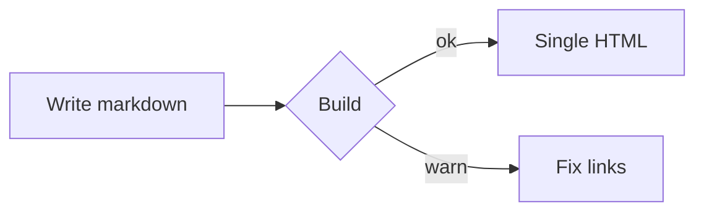

# Advanced syntax

Inline math $E = mc^2$ and $\sum_{i=1}^{n} x_i$, but prices like $5 and $10 stay text, and so does \$HOME.

$$
\int_0^\infty e^{-x^2}\,dx = \frac{\sqrt{\pi}}{2}
$$

```math
\begin{aligned} a &= b + c \\ d &= e \cdot f \end{aligned}
```

Emoji shortcodes: :rocket: :white_check_mark: :warning:, while times like 12:30:45 and `:code:` stay as is.



1. Install with pip:

   ```bash
   pip install markdown pygments  # optional highlight
   ```

2. Then run it:
   ```python
   import subprocess
   subprocess.run(["python3", "build_docs_site.py", "--docs", "docs"], check=True)
   ```
