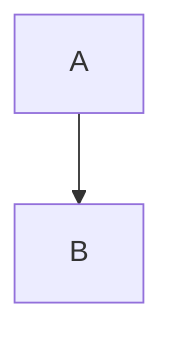
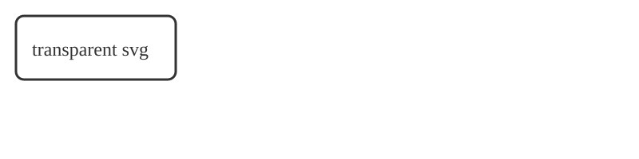

Usage
-----

## Configuration

```python
def main(argv: list[str]) -> int:
    """Entry point."""
    return 0  # ok
```

| Option | Default | Description |
| --- | --- | --- |
| `--verbose` | false | Print more |



See [the API](../api/reference.md#functions) and [missing](./nope.md) and [source](../../src/main.py).


