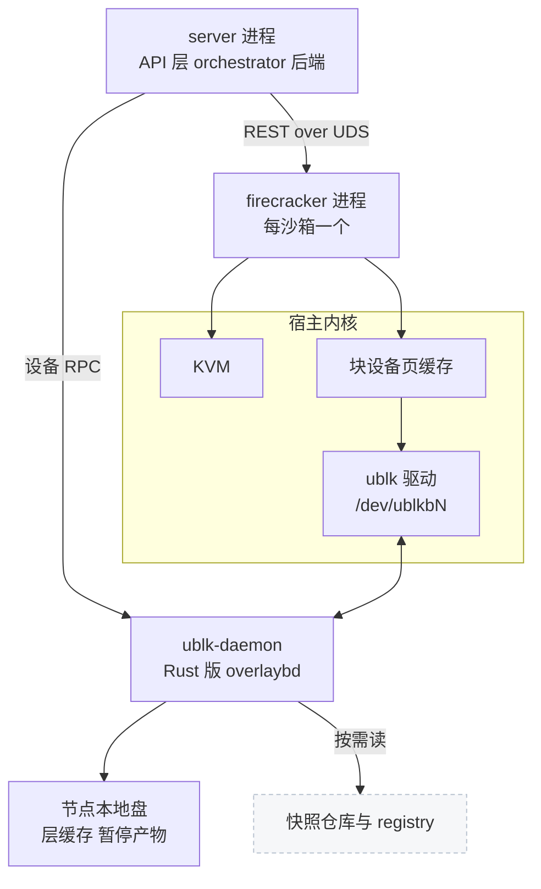
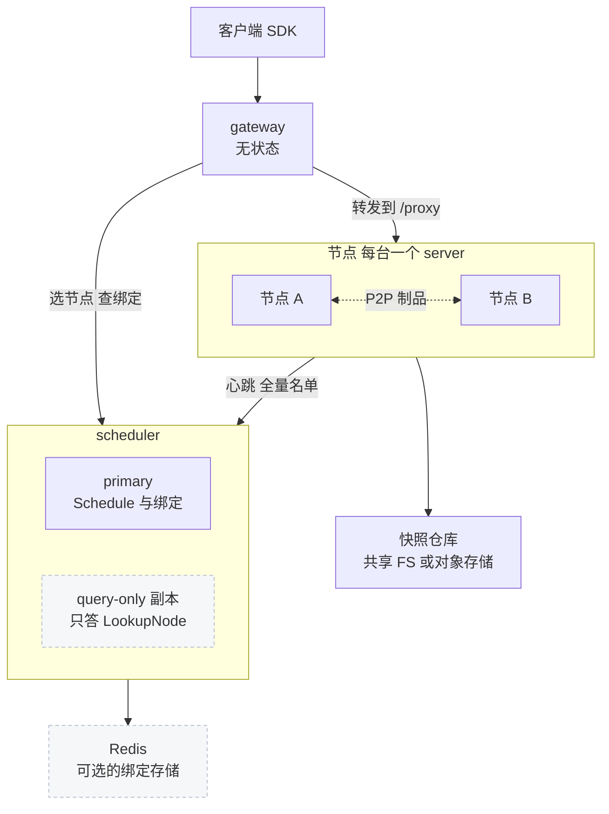

# 00 · 全书导读与 AgentENV 总览

> 这一篇用一次阅读的篇幅讲完 AgentENV 的全貌：它为什么存在、一台节点和一个集群由什么组成、一台沙箱从创建到删除经过哪些部件、
> 全书怎样按三条主线组织，以及它和 e2b infra 的关系。每一处都只给结论和去处，细节在后面的专篇里。
>
> **读者**：评审与决策者、第一天到岗的工程师、想先看全貌的所有读者。　**预备**：无。
> **代码**：`README.md`、`src/bin/server.rs`、`src/orchestrator/service.rs`、`src/sandbox/firecracker/sandbox.rs`、`storage/ublk-daemon/`、`services/gateway/`、`services/scheduler/`

---

## 0. 本篇要回答的问题

1. AgentENV 要解决什么问题？它的四个设计目标各靠什么机制实现，各付出什么代价？
2. 一台节点上有哪几类进程？内存和磁盘的数据经过哪些内核与用户态部件？
3. 多节点时多出哪些组件，它们各保存什么状态？
4. 一台沙箱从创建、运行、暂停、恢复到删除，每一步在哪个模块发生？
5. 全书按哪三条主线组织？不同背景的读者从哪里读起？
6. AgentENV 与 e2b infra 是什么关系，主要的实现差别在哪里？

---

## 1. AgentENV 是什么

AgentENV（kvcache-ai/AgentENV，本书基线 tag `v0.2.3`）是一个为 agentic RL 训练大规模运行 agent 环境的沙箱平台。
每个环境是一台 Firecracker microVM，对外提供 E2B 兼容的 HTTP API，现有的 E2B SDK 把 `E2B_API_URL` 指过来就能使用（兼容的范围与偏差在[第 18 篇](18-e2b-compatibility.md)）。

它的负载有四个特点（[第 02 篇](02-why-agentenv.md)）：环境种类多，镜像无法预先铺到每台机器；大部分时间在等待模型输出；
需要从同一个状态分叉做并行探索；会长时间运行并逐渐偏离初始镜像。由此推出四条要求：镜像不预热、空闲即释放、
暂停与分叉的成本正比于改动量、长期运行时密度不衰减。

部署上，一台装了 `server` 的 Linux 主机就是一个完整的 AgentENV，不需要任何外部服务；
需要多台机器时，再加 Go 写的 gateway 与 scheduler（[第 54 篇](54-control-plane-overview.md)）。
节点代码是 Rust，存储栈是仓库的重心（[第 01 篇](01-repo-map-and-versions.md)）。

AgentENV 依赖的 Firecracker 不是上游版本，而是 **AENV 补丁版 Firecracker**（上游 v1.15.1 之上 7 个提交）。
AgentENV 用到其中四个补丁行为：可选的 `mem_file_path`、`GET /vm/dirty-memory-ranges`、从块设备 seek 取内存文件大小、drive 的 `direct` 选项
（[第 03 篇](03-firecracker-for-agentenv.md)、[第 67 篇](67-firecracker-patch-layer.md)）。没有这几个补丁，下文的内存快照方案无法成立。

---

## 2. 四个设计目标与它们的代价

| 目标 | 机制 | 代价 | 主要篇目 |
|---|---|---|---|
| 镜像多样性 | 镜像转成 overlaybd 层栈，经 ublk 暴露为块设备，按需用 Range GET 读远端片段；节点块缓存有界 | 冷读走网络；标准 OCI 镜像要先逐层转换 | 05、34–39、45 |
| 空闲便宜 | TTL 到期缺省暂停；暂停后不留任何进程，只剩本地目录与一条 RocksDB 记录 | 恢复后的缺页逐个回源；暂停的沙箱只能在原节点恢复 | 22、23、27 |
| 原生快照与 fork | 暂停只写脏页与可写层：脏页由补丁接口给出、直接读进新的内存层，rootfs 的 upper 原地封存；fork 共享封存的下层 | 依赖 AENV 补丁版 Firecracker；层栈要靠预算与 compact 控制高度；fork 限于同一节点 | 37、42、51 |
| 长期运行的密度 | 同一快照的沙箱共享一个只读内存设备与它的页缓存；balloon 的 free page reporting 配合 guest 内的 DAMON 把空闲页还给宿主 | 单个 ublk-daemon 是节点单点；对 guest 内核有要求；放弃大页 | 26、41、42 |

这张表是全书的骨架。第三条与第四条其实是同一个设计的两面：
恢复时，Firecracker 的 File 内存后端以 `MAP_PRIVATE` 映射一个只读的 `/dev/ublkbN`，读走宿主页缓存，写在宿主上 COW 成私有匿名页。
于是没写过的页在节点上只有一份，写过的页正好是下一次暂停要写出的脏页（[第 42 篇](42-memory-snapshot-over-ublk.md)；后一句是推论，依据见该篇）。
用 userfaultfd 的另一种做法与它的比较在[第 44 篇](44-uffd-alternative.md)。

---

## 3. 一台节点里有什么

一台节点只有三类进程：`server`、ublk-daemon、每台沙箱一个 `firecracker`（[第 08 篇](08-system-architecture.md)）。
下图按「用户态进程 — 宿主内核 — 存储」三层画出它们的关系，重点是块设备数据怎样流动：
Firecracker 经 virtio-blk 读写磁盘、经 mmap 映射内存设备；只读的 tools 盘与内存设备走块设备页缓存，可写盘以 `direct` 选项绕过它（[第 26 篇](26-sandbox-block-devices.md)）。
到达 `/dev/ublkbN` 的请求由内核 ublk 驱动以 io_uring 命令交给 ublk-daemon，
daemon 再从本地层文件或远端读出数据。

三类进程的分工按能力与故障域划分：

- **`server`** 是控制中心。API 层由 `src/api/openapi.yml` 生成骨架、手写实现（[第 12 篇](12-spec-driven-server.md)），同时承担节点内的反向代理；
  orchestrator 维护沙箱状态机（[第 19 篇](19-state-machine-and-concurrency.md)）；Firecracker 后端管一台 VM 的全部资源：网络槽位、块设备、MMDS、envd 客户端（[第 25 篇](25-backend-and-firecracker-process.md)）。
- **ublk-daemon** 集中持有节点上全部 ublk 设备，是唯一持有 `CAP_SYS_ADMIN` 的子进程；Rust 版 overlaybd 在它的 queue 线程里执行读写（[第 40 篇](40-ublk-library.md)、[第 41 篇](41-ublk-daemon.md)）。
  共享设备去重、预热池与下载限流都依赖「所有设备在同一进程」，代价是单点：它退出后不会被重新拉起。
- **`firecracker`** 在沙箱自己的 netns 里由短命线程 spawn，spawn 前清空能力集（[第 25 篇 §4.2](25-backend-and-firecracker-process.md#42-进入-netns-并清空能力)）。
  这只在 `server` 以非 root 运行时成立：以 root 运行（Compose 与 DaemonSet 的特权容器）时，exec 会从 bounding 集重新授予能力（[第 59 篇](59-host-setup-and-privileges.md)）。
  它不用 jailer，与 `server` 同 uid，这是最主要的隔离缺口（[第 25 篇 §5](25-backend-and-firecracker-process.md#5-不用-jailer哪些隔离有哪些没有)）。

guest 看到的块设备顺序固定：`/dev/vda` 是只读的 tools 盘（带 envd 与 init），`/dev/vdb` 是用户 rootfs，`/dev/vdc` 起是附加盘与预留的卷槽位；
内存设备不是 virtio-blk，而是 File 后端 mmap 的对象（[第 26 篇](26-sandbox-block-devices.md)）。
每台沙箱的网络是一个 netns 加 tap、veth 与命名空间内的 iptables，guest 地址各槽位相同，快照因此能在任意槽位恢复（[第 29 篇](29-network-slots.md)）。

---

## 4. 多节点：加一层控制面

多节点时节点 API 不变，只多一个主动调用 scheduler 的 gRPC 客户端；scheduler 完全被动，从不调用节点（[第 54 篇](54-control-plane-overview.md)）。

- **gateway** 按 host、路径、路由头的固定顺序判定一个请求该去哪台节点：新建经 primary 的 `Schedule()`，其余按已有沙箱路由的请求经 `LookupNode`；
  数据面请求统一改写成节点的 `/proxy` 加路由头（[第 55 篇](55-gateway.md)）。它不重试，节点的 5xx 原样透传。
- **scheduler** 做放置与绑定（[第 56 篇](56-scheduler.md)）。放置是阈值过滤加 round-robin 或 random；绑定（sandbox → node）的真相源是节点心跳里的完整名单，
  `binding_ttl` 到期让停止心跳的节点自动消失。绑定可以放进 Redis，再起只回答 `LookupNode` 的 query-only 副本；节点表、观测快照与 CPU 交集只在 primary 内存里。
- **心跳**是电平触发的全量同步，下行方向只捎带一份全集群 CPU 特性的交集，供跨节点恢复快照使用（[第 57 篇](57-heartbeat-and-cpu-intersection.md)）。
- **P2P** 让节点之间直接交换制品，是可以整个清空的加速层，源头永远是权威（[第 58 篇](58-p2p-artifact-transport.md)）。

状态的归属是理解多节点行为的关键（[第 08 篇 §5](08-system-architecture.md#5-存储拓扑什么是真相)）：已提交快照、模板与卷在快照仓库里，不随节点丢失；
暂停的沙箱写在节点本地，只能在原节点恢复；运行中的沙箱只在优雅关闭时被逐个暂停落盘。

---

## 5. 一个沙箱的一生

这一节是[第 09 篇](09-sandbox-lifecycle-walkthrough.md)的压缩版。贯穿全程的事实是：**从模板创建就是一次快照恢复**。
模板是一份已提交的快照（[第 46 篇](46-snapshot-object-model.md)），创建沙箱等于在新的 netns、新的 ublk 设备上把它恢复出来，再换上新身份。

**创建。** `POST /v2/sandboxes` 由 `src/api/impls/sandbox.rs` 处理：`SnapshotManager::load_runnable()` 把模板记录解析成节点本地可打开的制品（[第 49 篇](49-resolve-and-artifact-cache.md)），
再调 `Orchestrator::create_sandbox()`。之后进入创建与恢复共用的 `launch_sandbox()`（[第 20 篇](20-launch-plan-and-rollback.md)），顺序是**先拉起 VM，再写状态**：

1. 后端 `start_resume()` 从预热池取一个「网络槽位 + 未配置的 Firecracker 进程 + 工作目录」三元组（[第 32 篇](32-warm-pools.md)）。
2. 向 ublk-daemon 申请 rootfs 设备：模板的层作 lower，加一层新的可写 upper；`get_or_create_shared_mem()` 取同一内存镜像共用的只读内存设备。
3. `PUT /snapshot/load` 以 File 后端加载 `/dev/ublkbN`，重写 MMDS，置为 Resumed（[第 27 篇](27-start-pause-resume-sequences.md)）。
4. store 里出现 Creating 记录；等 envd `/health` 通过后发 `/init`，换入令牌、环境变量与当前时间（[第 28 篇](28-mmds-and-envd.md)）。
5. CAS 到 Running、开始计 TTL，然后发布代理路由。从这一刻起沙箱才接数据面流量。

**运行。** 数据面请求经反向代理送进 guest（[第 17 篇](17-reverse-proxy.md)）；rootfs 的写落在 upper 里（[第 36 篇](36-read-write-paths-and-rw-layouts.md)）；
回收任务每秒检查一次 TTL，到期按 `autoPause` 暂停或删除，缺省是暂停（[第 23 篇](23-auto-eviction-and-ttl.md)）。代理流量不续期 TTL。

**暂停。** 先 CAS 到 Pausing、摘下路由，再由 `pause_to_dir()` 依次：sync 可写卷、`PATCH /vm` 置 Paused、
只写 vm_state 的 Diff 快照、`GET /vm/dirty-memory-ranges` 取脏页区间、`process_vm_readv` 把脏页读成一层新的内存层、
restack rootfs 与附加盘（[第 37 篇](37-seal-restack-compact.md)、[第 42 篇](42-memory-snapshot-over-ublk.md)）。
记录写进本地 RocksDB 后 Firecracker 进程被停掉。内存写入量正比于脏页数，磁盘写入量正比于 upper 大小。

**恢复。** CAS 到 Resuming，把持久记录也标为 Resuming，再走同一条 `launch_sandbox()`；内存设备换成刚写下的层栈。
成功后只删记录、保留产物目录，因为新 VM 仍在读那些层（[第 22 篇](22-persistence-across-restarts.md)）。

**删除。** 分 Capture、Stop、Release 三段并保存进度：挂了卷的沙箱先在 guest 内冻结并封存卷，再停 VM、释放资源（[第 21 篇](21-deletion-and-volume-capture.md)）。
卷的捕获只做一次，失败后的下一次删除从断点续做。

另有两条路径。从 OCI 镜像冷启动走 `start_fresh()`，从头启动 guest 内核（[第 45 篇](45-oci-to-overlaybd.md)）；
模板由 builder VM 冷启动或从基础模板恢复、执行构建步骤、一次捕获后发布而来（[第 52 篇](52-template-builder.md)、[第 53 篇](53-buildkit-in-microvm.md)）。
fork 是一次本地捕获加 N 次并发恢复，不经过快照仓库（[第 51 篇](51-fork.md)）。

---

## 6. 三条主线

全书第三到第八部分沿三条主线展开。读任何一篇时，先问它在哪条线上。

| 主线 | 路径 | 关注点 | 篇目 |
|---|---|---|---|
| 控制面 | 客户端 → gateway → API 层 → orchestrator → 后端 → Firecracker 与 ublk-daemon | 状态机、并发、失败回滚、持久化、放置与绑定 | 12–16、19–27、31–33、54–57 |
| 数据面 | 客户端 → gateway → 节点反向代理 → netns → envd 或用户端口 | 寻址方式、鉴权、超时、自动恢复、出站策略 | 13、17、28–30、55 |
| 状态面 | guest 读写 → ublk → Rust 版 overlaybd 层栈 → 节点缓存 → 快照仓库 / registry / P2P | 格式、读写路径、封存与 compact、内存层、提交协议 | 34–53、58 |

三条线在两个地方交汇。一是 orchestrator 的状态转换：路由在 Running 之后发布、在 Pausing 时摘下，把控制面与数据面对齐（[第 19 篇](19-state-machine-and-concurrency.md)）。
二是暂停与快照：控制面发起，状态面完成，结果再由控制面持久化。

凭据也按线划分（[第 13 篇](13-authentication.md)）：API key 管控制面，`envdAccessToken` 管 secure 沙箱的 envd 端口，`trafficAccessToken` 管非公开沙箱的应用端口。
整个部署共用一把 API key，没有租户与 scope；这是「单信任域」假设的直接结果。

---

## 7. 与 e2b infra 的关系

AgentENV 与 e2b infra 服务同一套 SDK 契约：路径、字段名与数据面头别名沿用 E2B，两边 guest 里跑的是同一个 envd。
它们的实现路线在几处根本不同，每一处这里只给一句话：

- **进程与语言**：e2b infra 全部用 Go、按负载类型拆成多个服务与节点池；AgentENV 在节点上是 Rust 的 `server` 与 ublk-daemon，多节点时才加 Go 控制面（[第 65 篇 §2](65-vs-e2b-infra-architecture.md#2-进程结构与语言)）。
- **状态的真相**：e2b infra 的运行态在中心、暂停沙箱可以换节点恢复；AgentENV 的真相在节点，绑定由心跳对账，暂停沙箱只能原节点恢复（[第 65 篇 §3](65-vs-e2b-infra-architecture.md#3-控制面状态的真相与谁主动)）。
- **块设备**：e2b infra 用 NBD，AgentENV 用 ublk 加 Rust 版 overlaybd（[第 66 篇 §5](66-vs-e2b-infra-storage-and-memory.md#5-块设备nbd-与-ublk)）。
- **内存恢复**：e2b infra 用 userfaultfd 由每台沙箱的处理器回答缺页；AgentENV 用 File 后端映射共享只读块设备，缺页交给内核页缓存（[第 66 篇 §3](66-vs-e2b-infra-storage-and-memory.md#3-内存恢复uffd-与只读块设备)）。
- **增量产物**：e2b infra 把 diff 链压平成一张映射表；AgentENV 保留逐层索引，靠预算与 compact 控制栈高（[第 66 篇 §4](66-vs-e2b-infra-storage-and-memory.md#4-增量产物扁平映射表与层栈)）。

两边的差异大多源自三条假设：多租户还是单信任域、最小部署是一个集群还是一个进程、状态的真相在中心还是在节点（[第 65 篇](65-vs-e2b-infra-architecture.md)）。

---

## 8. 全书结构与阅读路径

全书十一个部分：导读（00–01）、预备知识（02–07）、总体架构（08–11）、API 层（12–18）、orchestrator（19–24）、沙箱运行时（25–33）、
存储（34–44）、镜像快照与模板（45–53）、分布式控制面（54–58）、部署与工程（59–64）、对照与延伸（65–68），外加附录（69–73）。
预备知识只讲本书用得到的部分：io_uring 与 ublk（[第 04 篇](04-io-uring-and-ublk.md)）、overlaybd（[第 05 篇](05-overlaybd-and-lazy-loading.md)）、
netns 与透明代理（[第 06 篇](06-netns-iptables-transparent-proxy.md)）、Rust 异步（[第 07 篇](07-rust-async-primer.md)）。

| 你是 | 建议路径 |
|---|---|
| 想先看个全貌 | **00 → 08 → 09** |
| 不熟悉 io_uring / ublk / overlaybd | **04 → 05**，然后 **34 → 36 → 40 → 41** |
| 要接手 AgentENV 代码的工程师 | **01 → 08 → 09 → 10**，然后 **19 → 20 → 25 → 27**，再按部补全 |
| 只关心快照与内存 | **03 → 27 → 37 → 42 → 43**，然后 **46 → 47 → 49 → 51** |
| 做存储层开发 | **04 → 05**，然后 **34 → 44** 全部，再读 **45** |
| 用 E2B SDK 接入 AgentENV | **12 → 13 → 14 → 17 → 18** |
| 做多节点部署与运维 | **54 → 58**，然后 **59 → 61** |
| 熟悉 e2b infra，想知道差在哪 | **65 → 66 → 67**，再按两篇里的链接回到正文 |
| 评审 / 决策者 | **00 → 02 → 65 → 66 → 68** |

评审者尤其应读[第 68 篇](68-known-issues-and-debt.md)：它汇总了各篇如实记下的技术债，例如 ublk-daemon 没有重启与恢复路径、
Firecracker 不用 jailer、`managed-layers/` 在两种仓库里都不回收、文档与代码在若干默认值上不一致。
查术语、代码位置、配置项与接口时用附录（[第 69 篇](69-glossary.md)、[第 70 篇](70-code-map.md)、[第 71 篇](71-config-env-ports-reference.md)、
[第 72 篇](72-api-reference.md)、[第 73 篇](73-artifacts-and-formats-reference.md)）。

---

## 9. 小结

- AgentENV 是为 agentic RL 大规模运行 agent 环境的 microVM 沙箱平台，对外 E2B 兼容；单节点自足，多节点加 Go 写的 gateway 与 scheduler。
- 四个设计目标分别落在 overlaybd 按需加载、暂停不留进程、脏页成层与 upper 封存、共享只读内存设备与页缓存上，每一项都有对应的代价。
- 内存快照方案依赖 AENV 补丁版 Firecracker 的四个补丁行为，不能在上游 Firecracker v1.15.1 上原样运行。
- 节点只有三类进程；ublk-daemon 集中持有全部块设备，换来共享与限流的简单，代价是节点单点。
- 从模板创建就是快照恢复；创建与恢复共用 `launch_sandbox()`，先拉起 VM 再写状态，Running 之后才接流量。
- 暂停的沙箱只是本地目录加一条记录，只能在原节点恢复；跨节点要先提交成快照。
- 全书按控制面、数据面、状态面三条主线展开，三者在状态转换与暂停快照处交汇。
- 与 e2b infra 共享 SDK 契约与 envd，在进程划分、状态归属、块设备、内存恢复与增量产物上走了不同的路。

---

## 延伸阅读 / 下一篇

- [第 02 篇 · agent 环境的规模问题与 AgentENV 的取舍](02-why-agentenv.md)：四个设计目标的来由。
- [第 08 篇 · 系统架构：单节点与多节点](08-system-architecture.md)：进程、子系统、存储拓扑与三种流量的完整版。
- [第 65 篇](65-vs-e2b-infra-architecture.md)、[第 66 篇](66-vs-e2b-infra-storage-and-memory.md)：与 e2b infra 的逐项对照。
- [e2b 服务端基础设施技术手册](../e2b-infra/README.md)：同一组问题的另一种实现。
- [Firecracker 技术手册](../firecracker/README.md)：本书不展开的 Firecracker 本身。
- 下一篇：[第 01 篇 · 仓库地图、版本与依赖](01-repo-map-and-versions.md)。
