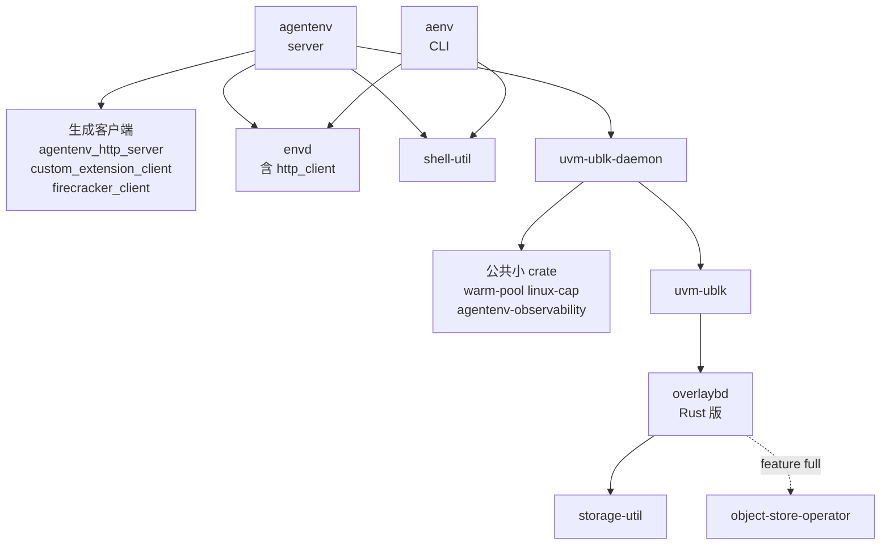

# 01 · 仓库地图、版本与依赖

> 这一篇给 AgentENV 仓库画一张地图：它从 v0.1.0 到 v0.2.3 经历了哪几个版本、v0.2.3 改了什么，
> 节点运行时依赖的 Firecracker、guest 内核、tools 盘与 overlaybd 工具从哪里来，Cargo workspace 与 Go module 怎样划分，哪些代码是生成的，
> 以及每个目录、每个 crate 管什么、有多大。读完它，读者在后面任何一篇里看到一个路径，都能知道它在全局中的位置。
>
> **读者**：要接手代码的工程师、想先了解仓库规模的评审者。　**预备**：无。
> **代码**：`Cargo.toml`、`config/deps_manifest.toml`、`build.rs`、`Makefile`、`cliff.toml`、`AGENTS.md`（即 `CLAUDE.md`）、`src/setup/deps.rs`、`git tag` / `git log` 输出

---

## 0. 本篇要回答的问题

1. AgentENV 发布过哪些版本，节奏如何？v0.2.3 相对 v0.2.2 改了哪几类东西？
2. 节点运行时依赖的外部二进制与镜像有哪些，版本写在哪里，从 v0.1.0 以来变过没有？
3. Cargo workspace 有哪些成员，它们之间怎样依赖？Go 代码放在哪里？
4. 仓库里哪些代码是生成的，规模多大，怎样再生成？
5. 每个顶层目录与 crate 的职责和行数是多少，本书在哪一篇讲它？
6. 一台节点上运行的进程分别来自仓库的哪一部分？从一个 API 请求追到块设备，要跨过哪几道接口边界？

---

## 1. 问题：一个仓库里的几种东西

第一次打开 AgentENV 仓库的读者会看到三种性质不同的东西混在一起。
第一种是节点运行时本身：Rust 写的 `server` 与 `uvm-ublk-daemon`，以及它们依赖的存储栈。
第二种是围绕它的周边：CLI、Go 写的多节点控制面、部署清单、测试脚本、文档站。
第三种是不在本仓库编译、却决定运行时行为的外部制品：AENV 补丁版 Firecracker、guest 内核、tools 盘镜像与 overlaybd 工具。

三者的变更节奏不同。运行时代码几乎每个版本都有大改动；外部制品的版本则钉在一个 manifest 里，很少变化。
读代码时如果分不清这三类，容易把一个外部二进制的行为当成仓库里的代码，或者在生成代码里花掉大量时间。
下面先讲版本，再讲外部依赖，然后是 workspace 与生成代码，最后给出目录地图与进程视角。
构建与发布的细节在[第 64 篇](64-build-codegen-release.md)，逐模块的代码地图在[第 70 篇](70-code-map.md)；本篇只讲全貌。

---

## 2. 版本历史

### 2.1 八个 tag

仓库到 v0.2.3 为止共有 230 个提交，打了八个 tag。v0.1.0 本身只有一个提交（`8f028b1`，「Initial open-source release」），
即开源时一次性导入的代码；之后大约每周发一个版本。下表的提交数与改动量用 `git rev-list --count` 与 `git diff --shortstat` 在相邻 tag 之间实测。

| 版本 | 日期 | 提交数 | 改动 | 主要内容（取自 `feat` / `perf` 提交标题） |
|---|---|---|---|---|
| v0.1.0 | 2026-07-25 | 1 | 初始导入 | 开源版本 |
| v0.1.1 | 2026-08-03 | 39 | 117 文件，+9374 −1961 | 快照 rootfs 导出工具 `aenv-snapshot-image`、ACR 加速层发现、CLI 文件上传下载 |
| v0.1.2 | 2026-08-10 | 30 | 131 文件，+9110 −5618 | PVM 部署、ARM64、静态二进制与 overlaybd 工具打包、可选脏页跟踪、内存快照 ZFile 压缩 |
| v0.1.3 | 2026-08-20 | 42 | 143 文件，+5768 −1461 | 脏页跟踪默认开启、单租户 API key、envd access token |
| v0.2.0 | 2026-09-03 | 52 | 192 文件，+18093 −2961 | 持久卷、转换层经 P2P 发布、secure 沙箱默认开启 |
| v0.2.1 | 2026-09-11 | 23 | 154 文件，+13418 −2541 | 托管 BuildKit worker 构建模板、发布时压缩层 |
| v0.2.2 | 2026-09-18 | 19 | 106 文件，+3512 −2482 | 可复现的 OCI tools 盘发布、DAMON reclaim 参数调整 |
| v0.2.3 | 2026-09-30 | 24 | 143 文件，+20085 −799 | 见 §2.2 |

v0.2.3 的 tag 是附注 tag（对象 `4890d5e`），指向提交 `6cccaa7842bd`。
仓库**没有 CHANGELOG 文件**。release notes 由 git-cliff 按 `cliff.toml` 在发布流水线里生成：
提交标题按 Conventional Commits 解析，`feat`、`fix`、`refactor`、`perf`、`docs` 分别进五个分组，`ci`、`chore`、`style`、`test`、`build` 被跳过。
所以 release notes 里看不到测试与依赖升级类提交；要了解一个版本的完整改动，只能读 `git log`。流水线本身见[第 64 篇](64-build-codegen-release.md)。

### 2.2 v0.2.3 的 24 个提交

`git log --oneline v0.2.2..v0.2.3` 的 24 个提交按主题可以分成六组。

| 组 | 提交 | 内容 | 本书位置 |
|---|---|---|---|
| startup pack（6） | `7eb9fc6`、`f0ea548`、`cd0c13c`、`599edb4`、`875faee`、`7e56ce8` | 录制首触页并与上传解耦的 startup manifest；resume 时并发预取；POSIX 仓库上的录制、解析与经共享内存设备预取；录制期间保留模板工作区；测试与文档 | [第 43 篇](43-startup-pack-and-prefetch.md) |
| E2B 兼容（3） | `187f654`、`7f19ffd`、`13cbf10` | E2B v2 的 sandbox create / connect；E2B 形的构建状态与日志；沙箱指标采集 API。三者都同时改了 gateway | [第 18 篇](18-e2b-compatibility.md)、[第 55 篇](55-gateway.md) |
| CLI（5） | `6aa185b`、`8a6594f`、`531a002`、`d660f5f`、`725810d` | 原生 Codex 沙箱会话及其文档；模板 / 快照名动态补全；build 帮助示例；HTTPS 下安装 rustls crypto provider | [第 62 篇](62-aenv-cli.md) |
| 存储与 P2P（3） | `8cd6793`、`04f8786`、`8ff079c` | 远端镜像 I/O 改派到独立的 remote-io runtime；seal 时只查 upper 索引；P2P 发布已提交的对象存储层 | [第 38 篇](38-virtualfile-chain-and-remote-io.md)、[第 37 篇](37-seal-restack-compact.md)、[第 58 篇](58-p2p-artifact-transport.md) |
| 新组件（1） | `5353143` | `containerd-plain-snapshotter/`：把宿主上现成的 rootfs 目录 bind-mount 给 containerd 当容器根的 proxy snapshotter 插件 | 本篇 §4.2 |
| 其它（6） | `59b36a4`、`2f48c9c`、`1f0c8a2`、`31e3c6f`、`9fd0651`、`6cccaa7` | boot args 加 `page_reporting.page_reporting_order=6`；缺省 readiness 改用内置 busybox；测试用对象存储镜像替换；两个 Go 依赖升级；版本号 | [第 03 篇](03-firecracker-for-agentenv.md)、[第 52 篇](52-template-builder.md) |

按改动量看，startup pack 一组（约 +8000 行）与 Codex 会话（约 +3000 行）占了大半；
存储侧的两处改动行数不多，但改变了 Rust 版 overlaybd 的线程模型与 seal 的开销结构。
`59b36a4` 只改了 `config/default.toml` 的 `[firecracker] boot_args` 与一篇调优文档，没有改 `src/sandbox/firecracker/config.rs` 里的 `DEFAULT_BOOT_ARGS`，
两者的不一致在[第 11 篇](11-configuration.md)讨论。
`d660f5f` 的标题以 `cli:` 开头，类型不在 `cliff.toml` 的任何规则里。

---

## 3. 外部依赖：`config/deps_manifest.toml`

### 3.1 manifest 的内容

节点运行时依赖的外部制品全部写在 `config/deps_manifest.toml` 里，每节给一个版本号与一个 URL 模板（`{version}`、`{arch}` 在运行时替换）。

| 节 | 版本 | 来源 | 用途 |
|---|---|---|---|
| `[firecracker.kvm]` | `1.15.1-patch-v1` | kvcache-ai/firecracker release `aenv-deps` | AENV 补丁版 Firecracker 与 `cpu-template-helper` |
| `[firecracker.pvm]` | `v1.17.0-next.1` | kvcache-ai/firecracker-next | PVM 模式下的 VMM（[第 61 篇](61-pvm.md)） |
| `[kernel.kvm]` | `vmlinux-6.1.175` | 同上 `aenv-deps` release | KVM 模式的 guest 内核 |
| `[kernel.pvm]` | `6.12.33-pvm` | kvcache-ai/linux | PVM guest 内核 |
| `[tools]` | `0.1.1` | `ghcr.io/kvcache-ai/agentenv-tools` | guest 的 `/dev/vda` 工具盘（envd、busybox、`/init`） |
| `[overlaybd]` | `v1.0.18-aenv.1` | kvcache-ai/overlaybd release `static-…` | overlaybd 工具（`overlaybd-create/apply/commit/resize`） |
| `[regclient]` | `v0.11.5` | regclient/regclient | `regctl`，镜像拉取等 registry 访问（发布路径另用进程内的 `AcrClient`，[第 50 篇](50-rootfs-as-oci-image.md)） |
| `[protoc]` | `33.4` | protocolbuffers/protobuf | 只给开发与 CI 用（`adev`），节点不读 |

另有 `[packages.runtime]` 与 `[packages.runtime_commands]` 两节列出宿主要装的发行版软件包（`iptables`、`e2fsprogs`、`umoci`、`zstd` 等）。
这两节的注释写明 `deploy/docker/Dockerfile.agentenv` 已不再解析 manifest，镜像里的包列表是硬编码的，需要手工保持同步。

这个文件不是运行时读的配置。`src/cfg.rs` 的 `SetupDependencyManifest::get()`、`src/setup/deps.rs` 的 `bundled_manifest()`
与 `src/setup/packages.rs` 都用 `include_str!` 把它**编进二进制**；`adev/src/config.rs` 则在开发机上从文件读取其中的 `[protoc]` 节。
换版本因此有两条路：改 manifest 后重新编译，或在节点配置里用 `[firecracker] version` / `url` / `binary_path`、`[kernel] version` / `url` / `image_path` 覆盖。
下载、按版本分目录与「文件存在即已安装」的判定由 `src/setup/deps.rs` 的 `ensure()` 完成，在[第 59 篇 §3.1](59-host-setup-and-privileges.md#31-manifest编进二进制的版本表) 展开。

### 3.2 变过什么，没变什么

`git log -- config/deps_manifest.toml` 显示这个文件到 v0.2.3 只被修改过五次：初始导入（`8f028b1`）、PVM 支持（`12825e4`）、ARM64（`8b29280`）、
静态二进制与 overlaybd 工具打包（`19c8bd3`）、tools 升到 0.1.1（`f58d55e`）。逐个 tag 取出 manifest 比较的结果是：

- `[firecracker.kvm]` 的 `1.15.1-patch-v1` 与 `[kernel.kvm]` 的 `vmlinux-6.1.175` 从 v0.1.0 到 v0.2.3 **没有变过**；
- PVM 两节从 v0.1.2 起出现，之后也没有变；
- overlaybd 工具在 v0.1.2 从上游版本号 `v1.0.18` 换成 kvcache-ai 分叉的 `v1.0.18-aenv.1`；
- tools 盘在 v0.2.2 从 `0.1.0` 升到 `0.1.1`；regctl 始终是 `v0.11.5`。

这意味着全书讲到的 Firecracker 行为在整个版本历史上是同一个二进制，也就是 kvcache-ai/firecracker 的 tag `aenv-deps`：
上游 Firecracker v1.15.1 之上 7 个提交，它们加了什么在[第 67 篇](67-firecracker-patch-layer.md)。
guest 内核同样是一个从 release 下载的预编译 `vmlinux`，两个仓库里都没有它专属的内核配置（[第 67 篇](67-firecracker-patch-layer.md)）。
kvcache-ai/firecracker 还有更新的补丁分支，但 v0.2.3 的 manifest 不引用它们。

---

## 4. Cargo workspace 与 Go module

### 4.1 19 个成员

根 `Cargo.toml` 的 `[workspace] members` 列出 19 个成员，`[workspace.package] version = "0.2.3"`。
只有根包 `agentenv` 与 CLI `aenv` 用 `version.workspace = true` 跟随版本号，其余成员写死 `0.1.0`，`thirdparty/firecracker-client` 写 `1.15.1`。
`cargo metadata --no-deps` 报告的 workspace 成员是 20 个：多出的 `http_client`（`thirdparty/envd/http-client`）没有列在 `members` 里，
它作为 `envd` 的路径依赖、又位于 workspace 目录之下，被 cargo 自动纳入。

产出二进制的包有五个：`agentenv`（`server` 与 `aenv-snapshot-image`）、`uvm-ublk-daemon`、`uvm-ublk`（一个单独创建 / 删除 ublk 设备的调试工具）、`aenv`、`adev`。
`storage/uffd-core` 有自己的 `Cargo.toml`，但**不在** workspace 里，也没有任何成员依赖它；`AGENTS.md` 称它为 reference-only。
它是 uffd 内存后端的保留实现，与块设备 File 后端的比较在[第 44 篇](44-uffd-alternative.md)。

下图是运行时依赖（不含 dev-dependencies）的主干。为了可读，图把三个生成客户端、三个公共小 crate 各画成一个节点；`agentenv` 其实也直接依赖 `uvm-ublk`、`overlaybd`、`storage-util`、`object-store-operator` 与公共小 crate，图里只画经 daemon 的那一条；
测试与工具类成员（`adev`、`agentenv-benchmarks`、`agentenv-e2e-tests`、`agentenv-test-support`）不画。

几处依赖值得注意。`agentenv` 依赖 `uvm-ublk-daemon` crate，是为了用其中的 `UblkDaemonClient` 与 RPC 协议类型，不是把 daemon 链接进 `server` 进程；
daemon 仍是 `server` 启动时拉起的独立进程（[第 08 篇 §2](08-system-architecture.md#2-单节点三类进程)）。
`overlaybd` 的缺省 feature `full` 带上 `object-store-operator` 与 HTTP 客户端，远端层读写由此而来；`io-uring` feature 由 `uvm-ublk` 与 daemon 打开。
CLI `aenv` 只依赖 `envd` 与 `shell-util`，不依赖 `agentenv`：它经 HTTP 与 envd 协议和节点交互，可以独立编译到 macOS。

### 4.2 Go：两个独立 module

Go 代码在两个互不相关的 module 里。`services/`（module `agentenv/services`，`go 1.25.0`）包含 gateway、scheduler 与它们共享的 `shared/`，以及 proto 契约 `api/proto/scheduler.proto`；
它有自己的 `services/Makefile`，根 `Makefile` 的 `services-%`、`gateway-%`、`scheduler-%` 目标只是转发。
v0.2.3 新增的 `containerd-plain-snapshotter/` 是另一个 module，模块路径不在本仓库的命名空间下，也没有被任何构建、部署脚本或 Rust 代码引用。
推论：它是一个随仓库发布的独立工具，不属于节点运行时。

---

## 5. 生成代码

仓库入库了五份生成代码，合计约 2.7 万行。它们的来源才是讲行为时应当引用的东西。

| 生成产物 | 来源 | 行数 | 再生成 |
|---|---|---|---|
| `src/api/generated`（crate `agentenv_http_server`） | `src/api/openapi.yml` | Rust 20539 | `make agentenv-server` |
| `thirdparty/firecracker-client` | 同目录 `firecracker.yaml` | Rust 2155 | `make firecracker-client` |
| `thirdparty/envd/http-client` | 同目录 `envd.yaml` | Rust 903 | `make envd-http-client` |
| `src/custom_extension_api/generated` | `src/custom_extension_api/openapi.yml` | Rust 621 | `make custom-extension-client` |
| `services/api/proto/*.pb.go` | `services/api/proto/scheduler.proto` | Go 3227 | `make -C services proto` |

前四项都由 `cargo adev codegen` 调用 openapi-generator 产生；Rust 侧的 gRPC 代码（scheduler 客户端、`src/image/content.proto` 等）由 `build.rs` 在每次构建时生成到 `OUT_DIR`，不入库。
`build.rs` 还把 `git rev-parse --short HEAD` 的结果以 `AENV_GIT_COMMIT` 编进二进制。
运行中的节点据此报告自己是哪个版本：`src/identity.rs` 的 `NodeIdentity::from_config()` 把这个提交号与 `CARGO_PKG_VERSION`（即 workspace 的 `0.2.3`）放进节点身份，供节点与管理 API 返回；编译时拿不到 git 信息（例如在没有 `.git` 的源码包里构建），提交号就退化为字符串 `unknown`。排查一台节点跑的是哪份代码时，先看这两个字段。生成器版本、后处理与 CI 缺少一致性检查等问题，见[第 64 篇 §3](64-build-codegen-release.md#3-生成代码)。

两个容易误读的地方。第一，`firecracker.yaml` 是**来源**而不是产物：它描述的是 AENV 补丁版 Firecracker 的 API（含补丁新增的端点），
但 client crate 的版本号仍写 `1.15.1`。第二，生成的 Firecracker client 只提供 model 类型；真正发 HTTP 请求的是手写的 `src/sandbox/firecracker/instance.rs`（[第 25 篇](25-backend-and-firecracker-process.md)）。
`AGENTS.md` 的「Generated Code」表列出了同样的再生成命令，并要求改 schema 时把产物与 schema 一起提交。

---

## 6. 目录地图

下表的行数是 v0.2.3 上 `git ls-files` 所列文件的 `wc -l`，含注释、空行与测试，**不含**上一节的五份生成代码。
按这个口径，Rust 约 17.0 万行，Go 约 1.3 万行（其中 `services/` 的测试约 0.7 万）。
OUTLINE 规划时的「Rust 约 17.1 万」把 `thirdparty/envd/http-client` 算作手写代码，差别就在这 903 行。
`AGENTS.md` 的 Code Map 表按主题给出了同样的入口，下表是它的按目录展开。

### 6.1 节点运行时：根 crate `agentenv` 的 `src/`

| 目录 | 行数 | 职责 | 本书位置 |
|---|---|---|---|
| `src/sandbox` | 20535 | 沙箱后端：Firecracker 进程与调用序列（`firecracker/` 9449）、网络槽位与出站代理（`network/` 5285）、ublk 设备客户端、envd 客户端、自定义扩展 | 第五部分（25–33） |
| `src/snapshot` | 18762 | 快照对象模型、仓库后端（`repository/` 13273）、本地制品缓存、startup pack、rootfs 导出 | 第七部分（46–51） |
| `src/api` | 14320 | 手写 API 实现（`impls/` 7963）、反向代理（`proxy.rs` 3198）、OpenAPI 规范 `openapi.yml`（2966） | 第三部分（12–18） |
| `src/orchestrator` | 12381 | 状态机、launch plan、删除、持久化、驱逐；约一半是测试 | 第四部分（19–24） |
| `src/image` | 10279 | OCI 镜像解析与转换、节点镜像缓存、BuildKit 适配 | [第 45 篇](45-oci-to-overlaybd.md)、[第 53 篇](53-buildkit-in-microvm.md) |
| `src` 根级文件 | 5075 | `cfg.rs`（2199）、`volume.rs`（1279）、凭据与权限（`api_key.rs`、`managed_secret.rs`、`privileges.rs`）、`local_store.rs`、`identity.rs` | [第 11 篇](11-configuration.md)、[第 13 篇](13-authentication.md)、[第 31 篇](31-extra-drives-and-volumes.md) |
| `src/setup` | 3407 | 依赖下载、宿主准备、发行版包 | [第 59 篇](59-host-setup-and-privileges.md) |
| `src/template` | 3380 | 模板构建器 | [第 52 篇](52-template-builder.md) |
| `src/p2p` | 3320 | 基于 iroh 的制品 P2P 传输 | [第 58 篇](58-p2p-artifact-transport.md) |
| `src/overlaybd` | 1889 | 节点侧 overlaybd 配置与 P2P 接入 | [第 39 篇](39-block-cache-and-background-download.md)、[第 58 篇](58-p2p-artifact-transport.md) |
| `src/observability` | 1701 | 节点指标、心跳 reporter | [第 24 篇](24-metrics-and-events.md)、[第 57 篇](57-heartbeat-and-cpu-intersection.md) |
| `src/cfg`、`src/bin`、`src/types` | 1061 | 配置子模块；`server.rs` 与 `aenv-snapshot-image.rs` 两个入口；共享类型 | [第 10 篇](10-node-process-and-object-model.md)、[第 50 篇](50-rootfs-as-oci-image.md) |

### 6.2 存储栈与其它 crate

| 目录 | 行数 | 职责 | 本书位置 |
|---|---|---|---|
| `storage/overlaybd` | 43173 | Rust 版 overlaybd：LSMT（`lsmt/` 9723）、ZFile（`compression/` 3158）、后端与缓存（`backend/` 15326）、镜像层栈 | 第六部分（34–39） |
| `storage/ublk-daemon` | 6743 | ublk-daemon：设备所有权、RPC 服务、内存层与 restack | [第 41 篇](41-ublk-daemon.md) |
| `storage/ublk` | 4131 | ublk 控制面与数据面库 | [第 40 篇](40-ublk-library.md) |
| `storage/util` | 1869 | io_uring 封装、对齐缓冲区、mmap 区域 | [第 40 篇](40-ublk-library.md) |
| `storage/uffd-core` | 808 | uffd 内存后端的保留实现，不在 workspace | [第 44 篇](44-uffd-alternative.md) |
| `crates/aenv` | 10138 | `aenv` CLI | [第 62 篇](62-aenv-cli.md) |
| `crates/benchmarks`、`crates/e2e-tests`、`tests/` | 6870 | 基准、端到端测试、根 crate 集成测试 | [第 63 篇](63-testing-and-benchmarks.md) |
| `crates/` 其余五个 | 1687 | `object-store-operator`（S3 凭据与客户端）、`warm-pool`（水位维持的通用预热池）、`linux-cap`（能力委派）、`agentenv-observability`（指标格式）、`shell-util`；外加 `test-support` | [第 32 篇](32-warm-pools.md)、[第 59 篇](59-host-setup-and-privileges.md) |
| `thirdparty/envd` | 1002 | envd 的 Rust 客户端（Connect-RPC 部分手写，HTTP 部分生成） | [第 28 篇](28-mmds-and-envd.md) |
| `adev` | 1197 | 开发者工具：codegen、coverage、mutants | [第 64 篇](64-build-codegen-release.md) |

### 6.3 Go、部署与周边

| 目录 | 行数 | 职责 | 本书位置 |
|---|---|---|---|
| `services/gateway` | 6108 | 多节点入口：路由判定与反向代理（测试 3533） | [第 55 篇](55-gateway.md) |
| `services/scheduler` | 5419 | 放置、绑定与 HA（测试 2713） | [第 56 篇](56-scheduler.md) |
| `services/shared`、`services/api` | 1521 | 共享配置、日志、指标桶；`scheduler.proto` | [第 54 篇](54-control-plane-overview.md) |
| `containerd-plain-snapshotter` | 1042 | 独立的 containerd snapshotter 插件（Go 627） | 本篇 §4.2 |
| `deploy` | 1078 | Dockerfile、Compose、Kubernetes kustomize | [第 60 篇](60-deployment.md) |
| `scripts` | 7024 | 安装脚本、能力 runner、e2e shell 套件（`scripts/tests` 5317）、BuildKit 脚本与测试夹具 | [第 60 篇](60-deployment.md)、[第 63 篇](63-testing-and-benchmarks.md) |
| `tools-image` | 671 | guest 工具盘的构建源：从 e2b infra 编译 envd，加 busybox 与 `/init` | [第 64 篇](64-build-codegen-release.md) |
| `config` | 466 | `default.toml` 与 `deps_manifest.toml` | [第 11 篇](11-configuration.md)、本篇 §3 |
| `docs` | 7509 | mdBook 文档站；其中 `docs/src` 7239 行是正文源码（参考，不是依据） | [第 64 篇](64-build-codegen-release.md) |
| `.github` | 2296 | CI 与发布 workflow | [第 63 篇](63-testing-and-benchmarks.md)、[第 64 篇](64-build-codegen-release.md) |

从行数分布可以读出这个项目的重心：`storage/overlaybd` 一个 crate 就占 Rust 代码的四分之一，
加上 ublk 库、daemon 与 `storage/util`，存储栈约 5.6 万行，超过 `src/sandbox` 与 `src/orchestrator` 之和。
本书第六部分给存储 11 篇，依据就在这里。Go 控制面的生产代码只有约 0.6 万行，测试与之相当，它的复杂度主要在 HA 与失败处理，而不在代码量。

`AGENTS.md` 是指向 `CLAUDE.md` 的符号链接，两者是同一个文件。它面向编码代理与贡献者，除 Code Map 外还列出了「Constraints to Preserve」——
生命周期、存储、卷、P2P、scheduler 等方面不能破坏的不变量，读对应篇目时可以对照。
它的「Details by Topic」里有三个链接（`docs/src/concepts/snapshots.md`、`volumes.md`、`custom-extension.md`）指向不存在的文件，实际文档是同名目录下的 `index.md`。

---

## 7. 进程视角

把目录与进程对上，节点上运行的东西都能在仓库里找到出处：

| 进程 | 每节点数量 | 来自 | 入口 |
|---|---|---|---|
| `server` | 1 | 根 crate `agentenv` | `src/bin/server.rs` 的 `main()` |
| `uvm-ublk-daemon` | 1 | `storage/ublk-daemon` | `storage/ublk-daemon/src/main.rs`，由 `server` 拉起 |
| `firecracker` | 每沙箱 1 个，外加预热池 | 外部制品 `[firecracker.kvm]` | 由 `src/sandbox/firecracker/instance.rs` 拉起 |
| `overlaybd-create` 等 | 转换时短暂存在 | 外部制品 `[overlaybd]` | 由 `src/image` 与 `src/setup/overlaybd.rs` 调用 |
| `gateway`、`scheduler` | 仅多节点，独立部署 | `services/` | `services/gateway/cmd`、`services/scheduler/cmd` |

guest 里还有一个进程不来自本仓库的任何编译产物：tools 盘上的 envd，来自 e2b infra 的源码，经 `tools-image/` 打包成 `[tools]` 镜像。
AgentENV 只实现它的客户端（`thirdparty/envd`）。
三类节点进程之间怎样协作、为什么这样切分，在[第 08 篇](08-system-architecture.md)；`server` 的启动与关闭顺序在[第 10 篇](10-node-process-and-object-model.md)。

---

## 8. 读代码的路线：四道接口边界

目录地图回答「某个东西在哪」，读代码时更常见的问题是「一个行为从哪里开始、在哪里结束」。
节点运行时沿四道接口边界分层，每一道都有一个可以搜索的类型名，读者可以从上往下一层一层追。

1. **生成的 API trait。** `openapi.yml` 的每个 tag 生成一个 trait（`Sandboxes`、`Templates`、`Snapshots`、`Volumes`、`Admin` 等），
   手写的 `ApiImpl` 在 `src/api/impls/` 下逐个实现。例如 `POST /v2/sandboxes` 落在 `impls/sandbox.rs` 里 `impl Sandboxes<()> for ApiImpl` 的 `v2_sandboxes_post()`。
   这一层做参数校验、字段换算与错误映射，不持有沙箱状态（[第 12 篇](12-spec-driven-server.md)）。
2. **`Orchestrator`。** handler 调用 `Orchestrator::create_sandbox()` 这类方法。`Orchestrator` 是对三个 trait 泛型的结构体：
   元数据存储 `MetadataStore`、后端工厂 `SandboxBackendFactory`、持久化 `SandboxPersister`，缺省分别是 `InMemoryMetadataStore`、`FirecrackerSandboxFactory`、`FileBackedSandboxPersister`（`src/orchestrator/service.rs`）。
   状态机、并发控制与失败回滚都在这一层，它不直接接触 Firecracker（[第 19 篇](19-state-machine-and-concurrency.md)）。
3. **`SandboxBackend` trait。** `src/sandbox/backend.rs` 定义一台沙箱的生命周期操作：`start()`、`wait_for_ready()`、`pause()`、`resume()`、`snapshot()`、`fork()`、`stop()` 等。
   生产实现是 `src/sandbox/firecracker/sandbox.rs` 的 `FirecrackerSandbox`；`src/sandbox/mock.rs` 的 `MockSandboxBackend` 不起任何进程、立即完成所有操作，供 orchestrator 的单元测试使用。
   所以 `src/orchestrator/tests.rs` 里的用例验证的是状态机与回滚逻辑，而不是真实 VM 的行为（[第 25 篇 §2](25-backend-and-firecracker-process.md#2-回顾后端-trait-的约定)）。
4. **daemon RPC。** 后端需要块设备时经 `UblkDaemonClient` 向 ublk-daemon 发请求。协议在 `storage/ublk-daemon/src/protocol.rs`：
   `DaemonRequest` 与 `DaemonResponse` 两个枚举，以 4 字节大端长度前缀加 JSON 的形式在 Unix socket 上传输，单条消息上限 16 MiB（[第 41 篇 §3](41-ublk-daemon.md#3-rpc-协议)）。
   再往下就是 `storage/ublk` 与 Rust 版 overlaybd 的库代码，不再有进程边界。

这种分层的收益是每一层只需要理解下一层的接口：读 orchestrator 不必懂 Firecracker 的 REST 序列，读后端不必懂 LSMT 索引。
代价是同一个概念在不同层各有一套类型，例如 API 层的 `models::SandboxState` 由 orchestrator 的 `SandboxState` 经 `From` 转换而来，
暂停后的后端状态又是另一个 trait 对象 `PausedSandboxState`。追一个字段时要留意转换发生在哪一层，错误码的映射也集中在这些转换上。

## 9. 小结

- AgentENV 从 v0.1.0（2026-07-25，单个导入提交）到 v0.2.3（2026-09-30）共八个 tag、230 个提交，约每周一版；没有 CHANGELOG，release notes 由 git-cliff 生成并跳过 test / chore 类提交。
- v0.2.3 的 24 个提交里，startup pack 与 CLI 的 Codex 会话占了大部分改动量；E2B v2 兼容的三个提交同时改了 gateway。
- 外部制品的版本钉在 `config/deps_manifest.toml`，并经 `include_str!` 编进二进制；AENV 补丁版 Firecracker `1.15.1-patch-v1` 与内核 `vmlinux-6.1.175` 在整个版本历史上没有变过。
- Cargo workspace 列 19 个成员，cargo 实际纳入 20 个（`thirdparty/envd/http-client` 被自动包含）；`storage/uffd-core` 不在 workspace。
- Go 代码分属 `services/` 与 `containerd-plain-snapshotter/` 两个独立 module，后者不被任何构建与部署引用。
- 入库的生成代码约 2.7 万行，讲行为时引用它们的来源：`openapi.yml`、`firecracker.yaml`、`envd.yaml`、`scheduler.proto`。
- 不含生成代码，Rust 约 17.0 万行、Go 约 1.3 万行；存储栈约 5.6 万行，是仓库的重心。
- 节点进程中 `server` 与 ublk-daemon 来自本仓库，Firecracker、overlaybd 工具与 guest 内的 envd 都是外部制品。
- 读代码沿四道边界：生成的 API trait 与 `ApiImpl`、`Orchestrator`、`SandboxBackend`、daemon RPC；orchestrator 的单元测试跑在 mock 后端上。

## 延伸阅读 / 下一篇

- 下一篇：[第 02 篇 · agent 环境的规模问题与 AgentENV 的取舍](02-why-agentenv.md)。
- 构建、代码生成与发布：[第 64 篇](64-build-codegen-release.md)；依赖下载与宿主准备：[第 59 篇](59-host-setup-and-privileges.md)。
- 逐模块的代码地图：[第 70 篇](70-code-map.md)；AENV 补丁版 Firecracker 的 7 个提交：[第 67 篇](67-firecracker-patch-layer.md)。
- 系统架构与三类进程：[第 08 篇](08-system-architecture.md)。
