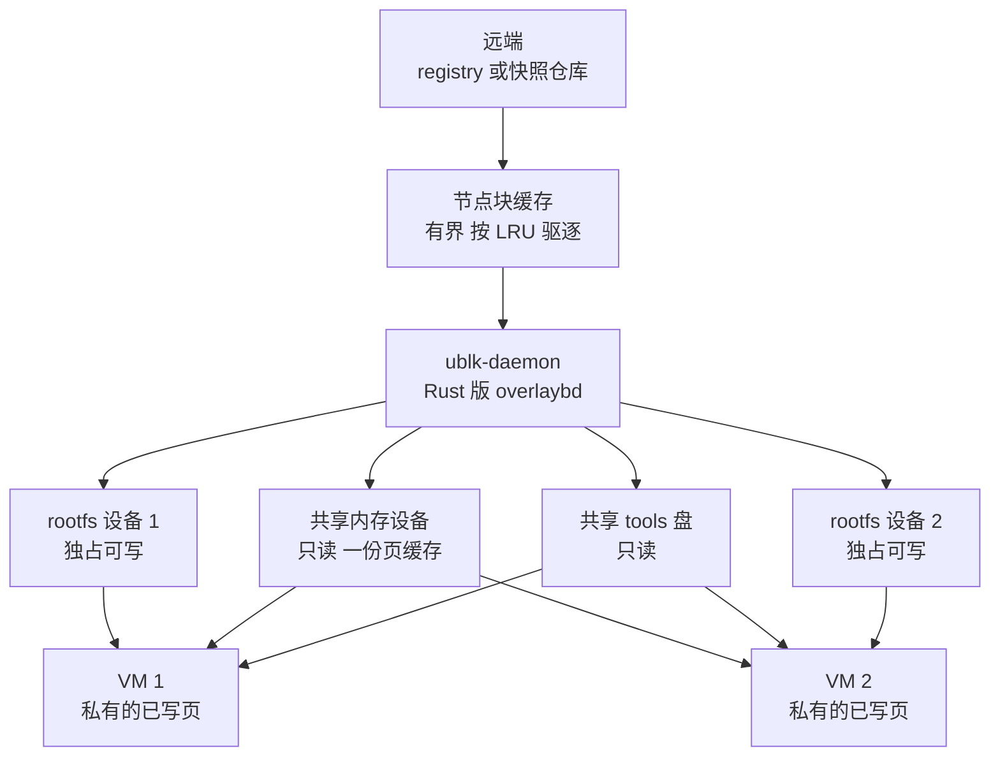

# 02 · agent 环境的规模问题与 AgentENV 的取舍

> 训练一个会用工具的模型，要同时开很多个各不相同的 Linux 环境，让模型在里面敲命令、改文件、跑测试。
> 本篇从这个负载出发推出四条要求，再说明 AgentENV 用哪些机制满足它们、每个机制把代价放在了哪里。
> 后面六十多篇讲的都是这些机制的细节；这里只给出它们之间的因果关系。
>
> **读者**：所有读者。　**预备**：无。　**代码**：`README.md`、`docs/src/concepts/overview.md`、`src/api/impls/sandbox.rs`、`src/orchestrator/service.rs`、`src/sandbox/firecracker/sandbox.rs`、`src/sandbox/firecracker/instance.rs`、`src/sandbox/ublk/device.rs`、`storage/overlaybd/src/backend/cache/full_file_cache/cache_pool.rs`

---

## 0. 本篇要回答的问题

1. agentic RL 训练对「运行环境」提出了什么样的负载，它和一次性的代码执行服务有什么不同？
2. 这种负载为什么可以归结成四条要求：镜像不预热、空闲即释放、暂停与分叉的成本正比于改动量、长期运行密度不衰减？
3. AgentENV 分别用哪些机制满足这四条要求，每个机制的代价落在哪里？
4. 隔离单位为什么是 microVM，而不是容器？
5. 这些取舍在本书的哪几篇展开？

---

## 1. 问题：训练循环里的环境

agentic RL（强化学习训练会使用工具的 agent）的一条轨迹（rollout）是这样展开的：
模型读到任务描述，生成一个动作（一条 shell 命令、一次文件编辑），环境执行这个动作并返回输出，模型据此生成下一个动作，
如此往复几十到几百步，最后由测试脚本或评分器给出奖励。环境必须是一台「真的」Linux：
动作的效果只有执行了才知道，奖励也往往来自在环境里跑一遍测试。

这个负载有四个特点，它们一起决定了平台的形状。

**环境各不相同。** 每个任务通常带着自己的镜像：某个代码仓库在某个提交上的完整依赖、某个版本的编译器、一份预置的数据。
本书不引用 README 里的规模数字，只取它的定性含义：镜像的种类远多于节点数，也远多于一台节点的磁盘能装下的数量。

**环境大部分时间在等。** 一步之中，环境执行命令的时间通常很短，等模型生成下一个动作的时间要长得多。
推论：一台环境的生命期里，真正占用 CPU 的时间只是一小部分，其余时间它只占着内存和设备。

**环境要能分叉。** 并行采样与树搜索都需要从同一个中间状态出发走出多条不同的路：
在第 30 步把环境复制成 8 份，每份尝试一个不同的动作。复制的必须是完整状态 —— 内存里的进程、打开的文件、写到一半的磁盘。

**环境会跑很久。** 一条长轨迹可能持续数小时，期间环境不断安装软件包、生成文件、读写缓存，和它出发时的镜像越来越不一样。

---

## 2. 四条要求

把上面四个特点和「节点数有限」这个约束放在一起，可以推出四条要求。每条都先说不这么做会怎样。

**要求一：镜像不能预热到每台机器。** 如果每个环境启动前都要把镜像完整下载并解包，启动时间就正比于镜像大小；
如果事先把所有镜像铺到每台节点，存储量是「镜像数 × 节点数」，磁盘装不下，铺的过程本身也追不上镜像的更新。
所以镜像必须按需读：环境只为它实际读到的数据付网络与磁盘的代价，本地磁盘只当作一个有界的缓存。

**要求二：空闲环境要能迅速交还 CPU 与内存。** 一台运行中的 microVM 即使什么都不做，guest 内存也一直占着宿主的物理页。
如果环境大部分时间在等，那么节点的容量就被这些等待中的环境吃掉了。所以空闲的环境要能被暂停到磁盘上、不留下任何进程，需要时再快速恢复。

**要求三：暂停与分叉的成本要正比于改动量。** 如果暂停意味着把整个内存与整个磁盘写出去，单次暂停的代价就正比于环境的规模，
跑了两条命令的环境和跑了一小时的环境一样贵；分叉 8 份就是复制 8 份。所以产物必须是增量：只写出上一次之后变了的那部分，并且让多个副本共享没变的部分。

**要求四：长期运行时密度不能衰减。** 同一模板启动的环境刚开始时内容几乎相同，宿主可以只存一份；
但随着它们各自运行，私有的部分越来越多。guest 内核还倾向于把空闲内存用作页缓存、从不主动归还。
如果不处理，一台节点能容纳的环境数会随运行时间下降。所以要尽量共享相同的数据，并把 guest 不再需要的内存还给宿主。

---

## 3. 机制与代价

下表是全书的骨架。每一行的机制在后面某几篇里展开；这里关心的是第三列 —— 每个机制都把代价转移到了别处，而不是消除了它。

| 要求 | AgentENV 的机制 | 代价 | 详讲 |
|---|---|---|---|
| 镜像不预热 | 镜像转成 overlaybd 层栈，经 ublk 暴露为块设备，缺块时从远端按需读；节点块缓存有界、按 LRU 驱逐 | 冷读走网络并阻塞 vCPU；标准 OCI 镜像要先转换；缓存命中率决定启动快慢 | 05、38、39、45 |
| 空闲即释放 | TTL 到期缺省暂停；暂停后不留进程，只剩本地目录与一条记录；恢复时内存从内存层按需读入 | 恢复后的首批缺页逐个回源；暂停的沙箱只能在原节点恢复 | 09、23、27、42、43 |
| 成本正比于改动量 | 内存：只读脏页写成一层新的内存层；磁盘：把可写层封存成新的只读层；分叉共享封存的下层 | 依赖 AENV 补丁版 Firecracker；层栈变深后要压实；分叉只能在同一节点 | 37、42、51、67 |
| 密度不衰减 | 同一快照的沙箱共享一个只读内存设备与它的页缓存；可写盘绕开宿主页缓存；balloon free page reporting 与 guest 内 DAMON 回收 | 全节点的设备由一个 ublk-daemon 服务；guest 内核必须支持 DAMON reclaim 与 page reporting | 26、41、42、03 |

### 3.1 镜像：按需读的块设备

AgentENV 不把镜像解包成目录，而是把它表示成 overlaybd 层栈：每一层是一个块级的 LSMT 文件，多层叠起来是一块虚拟磁盘
（格式在[第 05 篇](05-overlaybd-and-lazy-loading.md)与[第 34 篇](34-lsmt-format-and-index.md)）。
这块磁盘由节点上的 ublk-daemon 经内核 ublk 驱动暴露成 `/dev/ublkbN`，再作为 virtio-blk 设备交给 Firecracker。
guest 读到一个本地还没有的块时，ublk-daemon 里的 Rust 版 overlaybd 向 registry 或快照仓库发一次范围读（[第 38 篇](38-virtualfile-chain-and-remote-io.md)）。

读回的数据落进节点块缓存。缓存有容量上限：`storage/overlaybd/src/backend/cache/full_file_cache/cache_pool.rs` 的 `calc_water_mark()` 由容量算出水位，
越过水位时 `evictable_cache_ids_by_lru()` 按最近使用顺序挑出可驱逐的条目（[第 39 篇](39-block-cache-and-background-download.md)）。
于是一台节点能「装下」的镜像总量不受本地磁盘限制，本地只保留热数据。

代价落在第一次读上。缓存未命中时，guest 的这次块读要等一次网络往返，期间发出读请求的 vCPU 在等 I/O。
后台下载会在环境就绪后把整层拉到本地，但它不能和前台的缺块读抢带宽（[第 39 篇 §6](39-block-cache-and-background-download.md#6-前台与后台的准入)）。
标准 OCI 镜像（按层 tar 存放）还要先转换成 overlaybd 层（[第 45 篇](45-oci-to-overlaybd.md)），冷启动路径上这一步是同步的（[第 14 篇](14-sandbox-api.md)）。

### 3.2 空闲：暂停到磁盘，不留进程

每台沙箱带一个 TTL，到期动作由 `timeout_action` 决定。v1 创建与冷启动的 handler（`src/api/impls/sandbox.rs` 的 `sandboxes_post()`、`sandboxes_cold_post()`）
把 `autoPause` 缺省映射为 `SandboxTimeoutAction::Pause`，只有显式传 `false` 才是删除；
后台任务 `src/orchestrator/service.rs` 的 `evict_expired_sandboxes()` 周期地认领到期的 Running 沙箱，按 `timeout_action` 暂停或删除它（[第 23 篇](23-auto-eviction-and-ttl.md)）。
暂停完成后，Firecracker 进程退出，ublk 设备与网络槽位归还，一台暂停的沙箱只是本地磁盘上的一个目录加一条记录（[第 09 篇 §4](09-sandbox-lifecycle-walkthrough.md#4-暂停)）。
开启了自动恢复的沙箱，代理收到发往它的请求时会先把它恢复（[第 17 篇](17-reverse-proxy.md)）。

恢复不重新启动 guest 内核，而是从快照加载：Firecracker 进程可以取自预热池（[第 32 篇](32-warm-pools.md)），
guest 内存不预先读入，而是映射一个只读的内存设备，guest 碰到哪页才读哪页（[第 03 篇](03-firecracker-for-agentenv.md)讲 Firecracker 一侧的机制）。

代价有两处。第一，恢复之后的首批缺页逐个回源；内存层若不在本地，每页都可能是一次远端读。
AgentENV 为此录制首次触达的页序列、在恢复时预取（startup pack，缺省关闭，[第 43 篇](43-startup-pack-and-prefetch.md)）。
第二，暂停的产物写在节点本地的 `$AENV_HOME/persisted-sandboxes/` 下，不进快照仓库，所以暂停的沙箱只能在原节点恢复（[第 08 篇 §5](08-system-architecture.md#5-存储拓扑什么是真相)）；
要跨节点，必须显式提交成快照。

### 3.3 增量：脏页成层，可写层封存

暂停时，内存与磁盘各自只写出变化的部分。

内存一侧，`src/sandbox/firecracker/sandbox.rs` 的 `snapshot_memory_to_overlaybd()` 先让 Firecracker 只写 VM 状态、不写内存，
再向 AENV 补丁版 Firecracker 新增的 `GET /vm/dirty-memory-ranges` 要脏页区间，然后用 `process_vm_readv` 从 Firecracker 进程里直接读出这些页，写成一层新的内存层，
叠在这台沙箱来源的内存层栈之上（[第 42 篇](42-memory-snapshot-over-ublk.md)）。写出量正比于脏页数，与 guest 内存大小无关。

磁盘一侧，rootfs 的可写层（upper）被原地封存成只读层、压到下层栈顶，再换上一个新的空 upper（restack，[第 37 篇](37-seal-restack-compact.md)）。
写出量正比于这段时间里写过的数据，不复制下层。

分叉建立在同样的机制上。`src/orchestrator/service.rs` 的 `fork_sandbox_with_specs()` 先把源沙箱暂停到一个托管目录、立刻原地恢复源，
再用这份产物启动 1 到 100 个子沙箱（上限由 `sandboxes_sandbox_id_fork_post()` 检查）：子沙箱共享封存的下层与内存层，各自得到新的 upper（[第 51 篇](51-fork.md)）。

代价有三。第一，整个内存路径依赖上游 Firecracker v1.15.1 没有的行为，必须使用 AENV 补丁版 Firecracker（[第 03 篇](03-firecracker-for-agentenv.md)、[第 67 篇](67-firecracker-patch-layer.md)）。
第二，每暂停一次层栈就深一层，读路径要查的层越来越多，超过预算就要压实（compact），压实本身要重写数据（[第 37 篇](37-seal-restack-compact.md)）。
第三，分叉的产物不经过快照仓库，子沙箱只能在源沙箱所在的节点上启动。

### 3.4 密度：共享能共享的，归还不再需要的

图 1 是同一快照恢复出的两台沙箱在一台节点上的样子：哪些东西只有一份，哪些每台各有一份。

共享的部分有两块。同一份内存镜像的沙箱共用一个只读的 ublk 内存设备（`src/sandbox/ublk/device.rs` 的 `get_or_create_shared_mem()`），
所有 Firecracker 进程映射的是同一个块设备，读命中同一份宿主页缓存，相当于跨沙箱的内存去重；tools 盘也只有一份（[第 26 篇 §4](26-sandbox-block-devices.md#4-共享只读设备与两级引用计数)）。
每台沙箱私有的是它写过的内存页与它独占的 rootfs 设备。可写盘以 O_DIRECT 打开，宿主不再为它们另存一份页缓存（[第 26 篇 §6](26-sandbox-block-devices.md#6-o_direct哪些盘绕过宿主页缓存)）。

归还的部分由 guest 与宿主配合完成。冷启动时 `src/sandbox/firecracker/instance.rs` 的 `set_balloon()` 配置一个大小为 0 的 balloon 设备，只为打开 free page reporting；
内核命令行（`src/sandbox/firecracker/config.rs` 的 `DEFAULT_BOOT_ARGS`）启用 guest 内的 DAMON reclaim，回收长期不用的页缓存。
guest 把回收出来的空闲页报告给 Firecracker，Firecracker 让宿主丢弃它们（[第 03 篇](03-firecracker-for-agentenv.md)、[第 27 篇](27-start-pause-resume-sequences.md)）。

代价有两处。第一，节点上所有沙箱的磁盘与内存设备都由一个 ublk-daemon 进程服务，它退出后不会被自动拉起（[第 08 篇 §7](08-system-architecture.md#7-单点与代价)、[第 41 篇](41-ublk-daemon.md)）。
集中换来了全局的设备池与共享缓存，也造成了单点。第二，归还机制要求 guest 内核编进 DAMON reclaim 与 page reporting，并接受固定在命令行里的回收参数；
换内核就要重新确认这些能力；推论：按上游 Firecracker 6.1 CI 配置构建的内核不含 `CONFIG_DAMON_RECLAIM`，DAMON 回收会静默失效（[第 67 篇 §7.2](67-firecracker-patch-layer.md#72-boot-args-隐含的要求)）。
推论：DAMON 参数里带 `skip_anon=Y`，只回收文件页；环境运行越久，私有的匿名页越多，这部分密度损失不在回收机制的覆盖范围内，只能靠暂停来释放。

---

## 4. 为什么是 microVM

容器与宿主共享内核。agent 执行的是模型生成的任意命令 —— `pip install` 一个包就等于执行任意二进制 ——
内核的任何一个可利用缺陷都会让一个环境越过边界。microVM 让每个环境有自己的 guest 内核，宿主暴露给 guest 的接口缩小到 KVM 与少数几个 virtio 设备。

对 AgentENV 来说，还有一个与安全无关、同样决定性的理由：**要求二与要求三都需要整机快照。**
暂停与分叉要保存的不只是文件系统，还有进程、打开的套接字、内核里的全部状态。
对一个 VMM 而言，这些状态只是 vCPU 寄存器、设备状态与一段 guest 内存，保存与恢复是机制上的自然操作；
对容器而言，要做到同样的事需要在进程层面逐个保存与重建内核对象，适用范围窄得多。
AgentENV 的暂停、恢复与分叉全部建立在 Firecracker 的快照之上（[第 03 篇](03-firecracker-for-agentenv.md)）。

代价同样明确。每个环境多一个 guest 内核的内存开销；节点必须能用 `/dev/kvm`，在没有嵌套虚拟化的云主机上要改用 PVM（[第 61 篇](61-pvm.md)）；
Firecracker 的设备模型很小，AgentENV 交给 guest 的磁盘全部是 virtio-blk 设备，内存层则只能借快照加载的内存后端接入（[第 03 篇](03-firecracker-for-agentenv.md)）。
冷启动一个 guest 内核也不便宜，所以从模板创建沙箱一律走快照恢复，冷启动只发生在从镜像直接创建与模板构建时（[第 09 篇 §7](09-sandbox-lifecycle-walkthrough.md#7-冷启动从-oci-镜像创建)）。

---

## 5. 不在这组取舍之内的

有几件事 AgentENV v0.2.3 有意没有做，读后面各篇时要记住：

- **多租户。** 整个部署只有一个 API key，没有团队、配额与按调用方的权限（[第 13 篇](13-authentication.md)）。它面向的是一个训练集群内部，而不是公共服务。
- **自己的 SDK 契约。** API 与 E2B 兼容，现成的 E2B SDK 不改代码就能用（[第 18 篇](18-e2b-compatibility.md)）；差异与缺口在那一篇列出。
- **跨节点的在线迁移。** 运行中与暂停的沙箱都绑定在一台节点上；跨节点靠显式提交快照（[第 46 篇](46-snapshot-object-model.md)）。

---

## 6. 与 e2b infra 的对照

e2b infra 面对的是同类的沙箱负载，同样把「从模板创建」实现为快照恢复、同样要求暂停只写增量（e2b 手册第 02、37 篇）。
不同之处在要求一与要求四：e2b infra 的模板是预先构建、按块存放在对象存储里的产物，恢复时内存由 uffd 服务按页拷入每台沙箱自己的匿名内存（e2b 手册第 31 篇）；
AgentENV 把任意 OCI 镜像直接变成按需读的层栈，并让同一快照的沙箱经由一个只读块设备共享页缓存。
代价是 AgentENV 必须维护一个用户态块设备栈与一个补丁版 Firecracker。两者的系统对照在[第 65 篇](65-vs-e2b-infra-architecture.md)与[第 66 篇](66-vs-e2b-infra-storage-and-memory.md)。

---

## 7. 这些概念在本书哪几篇被用到

- 「按需读的块设备」：[第 04 篇](04-io-uring-and-ublk.md)讲 ublk，[第 05 篇](05-overlaybd-and-lazy-loading.md)讲 overlaybd；第六部分（[第 34 篇](34-lsmt-format-and-index.md)到[第 44 篇](44-uffd-alternative.md)）是它的实现，[第 45 篇](45-oci-to-overlaybd.md)讲镜像怎样变成层栈。
- 「暂停到磁盘、不留进程」：[第 09 篇](09-sandbox-lifecycle-walkthrough.md)的走查、[第 23 篇](23-auto-eviction-and-ttl.md)的自动驱逐、[第 27 篇](27-start-pause-resume-sequences.md)的调用序列、[第 22 篇](22-persistence-across-restarts.md)的跨重启持久化。
- 「增量产物与层栈」：[第 37 篇](37-seal-restack-compact.md)（磁盘）、[第 42 篇](42-memory-snapshot-over-ublk.md)（内存）、[第 46 篇](46-snapshot-object-model.md)到[第 49 篇](49-resolve-and-artifact-cache.md)（提交与解析）、[第 51 篇](51-fork.md)（分叉）。
- 「共享页缓存与归还内存」：[第 26 篇](26-sandbox-block-devices.md)、[第 41 篇](41-ublk-daemon.md)、[第 42 篇](42-memory-snapshot-over-ublk.md)；Firecracker 一侧的前提在[第 03 篇](03-firecracker-for-agentenv.md)。
- 「恢复后的缺页延迟」：[第 39 篇](39-block-cache-and-background-download.md)、[第 43 篇](43-startup-pack-and-prefetch.md)。
- 「microVM 与它的代价」：[第 25 篇](25-backend-and-firecracker-process.md)（进程与隔离）、[第 61 篇](61-pvm.md)（没有嵌套虚拟化时）。

---

## 8. 小结

- agentic RL 的环境负载有四个特点：种类多、大部分时间在等、需要分叉、会长时间运行并逐渐偏离初始镜像。
- 由此推出四条要求：镜像不预热、空闲即释放、暂停与分叉的成本正比于改动量、长期运行密度不衰减。
- 镜像以 overlaybd 层栈加 ublk 的形式按需读，本地块缓存有界；代价是冷读走网络、标准 OCI 镜像要先转换。
- 空闲沙箱缺省在 TTL 到期时暂停，暂停后不留进程；代价是恢复后的缺页逐个回源，且暂停的沙箱只能在原节点恢复。
- 暂停只写脏页与可写层，分叉共享封存的下层；代价是依赖 AENV 补丁版 Firecracker、层栈需要压实、分叉限于同一节点。
- 同一快照的沙箱共享一个只读内存设备与它的页缓存，balloon 与 DAMON 把 guest 的空闲页还给宿主；代价是单个 ublk-daemon 的单点与对 guest 内核的要求。
- 选择 microVM 不只为了隔离，也因为暂停与分叉需要整机快照；代价是每环境一个 guest 内核、对 `/dev/kvm` 的依赖与很小的设备模型。
- 多租户、自有 SDK 契约与跨节点在线迁移不在 v0.2.3 的取舍之内。

## 延伸阅读 / 下一篇

- 下一篇：[第 03 篇 · 本书用到的 Firecracker](03-firecracker-for-agentenv.md) —— 快照、内存后端与脏页：要求二到要求四在 VMM 一侧的前提。
- [第 08 篇 · 系统架构](08-system-architecture.md)：这些机制分别住在哪个进程里。
- [Firecracker 手册第 02 篇 · microVM 与 Firecracker 的设计取舍](../firecracker/02-microvm-design-tradeoffs.md)：microVM 砍掉了什么、留下了什么。
- [e2b 手册第 02 篇 · AI 代码沙箱：问题、威胁模型与隔离谱系](../e2b-infra/02-why-sandbox.md)：同类负载的威胁模型与隔离谱系。
- AgentENV 仓库的 `README.md` 与 `docs/src/concepts/overview.md`：项目自述的设计目标与用户工作流；文中的数字不在本书讨论范围内。
