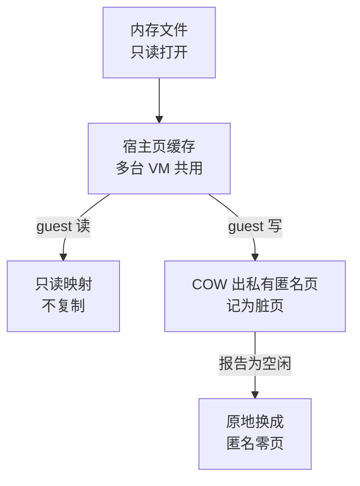
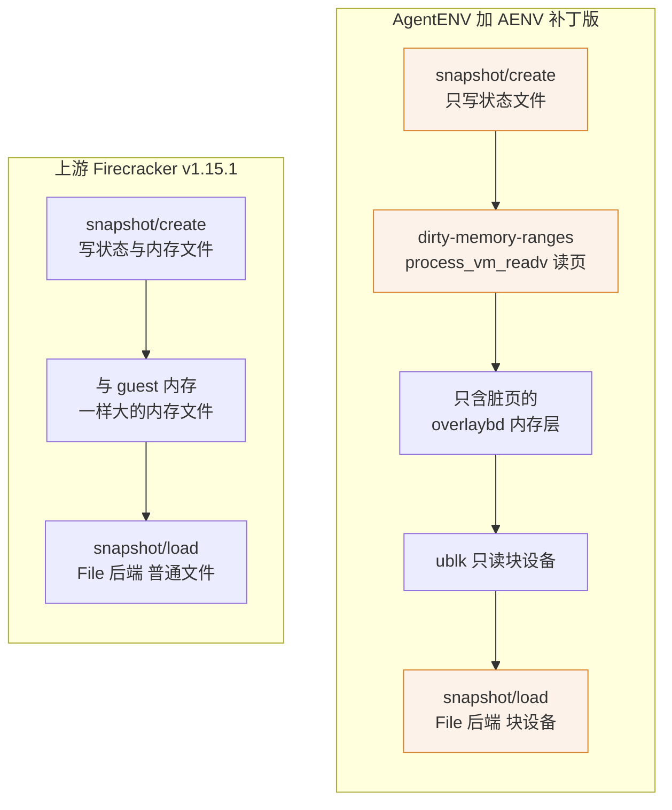

# 03 · 本书用到的 Firecracker：快照、内存后端与脏页

> AgentENV 的暂停、恢复、分叉与内存共享，全部建立在 Firecracker 的几个具体行为之上：快照由哪两部分组成、恢复时 guest 内存怎样映射、脏页从哪里来。
> 本篇不复述 Firecracker，只回顾这几个行为，并标出哪些来自上游 Firecracker v1.15.1、哪些是 AENV 补丁版 Firecracker 新增的。
>
> **读者**：没有读过 Firecracker 源码、要读第五与第六部分的读者。　**预备**：[第 02 篇 · 规模问题与取舍](02-why-agentenv.md)
> 　**代码**：`src/sandbox/firecracker/instance.rs`、`src/sandbox/firecracker/sandbox.rs`、`src/sandbox/firecracker/config.rs`、`src/cfg.rs`、`config/default.toml`、`thirdparty/firecracker-client/firecracker.yaml`；firecracker 仓库的 `src/vmm/src/vstate/memory.rs`、`src/vmm/src/vstate/vm.rs`、`src/vmm/src/persist.rs`、`src/vmm/src/rpc_interface.rs`

---

## 0. 本篇要回答的问题

1. 一份 Firecracker 快照由哪几部分组成？Full 与 Diff 有什么区别，`track_dirty_pages` 关掉时 Diff 从哪里取脏页？
2. 恢复时的 File 后端怎样映射内存文件？guest 写一页时宿主上发生了什么，为什么这让一个只读块设备可以被多台 VM 同时当作内存文件？
3. 一台恢复出来的 VM，它的「脏页」指的是哪些页？
4. AgentENV 用到了哪四个上游没有的补丁行为，各自解决什么问题？
5. balloon 的 free page reporting 与 guest 内的 DAMON reclaim 怎样配合把内存还给宿主？
6. 为什么跨机型恢复快照需要集群 CPU 特性的交集？

---

## 1. 问题：AgentENV 要 VMM 提供什么

[第 02 篇](02-why-agentenv.md)的四条要求落到 VMM 上，变成三项能力：

- **把一台运行中的 VM 冻结成文件，再从文件恢复出来。** 这是暂停、模板与分叉的共同基础。
- **恢复时不必先读完内存。** guest 内存可能有几 GiB，而一次恢复之后 guest 往往只碰其中一小部分。
- **知道这次运行改了哪些内存页。** 否则每次暂停都要写出整个内存。

上游 Firecracker v1.15.1 已经提供了这三项能力的大部分，但它的接口假设「内存写成一个普通文件」：
创建快照时必须给出内存文件路径，恢复时用 fstat 取内存文件的大小。AgentENV 的内存住在 overlaybd 层栈里，经 ublk 暴露成块设备，
这两个假设都不成立。下面先回顾上游的机制，再讲补丁改了哪里。

---

## 2. 快照：状态文件加内存

### 2.1 两个文件

上游 Firecracker 的 `PUT /snapshot/create` 只能在 VM 暂停时调用（`PATCH /vm` 置为 Paused 之后），产出两样东西：

- **状态文件**（AgentENV 里叫 `vm_state.bin`）：vCPU 寄存器、KVM 中断控制器状态、每个设备的状态与队列位置、guest 内存的区域布局。
  它不含 guest 内存的内容，也不含 MMDS 里的数据（[第 27 篇 §4.2](27-start-pause-resume-sequences.md#42-load-与-load-之后)）。
- **内存文件**：guest 内存的连续镜像。多个内存区域按顺序首尾相接，guest 物理地址里的空洞（例如 x86_64 在 4 GiB 以下留给 MMIO 的那一段）不占位置。
  所以内存文件里的偏移不等于 guest 物理地址。

`src/vmm/src/persist.rs` 的 `create_snapshot()` 先写状态文件，再调用 `Vm::snapshot_memory_to_file()` 写内存。
`PUT /snapshot/load` 是它的逆过程，只能发给一个**完全没有被配置过**的 Firecracker 进程，加载之后启动前的配置窗口就关闭了；
AgentENV 的恢复序列因此要先把所有块设备就位再 load（[第 27 篇 §4.1](27-start-pause-resume-sequences.md#41-load-之前设备必须先就位)）。

### 2.2 Full 与 Diff

`snapshot_memory_to_file()` 按 `snapshot_type` 分两种（`src/vmm/src/vstate/vm.rs`）：

- **Full**：`dump()` 顺序写出全部内存，然后清掉所有脏页记录。
- **Diff**：先取脏页位图，再由 `dump_dirty()` 只把脏页写到内存文件的对应偏移上，其余位置保持原样（可以是文件空洞，也可以是上一份快照的内容）。
  写成功后清掉脏页记录；写失败时用 `store_dirty_bitmap()` 把刚读出的位存回去，下次 Diff 仍能看到这些页。

Diff 的意义是「只付改动量的代价」，但上游的 Diff 产物仍是一个**与 guest 内存一样大**的文件，增量信息要靠调用方自己合并到基线文件上。
AgentENV 想要的是把脏页单独写成一个 overlaybd 层，这一点上游接口做不到（§4）。

### 2.3 脏页从哪里来

guest 内存有两个写者：vCPU 直接写，以及 Firecracker 的设备模拟代码（例如 virtio-blk 把读到的数据写进 guest 缓冲区）。
上游因此维护两套记录，Diff 取二者的并集：

- **KVM dirty log**：`PUT /machine-config` 的 `track_dirty_pages` 为真时，Firecracker 注册内存槽位时带上 `KVM_MEM_LOG_DIRTY_PAGES`，
  KVM 记下 vCPU 写过的页。`Vm::get_dirty_bitmap()` 用 `KVM_GET_DIRTY_LOG` 读出，**读一次就清零**。
- **Firecracker 的用户态位图**：每个内存区域一张 `AtomicBitmap`，Firecracker 自己写 guest 内存时置位；只有 `track_dirty_pages` 为真时才分配。

`track_dirty_pages` 为假时，区域没有位图，`get_dirty_bitmap()` 改用 `mincore_bitmap()`：以 `mincore(2)` 查每一页是否驻留在内存里，把驻留的页都当作脏页。
上游注释称之为「过估」（overapproximate），并指出在开了 swap 的宿主上，被换出的页会被漏报。
AgentENV 的 `[memory_snapshot] track_dirty_pages` 缺省为真，配置注释写明设为假即「use mincore」；PVM 模式下 `src/cfg.rs` 的 `normalize()` 强制把它改成假（[第 11 篇](11-configuration.md)、[第 61 篇](61-pvm.md)）。

---

## 3. 恢复时的内存后端

`PUT /snapshot/load` 的 `mem_backend` 有两种类型，决定 guest 内存怎样建出来（`src/vmm/src/persist.rs` 的 `restore_from_snapshot()`）。

### 3.1 Uffd 后端

`guest_memory_from_uffd()` 用 `memory::anonymous()` 建一段匿名内存，注册到一个 userfaultfd 上，再经 UNIX socket 把 uffd 与区域映射交给外部进程。
guest 第一次碰到某页时触发缺页，外部进程用 `UFFDIO_COPY` 把内容拷进来。内容来自哪里、怎样缓存，完全由外部进程决定。
AgentENV 的 `instance.rs` 里保留着一个以 `#[allow(dead_code)]` 标记的 `load_snapshot_uffd()`，现行路径不用它；两种方案的比较在[第 44 篇](44-uffd-alternative.md)。

### 3.2 File 后端

AgentENV 走的是 File 后端。`guest_memory_from_file()` 以 `File::open()` **只读**打开内存文件，交给 `src/vmm/src/vstate/memory.rs` 的 `snapshot_file()`。
后者先确认文件不比 guest 内存小（否则访问越界的页会收到 SIGBUS），再把每个区域按 `PROT_READ | PROT_WRITE`、`MAP_NORESERVE | MAP_PRIVATE` 映射到文件的对应偏移。
这一段在上游 Firecracker v1.15.1 与 AENV 补丁版 Firecracker 中都是 `MAP_PRIVATE`，补丁只改了取文件大小的方式（§4）。

私有文件映射的语义决定了 AgentENV 内存路径的形状（图 1）：

1. **读**：guest 第一次读某页触发缺页，内核从内存文件读入页缓存，并把这一页以只读方式映射进 Firecracker 进程。按需加载由内核完成，不需要用户态参与。
2. **写**：guest 写某页时内核做写时复制（COW），复制出一个只属于这个进程的匿名页；文件与页缓存都不变。
3. **共享**：同一个文件被多个进程私有映射时，未写过的页在宿主上只有一份页缓存。这正是 AgentENV 让同一快照的沙箱共用一个只读 ublk 内存设备的依据（[第 26 篇 §4](26-sandbox-block-devices.md#4-共享只读设备与两级引用计数)、[第 42 篇](42-memory-snapshot-over-ublk.md)）。
   内存文件被只读打开，任何一台 VM 都不可能改动它。

由此可以回答「恢复出来的 VM 的脏页是什么」。load 时内存槽位是新注册的，KVM dirty log 从空开始；
此后被 vCPU 或设备模拟写过的页，既是 dirty log 记下的页，也是发生过 COW、内容已经不在内存文件里的页。
推论：在 `track_dirty_pages` 为真时，这两个集合相同，所以 AgentENV 只需把脏页写成一层新的内存层、叠在来源内存层栈之上，就能完整表示这台 VM 的内存。
这一推论依据的是上游与补丁版共同的 `snapshot_file()` 实现，[第 09 篇](09-sandbox-lifecycle-walkthrough.md)里标为推论的那句话到此有了代码依据。
冷启动的 VM 则不同：`VmResources::allocate_memory_regions()` 在没有 vhost-user 设备时用 `memory::anonymous()` 分配私有匿名内存，从未写过的页读出来是零，
所以它第一次暂停写出的层就是全部写过的页，未写过的部分在层里是空洞。

`track_dirty_pages` 为假时情况不同。推论：`mincore()` 对私有文件映射里未 COW 的页，报告的是文件页缓存里是否有这一页；
共享内存设备的页缓存里有其它沙箱读入的页，于是脏页区间会包含大量本 VM 只读过、甚至没碰过的页。结果仍然正确（多记不漏记），只是写出量不再正比于改动量。

---

## 4. AENV 补丁版 Firecracker 的四个被用到的行为

AgentENV 依赖的 Firecracker 是 AENV 补丁版（`config/deps_manifest.toml` 的 `[firecracker.kvm]`，资产名 `1.15.1-patch-v1`）。
补丁的完整清单与实现在[第 67 篇](67-firecracker-patch-layer.md)；这里只列 AgentENV 实际调用的四个行为：

| 行为 | 上游 Firecracker v1.15.1 | AENV 补丁版 Firecracker | AgentENV 的调用点 |
|---|---|---|---|
| `PUT /snapshot/create` 的 `mem_file_path` | 必填 | 可选；缺省时只写状态文件 | `instance.rs` 的 `create_state_only_snapshot()` |
| `GET /vm/dirty-memory-ranges` | 无 | 新增，返回脏页区间 | `instance.rs` 的 `get_dirty_memory_ranges()` |
| 内存文件大小 | `fstat`，块设备得 0 | `lseek(SEEK_END)`，块设备得容量 | `instance.rs` 的 `load_snapshot_file()` |
| drive 的 `direct` | 无，总是缓冲 I/O | 为真时以 O_DIRECT 打开后端文件 | `instance.rs` 的 `add_drive()` |

前三个组成一条主线：**快照内存不经过内存文件**（图 2，橙色节点依赖补丁行为）。

- **可选的 `mem_file_path`**：补丁版 `create_snapshot()` 在没有内存文件路径时只调 `snapshot_state_to_file()`，既不写内存，也不动任何脏页记录
  （上游写完内存后还会把 virtio 队列所在的页重新标脏，这一步也随之跳过）。AgentENV 仍把 `snapshot_type` 设为 Diff，此时它不影响产物。
- **`GET /vm/dirty-memory-ranges`**：补丁版 `Vm::get_dirty_memory_ranges_preserve()` 读出 KVM dirty log，先用 `store_dirty_bitmap()` 把这些位写回 Firecracker 的用户态位图，
  再按与 `dump_dirty()` 相同的判据（KVM 位或用户态位）把相邻脏页合并成区间。每个区间给出三样东西：页所在的**宿主虚拟地址**（HVA）、它在连续内存镜像里的偏移、长度；
  另外返回页大小与镜像总大小。swagger 描述称这个查询「logically non-clearing」：读 KVM 日志虽然清了 KVM 的位，但位已经转存，外部消费失败时下一次查询仍能看到它们。
  AgentENV 拿到 HVA 后用 `process_vm_readv` 直接从 Firecracker 进程的地址空间读这些页，镜像偏移决定它们在内存层里的位置（[第 42 篇](42-memory-snapshot-over-ublk.md)）。
- **seek 取大小**：补丁版 `snapshot_file()` 用 `seek(SeekFrom::End(0))` 代替 `file.metadata().len()`，注释写明 ublk、dm-snapshot 这类块设备的 `fstat` 返回 0。
  没有这一处，块设备在大小检查一步就会被拒绝。
- **drive `direct`**：与内存无关，作用于 virtio-blk。AgentENV 给用户 rootfs、附加盘与卷槽位开启它，tools 盘不开（[第 26 篇 §6](26-sandbox-block-devices.md#6-o_direct哪些盘绕过宿主页缓存)）。

不清除的语义还有一个后果。AgentENV 从不做 Full 快照，也从不通过 Firecracker 写内存文件，`reset_dirty()` 在它的路径上不会被调用；
推论：一台 VM 的脏页区间累积的是自启动或 load 以来写过的全部页，而不是自上一次查询以来的页。
这与 `snapshot_to_dir()` 的做法吻合 —— 原地 capture（snapshot、fork）之后继续运行的 VM 再次 capture 时，`build_mem_snapshot_image_config()` 把新层压在**启动时**的来源层栈上，而不是上一次 capture 的层上，所以新层必须包含自启动以来的全部改动。

---

## 5. balloon 与 DAMON：把内存还给宿主

[第 02 篇](02-why-agentenv.md#2-四条要求)的要求四要求 guest 不再需要的内存回到宿主。这需要 guest 内核与 Firecracker 两侧配合。

**guest 一侧**：内核命令行启用 DAMON reclaim。`src/sandbox/firecracker/config.rs` 的 `DEFAULT_BOOT_ARGS` 与 `config/default.toml` 的 `boot_args` 都带有一组 `damon_reclaim.*` 参数：
`enabled=Y`、`min_age=100000`（微秒）、每 500 ms 最多花 20 ms 回收不超过 1 GiB、水位 990 / 990 / 200（千分比），以及 `skip_anon=Y` —— 只回收文件页，不碰匿名页。
`default.toml` 另有 `page_reporting.page_reporting_order=6`，`DEFAULT_BOOT_ARGS` 没有；两处的差异见[第 11 篇](11-configuration.md)。
DAMON 把长期没被访问的页缓存回收成空闲页；这些参数隐含要求 guest 内核编进了 DAMON reclaim 与 virtio-balloon 的 page reporting（推论：依据参数名）。
这个要求未必被满足：上游 Firecracker 6.1 CI 内核配置写着 `# CONFIG_DAMON_RECLAIM is not set`，而 AgentENV 缺省开启 `damon_reclaim.*`。
推论：若 guest 内核按上游 CI 配置构建，这组参数没有对应的模块可接收，DAMON 回收静默失效，只剩 guest 自己释放的空闲页经 page reporting 归还；这处矛盾与 guest 内核配置的可追溯性见[第 67 篇 §7.2](67-firecracker-patch-layer.md#72-boot-args-隐含的要求)。

**Firecracker 一侧**：冷启动时 `instance.rs` 的 `set_balloon()` 发 `PUT /balloon`，`amount_mib = 0`、`deflate_on_oom = true`、`free_page_reporting = true`。
气球本身不充气，只是打开 free page reporting 队列。guest 把成块的空闲页报告上来，上游 v1.15.1 的 `process_free_page_reporting_queue()` 对每段调用 `discard_range()`：
对匿名内存是 `madvise(MADV_DONTNEED)`；对从内存文件恢复的私有映射，`MADV_DONTNEED` 只会丢掉私有副本、下次访问又读回文件内容，
所以它改为用 `MAP_FIXED | MAP_ANONYMOUS | MAP_PRIVATE` 在原地覆盖一段匿名映射，使这些页成为零页、宿主物理页得以释放（图 1 的最后一步）。
balloon 的配置随状态文件保存，恢复路径不再发 `PUT /balloon`（[第 27 篇 §3](27-start-pause-resume-sequences.md#3-冷启动的配置序列)）。

这里与脏页跟踪有一处交互。覆盖映射既不经过 vCPU 写，也不置用户态位图。推论：一页被报告为空闲之后若没有再被写过，它不会出现在下一次的脏页区间里，
恢复出来的 VM 在这一页读到的是来源内存层里的旧内容。guest 认为这一页是空闲的，分配时会先写再用，所以通常无害；
但它意味着「内存层忠实记录了 guest 内存」这句话只对 guest 在用的页成立。

---

## 6. CPU 模板与跨节点恢复

快照里的 vCPU 状态包含 guest 看到的 CPUID 与 MSR。把它恢复到另一台 CPU 特性不同的主机上，上游 Firecracker v1.15.1 的 `snapshot_state_sanity_check()` 只比较 CPU 厂商并在不一致时打 warn，不比较特性位。
推论：源主机有而目标主机没有的特性，要么在恢复 vCPU 状态时被 KVM 拒绝，要么让 guest 在运行中执行到不受支持的指令。

上游的办法是 CPU 模板：`PUT /cpu-config` 在启动前给出一份自定义模板，按位修改 guest 可见的 CPUID 与 MSR（只能在启动前设置，恢复时 CPU 状态已在快照里）。
配套的 `cpu-template-helper template dump` 把本机 Firecracker 实际呈现给 guest 的 CPU 配置导出成同一种格式。
AgentENV 用这两样东西构造集群范围的交集：节点用 `src/observability/machine.rs` 的 `dump_cpu_config()` 跑 `cpu-template-helper template dump` 并经心跳上报，
scheduler 的 `services/scheduler/internal/cpu_template.go` 中 `IntersectCpuConfigs()` 对所有节点的 CPUID 与 MSR 位图按位求与，
结果下发给节点，冷启动与模板构建时以 `PUT /cpu-config` 应用（[第 27 篇 §3](27-start-pause-resume-sequences.md#3-冷启动的配置序列)）。
于是在任一节点上做出的快照，只用到了全部节点都支持的特性。流程与它的边界条件在[第 57 篇](57-heartbeat-and-cpu-intersection.md)。

---

## 7. 本书用到的 Firecracker 端点

| 端点 | 来源 | 本书哪篇 |
|---|---|---|
| `PUT /logger` | 上游；只在配置了 `[firecracker] log_level` 时发出 | 11、25 |
| `PUT /machine-config`（含 `track_dirty_pages`） | 上游 | 11、27 |
| `PUT /cpu-config` | 上游 | 27、57 |
| `PUT /boot-source`、`PUT /network-interfaces/{id}`、`PUT /actions` | 上游 | 27、29 |
| `PUT /drives/{id}`、`PATCH /drives/{id}` | 上游；`direct` 字段为补丁新增 | 26、27、31 |
| `PUT /mmds/config`、`PUT /mmds` | 上游 | 28 |
| `PUT /balloon`（`free_page_reporting`） | 上游 | 27、本篇 §5 |
| `PATCH /vm`（Paused / Resumed） | 上游 | 27 |
| `PUT /snapshot/create` | 上游；`mem_file_path` 可选为补丁行为 | 27、42 |
| `GET /vm/dirty-memory-ranges` | 补丁新增 | 27、42 |
| `PUT /snapshot/load`（File 后端） | 上游；块设备作内存文件靠补丁的 seek | 27、42 |

`PUT /logger` 是可选调用：`instance.rs` 的 `set_logger()` 由 `sandbox.rs` 的 `configure_logger()` 在启动或 load 之前调用，`[firecracker] log_level` 缺省未设置（`config/default.toml` 中被注释掉），此时直接跳过。
AgentENV 不用 jailer（[第 25 篇](25-backend-and-firecracker-process.md)），也不走 Uffd 后端与 Full 快照。
`thirdparty/firecracker-client/firecracker.yaml` 是生成客户端用的 OpenAPI 描述，与补丁版仓库的 swagger 除版本号一行外相同；真正的请求由 `instance.rs` 手写发出。

---

## 8. 这些概念在本书哪几篇被用到

- 「状态文件 + 内存」与 load 的前置条件：[第 09 篇](09-sandbox-lifecycle-walkthrough.md)、[第 27 篇](27-start-pause-resume-sequences.md)、[第 32 篇](32-warm-pools.md)（预热进程必须未配置）、[第 22 篇](22-persistence-across-restarts.md)。
- File 后端的私有映射与页缓存共享：[第 26 篇](26-sandbox-block-devices.md)、[第 41 篇](41-ublk-daemon.md)、[第 42 篇](42-memory-snapshot-over-ublk.md)、[第 43 篇](43-startup-pack-and-prefetch.md)、[第 44 篇](44-uffd-alternative.md)。
- 脏页的来源与「不清除」语义：[第 42 篇](42-memory-snapshot-over-ublk.md)、[第 51 篇](51-fork.md)、[第 61 篇](61-pvm.md)（关闭跟踪时的 mincore）。
- 四个补丁行为：[第 26 篇](26-sandbox-block-devices.md)（`direct`）、[第 27 篇](27-start-pause-resume-sequences.md)、[第 42 篇](42-memory-snapshot-over-ublk.md)、[第 67 篇](67-firecracker-patch-layer.md)。
- balloon 与 DAMON：[第 11 篇](11-configuration.md)、[第 27 篇](27-start-pause-resume-sequences.md)、[第 33 篇](33-custom-extension-hooks.md)（扩展可改 boot args）、[第 67 篇](67-firecracker-patch-layer.md)（guest 内核）。
- CPU 模板交集：[第 27 篇](27-start-pause-resume-sequences.md)、[第 57 篇](57-heartbeat-and-cpu-intersection.md)。
- 与 e2b infra 的对照：[第 66 篇](66-vs-e2b-infra-storage-and-memory.md)。

---

## 9. 与 e2b infra 的对照

e2b infra 恢复时用 Uffd 后端，由 orchestrator 里的缺页服务把内存拷进每台沙箱自己的匿名内存；暂停时同样不让 Firecracker 写内存文件，而是靠其定制版 Firecracker 的内存映射与脏页端点由宿主自己读页（e2b 手册第 31、37 篇，Firecracker 手册第 49–54 篇）。
AgentENV 选 File 后端，把缺页交给内核与 ublk 块设备，换来跨沙箱的页缓存共享，代价是补丁版 Firecracker 必须能把块设备当内存文件，且内存的读路径全部经过 ublk-daemon。

---

## 10. 小结

- Firecracker 快照 = 状态文件 + 内存的连续镜像；镜像偏移不等于 guest 物理地址。`snapshot/load` 只能发给未配置的进程。
- Diff 的脏页是 KVM dirty log 与 Firecracker 用户态位图的并集；`track_dirty_pages` 为假时退回 `mincore`，结果是过估。
- File 后端只读打开内存文件、以 `MAP_PRIVATE` 映射：读走宿主页缓存，写 COW 成私有匿名页；上游与补丁版在这里相同。
- 因此多台 VM 可以共用一个只读的内存块设备，未写过的页只有一份页缓存；恢复后的脏页就是 COW 过的页（推论，依据 `snapshot_file()`）。
- AgentENV 用到的四个补丁行为：可选 `mem_file_path`、`GET /vm/dirty-memory-ranges`、seek 取内存文件大小、drive `direct`；前三个让快照内存不经过内存文件。
- `dirty-memory-ranges` 返回 HVA、镜像偏移与长度，查询逻辑上不清除；AgentENV 不重置脏页记录，所以区间累积自启动或 load 以来的全部写入（推论）。
- balloon 只为打开 free page reporting，配合 guest 内只回收文件页的 DAMON reclaim；恢复出来的 VM 上，被报告的页以匿名零页覆盖而释放，但不计为脏页。
- 跨节点恢复快照要求 guest 只看到全集群共有的 CPU 特性；AgentENV 用 `cpu-template-helper` 导出、scheduler 求交、`PUT /cpu-config` 应用。

## 延伸阅读 / 下一篇

- 下一篇：[第 04 篇 · io_uring 与 ublk](04-io-uring-and-ublk.md) —— 把内存层与磁盘变成块设备的那套内核机制。
- [第 67 篇 · Firecracker 补丁层](67-firecracker-patch-layer.md)：补丁的完整清单、实现与未被使用的部分。
- [Firecracker 手册第 36 篇 · 快照总览](../firecracker/36-snapshot-overview-and-format.md)、[第 37 篇 · 创建快照](../firecracker/37-snapshot-create.md)、[第 38 篇 · 加载快照](../firecracker/38-snapshot-load.md)：状态文件格式、Full / Diff 与两种内存后端。
- [Firecracker 手册第 13 篇 · guest 内存](../firecracker/13-guest-memory.md)、[第 14 篇 · 脏页跟踪](../firecracker/14-dirty-page-tracking.md)：内存区域、memslot 与两套脏页记录。
- [Firecracker 手册第 34 篇 · balloon](../firecracker/34-balloon.md)：恢复后的 `discard_range` 为什么要覆盖映射；该书基线是上游 v1.12.1，没有 free page reporting。
- [Firecracker 手册第 20 篇 · CPU 模板机制](../firecracker/20-cpu-templates.md)、[第 41 篇 · snapshot-editor、rebase-snap 与兼容性](../firecracker/41-snapshot-tools-and-compat.md)。
- [Firecracker 手册第 39 篇 · userfaultfd 后端](../firecracker/39-uffd-backend.md)、[第 49 篇 · 为什么分叉](../firecracker/49-why-e2b-forked.md)：AgentENV 没有走的那条路。
