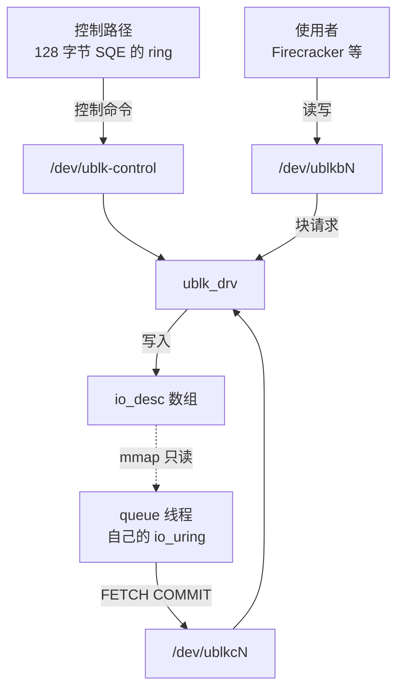
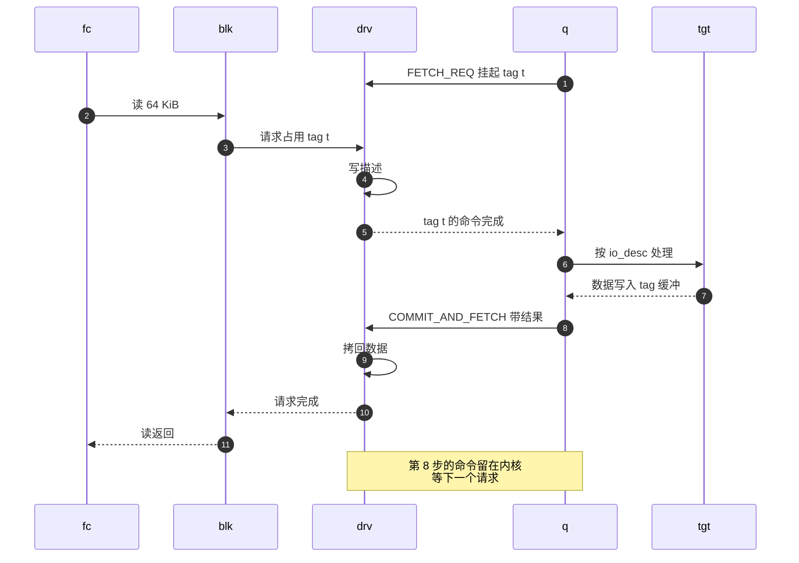

# 04 · io_uring 与 ublk

> AgentENV 的每一块 overlaybd 盘都是一个 ublk 设备：内核把块请求经 io_uring 交给用户态的 ublk-daemon，
> 由 Rust 版 overlaybd 完成读写。本篇只讲读懂第六部分所需的那部分 io_uring 与 ublk：两个环形队列、
> 透传命令、注册表，ublk 的三类设备节点与「领取—提交」循环，块设备页缓存的几条规则，以及这些能力分别从哪个内核版本开始可用。
>
> **读者**：没有接触过 io_uring 或 ublk 的读者；要读第 26、32、40–42 篇的工程师。　**预备**：操作系统课程里的块设备、系统调用与页缓存。
> **代码**：`storage/util/src/io_ring/uring.rs`（只看用法）、`storage/ublk/src/{ctrl,queue,ublk_caps}.rs`、`storage/ublk-daemon/src/server.rs` 的 `detect_ublk_features()`、`src/setup/ublk.rs`

---

## 0. 本篇要回答的问题

1. io_uring 的 SQ / CQ 是什么？一次 I/O 的结果靠什么找回发起它的那段代码？
2. fixed file、fixed buffer 与稀疏注册表是什么？`URING_CMD` 为什么分 16 字节与 80 字节两种？
3. ublk 的 `/dev/ublk-control`、`/dev/ublkcN`、`/dev/ublkbN` 各是什么？一台设备从创建到删除要发哪些控制命令？
4. 数据面上，用户态 server 怎样「领取」一个块请求、怎样交回结果？请求描述与数据各走哪条路？
5. AgentENV 用到的 ublk 特性位各从哪个内核版本开始可用？文档里的「6.8+」意味着什么？
6. 为什么用户态块设备选 ublk，而不是 NBD 或 TCMU？代价是什么？

---

## 1. 问题：块设备的逻辑要写在用户态

AgentENV 的 rootfs、附加盘与内存快照都不是普通文件，而是 overlaybd 层栈：一叠 LSMT 层文件，
有的在本地，有的要从镜像仓库或对象存储按需读回（[第 05 篇](05-overlaybd-and-lazy-loading.md)）。
Firecracker 只认块设备或文件；guest 内核看到的也只是一块 virtio 盘。于是中间要有一层「把块请求翻译成层栈读写」的逻辑。

这层逻辑放进内核不现实：它要发 HTTP Range 请求、做认证、解压、维护节点级缓存，用 Rust 的 async 生态写最自然。
放在用户态，就需要一种让内核把块请求转交给用户进程、再把结果收回来的机制，而且每个请求的额外开销要小，
因为 guest 的每一次缺页读、每一次 `fsync` 都会穿过它。Linux 里这类机制有 NBD、TCMU 与 ublk 三种（[§6](#6-为什么是-ublk)）；
AgentENV 选的是 ublk，而 ublk 的通信完全建立在 io_uring 之上，所以先讲 io_uring。

---

## 2. io_uring：两个环与一个 `user_data`

### 2.1 SQ 与 CQ

io_uring 是 Linux 5.1 引入的异步 I/O 接口。进程用 `io_uring_setup` 建一个实例，内核与进程共享两个环形队列：

- **提交队列 SQ**：进程往里写 **SQE**（submission queue entry），每个 SQE 描述一个操作——操作码、文件、偏移、缓冲地址、长度。
- **完成队列 CQ**：内核往里写 **CQE**（completion queue entry），每个 CQE 带一个结果值 `res`（成功时是字节数，失败时是负的 errno）。

写进 SQ 的 SQE 不会自动生效，要调用 `io_uring_enter` 通知内核。一次调用可以提交任意多个 SQE，这是 io_uring 省系统调用的根本：
攒一批再提交，一批完成后一次收割。`storage/ublk/src/dev.rs` 的 queue 线程把提交放在 tokio runtime 的 `on_thread_park` 钩子里，
就是这个思路——线程即将空闲时把这一轮所有任务产生的 SQE 一次交给内核（细节见[第 40 篇 §4.3](40-ublk-library.md#43-什么时候真正提交)）。

完成是异步的，CQE 的顺序与 SQE 的顺序无关。把结果与请求对上号的唯一线索是 **`user_data`**：
SQE 里一个 64 位的不透明字段，内核原样抄进对应的 CQE。`storage/util/src/io_ring/uring.rs` 的 `AsyncIoRing` 用 slab 的下标作 `user_data`，
收割 CQE 时按它找回等待中的 future 并唤醒。进程怎样知道 CQ 里有了新东西？ring 的文件描述符本身可以被 epoll，
CQ 非空时可读；`AsyncIoRing::handle_completion()` 就是把这个 fd 交给 tokio 的 `AsyncFd`，可读时收割。

```text
   用户态                                   内核
 ┌─────────────┐   SQE: opcode fd off addr len user_data   ┌──────────────┐
 │ 任务 A, B … │ ─────────── SQ 环 ─────────────────────▶ │              │
 │             │          io_uring_enter 批量提交           │  执行 I/O    │
 │ 按 user_data│ ◀────────── CQ 环 ──────────────────────── │              │
 │ 唤醒 future │   CQE: user_data res                       └──────────────┘
 └─────────────┘
```

这里埋着一个异步语言里特有的问题：SQE 一旦提交，操作就在内核里进行，与用户态那个 future 是否还活着无关。
future 被丢弃后，内核照样会写缓冲、照样送来 CQE。若这时 `user_data` 已被复用给另一个操作，结果就会投错地方。
`AsyncIoRing` 怎样处理这件事，是[第 40 篇 §5](40-ublk-library.md#5-asyncioring-与取消安全)的主题；这里只需记住：**提交了的操作收不回来，只能等它完成。**

### 2.2 注册表：fixed file 与 fixed buffer

每个 SQE 都要引用文件与缓冲。默认情况下内核每次都要按 fd 查文件表、按地址钉住用户页，这是可省的重复工作。
io_uring 允许事先**注册**：

- **fixed file**：把若干 fd 注册进 ring 的文件表，之后 SQE 用表的下标（`types::Fixed(idx)`）而不是 fd 引用文件。
- **fixed buffer**：把若干块用户内存注册进 ring 的缓冲表，内核一次性钉住这些页；之后用 `ReadFixed` / `WriteFixed` 加下标引用。
- **稀疏注册表**：先建一张给定大小的空表，再逐项填入或替换（`IORING_REGISTER_BUFFERS2` 与 `IORING_RSRC_REGISTER_SPARSE`）。
  `AsyncIoRingBuilder` 的 `nr_sparse_buffer()`、`nr_sparse_file()` 建的就是这两张空表，`register_buffer()` 与 `register_fd()` 往里填，
  下标由 `ReloadableIDAllocator` 分配。

ublk 的 queue ring 把字符设备 `/dev/ublkcN` 注册成 fixed file，此后所有 ublk 命令都以 `Fixed(cdev_idx)` 提交（`storage/ublk/src/queue.rs`）。
fixed buffer 在 ublk 里还有一个更特殊的用途——让内核把块请求的页直接挂进这张表，即零拷贝（[§5](#5-特性位与内核版本)）。

ring 建立时还可以声明使用方式。`AsyncIoRingBuilder::build()` 设置了 `setup_single_issuer`（只有一个线程提交）与 `setup_coop_taskrun`
（完成处理推迟到该线程下次进入内核时，不打断它），这两项都与「一个 ring 只归一个线程」的用法吻合。

### 2.3 透传命令：`URING_CMD`

普通的 SQE 描述 read、write、fsync 这类通用操作。`IORING_OP_URING_CMD` 是另一类：它把一段命令负载原样交给文件背后的驱动，
由驱动自己解释——相当于一个异步的 `ioctl`。负载放在 SQE 尾部：

- 标准 64 字节 SQE 留给负载 16 字节，对应 `io-uring` crate 的 `opcode::UringCmd16`；
- ring 以 `IORING_SETUP_SQE128` 建立时 SQE 为 128 字节，负载 80 字节，对应 `UringCmd80`，ring 的类型写作 `Entry128`。

ublk 两种都用。数据面命令（领取请求、提交结果）的负载是 16 字节的 `ublksrv_io_cmd`，走普通 ring 上的 `UringCmd16`；
控制命令的负载是 32 字节的 `ublksrv_ctrl_cmd`，放不进 16 字节，必须走 128 字节 SQE 的 ring。
所以 ublk-daemon 里有两类 ring：每个 queue 一个普通 ring，外加进程内唯一的一条 `Entry128` ctrl ring（`storage/ublk-daemon/src/main.rs` 的 `spawn_io_ring_worker::<Entry128>()`）。
命令码本身按 `ioctl` 的方式编码，例如 `UBLK_U_CMD_ADD_DEV = _IOWR('u', 0x04, struct ublksrv_ctrl_cmd)`。

---

## 3. ublk：三个设备节点与控制面

### 3.1 三类节点

ublk 的内核驱动是 `ublk_drv`。加载后它提供一个全局的控制节点，每创建一台设备再出现两个节点：

| 节点 | 类型 | 谁打开 | 用途 |
|---|---|---|---|
| `/dev/ublk-control` | misc 字符设备，全局唯一 | ublk server 的控制路径 | 提交控制命令：建设备、设参数、启停、删除、查询特性 |
| `/dev/ublkcN` | 字符设备，每设备一个 | ublk server 的 queue 线程 | 数据面命令通道；mmap 出请求描述数组 |
| `/dev/ublkbN` | 块设备，每设备一个 | 使用者，在 AgentENV 里是 Firecracker 与节点进程 | 普通块设备，读写在这里发生 |

三类节点与用户态的关系如下图：控制路径只碰 `/dev/ublk-control`，queue 线程只碰 `/dev/ublkcN` 与映射出来的描述数组，使用者只与 `/dev/ublkbN` 打交道；三者在内核里汇到同一个驱动。图中「控制路径」「使用者」「queue 线程」三个节点在用户态，其余在内核。



`N` 是设备号。AgentENV 不自己选号：`UVMUblkCtrlBuilder` 缺省 `dev_id = u32::MAX`，表示请内核分配，ADD_DEV 返回时把结果写回设备信息。
`src/setup/ublk.rs` 的 `provision()` 负责 `modprobe ublk_drv`、写 `/etc/modules-load.d/aenv-ublk.conf`，
并装一条 udev 规则，把三类节点设为 `0660` 与 server 所在的组，好让非 root 的 Firecracker 打开 `/dev/ublkbN`。

没有 `UBLK_F_UNPRIVILEGED_DEV` 时，内核要求控制命令的发起者有 `CAP_SYS_ADMIN`（内核 `drivers/block/ublk_drv.c` 的 `ublk_ctrl_uring_cmd_permission()`）。
AgentENV 不用非特权模式，所以 ublk-daemon 必须带这个能力运行（[第 41 篇](41-ublk-daemon.md)、[第 59 篇](59-host-setup-and-privileges.md)）。

### 3.2 控制命令

控制命令都以 `UringCmd80` 提交到 `/dev/ublk-control`，`storage/ublk/src/ctrl.rs` 的 `UVMUblkCtrl` 实现了下面这些：

| 命令 | 作用 |
|---|---|
| `GET_FEATURES` | 读回内核支持的特性位（64 位掩码），不涉及具体设备 |
| `ADD_DEV` | 按队列数、队列深度、单请求缓冲上限与特性位创建设备，出现 `/dev/ublkcN`；此后这些基本信息不可改 |
| `SET_PARAMS` | 设置块大小、容量、最大请求长度、discard 等参数，必须在 START_DEV 之前 |
| `START_DEV` | 按参数创建并暴露 `/dev/ublkbN` |
| `STOP_DEV` | 停止 `/dev/ublkbN` 上的 I/O 并移除块设备 |
| `DEL_DEV` | 移除 `/dev/ublkcN`；返回后设备号可被复用 |
| `GET_DEV_INFO` | 读回设备信息，包括状态 |
| `UPDATE_SIZE` | 在线修改容量（需要 `UBLK_F_UPDATE_SIZE`） |

顺序有讲究。START_DEV 在内核里会等待「每个队列的每个 tag 都已领取过请求」才继续
（`ublk_ctrl_start_dev()` 里 `wait_for_completion_interruptible(&ub->completion)`，该 completion 在所有队列就绪时由 `ublk_mark_io_ready()` 触发）。
所以 server 必须先起好 queue 线程、发出全部的首次领取命令，再发 START_DEV；而这次等待可被信号打断，返回 `-EINTR`，
这正是 `UVMUblkCtrl::start_dev()` 遇到 EINTR 重发的原因。拆除时反过来：STOP_DEV 让挂着的领取命令以错误返回、queue 线程退出，
关掉 `/dev/ublkcN` 之后再 DEL_DEV。AgentENV 的完整十步顺序见[第 40 篇 §3](40-ublk-library.md#3-设备生命周期)。

---

## 4. 数据面：领取与提交

### 4.1 队列、tag 与请求描述

`/dev/ublkbN` 是一个 blk-mq 块设备，有 `nr_queues` 个硬件队列，每个队列有 `depth` 个 tag，一个 tag 同一时刻对应一个在途请求。
AgentENV 的缺省是 1 个队列、深度 16、单请求缓冲 256 KiB（`UVMUblkCtrlBuilder` 的缺省值，daemon 不改）。

内核为每个 tag 准备一个 `ublksrv_io_desc`：操作码与标志、起始扇区、扇区数、缓冲地址。
这些描述排成数组，放在 `/dev/ublkcN` 上一段可 mmap 的区域里，server 以只读方式映射（`queue.rs` 的 `UblkQueueIoDesc::new()`，
偏移 `UBLKSRV_CMD_BUF_OFFSET` 加队列号乘以每队列的区间大小）。请求到来时，内核把描述写进对应下标，server 直接读内存即可，不需要再做一次系统调用取请求。

### 4.2 领取—提交循环

数据面只有两条命令，都以 `UringCmd16` 提交到注册过的 `/dev/ublkcN`，负载指明队列号、tag、结果与缓冲地址：

- **`FETCH_REQ`**：每个 tag 在设备启动前发一次，意思是「这个 tag 上有请求时通知我」。命令挂在内核里，直到有请求才完成。
- **`COMMIT_AND_FETCH_REQ`**：处理完一个请求后发出，同时做两件事——把结果交给内核，并且继续领取这个 tag 上的下一个请求。

于是稳态下每个 tag 在内核里始终挂着一条命令，命令的完成就是「来请求了」的通知。下图是一次读请求的完整往返，
参与者为：`fc`（打开 `/dev/ublkbN` 的使用者，例如 Firecracker）、`blk`（块层与 `/dev/ublkbN`）、`drv`（`ublk_drv`）、
`q`（server 的 queue 线程与它的 io_uring）、`tgt`（target，即 Rust 版 overlaybd 的 `OverlaybdTarget`）。



第 7 步与第 9 步之间是数据的走法。缺省模式下，server 为每个 tag 准备一块自己的缓冲，命令负载里的 `addr` 指向它：
写请求在通知 server 之前，内核先把请求页的数据拷进这块缓冲；读请求在收到 COMMIT 之后，内核把缓冲里的数据拷回请求页。
每个请求因此在内核与用户态之间有一次拷贝。AgentENV 的生产设备全部用这种模式，即 `UserBuffer`（[第 40 篇 §6](40-ublk-library.md#6-两种缓冲)）。
另外还有三种取数据的方式：`UBLK_F_NEED_GET_DATA`（写请求先只送描述，server 再要数据）、`UBLK_F_USER_COPY`（server 对 `/dev/ublkcN` 做 pread / pwrite 取放数据）、
零拷贝（[§5](#5-特性位与内核版本)）。AgentENV 都没有使用。

请求的结果是一个 `i32`：非负表示处理的字节数，负数是 errno，内核据此完成或失败这个块请求。
`OverlaybdTarget` 把 Rust 侧的错误映射成 errno（如只读层上的写报 `EROFS`），映射表在[第 40 篇 §7.2](40-ublk-library.md#72-设备参数与支持的操作)。

### 4.3 server 退出时设备会怎样

ublk 把块设备的生死交给了一个用户进程，于是必须回答「这个进程崩溃了怎么办」。
内核在 `/dev/ublkcN` 的最后一个引用释放时（`ublk_ch_release()`）中止所有已交给 server 的请求。
没有开启任何恢复特性时，设备随即进入「无 server」状态：挂着的与之后到来的 I/O 都以错误快速返回，块设备被移除。
`UBLK_F_USER_RECOVERY` 系列特性让设备在 server 退出后保留，由新进程接管（`START_USER_RECOVERY` / `END_USER_RECOVERY`），
已交出的请求按标志重发或失败。AgentENV v0.2.3 不使用这组特性：ublk-daemon 一旦退出，节点上的所有 overlaybd 设备都失效（[第 41 篇](41-ublk-daemon.md)）。

### 4.4 块设备的页缓存

`/dev/ublkbN` 是一个普通块设备，所以它遵守内核对块设备的一般规则。第 26、32、42 篇反复依赖下面四条：

1. **页缓存属于块设备本身。** 以缓冲 I/O 读 `/dev/ublkbN` 的数据进入这个块设备的页缓存，所有打开它的进程共享同一份。
   多台沙箱共用一个只读设备，就共用一份页缓存，读命中时请求根本不到达 server。
2. **最后一个打开者关闭时，页缓存被丢弃。** 内核 `block/bdev.c` 的 `blkdev_put_whole()` 在打开计数归零时调用 `blkdev_flush_mapping()`，
   先 `sync_blockdev()` 再 `kill_bdev()`。server 打开的是字符设备 `/dev/ublkcN`，不算块设备的打开者，
   所以节点侧要专门留一个打开句柄才能让页缓存活过「上一台沙箱退出、下一台尚未打开」的窗口（`cache_fd`，[第 26 篇 §4.4](26-sandbox-block-devices.md#44-cache_fd保住页缓存的那个打开者)）。
3. **`BLKFLSBUF` 主动清缓存。** 这个 ioctl 先回写再 `invalidate_bdev()`，需要 `CAP_SYS_ADMIN`。
   预热池在把设备换给下一位使用者之前用它清掉上一位留下的页（[第 32 篇](32-warm-pools.md)）。
4. **O_DIRECT 绕过页缓存，mmap 则映射页缓存。** 以 `O_DIRECT` 打开时，每次读写都直接变成块请求送到 server；
   对块设备做 mmap 时，映射的就是它页缓存里的页，缺页时由块层发读请求。前者是可写盘的打开方式（[第 26 篇 §6](26-sandbox-block-devices.md#6-o_direct哪些盘绕过宿主页缓存)），
   后者是 Firecracker 以 File 后端从 `/dev/ublkbN` 恢复内存的基础（[第 42 篇](42-memory-snapshot-over-ublk.md)）。

---

## 5. 特性位与内核版本

### 5.1 AgentENV 看的三个特性位

ADD_DEV 时 server 在 `flags` 里声明要用的特性；内核会清掉它不认识的位（`ublk_ctrl_add_dev()` 里 `flags &= UBLK_F_ALL`），所以声明了不等于生效。GET_FEATURES 则直接告诉 server 内核支持哪些。
与本书有关的是三个：

- **`UBLK_F_UPDATE_SIZE`**（bit 10）：允许用 `UPDATE_SIZE` 命令在线改容量。所用的 libublk-rs-sys 版本没有这个命令的定义，
  `storage/ublk/src/ublk_caps.rs` 按 uapi 手工编码为 `_IOWR('u', 0x15, struct ublksrv_ctrl_cmd)`，即 `0xC0207515`，并用单元测试固定。
  ublk-daemon 启动时由 `detect_ublk_features()` 查询；有这一位时，预热池可以把一台空闲设备改成任意容量再交出去，没有时只能复用容量恰好相同的设备，
  `startup_prewarm` 的缺省值也随之取假（`storage/ublk-daemon/src/main.rs`）。
- **`UBLK_F_AUTO_BUF_REG`**：请求到达时，内核自动把这个请求的页注册进 queue ring 稀疏缓冲表的某个下标，
  server 用 `ReadFixed` / `WriteFixed` 加这个下标让后端文件与请求页直接传输，省掉那一次拷贝。下标经 SQE 的 `addr` 字段传递，命令负载里的 `addr` 必须为 0。
  `uvm-ublk` 支持它（`UVMUblkCtrlBuilder::zero_copy(true)`），但生产路径从不打开（[第 40 篇 §6.2](40-ublk-library.md#62-零拷贝只停留在库层面)）。
- **`UBLK_F_USER_RECOVERY`**（bit 3）：[§4.3](#43-server-退出时设备会怎样)的恢复能力，未使用。

`detect_ublk_features()` 把 GET_FEATURES 返回 `ENOTTY`、`EINVAL` 或 `EOPNOTSUPP` 当作「特性为零」，只记一条警告，daemon 照常启动。

### 5.2 分级表

下表按内核 uapi 头文件 `include/uapi/linux/ublk_cmd.h` 与 `include/uapi/linux/io_uring.h` 在各个主线版本 tag 上的内容，
列出某个定义**首次出现**的版本。头文件中出现定义通常意味着该版本的驱动实现了它；发行版内核可能回移植，以 GET_FEATURES 的实际返回为准。

| 主线版本 | 首次出现的定义 | AgentENV v0.2.3 的依赖 |
|---|---|---|
| 5.13 | `IORING_REGISTER_BUFFERS2` | 稀疏缓冲表的注册接口 |
| 5.19 | `IORING_OP_URING_CMD`、`IORING_SETUP_SQE128`、`IORING_SETUP_COOP_TASKRUN`、`IORING_RSRC_REGISTER_SPARSE` | 必需 |
| 6.0 | `ublk_drv`；`IORING_SETUP_SINGLE_ISSUER` | 必需 |
| 6.1 | `UBLK_F_USER_RECOVERY`、`_REISSUE` | 不用 |
| 6.3 | `UBLK_F_UNPRIVILEGED_DEV` | 不用 |
| 6.4 | `UBLK_F_CMD_IOCTL_ENCODE`，`UBLK_U_CMD_*` 与 `UBLK_U_IO_*` 编码 | 必需：所有命令都用这种编码 |
| 6.5 | `UBLK_U_CMD_GET_FEATURES`、`UBLK_F_USER_COPY` | GET_FEATURES 用于探测，缺失时降级 |
| 6.6 | `UBLK_F_ZONED` | 不用 |
| 6.13 | `UBLK_F_USER_RECOVERY_FAIL_IO` | 不用 |
| 6.15 | `UBLK_U_IO_REGISTER_IO_BUF`（零拷贝的第一种实现） | 不用 |
| 6.16 | `UBLK_F_UPDATE_SIZE`、`UBLK_U_CMD_UPDATE_SIZE`、`UBLK_F_AUTO_BUF_REG`、`UBLK_F_QUIESCE` | `UPDATE_SIZE` 决定预热池策略；`AUTO_BUF_REG` 只在库里 |

由此可以分三级：

| 级别 | 内核 | 能用到什么 |
|---|---|---|
| 最低可运行（推论） | 主线 6.4 或 6.5 起 | 全部 ublk 数据面；6.4 上 GET_FEATURES 不可用，按特性为零降级 |
| 文档要求 | 6.8+（`README.md` 与 `docs/src/` 的部署页） | 与上一级相同；6.8 的 uapi 头文件里最高只到 `UBLK_F_ZONED` |
| 全部特性 | 6.16 起 | 预热池按任意容量复用设备，`startup_prewarm` 缺省开启；库里的 AutoReg 零拷贝可用 |

「最低可运行」一级是推论：依据是 6.3 的头文件里还没有 `UBLK_U_CMD_*` 这组 ioctl 编码，而 `ctrl.rs` 与 `queue.rs` 只发这种编码；
本书没有在 6.4 / 6.5 内核上验证过。推论：文档的 6.8 不是由 ublk 特性决定的，可能来自其它宿主依赖。
`docs/src/internals/architecture.md` 把 `AutoRegBuffer` 写成「zero-copy … kernel 6.8+」，与上表不符：6.8 内核上没有这个特性位，生产路径也不用它。

---

## 6. 为什么是 ublk

Linux 上把块设备逻辑交给用户态，主要有三种做法。下表只比较读第六部分需要的几个维度：

| 维度 | NBD | TCMU | ublk |
|---|---|---|---|
| 内核侧 | `nbd` 驱动 | LIO SCSI target 的 `target_core_user` | `ublk_drv`，blk-mq 驱动 |
| 请求怎样到用户态 | 经 socket 发协议报文，头与数据都走 socket | uio mmap 的共享命令环，内容是 SCSI 命令 | mmap 的描述数组 + io_uring 透传命令 |
| 使用者看到的设备 | `/dev/nbdN` | 经 loopback fabric 暴露的 SCSI 盘，需 configfs 配置 | `/dev/ublkbN` |
| 用户态 server 要懂的协议 | NBD 协议 | SCSI 命令集 | 只有读、写、flush、discard 等块操作 |
| server 能否在远端 | 能 | 否 | 否 |
| 与后端 I/O 合批 | 各走各的系统调用 | 各走各的 | 命令与后端文件 I/O 可进同一个 ring 一起提交 |

这三条路分别有人走：e2b infra 用 NBD 把 rootfs 交给 Firecracker（见 e2b 手册第 33 篇）；
上游 overlaybd 的经典前端是 TCMU，进程名就是 `overlaybd-tcmu`（上游 `README.md`）。
本书所拉取的上游 overlaybd 默认分支另有一个基于 libublksrv 的 ublk 前端（`src/ublk/`），README 称其「不经过 TCMU / SCSI」；
它的引入版本无法从浅 clone 确定，本书也不讨论它。

推论（依据 AgentENV 的实际用法）：选 ublk 的理由有三。第一，server 只需理解块操作，不必实现 SCSI 或 NBD 协议，
`OverlaybdTarget` 的全部工作就是把一个 `ublksrv_io_desc` 翻译成 `ImageFile` 的读写。第二，请求描述走共享内存、命令走 io_uring，
ublk 命令与 target 对本地层文件的 `Read` / `Write` 可以在同一个 ring 里一次提交（[第 40 篇 §4.3](40-ublk-library.md#43-什么时候真正提交)）。
第三，`/dev/ublkbN` 是本机的普通块设备，Firecracker 可以用 O_DIRECT 打开它，也可以把它当内存文件 mmap，块设备页缓存的共享随之而来。

代价同样具体：

- **内核版本**：必需功能要 6.4 以上（推论），预热池的完整能力要 6.16，比 NBD 与 TCMU 苛刻得多（[§5.2](#52-分级表)）。
- **特权**：不用非特权模式，控制命令要 `CAP_SYS_ADMIN`，所以 ublk-daemon 是一个带特权的长驻进程。
- **单点**：server 只能在本机，且没有使用用户态恢复；daemon 退出即所有设备失效。NBD 的 server 可以在别处重启并重连，ublk 没有这个余地。
- **一次拷贝仍在**：零拷贝特性存在，但 overlaybd 的读要拆到多层、要解压，用不上（[第 40 篇 §6.2](40-ublk-library.md#62-零拷贝只停留在库层面)）。

---

## 7. 这些概念在本书哪里用到

| 概念 | 用到的篇目 |
|---|---|
| ublk-daemon 作为独立进程、设备所有权集中 | [第 08 篇](08-system-architecture.md)、[第 10 篇](10-node-process-and-object-model.md)、[第 41 篇](41-ublk-daemon.md) |
| `/dev/ublkbN` 的打开方式、页缓存共享、`cache_fd`、O_DIRECT | [第 25 篇](25-backend-and-firecracker-process.md)、[第 26 篇](26-sandbox-block-devices.md) |
| `BLKFLSBUF`、`UPDATE_SIZE` 与预热池的容量策略 | [第 32 篇](32-warm-pools.md)、[第 41 篇](41-ublk-daemon.md) |
| queue 线程、`!Send` future 与 io_uring ctx 路径 | [第 07 篇](07-rust-async-primer.md)、[第 38 篇](38-virtualfile-chain-and-remote-io.md) |
| 控制命令顺序、FETCH / COMMIT_AND_FETCH、`user_data` 与取消安全、两种缓冲 | [第 40 篇](40-ublk-library.md) |
| daemon 的特权、无用户态恢复的故障模型 | [第 41 篇](41-ublk-daemon.md)、[第 59 篇](59-host-setup-and-privileges.md)、[第 68 篇](68-known-issues-and-debt.md) |
| 块设备 mmap 作为内存后端、共享只读内存设备 | [第 42 篇](42-memory-snapshot-over-ublk.md)、[第 44 篇](44-uffd-alternative.md) |
| 首触页录制挂在 target 的读请求上 | [第 43 篇](43-startup-pack-and-prefetch.md) |
| ublk 与 NBD 的取舍 | [第 66 篇](66-vs-e2b-infra-storage-and-memory.md) |

---

## 8. 小结

- io_uring 用共享的 SQ / CQ 两个环交换请求与结果；`io_uring_enter` 可以一次提交一批 SQE，结果靠 `user_data` 对号。
- 提交了的操作收不回来：future 被丢弃后内核照样完成它，复用 `user_data` 与缓冲时必须等 CQE。
- fixed file、fixed buffer 与稀疏注册表省掉每次按 fd 查表、按地址钉页的开销；ublk 把 `/dev/ublkcN` 注册成 fixed file。
- `URING_CMD` 是异步的驱动命令：数据面命令 16 字节负载走普通 ring，控制命令 32 字节负载必须走 128 字节 SQE 的 ring。
- ublk 有三类节点：全局的 `/dev/ublk-control`、server 持有的 `/dev/ublkcN`、使用者打开的 `/dev/ublkbN`；控制命令需要 `CAP_SYS_ADMIN`。
- START_DEV 要等所有 tag 都已 FETCH，所以 queue 线程必须先就绪；拆除时先 STOP_DEV、关字符设备，再 DEL_DEV。
- 数据面是每 tag 一条常驻命令的「领取—提交」循环；缺省模式下数据在请求页与 server 缓冲之间拷贝一次，AgentENV 全部用这种模式。
- 块设备页缓存由所有打开者共享、最后一个打开者关闭时丢弃；mmap 映射页缓存，O_DIRECT 绕过它。
- AgentENV 的 ublk 代码需要 ioctl 编码的命令（主线 6.4 起，推论）；`UPDATE_SIZE` 与 `AUTO_BUF_REG` 要 6.16，文档写的 6.8+ 拿不到这两个特性位。
- 选 ublk 换来了简单的块语义、与后端 I/O 的合批和本机块设备的页缓存共享；代价是新内核、特权进程与 server 单点。

## 延伸阅读 / 下一篇

- 下一篇：[第 05 篇 · overlaybd、LSMT 与 OCI 镜像按需加载](05-overlaybd-and-lazy-loading.md)——ublk 设备背后那叠层文件是什么。
- [第 40 篇 · ublk 库](40-ublk-library.md)：本篇概念在 AgentENV 代码里的实现。
- [第 41 篇 · ublk-daemon](41-ublk-daemon.md)：谁持有这些设备、怎样池化与共享。
- Linux 内核文档 `Documentation/block/ublk.rst`：控制命令、数据面命令、用户态恢复与零拷贝的权威说明。
- [e2b 手册第 33 篇](../e2b-infra/33-nbd-and-rootfs.md)：同一问题上的 NBD 方案。
