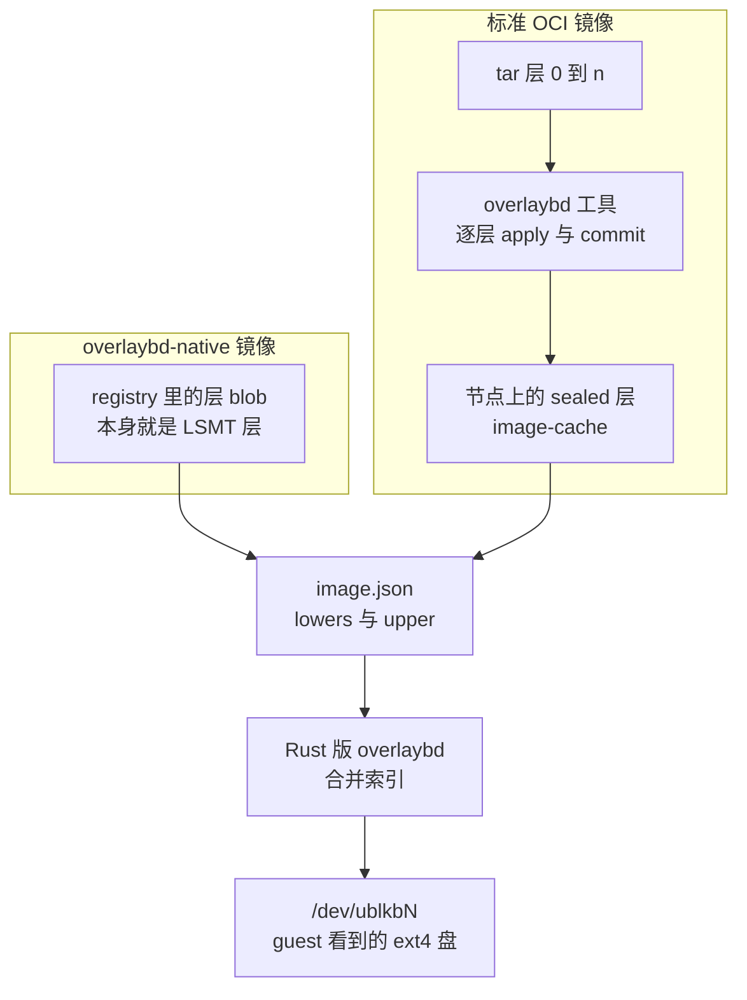
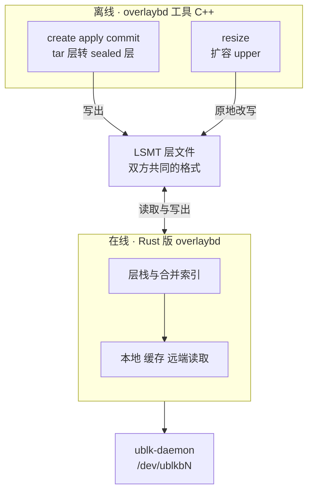

# 05 · overlaybd、LSMT 与 OCI 镜像按需加载

> 容器镜像是一叠 tar 包，要用就得先整份下载、解压、解包；microVM 要的却是一块盘。
> overlaybd 把镜像的每一层改造成一个块级的差分层，多层叠成一块虚拟盘，读到哪一块再从远端取哪一块。
> 本篇讲这个思路、它的两个关键格式（LSMT 与 ZFile）的概念，AgentENV 支持的两种镜像形态，
> 以及 AgentENV 与上游 overlaybd 之间的分工：在线数据面用 Rust 重写，离线转换仍用 C++ 工具。
>
> **读者**：没有接触过 overlaybd 的读者；要读第 34–39 篇与第 45 篇的工程师。　**预备**：容器镜像与 overlayfs 的基本概念、[第 04 篇 · io_uring 与 ublk](04-io-uring-and-ublk.md)。
> **代码**：`storage/overlaybd/src/lsmt/format.rs`（只看常量与注释）、`storage/overlaybd/src/config.rs`、`storage/overlaybd/src/tools/oci.rs`、`src/setup/overlaybd.rs`、`src/image/oci_image.rs`、`config/deps_manifest.toml`

---

## 0. 本篇要回答的问题

1. 用标准 OCI 镜像启动一个容器，为什么必须先下载完全部层？这对 agent 环境意味着什么？
2. 「块级分层」是什么意思？多层怎样叠成一块盘，读一个扇区时怎样找到它的内容？
3. 压缩与随机读天然冲突，ZFile 怎样两者兼得？
4. overlaybd-native 镜像与标准 OCI 镜像在 AgentENV 里各怎样变成一块盘？
5. AgentENV 用了上游 overlaybd 的哪些部分、重写了哪些部分？哪些格式与上游兼容，哪些是扩展？

---

## 1. 问题：tar 层要先下载、再解包

一个 OCI 镜像由三类对象组成，都按内容的 sha256 寻址、存在 registry 里：

- **manifest**：一个 JSON，列出 config 与各层的描述符（`mediaType`、`digest`、`size`，可选的 `annotations`）；
- **config**：镜像的运行配置，ENTRYPOINT、ENV、工作目录等；
- **layer**：每层一个 blob，通常是 gzip 或 zstd 压缩的 tar 包，记录相对下层的文件增删，删除用 whiteout 文件表示。

容器运行时用镜像的方式是：下载每一层、解压、解包到宿主的一个目录，再用 overlayfs 把这些目录叠成一个根文件系统。
这套流程有两个绕不开的前提。其一，gzip 流只能从头顺序解压，要取 tar 里某个文件的某一段，必须先解压它前面的全部字节；
其二，overlayfs 叠的是目录，目录要先存在于本地。所以**启动前必须拿到整个镜像**，哪怕程序启动时只读其中很少一部分文件。

对 agent 环境，这个前提的代价被放大了。每个任务可能带一个不同的镜像，镜像种类远多于任何一台机器能预先存下的数量；
节点上第一次见到某个镜像时，沙箱要等它整份下载解包完才能启动。再者，microVM 的 guest 只认块设备，
即使宿主把目录解包好，还得再做一步「目录变成磁盘镜像」的转换（[第 45 篇 §1](45-oci-to-overlaybd.md#1-问题镜像是-tar-层沙箱要的是块设备)）。

需要的是一种既是块设备、又能按块随机读远端内容的镜像格式。overlaybd（来自阿里巴巴的 DADI 项目，后成为 containerd 子项目）就是这样一种格式。

---

## 2. 块级分层

### 2.1 思路

overlaybd 把「文件级的层」换成「块级的层」。整个镜像对应一块虚拟盘，盘上是一个 ext4 文件系统；
每一层只记录**这一层改写过的扇区**，外加一张映射表：「逻辑盘上第 x 到 x+n 号扇区的内容，在本层文件的第 y 个扇区处」。
多层叠起来时，读一个扇区就从最新的层往下找，第一个有映射的层给出内容；所有层都没有映射的扇区读作 0。

```text
逻辑扇区   0    8    16   24   32   40   48
           ├────┼────┼────┼────┼────┼────┤
 layer 2   ·    ████ ·    ·    ·    ·        最新层：改写了 8..16
 layer 1   ·    ·    ████ ████ ·    ·        改写了 16..32
 layer 0   ████ ████ ████ ·    ████ ·        基础层：mkfs 与初始文件
           ────────────────────────────
 合并视图  L0   L2   L1   L1   L0   零       每段取自最新的那一层
```

这个模型对 guest 完全透明：它看到的就是一块装着 ext4 的盘，挂载、读写都与普通磁盘一样。
层与层之间的关系在宿主侧由 Rust 版 overlaybd 维护，块设备由 ublk 暴露（[第 04 篇](04-io-uring-and-ublk.md)）。
最上面可以再加一个**可写层**（upper）：guest 的写入只落进它，下面的只读层（lower）可以被许多沙箱共享。

块级分层的代价是丢掉了文件语义。同一个文件在两层里各改一次，块层看到的只是两组扇区；whiteout 删除的文件，
它的扇区不会从下层消失，只是 ext4 元数据不再引用它们。所以层不能脱离下层独立解释，这一点在转换时会再次出现（[§3.2](#32-标准-oci逐层转换)）。

### 2.2 LSMT：每层一个文件，多层一张索引

overlaybd 的层文件格式叫 LSMT（取 log-structured merge tree「追加写、合并索引」的意思）。读第六部分要知道的概念只有四个，字节布局在[第 34 篇](34-lsmt-format-and-index.md)：

- **段映射**：一条映射描述一段连续扇区——逻辑偏移、长度、物理偏移，以及一个零段标志与一个层号 `tag`。单位是 512 字节扇区。
  `storage/overlaybd/src/lsmt/format.rs` 里的位宽是：逻辑偏移 50 位、长度 14 位、物理偏移 55 位、零段 1 位、tag 8 位，合计 16 字节。
- **头尾与索引**：sealed（封存后只读）的层文件由头、数据、索引、尾组成，索引是该层全部映射的有序数组。
  读远端层时先只读头尾与索引，这一部分很小；数据部分按偏移随机读。
- **合并索引**：打开层栈时把各层索引合并成一张按逻辑偏移排序、互不重叠的表，每段标明来自哪一层（`tag`）。
  此后每次读都是一次二分查找，层数多少不影响查找次数。`tag` 是 8 位，所以层栈有 255 层的上限（[第 34 篇 §4.3](34-lsmt-format-and-index.md#43-255-层上限)）。
- **可写层**：写入追加到数据末尾，再追加一条映射，后来的映射覆盖先前的。AgentENV 另有原地写为主的布局，三种可写布局见[第 36 篇](36-read-write-paths-and-rw-layouts.md)；
  把可写层冻结成只读层叫封存（seal），见[第 37 篇](37-seal-restack-compact.md)。

### 2.3 ZFile：分块压缩

镜像通常要压缩，而压缩与随机读冲突：gzip 那样的流式压缩，读中间一段要从头解压。
ZFile 的做法是把数据切成固定大小的块（AgentENV 的 `CompressOptions` 缺省 4 KiB、LZ4，`storage/overlaybd/src/compression/zfile.rs`），
每块独立压缩，再记一张「每块压缩后多长」的索引。读某个偏移时先算出块号、查出这块在文件里的位置，只读这一块、只解压这一块。
ZFile 包在 LSMT 层文件外面：LSMT 看到的仍是未压缩的偏移，压缩对它透明，读端靠魔数自动识别（[第 35 篇](35-zfile-compression.md)）。

### 2.4 按需加载

有了「小索引 + 可随机读的数据」，镜像就不必先下载。层文件留在 registry 里，Rust 版 overlaybd 打开层栈时只取各层的索引，
之后 guest 读到哪个扇区，就对相应层的 blob 发一个 HTTP Range GET 取回那一段（`storage/overlaybd/src/backend/registryfs_v2.rs`）。
同一个节点上，取回的数据进入节点块缓存，以 256 KiB 为单位管理（AgentENV 生成的全局配置里 `refillSize = 262144`），
后续的读、乃至其它沙箱对同一层的读都在本地命中；后台还可以把整层慢慢下载下来（[第 39 篇](39-block-cache-and-background-download.md)）。

按需加载换来的是启动不等下载、节点只存真正被读到的部分；付出的是冷读要走网络，第一次触达某块数据的延迟落在 guest 的 I/O 路径上。
AgentENV 在这条代价上又做了几层缓解：节点块缓存、P2P 分发（[第 58 篇](58-p2p-artifact-transport.md)）、内存快照启动时的 trace 预取（[第 43 篇](43-startup-pack-and-prefetch.md)）。

---

## 3. 两种镜像形态

用户给 AgentENV 的仍是一个普通的镜像引用。`src/image/oci_image.rs` 取到 manifest 后按层的 `mediaType` 与注解分类，
落到两种可接受的形态之一（分类表见[第 45 篇 §2.3](45-oci-to-overlaybd.md#23-分类)）。下图是两条路径汇合成一块盘的过程：



### 3.1 overlaybd-native：直接读远端层

native 镜像的每个层 blob 已经是封存好的 overlaybd 层（可能再包一层只含单个文件的 tar，或是 ZFile）。
解析阶段不下载任何 blob，只生成一份 `image.json`：`repoBlobUrl` 指向仓库的 blobs 路径，`lowers` 逐层列出 `digest` 与 `size`。
运行时按 `repoBlobUrl/<digest>` 按需读取（[第 45 篇 §3](45-oci-to-overlaybd.md#3-overlaybd-native不下载任何-blob)）。
这是按需加载收益最完整的形态。

一个标准镜像也可能有现成的 native 版本：OCI 1.1 的 referrers 机制允许 registry 把转换好的制品挂在原 manifest 上，
AgentENV 在配置允许时用 `regctl artifact list` 找 artifactType 为 overlaybd 的 referrer，找到就换用它的层（[第 45 篇 §2.4](45-oci-to-overlaybd.md#24-referrers给标准镜像找加速层)）。

### 3.2 标准 OCI：逐层转换

标准镜像的层是 tar，要先在节点上转成 overlaybd 层。`storage/overlaybd/src/tools/oci.rs` 的 `convert_local_oci_layer_to_overlaybd()`
对每层依次调用三个 C++ 工具：`overlaybd-create` 建一个空的可写层，`overlaybd-apply` 在已有 lower 栈之上把 tar 解进去（第 0 层带 `--mkfs` 先建 ext4），
`overlaybd-commit` 把可写层封存成 `layer.commit`。由于 whiteout 与 ext4 元数据都依赖下层，第 N 层必须叠在前 N 层的转换结果上才能转换，
转换只能串行，转换结果也只能按「源层加整条下层链」来复用（[第 45 篇 §4](45-oci-to-overlaybd.md#4-标准-oci逐层转换)）。

这条路径要先下载 tar 层并在本地转换，第一次使用某个镜像时付出与传统方式相近的代价；
收益在之后：转换好的层以层为单位缓存，共享基础层的镜像只转换一次，沙箱启动时读的是本地 sealed 层。

AgentENV 不支持的形态都在分类时拒绝，其中值得一提的是 turbo-OCI：它的层只带文件系统元数据与 gzip 解压索引，
数据仍在原始的 tar.gz 层里。Rust 版 overlaybd 没有实现这条读路径——`storage/overlaybd/src/image/image_file.rs` 遇到层配置里的
`targetFile`、`targetDigest`、`gzipIndex` 直接报「not migrated in Rust image_file yet」。

---

## 4. 上游 overlaybd 与 AgentENV 的分工

### 4.1 谁做什么

上游 overlaybd（containerd/overlaybd，C++）既有在线数据面，也有离线工具。它的经典前端是 TCMU：
`overlaybd-tcmu` 进程经 LIO SCSI target 把镜像暴露成一块 SCSI 盘（上游 `README.md`）。本书所取的上游默认分支另带一个 ublk 前端，
但它与 AgentENV 无关。AgentENV 只拿上游的一部分：

| 部分 | AgentENV 用什么 | 位置 |
|---|---|---|
| 在线读写：层栈、LSMT、ZFile、registry / 对象存储读取、节点块缓存、预取 | **Rust 版 overlaybd**，在 ublk-daemon 进程里运行 | `storage/overlaybd` |
| 块设备前端 | ublk，替代 TCMU | `storage/ublk`、`storage/ublk-daemon` |
| OCI tar 层转换 | **overlaybd 工具** `overlaybd-create` / `-apply` / `-commit` | `storage/overlaybd/src/tools/oci.rs` 调用 |
| 运行时镜像扩容 | **overlaybd 工具** `overlaybd-resize`，按 GiB 指定新大小 | `storage/ublk-daemon/src/runtime.rs` 的 `run_resize_tool()` |

overlaybd 工具来自 kvcache-ai/overlaybd 的分叉，`config/deps_manifest.toml` 的 `[overlaybd]` 写定版本 `v1.0.18-aenv.1`，
下载地址是 `static-{version}` 发布页上的静态链接压缩包；`src/setup/overlaybd.rs` 负责下载、解包与安装这四个二进制。
tools 盘的转换另有一条约束：`ensure_tools_converter_v1()` 把转换器钉在 `v1.0.18-aenv.1`（注释：「OCI tools v1 must keep the same block layout when the runtime is upgraded」），
即使节点升级了 overlaybd 工具，tools 盘镜像也由同一版本转换，块布局不变（`src/image/resolver.rs` 的 tools 解析分支）。

下图是这条分界：



推论（依据代码结构）：这样分工的理由是两边的约束不同。在线数据面每个请求都要经过，要与 ublk 的 io_uring 模型、
tokio 异步生态和节点级缓存紧密结合，值得重写；离线转换要实现「把 tar 解进 ext4」，涉及完整的文件系统操作，
重写成本高、出错面大，而它只在转换时运行，以子进程调用即可。代价是两套实现必须对同一种磁盘格式保持一致，
而 AgentENV 不控制 C++ 一侧的源码，只能靠固定版本与事后校验（`validate_rw_header_pair_paths()` 检查被 `overlaybd-resize` 原地改过的 upper，[第 34 篇 §6](34-lsmt-format-and-index.md#6-与上游的兼容边界)）。

### 4.2 格式兼容的边界

「Rust 版 overlaybd 与上游兼容」只对一部分格式成立。下表按读第六部分时会遇到的格式列出：

| 格式 | 状态 | 详见 |
|---|---|---|
| LSMT 头尾、段映射、sealed 层与 RW 对、Sparse RW（bit4） | 与上游兼容 | [第 34 篇](34-lsmt-format-and-index.md) |
| Hybrid RW（bit5） | 上游默认分支也定义了这一位，同位同义；写入时复用零段物理空间的 `ReuseZero` 是 Rust 版独有的行为 | [第 34 篇 §6](34-lsmt-format-and-index.md#6-与上游的兼容边界)、[第 36 篇](36-read-write-paths-and-rw-layouts.md) |
| ZFile 头尾、jump table、CRC 变体 | 与上游兼容 | [第 35 篇](35-zfile-compression.md) |
| 单文件 tar 包裹的远端 blob | 与上游兼容 | [第 38 篇](38-virtualfile-chain-and-remote-io.md) |
| `image.json` | 字段沿用上游的 camelCase；`upper.mode` 等是 AgentENV 新增（上游 `src/config.h` 的 `UpperConfig` 只有 `index`、`data`、`target`、`gzipIndex`） | [第 36 篇](36-read-write-paths-and-rw-layouts.md) |
| 预合并索引缓存 `PMIDX001` | AgentENV 扩展，只在本地缓存目录 | [第 34 篇](34-lsmt-format-and-index.md) |
| 节点块缓存 `meta.bin`（`OBCH`） | AgentENV 扩展，与上游缓存格式不兼容 | [第 39 篇](39-block-cache-and-background-download.md) |
| startup manifest `AENVMF01` | AgentENV 扩展 | [第 43 篇](43-startup-pack-and-prefetch.md) |

缓存键也与上游不同，值得单独一提。上游按 blob 的 digest 给缓存条目取名，同一层从不同 registry 拉取会命中同一条目；
Rust 版 overlaybd 照搬了这个变换（`ImageService::build_file_cache()` 的 `basename_transform`），但在线读取路径直接以完整 URL 作键，
变换只在没有外部调用者的 `CachedFs` 里生效。所以在 AgentENV v0.2.3 里，**节点块缓存按完整 URL 区分条目**，同一 digest 换一个仓库地址就是另一个条目（[第 39 篇 §2.2](39-block-cache-and-background-download.md#22-条目与键)）。

### 4.3 没有迁移的上游特性

Rust 版 overlaybd 遇到下面这些上游配置会在打开镜像时报错，而不是静默忽略：

- 层配置里的 `targetFile`、`targetDigest`、`gzipIndex`（turbo-OCI 与 gzip 索引一类的读路径），见 `ImageFile` 打开 lower 与 upper 的检查；
- 缓存类型 `ocf` 与 `download`：`ImageService` 构建缓存时报「cache type … is not migrated in Rust image_service yet」，只实现了 file 缓存；
- TCMU 前端：由 ublk 取代。

---

## 5. 这些概念在本书哪里用到

| 概念 | 用到的篇目 |
|---|---|
| 块级分层、可写层与只读层、层栈 | [第 26 篇](26-sandbox-block-devices.md)、[第 31 篇](31-extra-drives-and-volumes.md)、[第 36 篇](36-read-write-paths-and-rw-layouts.md) |
| LSMT 段映射、合并索引、tag 与 255 层上限 | [第 34 篇](34-lsmt-format-and-index.md)、[第 37 篇](37-seal-restack-compact.md)、[第 42 篇](42-memory-snapshot-over-ublk.md) |
| ZFile 分块压缩 | [第 35 篇](35-zfile-compression.md)、[第 48 篇](48-object-storage-repository.md) |
| Range GET 按需读、节点块缓存与后台下载 | [第 38 篇](38-virtualfile-chain-and-remote-io.md)、[第 39 篇](39-block-cache-and-background-download.md)、[第 58 篇](58-p2p-artifact-transport.md) |
| native 与标准 OCI 两种形态、referrers、逐层转换 | [第 45 篇](45-oci-to-overlaybd.md)、[第 50 篇](50-rootfs-as-oci-image.md)、[第 53 篇](53-buildkit-in-microvm.md) |
| overlaybd 工具的调用与 `overlaybd-resize` | [第 41 篇](41-ublk-daemon.md)、[第 45 篇](45-oci-to-overlaybd.md)、[第 59 篇](59-host-setup-and-privileges.md) |
| 与上游的格式兼容边界 | [第 34 篇](34-lsmt-format-and-index.md)、[第 35 篇](35-zfile-compression.md)、[第 73 篇](73-artifacts-and-formats-reference.md) |
| 冷读代价与启动加速 | [第 43 篇](43-startup-pack-and-prefetch.md)、[第 66 篇](66-vs-e2b-infra-storage-and-memory.md) |

---

## 6. 小结

- 标准 OCI 层是压缩的 tar，只能顺序解压、要解包成目录才能用，所以启动前必须拿到整个镜像。
- overlaybd 把每层改造成块级差分层：只存改写过的扇区与一张映射表；多层叠成一块装着 ext4 的虚拟盘，guest 无感知。
- 块级分层丢掉了文件语义，层不能脱离下层独立解释，标准镜像的转换因此只能逐层串行。
- LSMT 的合并索引让每次读都是一次二分查找，与层数无关；8 位 tag 带来 255 层上限。
- ZFile 按固定块独立压缩并记录每块长度，压缩后仍可随机读，对 LSMT 透明。
- 按需加载用 Range GET 取远端层的片段，换来启动不等下载，代价是冷读走网络；节点块缓存、P2P 与预取都在缓解这一代价。
- native 镜像解析时不下载任何 blob；标准镜像在节点上用 overlaybd 工具逐层转换，结果按层缓存复用。
- AgentENV 在线数据面是 Rust 重写、经 ublk 暴露；离线转换与扩容仍调用 `v1.0.18-aenv.1` 的 C++ 工具，双方靠同一种磁盘格式协作。
- 与上游兼容的是 LSMT、ZFile 与 tar 包裹；Hybrid RW 上游也有定义而 `ReuseZero` 是 Rust 版独有；`PMIDX001`、`OBCH`、`AENVMF01` 是扩展；节点块缓存按完整 URL 而不是 digest 取键。

## 延伸阅读 / 下一篇

- 下一篇：[第 06 篇 · 网络命名空间、iptables 与透明代理](06-netns-iptables-transparent-proxy.md)。
- [第 34 篇 · LSMT 格式与索引](34-lsmt-format-and-index.md)：本篇 §2.2 的字节级展开。
- [第 45 篇 · 从 OCI 镜像到 overlaybd 层栈](45-oci-to-overlaybd.md)：本篇 §3 的完整决策树与 image-cache。
- Li Huiba 等，「DADI: Block-Level Image Service for Agile and Elastic Application Deployment」，USENIX ATC 2020：overlaybd 设计的原始论文。
- containerd/overlaybd 与 containerd/accelerated-container-image 两个仓库的文档：上游实现与镜像转换工具链。
- OCI Image Specification 与 Distribution Specification（v1.1 起含 referrers API）。
