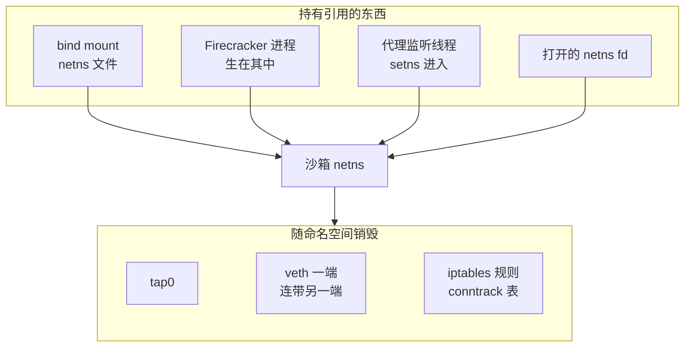
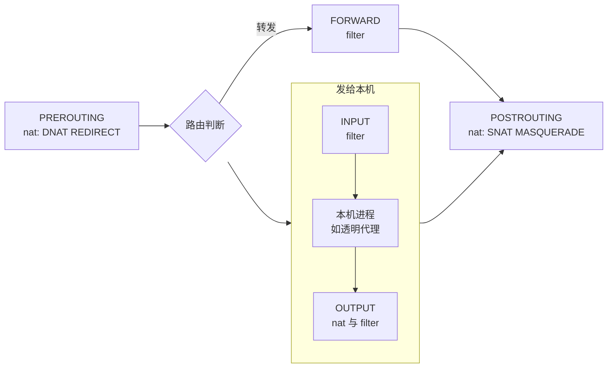

# 06 · 网络命名空间、iptables 与透明代理

> AgentENV 给每台沙箱的网络是用 Linux 内核里几样现成的东西搭起来的：一个网络命名空间、一对 veth、一个 tap、几条 iptables 规则，外加一个靠 `SO_ORIGINAL_DST` 工作的透明代理。
> 本篇只讲读第 29、30 篇必须知道的那部分内核语义，尤其是几处容易想错的地方：命名空间属于线程而不是进程，nat 表只看连接的第一个包，代理自己发出的包不经过 FORWARD。
>
> **读者**：熟悉 TCP/IP 与 socket 编程、没有直接配过网络命名空间或 iptables 的读者。　**预备**：无。
> **代码**：`src/sandbox/network/slot.rs`、`src/sandbox/network/iptables_util.rs`、`src/sandbox/network/egress_proxy.rs`、`src/sandbox/firecracker/instance.rs`、`src/privileges.rs`

---

## 0. 本篇要回答的问题

1. 网络命名空间隔离了哪些东西？为什么说它的成员关系属于线程？命名空间什么时候被销毁？
2. tap 与 veth 各是什么？`/31` 与 link-local 地址为什么适合拿来连沙箱？
3. 一个包在 netfilter 里经过哪些钩子？filter 与 nat 两张表分别在哪几个钩子上起作用？本机进程发出的包与转发的包走的路有什么不同？
4. SNAT、MASQUERADE、DNAT、REDIRECT 有什么区别？conntrack 在其中扮演什么角色？
5. `iptables-restore --noflush` 提交规则时，原子性的边界在哪里？
6. 透明代理怎样拿到连接原本要去的地址？怎样在不终止 TLS 的前提下看到域名？

---

## 1. 问题：一台节点上的成千上万张私有网络

一台沙箱要能上网、能被宿主访问，又不能看见别的沙箱和宿主上的服务。如果所有沙箱的网卡都放在宿主的网络栈里，
它们共享一张路由表、一套防火墙规则、一个端口空间：给一台沙箱写的规则要靠接口名或地址精确匹配才不会误伤别人，
任何一条写错的规则都可能把一台沙箱的流量放进另一台。

Linux 的回答是把网络栈本身复制成多份。每份是一个**网络命名空间**（network namespace，netns），拥有自己的接口、路由、规则与连接跟踪表。
沙箱的网络于是变成了一个「小路由器」：一侧连 guest，一侧连宿主，中间的转发与过滤规则只对这一台沙箱生效。
剩下的问题是怎样把几个命名空间连起来（第 3 节）、在它们之间做什么样的地址转换与过滤（第 4 节），以及当规则只认 IP 而策略写的是域名时怎么办（第 5 节）。

---

## 2. 网络命名空间

### 2.1 隔离的是什么

一个网络命名空间里有一整套独立的网络状态：

- 网络接口（包括它自己的 `lo`），以及接口上的地址；
- 路由表与邻居（ARP）表；
- netfilter 规则（iptables 的所有表与链）和连接跟踪（conntrack）表；
- socket 的端口空间：两个命名空间可以各有一个进程监听 `0.0.0.0:15000` 而互不冲突；
- `/proc/sys/net/` 下的大部分参数，例如 `net.ipv4.ip_forward`、每个接口的 `neigh/<if>/retrans_time_ms`。

最后一条常被忽略。宿主打开了 IP 转发，新建的命名空间里转发仍然是关着的；
所以 AgentENV 建好命名空间后要在里面单独写一次 `ip_forward = 1`，接口级的 ARP 参数也在命名空间里单独调（[第 29 篇](29-network-slots.md)）。
同理，第 30 篇里每台沙箱的出站代理都能监听同一个端口 15000，靠的就是端口空间的隔离。

### 2.2 成员关系属于线程

进程「在哪个命名空间里」，在内核里其实是每个**任务**（task，即线程）的属性。两个系统调用改变它：

- `unshare(CLONE_NEWNET)`：新建一个命名空间，并把**调用线程**移进去；
- `setns(fd, CLONE_NEWNET)`：把**调用线程**移进 `fd` 所指的已有命名空间。

同一进程的其它线程不受影响。新线程与 `fork` 出来的子进程继承**创建它的那个线程**当时所在的命名空间。
这两条规则合起来，决定了一个多线程程序在命名空间里做事的标准写法：开一个专用线程，在里面 `setns` 或 `unshare`，
然后在这个线程里完成所有需要「身在其中」的操作，包括 spawn 外部命令（子进程从这个线程 fork，所以生在目标命名空间里）。

对 tokio 这样的多线程 runtime 来说，这条规则有直接后果：一个任务在工作线程上调用了 `setns`，之后被调度到这个线程上的**所有**任务都会跑在沙箱的命名空间里，
而任务还会在 `.await` 处被换到别的线程上，命名空间状态与任务对不上。所以 AgentENV 从不在 runtime 的工作线程上切换命名空间，而是统一用一次性的 OS 线程：

- 建槽位：`Slot::create_network()` 每次 `thread::spawn` 一个线程，在其中 `unshare(CLONE_NEWNET)`，再在这个线程里起一个 `current_thread` runtime 跑 netlink 配置；
- 改规则：`Slot::set_egress_policy()` 开线程 `setns` 进去，再执行 `iptables-restore`，后者作为子进程继承了这个线程的命名空间；
- 起 Firecracker：`privileges::spawn_tokio_command_scoped()` 开一个 launcher 线程，`src/sandbox/firecracker/instance.rs` 传入的闭包在其中 `setns`，然后 spawn（[第 25 篇](25-backend-and-firecracker-process.md)）；
- 长驻线程：出站代理的监听线程（`EgressProxy::ensure_listener()`）`setns` 进沙箱命名空间后 bind；宿主侧解析线程（`src/sandbox/network/resolver.rs`）反过来 `setns` 回宿主命名空间。

要回到原来的命名空间，必须事先拿着指向它的 fd。`/proc/thread-self/ns/net` 指向调用线程当前的命名空间；
`/proc/self/ns/net` 看的是主线程，在多线程进程里两者可能不同。`slot.rs` 的 `host_ns_fd()` 在任何 `unshare` 之前打开前者并存进 `OnceLock`，之后把 veth 移回宿主时用它。

### 2.3 命名空间的寿命

命名空间按引用计数存活。以下任何一样都算一个引用：一个身在其中的任务、一个打开着的 `/proc/<pid>/ns/net` 类 fd、一个 bind mount 到某个文件上的命名空间。
最后一个引用消失时，内核销毁命名空间，里面的接口一并删除——veth 的一端被删，另一端也随之消失。



只靠线程持有的命名空间，在建它的线程退出时就没了。为了让命名空间比建它的线程活得久，常规做法是 bind mount：
先建一个空文件，再把 `/proc/thread-self/ns/net` bind mount 到这个文件上。`ip netns add` 在 `/run/netns/` 下做的正是这件事，
`Slot::setup_namespace_internal()` 用同样的手法把命名空间挂到 `$AENV_RUNTIME/netns/agentenv-ns-<uuidv7>`。
之后任何人打开这个文件得到的 fd 都可以交给 `setns`。

拆除时要反过来：`umount` 这个文件（同一个文件可能被挂载多次，所以要循环到 `EINVAL`），再删文件。
只要还有别的引用——比如一个没被杀掉的 Firecracker 进程——命名空间就不会消失，这是第 29 篇 §6.5「残留接口永久占位」的根源。
同理，出站代理的监听线程身在命名空间里，`Slot::cleanup()` 必须先停它。

### 2.4 需要哪些权限

`unshare(CLONE_NEWNET)` 与 `setns` 需要 `CAP_SYS_ADMIN`；在命名空间里建接口、改地址与路由、写 iptables 需要 `CAP_NET_ADMIN`。
AgentENV 把这两类操作分开：`setns` 在清空能力之前做，外部命令（`ip`、`iptables-restore`）放进 `privileges::run_with_scoped_capabilities()` 开出的、只持有 `CAP_NET_ADMIN` 的临时线程里执行。
这个临时线程由当前线程创建，继承了当前线程的命名空间，所以在命名空间线程里调用它，命令就作用于沙箱命名空间。权限模型的全貌在[第 59 篇](59-host-setup-and-privileges.md)。

---

## 3. 接口与地址

### 3.1 tap：一端是网卡，一端是文件描述符

tap 设备在内核网络栈里是一张普通的以太网卡，另一端是一个用户态进程持有的 fd：进程 `read` 得到的是内核要从这张网卡发出的以太网帧，`write` 进去的帧被当作从这张网卡收到的。
Firecracker 的 virtio-net 设备就是这样工作的：guest 发出的帧被 Firecracker 写进 tap，宿主发往 tap 的帧被 Firecracker 读出来放进 guest 的接收队列（见 Firecracker 手册第 30 篇）。

两个细节与本书有关。第一，进程按名字打开 tap（`/dev/net/tun` 上的 `TUNSETIFF`），名字在**打开它的进程所在的命名空间**里查找，
所以 Firecracker 必须生在沙箱命名空间里才能打开那里的 `tap0`，而每个命名空间里的 tap 都可以叫同一个名字。
第二，`ip tuntap add` 建出来的是持久 tap，不依赖任何进程打开它；AgentENV 在建槽位时就把它建好、配好地址，Firecracker 以后只是打开它（`slot.rs`）。

### 3.2 veth：跨命名空间的一根网线

veth 总是成对创建，从一端发进去的包从另一端出来，像一根网线。关键能力是**一端可以移到另一个命名空间**：
netlink 建接口时带上目标命名空间的 fd（`IFLA_NET_NS_FD`）即可。AgentENV 的做法是在沙箱命名空间里建出一对，再把其中一端移回宿主（第 29 篇 §4.2）。
删除任一端，整对一起消失，所以清理时只删宿主一端就够了。

guest、tap、veth、宿主之间于是形成一条链：guest 的 `eth0` 经 virtio-net 到 tap，tap 与 veth 在同一个命名空间里由转发连起来，veth 的另一端在宿主上。
沙箱命名空间在这里扮演一台两口的路由器：打开 `ip_forward`，默认路由指向宿主那一端。

### 3.3 `/31` 与 link-local 地址

一条只有两个端点的链路不需要网络地址和广播地址。传统的 `/30` 有四个地址，只有两个能用；
**RFC 3021** 允许 `/31` 用于点对点链路，两个地址都分给端点，没有广播地址。AgentENV 的 veth 链路用 `/31`，从而一个 `/16` 能连 32768 个槽位。
有一处实现细节：rtnetlink crate 的地址构造器总会算出一个广播地址填进 `RTM_NEWADDR`，这在 `/31` 上不对，
所以 `slot.rs` 的 `add_address_no_broadcast()` 自己拼消息，只带 `IFA_ADDRESS` 与 `IFA_LOCAL`。

guest 与 tap 之间用的是 `169.254.0.20/30`。`169.254.0.0/16` 是 IPv4 的 link-local 网段（RFC 3927），按定义只在一条链路上有意义，路由器不转发。
推论：选它给 guest 链路，好处是不会与任何真实网络的地址冲突，即使所有槽位都用同一组地址，也只在各自的命名空间里可见。
同一网段里还有云厂商的元数据服务 `169.254.169.254`，所以 AgentENV 的出站策略默认拒绝整个 `169.254.0.0/16`（[第 30 篇](30-egress-policy-and-proxy.md)）。

最后一个概念是**不配在任何接口上的地址**。路由只需要一个目标和一个下一跳，目标地址不必属于哪张网卡。
宿主上 `ip route add <addr>/32 via <对端> dev veth-<i>` 之后，发往 `<addr>` 的包就被交给沙箱命名空间，再由那里的 DNAT 改写成 guest 地址。
第 29 篇的 host interaction IP 就是这样一个只存在于路由表里的地址。

---

## 4. netfilter 与 iptables

### 4.1 钩子、表与链

netfilter 是内核网络栈里的一组**钩子**（hook），包在固定的几个位置被交给规则检查。IPv4 有五个：

- `PREROUTING`：包从接口进来、做路由判断之前；
- `INPUT`：路由判断为「发给本机」之后；
- `FORWARD`：路由判断为「转发给别的接口」之后；
- `OUTPUT`：本机进程发出的包，路由判断之后；
- `POSTROUTING`：包从接口出去之前。

iptables 把规则按用途分进**表**（table），每张表在其中几个钩子上各有一条同名的内置**链**（chain）。本书只用到两张：

| 表 | 用途 | 本书用到的内置链 |
|---|---|---|
| `filter` | 放行或拒绝 | `INPUT`、`FORWARD` |
| `nat` | 改写地址与端口 | `PREROUTING`、`POSTROUTING`（`OUTPUT` 只在说明代理时提到） |



图里最要紧的是两条路的分叉。guest 发出、穿过命名空间的包走 `PREROUTING → FORWARD → POSTROUTING`；
命名空间里一个进程自己发出的包走 `OUTPUT → POSTROUTING`，**不经过 FORWARD**。
第 30 篇的出站代理正是这样一个进程：它向上游发起的连接看不到挂在 FORWARD 上的出站规则，所以代码里要再查一遍绝对拒绝的网段。

### 4.2 规则、目标与自定义链

一条链是一个有序的规则列表。每条规则由若干匹配条件（`-i tap0`、`-d 10.0.0.0/8`、`-p tcp --dport 443`）和一个**目标**（target，`-j` 后面的东西）组成。
包从链头逐条比对，第一条匹配且目标是终结性的（`ACCEPT`、`REJECT`、`DROP`）就决定了它在这张表这条链上的命运；
走到内置链的末尾都没有命中，就按链的默认策略（policy）处理。

- `ACCEPT` 放行，`DROP` 静默丢弃，`REJECT` 丢弃并回一个错误（默认是 ICMP 端口不可达，TCP 连接方会立刻看到连接被拒绝）。AgentENV 的拒绝一律用 `REJECT`，guest 里的程序因此能快速失败而不是等超时。
- `-j <自定义链>` 跳进一条用户建的链（`-N` 创建）；那条链走完没有命中，就回到跳转处的下一条继续。AgentENV 用这种方式把出站策略组织成 `AGENTENV-EGRESS` 与 `AGENTENV-USER-EGRESS` 两级，替换策略时只清空（`-F`）用户链。
- `-I <链> 1` 插到链头，`-A` 追加到链尾。位置决定优先级：AgentENV 把自己的入口插到内置链第一位，宿主全局规则则是追加，后者在宿主已有更早的 DROP 时不会被走到（第 29 篇 §6.1）。

### 4.3 地址转换

nat 表的四个目标：

| 目标 | 链 | 改什么 | 典型用途 |
|---|---|---|---|
| `SNAT --to <addr>` | `POSTROUTING` | 源地址改为指定地址 | 让出站包带上固定身份 |
| `MASQUERADE` | `POSTROUTING` | 源地址改为出口接口的当前地址 | 出口地址可能变化的上网 NAT |
| `DNAT --to <addr>` | `PREROUTING` | 目的地址改为指定地址 | 把一个对外地址映射到内部主机 |
| `REDIRECT --to-ports <p>` | `PREROUTING` | 目的地址改为入口接口的主地址，端口改为 `p` | 把流量交给本机的代理 |

理解 nat 表的关键是：**它只对一条连接的第一个包查规则**。第一个包决定的转换被记进 conntrack，之后同一连接的包——包括反方向的回包——都由 conntrack 自动按相同或相反的方式改写，不再查 nat 表。
所以 AgentENV 只写了 guest 到外部的 SNAT 与宿主到 guest 的 DNAT，回包的地址恢复不需要任何规则；
一个出站包在命名空间里 SNAT、在宿主上再 MASQUERADE，两层转换各记在各自命名空间的 conntrack 表里，回来时逐层还原。
也因为这条规则，往 nat 表里新增一条 REDIRECT，只影响之后新建的连接，已经建立的连接继续按原来的方式转换。

### 4.4 conntrack 与状态匹配

conntrack 为每条连接（按五元组）维护一个条目，记录它的状态与 NAT 映射。filter 规则可以按状态匹配：

- `NEW`：这条连接的第一个包；
- `ESTABLISHED`：已经看到过双向流量的连接上的包；
- `RELATED`：与已有连接相关的新流，例如该连接引起的 ICMP 错误。

`-m conntrack --ctstate ESTABLISHED,RELATED` 与较老的 `-m state --state RELATED,ESTABLISHED` 等价，AgentENV 的规则里两种写法都出现。
「已建立连接放行」通常是一条链的第一条规则，于是真正的策略只需要判定 `NEW` 包：
宿主 INPUT 上这条规则加一条 REJECT，效果就是「宿主可以连沙箱，沙箱不能主动连宿主」；出站链的第一条让宿主发起的 envd 连接的回包不受出站策略影响。

conntrack 表也是命名空间级的，条目按超时老化，**不随规则变化而清空**。这是一把双刃剑：替换规则不会切断已有连接，
但一个被复用的命名空间里留着上一位使用者的条目（第 30 篇 §6.4）。宿主上 conntrack 表的容量由 `nf_conntrack_max` 限制，第 29 篇 §5.4 的容量参数里有它。

### 4.5 `iptables-restore` 与原子性

逐条执行 `iptables` 命令有两个问题：每条一次 fork，几十条规则就是几十次；中途失败时规则集停在一半。
`iptables-restore` 从标准输入读一份脚本，按表提交：

```text
*filter
-N AGENTENV-EGRESS
-I FORWARD 1 -i tap0 -o vpeer -j AGENTENV-EGRESS
-A AGENTENV-EGRESS -m conntrack --ctstate ESTABLISHED,RELATED -j ACCEPT
COMMIT
*nat
-A POSTROUTING -o vpeer -s 169.254.0.21 -j SNAT --to <hip>
COMMIT
```

每个 `*表名` 到 `COMMIT` 之间的内容在内核里一次替换，要么全部生效，要么全部不生效。不带参数时它会先清空脚本里出现的每张表，
`--noflush` 则保留表里已有的规则、只施加脚本里的增删。AgentENV 的 `iptables_util.rs` 把一组 `IptablesRestoreCommand` 渲染成这样的脚本，以 `--noflush` 一次写入（第 29 篇 §4.3）。

原子性的边界是**单张表**：一份脚本里的 filter 与 nat 是两次独立提交，前一个成功、后一个失败时，内核里留下的是一半新规则。第 30 篇 §5.2 末尾讨论的不一致窗口就出在这里。
另外，现代发行版的 `iptables-restore` 常常是 iptables-nft 前端，规则实际落在 nftables 的兼容表里；对写规则的一方这是透明的，但用 `nft` 查看时会看到另一种表示。

---

## 5. 透明代理

### 5.1 REDIRECT 之后，原目的地在哪里

「透明」指客户端不知道代理存在：guest 里的程序照常连 `x.x.x.x:443`，不配置任何代理。实现分两步。
第一步，nat 表 `PREROUTING` 上一条 `-p tcp --dport 443 -j REDIRECT --to-ports 15000`，把这条连接的目的地改成命名空间里的本机地址、端口 15000。
第二步，一个监听在 `0.0.0.0:15000` 上的进程 `accept` 这条连接。

问题在于，`accept` 得到的 socket 的本端地址已经是改写后的 `本机:15000`，原来的 `x.x.x.x:443` 从 socket 上看不出来。
它保存在 conntrack 条目里，内核通过一个 socket 选项把它交出来：

```rust
// src/sandbox/network/egress_proxy.rs，original_destination()，有删节
const SO_ORIGINAL_DST: libc::c_int = 80;
…
libc::getsockopt(fd, libc::SOL_IP, SO_ORIGINAL_DST,
                 &mut address as *mut _ as *mut libc::c_void, &mut length)
```

`SO_ORIGINAL_DST`（值 80，定义在内核头文件 `linux/netfilter_ipv4.h`）返回一个 `sockaddr_in`，即 DNAT / REDIRECT 之前的目的地址与端口。
它只有 IPv4 版本；IPv6 要用另一个选项，这是 AgentENV 的代理只支持 IPv4 的原因之一（第 30 篇 §3.2）。
内核还提供另一种透明代理机制 TPROXY，不改写目的地址、由代理用 `IP_TRANSPARENT` socket 直接接收；AgentENV 没有用它。

这个设计还有一个前提：REDIRECT 发生在命名空间的 `PREROUTING` 上，连接对内核来说是「发给本机」的，走 `INPUT`，不再走 `FORWARD`；
所以被重定向的连接也不经过 FORWARD 上的出站规则，是否放行完全由代理决定。

### 5.2 看见域名：Host 与 SNI

拿到原目的地之后，代理还要知道 guest 想访问哪个域名。代理不终止 TLS，能看到的只有连接开头的几百个字节，这里有两处明文：

- **HTTP/1.x 的 `Host` 头**。明文 HTTP 请求的头部里必有 `Host: example.com`。
- **TLS ClientHello 的 SNI 扩展**。TLS 握手的第一条消息由客户端发出、不加密，其中 `server_name` 扩展写着要访问的主机名。

```text
TLS 记录头      content_type = 22 (handshake) | version (2 B) | length (2 B)
handshake 头    msg_type = 1 (ClientHello)    | length (3 B)
ClientHello     version | random (32 B) | session_id | cipher_suites | compression
扩展列表        … | type = 0 (server_name) | … host_name … | …
```

`egress_proxy.rs` 的 `parse_protocol_host()` 在原端口为 443 或首字节为 22 时按 TLS 解析（`parse_tls_sni()`），否则按 HTTP 解析（`parse_http_host()`）。
ClientHello 可能被拆进多个 TLS 记录，所以解析器要先拆记录、再拼握手消息。

读到域名之后，代理已经从 guest 那里收了一段字节（preface）。它判定放行后连上游，**先把这段 preface 原样写过去**，再开始双向转发；
对上游来说，这条连接与 guest 直连没有区别，TLS 会话在 guest 与上游之间端到端。
代价是代理只在连接开头做一次判定：同一条连接上之后发生的事——HTTP keep-alive 上的下一个请求、TLS 内层的 `Host`、HTTP/2 的连接复用、加密的 ECH——它都看不见（第 30 篇 §6.2）。

---

## 6. 这些概念在本书哪几篇被用到

| 概念 | 用到的篇目 |
|---|---|
| 命名空间的线程级成员关系、一次性线程里 `unshare` / `setns` | [第 25 篇](25-backend-and-firecracker-process.md)（launcher 线程拉起 Firecracker）、[第 29 篇](29-network-slots.md)（建槽位）、[第 30 篇](30-egress-policy-and-proxy.md)（代理与解析线程） |
| bind mount 的 netns 文件、命名空间寿命 | [第 29 篇](29-network-slots.md)（清理与残留）、[第 22 篇](22-persistence-across-restarts.md)（重启时清残留挂载）、[第 33 篇](33-custom-extension-hooks.md)（扩展拿到 netns 路径） |
| tap、veth、`/31`、link-local、只在路由表里的地址 | [第 29 篇](29-network-slots.md)（拓扑与地址计划）、[第 17 篇](17-reverse-proxy.md)与[第 28 篇](28-mmds-and-envd.md)（宿主经 host interaction IP 访问 guest） |
| netfilter 钩子、filter / nat 表、自定义链 | [第 29 篇](29-network-slots.md)（包路径）、[第 30 篇](30-egress-policy-and-proxy.md)（出站判定链） |
| SNAT / MASQUERADE / DNAT、conntrack 状态与残留 | [第 29 篇](29-network-slots.md)（双层源地址转换）、[第 30 篇](30-egress-policy-and-proxy.md)、[第 32 篇](32-warm-pools.md)（预热槽位复用） |
| `iptables-restore --noflush` 与按表原子 | [第 29 篇](29-network-slots.md)、[第 30 篇](30-egress-policy-and-proxy.md)（替换策略的失败窗口） |
| REDIRECT、`SO_ORIGINAL_DST`、Host / SNI 嗅探 | [第 30 篇](30-egress-policy-and-proxy.md) |
| `CAP_SYS_ADMIN` 与 `CAP_NET_ADMIN` 的分工 | [第 25 篇](25-backend-and-firecracker-process.md)、[第 59 篇](59-host-setup-and-privileges.md) |

---

## 7. 小结

- 网络命名空间复制了整套网络状态：接口、路由、邻居表、iptables、conntrack、端口空间与 `net.*` sysctl；宿主的 `ip_forward` 不会带进新命名空间。
- 命名空间成员关系是线程属性；新线程与子进程继承创建者线程的命名空间。多线程 runtime 里切换命名空间要用一次性的 OS 线程，外部命令从那个线程 spawn。
- 命名空间按引用计数存活，bind mount 让它脱离任何进程独立存在；只要还有一个进程身在其中，umount 也销毁不了它。
- tap 一端是网卡一端是 fd，按名字在打开者的命名空间里查找；veth 成对、一端可移入别的命名空间、删一端整对消失。
- `/31` 让点对点链路不浪费地址；link-local 地址只在本链路有意义，适合做各槽位相同的 guest 链路；路由目标可以是不配在任何接口上的地址。
- 转发的包走 `PREROUTING → FORWARD → POSTROUTING`，本机进程发出的包走 `OUTPUT → POSTROUTING`，不经过 FORWARD。
- nat 表只对连接的第一个包查规则，其后与回包由 conntrack 自动改写；conntrack 条目不随规则变化清空。
- `iptables-restore --noflush` 的原子性以单张表为界，跨表提交可能只成功一半。
- 透明代理靠 REDIRECT 接管连接、用 `SO_ORIGINAL_DST` 取回原目的地，靠 Host 头与 TLS SNI 看见域名，转发前回放 preface；判定只在连接开头做一次。

---

## 延伸阅读 / 下一篇

- [第 29 篇 · 网络（一）：槽位、命名空间与地址计划](29-network-slots.md)、[第 30 篇 · 网络（二）：出站策略与透明代理](30-egress-policy-and-proxy.md)：本篇概念的具体用法。
- [e2b 手册第 07 篇 · 沙箱网络的内核基础](../e2b-infra/07-linux-networking-for-sandboxes.md)：同一组内核机制的另一个视角，侧重 nftables。
- [Firecracker 手册第 30 篇 · virtio-net：tap、收发路径与 offload](../firecracker/30-virtio-net.md)：tap 另一侧的设备模拟。
- man 页：`network_namespaces(7)`、`setns(2)`、`veth(4)`、`iptables-extensions(8)`（REDIRECT、conntrack 匹配）、`iptables-restore(8)`；RFC 3021、RFC 3927、RFC 6066（TLS SNI）。
- 下一篇：[第 07 篇 · 本书用到的 Rust 异步与依赖 crate](07-rust-async-primer.md)。
