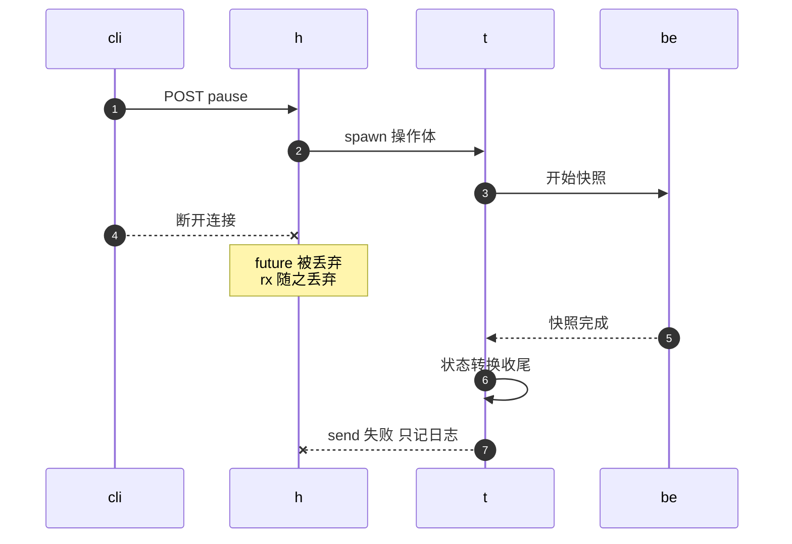

# 07 · 本书用到的 Rust 异步与依赖 crate

> 读 AgentENV 的 Rust 代码，难点很少在语法，多数在执行模型：一段代码跑在哪个线程上、能不能在 `.await` 处被取消、能不能阻塞、能不能跨线程移动。
> 本篇不是 Rust 教程，只讲读这份代码必须认识的 tokio 概念、几个反复出现的写法，以及依赖 crate 各自承担什么。
>
> **读者**：会读 Rust 基本语法、没有写过 tokio 程序的读者；写过的读者可以只看第 2 节的表与第 5、8 节。　**预备**：无。
> **代码**：`Cargo.toml`、`src/bin/server.rs`、`src/orchestrator/service.rs`、`storage/ublk/src/dev.rs`、`storage/overlaybd/src/io/vfile_io.rs`、`storage/overlaybd/src/backend/local.rs`、`src/local_store.rs`

---

## 0. 本篇要回答的问题

1. tokio 的多线程 runtime 与 `current_thread` runtime 有什么不同？AgentENV 的两个进程里各有哪些 runtime 和线程，各跑什么？
2. 为什么有的 future 必须是 `Send`，有的故意不是？`LocalSet` 解决什么问题？
3. 在 async 代码里做阻塞操作有哪几种办法？`spawn_blocking` 的代价是什么？
4. 丢弃一个 future 意味着什么？什么叫取消安全，`run_cancellation_safe()` 的写法保证了什么、没保证什么？
5. `oneshot`、`watch`、`broadcast`、`Notify`、`OnceLock` 各用在什么场合？
6. 依赖里的 axum、tonic、RocksDB、opendal、iroh、io-uring、arc-swap、dashmap 等 crate 各负责什么？

---

## 1. 问题：同一行代码，在不同线程上意思不同

`setns()` 在一个 tokio 工作线程上执行，会把之后调度到这个线程上的所有任务带进沙箱的网络命名空间（[第 06 篇](06-netns-iptables-transparent-proxy.md)）；
一次 `pread` 在多线程 runtime 上只占住一个工作线程，在 `current_thread` runtime 上却会让整个 runtime 停下；
同一个 HTTP 客户端，被不同 runtime 上的请求先后使用，连接会被第一个使用者的 runtime 拥有（[第 38 篇](38-virtualfile-chain-and-remote-io.md)）。

这些都不是 Rust 语法的问题，而是「代码在哪里执行」的问题。AgentENV 的两个 Rust 进程——节点进程 `server` 与 ublk-daemon——里同时存在好几种执行体，
很多设计决定只有放回这个背景下才讲得通。本篇先讲执行体（第 2 节），再讲 `Send`、阻塞与取消三条约束（第 3–5 节），最后是同步原语、依赖 crate 与代码纪律。

---

## 2. tokio 的执行模型

### 2.1 future、任务与两种 runtime

Rust 的 `async fn` 被编译成一个状态机，即 future。future 本身什么都不做，要有人反复调用它的 `poll()`；每到一个还没就绪的 `.await`，`poll()` 返回 `Pending`，等 I/O 就绪时再被唤醒。
**runtime** 就是这个「有人」：它维护一组任务（`tokio::spawn` 交给它的顶层 future），在 I/O 事件到来时 poll 对应的任务。

tokio 有两种 runtime：

- **多线程 runtime**：若干工作线程（默认等于 CPU 核数），任务可以在线程间迁移（工作窃取）。`#[tokio::main]` 默认就是这种。
- **`current_thread` runtime**：只用调用 `block_on()` 的那一个线程，所有任务都在它上面轮流执行，不会迁移。

后者看起来只是前者的退化版，但在 AgentENV 里它承担一个专门的角色：**把一段 async 代码钉在一个 OS 线程上**。
网络命名空间、线程局部的 io_uring、Linux capability 这些状态都属于线程，需要它们的 async 代码就只能跑在 `current_thread` runtime 上。

### 2.2 `LocalSet` 与 `spawn_local`

`current_thread` runtime 解决了「在一个线程上跑」，但 `tokio::spawn` 仍然要求任务是 `Send`（第 3 节），因为它的签名不区分 runtime 类型。
`tokio::task::LocalSet` 补上这一块：在 `LocalSet` 里用 `spawn_local` 起的任务可以不是 `Send`，可以持有 `Rc`、`RefCell` 和指向线程局部数据的借用。

ublk 的 queue 线程是全书最典型的例子。`storage/ublk/src/dev.rs` 的 `UVMUblkDev::queue_work()`：

```rust
// storage/ublk/src/dev.rs，UVMUblkDev::queue_work()，有删节
let rt = tokio::runtime::Builder::new_current_thread()
    .enable_all()
    .on_thread_park(move || {
        UBLK_QUEUE_URING.with(|uring| {
            if let Some(uring) = uring.get() {
                let _ = uring.borrow().submit() /* … */;
            }
        })
    })
    .build()?;
let local_set = tokio::task::LocalSet::new();
local_set.block_on(&rt, async {
    let queue = Rc::new(UVMUblkQueue::new(qid, dev_info, &inner.cdev_file)?);
    let mut join_set = tokio::task::JoinSet::new();
    for tag in 0..queue.iodepth() as u16 {
        join_set.spawn_local(queue.slot_task(tag, tgt.clone()));
    }
    while let Some(res) = join_set.join_next().await { /* … */ }
    Ok(())
})
```

三点值得注意。queue 用 `Rc` 共享给每个 tag 的任务，这只有在 `LocalSet` 里才合法。io_uring 实例放在线程局部变量 `UBLK_QUEUE_URING` 里，任务借用它提交 SQE。
`on_thread_park` 是 runtime 即将因为无事可做而睡眠时的回调，这里用它把本轮积累的 SQE 一次 `submit()`：几十个任务各自准备好请求，只进一次内核。
这个结构在[第 40 篇](40-ublk-library.md)展开；`storage/util/src/io_ring/worker.rs` 的 `spawn_io_ring_worker()` 用同样的骨架为 ublk 控制命令开了一条独立的 ring。

### 2.3 一个进程里的多个 runtime

一个进程可以有多个 runtime，但资源会悄悄地绑定到某个 runtime 上：在 runtime A 上建立的 HTTP 连接，其后台驱动任务被 spawn 在 A 上；A 被丢弃，任务一起消失。
跨 runtime 调用的标准写法是拿到目标 runtime 的 `Handle`，`handle.spawn(fut)` 把工作投递过去，再在本地 `await` 返回的 `JoinHandle`。
`storage/overlaybd/src/io/dispatch_file.rs` 的 `RuntimeDispatchFile` 就是这样把所有远端 I/O 钉在 `obd-remote-io` runtime 上（[第 38 篇 §4](38-virtualfile-chain-and-remote-io.md#4-多-runtime-陷阱)）。
另一个相关规则：在 async 上下文里析构一个 `Runtime` 会 panic，所以长寿命的 runtime 要用 `shutdown_background()` 关闭。

下表是本书出现的执行体（代码位置为建 runtime 或开线程处）：

| 进程 | 执行体 | 数量 | 跑什么 | 代码 |
|---|---|---|---|---|
| `server` | 主多线程 runtime | 1 个，工作线程数取 tokio 缺省 | API、orchestrator、后端的绝大部分 async 代码 | `src/bin/server.rs` 的 `#[tokio::main]` |
| `server` | blocking 线程池 | 按需，上限取 tokio 缺省 | `spawn_blocking` 的闭包：RocksDB、同步文件操作 | 各处 `spawn_blocking` |
| `server` | `firecracker-pool-runtime` | 1 个，1 个工作线程 | Firecracker 预热池维护线程的 `block_on` | `src/sandbox/firecracker/pool.rs` |
| `server` | 一次性线程 + `current_thread` | 每次网络操作一个 | 建槽位、配宿主侧接口 | `src/sandbox/network/slot.rs` |
| `server` | 解析线程 + `current_thread` | 1 个，常驻 | 在宿主命名空间里做 DNS 解析 | `src/sandbox/network/resolver.rs` |
| `server` | 出站代理线程（无 runtime） | 每命名空间 1 个监听，每连接 2 个 | 阻塞 I/O 的透明代理 | `src/sandbox/network/egress_proxy.rs` |
| `server` | launcher 线程 | 每次 spawn 一个 | `setns`、收窄能力后拉起子进程 | `src/privileges.rs` |
| ublk-daemon | 主多线程 runtime | 1 个，4 个工作线程 | RPC、指标、后台任务 | `storage/ublk-daemon/src/main.rs` |
| ublk-daemon | queue 线程 + `current_thread` + `LocalSet` | 每设备每 queue 一个 | ublk 数据面 | `storage/ublk/src/dev.rs` |
| ublk-daemon | 控制 ring 线程 + `current_thread` + `LocalSet` | 1 个 | ublk 控制命令 | `storage/util/src/io_ring/worker.rs` |
| ublk-daemon | `obd-remote-io` 多线程 runtime | 每个 `ImageService` 一个 | 远端层的网络 I/O 与缓存后台任务 | `storage/overlaybd/src/io/dispatch_file.rs` |

`firecracker-pool-runtime` 的注释说明了为什么只给一个工作线程：维护线程只做偶尔的、I/O 密集的 `block_on`，缺省的多线程 runtime 会为每个核常驻一个工作线程。
这也是一种常见取舍：多建一个小 runtime，换来不依赖「第一个调用者所在的 runtime」。

---

## 3. `Send` 与 `!Send` future

### 3.1 什么决定了一个 future 是否 `Send`

`tokio::spawn` 要求 `F: Future + Send + 'static`：任务可能在下一次 poll 时换到另一个工作线程上，它的整个状态都要能跨线程移动。
一个 async 块编译出的状态机包含所有**跨越 `.await` 存活**的局部变量；只要其中一个不是 `Send`，整个 future 就不是 `Send`。常见的来源有三个：

- `Rc`、`RefCell` 的借用守卫等明确的非线程安全类型；
- 指向一个非 `Sync` 对象的引用 `&T`：`&T` 是 `Send` 当且仅当 `T` 是 `Sync`；
- 跨 `.await` 持有的 `std::sync::MutexGuard`。

最后一条解释了 orchestrator 为什么用 `tokio::sync::Mutex` 保护沙箱句柄（`src/orchestrator/service.rs` 的 `SandboxHandle = Arc<Mutex<Box<dyn SandboxBackend>>>`，`Mutex` 来自 `tokio::sync`）：
生命周期操作要在持锁期间 `await` 后端，tokio 的锁守卫可以跨 `.await`，标准库的不行（[第 19 篇](19-state-machine-and-concurrency.md)）。

### 3.2 `async_trait` 与 `?Send`

trait 里的 async 方法在 AgentENV 里大多用 `async_trait` 宏写成。这个宏把方法改写成返回 `Pin<Box<dyn Future + Send>>`，**默认带 `Send` 约束**；
写成 `#[async_trait(?Send)]` 则去掉这个约束。生产代码里有三处有意去掉（模板测试里的几个桩实现不计）：

- `SandboxExecutor`：注释说明 `FirecrackerSandbox` 持有的 tonic 客户端不是 `Sync`，所以 `&Self` 不是 `Send`，方法返回的 future 也就不能是（[第 25 篇](25-backend-and-firecracker-process.md)）；
- ublk 的 target trait `UVMUblkTarget`（`storage/ublk/src/dev.rs`）：`handle_io_request()` 在 queue 线程的 `LocalSet` 上执行，要借用线程局部的 ring（[第 40 篇](40-ublk-library.md)）。
- `storage/util/src/io_ring/worker.rs` 的 `TlsRing`：它返回线程局部的 `URING` / `URING128`，方法里借用的 ring 只在本线程有效。

### 3.3 同一份代码，两种 future

Rust 版 overlaybd 的读写路径要同时服务两类调用者：多线程 runtime 上的后台任务（需要 `Send` future），与 ublk queue 线程（要借用 `!Send` 的 ring）。
`storage/overlaybd/src/io/vfile_io.rs` 用「策略类型」解决：`FileReader` / `FileWriter` 两个 trait 各有两个零大小的实现。
`DirectRead` / `DirectWrite` 调 `VirtualFile` 的普通方法，得到 `Send` future；`CtxRead` / `CtxWrite` 携带一个借用 `AsyncIoRing` 的 `IoCtx`，调 `*_with_ctx` 方法，得到的 future 是 `!Send`。
泛型代码（如同文件里的 `read_exact()`）以 `R: FileReader` 为参数，在调用处选策略。
文件头注释说明了不用 async 闭包的原因：接受 `&dyn VirtualFile` 的 async 闭包目前写不出满足高阶生命周期约束的 `AsyncFn` 实现。

---

## 4. 阻塞操作

### 4.1 为什么不能在 async 代码里阻塞

工作线程在一个任务里阻塞时，它不能去 poll 别的任务。多线程 runtime 上这只占掉一个工作线程；`current_thread` runtime 上整个 runtime 都停了。
所以同步的系统调用、同步库（RocksDB 的 Rust 绑定就是同步的）、CPU 密集的计算，都要交给别的线程。tokio 提供两个工具：

- `spawn_blocking(f)`：把闭包交给一个独立的 blocking 线程池，返回可以 `await` 的 `JoinHandle`；
- `block_in_place(f)`：告诉多线程 runtime「这个工作线程要阻塞了」，runtime 把它上面的其它任务转给别的线程，然后原地执行 `f`。它在 `current_thread` runtime 上直接 panic。

`src/local_store.rs` 的 `LocalKvStore` 是前者的典型用法：每一次 RocksDB 打开、读、写都包在 `spawn_blocking` 里。

### 4.2 `spawn_blocking` 的两个约束

`spawn_blocking` 的闭包要求 `'static`，也就是不能借用调用者栈上的数据；而且它**不可取消**：丢弃 `JoinHandle` 只是不再等结果，闭包照样跑完。
这两条合起来，在 `storage/overlaybd/src/backend/local.rs` 里留下了一个有据可查的取舍。`LocalFile::read_at_into()` 的签名是借用缓冲 `dst: &mut [u8]`，它的 TODO 注释写明：

- 闭包要捕获 `&mut [u8]`，不满足 `'static`；
- 若用裸指针绕过，future 被丢弃后 blocking 线程仍在写那块缓冲，就是写已释放的内存；
- 正解要么是「交出缓冲、再拿回来」的所有权传递接口（tokio-uring 的做法），要么按 runtime 类型选择 `block_in_place`。

于是这个方法目前在调用线程上同步 `pread`；拥有数据的 `read_at()`、`write_bytes_at()` 则经 `offload()` 交给 blocking 池。
代价是在多线程 runtime 上，一次慢盘读会占住一个工作线程（[第 38 篇](38-virtualfile-chain-and-remote-io.md)）。

### 4.3 反方向：在同步代码里跑 async

同步函数需要调用 async 函数时，常见写法是临时建一个 `current_thread` runtime 再 `block_on`。
`src/snapshot/repository/backends/common/mod.rs` 的 `write_dense_overlaybd_layer_to_file_blocking()` 就是这样，注释提醒「不要在 async 任务里调用它」：
在已有 runtime 的线程上再 `block_on` 会 panic。建网络槽位时在一次性线程里建 runtime（第 2 节表）属于同一类写法。

---

## 5. 取消与取消安全

### 5.1 丢弃即取消

tokio 里没有「取消信号」这种东西：**丢弃一个 future 就是取消它**。它停在上一次返回 `Pending` 的那个 `.await` 处，再也不会被 poll，持有的局部变量按析构顺序被 drop。
三个场合会丢弃 future：`tokio::select!` 中输掉的分支；`timeout()` 到期；以及服务端框架在客户端断开连接时丢弃 handler 的 future——axum 正是这样（[第 19 篇 §6](19-state-machine-and-concurrency.md#6-取消安全操作不随请求一起死)）。

析构函数会跑，但逻辑状态不会自动回滚。一个 future 如果在「状态已经写成 Pausing、快照才做了一半」的 `.await` 处被丢弃，就没有代码负责收尾。
**取消安全**（cancellation safety）指的是：一个 future 在任意 `.await` 处被丢弃，都不会留下丢数据或半完成的状态。tokio 文档对自己的每个 API 都标了是否取消安全；
业务代码要么逐个 `.await` 去证明，要么换一种结构，让关键操作不会被丢弃。

### 5.2 `spawn` 包一层

AgentENV 选择后者。`src/orchestrator/service.rs` 的 `run_cancellation_safe()`：

```rust
// src/orchestrator/service.rs，Orchestrator::run_cancellation_safe()，有删节
let (tx, rx) = oneshot::channel();
tokio::spawn(async move {
    let result = future.await;
    if tx.send(result).is_err() {
        debug!(sandbox_id = %sandbox_id, operation,
               "operation completed after caller stopped waiting");
    }
});
rx.await.map_err(|err| OrchestratorError::InternalError(
    format!("operation task ended before reporting result: {err}")))?
```

`tokio::spawn` 出来的任务归 runtime 所有，不归调用者。调用者被丢弃时，丢掉的只是 `oneshot` 的接收端 `rx`；任务继续跑完，发送时发现无人接收，记一条 debug 日志。
下图的参与者：`cli` 是 HTTP 客户端，`h` 是 axum handler 的 future，`t` 是 spawn 出来的任务，`be` 是沙箱后端。



这种写法的保证与代价要分清：它保证状态转换不被调用者的取消打断；它不保证「调用者放弃了，工作就不做」，一次没人等的创建仍然会把沙箱建出来；
任务若 panic，`tx` 被丢弃，`rx` 收到错误，调用者看到的是「operation task ended before reporting result」，状态停在过渡态。
它对传入的 future 也有要求：`Send + 'static`，因为要交给 `tokio::spawn`。

### 5.3 `Drop` 里不能 `await`

`Drop::drop()` 是同步函数。需要在析构时做异步清理，通行的写法是在当前 runtime 上 spawn 一个分离任务。
`src/sandbox/ublk/device.rs` 释放共享只读设备时就是这样，并且用 `Handle::try_current()` 判断是否还有 runtime：进程退出时静态对象的析构可能发生在 runtime 关闭之后，此时跳过异步清理。
分离任务的完成时间不确定，所以代码先登记一个 `Notify`，让后来者能等它做完（[第 26 篇](26-sandbox-block-devices.md)）。

---

## 6. 同步原语与全局单例

| 原语 | 语义 | 本书里的用法 |
|---|---|---|
| `tokio::sync::oneshot` | 一次性的单值通道；发送端被丢弃时接收端得到错误 | `run_cancellation_safe()` 回传结果；`spawn_tokio_command_scoped()` 从 launcher 线程回传子进程 |
| `tokio::sync::watch` | 只保留最新值，接收端看到「变了」 | 关闭信号 `watch::channel(false)`（orchestrator、ublk-daemon 指标服务）；反向代理的上传活动信号 |
| `tokio::sync::broadcast` | 环形缓冲，每个订阅者各读一份；落后太多得到 `Lagged` 并丢失中间消息 | 沙箱生命周期事件（[第 24 篇](24-metrics-and-events.md)） |
| `tokio::sync::Notify` | 不带数据的唤醒；`notify_one()` 在无人等待时留一个许可 | 共享只读设备释放、块缓存驱逐时让后来者等待 |
| `std::sync::OnceLock` | 进程级、只能写一次的懒初始化 | 全局配置、`NetworkManager`、宿主命名空间 fd、custom extension 客户端 |

`watch` 与 `broadcast` 的差别值得记住：`watch` 只关心最新状态，适合「是否该关闭」；`broadcast` 关心每一条消息，但慢订阅者会丢消息，所以订阅方要处理 `Lagged`。

`OnceLock` 在 AgentENV 里用得很多：配置（[第 11 篇](11-configuration.md)）、网络管理器与宿主命名空间 fd（[第 29 篇](29-network-slots.md)）、custom extension 客户端（[第 33 篇](33-custom-extension-hooks.md)）。
好处是读取无锁、无需层层传参；代价是隐式依赖、同一测试进程里的所有测试共用一份、无法重置，因而也没有热加载。
线程局部的单例用 `thread_local!` 加 `OnceCell`，如 queue 线程的 `UBLK_QUEUE_URING`。

---

## 7. 依赖 crate

只列本书正文会遇到的。版本见根目录与各 crate 的 `Cargo.toml`。

**HTTP 与 RPC。** axum 是 `server` 的 HTTP 框架，建在 tower 的 `Service` / `Layer` 抽象上：每个中间件是一层包装，请求由外向内穿过、响应由内向外返回，像剥洋葱。
`src/api/server.rs` 里后加的 `.layer()` 在外层，所以指标中间件最后加、位于最外（[第 12 篇](12-spec-driven-server.md)）。
hyper 是底层 HTTP 实现，hyper-util 提供它的客户端连接池与连接器；AgentENV 用它们经 Unix socket 调 Firecracker API（`src/sandbox/firecracker/connector.rs`），也用在反向代理里（[第 17 篇](17-reverse-proxy.md)）。
tonic 是 gRPC 框架，prost 生成消息类型；`build.rs` 用 tonic-prost-build 编译 `scheduler.proto`（只生成客户端）与 BuildKit 内容存储的 proto，envd 的 process / filesystem 客户端也是 tonic 生成的（[第 18 篇](18-e2b-compatibility.md)）。

**配置与本地状态。** confique 从结构体定义派生分层配置加载（环境变量、文件、缺省值），[第 11 篇](11-configuration.md)讲它的优先级规则。
RocksDB（`rocksdb` crate）是节点本地的键值存储，`src/local_store.rs` 包成 `LocalKvStore`；它的 API 是同步的，所以每次调用都走 `spawn_blocking`（[第 22 篇](22-persistence-across-restarts.md)）。

**远端存储与 P2P。** opendal 是统一的对象存储访问层，AgentENV 经 `crates/object-store-operator` 用它的 S3 服务访问 OSS 与 S3 兼容存储（[第 38 篇](38-virtualfile-chain-and-remote-io.md)、[第 48 篇](48-object-storage-repository.md)）。
iroh 提供按节点公钥寻址的 QUIC 端点，iroh-blobs 在其上做按内容哈希寻址的数据块传输；`src/p2p/iroh/` 用它们在节点之间传快照制品（[第 58 篇](58-p2p-artifact-transport.md)）。

**Linux I/O。** io-uring crate 是 io_uring 的薄绑定，只提供 SQ / CQ 与各种 opcode 的构造，事件循环与 tokio 集成由 `storage/util/src/io_ring/` 自己写（[第 04 篇](04-io-uring-and-ublk.md)）。
libublk-rs-sys 是 libublk-rs 项目里的 FFI 绑定部分，`storage/ublk` 只借用它的结构体与常量定义，queue 与控制命令都是自己实现的（[第 40 篇](40-ublk-library.md)）。
nix 与 libc 提供系统调用包装，rtnetlink 用于网络配置（[第 29 篇](29-network-slots.md)）。

**内存与并发数据结构。** tikv-jemallocator 把 `server` 的全局分配器换成 jemalloc（`src/bin/server.rs` 的 `#[global_allocator]`），并开启后台线程；注释说明调参是为了让突发分配释放后尽快把内存还给系统（[第 10 篇](10-node-process-and-object-model.md)）。
arc-swap 提供可原子替换的 `Arc`：读者无锁地拿到一份快照，写者整体替换；`OverlaybdTarget` 的 `ArcSwap<TargetState>` 让预热的 ublk 设备在空闲时换镜像（[第 40 篇](40-ublk-library.md)）。
dashmap 是分片加锁的并发哈希表，出现在共享设备表与块缓存里（[第 26 篇](26-sandbox-block-devices.md)、[第 39 篇](39-block-cache-and-background-download.md)）；读代码时注意，从 `DashMap` 拿到的引用持有分片锁，不应跨 `.await` 持有。
roaring 是压缩位图，块缓存用它记录哪些块已在本地（[第 39 篇](39-block-cache-and-background-download.md)）。

---

## 8. 代码组织纪律

**错误类型。** 模块边界上用 `thiserror` 派生的枚举（`OrchestratorError`、`NetworkError`、`SandboxCaptureError` 等），调用方可以按变体分支；模块内部与工具代码大量用 `anyhow::Result` 加 `.context()` 串起错误链。
读代码时看到 `anyhow!` 就知道这是给人看的错误，看到具体枚举就知道上层会据此做决定（例如[第 25 篇](25-backend-and-firecracker-process.md)的可恢复与终结两类捕获错误）。

**`unsafe` 与 `SAFETY` 注释。** 系统调用、FFI 与 mmap 内存访问需要 `unsafe` 块，惯例是在块前写 `// SAFETY:` 说明为什么成立，例如 `egress_proxy.rs` 的 `getsockopt` 与 `firecracker/instance.rs` 的 `setns`。
这条惯例没有被工具强制：仓库没有开启 clippy 的 `undocumented_unsafe_blocks`，用 grep 粗略统计，带 `SAFETY` 注释的位置明显少于 `unsafe` 出现的位置。

**clippy。** 根 `Cargo.toml` 与各 crate 的 `Cargo.toml` 里都没有 `[lints]` 表，也没有 `clippy.toml`；约束来自 `Makefile` 的 `clippy` 目标：
`cargo clippy --workspace --all-targets --all-features -- -D warnings`，CI 跑同一个目标。所以 clippy 的缺省警告集即规则，个别函数用 `#[allow(clippy::too_many_arguments)]` 之类局部豁免，生成代码整体 `allow`。
`storage/uffd-core` 不在 workspace 的 `members` 里，不参与这项检查（[第 44 篇](44-uffd-alternative.md)）。

---

## 9. 这些概念在本书哪几篇被用到

| 概念 | 用到的篇目 |
|---|---|
| `current_thread` runtime、一次性线程 | [第 29 篇](29-network-slots.md)、[第 30 篇](30-egress-policy-and-proxy.md)、[第 25 篇](25-backend-and-firecracker-process.md) |
| `LocalSet`、`!Send` future、`on_thread_park` 批量提交 | [第 38 篇](38-virtualfile-chain-and-remote-io.md)、[第 40 篇](40-ublk-library.md)、[第 41 篇](41-ublk-daemon.md) |
| 多 runtime 与 `Handle::spawn` 投递 | [第 38 篇](38-virtualfile-chain-and-remote-io.md)、[第 39 篇](39-block-cache-and-background-download.md)、[第 32 篇](32-warm-pools.md) |
| `spawn_blocking` 的 `'static` 与不可取消 | [第 22 篇](22-persistence-across-restarts.md)、[第 31 篇](31-extra-drives-and-volumes.md)、[第 38 篇](38-virtualfile-chain-and-remote-io.md)、[第 12 篇](12-spec-driven-server.md) |
| 丢弃即取消、`run_cancellation_safe()` | [第 19 篇](19-state-machine-and-concurrency.md)、[第 09 篇](09-sandbox-lifecycle-walkthrough.md)、[第 15 篇](15-template-build-api.md)、[第 21 篇](21-deletion-and-volume-capture.md)、[第 23 篇](23-auto-eviction-and-ttl.md) |
| `tokio::sync::Mutex` 持锁跨 `.await`、`?Send` trait | [第 19 篇](19-state-machine-and-concurrency.md)、[第 25 篇](25-backend-and-firecracker-process.md) |
| `oneshot` / `watch` / `broadcast` / `Notify` | [第 10 篇](10-node-process-and-object-model.md)、[第 19 篇](19-state-machine-and-concurrency.md)、[第 24 篇](24-metrics-and-events.md)、[第 26 篇](26-sandbox-block-devices.md)、[第 39 篇](39-block-cache-and-background-download.md) |
| `OnceLock` 全局单例 | [第 11 篇](11-configuration.md)、[第 14 篇](14-sandbox-api.md)、[第 17 篇](17-reverse-proxy.md)、[第 29 篇](29-network-slots.md)、[第 33 篇](33-custom-extension-hooks.md) |
| axum / tower 中间件、hyper、tonic | [第 12 篇](12-spec-driven-server.md)、[第 17 篇](17-reverse-proxy.md)、[第 18 篇](18-e2b-compatibility.md)、[第 25 篇](25-backend-and-firecracker-process.md) |
| arc-swap、dashmap、roaring | [第 26 篇](26-sandbox-block-devices.md)、[第 39 篇](39-block-cache-and-background-download.md)、[第 40 篇](40-ublk-library.md) |

---

## 10. 小结

- 多线程 runtime 的任务会在工作线程间迁移；`current_thread` runtime 把 async 代码钉在一个 OS 线程上，凡是依赖线程级状态（netns、线程局部 ring、capability）的 async 代码都用它。
- `LocalSet` + `spawn_local` 允许 `!Send` 任务，ublk queue 线程借此用 `Rc` 共享 queue、借用线程局部 ring，并在 `on_thread_park` 时批量提交 SQE。
- 资源会绑定到创建它的 runtime；跨 runtime 用 `Handle::spawn` 投递，长寿命 runtime 用 `shutdown_background()` 关闭。
- future 是否 `Send` 取决于跨 `.await` 存活的状态；`async_trait` 默认要求 `Send`，`?Send` 是有意的放宽；`vfile_io.rs` 用零大小策略类型让同一份代码产出两种 future。
- 阻塞要交出去：`spawn_blocking` 要求 `'static` 且不可取消，所以借用缓冲的读写只能同步执行或改成所有权传递；`block_in_place` 只能用在多线程 runtime 上。
- 丢弃 future 就是取消，析构会跑但逻辑状态不会回滚；`run_cancellation_safe()` 用 `spawn` + `oneshot` 让生命周期操作不随调用者消失，代价是放弃的请求照样执行、panic 留下过渡态。
- `Drop` 不能 `await`，异步清理要 spawn 分离任务，并考虑 runtime 已关闭的情形。
- `watch` 传最新状态，`broadcast` 传每条消息但会 `Lagged`，`Notify` 只唤醒不带数据，`OnceLock` 是不可重置的进程级单例。
- 代码纪律靠 `make clippy -D warnings` 维持，没有 `[lints]` 表；`SAFETY` 注释是惯例而非强制。

---

## 延伸阅读 / 下一篇

- [第 19 篇 · 状态机与并发控制](19-state-machine-and-concurrency.md)：取消安全与句柄锁在生命周期操作里的用法。
- [第 38 篇 · VirtualFile 装饰器链与远端 I/O 运行时](38-virtualfile-chain-and-remote-io.md)、[第 40 篇 · ublk 库](40-ublk-library.md)：多 runtime 与 `LocalSet` 的完整案例。
- [Firecracker 手册第 05 篇 · 本书用到的 Rust 与依赖 crate](../firecracker/05-rust-and-crates-primer.md)：另一个 Rust 系统项目的基础，侧重 `unsafe` 与 rust-vmm crate。
- tokio 文档：「Bridging with sync code」「Graceful shutdown」两篇指南，以及 `tokio::select!` 文档里关于取消安全的说明。
- 下一篇：[第 08 篇 · 系统架构：单节点与多节点](08-system-architecture.md)。
