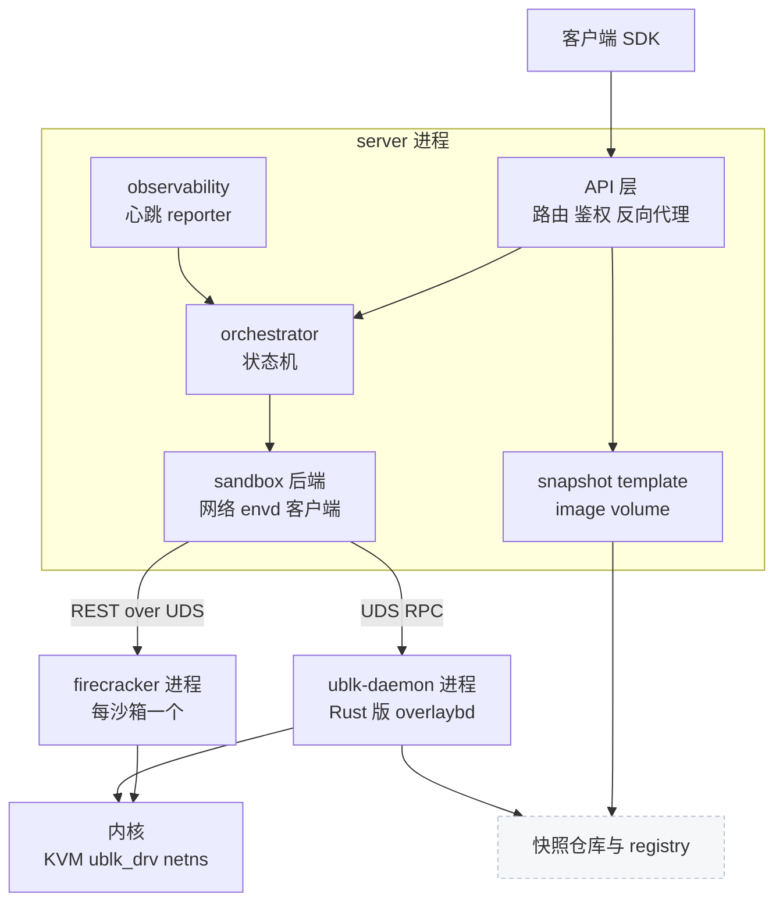
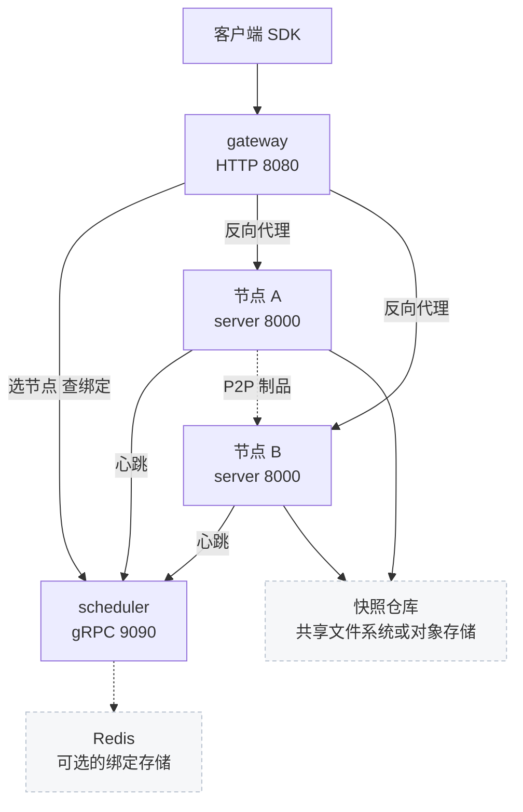

# 08 · 系统架构：单节点与多节点

> 这一篇是全书的地图：一台节点上有哪几类进程、`server` 进程内部分成哪些子系统、多节点时 gateway 与 scheduler 各管什么、
> 哪些状态是持久的真相、哪些只是节点本地可以丢掉的派生物，以及三种流量各走哪条路、在哪里鉴权。
> 后面各部分讲到某个部件时，都可以回到这里的两张图上找到它的位置。
>
> **读者**：所有读者；工程师必读。　**预备**：无；熟悉 [第 02 篇 · 规模问题与取舍](02-why-agentenv.md) 更好。
> **代码**：`src/bin/server.rs`、`src/lib.rs`、`src/api/server.rs`、`src/api/impls/auth.rs`、`src/sandbox/ublk/device.rs`、`storage/ublk-daemon/src/client.rs`、`src/snapshot/manager.rs`、`services/gateway/internal/server.go`、`services/scheduler/internal/service.go`、`services/shared/config/config.go`、`config/default.toml`

---

## 0. 本篇要回答的问题

1. 单节点部署由哪几类进程构成？块设备服务为什么放在独立进程里，而 Firecracker 为什么每个沙箱一个进程？
2. `server` 进程内部有哪些子系统？谁调用谁，哪些是全局单例？
3. 多节点时，一个请求怎样找到它的沙箱所在的节点？gateway 与 scheduler 各保存什么状态？
4. 哪些数据是持久真相，哪些是可重建的派生物？有没有例外？
5. 控制面、数据面、制品流三种流量各走哪条路径，凭据在哪里校验？
6. 这套架构的单点在哪里，各自的代价是什么？

---

## 1. 问题：一台机器上要同时做哪几件事

一个沙箱平台的节点至少要同时扮演四个角色：对外的 HTTP 服务端（接受创建、暂停、删除等请求）、
虚拟机管理者（拉起 microVM、打快照、恢复）、块设备服务端（把分层镜像变成 guest 能读写的磁盘）、
以及网络管理者（给每台 VM 一个隔离的网络环境并执行出站策略）。

把这四件事放在一个进程里最简单，但有两个问题。第一，故障域连在一起：块设备服务端里一次 panic 会带走 HTTP 服务端与所有状态。
第二，能力要求不同：创建块设备与网络命名空间需要 `CAP_SYS_ADMIN`、`CAP_NET_ADMIN`，而虚拟机监视器（VMM）进程直接面对 guest，
最好一项能力都不带。反过来，拆得过细又会让每次生命周期操作都要跨好几个进程协调状态。

AgentENV v0.2.3 的切分是：**一个有状态的管理进程、一个块设备进程、每沙箱一个无能力的 VMM 进程**；
多节点时再加两个几乎无状态的 Go 服务。下面分别展开。

---

## 2. 单节点：三类进程

单节点部署不需要任何 Go 组件，客户端直接访问节点上的 `server` 进程。节点上运行的进程只有三类：

| 进程 | 数量 | 由谁拉起 | 职责 |
|---|---|---|---|
| `server` | 每节点一个 | systemd、容器或手动 | API、状态机、网络、快照与镜像管理；其余两类进程的父进程 |
| `uvm-ublk-daemon`（下文 ublk-daemon） | 每节点一个 | `server` 启动时 | 持有全部 ublk 设备，运行 Rust 版 overlaybd 的读写路径 |
| `firecracker` | 每沙箱一个，外加预热池 | `server` | 运行一台 microVM |

**`server`**。入口是 `src/bin/server.rs` 的 `main()`。监听地址取环境变量 `API_ADDR`，缺省为 `0.0.0.0:8000`；
这个地址不经过 confique 配置体系（[第 11 篇](11-configuration.md)）。每个入站 TCP 连接都设置 `TCP_NODELAY`，
代码注释给出的原因是 envd 用一串很小的 Connect-RPC 帧推送命令输出，Nagle 算法会让第二帧等对端的延迟 ACK。
`main()` 在监听之前完成能力检查、宿主环境检查、拉起 ublk-daemon、预热 Firecracker 进程池、构造各服务与 orchestrator；
完整顺序与关闭顺序在[第 10 篇](10-node-process-and-object-model.md)。

**ublk-daemon**。`server` 在 `UblkDeviceManager::init_global_from_config_with_p2p_publish_url()`（`src/sandbox/ublk/device.rs`）里
通过 `UblkDaemonClient::new()`（`storage/ublk-daemon/src/client.rs`）拉起它，两者经 Unix 域套接字通信，
缺省路径是 `$AENV_RUNTIME/ublk-daemon.sock`（`config/default.toml` 的 `[ublk] daemon_socket_path`）。
daemon 被放进自己的进程组（`process_group(0)`），注释说明这是为了让终端里的 Ctrl+C 只发给 `server`，
避免优雅关闭期间 daemon 被同一个 SIGINT 打断正在进行的快照与 restack RPC。
把块设备放在独立进程里，换来的是 io_uring 与 ublk 设备的所有权集中在一处，`server` 只通过 RPC 描述「要一个什么样的设备」；
设备号由内核分配（daemon 发 ADD_DEV 时以 `u32::MAX` 请求自动分配，见 `storage/ublk/src/ctrl.rs`）。daemon 内部在[第 41 篇](41-ublk-daemon.md)展开。

**firecracker**。每台 microVM 一个进程，由 `src/sandbox/firecracker/instance.rs` 的 `spawn_with_netns()` 拉起：
先在临时线程里进入这台沙箱的网络命名空间（netns），再把线程能力集清空后 spawn（`src/privileges.rs` 的 `spawn_tokio_command_scoped()`），
所以 `server` 以非 root 用户运行时 VMM 进程不带任何 Linux 能力；`server` 以 root 运行（例如 Compose 与 DaemonSet 的特权容器）时，
exec 会从 bounding 集重新授予能力，这一保证不成立（[第 59 篇 §5.1](59-host-setup-and-privileges.md#51-回顾能力在-exec-时怎样变化)）；
spawn 之后把它的 `oom_score_adj` 设成 1000，内存紧张时优先被杀的是某一台 VM 而不是 `server`。
进程的工作目录是这台沙箱的 work_dir，所有磁盘路径都是这个目录下的相对 symlink。
为了缩短恢复路径，`FirecrackerPool` 预先 spawn 一批未配置的进程（[第 32 篇](32-warm-pools.md)）。

三类进程之外，节点依赖内核提供的 KVM（或 PVM）、`ublk_drv` 驱动、netns 与 iptables。
下图是节点内部的结构，箭头表示调用方向。

图里 `FC → 内核` 一条边包含两件事：VMM 用 KVM 跑 vCPU；guest 的磁盘请求经 virtio-blk 到达 VMM，
VMM 再读写宿主上的 `/dev/ublkbN` 块设备，内核把这些请求交给 ublk-daemon。
内存快照恢复时，VMM 把一个只读 ublk 设备当作内存文件 mmap（[第 42 篇](42-memory-snapshot-over-ublk.md)）。

---

## 3. server 进程内部的子系统

`src/lib.rs` 声明了全部模块。按职责可以归成下表；每一行在后面都有专门的部分。

| 子系统 | 目录 | 职责 | 本书位置 |
|---|---|---|---|
| API | `src/api/` | 由 `openapi.yml` 生成的路由、手写实现、鉴权中间件、反向代理 | 第三部分 |
| orchestrator | `src/orchestrator/` | 沙箱状态机、持久化、自动驱逐、指标 | 第四部分 |
| sandbox | `src/sandbox/` | Firecracker 后端、网络槽位、ublk 设备客户端、envd 客户端、预热池 | 第五部分 |
| snapshot / template | `src/snapshot/`、`src/template/` | 已提交快照的仓库与解析、模板构建 | 第七部分 |
| image | `src/image/` | OCI 镜像解析、转换、本地层缓存与 GC | 第七部分 |
| volume | `src/volume.rs` | 卷目录、预留与发布 | 第 16、31 篇 |
| p2p / overlaybd | `src/p2p/`、`src/overlaybd/` | 节点间制品传输与给 overlaybd 用的 HTTP 门面 | 第 58 篇 |
| observability | `src/observability/` | 节点快照、心跳、Prometheus | 第 24、56 篇 |
| setup / cfg | `src/setup/`、`src/cfg.rs` | 宿主准备与依赖下载、配置 | 第 11、59 篇 |

依赖方向可以从 `main()` 的装配读出来。`ApiImpl::new()` 拿到 orchestrator、`SnapshotManager`、`TemplateBuilder`、`ImageResolver`、
`VolumeManager` 与 observability 服务；orchestrator 本身只拿到后端工厂 `FirecrackerSandboxFactory` 与 `VolumeManager`
（`Orchestrator::with_file_backed_store_factory_and_volumes()`）。
也就是说，**解析模板、解析镜像这类与仓库打交道的事情在 API 层完成**，orchestrator 收到的 `CreateSandboxRequest` 里已经是本地可用的快照：
`src/api/impls/sandbox.rs` 的 `sandboxes_post()` 先调 `SnapshotManager::load_runnable()`，再调 `Orchestrator::create_sandbox()`。
orchestrator 只关心状态与后端，后端只关心一台 VM。

除了显式传递的对象，还有几个进程级单例：`ConfigManager::global()`、`UblkDeviceManager::global()`、`NetworkManager::global()`、
`FirecrackerPool::global()`。它们让后端代码不必层层传参，代价是依赖关系不出现在函数签名上，
测试必须先初始化这些全局对象，一个进程里也只能有一套配置（[第 11 篇](11-configuration.md)讨论这一点）。

---

## 4. 多节点：gateway 与 scheduler

多节点时，在节点前面加两个 Go 服务（`services/`，独立的 Go module）。缺省监听地址来自 `services/shared/config/config.go` 的 `defaultConfig()`：
gateway 的 HTTP 在 `:8080`，scheduler 的 gRPC 在 `:9090`。

**scheduler** 保存两类状态。一是节点表：来自静态配置或 Kubernetes EndpointSlice 的发现结果，加上每个节点最近一次心跳的观测快照。
二是**绑定**（binding）：sandbox ID → 节点。新建沙箱时，`Service::Schedule()`（`services/scheduler/internal/service.go`）
取出不处于下线中的节点，按心跳快照做资源阈值过滤，再交给策略（缺省 `round_robin`，另有 `random`）选一个；
请求里携带的调度 hint 目前两种策略都不使用（[第 56 篇](56-scheduler.md)）。

**gateway** 不保存沙箱状态。它对每个请求按固定顺序判定路由来源（`services/gateway/internal/server.go` 的 `handleProxy()`）：

| 顺序 | 路由来源 | 判定依据 | 选节点方式 |
|---|---|---|---|
| 1 | host | Host 名形如 `{port}-{sandboxID}.{domain}` | `LookupNode` |
| 2 | gateway 本地 | 无 host 路由与路由头时的列表类请求：`GET /sandboxes`、`/v2/sandboxes`、`/nodes` 等 | 向所有节点扇出后合并 |
| 3 | path | 路径里带 sandbox ID 的控制面请求，如 `POST /sandboxes/{id}/pause` | `LookupNode` |
| 4 | 模板构建 | builder 分配与构建状态查询 | 新分配走 `Schedule`，查询走 `LookupNode` |
| 5 | header | `x-agentenv-sandbox-id` 或 `e2b-sandbox-id` 路由头 | `LookupNode` |
| 6 | schedule | 以上都不是，例如 `POST /sandboxes` | `Schedule` |

选出节点后，gateway 用 `httputil.ReverseProxy` 转发。对 host 与 header 两类数据面请求，`upstreamTargetPath()` 会在上游路径前加 `/proxy`，
让节点上的反向代理接手；控制面请求原样转发。

绑定怎么建立与维持？新建沙箱的响应为 2xx 时，`recordAssignmentFromResponse()` 从响应头 `x-agentenv-sandbox-id` 或响应体里取出 sandbox ID，
调 `RecordAssignment` 写入绑定；fork 请求按源沙箱路由，但为每个子沙箱写绑定。这一步失败时普通沙箱只记一条警告，客户端照样拿到 201。
真正维持绑定的是**心跳**：节点的 `ObservabilityReporter`（`src/observability/reporter.rs`）每隔 `interval_secs`（缺省 5 s）发一次 `Heartbeat`，
携带 `Orchestrator::list_sandbox_ids()` 的完整名单（包括暂停的沙箱）；scheduler 的 `Heartbeat()` 用 `ReconcileNode()` 把名单内的绑定续期、
把名单外的删除。绑定缺省有效期 `binding_ttl` 为 30 s。所以绑定的真相源是节点自己的名单，`RecordAssignment` 只是让新建之后、下一次心跳之前也能路由。
绑定的一致性与失败模式在[第 56 篇](56-scheduler.md)，心跳本身在[第 57 篇](57-heartbeat-and-cpu-intersection.md)。

节点与控制面之间只有一条主动链路：节点调 scheduler 的 gRPC（心跳、生命周期事件，以及 P2P 的节点发现 `ListP2pPeers`）。
scheduler 从不主动调节点。节点之间唯一的直接通信是可选的 P2P 制品传输（`[p2p] enabled` 缺省为 false）。
心跳本身也是可选的：`[observability.scheduler_report] enabled` 缺省为 false，单节点部署时整条链路不存在。

---

## 5. 存储拓扑：什么是真相

AgentENV 的持久状态有三类，位置与恢复方式各不相同。

**快照仓库**（snapshot repository）保存已提交的快照（包括模板）与卷目录。后端由 `[snapshot] repository_backend` 选择：
`posix_fs`（本地或共享文件系统）或 `oss`（S3 兼容对象存储）。`src/snapshot/manager.rs` 的 `SnapshotManager` 注释写明，
已提交快照的持久可达性完全由仓库负责，节点本地的 overlaybd 层缓存（`image-cache/commits/`）可以回收，已提交快照不会钉住它。
`VolumeManager` 与 `SnapshotManager` 共用同一个仓库对象（`main()` 里的 `snapshot_manager.repository()`）。
需要注意 `posix_fs` 的缺省 `snapshot_store` 是 `$AENV_HOME/snapshot-store`，在节点本地；
多节点部署要让各节点看到同一份快照，必须把它改到共享文件系统，或改用 `oss`。
仓库自带的 Kubernetes base 清单（`deploy/k8s/base/`）用的就是默认配置，因而每个节点各有自己的快照仓库，快照不在节点间共享（[第 60 篇](60-deployment.md)）。

**节点本地的派生物**是丢掉以后可以重建的东西：镜像层缓存、快照制品的本地缓存（`$AENV_HOME/snapshot-local-cache`）、
预热池里的网络槽位、块设备与 Firecracker 进程、`$AENV_RUNTIME` 下的套接字与 netns 文件。

**例外是暂停的沙箱。** pause 的产物（vm_state、内存层、rootfs 层）写在 `$AENV_HOME/persisted-sandboxes/` 下
（`[orchestrator]` 的 `persisted_sandbox_store_path`），记录存在本地 RocksDB 里，不进快照仓库。
因此一台暂停的沙箱只能在原节点恢复；多节点时它的绑定靠心跳名单维持，节点永久失联时它也随之不可用。
要让沙箱的状态跨节点可用，需要显式提交成快照（`POST /sandboxes/{id}/snapshots`，[第 46 篇](46-snapshot-object-model.md)），
再从快照创建新沙箱。运行中的沙箱更不落盘，只在进程正常关闭时被逐个暂停（[第 22 篇](22-persistence-across-restarts.md)）。

| 状态 | 位置 | 节点丢失后 |
|---|---|---|
| 已提交快照、模板、卷目录 | 快照仓库 | 不受影响 |
| 暂停的沙箱 | 节点 `$AENV_HOME/persisted-sandboxes/` | 随节点不可用 |
| 运行中的沙箱 | 节点内存与 VM 进程 | 丢失；正常关闭时转为暂停 |
| 绑定 | scheduler 内存或 Redis | 由心跳重建；节点失联后过期 |
| 层缓存、预热池 | 节点本地 | 按需重建 |

---

## 6. 三种流量

**控制面**是带 `X-API-Key` 的管理请求（创建、暂停、快照、模板构建等）。多节点时 key 校验两次：
gateway 的 `authenticate()` 用常量时间比较校验一次，节点的 `require_auth()`（`src/api/impls/auth.rs`）再校验一次，
所以 gateway 与所有节点必须配置同一个 key。

**数据面**是送进 guest 的流量：发往 envd（端口 49983）或用户服务端口的 HTTP、SSE 与 WebSocket。
gateway 对数据面请求**不鉴权**，直接按 host 或路由头转发；源码注释给出的理由是，只有拥有这台沙箱的节点知道它的入口策略。
节点上的 `require_auth()` 先判断请求是否为代理请求，再按目标端口决定所需凭据：envd 端口且沙箱为 secure 时要 `X-Access-Token`；
其它端口要么沙箱允许公开流量，要么带 `e2b-traffic-access-token`。`X-API-Key` 不是数据面凭据，在转发进 guest 之前被剥离。
决策树在[第 13 篇 §4](13-authentication.md#4-require_auth-的决策)，转发细节在[第 17 篇](17-reverse-proxy.md)。

**制品流**是节点读写快照、镜像层与内存层的流量，不经过 gateway。它有三个来源：快照仓库（POSIX 或对象存储）、
OCI registry（镜像层按需读取）、其它节点（P2P）。在线读取发生在 ublk-daemon 里：guest 读到一个本地还没有的块时，
Rust 版 overlaybd 从远端取回对应的数据（[第 38 篇](38-virtualfile-chain-and-remote-io.md)）。

| 流量 | 入口 | 凭据 | 校验位置 | 终点 |
|---|---|---|---|---|
| 控制面 | gateway 或节点 `:8000` | `X-API-Key` | gateway 与节点各一次 | 节点 API 实现 |
| 数据面 | Host 名、路由头或 `/proxy` | `X-Access-Token` 或 traffic token | 只在节点 | guest 内的 envd 或用户端口 |
| 制品流 | 节点主动发起 | 仓库或 registry 自身的凭据 | 存储侧 | 快照仓库、registry、其它节点 |

---

## 7. 单点与代价

这套架构有几个明确的单点，它们是有意的简化，各自有代价。

**每节点一个 ublk-daemon。** 节点上所有沙箱的磁盘与内存设备都由它服务。`UblkDaemonClient` 的 `spawn_watchdog()`
在 daemon 意外退出时只记录原因并把客户端标记为失效，不会重新拉起；启动时若 daemon 拉起失败，`UblkDeviceManager::init_global()`
只记一条错误，`server` 继续启动，此后需要 ublk 的操作会失败。推论：daemon 退出后，这台节点上正在运行的 VM 的块设备随之失效，需要重启整个节点进程。
换来的是设备所有权集中、跨沙箱共享只读设备与页缓存很容易做（[第 26 篇](26-sandbox-block-devices.md)）。

**单副本的 scheduler。** Kubernetes 清单里 scheduler 是 `replicas: 1`。绑定缺省存在内存里，重启后靠下一轮心跳重建；
配置 Redis 后可以再起只读的 query-only 副本，只回答 `LookupNode`。primary 不可用时，已有沙箱的请求在有 query-only 副本时还能路由，
但只能撑到 Redis 里的绑定过期（缺省 30 s）：绑定只由 primary 在处理心跳时续期（[第 56 篇 §6.2](56-scheduler.md#62-primary-不可用时)）；
新建、列表与心跳都会失败。

**gateway 不重试。** 节点对创建请求返回 5xx 时，gateway 原样透传，不换节点重试；`RecordAssignment` 失败也不回滚创建。
重试的责任在客户端。

**一个部署级 API key。** 所有节点与 gateway 共用同一个 key，没有租户概念（[第 13 篇](13-authentication.md)）。
这让 gateway 不需要任何身份系统，代价是无法按调用方隔离或吊销权限。

---

## 8. 与 e2b infra 的对照

e2b infra 把沙箱目录与放置决策放在中心化的 API 服务里（配合 PostgreSQL 与 Redis），数据面由独立的 client-proxy 查 Redis 路由目录转发，
节点上的 orchestrator 只执行指令。AgentENV 把沙箱状态留在各节点的 orchestrator 里，gateway 与 scheduler 只做选节点与查绑定，
因而单节点时可以完全不部署控制面。代价是集群级视图（列表、节点详情）要由 gateway 实时向所有节点扇出合并，任一节点失败就整体失败。

---

## 9. 小结

- 一个节点只有三类进程：`server`、ublk-daemon、每沙箱一个 `firecracker`；单节点部署不需要任何 Go 组件。
- `server` 监听 `API_ADDR`（缺省 `0.0.0.0:8000`），这个地址不走 confique 配置。
- ublk-daemon 集中持有全部块设备，与 `server` 经 Unix 域套接字通信；它退出后不会被重新拉起，是节点内的单点。
- Firecracker 进程在沙箱的 netns 里启动且不带任何 Linux 能力，`oom_score_adj` 设为 1000。
- 模板与镜像在 API 层解析，orchestrator 只管状态与后端；若干进程级单例让依赖不出现在签名上。
- gateway 无状态，按 host、路径、路由头的固定顺序判定路由；数据面请求被改写到节点的 `/proxy`。
- 绑定的真相源是节点心跳里的完整名单（含暂停沙箱）；`RecordAssignment` 只填补新建到下一次心跳之间的空档。
- 快照仓库保存已提交快照与卷目录；暂停的沙箱写在节点本地，只能在原节点恢复。
- 控制面 key 在 gateway 与节点各校验一次；数据面只在节点校验，`X-API-Key` 在转发前被剥离。

---

## 延伸阅读 / 下一篇

- [第 10 篇 · 节点进程：启动、关闭与对象模型](10-node-process-and-object-model.md)：`server` 的启动与关闭顺序、三张表。
- [第 54 篇 · 控制面总览](54-control-plane-overview.md)：三个角色与 proto 契约。
- [第 41 篇 · ublk-daemon](41-ublk-daemon.md)：块设备进程的内部结构。
- [第 55 篇 · gateway](55-gateway.md)、[第 56 篇 · scheduler](56-scheduler.md)、[第 57 篇 · 心跳与 CPU 模板交集](57-heartbeat-and-cpu-intersection.md)：控制面的三个部件。
- [e2b 手册第 10 篇 · 系统架构](../e2b-infra/10-system-architecture.md)：同类系统的另一种进程划分。
- [Firecracker 手册第 07 篇 · 进程启动](../firecracker/07-process-startup.md)：VMM 进程本身做了什么。
- 下一篇：[第 09 篇 · 一个沙箱的一生](09-sandbox-lifecycle-walkthrough.md)。
