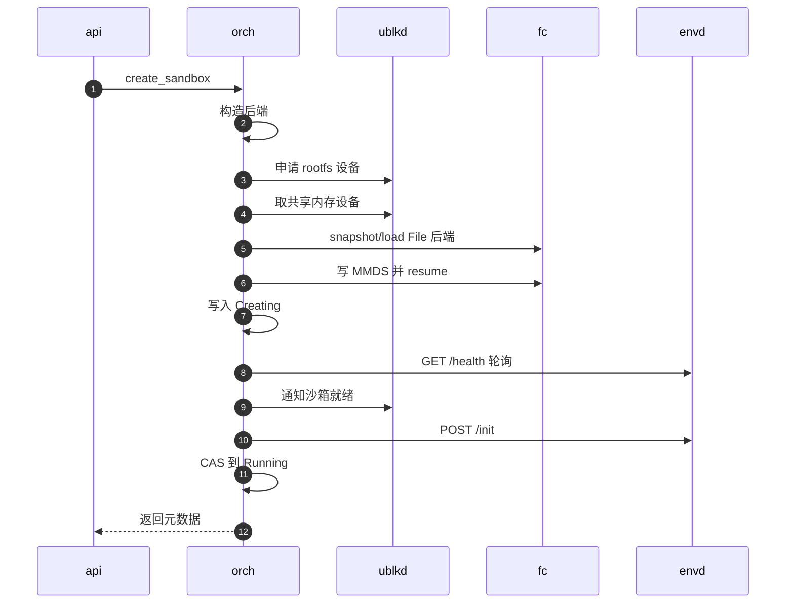
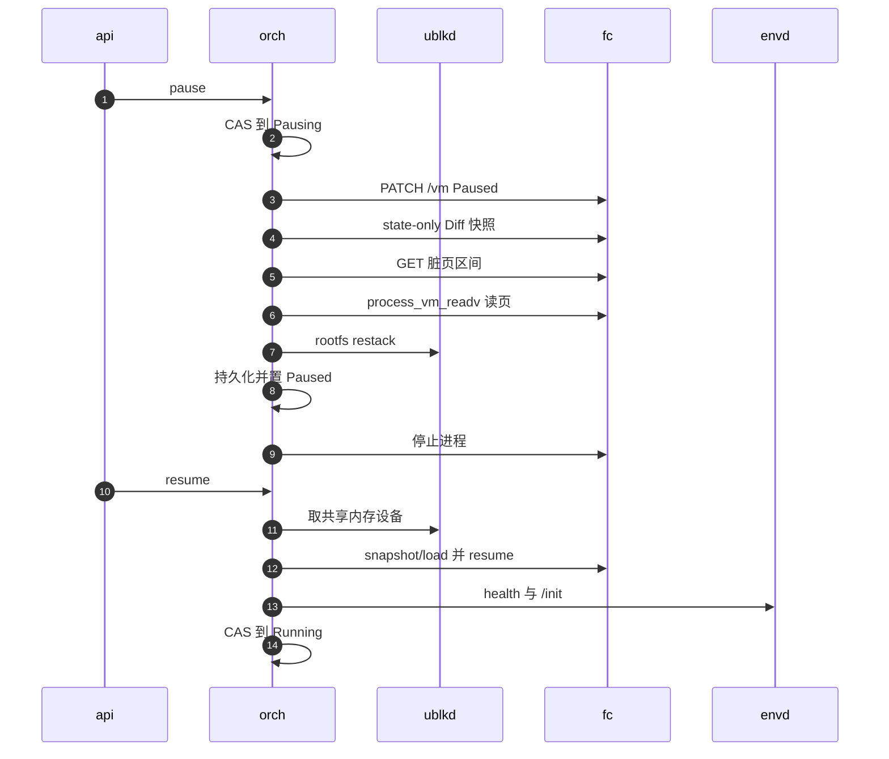

# 09 · 一个沙箱的一生

> 这一篇沿着一台沙箱从创建到删除走一遍：从模板创建、运行、暂停、恢复、删除，最后对比从 OCI 镜像冷启动有何不同。
> 每一步只回答「发生了什么、在哪个模块」，细节都链接到后面的专篇；读完这一篇，再读第四到第七部分时，
> 读者应当知道每一篇讲的是这条主线上的哪一段。
>
> **读者**：所有读者；工程师必读。　**预备**：[第 08 篇 · 系统架构](08-system-architecture.md)。
> **代码**：`src/api/impls/sandbox.rs`、`src/orchestrator/service.rs`、`src/orchestrator/launch_plan.rs`、`src/sandbox/firecracker/sandbox.rs`、`src/sandbox/firecracker/instance.rs`、`src/orchestrator/persistence/file_backed.rs`

---

## 0. 本篇要回答的问题

1. `POST /v2/sandboxes` 从模板创建一台沙箱时，请求依次经过哪些函数？沙箱在什么时刻出现在 store 里，什么时刻开始接流量？
2. 为什么「从模板创建」和「恢复一台暂停的沙箱」走的是同一条流水线？
3. 暂停时，内存和磁盘分别以什么形式落盘？Firecracker 进程在暂停之后还在吗？
4. 恢复时内存从哪里来？为什么 MMDS 要重写、envd 要重新 `/init`？
5. 删除为什么分成 Capture、Stop、Release 三段？
6. 从 OCI 镜像冷启动与从模板创建有哪些差别？

---

## 1. 走查的边界与记号

走查以单节点为准；多节点时请求先经过 gateway 选节点（[第 08 篇 §4](08-system-architecture.md#4-多节点gateway-与-scheduler)），到达节点之后的过程完全相同。
沙箱的状态机（八个状态与它们之间的 CAS 转换）在[第 19 篇](19-state-machine-and-concurrency.md)，这里只在用到时点名。

整条主线分三层：API 层负责解析请求与解析模板；orchestrator 负责状态与回滚；后端 `FirecrackerSandbox` 负责一台 VM 的所有具体动作。
下面的时序图用五个短名：`api`（API 层的手写实现）、`orch`（orchestrator 以及它调用的 Firecracker 后端，二者在同一进程里，合在一起画）、
`ublkd`（ublk-daemon）、`fc`（这台沙箱的 Firecracker 进程）、`envd`（guest 内的守护进程）。

本篇反复用到的一个事实：**从模板创建就是一次快照恢复**。模板是一份已提交的快照（[第 46 篇](46-snapshot-object-model.md)），
里面有 vm_state、内存层与 rootfs 层；创建沙箱等于把这份快照在新的 netns、新的 ublk 设备上恢复出来，再换上新的身份。
这也是为什么创建与恢复共用一条流水线。

---

## 2. 从模板创建

### 2.1 API 层：把模板变成本地可用的快照

`POST /sandboxes` 由 `src/api/impls/sandbox.rs` 的 `sandboxes_post()` 处理（v2 的 `v2_sandboxes_post()` 在其上加了 secure 与缺省 TTL 的不同默认值，见[第 14 篇](14-sandbox-api.md)）。它依次：

1. 调 `SnapshotManager::load_runnable()`：在快照仓库里找到模板记录，解析成节点本地可打开的制品路径（[第 49 篇](49-resolve-and-artifact-cache.md)）；找不到返回 400。
2. 由请求里的 `allowInternetAccess` 与 `network` 字段生成网络策略，校验自定义扩展参数。
3. 处理卷：请求带了卷就预留；没带而快照里记录了卷，就恢复快照里的卷（[第 16 篇](16-snapshot-and-volume-api.md)）。
4. 组装 `CreateSandboxRequest`，其中 `source` 是 `SandboxLaunchSource::Snapshot`，调 `Orchestrator::create_sandbox()`。
5. 成功后把卷预留的 owner 从临时值改成新沙箱的 ID；失败则回滚预留。响应体之外还带一个 `x-agentenv-sandbox-id` 响应头，gateway 用它写绑定。

### 2.2 orchestrator：一条流水线

`create_sandbox()` 用 `SandboxId::new()` 生成一个 UUIDv7 作为沙箱 ID，然后把真正的工作放进 `run_cancellation_safe()` 包住的独立任务
（HTTP 调用方断开不会打断它，见[第 19 篇 §6](19-state-machine-and-concurrency.md#6-取消安全操作不随请求一起死)）。
`create_sandbox_inner()` 做三件准备工作：secure 沙箱用 `access_tokens.generate()` 派生 envd 访问令牌；
比较快照的 `virtualization_mode` 与节点配置，不一致就返回 `VirtualizationModeMismatch`；
组装 `SandboxLaunchConfig`（环境变量、运行期网络策略、要写进 MMDS 的 `imageConfigs`、扩展参数、卷）
与一份状态为 Creating 的过渡元数据。之后进入 `launch_sandbox(LaunchPlan::for_create_from_snapshot(...))`。

`launch_sandbox()`（`src/orchestrator/service.rs`）是创建与恢复共用的流水线。它的顺序是有意安排的：**先把 VM 拉起来，再写任何状态**。

1. `build_sandbox()` 调工厂的 `build_from_snapshot()`，只构造后端对象与工作目录，不启动任何东西。
2. `protect_image_refs(StartingSandbox)` 把要打开的层钉住，防止镜像 GC 在这期间删掉它们。
3. `start_nowait()`：Firecracker 进程启动并完成快照加载与 resume（§2.3）。
4. 检查进程是否已开始关闭；把句柄放进运行期句柄表；`store.add()` 写入 Creating 记录。**从这一刻起，沙箱才在 store 里可见。**
5. `wait_for_ready()`：等 envd 就绪并完成 `/init`（§2.4）。
6. 再检查一次关闭；`update_if_state()` 以 `[Creating]` 为期望把状态改成 Running，同时写入资源与 TTL。
7. 取后端的 host interaction IP，`upsert_proxy_route_if_current_handle()` 发布代理路由。**从这一刻起，沙箱开始接数据面流量。**

返回到 `create_sandbox_inner()` 后，创建成功计数加一，并广播一个 Create 生命周期事件。
任一步失败都按所处阶段回滚：第 4 步之前失败只需 stop 后端；之后的失败经 `cleanup_failed_launch()` 按 `FailedLaunchStage` 撤销已写的状态，
对创建计划而言就是从 store 里删掉记录。回滚的细节在[第 20 篇](20-launch-plan-and-rollback.md)。

### 2.3 后端：恢复一台 VM

`FirecrackerSandbox::start_nowait()`（`src/sandbox/firecracker/sandbox.rs`）先准备 tools 盘，再按启动模式分派；
从快照来的沙箱走 `start_resume()`。它的主要步骤：

- 尝试从 `FirecrackerPool` 取一个预热好的三元组（网络槽位、已 spawn 但未配置的 Firecracker 进程、工作目录）；没有就现场分配网络槽位并在 netns 里 spawn 进程（[第 32 篇](32-warm-pools.md)）。
- 把 tools 盘链接进工作目录；向 ublk-daemon 申请一个可写的 rootfs 设备（快照的 rootfs 层作为 lower，上面加一层新的可写 upper）；准备附加盘与卷槽位（[第 26 篇](26-sandbox-block-devices.md)、[第 31 篇](31-extra-drives-and-volumes.md)）。
- 在 netns 里设置出站策略，调用扩展的 start-resume hook（[第 33 篇](33-custom-extension-hooks.md)）。
- 取**共享的只读内存设备**：`get_or_create_shared_mem()` 让同一份内存镜像的所有沙箱共用一个 ublk 设备与它的页缓存（[第 42 篇](42-memory-snapshot-over-ublk.md)）。
- `load_snapshot_file()` 发 `PUT /snapshot/load`，内存后端类型为 File，路径就是那个 `/dev/ublkbN`，`resume_vm` 为 false。
- 重写 MMDS，按本节点配置重设磁盘限流，最后 `PATCH /vm` 置为 Resumed。

MMDS 必须重写：它的内容不在 vm_state 里，而且新沙箱的 `instanceID` 与令牌哈希都与模板不同（[第 28 篇](28-mmds-and-envd.md)）。
完整的 Firecracker 调用序列在[第 27 篇](27-start-pause-resume-sequences.md)。

### 2.4 就绪：envd 与 `/init`

`FirecrackerSandbox::wait_for_ready()` 先轮询 envd 的 `GET /health`；通过后通知 ublk-daemon「这台沙箱已启动」，
让 daemon 放行被暂缓的后台下载（tools、内存、rootfs 各一次，[第 39 篇](39-block-cache-and-background-download.md)）；
然后 `POST /init`，把访问令牌、环境变量、工作目录、默认用户与当前时间交给 envd；最后，若本次启动新挂了卷，经 envd 在 guest 内执行挂载。
快照里的 guest 时钟停在模板制作的那一刻，令牌也是模板的，所以 `/init` 不能省。

---

## 3. 运行

Running 状态的沙箱有两条路可达。控制面请求（改 TTL、快照、fork、改网络策略）仍走 orchestrator；
数据面请求由节点上的反向代理处理：`proxy_lookup_for()` 只读代理路由表、不碰沙箱的锁，查到路由后把请求转发到 `host interaction IP:端口`，
宿主侧的 iptables 再把它送进 guest（[第 17 篇](17-reverse-proxy.md)、[第 29 篇](29-network-slots.md)）。
SDK 执行命令、读写文件时访问的是 guest 内 envd 的 49983 端口，envd 再在 guest 里执行（[第 28 篇](28-mmds-and-envd.md)）。

运行期间有两个后台任务关注这台沙箱。过期回收任务每秒检查一次 TTL，到期后按 `timeout_action` 暂停或删除它（[第 23 篇](23-auto-eviction-and-ttl.md)）；
指标任务周期性地从 envd 的 `/metrics` 采样（[第 24 篇](24-metrics-and-events.md)）。
guest 写磁盘的数据落在 rootfs 的可写 upper 里，由 ublk-daemon 中的 Rust 版 overlaybd 处理（[第 36 篇](36-read-write-paths-and-rw-layouts.md)）；
guest 写内存时，共享的内存设备本身不被修改。推论：File 后端以私有映射打开内存文件，被写的页在宿主上复制成匿名页，
这些页就是下一次暂停时的脏页；这一点取决于 AENV 补丁版 Firecracker 的内存映射方式，由[第 42 篇](42-memory-snapshot-over-ublk.md)核实。

---

## 4. 暂停

`pause_sandbox()` → `pause_sandbox_inner()` 先以 `[Running]` 为期望 CAS 到 Pausing；撞上另一个 pause 就等它的结果。
然后进入 `pause_sandbox_impl()`：

1. 读出运行期制品清单，`protect_image_refs(PausedSandbox)` 钉住它们。
2. `persister.allocate_artifact_root()` 分配本次的产物目录 `artifacts/<id>/<uuidv7>/`（`src/orchestrator/persistence/file_backed.rs`）。
3. `detach_sandbox_handle_and_route()` 把句柄与代理路由一起摘下。**从这一刻起，沙箱不再接流量。**
4. 调后端 `pause()`，即 `FirecrackerSandbox::pause_to_dir()`，把快照写进产物目录（下面展开）。
5. `persister.persist_paused()` 把元数据与不透明的暂停状态写进本地 RocksDB；成功后 `store.update()` 置为 Paused。
6. 调后端 `stop()` 停掉 Firecracker 进程、释放 ublk 设备与网络槽位，广播 Pause 事件。

所以暂停之后**没有任何进程留下**：一台 Paused 沙箱只是本地磁盘上的一个目录加一条记录。

`pause_to_dir()` 的内部顺序：若挂了可写卷，先经 envd 在 guest 里 `sync`；`PATCH /vm` 置为 Paused；
`create_state_only_snapshot()` 发 `PUT /snapshot/create`，类型为 Diff 且**不带内存文件路径**，只写 vm_state；
`get_dirty_memory_ranges()` 调 AENV 补丁版 Firecracker 新增的 `GET /vm/dirty-memory-ranges` 拿到脏页区间（[第 67 篇](67-firecracker-patch-layer.md)）；
`convert_dirty_memory_to_overlaybd()` 用 `process_vm_readv` 直接从 Firecracker 进程的地址空间读这些页，写成一层新的内存层，
叠在这台沙箱来源的内存层之上（[第 42 篇](42-memory-snapshot-over-ublk.md)）。
接着 `restack_snapshot_overlaybd_rootfs()` 让 daemon 把 rootfs 的可写 upper 原地封存成只读层（[第 37 篇](37-seal-restack-compact.md)），
附加盘与卷各自处理，最后组装 `FirecrackerSnapshotConfig` 与快照 manifest。
内存的写入量正比于脏页数，磁盘的写入量正比于 upper 的大小，都与沙箱的总规模无关。

失败分两类（`SandboxCaptureError`）。可恢复的失败由后端负责先把 VM 恢复运行，orchestrator 把句柄与路由放回、状态退回 Running；
终止性失败说明 VM 已经被改动，直接 stop 并从 store 删除。持久化失败时，orchestrator 尝试原地 `resume()` 把沙箱救回 Running。
这三种路径在[第 20 篇](20-launch-plan-and-rollback.md)。

图中第 9 步之后 `fc` 已经退出；第 12 步的 `fc` 是新进程，通常来自预热池。

---

## 5. 恢复

`resume_sandbox_inner()` 读出元数据：若正在 Resuming，等它结束；若已是 Running，只按请求更新 TTL；
若不是 Paused，返回状态错误。它同样检查虚拟化模式，然后以 `[Paused]` 为期望 CAS 到 Resuming，
并调用 `persister.mark_resuming()` 把持久记录标为 Resuming，使得恢复中途进程崩溃时，下次启动能识别这条记录（[第 22 篇](22-persistence-across-restarts.md)）。

之后进入同一个 `launch_sandbox()`，计划换成 `LaunchPlan::for_resume(...)`：`build_sandbox()` 调 `build_from_paused_state()`，
后端从不透明的暂停状态里解出 `FirecrackerSnapshotConfig`；`start_nowait()` 同样走 `start_resume()`，只是内存设备换成刚才暂停时写下的层栈，
rootfs 的 lower 栈顶是刚封存的那一层。与创建相比有两处不同：Resume 计划没有过渡元数据要 `add()`，因为记录一直在 store 里；
`launch_sandbox()` 成功后多一步 `persister.delete_record()`，**只删记录、保留产物目录**，因为新 VM 的内存与 rootfs 仍在读那些层。
恢复失败时，状态退回 Paused，持久记录的标记也回滚。

令牌在恢复时重新调用 `access_tokens.generate()`；令牌是对 sandbox ID 的确定性派生，所以与暂停前相同（[第 13 篇](13-authentication.md)）。
envd 仍要重新 `/init`，至少是为了把 guest 时钟拨到现在。

---

## 6. 删除

`delete_sandbox()` → `delete_sandbox_inner()` 先拿这台沙箱的删除进度锁，再以 `[Running, Paused]` 为期望 CAS 到 Killing；
遇到任何过渡态都先等它结束再重试，保证不会有两个删除者同时工作。之后进入 `delete_sandbox_impl()`，
按进度 `DeleteProgress` 的三段推进：

| 阶段 | 做什么 | 失败时 |
|---|---|---|
| Capture | 若删除前是 Running 且挂了卷，`freeze_and_snapshot_volumes()` 在 guest 内冻结文件系统并封存卷的 upper；再发布卷的新 backing | 可恢复失败先解冻，退回原状态并返回错误；不可恢复则继续删除，并记下卷捕获失败 |
| Stop | 后端 `stop()` | 保留进度，下次删除从这里继续 |
| Release | 卷捕获失败的卷标为 Failed；释放卷的 owner；`remove_deleted_sandbox()` | 同上 |

`remove_deleted_sandbox()` 从 store 删除记录（等待者收到 `None`）、广播 Delete 事件、`delete_record_and_artifacts()` 删除整个 `artifacts/<id>/`、
解除镜像引用的钉住。分段的理由是卷的捕获是**有副作用且不可重复**的提交：一旦卷的新层已经发布，重试删除时不应再捕获一次。
详见[第 21 篇](21-deletion-and-volume-capture.md)。

后端 `stop()` 的释放顺序本身也有讲究：先停 Firecracker 进程，再释放 rootfs 的 ublk 设备，再释放共享的 tools 设备与附加盘，
然后调用扩展的 stop hook，之后才释放网络槽位，最后释放共享内存设备（[第 25 篇](25-backend-and-firecracker-process.md)）。

---

## 7. 冷启动：从 OCI 镜像创建

`POST /sandboxes-cold` 由 `sandboxes_cold_post()` 处理，它不读快照仓库，而是调 `ImageResolver::resolve()` 把 OCI 镜像解析成 overlaybd 镜像配置，
必要时同步转换（[第 45 篇](45-oci-to-overlaybd.md)）。传给 orchestrator 的 `source` 是 `SandboxLaunchSource::Image`，
`create_sandbox_inner()` 据此组装 `FreshSandboxBuildSpec`，走 `LaunchPlan::for_create_fresh(...)`。
流水线还是 `launch_sandbox()`，但后端走 `start_fresh()`：

| 维度 | 从模板创建 | 从 OCI 镜像冷启动 |
|---|---|---|
| API 入口 | `sandboxes_post()`、`v2_sandboxes_post()` | `sandboxes_cold_post()` |
| 来源解析 | `SnapshotManager::load_runnable()` | `ImageResolver::resolve()`，可能同步转换镜像 |
| 后端入口 | `start_resume()` | `start_fresh()` |
| Firecracker 进程 | 可取自预热池 | 现场 spawn；预热池只用于快照恢复 |
| 配置方式 | `PUT /snapshot/load`，设备布局继承自快照 | 逐项配置 machine-config、boot-source、drives、网卡、MMDS、balloon，再 `InstanceStart` |
| 内存 | 共享只读内存设备，按需读入 | 全新的匿名内存，guest 内核从头启动 |
| boot args | 不重放 | 拼装 `agentenv_drives=`、`ip=`、扩展返回的参数与 DAMON 区间 |
| 卷槽位 | 继承快照的槽位，新卷经 `PATCH /drives` 热插 | 按 `volume.max_volume_count` 预留 |

冷启动之后的 `wait_for_ready()`、CAS 到 Running、发布路由与模板创建完全相同。
模板也由同一条流水线产生：模板构建器让一台 builder VM 从镜像冷启动（或从已有快照恢复），在里面执行构建步骤，再捕获它的状态并发布成快照（`src/template/builder.rs` 的 `execute_and_publish()`，[第 52 篇](52-template-builder.md)）。
冷启动的 Firecracker 调用序列在[第 27 篇](27-start-pause-resume-sequences.md)。

---

## 8. 与 e2b infra 的对照

e2b infra 同样把「从模板创建」实现为快照恢复，但恢复时的内存由 orchestrator 里的 uffd 服务按缺页逐页供给，暂停时把差分上传到对象存储。
AgentENV 把内存层做成只读 ublk 块设备交给 Firecracker 的 File 后端，让内核页缓存在同一镜像的沙箱之间共享；
暂停产物留在节点本地，代价是暂停的沙箱只能在原节点恢复，跨节点必须显式提交快照。

---

## 9. 小结

- 创建、恢复共用 `launch_sandbox()`：先构造并启动 VM，再写 store；Creating 记录在 Firecracker 已加载快照之后才出现。
- 沙箱在 CAS 到 Running 之后、代理路由发布之后才接数据面流量；暂停时先摘路由再动 VM。
- 从模板创建就是一次快照恢复：新 netns、新 rootfs upper、共享只读内存设备，再重写 MMDS、重新 `/init`。
- 模板解析在 API 层完成，orchestrator 收到的已是节点本地可打开的快照。
- 暂停 = state-only Diff 快照 + 补丁接口给出的脏页区间 + `process_vm_readv` 写内存层 + rootfs restack；之后 Firecracker 进程被停掉。
- 一台 Paused 沙箱只是本地产物目录与一条 RocksDB 记录，没有任何进程。
- 恢复成功后只删持久记录、保留产物目录，因为新 VM 仍在读那些层。
- 删除分 Capture、Stop、Release 三段并保存进度，卷的捕获只做一次。
- 冷启动走 `start_fresh()`，不用 Firecracker 预热池，从头启动 guest 内核；模板由 builder VM 捕获并发布而来。

---

## 延伸阅读 / 下一篇

- [第 19 篇 · 状态机与并发控制](19-state-machine-and-concurrency.md)：本篇用到的每次 CAS。
- [第 20 篇 · launch plan 与失败回滚](20-launch-plan-and-rollback.md)：`launch_sandbox()` 每一步失败时撤销什么。
- [第 27 篇 · 启动、暂停与恢复的 Firecracker 调用序列](27-start-pause-resume-sequences.md)：三条路径的完整端点序列。
- [第 42 篇 · 内存快照](42-memory-snapshot-over-ublk.md)：脏页如何成层、共享内存设备如何恢复。
- [e2b 手册第 12 篇 · 沙箱生命周期走查](../e2b-infra/12-sandbox-lifecycle-walkthrough.md)：同一条主线在 e2b infra 里的走法。
- [Firecracker 手册第 38 篇 · 快照加载](../firecracker/38-snapshot-load.md)：`PUT /snapshot/load` 在 VMM 内部做了什么。
- 下一篇：[第 10 篇 · 节点进程：启动、关闭与对象模型](10-node-process-and-object-model.md)。
