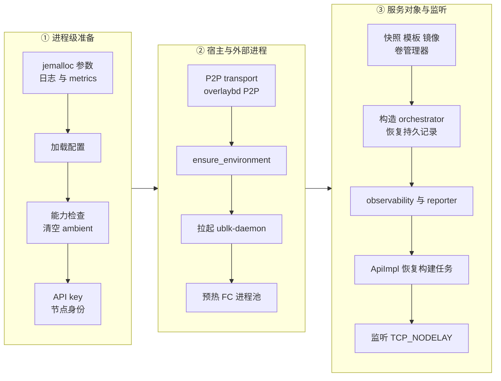
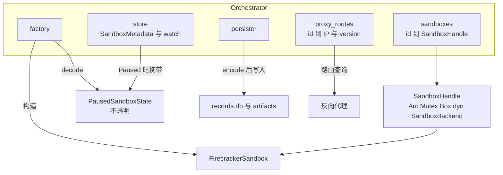

# 10 · 节点进程：启动、关闭与对象模型

> 每个节点上只有一个常驻的 `server` 进程，它在启动时把宿主检查、依赖下载、ublk-daemon、预热池与持久记录恢复串成一条有先后约束的序列，
> 在关闭时又按相反的约束把运行中的沙箱逐个暂停落盘。本篇讲这两条序列里每一步为什么在那个位置，
> 再讲 orchestrator 内部的三张表、两个后端 trait 与一个不透明的暂停状态，最后给出节点磁盘布局。
>
> **读者**：工程师、运维。　**预备**：[第 08 篇 · 系统架构](08-system-architecture.md)、[第 07 篇 · Rust 异步](07-rust-async-primer.md)。
> **代码**：`src/bin/server.rs`、`src/setup/mod.rs`、`src/privileges.rs`、`src/orchestrator/service.rs`、`src/orchestrator/proxy.rs`、
> `src/orchestrator/store/in_memory.rs`、`src/orchestrator/persistence/{mod,file_backed}.rs`、`src/sandbox/backend.rs`、`src/sandbox/firecracker/factory.rs`

---

## 0. 本篇要回答的问题

1. `server` 启动时各步骤的先后由什么决定？哪些步骤失败会让进程退出，哪些只记一条警告？
2. 收到 SIGTERM 后进程做了什么？为什么要把所有运行中的沙箱暂停，而不是直接杀掉？
3. orchestrator 为什么要分三张表（元数据、运行期句柄、代理路由），它们之间的锁顺序是什么？
4. `SandboxBackend` 与 `SandboxBackendFactory` 把哪些职责从 orchestrator 里切了出去？`PausedSandboxState` 为什么对 orchestrator 不透明？
5. 一个节点在 `$AENV_HOME` 与 `$AENV_RUNTIME` 下留下哪些文件，哪些是持久的，哪些重启即可重建？

---

## 1. 问题：一个进程，三类外部依赖

`server` 进程不是一个只处理 HTTP 的无状态服务。它在同一个地址空间里持有三类彼此耦合的东西：

- **宿主资源**：网络命名空间（netns）、iptables 规则、tap 设备、Linux 能力（capability）；
- **子进程**：一个 ublk-daemon（提供所有 overlaybd 块设备），以及每台沙箱一个 Firecracker 进程；
- **持久状态**：暂停沙箱的记录与制品、API key、访问令牌的种子、卷目录、镜像缓存。

这三类东西之间有依赖方向。ublk-daemon 要读 `server` 生成的 overlaybd 全局配置，所以必须在配置生成之后拉起；
orchestrator 恢复暂停记录时要校验令牌种子与镜像引用，所以必须在镜像缓存、卷管理器就绪之后构造；
HTTP 监听必须最后打开，否则请求会先于恢复到达，看到一个「不存在」的暂停沙箱。
关闭方向反过来：Firecracker 进程还在跑时不能拆掉它的块设备，块设备还在用时不能关掉 daemon。

如果把这些依赖交给各模块懒初始化，次序就由「谁先被调用」决定，故障表现也随调用次序漂移。
`src/bin/server.rs` 的 `main()` 选择了另一种做法：一条显式的、只有一个入口的启动序列，与一条同样显式的关闭序列。
代价是 `main()` 必须知道每个子系统的初始化细节，新增子系统时要人工判断它该插在哪里。

---

## 2. 启动序列

### 2.1 三个阶段

下图按 FIGURE-GUIDE 的分列法把 `main()` 的启动步骤分成三列：进程级准备、宿主与外部进程、服务对象与监听。



第一列的「加载配置」是 `ConfigManager::init_global_from_path()`（命令行给了 `--config`）或 `ConfigManager::init_global()`（读 `AENV_CONFIG_PATH`），
加载与归一化的细节在[第 11 篇](11-configuration.md)。配置一旦写进全局单例，后面所有步骤都从它读。

图里省略了「加载配置」之后的两个提前退出分支：`--setup-only` 与 `--setup-host`。前者调 `setup::ensure_provisioning()`，只装包、下载依赖、生成 overlaybd 配置，不需要设备权限，
用于镜像构建与发布流程；后者调 `setup::ensure_host()`，要求 root，把运行用户加进运行组与 `kvm` 组、配置 ublk 与 sysctl、打开 IPv4 转发。
两者的分工在[第 59 篇](59-host-setup-and-privileges.md)展开。正常启动不走这两个分支。

### 2.2 能力检查为什么在最前面

`privileges::require_runtime_capabilities()` 检查 `CAP_NET_ADMIN` 与 `CAP_SYS_ADMIN`：以 root 运行时要求它们在 effective 集合里，
以普通用户运行时要求它们处于「可委派」状态，即同时在 inheritable、permitted 与 effective（I、P、E）三个集合里（`crates/linux-cap/src/lib.rs` 的 `CapabilitySets::is_delegable()`）。缺任何一个就带着提示退出。
随后 `privileges::clear_ambient_capabilities()` 清空 ambient 集合，使 `server` 之后 spawn 的普通程序不会顺带继承网络与命名空间权限。

这一步放在下载依赖、拉起 daemon 之前，是为了让权限配置错误在最便宜的时候暴露：
若放在后面，节点可能已经下载了几百 MiB 的依赖、拉起了 daemon，才在第一次建 netns 时失败。
线程作用域的能力与子进程能力的去向属于[第 59 篇](59-host-setup-and-privileges.md)的内容。

### 2.3 API key、身份与 P2P

`ApiKey::resolve()`（`src/api_key.rs`）按固定次序找控制面密钥：环境变量 `AENV_API_KEY`，外部密钥文件 `/run/secrets/api-key`，
节点自管的 `$AENV_HOME/secrets/api-key`；三者都没有时生成一个以 `e2b_` 为前缀的新 key 写入自管文件。
监听地址取自环境变量 `API_ADDR`，缺省 `0.0.0.0:8000`，它不经过配置体系（[第 11 篇](11-configuration.md)）。
`NodeIdentity::from_config()`（`src/identity.rs`）解析节点 ID、集群 ID 与服务实例 ID，节点 ID 缺省时退回主机名。

P2P 传输层与 `OverlaybdP2pRuntime` 在 `ensure_environment()` **之前**启动，原因是后者生成 overlaybd 全局配置时要写入 P2P 读门面的地址：
`setup::ensure_environment()` 的第二个参数就是 `overlaybd_p2p.read_facade_address()`。P2P 关闭时这个地址为空，配置里不出现 P2P 段。

### 2.4 `ensure_environment()`：校验加补齐

`src/setup/mod.rs` 的 `ensure_environment()` 依次做七件事：创建 `runtime_path` 并清理上次残留的 netns 挂载（`prepare_network_runtime()`）；
检查运行期需要的系统包；按虚拟化模式检查 KVM / PVM 与 `/dev/kvm`；检查 ublk 模块与权限；
下载缺失的依赖并重新生成 overlaybd 全局配置；把 `RLIMIT_NOFILE` 软上限抬到 65536（不超过硬上限）；
读 `/proc/sys/net/ipv4/ip_forward`，不为 1 就退出并提示去跑 `--setup-host`。
最后 `network_capacity::check()` 估算网络槽位容量，不足时只记警告、不退出。

它对宿主状态只校验、不修改（修改留给需要 root 的 `--setup-host`），但对 `$AENV_HOME` 下的依赖与生成文件是**补齐**的：
缺 Firecracker 二进制或内核就下载，overlaybd 全局配置每次启动都重写。这样节点可以在无特权的构建机上预先 `--setup-only`，
也可以在运行时首次启动时自己补齐依赖，代价是首次启动的时长取决于下载。

### 2.5 ublk-daemon 与预热池

`UblkDeviceManager::init_global_from_config_with_p2p_publish_url()` 拉起 ublk-daemon 并等待它就绪。daemon 读 `ensure_environment()` 刚生成的全局配置，
所以这一步必须在其后；它失败会让 `main()` 返回错误。daemon 的进程模型与协议在[第 41 篇](41-ublk-daemon.md)。

`FirecrackerPool::prime()` 以 10 s 为限把 Firecracker 进程池填到低水位。它是尽力而为的：失败只记一条警告，启动继续。
池里是已 spawn、socket 就绪、尚未配置的进程，只供 resume 使用（[第 32 篇](32-warm-pools.md)）。
放在 orchestrator 构造之前，是为了让重启后第一批 resume 请求就能用上预热进程。

### 2.6 服务对象、orchestrator 与监听

接下来依次构造 `SnapshotManager`、`TemplateBuilder`、`ImageResolver`、`VolumeManager` 与 `FirecrackerSandboxFactory`。
`TemplateBuilder` 与 factory 共享同一个 `Arc<RwLock<Option<String>>>`，即集群 CPU 模板 JSON：它由 observability 服务从 scheduler 心跳响应中写入，
被所有新沙箱与模板构建读取（[第 57 篇](57-heartbeat-and-cpu-intersection.md)）。

`Orchestrator::with_file_backed_store_factory_and_volumes()` 是启动序列里最重的一步。它在 `new_inner_with_volumes()` 里：

1. 调 `persister.load_all()` 读出上次运行留下的暂停记录，按规则丢弃不可用的（[第 22 篇](22-persistence-across-restarts.md)）；
2. 加载或创建访问令牌种子；若存在需要令牌的持久记录而自管种子丢失，直接失败，避免恢复后令牌对不上；
3. 把记录逐条 `store.add()` 进元数据表——恢复出的沙箱处于 `Paused`，不会自动 resume；
4. 启动 guest 指标采样任务与每秒一轮的过期回收任务（[第 23 篇](23-auto-eviction-and-ttl.md)、[第 24 篇](24-metrics-and-events.md)）；
5. 若镜像 GC 开启，先为所有恢复出的暂停沙箱钉住镜像引用（`reconcile_paused_at_startup()`），成功后才启动镜像维护任务；钉住失败就不启动 GC，宁可不回收也不误删。

之后构造 observability 服务与 scheduler reporter（多节点时开始发心跳）、`ApiImpl`，调 `recover_image_builds()` 清理上次中断的模板构建，
最后绑定 TCP 监听。监听器对每个入站连接设置 `TCP_NODELAY`：envd 把一条命令的生命周期流成一串很小的 Connect-RPC 帧，
开着 Nagle 算法时第二帧要等客户端的延迟 ACK 才发出，短命令的耗时会被抬高一个固定的下限。
这是一处以每连接多发小包为代价、换掉一个与负载无关的固定延迟的取舍。

---

## 3. 关闭序列

### 3.1 触发与并发结构

`shutdown_signal()` 等待 SIGINT 或 SIGTERM。信号到达后，`axum::serve(...).with_graceful_shutdown()` 停止接受新连接、等待在途连接结束；
同时一个预先 spawn 的清理任务收到 oneshot 通知，开始按下表的顺序清理。`main()` 在 `axum::serve` 返回后再 `await` 这个清理任务，两者都完成才退出。

| 顺序 | 动作 | 代码 | 为什么在这里 |
|---|---|---|---|
| 1 | 停止新的 startup manifest 后续任务，排空在途的，最多 15 s | `snapshot::drain_startup_manifest_tasks()` | 在途 manifest 落地而不是被取消；上限防止卡在即将关闭的 daemon 上 |
| 2 | 中止模板构建清理任务 | `start_image_build_cleanup()` 的句柄 | 后台清理不应与关闭争用资源 |
| 3 | 停止 reporter，向 scheduler 注销节点 | `ObservabilityReporter::shutdown()` | 撤掉本节点的观测记录与全部绑定（见下文） |
| 4 | 暂停所有运行中的沙箱，然后清理网络 | `Orchestrator::shutdown()` | 见 §3.2 |
| 5 | 清理 Firecracker 进程池 | `FirecrackerPool::shutdown()` | 预热进程不承载状态，直接回收 |
| 6 | 关闭 ublk-daemon | `UblkDeviceManager::shutdown_daemon()` | 所有沙箱已停，块设备不再被使用 |
| 7 | 关闭 overlaybd P2P 与 P2P 传输 | `OverlaybdP2pRuntime::shutdown()` 等 | 最底层的制品传输最后关 |

注销的效果要看 scheduler 的节点发现方式。`UnregisterNode` 只删掉这个节点的心跳观测记录与名下绑定，不改发现列表（[第 57 篇 §4.1](57-heartbeat-and-cpu-intersection.md#41-unregisternode)）：
Kubernetes 发现模式下，终止中的 Pod 由 EndpointSlice 发现标为 lingering，`Schedule()` 不再选它，这是发现层的作用而不是注销的作用；
静态发现模式（缺省）下，节点仍在配置的节点表里，关闭期间仍可能被选中承接新建请求（[第 56 篇 §2.4](56-scheduler.md#24-不排除-unhealthy-节点)）。
两种模式下有一点相同：第 3 步先于第 4 步，绑定已被撤掉，对本节点上沙箱的请求在节点重启并重新心跳之前会得到 404。这个窗口与它对多节点路由的影响在[第 22 篇](22-persistence-across-restarts.md)与[第 57 篇](57-heartbeat-and-cpu-intersection.md)讨论。

### 3.2 `Orchestrator::shutdown()`：只把 Paused 留到下次

`Orchestrator::shutdown()` 先把 `is_shutting_down` 置位、向 `shutdown_tx` 广播 `true`，此后新的生命周期操作在 `ensure_accepting_lifecycle_operations()` 处得到 `ShuttingDown` 错误，
后台任务也看到信号退出。实际工作由 `run_shutdown_cleanup()` 完成，它放在一个 `OnceCell` 里，并发调用只执行一次、共享同一个结果。

`run_shutdown_cleanup()` 最多跑三轮。每轮列出所有非 `Paused` 的沙箱：处于 `Running` 的，普通沙箱走 `pause_sandbox_inner()`，模板构建器的 builder VM 走 `delete_sandbox_inner()`；
处于任一过渡态的，用 `wait_for_transition()` 等它落到稳定态（[第 19 篇 §5](19-state-machine-and-concurrency.md#5-等待一次转换结束)），下一轮再处理。
三轮后仍有失败就返回错误，这时网络清理会被跳过；全部成功才调用 `NetworkManager::shutdown()` 清理预热槽位、egress 代理与宿主 iptables 规则。

为什么要暂停而不是直接杀掉？因为 AgentENV 只持久化 `Paused` 沙箱：运行中的沙箱只存在于 Firecracker 进程的内存里，进程退出后它就没了。
把它们在关闭前全部暂停，是让一次计划内的重启对用户表现为「沙箱被暂停了」而不是「沙箱消失了」。
代价有两个：关闭时长正比于运行中沙箱的数量与各自的脏页量，因为暂停是逐个串行执行的；
以及这条路只在优雅关闭时生效，`server` 被 SIGKILL 或崩溃时运行中的沙箱不会留下记录。
那种情况下 Firecracker 子进程的去向、持久记录的崩溃一致性边界，属于[第 22 篇](22-persistence-across-restarts.md)。

作为最后一道兜底，`NetworkManager` 与 `FirecrackerPool` 在初始化时各自用 `libc::atexit` 注册了进程退出时的同步清理（`src/sandbox/network/manager.rs`、`src/sandbox/firecracker/pool.rs`）；
正常关闭路径已经清理过时，它们面对的是空池。

---

## 4. 对象模型

### 4.1 `Orchestrator<S, F, P>` 的字段

`Orchestrator`（`src/orchestrator/service.rs`）有三个类型参数：元数据存储 `S: MetadataStore`、后端工厂 `F: SandboxBackendFactory`、持久化器 `P: SandboxPersister`，
缺省分别是 `InMemoryMetadataStore`、`FirecrackerSandboxFactory`、`FileBackedSandboxPersister`。泛型让测试可以换上 `src/sandbox/mock.rs` 的模拟后端与 `persistence/mock.rs` 的记录型持久化器，
而生产路径不付动态分发的代价。字段按职责分组如下：

| 分组 | 字段 | 作用 |
|---|---|---|
| 三张表 | `store`、`sandboxes`、`proxy_routes` | 逻辑状态、活着的 VM 句柄、可接流量的路由（§4.2） |
| 操作协调 | `deletions`、`template_build_ids` | 可重入删除的进度（[第 21 篇](21-deletion-and-volume-capture.md)）；builder VM 的标记 |
| 外部协作者 | `factory`、`persister`、`image_refs`、`volume_manager`、`access_tokens` | 构造后端、持久化暂停记录、钉住镜像、管理卷、派生访问令牌 |
| 观测 | `counters`、`sandbox_metrics`、`sandbox_event_tx` | 计数器、guest 指标缓存、容量 1024 的生命周期事件广播 |
| 关闭 | `is_shutting_down`、`shutdown_tx`、`shutdown_outcome` | 拒绝新操作、通知后台任务、单飞的关闭结果 |
| 其它 | `next_proxy_route_version`、`default_sandbox_timeout` | 路由版本号发生器；缺省 TTL |

注意名字里的「file backed」指的是持久化器：元数据存储在生产里也是 `InMemoryMetadataStore`，只有暂停记录经 `FileBackedSandboxPersister` 写到 RocksDB。

### 4.2 三张表与锁顺序

下图画出 orchestrator 内部的三张表与两个协作者，以及它们和后端对象、持久化文件、反向代理之间的关系；箭头表示「持有」或「数据流向」。



三张表回答三个不同的问题：

- **`store`**：这台沙箱在逻辑上处于什么状态？`InMemoryMetadataStore`（`src/orchestrator/store/in_memory.rs`）把所有记录放在一把 `RwLock` 保护的 `HashMap` 里，
  每条记录带一个 `watch::Sender<Option<SandboxState>>`。状态字段同时是一把逻辑锁，靠 CAS 推进（[第 19 篇 §4](19-state-machine-and-concurrency.md#4-cas-原语)）。
- **`sandboxes`**：这台沙箱有没有一个活着的 VM？`RwLock<HashMap<SandboxId, SandboxHandle>>`，句柄是 `Arc<Mutex<Box<dyn SandboxBackend>>>`。
  句柄上的 `tokio::sync::Mutex` 只负责把对同一个 VM 的调用串行化。
- **`proxy_routes`**：这台沙箱能不能接流量、该送到哪个地址？`ProxyRouteTable`（`src/orchestrator/proxy.rs`）只存 host interaction IP 与一个单调递增的 `version`。

把它们分开，是因为三者的生命周期不重合。暂停中的沙箱有记录、没有路由，句柄已经被摘出；恢复中的沙箱有记录，句柄要等后端构造好才放入；
暂停后的沙箱只剩记录。若合成一张表，查询与代理路由就要和几秒长的 pause 抢同一把锁。
分开的代价是三者之间可能出现不一致，代码选择把不一致**显式化**：`proxy_lookup_for()` 先查路由表，查不到再看元数据，
遇到「状态是 `Running` 却没有路由」时返回 `ProxyLookupResult::RouteMissing`，而不是假装找不到；遇到 `Paused` 返回 `Paused { auto_resume }`，供代理决定是否自动恢复（[第 17 篇](17-reverse-proxy.md)）。

同时改句柄表与路由表的两个函数，`detach_sandbox_handle_and_route()` 与 `upsert_proxy_route_if_current_handle()`，都先拿 `sandboxes` 的写锁、再拿 `proxy_routes` 的写锁，
注释明确要求两者顺序一致，以免死锁。后者还用 `Arc::ptr_eq` 比较句柄：只有当表里的句柄仍是调用者手里的那一个时才写路由，
防止一个已被替换的旧句柄在慢一步完成后把过期的路由写回去。另一个约定是先从表里克隆出句柄、放掉表锁，再去 `lock()` 句柄（例如 `pause_sandbox_impl()` 开头），
这样等句柄锁的人不会挡住别人查表。

路由的 `version` 来自 `next_proxy_route_version` 这个原子计数器，每次写路由加一。guest 指标采样把它当作「代数」：采样前后版本不同，说明期间沙箱被暂停或恢复过，样本作废（[第 24 篇](24-metrics-and-events.md)）。

### 4.3 两个后端 trait

`src/sandbox/backend.rs` 定义了 orchestrator 与具体虚拟化技术之间的边界。

`SandboxBackend` 是**一台**沙箱的生命周期接口：`start_nowait()` 与 `wait_for_ready()` 把启动拆成「拉起进程」与「等 envd 就绪」两半，使 orchestrator 能在中间登记元数据；
`pause()`、`snapshot()`、`fork()`、`capture_to_dir()` 是四种捕获，`stop()` 释放所有资源并要求幂等；`freeze_and_snapshot_volumes()` 与 `thaw_volumes()` 服务于带卷的删除。
捕获类方法返回 `SandboxCaptureError`，分 `Recoverable` 与 `Terminal` 两种：前者要求后端在返回前已把沙箱恢复到可运行状态，后者表示运行期已被改动、调用方不能再把它当作可服务的沙箱。
这个二分直接决定了 orchestrator 的回滚分支——可恢复时把句柄与路由放回、状态 CAS 回 `Running`，终止时 stop 并删除（[第 19 篇](19-state-machine-and-concurrency.md)、[第 20 篇](20-launch-plan-and-rollback.md)）。

`SandboxBackendFactory` 负责**构造**：`build()` 从镜像冷启动，`build_from_snapshot()` 从已提交快照创建，`build_from_paused_state()` 从暂停状态恢复，
`decode_paused_state()` 把持久化读出的 JSON 还原成暂停状态。工厂只有一个实例，存放在 orchestrator 里，被每次 create 与 resume 使用。
当前唯一的生产实现是 `FirecrackerSandboxFactory` 与 `FirecrackerSandbox`（[第 25 篇](25-backend-and-firecracker-process.md)）。

### 4.4 `PausedSandboxState`：不透明的暂停状态

`PausedSandboxState` 是一个 trait object，只暴露三件事：`encode()` 把自己序列化成 `serde_json::Value`；`runtime_artifacts()` 列出恢复时要重新打开的本地制品，供镜像引用层钉住；
`control_plane_port()` 给出 envd 端口。orchestrator 把它放在 `SandboxMetadata::paused_state` 里（该字段标了 `#[serde(skip)]`，不随元数据一起序列化），
在 resume 时原样交还给工厂。

持久化器同样不认识它的内部：`FileBackedSandboxPersister` 写记录时存的是 `encode()` 的结果，读回时把 JSON 交给 `factory.decode_paused_state()`。
Firecracker 后端的实现 `FirecrackerPausedState`（`src/sandbox/firecracker/sandbox.rs`）内部是 `FirecrackerSnapshotConfig`，解码时顺带调用 `validate_persisted()` 检查制品是否齐全；
`build_from_paused_state()` 用 `downcast_ref` 取回具体类型，类型不符就报错。

这个设计让持久层与状态机都不依赖 Firecracker：换一个后端只需实现两个 trait 与一个暂停状态类型。代价是暂停状态的格式演进完全由后端负责，
orchestrator 无法在不解码的情况下判断一条记录是否还能恢复——这正是 `load_all()` 必须把 factory 作为参数传入的原因。

---

## 5. 节点磁盘布局

下面是默认配置下一个节点的目录树。路径都可以通过配置改写（[第 11 篇](11-configuration.md)）；树里只列由 `server` 进程本身创建或使用的位置。

```text
$AENV_HOME  (默认 /var/lib/aenv)
├── deps/                          依赖：firecracker/<ver>/、kernel/<ver>/、tools/<ver>/tools.ext4、overlaybd/、regctl/<ver>/
├── overlaybd/                     每次启动重写的 overlaybd 全局配置（rootfs、内存、转换、扩容各一份）
├── ublk/uvm-ublk-daemon           daemon 二进制的缺省位置
├── secrets/                       api-key、sandbox-access-token-hash-seed
├── persisted-sandboxes/           [持久] 暂停沙箱
│   ├── records.db/                RocksDB，每次写同步落盘
│   └── artifacts/<sandbox_id>/<uuidv7>/   vm_state.bin、内存层、rootfs 与附加盘层栈
├── volumes/                       卷目录（权威记录在快照仓库）
├── template-builds/               模板构建 journal（RocksDB）
├── image-cache/                   commits/、remote-blocks/ 及索引
├── snapshot-store/                POSIX 快照仓库的缺省位置
├── snapshot-local-cache/          快照制品的节点本地缓存
├── p2p/store/                     P2P 内容存储
├── firecracker-work/
│   ├── agentenv-fc-XXXX/          每台沙箱一个：firecracker.socket、设备 symlink、overlaybd/ 可写层、logs/
│   └── managed-snapshots/         fork 与捕获的临时产物
└── logs/                          ublk-daemon.log、serial/<sandbox_id>/

$AENV_RUNTIME  (默认 /run/aenv)
├── netns/agentenv-ns-<uuidv7>     bind mount 出来的网络命名空间
└── ublk-daemon.sock               ublk-daemon 的控制 socket
```

这棵树按「丢了会怎样」分三类。**必须保留**的是 `persisted-sandboxes/` 与 `secrets/`：前者丢了，暂停沙箱就没了；后者丢了，API key 会被重新生成，
而依赖令牌的暂停记录会让启动直接失败（§2.6）。使用 POSIX 后端且未另配路径时，`snapshot-store/` 也属于这一类，因为它就是快照仓库本身。
**可重建**的是 `deps/`、`overlaybd/`、`image-cache/`、`snapshot-local-cache/`：删掉后下次启动或下次使用时会重新下载、重新生成，只是慢。
**纯运行期**的是 `firecracker-work/` 与整个 `$AENV_RUNTIME`：每台沙箱的工作目录是一个 `TempDir`，随句柄释放而删除；netns 挂载在启动时由 `prepare_network_runtime()` 清理残留。
推论：`$AENV_RUNTIME` 缺省放在通常是 tmpfs 的 `/run` 下，是因为它不需要跨重启。

---

## 6. 小结

- `server` 的启动是一条显式序列：能力检查最先，P2P 先于依赖生成，依赖生成先于 ublk-daemon，orchestrator 恢复先于 HTTP 监听；每一处次序都对应一条数据依赖。
- 启动中尽力而为的只有 Firecracker 进程池预热、模板构建恢复与镜像 GC 的启动，其余步骤失败都让进程退出。
- `ensure_environment()` 对宿主只校验，对 `$AENV_HOME` 下的依赖与生成配置是补齐；修改宿主的事留给需要 root 的 `--setup-host`。
- 关闭时先注销节点，再把所有 `Running` 沙箱串行暂停落盘（builder VM 直接删除），最后依次拆 Firecracker 池、ublk-daemon 与 P2P；只有优雅关闭才有这条保护。
- orchestrator 用三张表分别回答「逻辑状态」「有没有 VM」「能不能接流量」，固定锁顺序 `sandboxes` → `proxy_routes`，并把三者的不一致显式返回为 `RouteMissing`。
- `SandboxBackend` 管一台沙箱的生命周期，`SandboxBackendFactory` 管构造；`SandboxCaptureError` 的可恢复与终止二分决定了回滚分支。
- `PausedSandboxState` 对 orchestrator 与持久层都不透明，换后端不需要改状态机，代价是记录能否恢复只有后端能判断。
- 节点上必须保留的只有 `persisted-sandboxes/`、`secrets/` 与（POSIX 后端时）快照仓库；其余目录都可以重建或本来就是运行期的。

## 延伸阅读 / 下一篇

- 下一篇：[第 11 篇 · 配置体系](11-configuration.md)——本篇里出现的每个路径与开关从哪里来。
- 状态机与 CAS：[第 19 篇 · 状态机与并发控制](19-state-machine-and-concurrency.md)；持久化与崩溃边界：[第 22 篇 · 跨重启持久化](22-persistence-across-restarts.md)。
- 后端与 Firecracker 进程：[第 25 篇](25-backend-and-firecracker-process.md)；预热池：[第 32 篇](32-warm-pools.md)；ublk-daemon：[第 41 篇](41-ublk-daemon.md)；权限模型：[第 59 篇](59-host-setup-and-privileges.md)。
- 对照：[e2b 手册第 25 篇 · orchestrator 进程](../e2b-infra/25-orchestrator-process.md)、[e2b 手册第 11 篇 · 对象模型](../e2b-infra/11-object-model.md)。
