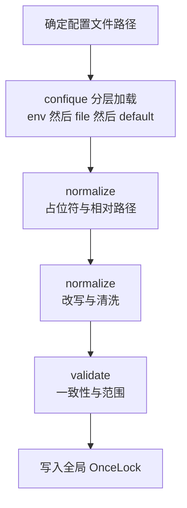
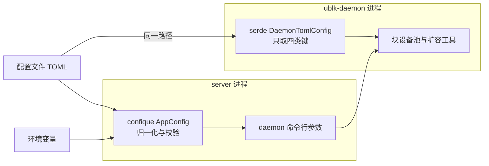

# 11 · 配置体系

> 一个节点的行为由一份 TOML 文件、一组环境变量与代码里的默认值共同决定。三者谁覆盖谁、路径怎样展开、
> 哪些组合在加载时就被拒绝，决定了运维改一个值之后实际生效的是什么。本篇讲 `AppConfig` 的加载与归一化流程、
> 全局单例的代价、`config/default.toml` 各节由谁消费，以及代码、默认文件与文档之间几处不一致。
>
> **读者**：工程师、运维。　**预备**：[第 10 篇 · 节点进程](10-node-process-and-object-model.md)。
> **代码**：`src/cfg.rs`、`src/cfg/network.rs`、`src/cfg/image.rs`、`config/default.toml`、`config/deps_manifest.toml`、
> `src/sandbox/firecracker/config.rs`、`src/bin/server.rs`、`storage/ublk-daemon/src/main.rs`

---

## 0. 本篇要回答的问题

1. 同一个配置项同时出现在环境变量、TOML 文件与代码默认值里时，谁生效？配置文件路径本身从哪里来？
2. `$AENV_HOME`、`$AENV_RUNTIME` 占位符与相对路径分别以什么为基准展开？
3. 加载时会拒绝哪些配置？哪些值会被归一化步骤悄悄改掉？
4. 为什么配置是一个进程级单例？这样做的代价是什么，能不能热加载？
5. `config/default.toml` 的各节由哪些子系统消费？
6. 代码默认值、默认文件与文档在哪些地方说法不一？没有配置文件时节点会怎样？

---

## 1. 问题：一份配置，几十个消费方

节点上的配置项覆盖了从宿主路径、Firecracker 内核命令行、网络地址池，到镜像缓存水位、预热池、模板构建资源的所有方面。
`AppConfig`（`src/cfg.rs`）一共有二十多个嵌套节，被约三十个源文件读取。设计配置体系时要回答三个问题：

- **分层**：运维多半想用一份基础文件加少量环境变量覆盖（容器与 Kubernetes 的习惯），开发者希望没有文件也能跑起来；
- **路径**：配置里的大部分值是路径，而部署形态不同（裸机、Compose、DaemonSet）时根目录不同，逐个写绝对路径既啰嗦又容易漏改；
- **校验时机**：一个非法值若到第一次创建沙箱时才报错，故障离原因已经很远。

AgentENV 的答案是：用 confique 派生分层加载，加载后立刻做一遍归一化与校验，结果放进进程级单例，运行期只读。下面按这个顺序讲。

---

## 2. 加载与归一化

### 2.1 流程

下图是 `ConfigManager::load_config_file()` 的全过程，六个步骤在一次函数调用里完成，任一步失败都让 `server` 启动失败。

**第一步：配置文件路径。** `src/bin/server.rs` 的 `main()` 先看命令行 `--config`，有则调 `ConfigManager::init_global_from_path()`；
否则 `ConfigManager::new()` 读环境变量 `AENV_CONFIG_PATH`；两者都没有时用 `default_config_path()`，即编译期的 `CARGO_MANIFEST_DIR/config/default.toml`。
最后这一档是源码树里的绝对路径，只对在源码目录里 `cargo run` 的开发者有意义；安装到别处的二进制应当显式给出路径，
仓库里的 `deploy/docker/Dockerfile.agentenv` 与 Kubernetes DaemonSet 都设置了 `AENV_CONFIG_PATH`。

**第二步：分层加载。** `AppConfig::builder().env().file(path).load()`。confique 的规则是先登记的来源优先级更高，所以次序是
**环境变量 > 文件 > `#[config(default = ...)]`**。只有在字段上声明了 `env = "..."` 的项才能被环境变量覆盖（§4.2 列出这些变量）；
没有声明的项只能写在文件里。另有一点容易忽略：confique 的文件来源缺省不是必需的，**文件不存在时加载照样成功**，所有未被环境变量覆盖的项都取代码默认值（§6.3 讨论其后果）。

### 2.2 路径归一化

`AppConfig::normalize()` 的第一部分处理路径，规则只有三条，实现在 `resolve_path()`、`resolve_runtime_path()` 与 `resolve_optional_config_path_or()`：

1. `home_path` 本身若是相对路径，以**配置文件所在目录**为基准；
2. 其它路径中的字面量 `$AENV_HOME` 替换成归一化后的 `home_path`，然后若仍是相对路径，同样以配置文件所在目录为基准；
3. 可选路径（如 `[firecracker].work_dir`、`serial_dir`、`[ublk].daemon_binary_path`、`daemon_log_path`）未设置时，取 `home_path` 下的固定子路径（`firecracker-work`、`logs/serial`、`ublk/uvm-ublk-daemon`、`logs/ublk-daemon.log`）。

`$AENV_RUNTIME` 只在 `[ublk].daemon_socket_path` 上展开（缺省 `$AENV_RUNTIME/ublk-daemon.sock`）；`runtime_path` 本身能用 `$AENV_HOME` 但不能引用自己。
这套规则带来的便利是：只改 `home_path`（或环境变量 `AENV_HOME_PATH`）就能把整棵目录树（[第 10 篇 §5](10-node-process-and-object-model.md#5-节点磁盘布局)）搬到别处，
`deploy/docker/Dockerfile.agentenv` 正是这样把它设为 `/workspace/env` 的。代价是「相对路径相对于谁」不直观：
同一份文件挪到别的目录，里面的相对路径就指向别处；而通过环境变量给出的相对路径，基准也是配置文件所在目录，而不是进程的当前目录。

### 2.3 改写与清洗

`normalize()` 的第二部分会改动语义上的值，运维需要知道它们的存在：

- **PVM 模式关闭脏页跟踪。** `virtualization_mode` 为 `pvm` 时，`memory_snapshot.track_dirty_pages` 被强制设为 `false`，放在校验之前，
  这样一份为 KVM 写的配置切到 PVM 时不需要额外改动。脏页跟踪依赖 AENV 补丁版 Firecracker 新增的 `GET /vm/dirty-memory-ranges`（[第 42 篇](42-memory-snapshot-over-ublk.md)、[第 61 篇](61-pvm.md)）。
- **`[cluster].scheduler_endpoint`** 去掉首尾空白，空串变成未设置（`ClusterConfig::normalize()`）。
- **`[sandbox_proxy].domains`** 逐个去空白、去尾部的点、按 DNS 名规范化并去重，非法域名直接报错；保持原顺序，因为第一个域名会作为对外通告的沙箱域名（`SandboxProxyConfig::normalize()`，见[第 17 篇](17-reverse-proxy.md)）。
- **POSIX 快照仓库**：`repository_backend = "posix_fs"` 而文件里没有 `[backend.posix_fs]` 节时，自动补上一个缺省节，`snapshot_store` 落在 `$AENV_HOME/snapshot-store`。

### 2.4 校验

`AppConfig::validate()` 依次调用以下检查，失败信息都带着键名，以便定位：

| 检查 | 函数 | 拒绝的情况 |
|---|---|---|
| 预热池 | `validate_pool_config()` | 任一启用的池 `low_watermark > high_watermark`；Firecracker 池 `fill_concurrency = 0` |
| 镜像 GC | `ImageCacheGcConfig::validate()` | 水位比例越界 |
| 网络地址池 | `NetworkConfig::validate()` | CIDR 无法解析；host interaction 池不足 32768 个地址、veth 池不足 65536 个；三个网段（含固定的 VM 链路 `169.254.0.20/30`）互相重叠 |
| ublk | `validate()` 内联 | `resize_timeout_secs = 0`；`remote_io_workers = 0` |
| 内存快照 | `validate_memory_snapshot_options()` 等 | PVM 下开脏页跟踪；后台下载的并发、块大小及两者乘积超过上限 |
| overlaybd 全局配置路径 | `validate_overlaybd_global_config_paths()` | rootfs、内存、转换、扩容四份生成配置的路径在字面或 canonical 意义上重名 |
| 磁盘限流 | `validate_disk_rate_limit()` | 启用时有突发值而持续值为零；任一值超出 Firecracker 令牌桶的 `i64` 范围 |
| 卷 | `validate_volume_limits()` | 大小为零或溢出；挂载数超出 `MAX_VOLUME_MOUNTS` |
| 模板构建 | `validate_template_builder()` | 并发为零、镜像为空、CPU 或内存或缓存容量越界 |

两个设计细节值得注意。磁盘限流在 `enabled = false` 时跳过全部检查：注释的理由是关闭时启动与恢复两条路径都不读这些值，预先写好的值不应阻止启动。
overlaybd 全局配置路径要求互不相同，是因为 C++ 的 overlaybd 工具把 `cacheDir` 当作扁平文件目录管理、会截断并删除它不认识的条目，
若与 Rust 版 overlaybd 的运行期缓存共用，会毁掉后者的按条目目录（见 `resolved_overlaybd_convert_global_config_path()` 的注释，[第 39 篇](39-block-cache-and-background-download.md)）。

---

## 3. 全局单例

### 3.1 `ConfigManager` 与 `OnceLock`

加载结果存进 `static GLOBAL_CONFIG_MANAGER: OnceLock<ConfigManager>`。`ConfigManager::init_global()` 与 `init_global_from_path()` 在已初始化时直接返回已有实例，
否则加载并写入；`ConfigManager::global()` 在生产构建里要求已初始化，否则 panic；`ConfigManager::global_config()` 是它的简写，返回 `&'static AppConfig`。

单例的好处是取用成本低、写法简单：Firecracker 后端在构造沙箱配置时（`FirecrackerSandboxConfig::from_global_config_with_user_image()`）、
orchestrator 在构造时（`with_file_backed_store_factory_and_volumes()`）、模板构建 journal 在打开时，都直接读全局配置，而不需要从 `main()` 一路传参。
由于返回的是 `'static` 引用，读配置不需要加锁。

### 3.2 代价

**隐式依赖。** 一个函数是否依赖配置、依赖哪几项，从签名上看不出来。`Orchestrator::new()` 的参数里没有配置，但它读了 `[orchestrator]` 节与镜像 GC 的设置；
`FirecrackerPool::global()` 第一次被调用时才读 `[pool]`。阅读与重构都要靠 grep 才能找全依赖面。

**测试隔离。** `OnceLock` 一个进程只能写一次，所以同一测试二进制里的所有测试共用一份配置。代码对此做了两处适配：
`#[cfg(test)]` 下 `global()` 遇到未初始化会自动调用 `init_global()`；`set_global()` 在测试构建里给 `access_token_hash_seed` 注入一个固定的测试种子 `TEST_ACCESS_TOKEN_HASH_SEED`，
避免测试去碰 `$AENV_HOME/secrets`。需要不同配置的测试只能绕开单例，直接构造 `AppConfig` 并调用 `from_app_config()` 一类接受显式配置的函数——
仓库里许多构造函数都同时提供 `from_app_config(&AppConfig)` 与读全局的版本，正是为此。

**没有热加载。** `ConfigManager` 没有任何重载方法，`OnceLock` 也无法重置；许多消费方在初始化时就把值拷进自己的结构（预热池水位、网络管理器的地址池、ublk-daemon 的命令行参数）。
所以修改配置一律需要重启 `server`。这对节点来说可以接受：重启会经由关闭序列把运行中的沙箱暂停落盘（[第 10 篇 §3](10-node-process-and-object-model.md#3-关闭序列)），
代价是一次重启的时长与这段时间里沙箱不可用。

### 3.3 不在单例里的配置

有几样东西不经过 `AppConfig`：

- **监听地址** `API_ADDR`：`main()` 直接用 `std::env::var` 读取，缺省 `0.0.0.0:8000`，不能写进 TOML。
- **API key** `AENV_API_KEY`：`ApiKey::resolve()` 直接读环境变量，再依次退到 `/run/secrets/api-key` 与 `$AENV_HOME/secrets/api-key`（[第 13 篇](13-authentication.md)）。
- **日志**：`RUST_LOG` 决定过滤级别，缺省 `agentenv=info,envd=info,uvm_ublk=info`；`AENV_LOG_FORMAT`、`AENV_LOG_SPAN_EVENTS` 决定格式（`src/logging.rs`）。日志在配置加载之前就已初始化，所以它不可能来自配置文件。
- **sysctl 调优开关** `AENV_FORCE_SYSCTL_TUNING`：在容器里运行时缺省跳过 sysctl 调优，置真则强制执行（`src/setup/network_capacity.rs`）。
- **依赖版本**：`config/deps_manifest.toml` 通过 `include_str!` 在编译期嵌进二进制（`SetupDependencyManifest::get()`），按虚拟化模式给出 Firecracker 与内核版本，以及 tools 盘、overlaybd 工具、regctl 的版本。
  运行期能改的只有 `[firecracker].version`、`[kernel].version` 等覆盖项；不改代码就升级依赖版本，等于换一个二进制。
- **构建提交号** `AENV_GIT_COMMIT`：编译期由 `option_env!` 注入 `NodeIdentity`，运行期设置同名环境变量不起作用（`src/identity.rs`）。

---

## 4. `default.toml` 各节

### 4.1 节与消费方

仓库附带的 `config/default.toml` 既是开发默认配置，也是镜像里使用的基础文件。下表按节列出关键键、默认值与消费方；完整键值表在[第 71 篇](71-config-env-ports-reference.md)。

| 节 | 关键键与默认值 | 消费方 | 本书 |
|---|---|---|---|
| 顶层 | `home_path = /var/lib/aenv`，`runtime_path`（代码默认 `/run/aenv`），`deps_path`（`$AENV_HOME/deps`），`virtualization_mode = kvm` | 全局 | 10、61 |
| `[firecracker]` | `boot_args`（完整内核命令行），`socket_timeout_secs = 3`，`socket_poll_ms = 1`，`work_dir`，`log_level` | Firecracker 后端 | 25、27 |
| `[kernel]` `[tools]` | `image_path`、`drive_path` 覆盖项；`control_plane_port = 49983`（envd 端口） | 依赖供给、后端 | 26、59 |
| `[image.*]` | `default_image = ubuntu:24.04`，`capacity_gb = 100`，GC 间隔 1800 s、水位 0.95 / 0.70 | 镜像解析与缓存 | 45、49 |
| `[p2p]` | `enabled = false`，`transport = iroh` | P2P | 58 |
| `[custom_extension]` | `url` 未设置即关闭，`timeout_ms = 5000` | 扩展 hook | 33 |
| `[cluster]` `[sandbox_proxy]` | `scheduler_endpoint`；`domains = []` | reporter、反向代理 | 17、57 |
| `[network.*]` | 六段 `always_denied_cidrs`；`10.11.0.0/16`、`10.12.0.0/16` | 网络 | 29、30 |
| `[machine]` | `mem_size_mib = 1024`，`vcpu_count = 2`，`disk_rate_limit` 缺省关闭 | 沙箱资源 | 14、26 |
| `[envd]` `[sandbox]` | `version = 0.5.15`，`init_timeout_secs = 60`；`access_token_hash_seed` | 后端、访问令牌 | 13、28 |
| `[volume]` | `max_size_mb = 262144`，`max_volume_count = 4` | 卷管理器 | 31 |
| `[orchestrator]` | `default_sandbox_timeout_secs = 15`，`auto_resume_min_sandbox_timeout_secs = 300`，`auto_evict_interval_ms = 1000`，`metrics_interval_secs = 15` | orchestrator | 22、23、24 |
| `[snapshot]` `[backend.*]` | `repository_backend = posix_fs`，`publish_compression` lz4，`memory_startup_pack` 缺省关闭 | 快照仓库 | 43、47、48 |
| `[ublk]` `[ublk.overlaybd]` | `daemon_metrics_listen_addr = 0.0.0.0:9103`，`runtime_upper_mode = hybridLogStructured`，`resize_timeout_secs = 120` | ublk-daemon、Rust 版 overlaybd | 36、41 |
| `[pool.*]` | `low_watermark = 2`，`high_watermark = 64`，三个池的开关 | 预热池 | 32 |
| `[memory_snapshot]` | `track_dirty_pages = true`，`background_download` 块大小 16 MiB、并发 4 | 内存快照 | 39、42 |
| `[template_build]` | `max_concurrent_builds = 4`，builder 16 vCPU、32768 MiB，缓存 65536 MiB | 模板构建器 | 52、53 |
| `[observability]` `[node_identity]` | `enabled = true`，`scheduler_report.enabled = false`、间隔 5 s；`node_id = node-a` | observability、reporter | 24、57 |

几个值的语义需要额外说明。`[orchestrator].default_sandbox_timeout_secs = 15` 是请求未带 TTL 时的缺省，它与 E2B 形 API 自己的缺省、自动恢复的最小 TTL 并存，三者的关系在[第 14 篇](14-sandbox-api.md)与[第 23 篇](23-auto-eviction-and-ttl.md)。
`[firecracker].boot_args` 是**整条**内核命令行，文件注释明确说修改它会替换而不是追加，DAMON 回收参数也在里面。
`[ublk.overlaybd].runtime_upper_mode` 只影响新物化的可写层，已有可写层保留原格式（[第 36 篇](36-read-write-paths-and-rw-layouts.md)）。

### 4.2 环境变量

在字段上声明了 `env` 的项共二十一个，集中在路径、身份与集群几类：

- 路径：`AENV_HOME_PATH`、`AENV_RUNTIME_PATH`、`AENV_DEPS_PATH`、`AENV_FIRECRACKER_WORK_DIR`、`AENV_FIRECRACKER_SERIAL_DIR`、`AENV_SNAPSHOT_STORE`、
  `AENV_SNAPSHOT_LOCAL_CACHE_PATH`、`AENV_PERSISTED_SANDBOX_STORE_PATH`、`AENV_UBLK_DAEMON_BINARY_PATH`；
- 模式与开关：`AENV_VIRTUALIZATION_MODE`、`AGENTENV_MEMORY_SNAPSHOT_TRACK_DIRTY_PAGES`、`AENV_OBSERVABILITY_SCHEDULER_REPORT_ENABLED`、`AENV_OBSERVABILITY_REPORT_INTERVAL_SECS`；
- 身份与集群：`AENV_NODE_ID`、`AENV_CLUSTER_ID`、`AENV_SERVICE_INSTANCE_ID`、`AENV_OBSERVABILITY_SCHEDULER_ENDPOINT`、`AENV_SANDBOX_PROXY_DOMAINS`（逗号分隔）；
- 其它：`AENV_SANDBOX_ACCESS_TOKEN_HASH_SEED`、`AENV_CUSTOM_EXTENSION_URL`、`AENV_UBLK_DAEMON_METRICS_LISTEN_ADDR`。

挑选的原则看得出来：凡是随部署实例变化（每个节点不同的身份、每套集群不同的 scheduler 地址）或者属于机密（令牌种子）的项，都能用环境变量注入，
使同一份 TOML 可以被一个集群的所有节点共用。Kubernetes DaemonSet（`deploy/k8s/base/agentenv-daemonset.yaml`）就用 `fieldRef` 把 Pod 名注入为 `AENV_NODE_ID`。
集群里所有节点必须使用同一个 `AENV_SANDBOX_ACCESS_TOKEN_HASH_SEED`，否则一个节点签发的访问令牌到另一个节点验证不过（[第 13 篇](13-authentication.md)）。

---

## 5. 同一个文件的第二个读者

`server` 并不是唯一读这份 TOML 的进程。`UblkDaemonConfig::from_app_config()`（`src/sandbox/ublk/device.rs`）把 `ConfigManager::config_path()` 作为 `--config` 传给 ublk-daemon，
daemon 在 `storage/ublk-daemon/src/main.rs` 里用自己的 serde 结构 `DaemonTomlConfig` 再解析一遍，只取 `home_path`、`deps_path`、`[pool]` 与 `[ublk.overlaybd].resize_timeout_secs`。

这条第二路径不经过 confique，因而规则与 `server` 不同。daemon 只认 `AENV_HOME_PATH` 与 `AENV_DEPS_PATH` 两个环境变量（自己读 `std::env`），其余覆盖看不到；
它的默认值也是自己定义的：`home_path` 缺省 `/var/lib/aenv` 与 `server` 一致，而 `deps_path` 缺省是 `./env`（`DEFAULT_DEPS_PATH`），与 `server` 的 `$AENV_HOME/deps` 不同。
`default.toml` 把 `deps_path` 注释掉了，于是在不设 `AENV_DEPS_PATH` 时，daemon 会到「配置文件目录/env/overlaybd/bin/overlaybd-resize」去找 C++ 扩容工具，
而 `server` 把 overlaybd 工具安装在 `$AENV_HOME/deps/overlaybd/` 下。推论：按仓库默认文件部署且需要冷启动扩容 rootfs 时，扩容会因找不到工具而失败；本书未在运行环境中验证。

块设备池的 `startup_prewarm` 是另一处语义分叉。`server` 侧 `PoolComponentConfig::startup_prewarm` 的代码默认是 `true`；
daemon 侧它是 `Option<bool>`，文件里不写时按内核是否支持 `UBLK_F_UPDATE_SIZE` 决定。`default.toml` 的注释描述的是 daemon 的语义（「省略则仅在内核支持时预热」），
而由于 `server` 只在没有配置文件路径时才用命令行把池参数传给 daemon（`UblkDaemonClient::new()`），实际生效的通常也是 daemon 的语义。
两处默认值各自成立，但读 `src/cfg.rs` 的人会得出相反的结论。

---

## 6. 不一致之处

### 6.1 内核命令行的两份默认

`[firecracker].boot_args` 在 `AppConfig` 里是 `Option<String>`，代码没有给它默认值。未设置时，`FirecrackerSandboxConfig::from_app_config_with_user_image()` 退回到 `src/sandbox/firecracker/config.rs` 的常量 `DEFAULT_BOOT_ARGS`。
这个常量与 `default.toml` 里的值不同：它没有 `mitigations=off`、`init=/init` 与 `page_reporting.page_reporting_order=6`，DAMON 参数则两边相同、需要同步维护。
推论：没有 `init=/init` 时内核按自己的缺省次序寻找 init 程序，guest 能否正常起来取决于 tools 盘的布局；本书没有验证这条路径。
文档 `docs/src/configuration/reference.md` 把 `boot_args` 的默认值写成含 `init=/init` 的那一份，即默认文件的值，而不是代码的值。

### 6.2 环境变量的命名

脏页跟踪的覆盖变量叫 `AGENTENV_MEMORY_SNAPSHOT_TRACK_DIRTY_PAGES`，其余全部是 `AENV_` 前缀；scheduler 地址属于 `[cluster]` 节，变量名却是 `AENV_OBSERVABILITY_SCHEDULER_ENDPOINT`。
`API_ADDR` 既没有前缀也不在 confique 体系里。这些都不影响功能，但按前缀 grep 或按节名推断变量名的运维会漏掉它们。

### 6.3 没有配置文件时

由于缺失的配置文件不报错，「没有文件」与「文件里什么都没写」等价，节点完全按代码默认值运行。代码默认与 `default.toml` 不同的项至少有这些：

| 项 | 代码默认 | `default.toml` | 文档 `reference.md` |
|---|---|---|---|
| `[firecracker].boot_args` | 未设置，退回 `DEFAULT_BOOT_ARGS` | 含 `init=/init` 的完整命令行 | 同默认文件 |
| `[image.cache].capacity_gb` | 未设置，不做容量淘汰 | 100 | 100，并注明未设置即不限 |
| `[image.cache.remote_blocks].max_size_gb` | 10 | 100 | 100 |
| `[node_identity].node_id` | 未设置，退回主机名 | `node-a` | 主机名派生 |
| `[node_identity].cluster_id` | 未设置，nil UUID | 全零 UUID | nil UUID |

其中 `node_id` 一项在多节点部署里有实际后果：直接拿默认文件给多个节点用、又不设 `AENV_NODE_ID` 时，它们都会以 `node-a` 的身份向 scheduler 注册。
仓库的 Compose 与 DaemonSet 都显式设置了 `AENV_NODE_ID`，规避了这一点。

---

## 7. 小结

- 优先级是环境变量 > 文件 > 代码默认；只有声明了 `env` 的二十一个字段能被环境变量覆盖。配置文件路径的次序是 `--config` > `AENV_CONFIG_PATH` > 编译期源码路径。
- 配置文件不存在不报错，节点会静默地按代码默认值运行，而代码默认与 `default.toml` 在内核命令行、缓存上限、节点 ID 等项上不同。
- 相对路径与 `$AENV_HOME` 展开后的路径都以配置文件所在目录为基准；`$AENV_RUNTIME` 只用于 daemon socket。只改 `home_path` 就能整体搬迁节点目录。
- 归一化会改写语义：PVM 下强制关闭脏页跟踪，清洗 scheduler 地址与代理域名，补全 POSIX 仓库节。校验在启动时拒绝地址池重叠、生成配置路径重名、限流值越界等组合。
- 配置是 `OnceLock` 单例，读取无锁、无需传参，代价是隐式依赖、测试共用一份配置与不能热加载；改配置等于一次经由暂停落盘的重启。
- 监听地址、API key、日志、依赖版本与构建提交号不在 `AppConfig` 里，其中依赖版本在编译期嵌入。
- ublk-daemon 用自己的结构再读一遍同一文件，`deps_path` 默认值与块设备池 `startup_prewarm` 语义都与 `server` 不同。

## 延伸阅读 / 下一篇

- 下一篇：[第 12 篇 · 规范驱动的服务骨架](12-spec-driven-server.md)，进入 API 层。
- 全部配置键、环境变量与端口：[第 71 篇](71-config-env-ports-reference.md)；配置被消费的启动序列：[第 10 篇](10-node-process-and-object-model.md)。
- 宿主准备与依赖供给：[第 59 篇](59-host-setup-and-privileges.md)；ublk-daemon 的进程模型：[第 41 篇](41-ublk-daemon.md)。
- 对照：[e2b 手册第 14 篇 · 配置、flag 与版本](../e2b-infra/14-config-flags-versions.md)。
- confique 的分层加载语义：<https://docs.rs/confique/0.4.0/confique/>。
