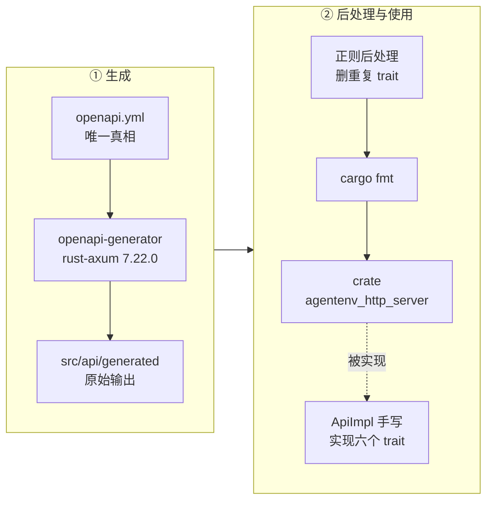
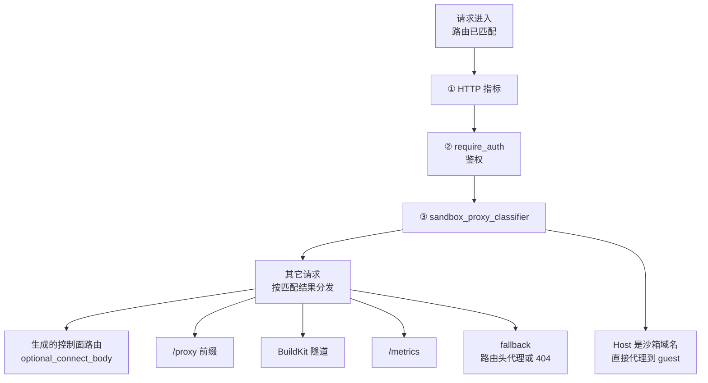

# 12 · 规范驱动的服务骨架

> AgentENV 的 HTTP 控制面要对 E2B SDK 线兼容：路径、字段名、状态码、请求头都由别人的契约决定。
> 它的做法是把 `src/api/openapi.yml` 当作唯一真相，用代码生成器产出路由、模型与 trait，手写代码只负责实现 trait。
> 本篇讲这条生成管线、生成代码长什么样、手写的中间件怎样包在它外面，以及错误怎样被映射成状态码。
>
> **读者**：工程师、SDK 使用者。　**预备**：[第 08 篇 · 系统架构](08-system-architecture.md)、[第 10 篇 · 节点进程](10-node-process-and-object-model.md)。
> **代码**：`src/api/server.rs`、`src/api/impls/mod.rs`、`src/api/impls/admin.rs`、`src/identity.rs`、`adev/src/codegen.rs`、`src/api/generated/src/server/mod.rs`

---

## 0. 本篇要回答的问题

1. 为什么 AgentENV 的路由表不是手写的？spec-first 换来了什么，又付出了什么？
2. 从 `openapi.yml` 到可编译的 crate，生成管线有哪几步？哪一步最脆弱？
3. 生成的 handler 在调用手写代码之前做了哪些固定的事？「按状态码枚举的响应」是什么意思？
4. 一个请求从进入进程到抵达 handler，依次经过哪几层中间件？为什么是这个顺序？
5. 内部错误怎样变成 HTTP 状态码？同一种错误为什么在不同端点得到不同的状态码？

---

## 1. 问题：实现一份别人写好的契约

AgentENV 希望用户把 `E2B_API_URL` 指向自己的节点，就能用官方 E2B SDK 创建沙箱、执行命令、读写文件。
这意味着 SDK 发出的每个请求，路径要能匹配，JSON 字段名要一字不差（`templateID`、`envdAccessToken`），
状态码的语义要与 SDK 的错误处理一致（409 表示冲突、404 表示不存在）。
契约的主体来自 E2B，AgentENV 在其上增加了冷启动、快照、卷、fork 与 BuildKit 等扩展端点（[第 18 篇](18-e2b-compatibility.md)）。

如果路由与模型都手写，有两个问题。第一，字段名与 spec 之间没有机械联系，一次重命名可能只改了一边，
错误只会在 SDK 兼容测试里暴露。第二，spec 也是文档站的 API 参考来源（`Makefile` 把它软链到 `docs/src/openapi.yml` 供页面渲染），
手写代码与 spec 漂移之后，读文档的人看到的是一份不存在的接口。

AgentENV 的选择是 **spec-first**：`src/api/openapi.yml`（OpenAPI 3.0.0，title「AgentENV API」）是唯一真相，
openapi-generator 的 `rust-axum` 生成器从它产出一个独立的 crate `agentenv_http_server`（目录 `src/api/generated/`），
里面有全部请求 / 响应模型、每个 tag 一个 trait、以及把路径接到 trait 方法上的 axum `Router`。
手写的 `ApiImpl`（`src/api/impls/mod.rs`）只实现这些 trait。
往 spec 里加一个端点而不实现它，编译就会失败；改一个字段名，所有用到它的手写代码同样编译不过。

代价也在这里：生成器的输出格式、命名规则、对 spec 中某些写法的处理方式，都变成了这个项目的约束。
本篇后面几节的「补丁」大多来自这一点。

---

## 2. 生成管线

生成由仓库自带的开发工具 `adev` 驱动。`make agentenv-server` 调用 `cargo adev codegen server`，
落到 `adev/src/codegen.rs` 的 `run_server()`。它做三件事：

1. 经 `run_openapi_generator()` 用 `npx` 调用 `@openapitools/openapi-generator-cli`。
   npm 包装器的版本由常量 `OPENAPI_GENERATOR_CLI_VERSION`（`2.32.0`）固定，真正的生成器 jar 版本由仓库根的 `openapitools.json` 锁定为 `7.22.0`。
   参数是 `-g rust-axum -i src/api/openapi.yml -o src/api/generated`，并指定 `packageName=agentenv_http_server`、`hideGenerationTimestamp=true`（让重复生成的输出逐字节稳定）。
2. 对生成的 `src/apis/mod.rs` 调用 `fix_duplicate_auth_trait()`，删掉重复的 `ApiKeyAuthHeader` trait 定义。
3. `cargo fmt -p agentenv_http_server`。



第二步是整条管线里最脆弱的一环。spec 声明了四个 `apiKey` 类型的安全方案（`ApiKeyAuth`、`AuthProviderTeamAuth`、`AdminApiKeyAuth`、`AdminTeamAuth`）
和一个 `http bearer` 方案。生成器为每个 apiKey 方案各输出一份同名的 `ApiKeyAuthHeader` trait，
Rust 不允许同一模块里有两个同名 trait，生成结果因此不能编译。
推论：这是 `rust-axum` 生成器按方案而不是按类型输出 trait 所致；生成的 `server::new()` 的泛型约束里 `apis::ApiKeyAuthHeader<Claims = C>` 至今仍重复出现四次，是同一现象留下的痕迹（重复的约束可以编译，重复的定义不行）。

`fix_duplicate_auth_trait()` 用一个多行正则匹配那段 trait 定义的**逐字文本**——注释、缩进、方法签名都写死在正则里——保留第一份、删除其余。
匹配不到任何一份时直接 `bail!`。这意味着生成器只要改动这段输出的一个空格或一行注释，`make agentenv-server` 就会失败，需要有人同步修改正则。
这段代码的注释说明它移植自一个 Python 脚本，逻辑没有变化。

生成结果**入库**：`src/api/generated/` 是工作区成员（根 `Cargo.toml` 的 `members`），普通的 `cargo build` 不运行生成器，也不需要 Node.js。
`CONTRIBUTING.md` 要求改 spec 的提交同时带上重新生成的输出，并禁止手改生成文件。
仓库的 CI 配置里没有「重新生成并比较」的检查（`adev/src/codegen.rs` 只出现在 CI 依赖缓存的版本计算里），
所以 spec 与生成代码的一致性靠评审维持。

同一套工具链在仓库里还生成三个**客户端**，方向相反：Firecracker API 客户端（`thirdparty/firecracker-client`）、
envd HTTP 客户端（`thirdparty/envd/http-client`）与 custom extension 客户端（`src/custom_extension_api/generated`，见[第 33 篇](33-custom-extension-hooks.md)），
都用 `-g rust`，后处理是在 `lib.rs` 开头加 `#![allow(clippy::all)]` 与 `#![allow(warnings)]`。

---

## 3. 生成了什么

### 3.1 trait 与按状态码枚举的响应

spec 里的 40 个操作按 tag 分进六个 trait：`Admin`（2）、`Default`（1，即 `/health`）、`Sandboxes`（20）、`Snapshots`（2）、`Templates`（11）、`Volumes`（4），
定义在 `src/api/generated/src/apis/*.rs`。每个操作是一个 async 方法，参数顺序固定：
`method`、`host`、`cookies`、`claims`，然后按需加路径参数、查询参数、请求体，各自是生成的结构体。

返回类型是 `Result<XxxResponse, E>`，`XxxResponse` 是一个**按状态码穷举的枚举**。以 pause 为例，`apis/sandboxes.rs` 里的
`SandboxesSandboxIdPausePostResponse` 有五个变体：`Status204_TheSandboxWasPausedSuccessfullyAndCanBeResumed`、`Status409_Conflict(Error)`、
`Status404_NotFound(Error)`、`Status401_AuthenticationError(Error)`、`Status500_ServerError(Error)`。
变体名由状态码加 spec 里 response 的描述拼成；带响应头的变体是结构体变体，例如创建沙箱的 201 带一个 `x_agentenv_sandbox_id` 字段。

这种形状的好处是**handler 只能返回 spec 声明过的状态码**。spec 里 pause 没有 400，手写代码就写不出一个 400 的 pause 响应；
想加，得先改 spec、重新生成。代价是冗长：每个 handler 的结尾都是一个把内部错误逐个翻成变体的 `match`。
`src/api/impls/sandbox.rs` 的 `sandboxes_sandbox_id_pause_post()` 是典型：

```rust
match timer.time("pause", self.orchestrator.pause_sandbox(sandbox_id)).await {
    Ok(_) => Ok(SandboxesSandboxIdPausePostResponse::Status204_TheSandboxWasPausedSuccessfullyAndCanBeResumed),
    Err(OrchestratorError::SandboxNotFound(id)) => Ok(
        SandboxesSandboxIdPausePostResponse::Status404_NotFound(sandbox_not_found(id)),
    ),
    Err(OrchestratorError::InvalidSandboxState { state, .. }) => Ok(
        SandboxesSandboxIdPausePostResponse::Status409_Conflict(Self::error(
            409, format!("sandbox cannot be paused from {} state", state),
        )),
    ),
    Err(err) => Ok(SandboxesSandboxIdPausePostResponse::Status500_ServerError(err.into())),
}
```

注意 HTTP 状态码由变体决定，响应体 `Error` 里的 `code` 字段由手写代码填，两者在类型上没有联系。
写成 `Status500_ServerError(Self::error(409, …))` 也能编译。生成器保证的是「状态码在 spec 的集合里」，不保证「响应体与状态码一致」。

`ApiImpl` 对所有 trait 取 `E = ()`，并且从不返回 `Err(())`：所有失败都表达成某个状态码变体。
生成代码里 `Err` 分支会调用 `ErrorHandler::handle_error()` 返回一个空 body 的 500，`impls/mod.rs` 只给了 `impl apis::ErrorHandler<()> for ApiImpl {}` 的默认实现，这条路径在 AgentENV 里实际走不到。

### 3.2 生成 handler 的固定步骤

`src/api/generated/src/server/mod.rs` 为每个操作生成一个泛型 handler 函数，例如 `sandboxes_sandbox_id_pause_post()`。
所有 handler 都是同一个模板：

1. 用 axum 提取器取出 `Method`、`TypedHeader<Host>`、`CookieJar`、`HeaderMap`、`Path`、`Query`、`Json` 等。
   请求体 JSON 解析失败、缺 `Host` 头之类的错误由 axum 提取器直接返回，**响应体是纯文本**，不是 spec 里的 `Error` 结构。
2. **认证**：按该操作的 `security` 声明调用 `ApiKeyAuthHeader::extract_claims_from_header()` 或 `ApiAuthBasic::extract_claims_from_auth_header()`，
   把结果 `None.or(a).or(b)` 合并，全为 `None` 就返回无 body 的 401。
3. **校验**：在 `tokio::task::spawn_blocking` 里调用 `validator` crate 派生的 `validate()`，检查 spec 里写的长度、范围等约束；失败返回纯文本 400。
4. 调用 trait 方法，得到响应枚举。
5. 对每个变体设置状态码与响应头；有 body 的变体再进一次 `spawn_blocking` 做 `serde_json::to_vec`。

第 2 步与 AgentENV 的认证模型并不贴合。spec 继承了 E2B 的多套安全方案，生成器把它们翻成按**头名**提取：
带三套备选方案的操作（如 pause）生成的是按 `X-Team-ID` 与 `authorization`（Bearer）两次提取，`/nodes` 是按 `X-Admin-Token` 提取，
只有四个只声明了 `ApiKeyAuth` 的操作（两个 metrics 端点与 builder 的 PUT / DELETE）才按 `X-API-Key` 提取。
AgentENV 的实现忽略传入的头名，一律检查 `X-API-Key`——这是[第 13 篇](13-authentication.md)的话题，这里只需要知道：
生成代码里的认证是一道**副检查**，真正有决定权的是外层中间件。

第 3、5 步把 CPU 工作挪到阻塞线程池，是生成器的固定做法，与请求大小无关。
推论：对 AgentENV 这类请求体很小的控制面，每个请求两次线程池往返的开销大于它避免的阻塞；这是用生成器的通用性换来的。

---

## 4. Router 组装与中间件顺序

### 4.1 `server::new()`

`src/api/server.rs` 的 `new()` 把生成的路由与手写部分拼成最终的 `Router`：

```rust
agentenv_http_server::server::new::<I, A, E, C>(api_impl.clone())
    .route_layer(middleware::from_fn(optional_connect_body))
    .merge(proxy::router(api_impl.clone()))
    .merge(super::impls::image_build::router(api_impl.clone()))
    .route("/metrics", get(metrics_handler))
    .layer(middleware::from_fn_with_state(api_impl.clone(), proxy::sandbox_proxy_classifier::<I>))
    .layer(middleware::from_fn_with_state(api_impl, auth::require_auth::<I>))
    .layer(middleware::from_fn(prometheus::http_metrics_middleware))
```

四块路由：生成的控制面路由；`proxy::router()` 的 `/proxy`、`/proxy/{*proxy_path}` 与 **fallback**（任何未匹配的路径都进 `proxy_via_fallback()`）；
`image_build::router()` 的 `GET /templates/{template_id}/builds/{build_id}/builder`（BuildKit 的 WebSocket 隧道，不在 spec 里，见[第 15 篇](15-template-build-api.md)）；
以及 Prometheus 的 `/metrics`。代码注释把生成路由称为「primary router」，把 `/proxy` 称为「temporary reverse proxy contract」。

理解中间件顺序需要 axum 的两条规则。第一，`Router::layer()` 把中间件套在**每一条已有路由与 fallback 上**，它在路由匹配之后、handler 之前运行，
所以中间件里能读到 `MatchedPath` 与路径参数；后加的 `layer` 在外层。第二，`route_layer()` 只套在已匹配的路由上，不套 fallback。
因为 `optional_connect_body` 在 `merge` 之前调用，它只作用于生成的路由。

于是一个请求依次经过：



三层的顺序各有理由：

- **① 指标最外层**。`prometheus::http_metrics_middleware()` 要记下所有响应，包括 ② 拒绝的 401；
  它还从响应的 extension 里读 `HttpRouteSource`（`ProxyHost`、`ProxyHeader`、`ProxyPrefix`，缺省 `ControlPlane`），这个标记由内层的代理 handler 写入，只有在最外层才能看到。
- **② 鉴权在分类器之外**。Host 形如 `{port}-{sandboxID}.{domain}` 的请求会被 ③ 直接代理走，不经过任何路由 handler；
  鉴权放在 ③ 外面，这类请求才不会绕过鉴权。`require_auth()` 自己调用 `proxy::is_sandbox_proxy_request()` 判断一个请求属于控制面还是数据面（[第 13 篇](13-authentication.md)）。
- **③ 分类器在路由 handler 之外**。Host 路由的优先级高于路径：一个发往 `8080-<id>.<domain>/sandboxes` 的请求虽然匹配了生成路由 `/sandboxes`，
  也必须送进 guest 而不是创建沙箱。`sandbox_proxy_classifier()` 在 handler 之前把它截走，并把解析出的沙箱 id 与端口写成路由头，交给代理（[第 17 篇](17-reverse-proxy.md)）。

手写的隧道与 `/proxy` 路由是在 `layer` 之前 `merge` 进来的，所以同样受 ② 保护，不需要各自再写鉴权。

### 4.2 两个补丁：可选 body 与 JSON 404

`optional_connect_body()` 修的是生成代码与契约之间的一处不符。spec 里 `POST /v2/sandboxes/{sandboxID}/connect` 的请求体是 `required: false`，
生成的 handler 用 `Json<Option<ConnectSandboxV2>>` 提取，它接受字面量 `null`，却拒绝**空 body**。
这个中间件只对 `MatchedPath` 等于该路径的 POST 生效：先把 body 读成字节，若为空，改写为 `"null"`，补上 `Content-Type: application/json` 与 `Content-Length: 4`，删去 `Transfer-Encoding`；
非空则原样放回。`server.rs` 里的测试 `optional_connect_body_preserves_json_and_body_limits()` 覆盖了八种 body 与 Content-Type 组合，并确认超过 body 上限时仍返回 413；
另一个测试确认 v1 的 `/sandboxes/{sandbox_id}/connect` 不受影响。

`proxy_via_fallback()` 处理未匹配的路径：带路由头（`x-agentenv-sandbox-id` 或 E2B 别名 `e2b-sandbox-id`）就当作数据面请求代理出去；
否则返回 404 与 JSON `Error`，消息为 `route not found: METHOD path`。注释给出的理由是让 JSON 客户端报出「路由不存在」，而不是因为空 body 解析失败。
这个 fallback 让 `E2B_SANDBOX_URL` 可以直接等于 `E2B_API_URL`，不必拼 `/proxy`（[第 18 篇](18-e2b-compatibility.md)）。

---

## 5. 错误映射

手写代码把三类内部错误翻成 `models::Error { code, message }`，入口在 `src/api/impls/mod.rs` 与 `src/api/impls/sandbox.rs`：

| 来源 | 映射函数 | 规则 |
|---|---|---|
| 快照仓库 | `ApiImpl::repository_error()` | `InvalidRequest` → 400；`SnapshotNotFound` 等五种 NotFound → 404；`AliasConflict`、`VolumeNameConflict`、`IntegrityMismatch` → 409；`Unsupported` → 500；`Backend` → 500（带 cause 链） |
| anyhow 链 | `ApiImpl::snapshot_manager_error()` | 沿 `chain()` 找第一个 `RepositoryError`，找到按上一行映射，否则 500 |
| orchestrator | `impl From<OrchestratorError> for models::Error` | `ShuttingDown` → 503；`SandboxNotFound` → 404；`InvalidSandboxState` → 400；`SandboxOperationConflict` → 409；`SandboxOperationFailed` → 500 并拼接 cause；其余 → 500 |

`internal_error()` 沿 `source()` 链拼接每一层的消息，与上一层相同的跳过，避免 anyhow 包装造成的重复文本。
这意味着 500 响应会把内部错误链原样交给客户端：便于排查，但也把路径、文件名等内部信息暴露给持有 API key 的调用方。

`From` 实现只是**缺省**映射。handler 可以先 `match` 出特定变体，再落到 `err.into()`，于是同一个内部错误在不同端点得到不同的状态码：

- `InvalidSandboxState` 的缺省映射是 400，但 pause 把它显式映射为 409（「sandbox cannot be paused from … state」）。
- `AliasConflict` 在 `repository_error()` 里是 409，而在构建与发布路径上，`bad_request_for_repository_build_error()` 把它与 `InvalidRequest`、`IntegrityMismatch` 一起视为 400，
  再由 `client_or_server_response()` 按 `code` 选 400 或 500 变体。理由写在注释里：在构建语境下这些都是「客户端输入问题」。

推论：这种「缺省 + 局部覆盖」的做法有一个直接原因——spec 是按 E2B 的约定为每个端点声明状态码的，
pause 声明了 409 而没有 400，构建端点则只有 400 与 500，映射必须落在各端点允许的集合里。生成的枚举把这条约束变成了编译期检查。

---

## 6. 最小的实现：`/health` 与 `/nodes`

`Default` trait 只有一个方法，`impls/mod.rs` 的 `health_get()` 无条件返回 `Status204_TheServiceIsHealthy`。它不检查 orchestrator 或 ublk-daemon 的状态，只说明 HTTP 服务在应答。

`Admin` trait 的两个方法在 `src/api/impls/admin.rs`，是读懂一个 trait 实现的最好起点：

- `nodes_get()`：observability 关闭（`ApiImpl::observability()` 为 `None`）时返回空数组；查询参数里的 `clusterID` 与本节点不符时也返回空数组；
  否则调用 `ObservabilityService::node_snapshot()`，返回只含本节点的单元素数组。每个节点只报告自己，集群视图由 gateway 聚合（[第 55 篇](55-gateway.md)）。
- `nodes_node_id_get()`：observability 关闭时 404（「observability is disabled on this node」）；`nodeID` 或 cluster 不符时 404；否则返回 `NodeDetail`。

两处都把状态写死为 `NodeStatus::NodeStatusReady`，没有 draining 或 unhealthy 的表达。文件里其余部分是把内部的 `MachineInfo`、`DiskMetric`、`NodeMetricsSnapshot`
转换成生成模型的 `From` 实现：生成模型与内部类型分开定义，转换集中在 API 层，内部类型不依赖生成 crate。

节点身份来自 `src/identity.rs` 的 `NodeIdentity::from_config()`，`src/bin/server.rs` 在启动时构造一次，交给 observability 与 P2P：

| 字段 | 来源 |
|---|---|
| `id` | `[node_identity]` 配置；为空时依次取 `HOSTNAME` 环境变量、`/proc/sys/kernel/hostname`、`/etc/hostname`，都没有则 `unknown` |
| `cluster_id` | 配置值解析为 UUID；缺省或解析失败（打 warn）都用 nil UUID |
| `service_instance_id` | 配置值；缺省为新的 UUIDv7，每次进程启动都变 |
| `commit` | 编译期的 `option_env!("AENV_GIT_COMMIT")`，运行时环境变量不能覆盖（测试 `observability_commit_uses_build_time_injection` 保证） |
| `version` | `CARGO_PKG_VERSION` |

三个可配置字段都可以用环境变量 `AENV_NODE_ID`、`AENV_CLUSTER_ID`、`AENV_SERVICE_INSTANCE_ID` 覆盖。
仓库自带的 `config/default.toml` 把它们写成了固定的示例值（`node_id = "node-a"` 等），所以按这份文件启动时主机名回退并不发生，多节点部署必须逐节点覆盖。
`cluster_id` 解析失败时降级为 nil UUID 而不是拒绝启动，代价是一个写错的配置会让节点悄悄出现在「nil 集群」里。

`ApiImpl` 本身是一个依赖清单：`orchestrator`、`snapshot_manager`、`template_builder`、`image_resolver`、`volume_manager`、可选的 `observability`、
代理用的 HTTP 客户端、`sandbox_proxy_domains`、`api_key`、BuildKit 会话表与构建日志。`src/bin/server.rs` 用 `Arc<ApiImpl>` 构造它，
`server::new()` 的泛型参数 `I: AsRef<ApiImpl>` 让同一个 `Arc` 既作为生成路由的 state，也作为手写中间件的 state。
`Claims` 是一个空结构体 `pub struct Claims;`——它不携带任何身份信息，只表示「已通过」。

---

## 7. 与 e2b infra 的对照

e2b infra 用 `oapi-codegen` 为 Go 的 gin 生成 `ServerInterface`，并把 spec 压缩嵌入二进制，运行时用请求校验中间件按 spec 再匹配、再校验一遍。
AgentENV 的生成器把约束编进 Rust 类型（模型结构体、`validator` 派生、按状态码的响应枚举），运行时不再加载 spec。
代价是 spec 里没被生成器翻成类型的约束在运行时不会被检查，而 e2b 的做法每个请求多一次路由查找与 schema 校验。

---

## 8. 小结

- `src/api/openapi.yml` 是控制面的唯一真相；`rust-axum` 生成 `agentenv_http_server`，手写的 `ApiImpl` 只实现六个 trait，spec 与实现的偏离会变成编译错误。
- 生成器版本由 `openapitools.json` 锁在 7.22.0；生成结果入库，日常构建不需要生成器，CI 也不检查生成结果是否最新。
- `fix_duplicate_auth_trait()` 用逐字正则删除重复的 `ApiKeyAuthHeader` 定义，是管线里对生成器版本最敏感的一步。
- 响应类型按状态码穷举，handler 只能返回 spec 声明过的状态码；但响应体里的 `code` 与 HTTP 状态码在类型上无关。
- 生成 handler 的固定步骤是提取、认证、`spawn_blocking` 校验、调用、`spawn_blocking` 序列化；提取与校验失败返回纯文本，不是 `Error` JSON。
- 中间件从外到内是指标、鉴权、Host 分类器；鉴权包住分类器，Host 路由的请求才不会绕过鉴权；分类器包住 handler，Host 路由才能优先于路径。
- `optional_connect_body` 与 JSON fallback 404 是「生成代码与契约不符时用中间件打补丁」的两个例子。
- 错误映射是「`From` 缺省 + handler 局部覆盖」，同一错误在 pause 与构建等端点得到不同状态码，受 spec 为每个端点声明的状态码集合约束。
- `/nodes` 只报告本节点、状态恒为 Ready；`Claims` 是空结构体，控制面没有身份与租户概念。

---

## 延伸阅读 / 下一篇

- [第 13 篇 · 认证与凭据](13-authentication.md)：`require_auth()` 的决策树与三类凭据。
- [第 17 篇 · 反向代理](17-reverse-proxy.md)：分类器之后的代理路径。
- [第 33 篇 · custom extension hook](33-custom-extension-hooks.md)：同一生成器的客户端方向。
- [第 64 篇 · 构建、代码生成与发布](64-build-codegen-release.md)：全部生成代码的再生成命令。
- [e2b 手册第 15 篇 · API 服务的结构](../e2b-infra/15-api-service-structure.md)：Go 侧的同一类做法与运行时校验。
- 下一篇：[第 13 篇 · 认证与凭据](13-authentication.md)。
