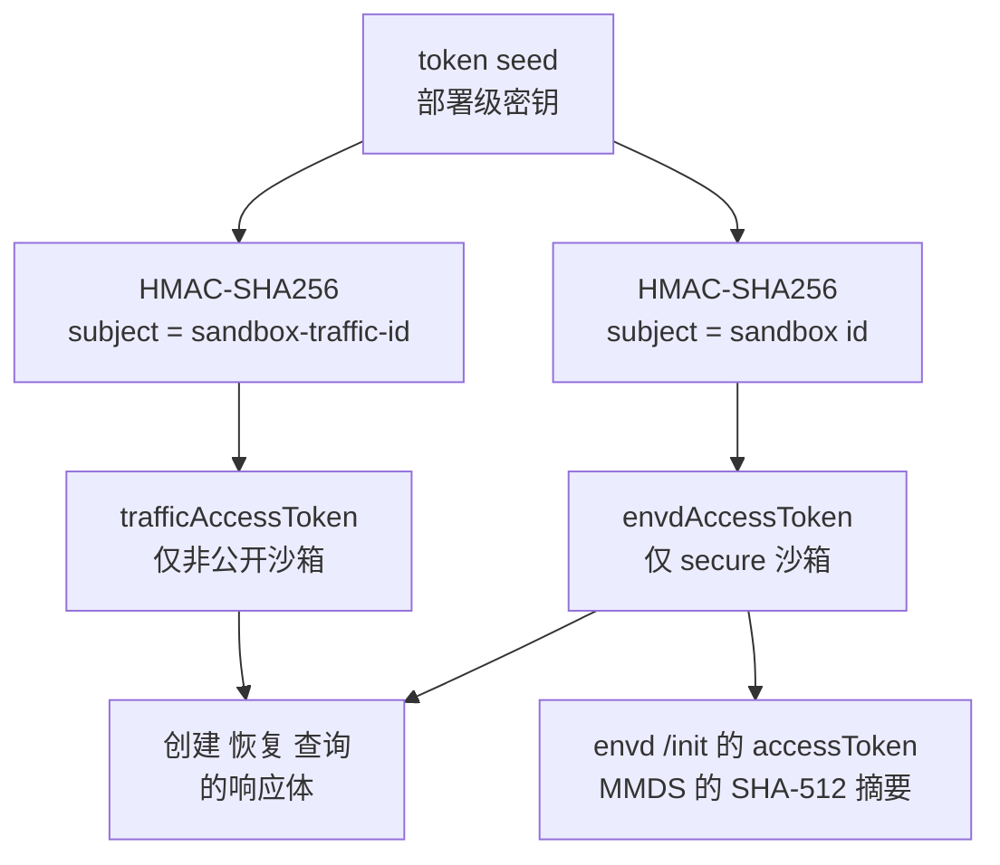
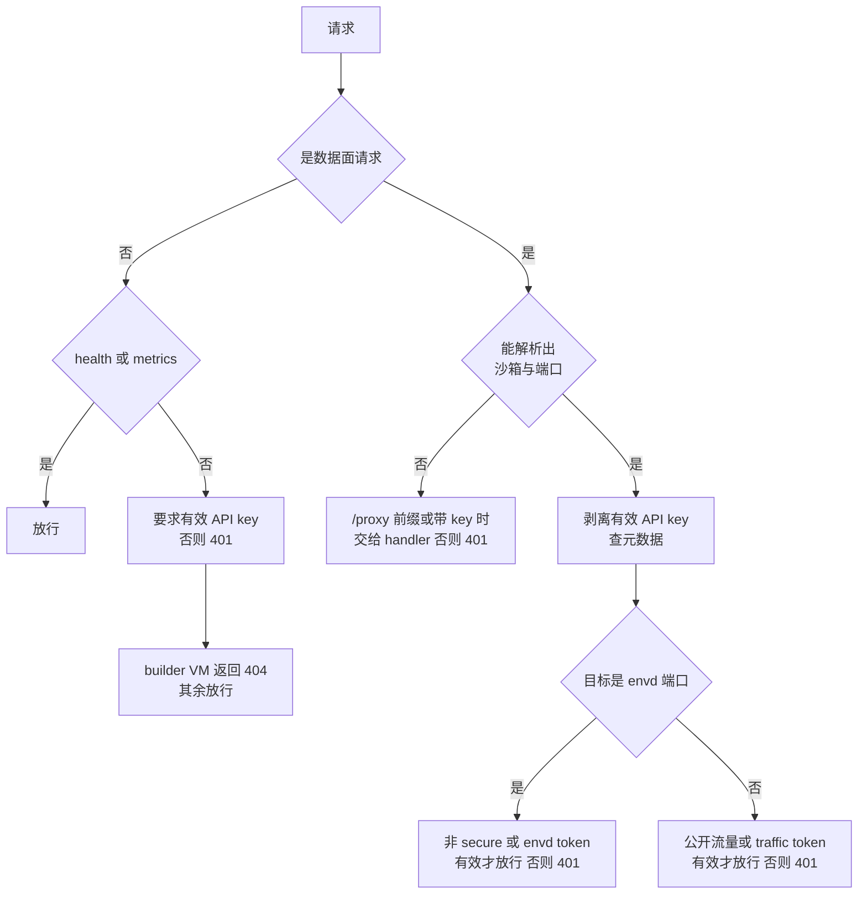

# 13 · 认证与凭据

> AgentENV 的一个节点同时面对三类调用方：管理沙箱的平台用户、操作 guest 里 envd 的 SDK、访问沙箱内应用的终端用户。
> 它为三者准备了三种互不通用的凭据：一把部署级 API key 与两种按沙箱派生的 token。
> 本篇讲每种凭据怎样产生、存在哪里、在哪一层被校验，以及中间件 `require_auth()` 怎样在一个请求上决定该要哪一种。
>
> **读者**：工程师、运维、SDK 使用者。　**预备**：[第 12 篇 · 规范驱动的服务骨架](12-spec-driven-server.md)。
> **代码**：`src/api/impls/auth.rs`、`src/api_key.rs`、`src/managed_secret.rs`、`src/sandbox/access.rs`、`src/api/impls/sandbox.rs` 的 `sandbox_model()`、`src/api/proxy.rs`

---

## 0. 本篇要回答的问题

1. 三种凭据各保护什么？为什么 API key 不能用来访问 guest 里的 envd？
2. API key 从哪里来？节点怎样保证自动生成的密钥文件不会被别的用户读到，也不会在并发启动时被写坏？
3. 两种沙箱 token 为什么不存库？这样做在 pause、重启、fork 与多节点部署中意味着什么？代价是什么？
4. `require_auth()` 怎样区分控制面与数据面？数据面请求在什么条件下放行？
5. 转发进 guest 的请求里，哪些凭据被删掉了，为什么？
6. spec 里那些继承自 E2B 的 Bearer、Team、Admin 安全方案在实现里还起作用吗？

---

## 1. 问题：三种访问，三条信任边界

一个节点的 HTTP 端口（默认 `:8000`）上同时流过两类流量（[第 08 篇](08-system-architecture.md)）。
**控制面**是创建、暂停、删除沙箱与模板的管理请求；**数据面**是经反向代理送进 guest 的请求，
又分成发往 envd 端口（`49983`）的命令执行、文件读写，与发往沙箱内应用端口的业务流量。
envd 端口在配置里有一个键 `[tools] control_plane_port`，但它实际上不可改：它只决定宿主侧连哪个端口、把哪个端口当作 envd，
guest 内的 `tools-image/pivot-init` 启动 envd 时不传端口（推论：envd 因而总是监听自己的缺省端口 49983），`aenv` CLI 也写死了 `ENVD_PORT_STR = "49983"`（`crates/aenv/src/grpc/mod.rs`）。

三者的信任关系不同。能调用控制面的人可以创建、删除任何沙箱，是部署的管理者。
envd 端口等于 guest 里的 root shell，持有它的人能在一台沙箱里执行任意命令，但不应因此能操作别的沙箱。
应用端口上跑的可能是一个要给外部用户访问的网页，访问它的人既不该能执行命令，也不该能管理沙箱。

如果只有一把钥匙，就只能二选一：要么把平台密钥交给每一个需要访问应用的终端用户，要么让应用端口完全公开。
AgentENV 的做法与 E2B 一致，三种访问三种凭据，并且**互不通用**：

| 凭据 | 请求头 | 作用域 | 产生 | 校验点 |
|---|---|---|---|---|
| API key | `X-API-Key` | 全部控制面 API | `ApiKey::resolve()`，部署级，一把 | `ApiImpl::has_valid_api_key()` |
| `envdAccessToken` | `X-Access-Token` | 一台 `secure` 沙箱的 envd 端口 | `SandboxAccessTokenGenerator::generate()` | `Orchestrator::validate_envd_access_token()` |
| `trafficAccessToken` | `e2b-traffic-access-token` | 一台 `allowPublicTraffic: false` 沙箱的非 envd 端口 | `SandboxAccessTokenGenerator::generate_traffic()` | `ApiImpl::has_valid_traffic_access_token()` |

三个头名定义在 `src/api/impls/auth.rs` 的常量 `API_KEY_HEADER`、`ENVD_ACCESS_TOKEN_HEADER`、`TRAFFIC_ACCESS_TOKEN_HEADER`。
后两种 token 的头名与 E2B 相同，E2B SDK 因此不需要改动。

---

## 2. 部署级 API key

### 2.1 来源与格式

`src/api_key.rs` 的 `ApiKey::resolve()` 按固定顺序找密钥，找到第一个就停：

1. 环境变量 `AENV_API_KEY`；
2. 外部密钥文件 `/run/secrets/api-key`（Docker / Kubernetes secret 的惯用挂载点）；
3. 托管密钥文件 `$AENV_HOME/secrets/api-key`；
4. 都没有时生成一把新的：32 字节系统随机数的十六进制，加前缀 `e2b_`，写入第 3 项的位置。

`e2b_` 前缀是为了兼容：E2B SDK 与 CLI 对 key 的形状有预期，生成的 key 可以直接填进 `E2B_API_KEY`。
无论来源如何，`ApiKey::new()` 都要求长度在 32 到 256 之间、字符只取 `[A-Za-z0-9._~-]`（URL 安全字符）；文件内容允许以一个 `\n` 或 `\r\n` 结尾。
不合法就拒绝启动，而不是退回到下一个来源——一个写错的密钥不会被悄悄替换成自动生成的那一把。

两类文件的读法不同。外部密钥文件由部署系统提供，`ApiKey::open_external()` 用 `O_NONBLOCK` 打开（防止路径上是一个 FIFO 时启动卡住），
随后要求它是普通文件，读取上限 258 字节；它**允许**符号链接，因为 Kubernetes 的 secret 卷正是用一串符号链接实现原子更新的（测试 `external_secret_allows_kubernetes_style_symlinks`）。
托管密钥文件由节点自己创建和读取，规则严格得多，见下一小节。

`ApiKey` 的 `Debug` 输出固定为 `ApiKey([REDACTED])`，日志里不会出现密钥本身。

### 2.2 托管密钥文件：权限与原子创建

`src/managed_secret.rs` 是 API key 与 token seed 共用的「托管密钥文件」工具。读取时 `read()` 检查：

- 父目录名必须是 `secrets`（`managed_parent()`），不是符号链接，属主是当前有效 uid，权限恰好 `0700`；
- 文件用 `O_NOFOLLOW | O_NONBLOCK` 打开，必须是普通文件，权限恰好 `0600`，属主是当前有效 uid，大小不超过上限。

任何一条不满足都返回错误，节点拒绝启动。这比「读得到就用」严格：一个被改成 `0644` 的密钥文件意味着别的用户可能已经读过它，此时继续运行只会掩盖问题。

创建走 `create()`：先建目录（`0700`）并校验，再在**同一目录**里用 `tempfile` 建临时文件，设 `0600`、写入、`fsync`，
最后 `persist_noclobber()` 把它链接到目标路径，成功后再对目录 `fsync`。
`persist_noclobber` 在目标已存在时失败而不是覆盖，于是两个进程同时首次启动、各自生成了一把随机密钥时，只有一个能落盘；
输掉的一方得到 `AlreadyExists`，转而读取赢家写下的文件（`CreateOutcome::Existing`），两者最终使用同一把密钥。
临时文件与目标在同一目录，保证这一步是同一文件系统上的原子操作；目录 `fsync` 保证掉电后不会出现「文件内容已落盘、目录项丢失」。

### 2.3 比较与轮换

`ApiImpl::has_valid_api_key()` 先用 `single_header()` 取 `x-api-key`：请求里**恰好一个**值才算数，两个值（哪怕其中一个正确）一律视为无效。
e2e 套件 `scripts/tests/e2e/suites/08_auth.sh` 有两条断言专门覆盖「一真一假」与「两个都假」。拒绝多值是为了避免各层取值规则不同造成的歧义：
如果中间件看第一个值、下游看最后一个值，攻击者就有机会构造两层判断不一致的请求。

`ApiKey::matches()` 先比较长度，长度相等时用 `subtle::ConstantTimeEq` 做常量时间比较。长度不等时提前返回，泄露的只有长度；
由于合法 key 的长度对生成的 key 是固定的 68 个字符，这一点信息没有价值。

节点只持有**一把** key，没有多 key 并存的机制。轮换意味着改掉来源、重启节点，并在同一时刻更新所有客户端；
多节点部署还要同时更新 gateway。gateway（`services/gateway/cmd/main.go`）只读前两个来源，从不自动生成，
所以多节点部署必须显式提供一把共享的 key。API key 与下文的 token seed 相互独立，轮换 API key 不影响任何沙箱的 token。

---

## 3. 沙箱级 token：无状态派生

### 3.1 派生

两种 token 都由 `src/sandbox/access.rs` 的 `SandboxAccessTokenGenerator` 计算，是以 seed 为密钥的 HMAC-SHA256，输出为 64 位十六进制：

`generate()` 的 subject 是沙箱 UUID 的字符串，`generate_traffic()` 的 subject 是 `sandbox-traffic-{id}`。
两种 token 用同一个 seed，靠 subject 的前缀区分；前缀不同保证同一台沙箱的两种 token 不同，拿到 traffic token 推不出 envd token。

seed 的来源由 `SandboxAccessTokenGenerator::load_or_create()` 决定：若配置了 `[sandbox].access_token_hash_seed`（环境变量 `AENV_SANDBOX_ACCESS_TOKEN_HASH_SEED`），用它（去掉首尾空白后的任意非空字符串）；
否则读写托管文件 `$AENV_HOME/secrets/sandbox-access-token-hash-seed`，内容必须恰好是 64 个小写十六进制字符（32 字节随机数），不存在就生成。
注意 HMAC 的密钥是 seed **字符串的字节**，十六进制并不被解码；只要各节点配置的是同一个字符串，结果就一致。
`SandboxConfig` 的 `Debug` 实现把 seed 打印为 `<redacted>`。

校验走 `matches_for()`：把候选值十六进制解码进一个 32 字节缓冲区，用 `Mac::verify_slice()` 做常量时间比较，再与「解码是否成功」做**按位与**（`&` 而不是 `&&`）。
即使候选值不是合法十六进制，HMAC 也照算一遍，两种失败路径的耗时相同。

### 3.2 token 交到谁手里

token 只在三个地方出现，不写进任何持久记录：

- **API 响应**。`src/api/impls/sandbox.rs` 的 `sandbox_model()` 在创建、连接、恢复、fork 的响应里填写：沙箱 `secure` 时带 `envdAccessToken`；
  `allowPublicTraffic` 为假时带 `trafficAccessToken`，否则该字段显式为 `null`。`sandbox_detail_model()`（`GET /sandboxes/{id}`）只带 `envdAccessToken`。
  两处都由 orchestrator 现场重新计算（`Orchestrator::get_envd_access_token()`、`traffic_access_token()`）。
- **guest 里的 envd**。沙箱启动后，`src/sandbox/envd.rs` 的 `EnvdInstance::post_init()` 把 envd token 放进 `POST /init` 的 `accessToken` 字段；
  MMDS 里则只写它的 SHA-512 摘要 `accessTokenHash`（`src/sandbox/firecracker/mmds.rs` 的 `hash_access_token()`，非 secure 沙箱写空串的摘要，见[第 28 篇](28-mmds-and-envd.md)）。
  推论：guest 里的 envd 编译自 e2b infra，会按 E2B 的方式自己再校验一次 `X-Access-Token`；节点侧的校验与它是两道独立的门。
- **节点自己的 envd 客户端**。`EnvdInstance` 连接 envd 的进程、文件服务时也带上这个 token。

### 3.3 生命周期

确定性派生让 token 的生命周期跟着沙箱 id 走，而不是跟着某一次进程或某一份存储：

- **pause / resume**：id 不变，token 不变。`resume_sandbox` 的 launch plan 用同一个 id 重新计算 token 并交给新的 Firecracker 进程（`src/orchestrator/service.rs`）。
- **节点重启**：只要 seed 不变，重启后恢复的沙箱 token 不变，客户端手里的旧 token 继续有效。
- **fork**：子沙箱有新的 id，`fork` 路径用子 id 重新派生（`source_metadata.secure.then(|| self.access_tokens.generate(child.sandbox_id))`），
  父子凭据互相独立；子沙箱 MMDS 里的摘要也被替换（测试 `snapshot_config_runtime_identity_replaces_source_auth`，[第 51 篇](51-fork.md)）。
- **跨节点**：一台暂停的沙箱可能在另一个节点上恢复。只要所有节点用同一个 seed，新节点算出的 token 与旧节点一致。

无状态的收益是没有任何「token 表」需要持久化、复制或在恢复时对齐。代价有四条：

1. **不能单独吊销**。一台沙箱的 token 泄露了，唯一的办法是删除这台沙箱；换 seed 会让**所有**沙箱的 token 同时失效。
2. **seed 是全局单点**。持有 seed 的人能算出任何沙箱、包括尚未创建的沙箱的 token。
3. **托管 seed 丢失**。若 seed 文件被删而节点自动生成了新的，所有恢复出来的沙箱的旧 token 都作废。为此 `Orchestrator::new()` 先加载持久记录，
   `persisted_sandboxes_require_managed_seed()` 只要发现任何一条 `secure` 或 `allow_public_traffic == false` 的记录，就要求 seed 文件必须存在；
   不存在时 `resolve_seed()` 拒绝启动，提示恢复文件或显式配置 seed（测试 `managed_seed_continuity_only_applies_to_token_protected_sandboxes`）。
   这个保护只覆盖托管文件，**显式配置的 seed 被改掉时没有任何检测**，旧 token 会静默失效。
4. **集群一致性只告警**。配置了 `cluster.scheduler_endpoint`（即多节点部署）却在用节点本地的托管 seed 时，`load_or_create()` 只打一条 warn，不拒绝启动；
   各节点 seed 不同的后果要等到一台沙箱跨节点恢复后才出现：客户端手里的 token 全部变成 401。

---

## 4. `require_auth()` 的决策

鉴权的唯一决策点是 `src/api/impls/auth.rs` 的 `require_auth()`。它作为中间件套在全部路由与 fallback 上，位于 HTTP 指标层之内、Host 分类器之外（[第 12 篇 §4](12-spec-driven-server.md#4-router-组装与中间件顺序)）。

### 4.1 控制面还是数据面

第一步由 `proxy::is_sandbox_proxy_request()` 判断，满足任意一条就是数据面：路径是 `/proxy` 或以 `/proxy/` 开头；
`Host` 能解析成 `{port}-{sandboxID}.{domain}`（`domain` 取自 `[sandbox_proxy] domains`），**或者解析出错**（端口非法、id 非法也按数据面处理，避免一个畸形 Host 落进控制面）；
或者请求**没有匹配到任何路由**（扩展里没有 `MatchedPath`）且带了路由头 `x-agentenv-sandbox-id` / `e2b-sandbox-id`。

最后一条的「没有匹配到路由」很关键。仓库测试 `control_plane_auth_is_separate_from_sandbox_auth`（`src/api/proxy.rs`）里，
一个带路由头的 `GET /sandboxes` 仍然得到 401：它匹配了控制面路由，所以按控制面处理，路由头不能把一个管理请求伪装成数据面请求来绕过 API key。

### 4.2 控制面

`/health` 与 `/metrics` 不需要凭据（`/health` 返回 204）。其余控制面请求必须带有效 API key，否则 401；
同一个测试也确认未匹配的路径无 key 时是 401，有 key 时才是 fallback 的 JSON 404——不带 key 的人无法探测哪些路径存在。

通过 API key 之后还有一步：若路径参数里有 `sandbox_id`，`require_auth()` 会 `get_sandbox()` 查一次元数据，若 `template_builder` 为真就返回 404。
模板构建用的 builder VM 也是一台沙箱（[第 52 篇](52-template-builder.md)），这一步让它对用户 API 不可见，与列表接口过滤掉它的做法一致。
代价是每个带 `sandbox_id` 的控制面请求多一次元数据读取，查询出错时返回 500。

### 4.3 数据面

数据面的判定依次是：

1. `proxy::route_for_auth()` 解析出目标 `(sandbox_id, port)`：Host 路由优先，否则读路由头（含 E2B 别名 `e2b-sandbox-port`）。
   解析不出时删掉 `x-access-token`；若是 `/proxy` 前缀或带了有效 API key，交给代理 handler 返回具体的 400，否则 401。
2. 带了有效 API key 时，从请求里**删除 `x-api-key`**。平台密钥不能流进 guest：guest 里的代码是不受信任的用户代码。
   注意被删除的只有**有效**的 key；一个不匹配的 `X-API-Key` 头被视为应用自己的头，原样转发。
3. 查元数据。沙箱不存在返回代理风格的 404；`template_builder` 为真同样返回 404。
4. 判断是否 envd 请求：`target_port == proxy::effective_envd_port(&metadata)`。暂停状态里记录了 envd 端口时用记录值，否则用全局配置——
   一台暂停的沙箱在配置改动后恢复，判断的仍是它自己的 envd 端口。由于 guest 侧端口不可改（§1），这个键若被改成别的值，
   推论：宿主侧的 `wait_for_ready()` 在新端口上等不到 envd，沙箱根本起不来，所以这一分支实际只会遇到 49983。
5. envd 请求：`!secure || envd token 有效`；非 envd 请求：`allow_public_traffic || traffic token 有效`。不满足返回 401。
6. 若 envd token 没有通过验证（包括请求不是发往 envd 的情形），删除 `x-access-token`，只把验证过的 envd token 转给 envd。

API key 在第 5 步里**不出现**。持有平台密钥的管理者访问 secure 沙箱的 envd，也必须先经 API 拿到 `envdAccessToken`——`aenv` CLI 正是这样做的。
e2e 套件里的「secure envd rejects API key」「envd token cannot authenticate another sandbox」两条断言覆盖了这一点。

还有一个时间上的前提：代理路由在 envd 完成 `/init`、拿到 token 之后才发布（[第 09 篇 §2.2](09-sandbox-lifecycle-walkthrough.md#22-orchestrator一条流水线) 第 7 步），
在此之前到达的数据面请求通过了鉴权也找不到路由，不会撞上一个还没收到 token 的 envd。

鉴权发生在代理解析之前，这让暂停沙箱的自动恢复（[第 17 篇 §4](17-reverse-proxy.md#4-自动恢复)）也受保护：一个没有正确 token 的请求在 `require_auth()` 就被拒绝，
不会触发一次恢复（测试 `paused_secure_envd_auto_resume_requires_valid_access_token`）。

### 4.4 转发前的头清洗

各类凭据在进入 guest 之前的去向：

| 头 | 何时删除 | 位置 |
|---|---|---|
| `x-api-key` | 数据面请求且 key 有效 | `require_auth()` |
| `x-access-token` | 未通过 envd 校验（含非 envd 请求） | `require_auth()` |
| `e2b-traffic-access-token` | 所有数据面请求 | `proxy::sanitize_request_headers()` |
| 路由头与 `Host` | 所有数据面请求 | `proxy::sanitize_request_headers()` |

traffic token 无条件删除：它是 AgentENV 在代理层用的门票，应用不需要看到它。envd token 反过来必须保留，因为 envd 自己也要校验它。

---

## 5. 生成层的副检查与名不副实的安全方案

`openapi.yml` 继承了 E2B 的安全方案：`ApiKeyAuth`（`X-API-Key`）、`AuthProviderBearerAuth`（Bearer）+ `AuthProviderTeamAuth`（`X-Team-ID`）、
`AdminApiKeyAuth`（`X-Admin-Token`）+ `AdminTeamAuth`（`X-Team-ID`）。在 E2B 里它们分别对应团队 API key、用户 access token、管理员 token 与团队选择。
AgentENV 没有用户、团队与管理员的概念，于是这些方案在实现中**全部退化为检查 `X-API-Key`**：

- 生成的 handler 按方案里的头名调用提取函数（[第 12 篇 §3.2](12-spec-driven-server.md#32-生成-handler-的固定步骤)），例如 pause 按 `X-Team-ID` 与 `authorization` 提取，`/nodes` 按 `X-Admin-Token` 提取。
- `impl ApiKeyAuthHeader for ApiImpl` 与 `impl ApiAuthBasic for ApiImpl` 忽略传进来的头名与 `BasicAuthKind`，一律返回 `has_valid_api_key(headers).then_some(Claims)`。
  代码注释写明外层中间件才是权威，这个适配器只是让生成的路由「不拒绝它的 API key 请求」。
- `Claims` 是空结构体，trait 方法收到它，却从中得不到任何身份信息。

结果是 spec 声明的 `X-Team-ID`、Bearer 与 `X-Admin-Token` 都不是有效凭据：08 号 e2e 套件明确断言用这三个头携带正确的 key 也得到 401。
读 spec 或 Stoplight 渲染的文档站的人会以为 `/nodes` 需要 admin token、沙箱 API 接受 Bearer，实际都只认 `X-API-Key`。

每个控制面请求因此被检查两次：`require_auth()` 一次，生成 handler 的适配器一次。两次检查的是同一个条件，结果一致，额外开销是一次常量时间比较。

更大的含义是**没有租户**：任何持有 API key 的调用方可以列出、操作、删除这个部署里的全部沙箱与模板，不存在 scope 或只读 key。
一个 AgentENV 部署对应一个信任域；需要隔离的使用者应当部署各自的实例。

---

## 6. 请求类型 × 所需凭据

| 请求 | 需要 | 不接受 |
|---|---|---|
| `GET /health`、`GET /metrics` | 无 | — |
| 其它控制面 API | 恰好一个有效 `X-API-Key` | Bearer、`X-Team-ID`、`X-Admin-Token`、两种沙箱 token |
| 非 secure 沙箱的 envd 端口 | 无（知道沙箱 id 即可） | — |
| secure 沙箱的 envd 端口 | 该沙箱的 `X-Access-Token` | API key、traffic token、别的沙箱的 token |
| `allowPublicTraffic: true` 的应用端口 | 无 | — |
| `allowPublicTraffic: false` 的应用端口 | 该沙箱的 `e2b-traffic-access-token` | API key、envd token |

第三行值得单独指出：非 secure 沙箱的 envd 端口对任何能到达节点端口、又知道沙箱 UUID 的人开放，UUID 本身成了唯一的屏障。
v1 的 `POST /sandboxes` 只在请求体 `secure == true` 时开启 secure，缺省为非 secure；v2 的 `v2_sandboxes_post()` 强制 `secure: true`（[第 14 篇](14-sandbox-api.md)）。
`aenv` CLI 虽然调用 v1 端点，但显式带上 `secure: true`。`allowPublicTraffic` 缺省为真（`network_policy_from_create()`），应用端口默认公开。

多节点部署里，gateway 的 `authenticate()`（`services/gateway/internal/server.go`）只对控制面验证 API key，数据面请求原样转给节点，
因为只有节点知道一台沙箱是否 secure、是否公开（[第 55 篇](55-gateway.md)）。控制面请求于是在 gateway 与节点各验一次，用的是同一把 key。

认证只验证凭据，不加密传输。节点端口是明文 HTTP，API key 与 token 在网络上可见，部署时需要 TLS 终结或可信网络。

数据面鉴权还有一个网络层的前提：流量必须经过节点的反向代理。guest 端口在宿主上经 host interaction 网段可达，
宿主 iptables 规则只放行已建立的回程，发往该网段的新连接落到宿主 FORWARD 链的默认策略。
推论：宿主 FORWARD 默认放行、且有外部主机能把 host interaction 网段路由到这台节点时，它可以绕过代理直连 guest 端口，上表的 token 检查全部不起作用。
部署时宿主 FORWARD 应默认 DROP（[第 29 篇 §6.1](29-network-slots.md#61-依赖宿主防火墙的前提)）。

---

## 7. 与 e2b infra 的对照

e2b infra 的 API key 存在 Postgres 里并映射到团队，认证结果带出团队与配额，另有用户 access token 与 admin token；沙箱 token 同样由一个 hash seed 经 HMAC 派生，且 seed 为空时进程直接退出。
AgentENV 只有一把部署级 key，没有团队与配额，`Claims` 为空；seed 可以自动生成并托管在本地文件里。
代价是一个部署只是一个信任域，单节点部署的开箱即用换来了「多节点必须手工统一 key 与 seed」这条运维约束。

---

## 8. 小结

- 三种凭据保护三条边界：API key 管控制面，`envdAccessToken` 管 secure 沙箱的 envd 端口，`trafficAccessToken` 管非公开沙箱的应用端口；三者互不通用。
- API key 按环境变量、`/run/secrets/api-key`、`$AENV_HOME/secrets/api-key` 的顺序解析，都没有时生成 `e2b_` 前缀的随机 key；只接受恰好一个头值，常量时间比较。
- 托管密钥文件要求目录 `0700`、文件 `0600`、属主为当前 uid、不跟随符号链接；创建用同目录临时文件加 `persist_noclobber`，并发首启时只有一把 key 落盘。
- 两种 token 是 HMAC-SHA256(seed, subject)，不存库；pause、resume、重启不变，fork 子沙箱按新 id 重新派生，跨节点恢复要求各节点 seed 相同。
- 无状态派生的代价是不能单独吊销、seed 是全局单点；托管 seed 丢失且存在受 token 保护的持久记录时拒绝启动，显式 seed 被改则无检测，集群 seed 不一致只告警。
- `require_auth()` 先分控制面与数据面；带路由头但匹配了控制面路由的请求仍按控制面处理。
- 数据面按「envd 端口看 secure、应用端口看 allowPublicTraffic」放行；API key 从不是数据面凭据，有效的 key 在转发前被剥离，traffic token 一律剥离，envd token 只在验证通过时保留。
- 鉴权先于代理解析，未授权请求不能唤醒暂停的沙箱；builder VM 对控制面与数据面都返回 404。
- spec 里的 Bearer、Team、Admin 方案在实现中全部退化为检查 `X-API-Key`，`Claims` 为空，部署内没有租户与 scope。

---

## 延伸阅读 / 下一篇

- [第 12 篇 · 规范驱动的服务骨架](12-spec-driven-server.md)：中间件顺序与生成 handler 的认证步骤。
- [第 17 篇 · 反向代理](17-reverse-proxy.md)：鉴权之后的路由解析、头清洗与自动恢复。
- [第 28 篇 · MMDS 与 envd](28-mmds-and-envd.md)：`accessTokenHash` 与 `/init`。
- [第 55 篇 · gateway](55-gateway.md)：多节点下的认证分界。
- [e2b 手册第 16 篇 · 认证与多租户](../e2b-infra/16-auth-and-multitenancy.md)：团队、五种凭证与 hash seed。
- 下一篇：[第 14 篇 · 沙箱生命周期 API](14-sandbox-api.md)。
