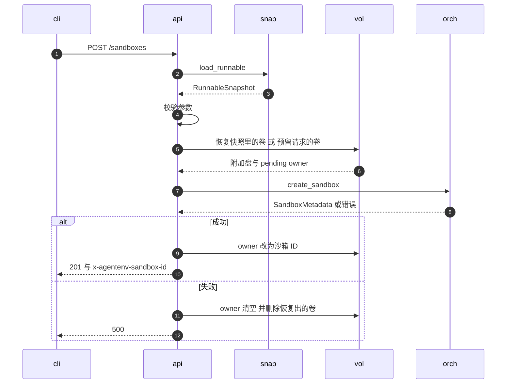
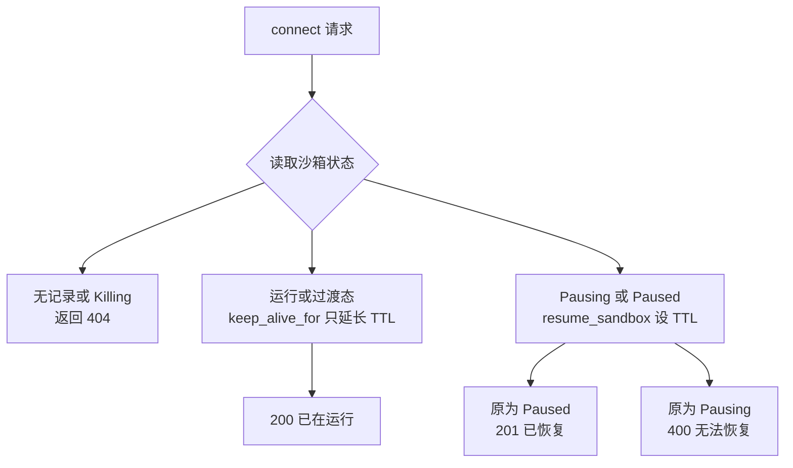

# 14 · 沙箱生命周期 API

> 沙箱 API 的 handler 本身很薄：它们把 E2B 形状的请求体翻译成 orchestrator 的调用，再把结果翻译回按状态码枚举的响应。
> 但「薄」不等于「无关紧要」：默认 TTL 取哪个值、卷在创建失败时怎样归还、哪些内部状态被折叠成 `running` 或 `paused`、
> 同一个错误在不同端点变成什么状态码，全都在这一层决定。本篇逐个端点讲这些翻译规则，以及它们之间不一致的地方。
>
> **读者**：工程师、SDK 使用者。　**预备**：[第 12 篇 · 规范驱动的服务骨架](12-spec-driven-server.md)、[第 19 篇 · 状态机与并发控制](19-state-machine-and-concurrency.md)。
> **代码**：`src/api/impls/sandbox.rs`、`src/api/impls/pagination.rs`、`src/api/impls/attached_drives.rs`、`src/api/openapi.yml`、`src/orchestrator/service.rs`（`keep_alive_for`、`resume_sandbox_inner`、`replace_sandbox_network_policy_inner`）

---

## 0. 本篇要回答的问题

1. `POST /sandboxes` 在调用 orchestrator 之前与之后各做了什么？卷预留在哪一步失败时怎样回滚？
2. v2 创建与 v1 创建的差别只有哪几个字段？为什么 `mcp` 字段对行为没有任何影响？
3. `/sandboxes-cold` 为什么是同步的，它的校验顺序带来什么代价？
4. connect、timeout、refreshes、resume 四个入口都能改 TTL，它们的语义和缺省值各是什么？
5. `PUT /network` 能改什么、不能改什么？
6. 列表接口对外只有 running 与 paused 两种状态，内部八个状态怎样折叠？按状态过滤与分页有哪些不直观的行为？

---

## 1. 问题：一层翻译要决定的事

orchestrator 讲的是 `CreateSandboxRequest`、`NewTimeout`、`SandboxState`、`OrchestratorError`；
E2B SDK 讲的是 `NewSandbox`、`timeout` 秒数、`running` / `paused` 和 HTTP 状态码。
沙箱 API 这一层夹在中间，它要回答三类问题。

第一，**缺省值与归一化**。请求里没给 `timeout` 时用多少秒？`autoPause` 缺省时到期是暂停还是删除？
`secure` 在 v1 与 v2 里的缺省值是否一样？这些规则写在 handler 里，而不是写在 orchestrator 里，
因为它们属于对外契约，orchestrator 只接受已经确定的值。

第二，**跨子系统的资源编排**。一次创建要用到快照管理器（解析模板）、卷管理器（预留卷）与 orchestrator（启动 VM）。
orchestrator 只管 VM 的生命周期，卷的预留与归还发生在它的外面，失败时由 handler 负责补偿。

第三，**错误到状态码的映射**。生成的 trait 把每个端点允许返回的状态码穷举成枚举变体（[第 12 篇](12-spec-driven-server.md)）。
spec 里没声明 409 的端点，handler 就无法返回 409，只能把冲突塞进别的变体。下文会看到这条约束造成的几处奇怪响应。

所有 handler 都在 `src/api/impls/sandbox.rs` 的 `impl Sandboxes<()> for ApiImpl` 里。
鉴权已由外层中间件完成（[第 13 篇](13-authentication.md)），handler 收到的 `Claims` 是空结构体，不携带任何身份。

---

## 2. 端点一览

| 方法与路径 | handler | 成功码 | 说明 |
|---|---|---|---|
| `POST /sandboxes` | `sandboxes_post()` | 201 | v1 创建，spec 标为 deprecated；`secure` 缺省 false |
| `POST /v2/sandboxes` | `v2_sandboxes_post()` | 201 | 强制 secure，`timeout` 缺省 300 |
| `POST /sandboxes-cold` | `sandboxes_cold_post()` | 201 | AgentENV 扩展：从外部 OCI 镜像冷启动 |
| `POST /sandboxes/{id}/connect`、`POST /v2/…/connect` | `sandboxes_sandbox_id_connect_post()` | 200 / 201 | 运行中则延长 TTL，暂停中则恢复 |
| `POST /sandboxes/{id}/timeout` | `sandboxes_sandbox_id_timeout_post()` | 204 | 覆盖 TTL |
| `POST /sandboxes/{id}/refreshes` | `sandboxes_sandbox_id_refreshes_post()` | 204 | 只延长 TTL |
| `POST /sandboxes/{id}/pause`、`/resume` | `…_pause_post()`、`…_resume_post()` | 204 / 201 | resume 在 spec 中标为 deprecated |
| `DELETE /sandboxes/{id}`、`GET /sandboxes/{id}` | `…_delete()`、`…_get()` | 204 / 200 | |
| `PUT /sandboxes/{id}/network` | `…_network_put()` | 204 | 替换出站策略 |
| `GET /sandboxes`、`GET /v2/sandboxes` | `sandboxes_get()`、`v2_sandboxes_get()` | 200 | v1 只列 Running；v2 分页 |
| `POST /sandboxes/{id}/fork`、`/snapshots` | `…_fork_post()`、`…_snapshots_post()` | 201 | 机制见第 51、46 篇 |

另有指标与 custom extension 参数端点（`/metrics`、`/custom-extension-params`），分别在[第 24 篇](24-metrics-and-events.md)与[第 33 篇](33-custom-extension-hooks.md)讲。
所有带 `{id}` 的 handler 第一步都是 `SandboxId::parse_str()`；解析失败一律返回 404 而不是 400，
对调用方而言「格式不对的 ID」与「不存在的 ID」没有区别。

---

## 3. 从模板创建

### 3.1 `sandboxes_post()` 的步骤

v1 创建是所有「从模板或快照启动」请求的公共路径，v2 也委托给它。下面的时序图中，
`cli` 是 SDK 或 CLI，`api` 是 handler，`snap` 是 `SnapshotManager`，`vol` 是 `VolumeManager`，`orch` 是 orchestrator。



逐步看：

1. **解析模板**。`snapshot_manager.load_runnable(&body.template_id)` 接受快照 ID 或别名，
   并把已提交的记录解析成本节点可运行的形态（[第 49 篇](49-resolve-and-artifact-cache.md)）。找不到返回 400 而不是 404，
   因为 spec 里 `POST /sandboxes` 没有 404 变体，「模板不存在」被归为请求参数错误。
2. **网络策略**。`network_policy_from_create()` 把 `allow_internet_access` 映射成 base policy（缺省为 Default），
   把 `network.allowOut` / `denyOut` 解析成出站规则，`allowPublicTraffic` 缺省为 true。
   随后两项校验：`validate_ipv4_cidrs()` 拒绝任何 IPv6 CIDR；`validate_domain_allowlist()` 要求只要 allowOut 里有域名，
   denyOut 就必须显式包含 `0.0.0.0/0`。注释给出的理由是域名检查只作用于 TCP 80 / 443，
   其余端口仍只按 CIDR 判定，不显式拒绝全部流量就会让域名白名单名不副实（[第 30 篇](30-egress-policy-and-proxy.md)）。
3. **扩展参数**。`validate_custom_extension_params()`：参数非空而节点没有配置 `[custom_extension].url` 时返回 400。
4. **卷**。分两种情况。请求带了 `volumeMounts` 时，按请求的挂载表预留；请求没带而快照里记录了卷（`volume_snapshots` 非空）时，
   `restore_snapshot_volume_mounts()` 为每个快照卷用 `create_from_snapshot()` 新建一个名为 `volume-restore-<uuid>` 的卷，
   并设置 `extra_drives_in_snapshot = true`，告诉后端这些盘已经存在于快照的设备布局里。
   两种情况最后都经 `prepare_volume_mounts()` 用一个临时 owner `pending-<uuidv7>` 预留卷。
5. **组装请求并创建**。`CreateSandboxRequest` 的几个字段在这里定型：
   `timeout_action` 只有 `autoPause == Some(false)` 时是 Delete，其余（含缺省）都是 Pause；
   `auto_resume` 取 `autoResume.enabled`；空的 `envVars` 被当成未提供；`secure` 只有显式为 true 才为 true。
6. **完成预留**。创建成功后 `finish_volume_reservation()` 调用 `replace_owner_for()`，把卷的 owner 从 pending 改成沙箱 ID。

整条路径包在 `SandboxStageTimer::new("create_warm")` 里分阶段计时（`load_snapshot`、`create_sandbox`），供[第 24 篇](24-metrics-and-events.md)的指标使用。

### 3.2 失败时谁来补偿

orchestrator 的 `create_sandbox()` 失败时，它自己会回滚 VM 与元数据（[第 20 篇](20-launch-plan-and-rollback.md)），但它不知道卷的存在。
handler 在两个失败点各做一次补偿：

- **orchestrator 创建失败**：把预留卷的 owner 清空（`replace_owner_for(owner, None, …)`），再用 `cleanup_volume_ids()` 删除第 4 步恢复出的卷。
- **创建成功但 owner 转移失败**：先 `delete_sandbox()` 删掉刚建好的沙箱，再清空 owner、删除恢复卷，返回 500。

用临时 owner 而不是直接写沙箱 ID 的原因是：预留发生在沙箱 ID 生成之前。
沙箱 ID 在 orchestrator 的 `create_sandbox()` 内部生成（[第 19 篇 §3](19-state-machine-and-concurrency.md#3-转换图与转换表)），
handler 在预留时还不知道它。代价是两步之间有一个窗口：handler 所在进程若在此时崩溃，卷会留在 pending owner 名下。
推论：这类孤儿预留需要卷管理器另行回收，API 层没有处理它（预留与回收的细节见[第 16 篇](16-snapshot-and-volume-api.md)）。

补偿动作的返回值全部被丢弃（`let _ = …`），补偿本身失败时不会改变响应，只会留下需要人工清理的状态。

### 3.3 v2：一层字段适配

`v2_sandboxes_post()` 不含任何业务逻辑。它把 `NewSandboxV2` 拷贝成 `NewSandbox`，改动只有两处：
`timeout` 缺省填 300，`secure` 强制为 `Some(true)`；然后调用 `sandboxes_post()`，把五种响应变体逐一映射成 v2 的同名变体。

`mcp` 字段也被原样拷贝进 `NewSandbox`，但 `sandboxes_post()` 从不读取它，在 `sandbox.rs` 里它只出现在这一次拷贝中。
E2B SDK 发来的 MCP 配置因此被接受、被忽略，不报错也不生效。

v1 与 v2 的缺省值差别会直接影响 SDK 用户：同一个不带 `timeout` 的请求，走 v1 得到 15 s 的 TTL，走 v2 得到 300 s；
走 v1 得到非 secure 沙箱（envd 端口不要求 access token），走 v2 一定是 secure 的。
AgentENV 自己的 `aenv` CLI 仍调用 v1 的 `POST /sandboxes`，并在请求体里显式写 `secure: true`（`crates/aenv/src/client/sandboxes.rs`）。

### 3.4 冷启动 `/sandboxes-cold`

`sandboxes_cold_post()` 跳过模板，直接从外部 OCI 镜像启动。它的第一步是 `image_resolver.resolve(&body.image)`：
缓存未命中时要拉取并逐层转换成 overlaybd 层（[第 45 篇](45-oci-to-overlaybd.md)），spec 描述里直说可能耗时数十秒。
代码在这里留了 TODO：等 API 支持「202 Accepted + 状态轮询」之后，把镜像解析移进异步创建操作。
在那之前，客户端必须为这个请求设置足够长的超时，中间的代理也一样。

解析之后的步骤与模板路径大体平行，但有三处不同：

- **资源**由请求决定。`cold_start_resources()` 用 `[machine]` 的 vCPU 与内存作缺省，要求 `cpuCount > 0`、`memoryMB ≥ 128`；
  `diskSizeMB` 给了就必须是 1024 的整数倍且不小于 1024，没给记为 0，由 orchestrator 按解析出的 rootfs 填充。
- **附加盘**（`attachedDrives`）由 `attached_drives.rs` 的 `resolve_attached_drives()` 处理：先逐个校验 driveID、挂载路径与 `subPath` 并查重，
  再用 `try_join_all` 并发解析每块盘的镜像；`readOnly` 缺省为 true（[第 31 篇](31-extra-drives-and-volumes.md)）。
- **错误分类**多了一层。orchestrator 返回的错误链里若能找到 ublk-daemon 的 `InvalidRequestError`，就转成 400，
  其余是 500。这样「请求的盘大小小于镜像本身而又不允许缩小」这类只有 daemon 才能判定的参数错误，也能以 400 返回。

校验顺序值得注意：rootfs 镜像解析排在资源、网络策略与扩展参数校验之前。
一个 `memoryMB` 写错的请求，可能要先等完一次镜像转换才得到 400。
模板路径有同样的问题，只是轻一些：`load_runnable()` 排在网络策略校验之前。
附加盘内部倒是先做完全部廉价校验再并发解析镜像，`attached_drives.rs` 里有测试专门锁定「非法 `diskSizeMB` 在镜像解析前被拒绝」。

---

## 4. 四个改 TTL 的入口

TTL 在 orchestrator 里是 `SandboxMetadata` 的 `timeout` 与 `expires_at`，过期后由自动驱逐任务按 `timeout_action` 暂停或删除（[第 23 篇](23-auto-eviction-and-ttl.md)）。
API 层有四个入口能改它，最终落到两个函数：`keep_alive_for(id, timeout, allow_shorter)` 只作用于 Running，
`resume_sandbox(id, NewTimeout)` 先恢复再设置 TTL。

| 入口 | 底层调用 | 语义 | 请求未给值时 |
|---|---|---|---|
| connect（运行中） | `keep_alive_for(…, false)` | 只延长：新到期时间不晚于现有到期时间就跳过 | v1 必填；v2 缺省 300 s |
| connect（暂停中） | `resume_sandbox(…, NewTimeout::Set)` | 恢复并覆盖为请求值 | 同上 |
| `POST /timeout` | `keep_alive_for(…, true)` | 覆盖，可以缩短 | 15 s |
| `POST /refreshes` | `keep_alive_for(…, false)` | 只延长 | 15 s |
| `POST /resume` | `resume_sandbox(…, NewTimeout::Set)` | 暂停态恢复后覆盖；已在运行也直接覆盖 | 15 s |

表中的 15 s 来自 `[orchestrator].default_sandbox_timeout_secs`（`config/default.toml` 缺省 15）。
`keep_alive_for()` 在 `timeout` 为 `None` 时用 orchestrator 持有的 `default_sandbox_timeout`；
resume handler 则在 API 层用 `default_sandbox_timeout()` 读同一个配置项，并用 `OnceLock` 缓存。
与之并存的还有两个数：v2 创建与 v2 connect 的缺省 300 s，以及代理自动恢复时保证的最小 TTL `auto_resume_min_sandbox_timeout_secs`（缺省 300 s，[第 17 篇](17-reverse-proxy.md)）。
于是「不带参数恢复一台沙箱」得到多长的 TTL 取决于走哪条路：显式 `POST /resume` 得 15 s，v2 connect 得 300 s，经代理自动恢复至少 300 s。

几个边角行为：

- `POST /resume` 对一台已经 Running 的沙箱不报错，`resume_sandbox_inner()` 走 `maybe_update_running_timeout()`，
  用 `NewTimeout::Set` 覆盖 TTL。一个 body 为 `{}` 的 resume 会把正在运行的沙箱的 TTL 重设为 15 s，可能比原来短。
- `keep_alive_for()` 遇到 Creating、Resuming、Snapshotting、Forking 会先等转换结束再判断（[第 19 篇 §7](19-state-machine-and-concurrency.md#7-同一沙箱上的并发操作)）；
  遇到 Paused、Pausing、Killing 返回 `InvalidSandboxState`。
- spec 里 `/timeout` 与 `/refreshes` 只声明了 204、401、404、500。`InvalidSandboxState` 经 `From<OrchestratorError>` 转成 code 为 400 的 `models::Error`，
  却只能装进 `Status500_ServerError` 变体：对暂停中的沙箱调 `/timeout`，HTTP 状态是 500，响应体里的 `code` 是 400。
- connect 与 resume 的 handler 都匹配 `OrchestratorError::InvalidTimeout` 并返回 400，但整个仓库里没有任何代码构造这个变体，这两个分支不可达。
  请求里的秒数在 API 层与 orchestrator 里都不做上限检查；spec 允许 0，`POST /timeout` 传 0 等于让沙箱在下一轮驱逐时到期。

---

## 5. connect：一个端点覆盖「连上或拉起」

connect 让 SDK 不必先查状态再决定调 keep-alive 还是 resume。`sandboxes_sandbox_id_connect_post()` 先 `get_sandbox()` 读一次状态，再分支：



图中「过渡态」指 Creating、Resuming、Snapshotting、Forking。对它们，`keep_alive_for()` 内部会先等转换结束；
如果转换以 Running 结束，延长 TTL 并返回 200。

值得注意的是 Pausing 分支。handler 把 Pausing 与 Paused 一起交给 `resume_sandbox()`，
但 `resume_sandbox_inner()` 只在当前状态是 Resuming 时等待，遇到 Pausing 直接返回 `InvalidSandboxState`，connect 把它映射成 400。
所以在 pause 进行期间到达的 connect 会失败，客户端需要稍后重试；它不会像 delete 那样等 pause 结束再接着做。
另一个窗口在读状态与调用之间：读到 Running、调 `keep_alive_for()` 时沙箱已进入 Pausing，同样得到 `InvalidSandboxState`，
这条路径上它被映射成 500（`Status500_ServerError(err.into())`，响应体 code 为 400）。

200 与 201 的响应体都是 `sandbox_model()` 生成的 `Sandbox`：secure 沙箱带 `envdAccessToken`，`allowPublicTraffic` 为 false 时带 `trafficAccessToken`，
`domain` 取 `[sandbox_proxy].domains` 的第一个。两个 token 都是无状态派生的，pause / resume 前后不变（[第 13 篇](13-authentication.md)）。
SDK 正是靠 connect 的响应重新拿到这两个 token。

---

## 6. pause、resume、delete 与错误码

pause、resume、delete 三个 handler 都只做 ID 解析与错误映射，语义全在 orchestrator（[第 19 篇](19-state-machine-and-concurrency.md)）。
值得在 API 层单独看的是：orchestrator 的同一个 `InvalidSandboxState`，在不同端点被映射成不同的状态码。

| 端点 | `InvalidSandboxState` 映射为 | 原因 |
|---|---|---|
| pause、resume、fork、`PUT /network` | 409 | spec 声明了 409 |
| snapshot、connect 的恢复分支 | 400 | 手写分支选择 400 |
| timeout、refreshes、connect 的延长分支 | HTTP 500，body code 400 | spec 没有 400 / 409 变体，走 `From` 后塞进 500 |

`From<OrchestratorError> for models::Error` 本身的映射是：ShuttingDown → 503、SandboxNotFound → 404、InvalidSandboxState → 400、
SandboxOperationConflict → 409、SandboxOperationFailed → 500 并拼接错误链，其它走 `internal_error()`。
但 `models::Error` 里的 code 只是响应体字段，真正的 HTTP 状态由 handler 选择的枚举变体决定，两者可以不一致。
关闭期间到达的请求就是例子：大多数 handler 把 ShuttingDown 放进 500 变体，客户端看到 HTTP 500、body code 503。

delete 的响应只有 204、404、500。对暂停的沙箱，delete 同样有效，因为 orchestrator 的 Killing CAS 期望集合是 `[Running, Paused]`；
对过渡态，orchestrator 先等再重试，所以 delete 的 HTTP 调用可能挂起到 pause 或 resume 结束。

---

## 7. `PUT /network`：只换出站策略

spec 对这个端点的描述是：替换运行中沙箱的出站规则，省略的字段即清空。实现分两层。

API 层的 `network_policy_from_update()` 用请求体构造一个完整的 `SandboxNetworkPolicy`，
其中 `allow_public_traffic` 写死为 true；请求体的类型 `SandboxNetworkUpdateConfig` 里根本没有这个字段。
orchestrator 的 `replace_sandbox_network_policy_inner()` 在拿到策略后，用 `metadata.network_policy.allow_public_traffic` 覆盖掉这个 true。
结果是 ingress 的公开 / 私有在创建时一经确定就不能通过 API 修改，API 层那个 true 只是一个占位值，靠下一层回填。
这条约定是正确的，但跨了两个文件，单看 API 层的代码会误以为 PUT 会把私有沙箱改成公开。

其余行为：

- 只接受 Running；其它状态返回 409（`InvalidSandboxState`），句柄已被摘出时返回 409（`SandboxOperationConflict`）。
- 是「替换」不是「合并」：一个空 body 会把 base policy 与出站规则全部清空，测试 `empty_network_update_clears_base_policy_and_egress` 锁定了这一点。
- 校验与创建时相同：IPv6 拒绝，域名规则必须配合 deny `0.0.0.0/0`。
- 先改后端、后写元数据，中间不持逻辑锁。与 pause 撞上时的不一致窗口见[第 19 篇 §7](19-state-machine-and-concurrency.md#7-同一沙箱上的并发操作)；新策略怎样不中断地生效见[第 30 篇](30-egress-policy-and-proxy.md)。

---

## 8. 列表、状态折叠与分页

### 8.1 八个状态折成两个

E2B 的对外状态只有 `running` 与 `paused`。`impl From<SandboxState> for models::SandboxState` 的规则是：
Pausing、Paused、Snapshotting、Forking → `paused`；其余（Creating、Resuming、Running、Killing）→ `running`。
把 Snapshotting 与 Forking 算作 paused，是因为这两个操作期间后端确实暂停了 VM；
把 Killing 算作 running 是兜底分支的结果：`GET /sandboxes/{id}` 对一台正在删除的沙箱返回 200 与 `state: running`，
而 connect 对同一台沙箱返回 404。

其它为 E2B SDK 保留的字段：`clientID` 恒为空字符串（注释说明只为 E2B Python SDK 保留）；
没有过期时间的沙箱，`endAt` 填成 UNIX 纪元之后一百年。

### 8.2 过滤：按内部状态精确匹配

`v2_sandboxes_get()` 只在 `state` 参数恰好给了一个值时过滤，把 `running` 映射成内部 Running、`paused` 映射成内部 Paused；
给了两个值视为不过滤（注释：只有两种外部状态，两个都给等于全要）。
过滤在 `InMemoryMetadataStore::list_filtered()` 里按内部状态精确比较。这与 8.1 的折叠规则不对称：

| 沙箱内部状态 | 不过滤时显示为 | `state=running` | `state=paused` |
|---|---|---|---|
| Running | running | 出现 | — |
| Paused | paused | — | 出现 |
| Creating、Resuming、Killing | running | 不出现 | — |
| Pausing、Snapshotting、Forking | paused | — | 不出现 |

过渡态的沙箱在不过滤的列表里出现，在按任一状态过滤的列表里都不出现。`x-total-running` 头同样只数内部 Running。
v1 的 `sandboxes_get()` 固定过滤 `[Running]`，所以 v1 列表也看不到过渡态。
两者都经 `list_sandboxes_filtered()` 去掉 `template_builder` 为真的记录，构建用的 VM 不出现在用户列表里（[第 15 篇](15-template-build-api.md)）。

其它过滤条件：`metadata` 是 URL 编码的 `k=v&k2=v2`，由 `parse_metadata_filter()` 解析，空键或空值被丢弃，要求全部键值匹配；
`startedAfter` 按创建时间；`template` 同时匹配快照 ID 与别名。

### 8.3 游标分页

`pagination.rs` 的 `PaginationCursor<T>` 是一个键集（keyset）游标，编码为 base64url：

```text
<RFC3339 纳秒时间戳>__<沙箱 ID>            降序（默认）
<RFC3339 纳秒时间戳>__<沙箱 ID>__asc       升序
```

这个形态与 E2B 的 token 兼容。`paginate()` 的做法是：取全部匹配记录，按 `(created_at, id)` 在内存里排序，
保留严格排在游标之后的记录，截取前 `limit` 条，若还有剩余就用第 `limit` 条生成 `x-next-token`。
首页的游标是「现在」（降序）或 UNIX 纪元（升序）。游标里带着排序方向，用降序 token 请求升序页会得到 400。

键集游标的好处是无状态，翻页期间新建的沙箱不会让后续页错位：降序遍历时，新沙箱的创建时间晚于游标，不会混进后面的页。
代价有两条。第一，每一页都把全部记录拷贝出来再排序，成本随节点上的沙箱总数增长，而不是随页大小增长。
第二，spec 给 `limit` 写了缺省 100、上限 100，生成代码只校验上限，不填缺省值；
handler 把 `None` 原样交给 `paginate()`，而 `paginate()` 把 `None` 解释为不截断。不带 `limit` 的请求因此一次返回全部沙箱，也不会有 `x-next-token`。

这里的列表只覆盖本节点 store 里的沙箱。多节点部署下的集群视图由 gateway 汇聚（[第 55 篇](55-gateway.md)）。

---

## 9. fork 与 snapshot：只看 API 形状

两个端点的机制在别处讲，这里只记录 API 层的约定。

`POST /sandboxes/{id}/snapshots` 的 `name` 可选，经 `SnapshotAlias::parse()` 校验后作为别名；
handler 依次调用 `capture_snapshot()`、`snapshot_sandbox_volumes()`、`publish_captured()`，返回 201 与 `SnapshotInfo`。
新快照的 ID 由 `SnapshotId::generate()` 生成，来源记为 `Sandbox{source_sandbox_id}`（[第 16 篇](16-snapshot-and-volume-api.md)、[第 46 篇](46-snapshot-object-model.md)）。

`POST /sandboxes/{id}/fork` 是 AgentENV 扩展。`count` 缺省 1，必须在 1 到 100 之间；
`timeout` 不给时每个子沙箱继承源沙箱的 TTL（`NewTimeout::UseExisting`）。
源沙箱挂了卷时，handler 先 `snapshot_volume_mounts()` 并 `recover_backings()`，再用 `prepare_volume_fork_specs()` 为每个子沙箱准备卷。
响应总是 201，body 是与 `count` 等长的 `SandboxForkResult` 数组，每项要么是 `sandbox`、要么是 `error`：这是部分成功语义，
调用方必须逐项检查，失败子沙箱的卷由 `cleanup_fork_volume_children()` 回收（[第 51 篇](51-fork.md)）。

---

## 10. 与 e2b infra 的对照

e2b infra 的 connect 遇到 pausing 会先等暂停结束再走恢复分支；AgentENV 的 connect 遇到 Pausing 直接返回 400，因为 `resume_sandbox_inner()` 只等待 Resuming。
e2b infra 的 refreshes 会把小于 15 s 的 duration 抬到 15 s，v2 列表的 limit 缺省与上限都是 100；AgentENV 不做抬升，不带 limit 时返回全部。
e2b infra 的 v2 列表要合并运行态存储与数据库里的快照，AgentENV 的沙箱记录全在节点内存里，一次内存过滤即可，代价是过渡态在过滤时被漏掉。

---

## 11. 小结

- 沙箱 handler 只做三件事：定缺省值、编排快照 / 卷 / orchestrator、把错误映射到 spec 声明过的状态码。
- 卷先以临时 owner `pending-<uuid>` 预留，创建成功后改成沙箱 ID；失败补偿在 handler 里完成，补偿本身失败只会留下待清理的状态。
- v2 创建等于 v1 加上「强制 secure、timeout 缺省 300」；`mcp` 被接受但从不读取。
- `/sandboxes-cold` 同步解析镜像，且镜像解析排在廉价校验之前；附加盘内部先校验后并发解析。
- 四个 TTL 入口：connect 与 refreshes 只延长，timeout 与 resume 覆盖；不给值时 resume、timeout、refreshes 用 15 s，v2 用 300 s，自动恢复至少 300 s。
- connect 遇到 Pausing 返回 400 而不等待；`InvalidTimeout` 变体从未被构造，相关分支不可达。
- 同一个 `InvalidSandboxState` 在不同端点是 409、400，或 HTTP 500 加 body code 400；HTTP 状态由枚举变体决定，与 body 里的 code 可以不一致。
- `PUT /network` 只替换出站策略，ingress 由 orchestrator 回填原值；空 body 清空全部规则。
- 对外状态折叠为 running / paused（Killing 显示为 running），但按状态过滤按内部状态精确匹配，过渡态在过滤结果里消失。
- 分页是 `(created_at, id)` 键集游标加内存全量排序；不带 `limit` 返回全部。

---

## 延伸阅读 / 下一篇

- [第 13 篇 · 认证与凭据](13-authentication.md)：响应里两个 token 的派生与校验。
- [第 16 篇 · 快照与卷 API](16-snapshot-and-volume-api.md)：卷预留与 owner 转移的细节。
- [第 19 篇 · 状态机与并发控制](19-state-machine-and-concurrency.md)：本篇各端点背后的状态转换。
- [第 23 篇 · 自动驱逐与 TTL](23-auto-eviction-and-ttl.md)：TTL 到期之后发生什么。
- [第 18 篇 · E2B 兼容性](18-e2b-compatibility.md)：本篇提到的偏差在兼容矩阵中的位置。
- [e2b 手册第 17 篇 · 创建沙箱](../e2b-infra/17-sandbox-create-api.md)、[e2b 手册第 18 篇 · 沙箱生命周期 API](../e2b-infra/18-sandbox-lifecycle-api.md)：同一组端点在 e2b infra 中的实现。
- 下一篇：[第 15 篇 · 模板构建 API](15-template-build-api.md)。
