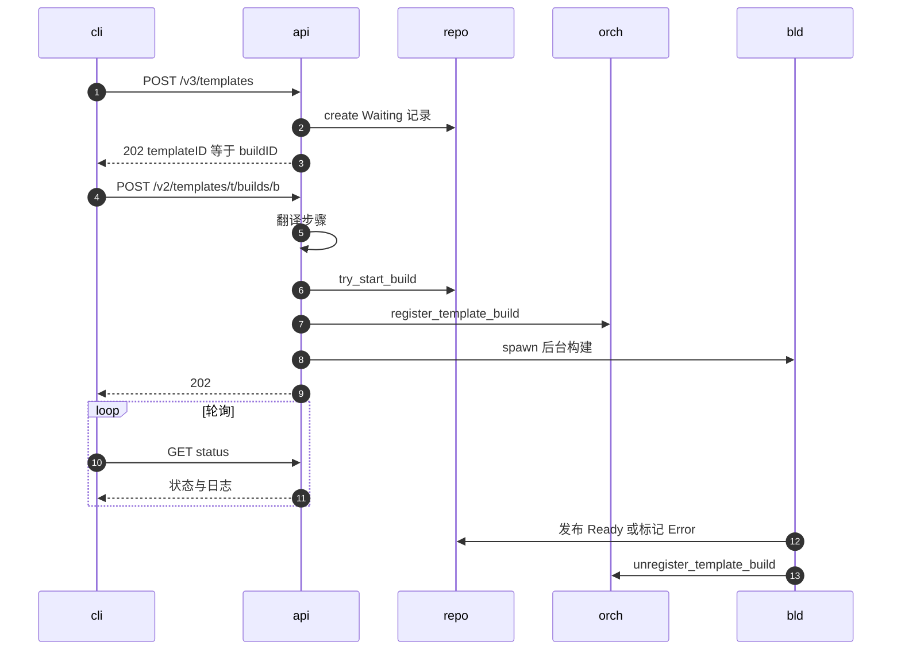
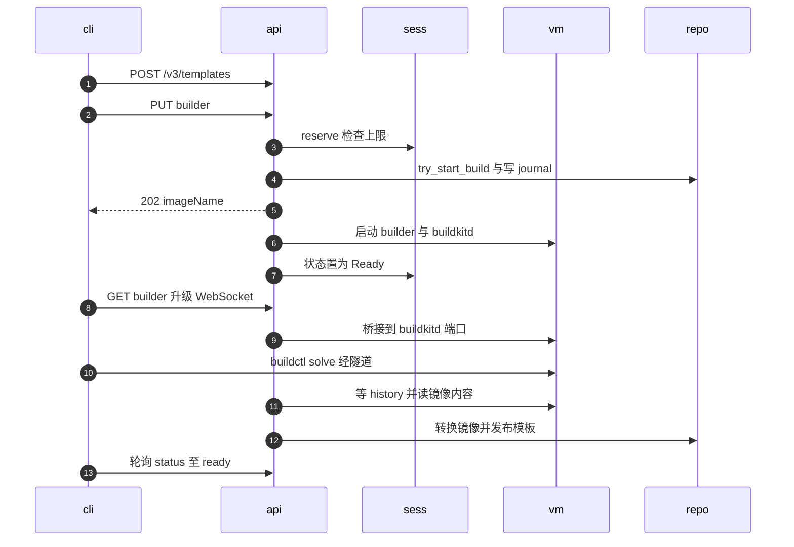
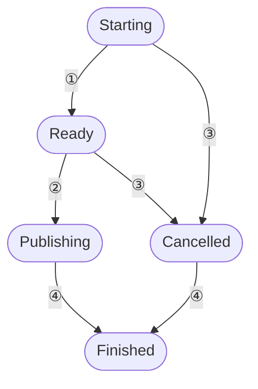

# 15 · 模板构建 API

> E2B SDK 构建模板的方式是「先登记、再启动、然后轮询」，步骤以 JSON 列表的形式随请求上传；
> AgentENV 在兼容这套两步协议的同时，另开了一条 Dockerfile 路径：用户本地的 `buildctl` 经一条 WebSocket 隧道
> 直接驱动远端 microVM 里的 buildkitd。两条路径落到同一种快照记录上，但会话管理、并发控制与崩溃恢复完全不同。
> 本篇只讲 API 与会话：请求怎样被受理、状态怎样对外呈现、构建中途断开或进程重启时发生什么。构建器内部在第 52、53 篇。
>
> **读者**：工程师、SDK 使用者。　**预备**：[第 12 篇 · 规范驱动的服务骨架](12-spec-driven-server.md)、[第 14 篇 · 沙箱生命周期 API](14-sandbox-api.md)。
> **代码**：`src/api/impls/template.rs`、`src/api/impls/template_helpers.rs`、`src/api/impls/image_build.rs`、`src/api/impls/image_build/{transport,cleanup,worker}.rs`、`crates/aenv/src/commands/build.rs`

---

## 0. 本篇要回答的问题

1. 在 AgentENV 里「模板」与「构建」是什么关系？为什么 templateID 必须等于 buildID？
2. E2B 风格的两步构建经过哪些检查，哪些步骤类型被支持、哪些被拒绝？
3. Dockerfile 路径为什么需要一条不在 spec 里的 WebSocket 隧道？它的会话有哪几个状态？
4. 两条路径各自怎样防止同一个构建被启动两次、怎样限制节点上的并发构建？
5. status 接口报告的状态为什么有时与快照仓库里的记录不一致？
6. 构建进行中服务端进程崩溃，两条路径各留下什么？

---

## 1. 问题：一次构建跨越很长的时间

创建沙箱是一次几秒内完成的请求；构建模板则可能持续几十分钟：拉取基础镜像、在 microVM 里逐条执行命令、
捕获快照、上传到仓库（[第 52 篇](52-template-builder.md)）。HTTP 请求不可能等这么久，于是 API 必须把构建拆成「受理」与「执行」两段，
并回答三个问题。

第一，**构建的身份**在受理时就要确定，客户端靠它轮询状态、读日志、取消构建；多节点部署下 gateway 也要靠它把后续请求路由到正在构建的节点。

第二，**互斥**：同一个构建只能被启动一次，即使两个请求落到不同节点上。

第三，**中断**：客户端断开、用户取消、服务端进程重启时，已经占用的资源（builder VM、缓存卷、并发名额）要能被回收，
仓库里的记录不能永远停在「构建中」。

e2b infra 把模板、构建、别名、标签做成四张表里的四个对象（见 e2b 手册第 22 篇）。AgentENV 没有数据库，
它把这一切压缩到一个对象上：**模板就是一条 source = Template 的快照记录**（[第 46 篇](46-snapshot-object-model.md)）。

---

## 2. 模板即快照记录

`SnapshotRecord` 的 `source` 为 `SnapshotSource::Template { build }` 时，`build` 里带着构建状态 `TemplateBuildStatus`
（Waiting、Building、Ready、Error）、起止时间与失败原因。一条记录只对应一次构建，所以模板 ID、构建 ID 与快照 ID 是同一个 UUID。

E2B 的 API 把两者分开，路径里同时出现 `{templateID}` 与 `{buildID}`。AgentENV 保留路径形状，但要求二者相等，
代码里称之为 compatibility mode。几个入口对不相等的处理并不一致：

| 入口 | templateID ≠ buildID 时 |
|---|---|
| `POST /v2/templates/{t}/builds/{b}` | 400，消息 `templateID and buildID must match in AgentENV compatibility mode` |
| status、logs（`build_record()`） | 404 `build not found for template` |
| `PUT` / `DELETE …/builder`、WebSocket 隧道 | 404 `template build not found` |

这个压缩的代价是：同一个模板名不能有多次构建。名字在 `POST /v3/templates` 创建 Waiting 记录时就作为别名占住
（POSIX 仓库在 `create()` 里调用 `ensure_alias_available()`），重名会得到 `AliasConflict`；
在构建语境下 `bad_request_for_repository_build_error()` 把它映射成 400。要用同一个名字重建，只能先删除旧记录。
E2B 那种「同一模板下追加一次新构建、标签指向最新构建」的语义在这里不存在，`tags` 非空与带 `:tag` 的名字都直接返回 400，
尽管 spec 对 `name` 字段的描述仍写着可以带标签（`template_helpers.rs` 的 `template_build_record_from_v3_request()`）。

模板相关的只读端点：

| 端点 | handler | 行为 |
|---|---|---|
| `GET /templates` | `templates_get()` | 全部模板记录，不分页 |
| `GET /v2/templates` | `v2_templates_get()` | 仓库已按创建时间降序返回，`paginate_sorted()` 只切片；只接受降序游标 |
| `GET /templates/{t}` | `templates_template_id_get()` | `builds` 数组至多一项，即记录本身 |
| `GET /templates/aliases/{alias}` | `templates_aliases_alias_get()` | 经 `resolve_committed_alias()`，只解析已提交的记录 |
| `DELETE /templates/{t}` | `templates_template_id_delete()` | 不存在返回 204；有活跃 BuildKit 会话返回 409 |

模板模型里的 `public` 恒为 true，别名查询返回的 `public` 恒为 false，两者都与访问控制无关：AgentENV 没有团队概念（[第 13 篇](13-authentication.md)）。

---

## 3. E2B 风格的两步构建

### 3.1 时序

下图中 `repo` 是经 `SnapshotManager` 访问的快照仓库，`bld` 是 handler 用 `tokio::spawn` 拉起的后台构建任务。

**第一步**，`v3_templates_post()`：要求有 `name`；生成新的 `SnapshotId`；`resolve_resources()` 用请求里的 `cpuCount` / `memoryMB`，
缺省取 `[machine]` 的配置，二者都必须大于 0，磁盘大小记为 0；`snapshot_manager.create()` 写入 Waiting 记录。
返回 202，响应体里 templateID 与 buildID 都是这个 ID，`aliases` 与 `names` 是 `[name]`，`tags` 为空。

**第二步**，`v2_templates_template_id_builds_build_id_post()` 依次做：

1. 校验两个 ID 相等、能解析，并且记录存在（不存在返回 404）。
2. `template_build_start_base_source()` 确定基础：`fromImage` 与 `fromTemplate` 至多给一个，同时给返回 400；都不给时用节点配置的默认镜像。
3. `template_build_spec_from_start_request()` 把 `startCmd`、`readyCmd` 与 `steps` 翻译成 `TemplateBuildSpec`（3.2 节）。
4. `snapshot_manager.try_start_build()`：仓库里的条件写，只有 Waiting 才能变成 Building。
5. `build_logs.start()` 开启日志会话；`orchestrator.register_template_build()` 把构建 ID 加进 `template_build_ids`。
6. `tokio::spawn` 后台任务，立即返回 202。

第 2、3 步全部发生在第 4 步之前。步骤非法的请求得到 400，而记录仍是 Waiting，客户端改正后可以用同一个 ID 再次启动。
反过来，一旦 `try_start_build()` 成功，记录就只能走向 Ready 或 Error；对非 Waiting 的记录再次启动，仓库返回 `InvalidRequest`，
handler 经 `repository_error()` 映射为 400。因为条件写发生在共享的快照仓库里，它同时挡住了来自其它节点的重复启动。

第 5 步的 `register_template_build()` 只为路由服务。步骤路径的构建 VM 不经过 orchestrator：
`src/template/runner.rs` 用 `SandboxId::new()` 另起一个 ID，直接构造 `FirecrackerSandbox`，它不出现在 orchestrator 的 store 里（[第 52 篇](52-template-builder.md)）。
于是在整个构建期间，节点上报的沙箱 ID 列表（`list_sandbox_ids()`，经 `src/observability/service.rs` 进入心跳）只能通过 `template_build_ids` 带上这个构建 ID，
gateway 据此把同一构建 ID 的 status、logs 请求路由到本节点（[第 57 篇](57-heartbeat-and-cpu-intersection.md)）。

后台任务按基础分两支：镜像基础先经 `resolve_template_rootfs_image()` 解析并转换镜像，再调用 `build_and_publish_with_id()`；
模板基础先 `load_runnable()` 加载基础模板，再调用 `build_from_snapshot_and_publish()`。任何一步失败都经 `mark_v2_build_error()` 把记录标为 Error；
整个任务包在 `catch_unwind` 里，panic 也会被记成 `template build worker panicked`。结束时持久化日志、注销 `template_build_ids`。

### 3.2 支持的步骤

`apply_e2b_template_step()` 按 `type`（不区分大小写）翻译每个步骤：

| 步骤 | 翻译 | 约束 |
|---|---|---|
| `RUN` | `spec.run(args[0])` | 只取第一个参数，必须非空 |
| `ENV`、`ARG` | 每对参数一个 `spec.env(k, v)` | 参数个数为非零偶数，键非空 |
| `WORKDIR`、`USER` | `spec.workdir()`、`spec.user()` | 一个非空参数 |
| `EXPOSE`、`VOLUME` | `spec.exposed_port()`、`spec.volume()` | 一个非空参数 |
| `LABEL` | 每对参数一个 `spec.label(k, v)` | 参数个数为非零偶数 |
| `COPY`、`ADD` | 拒绝 | 400 `not supported yet` |
| 其它 | 拒绝 | 400 `template step type … is not supported` |

另外，任何步骤只要 `filesHash` 非空就返回 400。三处限制合起来，意味着 E2B SDK 里向模板复制本地文件的能力不可用：
e2b infra 那条「按 hash 上传文件、构建器按 hash 取用」的通道在这里没有对应实现。

`ARG` 被当成 `ENV` 处理：构建参数会留在模板的环境变量里，被之后从这个模板启动的每台沙箱看到，这与 Dockerfile 里 ARG 只在构建期可见的语义不同。
步骤上的 `force` 与请求级的 `force` 字段被接受但不读取，这条路径本来就没有逐步缓存可以跳过（[第 52 篇](52-template-builder.md)）。

一个客户端步骤可能展开成多个内部步骤（一个带两对参数的 ENV 变成两步）。`stamp_source_steps()` 给每个内部步骤记下它来自客户端的第几步（从 1 开始），
测试 `expanded_env_pairs_share_their_client_step_number` 锁定了这一点。失败原因里的 `step` 字段因此能指回用户写的那一步。

### 3.3 这条路径没有会话

步骤路径的全部状态只有两处：仓库里的记录，与那个被 spawn 出去的任务。它不进入 4 节的 `BuildSessions`，由此带来三个后果。

- **没有并发上限**。`[template_build].max_concurrent_builds` 只约束 BuildKit 会话；同时启动多少个步骤构建，就并发跑多少台构建 VM。
- **删除不受保护**。`templates_template_id_delete()` 只检查 `build_sessions.contains()`，步骤构建进行中删除模板会直接成功。
  推论：后台任务随后的发布或 `mark_v2_build_error()` 会因记录缺失而失败，后者只打一条 warn 日志。
- **没有崩溃恢复**。仓库里搜不到其它对 Building 记录的回收逻辑：`mark_build_error` 的调用者只有本路径的后台任务与 BuildKit 路径的清理。
  服务端在构建中途退出时，记录会一直停在 Building，客户端的轮询永远等不到终态，只能删除记录后重建。

---

## 4. Dockerfile 与 BuildKit 路径

### 4.1 为什么要隧道

Dockerfile 构建要读用户本地的构建上下文，还可能用到 `--secret` 这样的敏感输入。
把它们打包进 HTTP 请求体上传，意味着 API 服务要接收、暂存、再转交，秘密也会经过 API 进程的内存。
AgentENV 的做法是不碰这些字节：`buildctl` 在用户本地运行，`buildkitd` 在 builder microVM 里运行，
API 只在两者之间提供一条字节流隧道。上下文与秘密由 BuildKit 自己的会话协议经隧道传给 buildkitd，API 只看到不透明的二进制帧。
代价是客户端必须安装 `buildctl`，并且整个构建期间保持连接。

下图中 `cli` 是 `aenv build` 及它拉起的本地 `buildctl`，`sess` 是节点内存里的 `BuildSessions`，`vm` 是 builder microVM。

### 4.2 受理：`PUT …/builder`

`templates_template_id_builds_build_id_builder_put()` 只是适配器，逻辑在 `image_build.rs` 的 `start_image_build()`：

1. **同步预留名额**。`BuildSessions::reserve()` 在一把 `std::sync::Mutex` 下检查：同一 ID 已有会话返回 409；
   会话数达到 `max_concurrent_builds`（缺省 4）返回 429。名额从这里起一直占到发布与清理结束（`config/default.toml` 的注释：包括准备、发布与清理）。
2. **分配在独立任务里完成**。`allocate_image_build()` 被 spawn 出去，handler 经一个 oneshot 通道等待结果。
   如果 HTTP 调用方在此期间断开，`sender.send()` 失败，任务会接着调用 `cancel_image_build()` 回收已分配的资源。
   这与 orchestrator 的 `run_cancellation_safe()` 是同一种思路（[第 19 篇 §6](19-state-machine-and-concurrency.md#6-取消安全操作不随请求一起死)）：操作不随请求一起死，但放弃的请求要负责收尾。
3. `allocate_image_build()` 校验 `cache_size_mb` 不超过卷大小上限、记录处于 Waiting，然后 `try_start_build()`；
   仓库返回 `InvalidRequest`（记录已不在 Waiting）时这里映射成 409，而步骤路径映射成 400。代码注释说明这次条件写同时排除了另一节点上的启动与经步骤 API 的启动。
4. 把 `BuildJournal { cache: "aenv-buildkit-work-<id>", parent }` 写进 `$AENV_HOME/template-builds` 下的本地 RocksDB（`LocalKvStore`，Sync 持久性），键为 `build/<id>`。
   写失败则立即把记录标为 Error。
5. 注册 `template_build_ids`，spawn `run_image_build()`，返回 202、响应头 `x-agentenv-build-id` 与 `TemplateBuilder { imageName }`。
   `imageName` 是 buildctl 导出镜像时必须使用的名字，服务端靠它在 BuildKit 的 history 里认出这次构建的产物（[第 53 篇](53-buildkit-in-microvm.md)）。

与步骤路径不同，builder VM 经 orchestrator 的 `create_template_builder()` 创建（`image_build/worker.rs` 的 `prepare_builder()`），
沙箱 ID 就是构建 ID，元数据带 `template_builder` 标记：`require_auth()` 对指向它的控制面请求返回 404，列表接口也会过滤掉它（[第 14 篇 §8](14-sandbox-api.md#8-列表状态折叠与分页)）。
它是 secure、私有 ingress 的沙箱，TTL 设为请求的 `timeout` 再加 3900 s，到期动作是删除，作为构建任务失控时的兜底。

请求体 `TemplateBuilderRequest` 只有三个字段：`startCmd`、`readyCmd` 与 `timeout`（缺省 3600 s，上限 86400 s）。
`startCmd` 缺省时取镜像的 ENTRYPOINT / CMD（`build_startup_commands()` 里的 `context.effective_start_cmd()`），
`readyCmd` 缺省时由 `dockerfile_ready_command()` 从镜像的 HEALTHCHECK 推导。步骤路径只使用请求里显式给出的 `startCmd`，两条前端在这一点上不一致（[第 52 篇](52-template-builder.md)）。

### 4.3 会话状态

每个 BuildKit 构建在节点内存里有一个 `BuildSession`，核心是一个 `watch` 通道承载的 `SessionState`：

| 编号 | 触发 | 代码 |
|---|---|---|
| ① | builder VM 就绪、buildkitd 已启动并连上 history | `wait_for_image_build()` 中 `session.ready(address)` |
| ② | 在 history 里等到本次构建的镜像 digest | `session.publish()` |
| ③ | `DELETE …/builder`，或调用方断开后的回收 | `request_cancel()` |
| ④ | 构建任务结束，无论成功、失败还是被取消 | `finish_image_build()` |

所有转换都用 `send_if_modified()` 做「检查当前状态再修改」，所以取消与发布之间没有竞争：
`request_cancel()` 只在 Starting 或 Ready 时生效；已经进入 Publishing 时返回 409，提示服务端会自己完成发布并释放 builder。
`wait_for_image_build()` 用 `tokio::select!` 同时等待取消信号与 `timeout_at(deadline)` 下的求解过程；
截止时间只覆盖到拿到镜像 digest 为止，之后的镜像导入另有一个 3600 s 的上限。

status 接口会用会话状态改写仓库里的状态：会话处于 Starting 时报 Waiting，尽管记录已是 Building；
记录已是 Ready 而会话仍在 Publishing 时报 Building。后一条的注释说明了原因：顺序执行的 CLI 构建必须等到新的缓存种子发布之后才算完成，
否则紧接着的下一次构建会用到旧的缓存种子（缓存种子见[第 53 篇](53-buildkit-in-microvm.md)）。

### 4.4 隧道：`GET …/builder`

隧道 handler 是 `image_build/transport.rs` 的 `connect()`，经 `image_build::router()` 合并进 Router（[第 12 篇](12-spec-driven-server.md)）。
spec 里有这个路径的 PUT 与 DELETE，却没有 GET，所以它不出现在生成的 trait 与文档站里。
它走控制面鉴权，需要 `X-API-Key`（[第 13 篇](13-authentication.md)）。

每次升级请求的处理：

1. 会话必须处于 Ready，否则 409。Publishing 之后不再接受新连接，已有连接继续存活，让 buildctl 收完最后的 Solve 响应。
2. 用会话里的 `connections` 限流。它是一把 `RwLock::with_max_readers((), MAX_TUNNEL_CONNECTIONS)`，每条隧道持有一个读锁，
   上限 8；`try_read_owned()` 失败立即返回 429，不排队等待。注释给出的理由是 buildctl 会为控制与会话流量各开连接。
3. 10 s 内连上 builder VM 里 buildkitd 的地址，超时 504，失败 502。
4. 升级为 WebSocket，单帧与单消息上限 1 MiB；`bridge()` 双向搬运二进制帧，每 20 s 发一次 ping，收到文本帧视为协议错误。

同一把 `RwLock` 还被用作「排空」：`run_image_build()` 在拿到镜像内容之后、停止 buildkitd 之前，
最多等 10 s 去拿写锁，即等所有隧道关闭。注释的说法是让 buildctl 先收到最终的 Solve 响应，但一个一直不关 socket 的客户端不能无限推迟发布。
`bridge()` 自己也监听会话状态，进入 Cancelled 或 Finished 时主动断开：注释指出停止 VM 不一定会关闭宿主侧的 TCP socket。

客户端一侧，`crates/aenv/src/client/buildkit.rs` 在本地监听一个 unix socket，每接受一个 buildctl 连接就开一条隧道，上限是 32 条并发。
服务端的 8 与客户端的 32 不一致：buildctl 开出第 9 条连接时会收到 429，而不是在客户端排队。

### 4.5 取消与清理

`DELETE …/builder` 调用 `cancel_image_build()`：若节点上有活跃会话，先 `request_cancel()`，再在 60 s 内等会话进入 Finished 并执行清理，
超时返回 500 并提示稍后重试；若没有活跃会话（例如进程重启过），确认记录存在后直接走清理。

清理的唯一入口是 `cleanup.rs` 的 `retry_image_build_cleanup()`。它在会话的 `cleanup` 互斥锁下工作，
只处理已 Finished 的会话；读到 journal 条目后按顺序：若记录还在 Waiting 或 Building 就标为 Error；
`release_builder()` 停止 buildkitd、删除 builder VM、释放缓存卷租约；清理构建缓存卷；注销 `template_build_ids`；
最后删除 journal 条目、移除会话。任何一步失败，journal 条目都保留，等待下次重试。

### 4.6 崩溃恢复

journal 是这条路径能从崩溃中恢复的原因。`src/bin/server.rs` 在开始监听前调用 `recover_image_builds()`，
之后 `start_image_build_cleanup()` 每 30 s 再跑一遍（持有 `ApiImpl` 的 `Weak` 引用，`ApiImpl` 释放后循环自行退出）。

`recover_image_builds()` 扫描前缀 `build/` 的全部条目，对每个条目调用 `retry_image_build_cleanup()`。
重启后内存里没有对应会话，函数会补一个状态为 `Finished("build interrupted by server restart")` 的会话，于是清理流程把记录标为 Error 并回收资源。
单个条目失败只打 warn，不阻塞其它条目。扫描结束后还会回收已退役的构建缓存（`collect_retired_build_caches()`）。

两条路径在这里形成对照：BuildKit 构建在服务端重启后会以 Error 终结，并带上可读的原因；步骤构建会永远停在 Building（3.3 节）。

---

## 5. 状态与日志接口

`GET /templates/{t}/builds/{b}/status` 返回 `TemplateBuildInfo`：状态、失败原因与一页日志。
日志由 `query_build_logs()` 提供，`logsOffset` 缺省 0，`limit` 缺省 100、超过 100 返回 400，`level` 过滤「不低于该级别」。
失败原因带 `step` 时，`query_build_reason_logs()` 再取该步骤下 Warn 及以上的日志（至多 100 条）附在 `reason.logEntries` 里，客户端不必另查就能看到出错那一步的输出。

`GET …/logs` 多了几种查询方式：`cursor` 是毫秒时间戳，`direction=backward` 时倒序并取不晚于游标的条目，否则取不早于游标的条目；
`source` 选择 temporary（节点内存里正在进行的构建）或 persistent（仓库里持久化的日志），缺省时先查内存、查不到再读仓库。
日志的截获、周期刷写与原子替换在[第 52 篇](52-template-builder.md)讲。

推论：temporary 日志只在执行构建的节点内存里，多节点部署下查询必须路由到那个节点，这正是构建 ID 需要经心跳上报、由 gateway 按它路由的原因之一。

---

## 6. 与 e2b infra 的对照

e2b infra 的模板与构建是两个对象，一个模板可以有多次构建，标签可以在构建之间移动；AgentENV 把二者压成一条快照记录，同名重建须先删除。
e2b infra 用「文件按 hash 上传」支持 COPY；AgentENV 的步骤路径不支持 COPY，而是另开 BuildKit 隧道，让构建上下文不经过 API 服务。
代价是步骤路径与 Dockerfile 路径成了两套前端，在会话、并发上限、恢复与启动命令推导上行为都不同。

---

## 7. 小结

- 模板是 source = Template 的快照记录，templateID = buildID = 快照 ID；名字在登记时即被占用，不支持标签与同名多次构建。
- 步骤路径先完整翻译步骤、再做仓库条件写 `try_start_build()`，非法请求不会把记录推进到 Building。
- 支持 RUN、ENV、ARG、WORKDIR、USER、EXPOSE、VOLUME、LABEL；COPY、ADD 与 `filesHash` 一律 400；ARG 被当成 ENV 留在模板里。
- 步骤路径没有会话：不受并发上限约束，删除不受保护，服务端崩溃后记录永远停在 Building。
- BuildKit 路径让 buildctl 经 WebSocket 隧道直连 microVM 里的 buildkitd，上下文与秘密不经过 API 请求体；隧道 GET 不在 spec 里。
- `BuildSessions` 提供节点级名额（缺省 4，超出 429）与五状态的会话；取消与发布之间用 `send_if_modified()` 消除竞争。
- 隧道上限用一把 `max_readers = 8` 的 `RwLock` 实现，同一把锁的写锁用于发布前排空；客户端 32 条并发与服务端 8 条上限不一致。
- status 会用会话状态改写仓库状态：Starting 报 Waiting，Publishing 中的 Ready 报 Building。
- `BuildJournal` 写在本地 RocksDB 里，启动时与每 30 s 重试清理；重启中断的 BuildKit 构建以 Error 终结。
- 同一类错误在两条路径上映射不同：ID 不等是 400 或 404，重复启动是 400 或 409。

---

## 延伸阅读 / 下一篇

- [第 46 篇 · 快照对象模型](46-snapshot-object-model.md)：模板记录的状态与字段。
- [第 52 篇 · 模板构建器](52-template-builder.md)：后台任务里 `TemplateBuildRunner` 做了什么。
- [第 53 篇 · BuildKit](53-buildkit-in-microvm.md)：builder 模板、缓存种子与镜像导入。
- [第 62 篇 · aenv CLI](62-aenv-cli.md)：`aenv build` 的客户端实现。
- [e2b 手册第 22 篇 · 模板 API](../e2b-infra/22-template-api.md)、[e2b 手册第 41 篇 · 构建总览](../e2b-infra/41-template-build-overview.md)：e2b infra 的模板对象与构建流程。
- 下一篇：[第 16 篇 · 快照与卷 API](16-snapshot-and-volume-api.md)。
