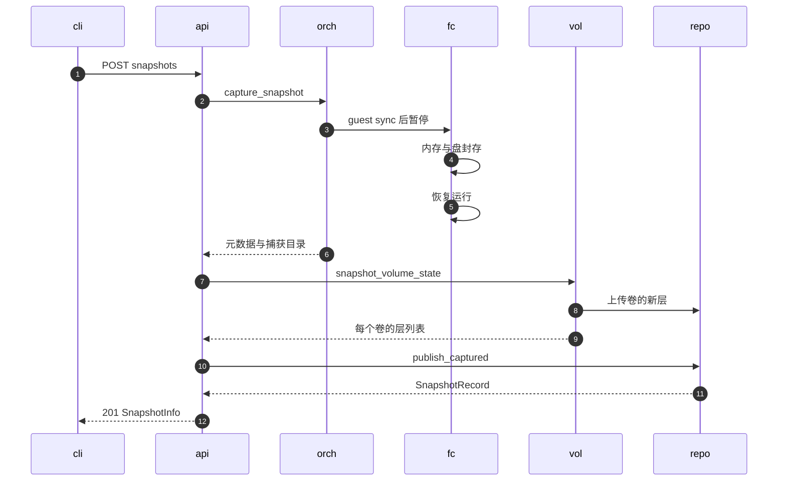
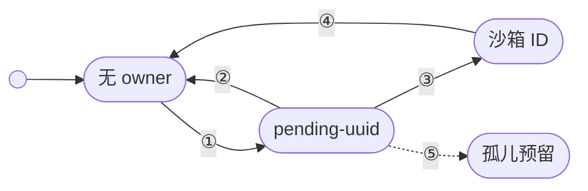

# 16 · 快照与卷 API

> 快照与卷是沙箱之外仅有的两类持久对象：快照是一次性冻结的整机状态，卷是有名字、可反复挂载、同一时刻只有一个写者的块存储。
> 两者的记录都放在快照仓库里，并且在「给一台挂着卷的沙箱打快照」时必须彼此对齐。
> 本篇讲 API 层怎样创建与读取这两类对象、卷怎样从「预留」走到「属于某台沙箱」，以及这些步骤在失败时留下什么。
>
> **读者**：工程师、SDK 使用者。　**预备**：[第 14 篇 · 沙箱生命周期 API](14-sandbox-api.md)、[第 19 篇 · 状态机与并发控制](19-state-machine-and-concurrency.md)。
> **代码**：`src/api/impls/snapshots.rs`、`src/api/impls/volumes.rs`、`src/api/impls/sandbox.rs`（`sandboxes_sandbox_id_snapshots_post`、`snapshot_sandbox_volumes`、`restore_snapshot_volume_mounts`）、`src/volume.rs`、`src/orchestrator/service.rs`（`capture_snapshot_inner`）

---

## 0. 本篇要回答的问题

1. `POST /sandboxes/{id}/snapshots` 的哪几步发生在 VM 暂停期间，哪几步发生在 VM 恢复运行之后？卷的内容怎样与内存快照对上？
2. 为什么快照 API 只列出沙箱来源的记录？一个沙箱快照要怎样删除？
3. 卷的 exclusive 与 ro 两种模式各允许什么？空卷、`image`、`fromVolume` 三种初始化方式在仓库里各留下什么？
4. 创建沙箱时 `resolve_volume_mounts()` 做哪些校验？卷的 owner 经历哪几次变化，哪一步失败会留下无人回收的预留？
5. 从一个带卷的快照创建沙箱时，卷是怎样恢复出来的？恢复出的卷在沙箱结束后去了哪里？

---

## 1. 问题：两类比沙箱活得久的对象

沙箱自己的 rootfs 随沙箱删除而消失；暂停记录虽然能跨重启保留，也只能在原节点恢复原沙箱（[第 22 篇](22-persistence-across-restarts.md)）。
用户需要两种不随沙箱消失的东西。

第一种是**快照**：把一台运行中沙箱的内存、设备状态与磁盘冻结成一个不可变的对象，以后可以从它启动任意多台新沙箱。
它在仓库里是一条 `SnapshotRecord`，来源记为 `SnapshotSource::Sandbox`；模板是同一种记录，只是来源为 Template（[第 15 篇](15-template-build-api.md)、[第 46 篇](46-snapshot-object-model.md)）。

第二种是**卷**：一块有名字的块设备，可以挂进沙箱、被沙箱改写，沙箱删除后内容留下，再挂给下一台沙箱。
卷是可变的，所以要回答「谁在写它」：同一块卷若有两台沙箱同时写，overlaybd 层的内容就没有定义。

两类对象在一处交汇。给一台挂着可写卷的沙箱打快照时，快照里的内存记着 guest 页缓存与文件系统元数据，
它们必须与同一时刻的卷内容配套，否则从快照恢复出来的 guest 看到的是另一个时刻的磁盘。
API 层要保证这种配套，同时保证卷的「单写者」约束在跨节点时也成立——卷记录与快照记录一样放在快照仓库，而仓库是多节点共享的真相（[第 08 篇](08-system-architecture.md)）。

---

## 2. 端点一览

| 方法与路径 | handler | 成功码 | 说明 |
|---|---|---|---|
| `POST /sandboxes/{id}/snapshots` | `sandboxes_sandbox_id_snapshots_post()` | 201 | 给运行中沙箱打持久快照，沙箱继续运行 |
| `GET /snapshots` | `snapshots_get()` | 200 | 只列沙箱来源的快照；按源沙箱与名字过滤，游标分页 |
| `GET /snapshots/{id}` | `snapshots_snapshot_id_get()` | 200 | 接受 ID 或别名；模板记录返回 404 |
| `POST /volumes` | `volumes_post()` | 201 | 建卷：空卷、`image` 或 `fromVolume` |
| `GET /volumes`、`GET /volumes/{id}` | `volumes_get()`、`volumes_volume_id_get()` | 200 | 后者接受 ID 或名字 |
| `DELETE /volumes/{id}` | `volumes_volume_id_delete()` | 204 | 被挂载时 409 |

快照 handler 在 `src/api/impls/sandbox.rs`（创建）与 `src/api/impls/snapshots.rs`（读取）；卷 handler 与挂载解析在 `src/api/impls/volumes.rs`，
真正的状态机在 `src/volume.rs` 的 `VolumeManager`。卷不出现在快照端点里，而是作为 `POST /sandboxes` 的 `volumeMounts` 字段参与沙箱创建（[第 14 篇 §3](14-sandbox-api.md#3-从模板创建)）。

spec 里没有删除快照的端点。

---

## 3. 创建快照

### 3.1 三个阶段

`sandboxes_sandbox_id_snapshots_post()` 先解析路径 ID（失败 404）与可选的 `name`（`SnapshotAlias::parse()` 只接受 ASCII 字母、数字、`-` 与 `_`，失败 400），
然后依次调用三个函数。下图中 `cli` 是 SDK，`api` 是 handler，`orch` 是 orchestrator，`fc` 是沙箱后端（Firecracker 进程及其块设备），
`vol` 是 `VolumeManager`，`repo` 是快照仓库。

**阶段一：捕获**（消息 2–6）。orchestrator 的 `capture_snapshot_inner()` 用 CAS 把状态从 Running 改成 Snapshotting（期望集合只有 Running），
在沙箱句柄的锁内调用后端的 `snapshot()`，结束后改回 Running（[第 19 篇 §3](19-state-machine-and-concurrency.md#3-转换图与转换表)）。
Firecracker 后端的 `snapshot()`（`src/sandbox/firecracker/sandbox.rs`）先 `pause_to_dir()`：
若沙箱挂着可写卷，经 envd 在 guest 里执行一次 `busybox sync`；然后暂停 VM，把内存写成 overlaybd 层，
把 rootfs 与每块附加盘 restack（封存当前 upper、换上新的空 upper，[第 37 篇](37-seal-restack-compact.md)）。
随后立即 `resume()`。整个 Snapshotting 窗口只包含这些本地操作，不包含任何上传。

**阶段二：卷的逻辑快照**（消息 7–9）。VM 恢复运行之后，handler 的 `snapshot_sandbox_volumes()` 对沙箱的每个挂载调用 `VolumeManager::snapshot_volume_state()`，
把卷的最新本地状态发布到仓库，得到一组层引用，组装成 `SnapshotVolume{mount_path, mode, size_mb, layers}`。

**阶段三：发布**（消息 10–11）。`SnapshotManager::publish_captured()` 用 `SnapshotId::generate()` 的新 ID 与可选别名，
把捕获目录里的制品连同 `volume_snapshots` 提交进仓库；它在提交前先启动 startup 录制，使录制与层上传并行（[第 46 篇](46-snapshot-object-model.md)、[第 43 篇](43-startup-pack-and-prefetch.md)）。
返回的记录经 `From<SnapshotRecord> for models::SnapshotInfo` 转成响应体。

这个划分的收益是：沙箱停顿的时间只与本地 restack 与内存落盘有关，与仓库后端的上传速度无关。
代价是阶段二、三发生时沙箱已经在继续运行，API 层必须靠阶段一留下的「封存层」而不是「当前设备」来描述快照时刻的卷。

### 3.2 卷内容怎样与内存对齐

关键在阶段一对卷做了什么。`snapshot_extra_drives()` 遍历全部附加盘：普通附加盘的封存层写进本次捕获目录；
而挂载时被标记了 `snapshot_output_dir` 的卷（只有 exclusive 卷有，见 §6.1），封存层直接写进卷自己的本地数据目录，
文件名是 `snapshot-<uuid>.commit`。注释说明了用唯一名字的原因：同一个卷目录跨多次暂停复用，后一次 restack 不能覆盖仍被 `image.json` 引用的下层。
卷盘随后从快照的设备清单里被过滤掉（`!drive.is_volume()`），快照只记录普通附加盘。

这样，VM 暂停那一刻卷的内容已经成为卷的本地下层栈的栈顶。阶段二的 `snapshot_volume_state()` 对已被本沙箱预留的卷调用
`recover_and_publish_backings()`，把本地 `image.json` 的下层上传到仓库并替换卷记录的 `backing_layers`（§5 的 Uploading 状态就出现在这里）；
返回的层列表因此包含刚封存的那一层，也就与内存快照处在同一时刻。

两点细节：

- guest 里的 `sync` 不是一致性所必需的——内存快照本身带着 guest 的页缓存，从快照恢复时两者合起来是自洽的。
  推论：`sync` 的作用在于卷的新层同时成为卷对外的最新内容，下一台不带这份内存去挂载该卷的沙箱只能看到磁盘上的数据，先刷盘让它少丢写入。
- 阶段一结束后沙箱回到 Running，阶段二开始前没有任何锁阻止第二次快照或 fork 再做一次 restack。
  推论：两个并发的快照请求交错时，前一个快照记录的卷层可能包含后一个时刻的封存层，代码里没有防止这种交错的机制。

### 3.3 错误映射与失败后的状态

| 失败点 | 响应 | 留下的状态 |
|---|---|---|
| 别名不合法 | 400 | 无 |
| 沙箱不存在或正在删除 | 404 | 无 |
| 沙箱不在 Running（`InvalidSandboxState`） | 400 | 无 |
| 捕获失败 | 500 | 可恢复错误回到 Running；终结性错误停机并移除沙箱（[第 20 篇](20-launch-plan-and-rollback.md)） |
| 卷发布失败 | 卷错误码为 500 时 500，其余 400 | 已上传的卷保持新状态；发布失败的卷标为 Failed |
| 快照发布失败 | 别名冲突、请求非法、完整性不符为 400，其余 500 | 卷已前进；捕获目录随句柄释放而删除 |

别名已被占用时返回的是 400 而不是 409，因为这个端点在 spec 里只声明了 201、400、401、404、500。
最后一行的「捕获目录随句柄释放而删除」来自 `PersistentSnapshotRootGuard` 的 `Drop`：捕获产物持有这个守卫，handler 提前返回时产物被丢弃，目录随之删除（`src/sandbox/firecracker/config.rs`）。
卷却不会回退：阶段二已经把卷的新层发布出去，这对卷来说是一次正常的前进，与快照是否成功无关。

---

## 4. 读取快照

`snapshots_get()` 用 `SnapshotListFilter::sandbox_snapshots(sandbox_id, name)` 查询，过滤条件固定包含「来源为 Sandbox」。
`name` 参数会先去掉团队前缀与 tag：`my-team/foo:v1` 按 `foo` 匹配 ID 或别名，这是为了接受 E2B SDK 的限定名写法；AgentENV 的别名本身不含 `/` 与 `:`。

分页与沙箱列表用的是同一个 `PaginationCursor`，但只支持降序；拿升序游标来请求返回 400。有两处与沙箱列表不同：

- 仓库的 `list()`（POSIX 与对象存储两个后端都一样）读出全部记录、在内存里过滤，再按 `(created_at 降序, id 升序)` 排好；
  handler 调用的是不再排序的 `paginate_sorted()`，依赖仓库给出的顺序与游标比较函数 `compare_desc()` 一致。两者确实一致，但这是跨模块的隐式约定。
- 首页游标是 `(当前时间, SnapshotId::max())`，只保留严格早于游标的记录。推论：多节点共享仓库时，若另一节点时钟偏快，它刚写入的快照在本节点的首页里暂时看不到。

和沙箱列表一样，不带 `limit` 时 `paginate_sorted()` 不截断，一次返回全部（[第 14 篇 §8](14-sandbox-api.md#8-列表状态折叠与分页)）。
每次列表都要读出仓库里的全部记录（包括模板），成本随记录总数线性增长。

`snapshots_snapshot_id_get()` 接受 ID 或别名，命中模板记录时返回 404。代码注释给出的理由是与列表接口保持一致：模板记录通过模板 API 暴露。
响应体 `SnapshotInfo` 包含 `snapshotID`、`names`（有别名时一个元素）、资源规格、创建与更新时间，以及可选的 `imageRef`——快照 rootfs 已被发布成 OCI 镜像时的引用（[第 50 篇](50-rootfs-as-oci-image.md)）。

这种「按来源隔离」只在读取端成立。模板端点 `templates_template_id_get()` 与 `templates_template_id_delete()` 按 ID 或别名直接查 `SnapshotManager`，不检查来源：
`GET /templates/{快照ID}` 能读到沙箱快照，`DELETE /templates/{快照ID}` 能删掉它，而这正是删除沙箱快照的唯一途径。
推论：E2B SDK 删除快照时走的也是模板删除接口，所以兼容层不需要单独的快照删除端点；但读一份 spec 的人会以为快照删不掉。

---

## 5. 卷对象

`VolumeRecord`（`src/volume.rs`）的字段：

| 字段 | 含义 |
|---|---|
| `id`、`name` | `vol_<uuidv7>`；名字只允许字母、数字、`_`、`-`，至多 128 字符，在仓库内唯一 |
| `mode`、`size_mb` | `Exclusive`（API 写作 `exclusive`，缺省）或 `ReadOnly`（`ro`）；大小不可变 |
| `status` | `Ready`、`Uploading`、`Failed` |
| `reserved_by_sandbox_id`、`read_only_mounts` | exclusive 卷的唯一持有者；ro 卷的持有者列表 |
| `backing_layers`、`backing_image_config` | 仓库里的层引用（真相）；节点本地 `image.json` 路径（缓存，不序列化） |

两种模式的差别：

| 维度 | exclusive | ro |
|---|---|---|
| 同时挂载 | 一台沙箱 | 多台沙箱 |
| guest 内是否可写 | 是 | 否 |
| 预留记录在 | `reserved_by_sandbox_id`，已被别人持有则 409 | 追加到 `read_only_mounts` |
| 写入怎样变成卷的内容 | restack 出的封存层发布到仓库 | 不产生新层 |

状态的转换规则写在 `VolumeRecord::validate_catalog_update()` 里，仓库每次 `put_volume()` 都会检查：
名字、模式、大小不能改；要替换 `backing_layers`，卷必须先处于 Uploading；从 Failed 回到 Ready 也必须经过 Uploading。
`VolumeManager::publish_records()` 按这个顺序执行：先把记录写成 Uploading，再上传层，最后写回 Ready；任一步失败都写成 Failed。
注释说明了先写 Uploading 的原因：别的节点看到 Uploading 就不会挂载一份过期的内容。
`reserve()` 与 `create` 的 `fromVolume` 分支都拒绝 Uploading 与 Failed 状态的卷，返回 409。

预留字段的写入只能经由专门的接口：posixfs 后端的 `put_volume()` 在写盘前用磁盘上的值覆盖 `reserved_by_sandbox_id` 与 `read_only_mounts`，
注释写明这是为了防止一次并发的状态更新把已经释放的 owner 写回去。真正修改预留的是 `reserve_volume()`、`reserve_read_only_volume()` 与 `replace_volume_owner_for()`，
它们在 POSIX 后端里持有每卷一把的文件锁，在对象存储后端里用条件写重试（[第 47 篇](47-posix-repository.md)、[第 48 篇](48-object-storage-repository.md)）。

---

## 6. 创建、读取与删除卷

### 6.1 `volumes_post()`

handler 先解析 `mode`（缺省 exclusive，其它值 400），再决定内容来源，最后调用 `VolumeManager::create()`。
`sizeMB` 缺省 `DEFAULT_VOLUME_SIZE_MB`（65536 MiB），必须大于 0 且不超过 `[volume].max_size_mb`（缺省 262144 MiB）；名字已存在返回 409。三种来源：

- **空卷**。`create_empty_backing()` 在卷数据目录建一个指定大小的稀疏文件，`mkfs.ext4` 格式化，
  用 `overlaybd::tools::package_raw_as_overlaybd()` 打包成 `base.commit`，写出只有这一层的 `image.json`，删掉原始文件。
- **`image`**。经 `ImageResolver::resolve()` 把镜像转成 overlaybd 层栈（[第 45 篇](45-oci-to-overlaybd.md)），
  `create_child_backing()` 把它的每个下层硬链接进卷目录（失败退回拷贝）。镜像解析失败时按错误类型返回 400 或 500。
- **`fromVolume`**。源卷必须是 Ready；被别的沙箱以 exclusive 持有时返回 409；大小必须与源卷相同，否则 400。
  源卷未被持有且已有已发布的层时，新卷直接复用源卷的 `backing_layers`，不拷贝、不读本地文件——仓库里的层不可变，共享层引用就是写时复制。

前两种来源产生了本地文件，`create` 随即调用 `publish_backing()` 把层发布进仓库，再 `create_volume()` 写入记录；任一步失败都删除本地目录。

有两处行为与 spec 的描述不符：

- 同时给 `fromVolume` 与 `image` 时，handler 只在 `fromVolume` 为空时才解析镜像，`image` 被静默忽略；
  `VolumeManager` 里专为这种情况准备的 `VolumeError::MultipleSources` 从 API 路径不可达。
- `fromVolume` 要求大小相等，而 `sizeMB` 缺省 64 GiB。克隆一个非 64 GiB 的卷时必须显式写出与源卷相同的大小，否则得到 400 `SizeMismatch`。

### 6.2 读取与列表

`volumes_volume_id_get()` 经 `get()` 先按 ID 查、查不到再按名字查。
`volumes_get()` 的分页与沙箱、快照都不同：游标是卷 ID 的 base64url 编码，仓库按卷 ID 的字典序返回 ID 之后的若干条；
卷 ID 是 UUIDv7，字典序大体就是创建顺序。`limit` 缺省 100（`DEFAULT_VOLUME_PAGE_SIZE`），而不是「不截断」。
响应体 `Volume` 只有 `volumeID`、`name`、`mode`、`sizeMB`、`status` 五个字段，不暴露持有者，调用方无法从 API 得知一个卷被谁占着。

### 6.3 删除

`VolumeManager::delete()` 先检查记录：被 exclusive 持有或仍有 ro 挂载时返回 409。随后调用仓库的 `delete_volume()`，仓库在锁内（或条件写中）再检查一次；
在两次检查之间被别人预留时，仓库返回的 `InvalidRequest` 经 `repository_error()` 变成 `VolumeError::Storage`，对外是 500 而不是 409。
仓库删除成功后清掉进程内缓存与本地数据目录；本地目录删除失败只记 warn。

删除只移除卷记录与别名，不删除卷引用的层文件。posixfs 仓库的 managed-layers 从不回收（[第 47 篇](47-posix-repository.md)）：
这是克隆与快照在源卷删除后仍然可用的前提，`src/volume.rs` 的测试 `published_volume_clones_survive_parent_deletion_without_local_files` 锁定了这一点；
代价是删除卷不释放仓库空间。

`VolumeError` 到状态码的映射集中在 `volumes.rs` 的 `error_response()`：

| 状态码 | 错误 |
|---|---|
| 400 | 名字非法、大小非法或超限、大小不匹配、源卷不存在、挂载数超限、游标或页大小非法 |
| 404 | 卷不存在 |
| 409 | 名字冲突、已被持有、Uploading、Failed |
| 500 | 存储错误（含仓库返回的 `InvalidRequest`） |

---

## 7. 挂载：预留、物化与 owner 转移

### 7.1 `resolve_volume_mounts()` 的校验顺序

`POST /sandboxes` 的 `volumeMounts` 是 `{name, path}` 列表，`volume_mounts_from_model()` 先拒绝重复的 path，
`prepare_volume_mounts()` 生成临时 owner `pending-<uuidv7>`，然后调用 `resolve_volume_mounts()`。它的校验顺序是：

1. 挂载数不超过 `[volume].max_volume_count`（缺省 4；配置校验要求在 1 到 24 之间，24 是 `/dev/vdc` 到 `/dev/vdz` 的设备名容量）。
2. 按挂载路径排序后逐个处理。路径经 `normalize_mount_path()` 规范化，必须是绝对路径，不能含 `..`、空白、逗号、冒号，不能与 `/proc`、`/dev`、`/agentenv` 等保留路径重叠（[第 31 篇](31-extra-drives-and-volumes.md)）。
3. 与已处理的路径互为前缀即拒绝：`/data` 与 `/data/cache` 不能同时挂。
4. 读卷记录；大小超过当前 `max_size_mb` 时拒绝（卷可能是在上限调低之前创建的）。
5. 同一个卷不能在一次请求里挂两次。
6. `reserve(volume, owner)`：exclusive 卷写入持有者，ro 卷追加挂载者；成功的卷 ID 记入 `reserved`。
7. `materialize_backing()`：本节点没有与仓库一致的本地 `image.json` 时，由仓库从 `backing_layers` 生成一份。
8. 构造 `ExtraDrive`，只读与否取决于模式；exclusive 卷带上 `snapshot_output_dir = data_dir(volume_id)`，这就是 §3.2 里 restack 写入卷目录的依据。

第 6 步之后的任何失败都触发同一个补偿：`replace_owner_for(owner, None, &reserved)` 释放本次已经做过的全部预留。
推论：按路径排序还让卷在设备槽位上的顺序可重复，从快照恢复时同一组路径会落到同样的槽位上。

### 7.2 owner 的三次变化

一块卷在一次「创建沙箱—删除沙箱」中经历三次 owner 变化：

| 编号 | 触发 | 代码 |
|---|---|---|
| ① | `resolve_volume_mounts()` 预留 | `VolumeManager::reserve()` |
| ② | 解析失败、orchestrator 创建失败、owner 转移失败 | `replace_owner_for(pending, None)`，恢复出的卷随后删除 |
| ③ | `create_sandbox()` 成功 | `finish_volume_reservation()` → `replace_owner_for(pending, 沙箱 ID)` |
| ④ | 沙箱删除或终结性失败 | `finalize_terminal_volumes()`：先 `recover_and_publish_backings()` 再释放 |
| ⑤ | ① 与 ③ 之间进程崩溃 | 无 |

用临时 owner 的原因在[第 14 篇 §3.2](14-sandbox-api.md#32-失败时谁来补偿)讲过：沙箱 ID 在 orchestrator 内部生成，预留时还不存在。
③ 失败时 handler 先删掉刚建好的沙箱，再走 ②。④ 在释放之前先发布一次，使沙箱最后写入的内容成为卷的新状态；
删除路径上的冻结与 restack 见[第 21 篇](21-deletion-and-volume-capture.md)。

⑤ 是这套设计留下的缺口。仓库里搜不到任何识别或回收 `pending-` 前缀 owner 的代码：
server 在 ① 与 ③ 之间崩溃（例如 orchestrator 正在启动 VM 时被 SIGKILL），卷就永久处于「被 `pending-…` 持有」的状态。
此后挂载它得到 409 Reserved，删除它也得到 409，而 API 响应不暴露持有者，用户只能看到冲突、看不到原因；恢复需要直接修改仓库里的卷记录。

---

## 8. 从快照恢复卷

`sandboxes_post()` 在请求**没有** `volumeMounts` 字段、而快照的 `volume_snapshots` 非空时恢复快照里的卷：
`restore_snapshot_volume_mounts()` 对每个 `SnapshotVolume` 调用 `VolumeManager::create_from_snapshot()`，
建一个名为 `volume-restore-<uuidv7>` 的新卷，模式、大小、层列表都取自快照，不读任何本地文件。
新卷随后和普通请求一样走 §7 的预留流程，并把 `extra_drives_in_snapshot` 设为 true。
后端看到这个标志就不再为这些盘安排 guest 内的挂载（`initial_guest_drive_mounts_for_snapshot_launch()` 返回空），
因为快照里的 guest 内存本来就记着它们已经挂在原路径上。

这个设计的要点是**快照不引用原卷**。快照记录的是卷在那一刻的层列表；原卷之后继续被写、被删除，都不影响快照。
每次从快照创建沙箱都得到一组全新的卷，ro 卷也不例外，所以两台从同一快照启动的沙箱不会争抢同一块 exclusive 卷。

代价有两条：

- **请求一旦给出 `volumeMounts` 就完全取代快照里的卷**，哪怕给的是空列表。空列表经 `volume_mounts_from_model()` 变成「没有卷」，
  `extra_drives_in_snapshot` 却因为字段存在而为 false。推论：此时 guest 内存里仍记着快照时刻的挂载，而对应的设备槽位上已经换成了别的内容或占位盘，guest 内的行为取决于第 31 篇讲的槽位机制。
- **恢复出的卷不会随沙箱删除**。沙箱结束时 `finalize_terminal_volumes()` 只发布与释放，不删除；仓库里也没有按 `volume-restore-` 前缀清理的代码。
  这些卷会出现在 `GET /volumes` 里，需要用户自己删除。从带卷的快照反复启动沙箱，卷的数量随启动次数增长。

---

## 9. 与 e2b infra 的对照

e2b infra 的 Volume 是宿主上的一个共享目录，经节点内的 NFS 代理暴露给沙箱，同一团队的多台沙箱可以同时挂载读写，API 层没有「预留」概念（见 e2b 手册第 40 篇）。
AgentENV 把卷做成 overlaybd 块设备，用 exclusive / ro 两种模式和仓库里的预留字段保证单写者，换来的是卷内容能以层的形式随快照冻结、跨节点按层分发。
代价是放弃了多写者共享；推论：e2b infra 的沙箱快照不包含 Volume 的内容，从快照恢复后看到的是 Volume 的当前内容，而 AgentENV 恢复的是快照时刻的副本。

---

## 10. 小结

- 创建快照分三段：Snapshotting 状态内只做 guest sync、暂停、内存成层与 restack；VM 恢复后才发布卷与快照，沙箱停顿与上传速度无关。
- exclusive 卷的封存层直接写进卷自己的数据目录，随后作为卷的新状态发布；快照记录的是这一刻的层列表，因此与内存快照对齐。
- 第一段结束到第二段开始之间没有锁，并发的快照或 fork 可能让卷层与内存错开（推论）。
- 快照读取端只暴露沙箱来源的记录；删除沙箱快照只能经 `DELETE /templates/{id}`，spec 里没有快照删除端点。
- 快照列表依赖仓库给出的排序与游标比较一致，且每次读全部记录；不带 `limit` 返回全部。
- 卷有 Ready / Uploading / Failed 三态，替换层必须先进 Uploading；预留字段只能由专门的接口修改。
- `volumes_post()` 在同时给 `fromVolume` 与 `image` 时静默忽略 `image`；克隆要求大小相等而缺省大小是 64 GiB。
- 卷的 owner 依次经过 pending、沙箱 ID、无；进程在预留与转移之间崩溃会留下永久的 pending 预留，代码里没有回收路径。
- 删除卷不删除层文件；克隆与快照因此在源卷删除后仍可用，代价是仓库空间不回收。
- 从快照恢复卷总是新建 `volume-restore-*` 卷，这些卷在沙箱删除后保留；请求给出 `volumeMounts`（含空列表）即完全取代快照里的卷。

---

## 延伸阅读 / 下一篇

- [第 14 篇 · 沙箱生命周期 API](14-sandbox-api.md)：`sandboxes_post()` 的完整步骤与补偿。
- [第 21 篇 · 删除与卷的捕获提交](21-deletion-and-volume-capture.md)：删除时的冻结、restack 与卷发布。
- [第 31 篇 · 附加盘与卷：预留槽位与热插](31-extra-drives-and-volumes.md)：卷在 guest 里怎样出现、恢复后怎样热插。
- [第 46 篇 · 快照对象模型与 SnapshotManager](46-snapshot-object-model.md)：`publish_captured()` 之后的提交与制品。
- [第 51 篇 · fork](51-fork.md)：fork 时 exclusive 卷的逐子沙箱克隆。
- [e2b 手册第 40 篇 · Volumes 与 NFS proxy](../e2b-infra/40-volumes-and-nfsproxy.md)、[e2b 手册第 37 篇 · 暂停与快照](../e2b-infra/37-pause-and-snapshot.md)：同一组概念在 e2b infra 中的做法。
- 下一篇：[第 17 篇 · 反向代理](17-reverse-proxy.md)。
