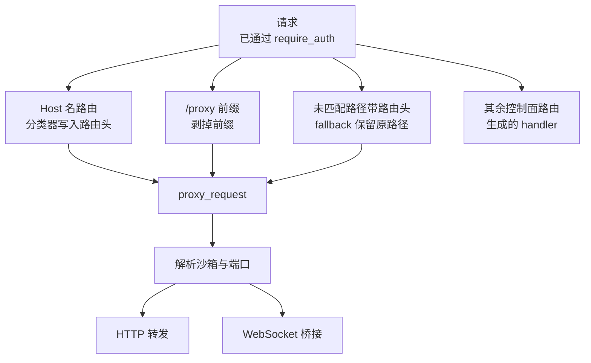
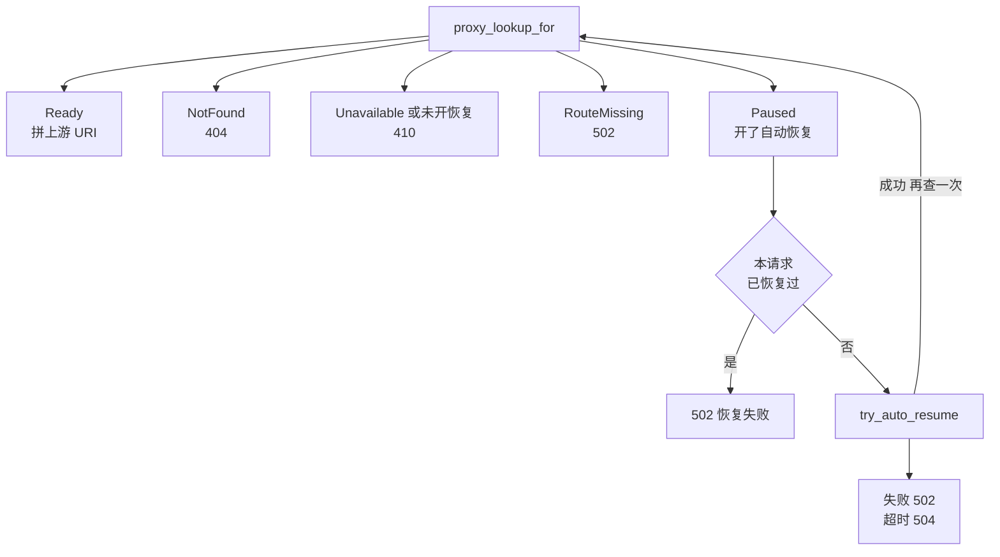
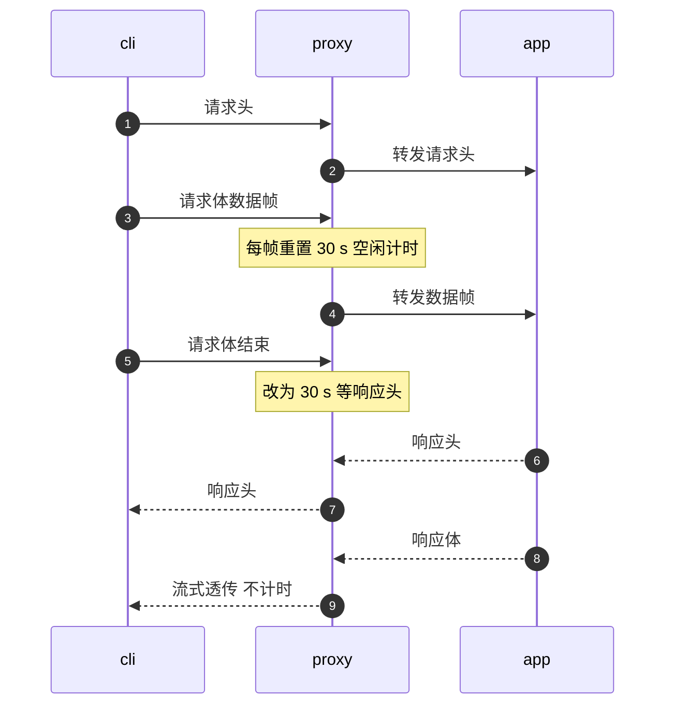

# 17 · 反向代理

> guest 里的服务只监听在宿主上一个网络命名空间里的地址，客户端看不见它；envd、用户的 Web 应用、终端的 WebSocket 都要经节点上的 `server` 进程转进去。
> 这个反向代理与控制面 API 共用一个端口，要从同一条 TCP 连接上分辨「这是管理请求」还是「这是送进某台沙箱某个端口的流量」，
> 还要在目标沙箱暂停时决定是拒绝还是先把它唤醒。本篇讲三个入口、路由解析与自动恢复、HTTP 与 WebSocket 两条转发路径，以及它们的超时与错误码。
>
> **读者**：工程师、SDK 使用者。　**预备**：[第 12 篇 · 规范驱动的服务骨架](12-spec-driven-server.md)、[第 13 篇 · 认证与凭据](13-authentication.md)。
> **代码**：`src/api/proxy.rs`、`src/orchestrator/proxy.rs`、`src/orchestrator/service.rs`（`proxy_lookup_for`、`upsert_proxy_route_if_current_handle`、`detach_sandbox_handle_and_route`）、`src/api/server.rs`

---

## 0. 本篇要回答的问题

1. 一个发往 guest 端口的请求可以从哪三个入口进来？它们的优先级如何，怎样汇合到同一条代码路径？
2. 代理怎样把「沙箱 ID 加端口」变成一个上游地址？为什么解析时不碰沙箱的锁？查找可能得到哪五种结果？
3. 发往暂停沙箱的请求怎样触发自动恢复？为什么只试一次、限时 60 s、并把 TTL 设为至少 300 s？两个请求同时到达时会怎样？
4. HTTP 转发的超时为什么分成两个阶段？为什么代理禁用了连接池？
5. WebSocket 请求怎样握手与桥接？上游拒绝握手时客户端看到什么？
6. 代理返回的 400、404、410、502、504 各对应什么情况？

---

## 1. 问题：一个端口，两种流量

每台沙箱的 guest 网卡在宿主上一个独立的 netns 里，宿主经一个 host interaction 地址（`10.11.0.0/16` 中的一个）与它通信（[第 29 篇 §2.2](29-network-slots.md#22-地址计划)）。
这个地址只在节点内可达。SDK、CLI 与浏览器在节点之外，它们要访问 guest 的 envd（缺省端口 49983）或用户自己在 guest 里起的服务，必须经过节点上的某个进程转发。

AgentENV 把这个转发器放在 `server` 进程里，与控制面 API 共用同一个监听端口。这样做省掉一个进程和一个端口，
代价是同一个 HTTP 服务要回答三个问题：

- **这是不是数据面请求？** `GET /sandboxes` 可能是列出沙箱的管理请求，也可能是送进某台 guest 的一个应用请求，取决于它从哪个入口来。
- **送到哪台沙箱的哪个端口？** 沙箱的 host interaction 地址随运行代际变化，不能写死在客户端里。
- **沙箱不在运行时怎么办？** 暂停的沙箱没有可以转发的目标，代理要么拒绝，要么先恢复它。

凭据检查不在本篇：数据面请求由 `require_auth()` 在进入代理之前判定，规则见[第 13 篇 §4](13-authentication.md#4-require_auth-的决策)。
本篇从「请求已经通过鉴权」讲起。

---

## 2. 三个入口



**`/proxy` 前缀。** `proxy::router()` 注册 `ANY /proxy` 与 `ANY /proxy/{*proxy_path}`，都由 `proxy_via_prefix()` 处理。
`strip_proxy_prefix()` 只去掉开头的 `/proxy` 五个字符：`/proxy` 变成空路径，再由 `build_upstream_uri_with_scheme()` 补成 `/`；
其余部分原样保留，测试 `proxy_preserves_raw_percent_encoded_wildcard_path` 与 `proxy_preserves_repeated_leading_slashes_in_wildcard_path`
锁定了百分号编码与 `/proxy//api` 这种重复斜杠都不被改写。目标沙箱与端口由路由头给出。

**fallback。** 任何没有匹配到路由的请求进入 `proxy_via_fallback()`：带路由头就按原路径代理，否则返回 JSON 形式的 404（[第 12 篇 §4.2](12-spec-driven-server.md#42-两个补丁可选-body-与-json-404)）。
注释说明了它存在的理由：多节点部署里 gateway 按头分发，fallback 让单节点也接受同样的请求，于是客户端在两种部署下都可以令 `E2B_SANDBOX_URL` 等于 `E2B_API_URL`，不必拼 `/proxy`。
匹配到控制面路由的请求即使带了路由头也不会进 fallback，这条规则是鉴权分类的基础（[第 13 篇 §4.1](13-authentication.md#41-控制面还是数据面)）。

路由头有两组名字，AgentENV 自己的优先：

| 用途 | AgentENV 头 | E2B 别名 | 校验 |
|---|---|---|---|
| 目标沙箱 | `x-agentenv-sandbox-id` | `e2b-sandbox-id` | 必须是 UUID |
| 目标端口 | `x-agentenv-target-port` | `e2b-sandbox-port` | `u16` 且大于 0 |

`first_header_value()` 按表中顺序取第一个非空值，所以两组头同时出现时 E2B 别名被忽略。

**Host 名。** 配置了 `[sandbox_proxy].domains` 时，`Host` 形如 `{port}-{sandboxID}.{domain}` 的请求由中间件 `sandbox_proxy_classifier()` 处理。
按[第 12 篇 §4.1](12-spec-driven-server.md#41-servernew) 讲的 axum 规则，这个中间件在路由匹配之后、handler 之前运行；
它不看匹配结果，直接把请求截走，所以 `8080-<id>.<domain>/sandboxes` 会送进 guest 而不是列出沙箱。
截走之前它把解析出的 ID 与端口写成 `x-agentenv-sandbox-id` 与 `x-agentenv-target-port`（覆盖客户端可能带来的同名头），
再手动调用 `WebSocketUpgrade::from_request_parts()`——中间件拿不到 handler 那样的提取器参数——然后直接调 `proxy_request()`，路径不做任何改写。

`parse_host_proxy_route()` 的规则值得逐条看，它决定了哪些 Host 属于数据面：

1. `Host` 头缺失时用 URI 的 authority；去掉端口与末尾的点，转成小写。
2. 按配置顺序逐个尝试域名。Host 恰好等于某个域名时立即判为控制面，不再尝试后面的域名。
3. 去掉 `.{domain}` 后剩下的必须是单个 label（不含点），否则跳过这个域名。
4. label 里没有 `-` 时跳过，最终按控制面处理；有 `-` 时按第一个 `-` 切成端口与沙箱 ID，任一部分不合法就返回 400。

第 4 条有一个后果：沙箱域名下凡是第一段 label 带连字符的主机名都被当作数据面。
若把 `api-v2.<domain>` 也解析到这台节点，它会得到「端口非法」的 400，而不是控制面响应。
另外，请求路径以 `/proxy` 开头时分类器直接放行，不解析 Host（测试 `sandbox_proxy_host_routes_control_paths_and_skips_explicit_proxy`）。

三个入口最后都在响应的 extension 里写入 `HttpRouteSource::{ProxyPrefix, ProxyHeader, ProxyHost}`，外层的指标中间件据此给请求打标签（[第 24 篇 §5.2](24-metrics-and-events.md#52-指标一览)）。
多节点时 gateway 把 Host 与头两类数据面请求都改写成 `/proxy` 前缀、把 Host 路由的解析结果写成路由头再发给节点，节点看到的永远是 `/proxy` 前缀入口（[第 55 篇 §5.1](55-gateway.md#51-改写了什么)）。

---

## 3. 解析：从沙箱 ID 到上游地址

### 3.1 运行时路由表

`resolve_proxy_request()` 读出两个路由头后调用 orchestrator 的 `proxy_lookup_for()`。它分两步：

1. 读锁 `proxy_routes`。这是一张 `ProxyRouteTable`（`src/orchestrator/proxy.rs`），从沙箱 ID 映射到 `ProxyRoute{target, version, updated_at}`，`target` 只有一个字段：host interaction IPv4 地址。命中就返回 `Ready`。
2. 没命中时读一次元数据 store，按状态分类：没有记录是 `NotFound`；状态是 Running 却没有路由是 `RouteMissing`；Paused 是 `Paused{auto_resume}`；其余状态是 `Unavailable(state)`。

这里有意不碰沙箱句柄的 `Mutex`。pause、snapshot、fork 这类操作在整个过程中持有句柄锁，可能长达数秒；
如果代理要先锁句柄才能找到地址，所有数据面流量都会在这期间排队。路由表把「地址」从句柄里拆出来，读路径上只有一把 `RwLock` 的读锁（[第 10 篇 §4.2](10-node-process-and-object-model.md#42-三张表与锁顺序)、[第 19 篇 §7](19-state-machine-and-concurrency.md#7-同一沙箱上的并发操作)）。

路由表的写入点决定了各状态下代理看到什么：

| 时刻 | 路由表 | 代理的结果 |
|---|---|---|
| 启动或恢复完成：envd `/init` 已返回，状态已写成 Running | `launch_sandbox()` 随后 `upsert_proxy_route_if_current_handle()` | 两步之间短暂为 `RouteMissing`，之后 `Ready` |
| Snapshotting、Forking | 不变 | `Ready`：请求照常转发给一台正在被短暂暂停的 VM |
| 进入 Pausing 之后 | `detach_sandbox_handle_and_route()` 删除 | `Unavailable(Pausing)`，之后 `Paused` |
| 进入 Killing | 同上删除 | `Unavailable(Killing)`，记录删除后 `NotFound` |

第一行的顺序带来一个保证：`launch_sandbox()` 先等后端的 `wait_for_ready()`（其中包括向 envd 发 `/init`，写入环境变量、工作目录与缺省用户，[第 28 篇 §4.1](28-mmds-and-envd.md#41-wait_for_ready-的顺序)），再写 Running，最后发布路由。
所以数据面请求不会在 `/init` 之前到达 guest；在此之前到达的请求查到的是 Starting 或 Resuming，得到 410。

写入时 `upsert_proxy_route_if_current_handle()` 先确认句柄仍是本次启动的那一个（`Arc::ptr_eq`），并按「先沙箱表、后路由表」的固定顺序加锁，与删除路径一致，避免死锁。
每次写入从原子计数器取一个新的 `version`，指标采样用它区分运行代际（[第 24 篇 §3.4](24-metrics-and-events.md#34-代数)）。
推论：Snapshotting 与 Forking 期间转发的请求会在 TCP 层等到 VM 恢复，只要暂停窗口短于下文的 30 s 响应头超时就不会失败。

拿到地址后，`build_upstream_uri_with_scheme()` 拼出 `http://{ip}:{port}{path}?{query}`（WebSocket 用 `ws://`），直接连 guest，不经过 netns 里的任何用户态进程。

### 3.2 解析循环

`resolve_proxy_request()` 是一个最多走两轮的循环：



图中省略了一条规则：已经尝试过自动恢复之后，第二轮再得到 `Unavailable`、`RouteMissing` 或查询错误，一律报「自动恢复失败」（502）；
没有尝试过时，查询错误是 500，`SandboxNotFound` 错误照样是 404。

---

## 4. 自动恢复

自动恢复按沙箱开关：创建请求里 `autoResume.enabled` 为真，元数据的 `auto_resume` 才为真（[第 14 篇 §3](14-sandbox-api.md#3-从模板创建)）。
它的意义是让「暂停后再访问」对客户端透明：一个长时间没有交互的 agent 环境被 TTL 暂停后，下一次 HTTP 请求本身就能把它唤醒，SDK 不必先调 connect。

`try_auto_resume()` 只有一行实质代码：

```rust
timeout(
    PROXY_AUTO_RESUME_TIMEOUT,                       // 60 s
    api_impl.orchestrator().resume_sandbox(
        sandbox_id,
        NewTimeout::EnsureMinimum(auto_resume_min_sandbox_timeout()),  // 缺省 300 s
    ),
)
```

三个参数各有理由：

- **至少 300 s 的 TTL。** `NewTimeout::EnsureMinimum(min)` 把 TTL 设为「原 TTL 与 min 的较大者」，并从现在起算（`SandboxMetadata::_update_timeout()`）。
  如果沿用原 TTL（可能只有 15 s，[第 14 篇 §4](14-sandbox-api.md#4-四个改-ttl-的入口)），沙箱可能刚恢复就再次到期暂停，客户端陷入「每个请求都要等一次恢复」。
  `auto_resume_min_sandbox_timeout_secs` 来自 `[orchestrator]`，缺省 300，读取后用 `OnceLock` 缓存，改配置要重启。
- **60 s 上限。** 超过就返回 504。`resume_sandbox()` 内部经 `run_cancellation_safe()` 运行（[第 19 篇 §6](19-state-machine-and-concurrency.md#6-取消安全操作不随请求一起死)），
  所以超时只是放弃等待，恢复本身在后台继续；客户端得到 504，稍后重试时沙箱多半已经在运行。
- **只试一次。** 恢复成功后回到循环再查一次；如果仍是 Paused（例如恢复后立刻被别的请求暂停），直接报 502，不再恢复。
  这避免了一个请求在「恢复—被暂停—恢复」之间无限循环，也避免一批请求把同一台沙箱反复拉起。

鉴权在恢复之前完成：没有正确 token 的请求在 `require_auth()` 就被拒绝，不会白白触发一次恢复（[第 13 篇 §4.3](13-authentication.md#43-数据面)）。
需要注意的是，WebSocket 请求的握手合法性检查排在解析之后（§6），一个格式不对的升级请求也会先触发恢复，再得到 400。

**并发请求。** 第一个请求的恢复把状态从 Paused 改成 Resuming；同时到达的第二个请求查到的是 `Unavailable(Resuming)`，立即得到 410，不会等待。
这与 orchestrator 自己的 `resume_sandbox_inner()` 不同——后者遇到 Resuming 会等转换结束（[第 19 篇 §7](19-state-machine-and-concurrency.md#7-同一沙箱上的并发操作)）。
浏览器加载一个页面时往往并发发出多个请求，除第一个以外都会在恢复期间收到 410；客户端需要把 410 当作可重试的错误。

**流量不续期。** 代理在转发成功时不调用 `keep_alive_for()`，`proxy.rs` 里没有任何续期逻辑。一台正在被频繁访问的沙箱仍会在 TTL 到期时被暂停或删除；
保持它运行是客户端的责任（connect 或 refreshes，[第 23 篇 §7](23-auto-eviction-and-ttl.md#7-与代理自动恢复的联动)）。自动恢复只负责「醒来」，不负责「别睡」。

---

## 5. HTTP 转发

### 5.1 头的改写

`proxy_http_request()` 在发出请求前做三件事：

1. `sanitize_request_headers()` 删除四个路由头、`e2b-traffic-access-token`、`Host`，以及全部逐跳（hop-by-hop）头：
   `Connection`、`Upgrade`、`TE`、`Trailer`、`Transfer-Encoding`、`Proxy-Authenticate`、`Proxy-Authorization`、`Keep-Alive`，
   外加 `Connection` 头里点名的那些头（RFC 9110 的要求，测试 `proxy_strips_connection_nominated_headers_on_requests_and_responses`）。
   API key 与未验证的 envd token 已经在鉴权阶段删掉（[第 13 篇 §4.4](13-authentication.md#44-转发前的头清洗)）。
2. `inject_forwarded_headers()` 写入 `x-forwarded-host`（客户端原来的 Host）、`x-forwarded-proto`、`x-forwarded-method`、`x-forwarded-uri`。
3. 把 `Host` 改成上游的 `ip:port`，把请求 URI 换成上游 URI。

两处细节。`x-forwarded-proto` 是写死的 `http`（WebSocket 是 `ws`），不反映客户端到 gateway 或负载均衡那一跳是否用了 TLS；
推论：guest 里依赖它生成绝对 URL 的应用会生成 `http://` 链接，部署者需要在更外层改写。
`x-forwarded-uri` 写的是**上游**的路径与查询串，也就是去掉 `/proxy` 前缀之后的值，而不是客户端发出的原始 URI。

响应方向由 `map_upstream_response()` 处理：去掉逐跳头，其余状态码、头与 body 原样透传。上游返回 4xx / 5xx 时客户端看到的就是上游的响应，
代理不把它包装成自己的错误（测试 `proxy_preserves_upstream_http_error_status_headers_and_body`）。

### 5.2 两阶段超时

代理只有三个超时常量：TCP 连接 5 s、请求体空闲 30 s、等待响应头 30 s（测试编译下全部缩成 100 ms，用 `#[cfg(test)]` 切换）。
难点在于一个固定的「请求超时」无法同时满足两类请求：上传一个大文件可能要几分钟，而一个卡住的上游应当尽快被发现。
`wait_for_upstream_response_headers_with_activity_timeout()` 把计时分成两个阶段。下图中 `cli` 是客户端，`proxy` 是代理，`app` 是 guest 里的服务：



实现靠一个 `watch` 通道。`track_request_body_activity()` 用 `map_frame()` 包住请求体，每见到一个**数据**帧就 `send(())`（trailers 不算进度）；
发送端随包装后的 body 一起交给 hyper，body 读完被丢弃时发送端关闭。等待函数在 `select!` 里同时等三件事：
上游响应头到达就返回；计时器到期就返回 504；通道有新值就把计时器重置为 30 s 空闲，通道关闭就把计时器改成 30 s 等响应头，并不再监听通道。

收益是：只要上传还在推进，多慢都可以；上传结束后上游 30 s 内不给出响应头才算超时。测试 `proxy_allows_slow_uploads_while_body_makes_progress` 与
`proxy_returns_gateway_timeout_when_upstream_headers_are_too_slow` 分别锁定这两点。
响应头到达之后没有任何超时，SSE 与大文件下载可以无限期地流式透传（测试 `proxy_streams_sse_response_without_buffering_entire_body`）。
代价也在这里：一个发完响应头之后不再发数据的上游会让连接一直挂着，代理不会替客户端断开它。

envd 的 `POST /process.Process/StreamInput` 是一种特殊情形：它是长期存在的客户端流式请求，SDK 用它把终端输入持续送进进程。
代理为它打「client attached / detached」日志；上游通道在客户端断开或 envd 暂停时被拆掉，hyper-util 报 `SendRequest` 错误。
`is_benign_stream_input_disconnect()` 把这种错误识别为正常分离，只降低日志级别，响应仍是 502。
由于 hyper-util 的错误种类是私有的，识别只能比较错误字符串 `"client error (SendRequest)"`（`is_send_request_failure_text()`），依赖库的错误文案不变。

### 5.3 禁用连接池

`build_proxy_client()` 构造的 hyper 客户端设置了 `pool_max_idle_per_host(0)`：每个请求新建一条 TCP 连接，用完即关。注释给出了原因：
host interaction 地址在沙箱的运行代际之间复用，而 hyper 的空闲池以 authority（`ip:port`）为键，池里的一条旧连接可能仍属于上一代 VM 的流。

具体地说，后端停止时网络槽位经 `NetworkManager::release()` 归还（`src/sandbox/firecracker/sandbox.rs` 的停止路径），之后可以分给任意一次启动或恢复（[第 32 篇 §3](32-warm-pools.md#3-网络槽位池)），同一个 `10.11.x.y` 在不同时刻可以属于不同的 VM。
推论：若允许连接复用，一个空闲的 keep-alive 连接在槽位易主之后仍以同样的键留在池里，下一个发往该地址的请求可能被写进一条已经失效的流，得到难以解释的连接错误；
测试 `proxy_client_does_not_reuse_connections_across_runtime_generations` 模拟了「同一地址换了一代服务端」并断言第二个请求用的是新连接。

代价是每个请求一次 TCP 握手。连接在节点内部、经 veth 直达 guest，握手只跨一段本地链路；代理还设置了 `set_nodelay(true)`，注释说明代理的请求与响应都很小，Nagle 算法只会引入一次延迟确认的等待。

---

## 6. WebSocket

`proxy_request()` 用 `is_websocket_upgrade_request()` 判断：`Connection` 含 `upgrade` 且 `Upgrade` 含 `websocket`（按逗号切分、忽略大小写）。
WebSocket 路径不用 hyper 客户端，而是用 tokio-tungstenite 自己建连接。`proxy_websocket_request()` 的顺序是：

1. 检查 axum 的 `WebSocketUpgrade` 提取结果，失败返回 400。如 §4 所说，这一步在解析与自动恢复之后。
2. `sanitize_websocket_request_headers()`：在 HTTP 的清洗之外再删掉 `sec-websocket-key`、`-version`、`-accept`、`-extensions`，保留 `sec-websocket-protocol`。
   两跳各自握手，key 与 accept 不能跨跳传递。推论：扩展头被删掉，压缩扩展不会在客户端与 guest 之间端到端协商。
3. 注入 `x-forwarded-*`（proto 为 `ws`），用 `connect_async()` 与上游握手，整体限时 30 s，这个时限同时覆盖 TCP 连接。
4. 上游拒绝握手（返回非 101 的 HTTP 响应）时，`map_websocket_handshake_rejection_response()` 去掉逐跳头后把上游的状态码、头与 body 原样还给客户端；
   其他握手错误返回 502，超时返回 504。
5. 上游握手成功之后，代理才答应客户端的升级：若上游选定了子协议，就用 `protocols()` 让 axum 在 101 里回同一个子协议；
   再把上游响应里除 `sec-websocket-*` 与逐跳头之外的头（例如 `Set-Cookie`、`X-Request-Id`）追加到 101 响应上。

「先与上游握手、再答应客户端」的顺序保证了客户端拿到 101 时上游确实已经接受；上游因鉴权或路径不存在而拒绝时，客户端看到的是上游真实的 401 或 404，
而不是一个随即被关闭的 WebSocket（测试 `proxy_preserves_upstream_websocket_handshake_rejection_status`）。

升级完成后，`bridge_websocket_streams()` 把两个连接各拆成收发两半，用 `tokio::join!` 同时跑两个方向的转发循环。
`axum_message_to_tungstenite()` 与 `tungstenite_message_to_axum()` 在两个库的消息类型之间逐一转换文本、二进制、Ping、Pong 与 Close（含关闭码与原因）；
tungstenite 的原始 `Frame` 被丢弃。任一方向读到结束或出错，就关闭对端的发送半边；两个方向都结束后桥接退出。
代理自己不发心跳、不设空闲超时，连接的存活完全由两端决定。

---

## 7. 错误映射

代理自己产生的错误由 `proxy_error_response()` 生成，body 是 `text/plain` 的一句话，与控制面的 JSON `Error` 不同：

| 状态码 | 情形 | body |
|---|---|---|
| 400 | 缺少或非法的路由头；非法的沙箱 Host；无法构造上游 URI；非法的 WebSocket 升级 | 说明文字（升级非法时为空） |
| 404 | 沙箱不存在 | `sandbox not found` |
| 410 | 沙箱存在但不可代理：Paused 且未开自动恢复，或处于 Pausing、Resuming、Killing 等状态 | `sandbox is not proxyable in its current state` |
| 502 | 自动恢复失败；Running 但没有路由；上游连接或请求失败；WebSocket 握手出错 | 前两种有说明文字，后两种为空 |
| 504 | 自动恢复超过 60 s；上传空闲或等待响应头超时；WebSocket 握手超时 | 第一种有说明文字，其余为空 |
| 500 | 查询元数据出错且未尝试过自动恢复 | 空 |

`RouteMissing` 的文案是「route is temporarily unavailable」，对应 §3.1 里状态已写成 Running、路由尚未发布的那个窗口。
上游自己返回的任何状态码都不在此表中，它们被原样透传。客户端因此需要区分两类 502 / 504：带 `text/plain` 说明的是代理在解析阶段的判断，空 body 的是转发阶段的失败。

---

## 8. 与 e2b infra 的对照

e2b infra 的数据面要经过两跳代理：边缘的 client-proxy 按 Host 找到节点，再由节点上 orchestrator 的代理送进沙箱；两跳共用一个代理库，节点侧的连接池以 Firecracker 进程的生命周期 ID 为键，从而在保留连接复用的同时避开地址复用的问题（见 e2b 手册第 53、54 篇）。
AgentENV 在节点内只有一跳，直接禁用连接池，换来更简单的实现，代价是每个请求一次本地 TCP 握手。
e2b infra 的自动恢复由边缘代理经 gRPC 向 API 发起，并受全局特性开关与按沙箱的策略双重控制；AgentENV 在节点进程内直接调用 orchestrator，只看按沙箱的 `auto_resume`。

---

## 9. 小结

- 数据面有三个入口：`/proxy` 前缀（剥前缀）、fallback（未匹配路径加路由头，保留原路径）、Host 名（分类器在路由匹配之后、handler 之前截走，路径不改）；三者汇入 `proxy_request()`。
- 路由头两组名字中 AgentENV 的优先；Host 路由把解析结果写成 AgentENV 路由头，覆盖客户端带来的值。
- 沙箱域名下第一段 label 含连字符的主机名一律按数据面处理，非法时返回 400 而不是落回控制面。
- 解析只读运行时路由表与元数据，不碰沙箱句柄的锁；路由在状态写成 Running 之后发布、在进入 Pausing 或 Killing 时删除，Snapshotting 与 Forking 期间保留。
- 自动恢复按沙箱开关，限时 60 s、只试一次、TTL 至少 300 s；超时不取消恢复本身；恢复期间并发到达的请求得到 410 而不等待。
- 代理转发不续期 TTL，保持沙箱运行是客户端的责任。
- HTTP 超时分两阶段：上传期间按数据帧重置 30 s 空闲计时，上传结束后 30 s 内要见到响应头；响应头之后不再计时。
- 连接池被禁用，因为 host interaction 地址跨运行代际复用；代价是每个请求一次本地 TCP 握手。
- WebSocket 先与上游握手再答应客户端，上游拒绝原样返回；子协议与应用层头被带回 101 响应。
- 代理自身的错误是 `text/plain`，上游的响应原样透传；空 body 的 502 / 504 来自转发阶段。

---

## 延伸阅读 / 下一篇

- [第 13 篇 · 认证与凭据](13-authentication.md)：进入代理之前的数据面鉴权与凭据头清洗。
- [第 29 篇 · 网络（一）：槽位、命名空间与地址计划](29-network-slots.md)：host interaction 地址从哪里来。
- [第 23 篇 · 自动驱逐与 TTL](23-auto-eviction-and-ttl.md)：自动恢复设置的 TTL 之后发生什么。
- [第 55 篇 · gateway](55-gateway.md)：多节点时请求怎样被改写后送到节点上的这个代理。
- [e2b 手册第 53 篇 · client-proxy](../e2b-infra/53-client-proxy-edge.md)、[e2b 手册第 54 篇 · 共享代理库](../e2b-infra/54-shared-proxy-library.md)：e2b infra 的两跳代理与按生命周期分池。
- 下一篇：[第 18 篇 · E2B 兼容性：矩阵与偏差](18-e2b-compatibility.md)。
