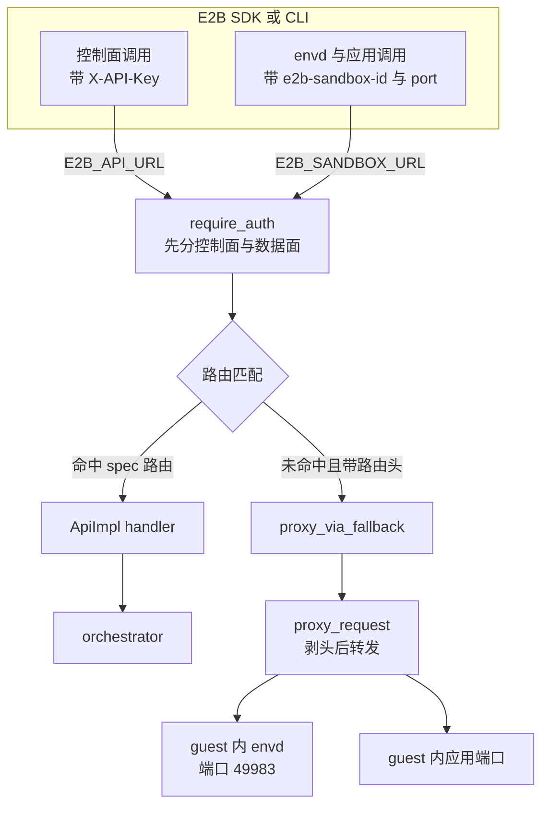

# 18 · E2B 兼容性：矩阵与偏差

> AgentENV 的对外 API 以「官方 E2B SDK 指向它就能用」为目标：路径、字段名、凭据头、envd 端口都沿用 E2B 的约定。
> 但「能用」是对一组具体 SDK 行为而言的，不是对某一版 E2B API 定义逐字兼容。本篇把兼容手段、与 e2b infra 2026.09 spec 的端点对照、
> 已知偏差与验证方式汇总成矩阵，供 SDK 使用者判断哪些调用可以放心迁移、哪些会得到不同的结果。
>
> **读者**：工程师、SDK 使用者。　**预备**：[第 13 篇 · 认证与凭据](13-authentication.md)、[第 14 篇 · 沙箱生命周期 API](14-sandbox-api.md)。
> **代码**：`src/api/openapi.yml`、`src/api/impls/sandbox.rs`、`src/api/proxy.rs`、`src/api_key.rs`、`src/cfg.rs`、`scripts/tests/e2e/suites/09_e2b_compat.sh`、`scripts/tests/e2e/e2b_{python_sdk_compat.py,ts_sdk_compat.ts}`；对照：e2b infra 的 `spec/openapi.yml`

---

## 0. 本篇要回答的问题

1. E2B SDK 与服务端有哪几个接触面？AgentENV 在每个接触面上用什么手段让 SDK 不必修改？
2. 为什么文档要求把 `E2B_SANDBOX_URL` 设成与 `E2B_API_URL` 相同？这背后是哪段代码？
3. 对照 e2b infra 2026.09 的 spec，AgentENV 的端点可以分成哪几类？哪些「E2B 形状」的端点在 2026.09 里其实不存在？
4. 哪些偏差会让同一个 SDK 调用在 AgentENV 上得到不同的结果？哪些只是字段被接受而不生效？
5. 仓库用什么测试来证明兼容性，这些测试覆盖不到什么？

---

## 1. 问题：兼容的对象是谁

一个 E2B 用户手里有三样东西：Python 或 TypeScript SDK、`e2b` CLI，以及用它们写好的 agent 代码。
迁移到另一个后端时，用户希望只改环境变量。这要求服务端在三个接触面上都与 SDK 的预期一致。

- **控制面 REST**：SDK 带着 `X-API-Key` 调 `POST /sandboxes`、`GET /v2/sandboxes`、`POST /v3/templates` 等端点，按 spec 里的字段名解析响应。
- **数据面 envd**：拿到沙箱 ID 与 `envdAccessToken` 之后，SDK 的 `commands`、`files` 直接与 guest 里的 envd 说话，协议是 HTTP + JSON 与 Connect-RPC，端口 49983。
- **数据面应用端口**：用户在沙箱里起的服务，经 `getHost(port)` 生成的地址访问，私有入口要带 `e2b-traffic-access-token`。

兼容的难点在于 E2B 自身也在演进。SDK 每个版本调用的端点集合不同，e2b infra 的 spec 也在变。
AgentENV 的 `src/api/openapi.yml` 是从 E2B 的 API 定义改出来的（[第 12 篇](12-spec-driven-server.md)），但它并不等于 e2b infra 2026.09 的 `spec/openapi.yml`：
安全方案的名字不同（2026.09 是 `AccessTokenAuth`、`Supabase1TokenAuth` / `Supabase2TeamAuth`、`AdminTokenAuth`，
AgentENV 是 `AuthProviderBearerAuth` / `AuthProviderTeamAuth`、`AdminApiKeyAuth` / `AdminTeamAuth`），
`autoResume` 的形状也不同（2026.09 是 `{policy: any | off}`，AgentENV 是 `{enabled: bool}`）。
推论：AgentENV 跟随的是另一版本的 E2B 公开 API 定义，而不是 e2b infra 2026.09 这一版。

因此本篇所说的「兼容」有一个操作性的定义：仓库里的兼容测试所用的 SDK 版本能跑通的那组调用。下文的端点对照以 2026.09 为参照系，
目的不是判定谁对谁错，而是让读者知道哪些端点在 e2b infra 的这一版里有对应实现、可以拿来比较行为。

---

## 2. 一个 SDK 请求怎样落到 AgentENV

E2B SDK 默认把控制面请求发往 `https://api.<domain>`，把数据面请求发往 `https://<port>-<sandboxID>.<domain>`。
后一种做法要求泛域名 DNS 与证书。SDK 另外允许用 `sandbox_url`（环境变量 `E2B_SANDBOX_URL`）把数据面请求集中发往一个固定地址，
并在请求头里带上 `E2b-Sandbox-Id` 与 `E2b-Sandbox-Port` 指明目标（见 e2b 手册第 12、52 篇）。
在 e2b infra 里，这种按头定址只在本地开发模式下启用；生产环境只认 Host。

AgentENV 把按头定址当成主路径。下图是单节点部署下两类请求的去向：

关键在 `src/api/proxy.rs` 的 `proxy_via_fallback()`。它挂在路由表的 fallback 上：任何没有匹配到 spec 路由的请求，
只要带了 `x-agentenv-sandbox-id` 或其 E2B 别名 `e2b-sandbox-id`，就以原路径转发到沙箱；不带路由头则返回 JSON 形式的 404。
注释写明它的目的：让客户端在单节点与多节点部署中都能用 `E2B_SANDBOX_URL=${E2B_API_URL}`，而不必追加 `/proxy`。
envd 的路径（`/files`、`/process.Process/Start` 之类）与控制面路径不重叠，所以同一个端口能同时承载两类流量。
多节点时 gateway 用同样的头做分发（`services/gateway/internal/server.go` 里同时定义了两个头名，[第 55 篇](55-gateway.md)）。

把按头定址放在主路径上，换来的是部署门槛低：不需要泛域名 DNS，也不需要通配证书，一个 IP 加一个端口就能让 SDK 跑起来。
代价有两条。第一，一个普通浏览器或不认识这两个头的 HTTP 客户端无法直接访问沙箱里的服务，它们只能走 Host 形态，而 Host 形态要先配置域名。
第二，控制面与数据面共用同一个监听端口，路由表里任何新增的 spec 路径都会「遮住」guest 里同名的 envd 或应用路径；
envd 的路径空间与控制面目前不重叠，但这依赖两套 API 各自的命名，没有机制保证。

这条路径解释了一个容易误配的细节：`[sandbox_proxy].domains` 在 `config/default.toml` 里缺省为空，
`sandbox_model()` 只在它非空时填响应里的 `domain`。不设 `E2B_SANDBOX_URL` 的 SDK 会拿不到可用的域名，
推论：它会退回 SDK 自带的默认域名去连 envd，于是创建成功、执行命令失败。文档把 `E2B_SANDBOX_URL` 列为必设，原因在此。

鉴权与头清洗不在这里重复，见[第 13 篇 §4](13-authentication.md#4-require_auth-的决策)；
转发、超时与 WebSocket 见[第 17 篇](17-reverse-proxy.md)。

---

## 3. 兼容手段清单

| 手段 | 代码位置 | 让哪一个 SDK 行为成立 |
|---|---|---|
| 路径与字段名沿用 E2B（`sandboxID`、`templateID`、`envdVersion`、`envdAccessToken`、`trafficAccessToken`、`domain`） | `src/api/openapi.yml` | SDK 的生成客户端能直接反序列化响应 |
| 控制面只认 `X-API-Key` | `src/api/impls/auth.rs` 的 `require_auth()` | SDK 用 `E2B_API_KEY` 发出的头被接受 |
| 自动生成的 key 带 `e2b_` 前缀 | `src/api_key.rs` 的 `GENERATED_API_KEY_PREFIX` | 校验 key 格式的客户端不拒绝它 |
| 路由头别名 `e2b-sandbox-id` / `e2b-sandbox-port` | `src/api/proxy.rs` 的 `E2B_SANDBOX_ID_HEADER`、`E2B_TARGET_PORT_HEADER` | `E2B_SANDBOX_URL` 模式下的数据面定址 |
| fallback 代理 | `proxy.rs` 的 `proxy_via_fallback()` | `E2B_SANDBOX_URL` 可以等于 `E2B_API_URL` |
| Host 形态 `{port}-{uuid}.{domain}` | `proxy.rs` 的 `parse_host_proxy_route()` | 配置了域名时，SDK 的 `getHost()` 地址可用 |
| envd 端口 49983 | `src/cfg.rs` 的 `control_plane_port` 缺省值 | SDK 写死的 envd 端口 |
| envd 凭据 `X-Access-Token`、私有入口凭据 `e2b-traffic-access-token` | `src/sandbox/access.rs`、`require_auth()` | SDK 自动附带的两个 token 被识别 |
| `clientID` 恒为空字符串 | `src/api/impls/sandbox.rs` 的三个 `From<SandboxMetadata>` | 注释：只为 E2B Python SDK 保留，该字段是必填 |
| 分页头 `x-next-token`、`x-total-running` 与时间加 ID 的游标 | `src/api/impls/pagination.rs` | SDK 的 `Sandbox.list().next_items()` 翻页 |
| 对外状态只有 `running` / `paused` | `impl From<SandboxState> for models::SandboxState` | SDK 的状态枚举不会遇到未知值 |
| templateID 与 buildID 相等 | `src/api/impls/template.rs` | SDK 的 `Template.build()` 两步流程（[第 15 篇](15-template-build-api.md)） |

`X-API-Key` 之外的凭据形态（Bearer access token、团队头、admin token）在 spec 里保留，实现中全部退化为检查 `X-API-Key`，详见[第 13 篇 §5](13-authentication.md#5-生成层的副检查与名不副实的安全方案)。

这里需要纠正一个常见说法：仓库里的 `thirdparty/envd` 不是 envd 的服务端分支，而是 host 侧调用 envd 的 Rust 客户端库（tonic 生成的 filesystem / process 客户端加一个 OpenAPI 生成的 HTTP 客户端），
它的 README 直接指向 e2b infra 的 `packages/envd`。guest 里的 envd 随 tools 盘提供（`config/deps_manifest.toml` 的 `[tools]`），
其源码不在本仓库。推论：数据面协议的兼容来自 guest 里运行的就是 E2B 协议的 envd，而不是 AgentENV 重新实现了它；本书无法从基线代码核实它与上游 envd 的版本关系。

---

## 4. 端点对照：以 e2b infra 2026.09 为参照

把 AgentENV 的 spec 与 e2b infra 2026.09 的 `spec/openapi.yml` 逐条比较路径与方法，可以分成四类。

**甲类：两边都有。** 这是 SDK 主流程依赖的部分。

| 资源 | 端点 |
|---|---|
| 健康与节点 | `GET /health`、`GET /nodes`、`GET /nodes/{nodeID}` |
| 沙箱 | `GET`/`POST /sandboxes`、`GET /v2/sandboxes`、`GET`/`DELETE /sandboxes/{id}`、`…/pause`、`…/resume`、`…/connect`、`…/timeout`、`…/refreshes`、`…/snapshots`、`GET /sandboxes/metrics`、`GET /sandboxes/{id}/metrics` |
| 快照 | `GET /snapshots` |
| 模板 | `POST /v3/templates`、`POST /v2/templates/{t}/builds/{b}`、`GET /templates`、`GET`/`DELETE /templates/{t}`、`…/builds/{b}/status`、`…/builds/{b}/logs`、`GET /templates/aliases/{alias}` |
| 卷 | `GET`/`POST /volumes`、`GET`/`DELETE /volumes/{id}` |

同名不等于同形。`GET /health` 在 AgentENV 返回 204，2026.09 声明的是 200；
AgentENV 的 `Volume` 在 `volumeID`、`name` 之外多了必填的 `mode`、`sizeMB`、`status`，`NewVolume` 多了 `sizeMB`、`mode`、`fromVolume`、`image`。
多出来的响应字段对 SDK 无害，多出来的请求字段 SDK 不会发送，缺省值决定了 SDK 建出来的卷是什么样（[第 16 篇](16-snapshot-and-volume-api.md)）。

**乙类：E2B 形状，但 2026.09 的 spec 里没有。** `POST /v2/sandboxes`、`POST /v2/sandboxes/{id}/connect`、`PUT /sandboxes/{id}/network`、
`GET /snapshots/{snapshotID}`、`GET /v2/templates`。它们沿用 E2B 的命名与 schema 风格，部分在 AgentENV spec 里被老端点的 deprecated 描述引用
（v1 connect 的描述写着「改用 `POST /v2/sandboxes/{sandboxID}/connect`」）。推论：它们对应的是比 2026.09 更新的 E2B 公开 API，
或者是 AgentENV 按 E2B 风格补出的端点；无论哪种，都不能拿 e2b infra 2026.09 的实现来对照它们的行为。

**丙类：AgentENV 扩展，E2B SDK 不会调用。**

| 端点 | 用途 | 详见 |
|---|---|---|
| `POST /sandboxes-cold` | 从外部 OCI 镜像冷启动 | [第 14 篇](14-sandbox-api.md) |
| `POST /sandboxes/{id}/fork` | 一次 fork 出 1 到 100 个子沙箱 | [第 51 篇](51-fork.md) |
| `GET`/`PATCH /sandboxes/{id}/custom-extension-params` | custom extension 参数 | [第 33 篇](33-custom-extension-hooks.md) |
| `PUT`/`DELETE …/builds/{b}/builder`，以及 spec 之外的 `GET …/builder` WebSocket | BuildKit 构建会话与隧道 | [第 15 篇](15-template-build-api.md) |
| `/proxy`、`/proxy/{*path}`、fallback 代理 | 数据面入口 | [第 17 篇](17-reverse-proxy.md) |
| `GET /metrics` | Prometheus 指标 | [第 24 篇](24-metrics-and-events.md) |

另有一组 `x-agentenv-*` 头：请求侧的 `x-agentenv-sandbox-id`、`x-agentenv-target-port`，响应侧的 `x-agentenv-sandbox-id`（创建）与 `x-agentenv-build-id`（builder）。

**丁类：2026.09 有、AgentENV 没有。**

| 端点 | SDK 侧的后果 |
|---|---|
| `/teams`、`/teams/{id}/metrics*`、`/api-keys*`、`/access-tokens*`、`/admin/teams/…` | 团队、key 管理与管理面功能不可用；一个部署只有一把 key |
| `GET /templates/{t}/files/{hash}` | 按 hash 上传构建文件的通道不存在，与步骤路径拒绝 COPY / ADD 一致 |
| `POST /templates`、`POST /templates/{t}`、`PATCH /templates/{t}`、`POST /templates/{t}/builds/{b}`、`POST /v2/templates`、`PATCH /v2/templates/{t}` | 只支持 v3 创建加 v2 启动这一条构建流程；更早的构建 API 与模板属性修改不可用 |
| `/templates/tags`、`/templates/{t}/tags` | 模板标签不可用；同名重建须先删除 |
| `GET /sandboxes/{id}/logs`、`GET /v2/sandboxes/{id}/logs` | 沙箱日志 API 不可用 |
| `POST /nodes/{nodeID}` | 节点状态不能经 API 修改，`/nodes` 恒报 Ready |

---

## 5. 偏差矩阵

端点存在只是第一步。下表列出同一个调用在两边得到不同结果的地方。第二列以 e2b 手册或 2026.09 spec 为依据；
第三列是 AgentENV v0.2.3 的代码行为；「后果」一列写 SDK 使用者能观察到的差别。

| 维度 | e2b infra 2026.09 | AgentENV v0.2.3 | SDK 可见后果 |
|---|---|---|---|
| 租户 | key 映射到团队，带配额 | `Claims` 为空，`teamID` 参数不起作用 | 所有调用方共享一个命名空间 |
| `autoPause` 缺省 | spec 缺省 false，到期删除 | spec 缺省 true；代码只有显式 false 才删除 | 不发此字段的客户端，到期后沙箱被暂停而不是消失 |
| `autoResume` 形状 | `{policy: any \| off}` | `{enabled: bool}`，`enabled` 必填 | 推论：按 2026.09 形状发送的请求会被生成层以缺少必填字段拒绝 |
| `secure` 缺省 | 由请求决定 | v1 缺省 false，v2 强制 true | 不显式要求 secure 的 v1 客户端得到 envd 无鉴权的沙箱 |
| 私有入口与 secure | `allowPublicTraffic: false` 要求 `secure: true` | 不做这项检查 | 可以建出应用端口私有、envd 公开的沙箱 |
| `mcp`、`maskRequestHost` | 生效 | 接受但从不读取 | 静默无效，不报错 |
| 模板步骤 | 支持 COPY / ADD（按 hash 上传） | COPY、ADD、非空 `filesHash` 返回 400；ARG 当 ENV | SDK 的 `copy()` 不可用；构建参数留在运行时环境变量里 |
| 卷内容 | SDK 有直接读写卷内容的接口 | 不支持（`docs/src/integration/e2b.md`） | 只能经挂载卷的沙箱读写 |
| 沙箱 ID | 短 ID | UUID | SDK 不受影响；日志与 URL 里的 ID 更长 |
| 查询删除中的沙箱 | `GET /sandboxes/{id}` 对 killing 返回 404 | 返回 200 与 `running` | 删除后立即查询会看到「仍在运行」 |
| 按状态过滤 | pausing 计入 paused | 按内部状态精确匹配，过渡态从过滤结果中消失 | `Sandbox.list(state=[running])` 可能漏掉正在创建或恢复的沙箱 |
| v2 列表 `limit` | 缺省与上限都是 100 | 只校验上限，不带时返回全部 | 不带 `limit` 时一页拿全部，没有 `x-next-token` |
| connect 遇到暂停中 | 等暂停结束再恢复 | 返回 400 | 需要客户端重试 |

其中 TTL 相关的三个缺省值（显式 resume 的 15 s、v2 创建与 connect 的 300 s、代理自动恢复至少 300 s）与状态折叠、过滤、分页的细节在[第 14 篇](14-sandbox-api.md)；
模板步骤与 templateID = buildID 的约束在[第 15 篇](15-template-build-api.md)。这里只指出两个对 SDK 使用者影响最大的点。

第一，`autoPause` 的缺省值反了过来。AgentENV 选择缺省暂停，是因为暂停的沙箱可以靠快照恢复，删除不可撤销，缺省偏向保留状态；
代价是不显式写 `autoPause: false` 的客户端会在节点上积累暂停记录与产物，直到有人删除它们（[第 23 篇](23-auto-eviction-and-ttl.md)）。
推论：SDK 若总是显式发送 `autoPause`，这处差异对它不可见；只有手写请求或省略该字段的客户端会受影响。

第二，「接受但不生效」的字段比「明确拒绝」更难排查。`mcp` 与 `maskRequestHost` 都能通过 spec 校验，handler 不读它们
（`maskRequestHost` 在 `sandbox.rs` 里只出现在输出方向的 `From<&SandboxNetworkPolicy>`，且恒为 `None`）。
与之相对，COPY / ADD 的步骤路径选择了显式 400，用户能立刻知道不支持。

第三，几处偏差会叠加成安全上的差别。v1 创建缺省非 secure，而 AgentENV 又不要求私有入口必须配 secure，
于是一个只写了 `allowPublicTraffic: false` 的 v1 请求得到的沙箱，应用端口要 traffic token，envd 端口却只要知道 UUID 就能访问（[第 13 篇 §6](13-authentication.md#6-请求类型--所需凭据)）。
在 e2b infra 上同一个请求会被 400 拒绝。推论：E2B SDK 的缺省请求带 `secure: true`，兼容测试也显式传了它，所以这条路径在 SDK 用户那里不常见，主要影响手写 HTTP 请求的客户端。

把这些偏差换成迁移时的操作，SDK 使用者需要做的检查是：

1. 设置 `E2B_SANDBOX_URL`，单节点指向节点端口，多节点指向 gateway；只设 `E2B_API_URL` 不够。
2. 创建请求显式写出 `autoPause`、`secure` 与 `timeout`，不依赖任何一方的缺省值。
3. 模板构建不用 `copy()`，需要带文件进镜像时改走 Dockerfile 路径（`aenv build`）。
4. 列表查询不按状态过滤，或者接受过渡态沙箱暂时不出现；翻页时显式传 `limit`。
5. 不依赖 `mcp`、`maskRequestHost`、模板标签、沙箱日志与团队相关的接口。
6. 删除后要确认沙箱已经消失时，以 404 为准，不以 `state` 为准。

---

## 6. 验证方式

兼容性由 e2e 套件 `scripts/tests/e2e/suites/09_e2b_compat.sh` 检查。它把 `E2B_API_URL`、`E2B_SANDBOX_URL`、`E2B_API_KEY` 指向被测部署，然后分三段运行：

1. **`e2b` CLI**：`sandbox list`、`sandbox create --detach`（从输出里抓一个 UUID）、再 list 确认出现、`sandbox exec -- echo hello`（最多 10 次重试，注释说明 API 可能在 envd 接受第一个 Connect RPC 之前返回）、`sandbox kill`。
2. **Python SDK**（`e2b_python_sdk_compat.py`）：用 `Template().from_image().run_cmd().set_workdir().set_envs().set_start_cmd()` 构建模板，
   检查 WORKDIR、环境变量与 start 命令进程是否保留在模板快照里；`Sandbox.create(secure=True)`、`Sandbox.list`、`commands.run`；
   `beta_pause` 后 `connect` 再执行命令；kill；可选地再测 `from_template()` 派生模板。
3. **TypeScript SDK**（`e2b_ts_sdk_compat.ts`）：除模板与生命周期外，还用 `Volume.create` 建卷、挂进沙箱写入标记、删除沙箱后挂进第二台沙箱读回，验证卷内容跨沙箱保留。

这组测试覆盖了 SDK 主流程，但有三个需要知道的边界。

- **缺工具即通过。** 本机没有 `e2b` CLI、CLI 运行失败、没装 Python `e2b` 包、没有 npm 时，脚本都记一条 `_pass "skipped …"`。
  一个什么都没装的环境会让整个套件显示通过。kill 之后查询不是 404 时同样记为通过（「may still be cleaning up」）。
- **SDK 版本不固定。** TypeScript 段每次执行 `npm install e2b@latest`；Python 段用环境里已装的版本，只把版本号打进日志。
  兼容性因此是「对测试那天的最新 SDK」成立，SDK 新版本开始调用一个乙类或丁类端点时，测试会在某一天突然失败。
- **偏差没有被锁定。** 第 5 节的各项偏差没有对应的测试：测试证明主流程能跑通，不证明边角行为与 E2B 一致，也不证明它们不一致。

单元测试补上了几块协议细节：`proxy.rs` 里有 E2B 头别名的解析与剥离测试（`parses_e2b_headers`、`proxy_fallback_dispatches_with_e2b_header_alias`、`proxy_accepts_e2b_compatible_headers`），
`api_key.rs` 断言生成的 key 以 `e2b_` 开头。

从测试的选材也能看出兼容目标的范围。Python 段专门检查 start 命令进程在模板快照里仍然存活，TypeScript 段专门检查卷内容在沙箱删除后仍然保留：
这两项分别对应 AgentENV 的快照式模板（[第 52 篇](52-template-builder.md)）与块设备卷（[第 31 篇](31-extra-drives-and-volumes.md)），
都是实现方式与 e2b infra 差别最大、最容易在 SDK 看来「行为变了」的地方。测试没有覆盖的，是 SDK 里依赖团队、标签、文件上传的功能，它们本来就落在丁类端点上。

---

## 7. 小结

- 兼容的对象是 E2B SDK 的一组行为，不是某一版 E2B spec；AgentENV 的 spec 在安全方案名、`autoResume` 形状上都与 e2b infra 2026.09 不同。
- 控制面靠沿用路径与字段名、只认 `X-API-Key`；数据面靠 E2B 头别名加 fallback 代理，使 `E2B_SANDBOX_URL=${E2B_API_URL}` 成立。
- e2b infra 只在本地开发时按头定址，AgentENV 把它作为主路径；`[sandbox_proxy].domains` 缺省为空，所以 `E2B_SANDBOX_URL` 必须设置。
- `thirdparty/envd` 是 host 侧客户端，不是 envd 分支；guest 里的 envd 随 tools 盘提供。
- 对照 2026.09，端点分四类：两边都有、E2B 形状但 2026.09 没有、AgentENV 扩展、2026.09 有而 AgentENV 没有（团队、key 管理、模板标签与文件上传、沙箱日志）。
- 影响最大的偏差：`autoPause` 缺省为暂停、v1 缺省非 secure、COPY / ADD 不可用、过渡态从状态过滤中消失、删除中的沙箱查询为 running。
- `mcp`、`maskRequestHost` 被接受而不生效，比显式拒绝更难排查。
- e2e 兼容套件覆盖 CLI 与两种 SDK 的主流程，但缺工具时记为通过、SDK 版本不固定、偏差项没有测试锁定。

---

## 延伸阅读 / 下一篇

- [第 13 篇 · 认证与凭据](13-authentication.md)：三种凭据与数据面鉴权决策树。
- [第 14 篇 · 沙箱生命周期 API](14-sandbox-api.md)：TTL 缺省值、状态折叠与分页的细节。
- [第 15 篇 · 模板构建 API](15-template-build-api.md)：两条构建路径与不支持的步骤。
- [第 17 篇 · 反向代理](17-reverse-proxy.md)：三种代理入口与转发细节。
- [第 65 篇 · 与 e2b infra 的对照（一）](65-vs-e2b-infra-architecture.md)：两套系统在架构层面的取舍。
- [e2b 手册第 52 篇 · legacy 服务与 SDK 兼容](../e2b-infra/52-envd-legacy-and-sdk-compat.md)：SDK 怎样定址 envd、为什么端口编进域名。
- [e2b 手册第 17 篇 · 创建沙箱](../e2b-infra/17-sandbox-create-api.md)：`autoPause`、`autoResume`、网络字段在 e2b infra 中的处理。
- 下一篇：[第 19 篇 · 状态机与并发控制](19-state-machine-and-concurrency.md)。
