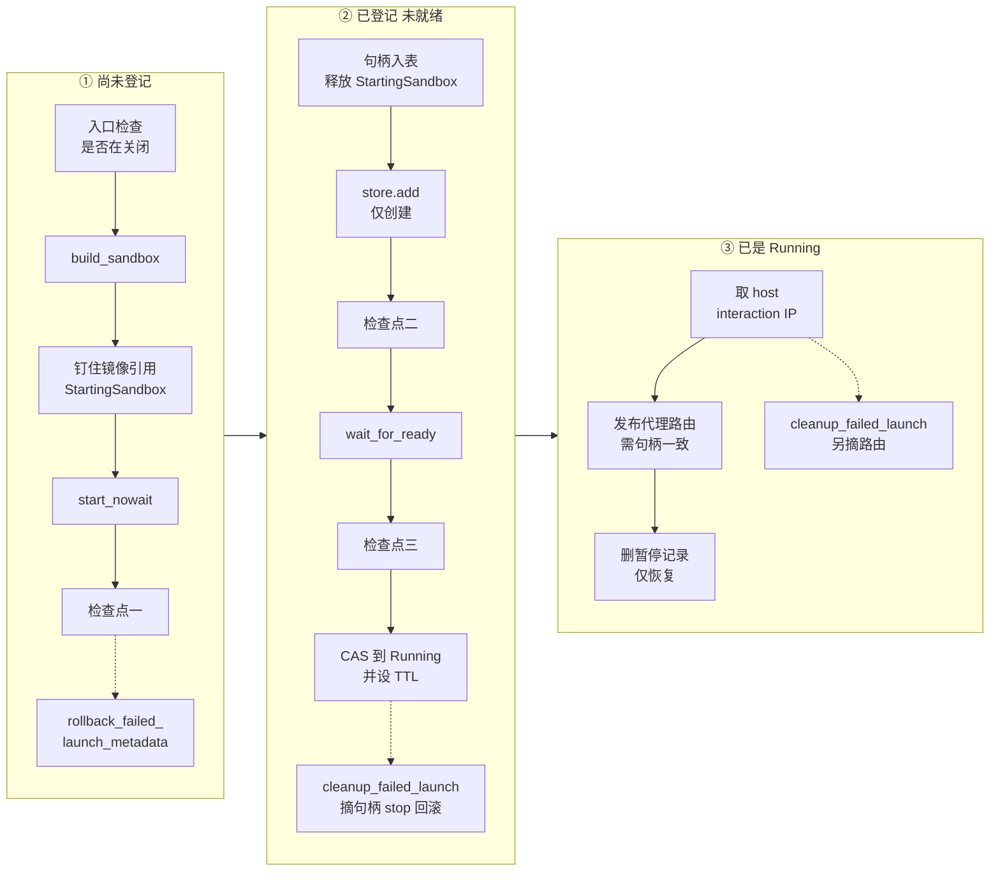
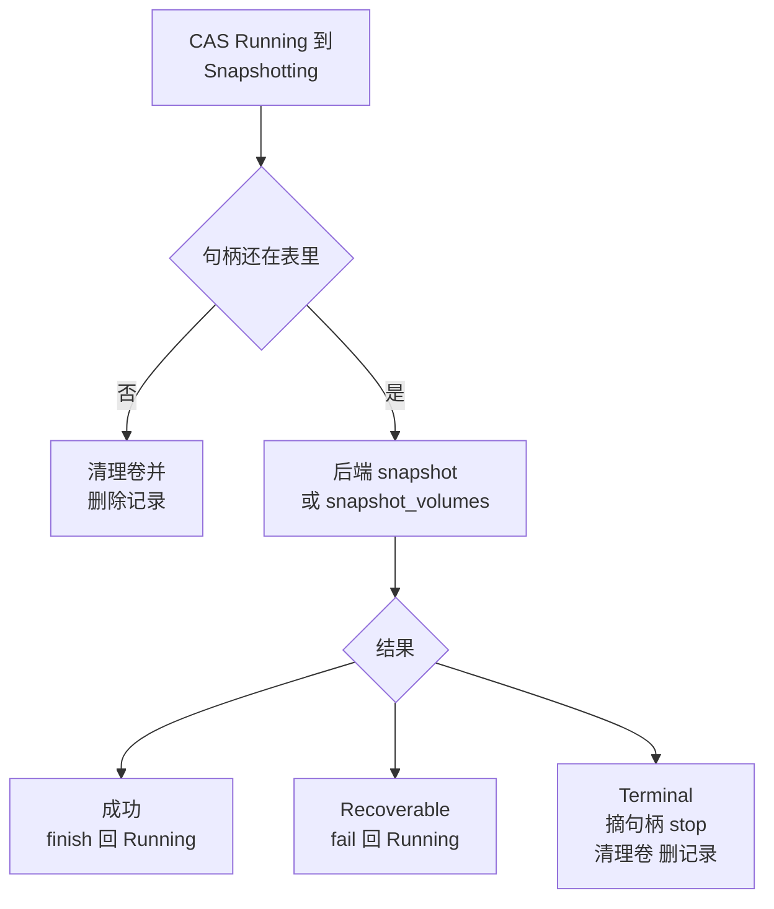

# 20 · launch plan 与失败回滚

> 启动一台沙箱要依次拿到 Firecracker 进程、ublk 设备、网络槽位、镜像引用保护、句柄表项、元数据记录与代理路由，
> 这些副作用分散在内核、daemon、本地数据库与进程内存里，无法放进一个事务。orchestrator 的办法是把创建与恢复合成一条
> `launch_sandbox()` 流水线，按「对外可见的副作用尽量靠后」排好顺序，并给每个失败点标上它所处的阶段，回滚时只撤销那个阶段已经做过的事。
> 本篇讲这条流水线的失败阶段与回滚动作，以及同一套「开始、完成、失败」模式怎样用在快照、fork 与 pause 上。
>
> **读者**：工程师。　**预备**：[第 19 篇 · 状态机与并发控制](19-state-machine-and-concurrency.md)、[第 09 篇 · 一个沙箱的一生](09-sandbox-lifecycle-walkthrough.md)。
> **代码**：`src/orchestrator/launch_plan.rs`、`src/orchestrator/service.rs`（`launch_sandbox`、`cleanup_failed_launch`、`rollback_failed_launch_metadata`、`pause_sandbox_impl`、`begin/finish/fail_snapshot_operation`、`fork_sandbox_inner`）、`src/sandbox/backend.rs`、`src/image/cache/store.rs`

---

## 0. 本篇要回答的问题

1. 创建与恢复有哪些步骤相同、哪些不同？`LaunchPlan` 怎样把差别收拢到几个访问器里？
2. 为什么流水线要先启动 VM、后写元数据？三个关闭检查点各自防的是什么？
3. `FailedLaunchStage` 的三个阶段分别对应哪些失败点，回滚时各撤销什么？为什么回滚前要用 `Arc::ptr_eq` 比较句柄？
4. 镜像引用保护怎样在「启动中」「运行中」「暂停中」三种持有者之间交接，才能不留空档？
5. 快照、卷快照与 fork 怎样复用「借出 Running、再归还」的模式？
6. pause 失败时，`Recoverable` 与 `Terminal` 两类错误各意味着什么，持久化失败又怎样处理？

---

## 1. 问题：一串不能原子化的副作用

一次成功的启动会留下七类状态：一个 Firecracker 子进程；daemon 里为 rootfs、内存与附加盘创建的 ublk 设备；一个网络槽位；
镜像缓存里的引用保护；orchestrator 句柄表 `sandboxes` 里的一项；`MetadataStore` 里的一条记录；路由表 `proxy_routes` 里的一条路由。
恢复还要多碰一处：节点本地持久化器里那条暂停记录（[第 22 篇 §3](22-persistence-across-restarts.md#3-记录与目录)）。

这些状态由不同的部件持有，任何一步都可能失败：快照文件读不到、envd 迟迟不就绪、进程收到关闭信号、元数据写入出错。
数据库事务那种「全做或全不做」在这里不存在，因为杀掉一个进程、释放一个 ublk 设备都没法和写一条记录一起提交。

可行的做法是**补偿**：失败时按相反顺序把已经做过的事撤销。补偿要正确，需要两个前提。
第一，每个失败点都要准确知道此前做过哪些事；第二，副作用的顺序要让「别人能看到」的那些尽量靠后，
这样越早的失败需要撤销的东西越少，而且撤销期间没有外部观察者被牵连。`launch_sandbox()` 的设计就是围绕这两点展开的。

---

## 2. `LaunchPlan`：一条流水线，两种计划

`src/orchestrator/launch_plan.rs` 定义了 `LaunchPlan` 的两个变体：

| 字段 | `CreateLaunchPlan` | `ResumeLaunchPlan` |
|---|---|---|
| 启动来源 | `CreateLaunchSource::Snapshot{snapshot}` 或 `Fresh{build_spec}` | `paused_state: Arc<dyn PausedSandboxState>` |
| 运行期输入 | `launch_config: SandboxLaunchConfig` | 只有 `envd_access_token` |
| 元数据 | 一份完整的过渡元数据（state 为 Creating） | 无，记录已经在 store 里 |
| TTL 与资源 | `timeout`；资源取自过渡元数据 | `timeout`；`resources` 单独携带 |

流水线只通过五个访问器读计划：`sandbox_id()`、`transitional_state()`（Creating 或 Resuming）、`transitional_metadata()`（创建为 `Some`，恢复为 `None`）、
`timeout()` 与 `resources()`。启动来源只在 `build_sandbox()` 里被拆开，分别调用工厂的 `build_from_snapshot()`、`build()` 与 `build_from_paused_state()`。
三种启动（从模板创建、从 OCI 镜像冷启动、从暂停恢复）因此共用同一段等待、登记、发布与回滚代码。

代价是两处按计划类型分支的代码不能消除：流水线末尾只有恢复要 `persister.delete_record()`（用 `matches!(plan, LaunchPlan::Resume(_))` 判断），
回滚时创建要删记录、恢复要退回 Paused（`rollback_failed_launch_metadata()` 里的 `match plan`）。
另外，沙箱 ID 与 envd token 在计划构造之前就已确定：创建由 `create_sandbox()` 生成 ID、`create_sandbox_inner()` 派生 token，
恢复由 `resume_sandbox_inner()` 用同一个 seed 重新派生出与暂停前相同的 token（[第 13 篇 §3.1](13-authentication.md#31-派生)）。

---

## 3. 流水线与检查点

回顾：[第 09 篇 §2.2](09-sandbox-lifecycle-walkthrough.md#22-orchestrator一条流水线) 按成功路径列出了流水线的七步。
这里按失败阶段重新分组。下图三列是三个阶段，每列底部是该阶段内任一步失败时调用的回滚入口：

第一列的顺序体现了「先启动、后写状态」。代码注释说得直白：先构建并启动，再改任何状态，这样构建失败时不必回滚任何持久化的东西。
`build_sandbox()` 只构造后端对象与工作目录，`start_nowait()` 启动 Firecracker 并完成快照加载，但两者都不碰 store、句柄表与路由表。
此时失败，外界没有任何途径观察到这台沙箱：创建时它的 ID 还没返回给调用方，恢复时它在 store 里仍是 Resuming。

**三个关闭检查点**分别在 `start_nowait()` 之后、`wait_for_ready()` 之前、`wait_for_ready()` 之后，都调用 `is_shutting_down()`；
入口处另有一次 `ensure_accepting_lifecycle_operations()`。它们防的是同一件事：进程关闭时 `run_shutdown_cleanup()` 会把所有非 Paused 的沙箱逐轮暂停落盘，
一个在这次清扫之后才完成的启动会留下一台既不在暂停记录里、也不会再被暂停的 Running 沙箱，进程退出时它的状态全部丢失。
推论：检查点放在每个可能耗时的步骤前后，是为了把「清扫已开始、启动才结束」的窗口压到最小；它不能完全消除这个窗口，
因为检查与后续写入之间没有锁，清扫与 Running CAS 之间仍可能交错，最后一道防线是清扫最多重复三轮。

TTL 在第二列最后一步才写入：`update_if_state()` 把状态从过渡态改成 Running 的同一个闭包里调用 `metadata.update_timeout(launch_timeout)`。
测试 `launch_sandbox_create_starts_timeout_after_ready` 锁定了这一点：TTL 从沙箱就绪时开始计，启动耗时不占用户的 TTL。

---

## 4. 失败阶段与回滚

### 4.1 三个阶段

`FailedLaunchStage`（`src/orchestrator/service.rs`）只有三个值，第一列的失败不需要它，直接走 `rollback_failed_launch_metadata()`。

| 阶段 | 失败点 | 摘句柄 | 摘路由 | 元数据回滚的期望状态 |
|---|---|---|---|---|
| 无（第一列） | 构建、钉引用、`start_nowait()`、检查点一 | 不需要 | 不需要 | 创建：删记录（实际不存在）；恢复：Resuming |
| `Registered` | 创建时 `store.add()` 失败 | 是 | 否 | 无（`rollback_expected_state()` 返回 `None`） |
| `TransitionalPersisted` | 检查点二、三，`wait_for_ready()` 失败，Running CAS 失败 | 是 | 否 | 过渡态：Creating 或 Resuming |
| `RunningPersisted` | 沙箱就绪却没有 host interaction IP | 是 | 是 | Running |

`rollback_failed_launch_metadata()` 做三件事：释放 `StartingSandbox` 的镜像引用保护；创建计划无条件 `store.remove()`；
恢复计划以期望状态为条件把记录 CAS 回 Paused，并调用 `persister.rollback_resuming()` 把持久记录的生命周期标记从 Resuming 改回 Paused。
这个标记由 `resume_sandbox_inner()` 在 CAS 到 Resuming 之后以 `mark_resuming()` 写入，它在崩溃重启时的含义见[第 22 篇 §5](22-persistence-across-restarts.md#5-两阶段-resume-标记)；`rollback_resuming()` 失败只记 warn，不影响内存里的回滚。
注意创建计划的删除不看期望状态，是无条件的 `remove()`。在前两个阶段这没有问题：Creating 不在任何其它操作的 CAS 期望集合里，没有别的写者能改动这条记录。
`RunningPersisted` 阶段记录已经是 Running，而 delete 的期望集合是 `[Running, Paused]`。推论：在这个阶段的回滚窗口内，一个并发的 delete 理论上可以先把状态改成 Killing，
随后记录被这里直接删除，delete 再按「记录已不存在」收尾；这个窗口只在「就绪却没有 interaction IP」这种不应出现的情形下才会打开。

`cleanup_failed_launch()` 的顺序是：先 `detach_launch_runtime_if_current()` 从句柄表摘下句柄（`RunningPersisted` 还要摘路由），
再锁住句柄调后端 `stop()`，最后才回滚元数据。先摘句柄后改元数据，保证当记录重新显示为 Paused 时，句柄表里已经没有那台失败的 VM，
下一次 resume 不会撞见它。后端的 `stop()` 按 trait 约定是幂等的，它负责释放 ublk 设备、网络槽位与 Firecracker 进程，orchestrator 不逐项跟踪这些资源。

测试 `launch_sandbox_create_add_failure_stops_backend_and_reverts_metrics`、`launch_sandbox_shutdown_before_wait_for_ready_rolls_back_create_state`、
`launch_sandbox_resume_running_metadata_persist_failure_restores_paused_state` 等分别覆盖了表中的各行；
恢复失败后可以重试，由 `resume_sandbox_start_failure_from_launch_rolls_back_to_paused_and_allows_retry` 锁定。

### 4.2 句柄身份：只回滚自己的东西

`detach_launch_runtime_if_current()` 在摘句柄之前用 `Arc::ptr_eq` 比较表里的句柄与本次启动创建的句柄：
不相同就记一条 warn、跳过共享状态的回滚，只 stop 自己的后端；相同才摘除并继续回滚元数据。
发布路由的 `upsert_proxy_route_if_current_handle()` 用同样的比较，句柄不一致就不发布。

这层保护针对的是「同一个沙箱 ID 在回滚完成前被另一次启动接管」的情形：如果没有它，一次迟到的回滚会删掉新启动登记的句柄与路由。
仓库里的测试（`cleanup_failed_launch_does_not_remove_replacement_runtime_state`、`launch_sandbox_create_with_stale_handle_skips_proxy_route_publication`）
是靠直接向句柄表注入替代句柄构造出这种情形的。推论：在当前的状态机下，CAS 已经保证同一沙箱同时只有一次启动，正常路径上碰不到这种替换，`ptr_eq` 是防御性的。

两个边角值得记下。其一，句柄表里**没有**这个 ID 时，`detach_launch_runtime_if_current()` 返回 true，元数据照样回滚。
其二，路由因句柄不一致而没有发布时，`launch_sandbox()` 仍然返回成功：记录是 Running，计数器算它一台，但代理查不到路由（测试断言结果为 `RouteMissing`）。

---

## 5. 镜像引用保护的交接

本地镜像缓存有一个周期维护任务，会按水位回收不再被引用的层（[第 45 篇 §5.3](45-oci-to-overlaybd.md#53-三类持有者)、[§5.5](45-oci-to-overlaybd.md#55-宁可不删的-gc)）。
一台正在启动的沙箱要打开的层，必须在它被打开之前就受到保护，否则维护任务可能恰好在这时把它删掉。
`RuntimeImageRefs`（`src/image/cache/store.rs`）提供三种保护来源：

- **`StartingSandbox(id)`**：`launch_sandbox()` 在 `start_nowait()` 之前用 `protect_image_refs()` 钉住 `startup_artifacts()`。
- **运行集**：维护任务每轮调用 `collect_running_artifacts()` 遍历句柄表，把每台运行中沙箱的 `runtime_artifacts` 交给 `maintain_running()`，这些层在本轮不被回收。
- **`PausedSandbox(id)`**：`pause_sandbox_impl()` 在摘下句柄之前钉住运行期制品，供日后恢复使用；节点重启时 `reconcile_paused_at_startup()` 先为每条暂停记录重新钉住，再清理孤儿保护，失败则拒绝启动维护任务。

交接的顺序保证任何时刻至少有一种保护在位。启动时，句柄先放进句柄表，**之后**才释放 `StartingSandbox`，保护从「启动中」交给「运行集」。
暂停时，先钉 `PausedSandbox`，**之后**才摘句柄，保护从「运行集」交给「暂停中」。恢复成功后，句柄已在表里，`resume_sandbox_inner()` 才释放 `PausedSandbox`；
恢复失败时只释放本次的 `StartingSandbox`，`PausedSandbox` 留着，沙箱回到 Paused 仍然可以再试。

代价是保护的粒度粗：维护任务一轮要锁遍所有句柄读制品清单，保护的是整台沙箱引用的全部层，而不是正在读的那几块数据。

---

## 6. 借出 Running：快照、卷快照与 fork

快照、卷快照与 fork 都要短暂停住一台运行中的 VM，做完再让它继续跑。它们复用同一个模式：
CAS 到一个过渡态当作逻辑锁，结束时 CAS 回 Running；失败时按后端返回的错误类别决定归还还是拆除。

`begin_snapshot_operation()` 以 `[Running]` 为期望 CAS 到 Snapshotting，遇到 Killing 返回 404、其它状态返回状态错误；
CAS 成功却在句柄表里找不到句柄时，判定为不一致，直接摘路由、`finalize_terminal_volumes()`、删记录。
`fail_snapshot_operation()` 对 `Terminal` 摘下句柄与路由、stop、发布并释放卷后删记录；对 `Recoverable` 只把状态 CAS 回 Running。
`finish_snapshot_operation()` 只做 CAS。`capture_snapshot_inner()` 与 `snapshot_volume_mounts_inner()` 都由这三个函数拼成。

与 pause 不同，这里**不摘路由**：快照期间代理仍会把数据面请求转给一台被暂停的 VM，推论：这些请求会挂起到 VM 恢复运行，而不是被拒绝。
另外，`capture_snapshot()` 在 VM 恢复、状态回到 Running 之后才返回 `CapturedSandboxSnapshot`，把制品发布到快照仓库是 API 层随后调用 `publish_captured()` 完成的（[第 16 篇 §3.1](16-snapshot-and-volume-api.md#31-三个阶段)、[第 46 篇 §6](46-snapshot-object-model.md#6-snapshotmanager一层薄门面)），
发布期间沙箱是 Running，可以被 pause 或 delete；`CapturedSandboxSnapshot` 持有临时制品目录的守卫，保证目录活到发布结束。

`fork_sandbox_inner()` 没有调用这组辅助函数，但写的是同一个模式：CAS 到 Forking，调后端 `fork()`，外层错误为 `Terminal` 时拆除源沙箱，为 `Recoverable` 时 CAS 回 Running。
它与启动流水线有三点不同：子沙箱不经过 Creating，后端返回就绪的子 VM 后直接以 Running `add()` 进 store；
子沙箱逐个登记，某个子沙箱失败只影响它自己的结果项（部分成功语义，[第 51 篇 §5](51-fork.md#5-失败语义)）；
这段代码里没有关闭检查点，也没有为子沙箱调用 `protect_image_refs()`，子 VM 的层只在登记进句柄表之后才由运行集保护。推论：后者依赖子 VM 共享源沙箱的层，源沙箱的句柄一直在表里。

---

## 7. pause 的失败语义

### 7.1 两类错误的约定

`SandboxCaptureError`（`src/sandbox/backend.rs`）只有 `Recoverable` 与 `Terminal` 两个变体。`SandboxBackend::pause()` 的文档约定：
`Terminal` 表示捕获已经改动了运行中的 VM，调用方不能再把它当作可运行的沙箱；`Recoverable` 必须保证返回之前 VM 已经恢复运行。
`snapshot()`、`snapshot_volumes()`、`fork()`、`freeze_and_snapshot_volumes()` 是同样的约定。

这个约定把「VM 处于什么状态」的判断交给后端，orchestrator 只看类别。Firecracker 后端里，判成 `Terminal` 的典型情形有：
捕获完成后的 `resume()` 失败；捕获失败后试图恢复而恢复也失败（`recover_capture_failure()`）；rootfs 已经 restack、随后的暂存失败（`overlaybd_snapshot.rs` 的 `into_terminal_snapshot_failure()`）；
冻结卷的 RPC 出错、ioctl 结果未知（`freeze_and_snapshot_volumes()`）。

需要注意 `impl From<anyhow::Error> for SandboxCaptureError` 的缺省：不是显式包装成 `Terminal` 的错误都被当作 `Recoverable`。
这让后端里的普通 `?` 默认走「可恢复」分支，写起来省事；代价是新增一个会改动 VM 的步骤而忘了标 `Terminal` 时，orchestrator 会把一台状态未知的 VM 放回服务。

### 7.2 失败点与动作

`pause_sandbox_impl()` 在 CAS 到 Pausing 之后依次可能在下列位置失败：

| 失败点 | VM 状态 | 动作 | 结果状态 |
|---|---|---|---|
| 钉 `PausedSandbox` 失败 | 未动 | CAS 回 Running | Running |
| `allocate_artifact_root()` 失败 | 未动 | 释放保护，CAS 回 Running | Running |
| 摘下时句柄不在表里 | 未知 | 释放保护，清理卷，删记录，返回 404 | 记录消失 |
| 后端 `pause()` 返回 `Recoverable` | 已恢复运行 | 句柄与路由放回，CAS 回 Running | Running |
| 后端 `pause()` 返回 `Terminal` | 已被改动 | 句柄不放回，stop，清理卷，删记录 | 记录消失 |
| `persist_paused()` 失败，原地 `resume()` 成功 | 恢复运行 | 句柄与路由放回，CAS 回 Running | Running |
| `persist_paused()` 失败，`resume()` 也失败 | 停住 | stop，清理卷，删记录 | 记录消失 |

所有失败路径最后都释放 `PausedSandbox` 保护。成功路径是：`persist_paused()` 写盘成功之后才 `store.update()` 为 Paused，再 stop 后端。
先持久化、后改内存元数据，是为了让「store 显示 Paused」蕴含「磁盘上有可恢复的记录」。
持久化失败时，VM 仍处在「已暂停、未停止」的状态，`SandboxBackend::resume()` 正是为这种情形准备的（文档要求它幂等），所以能原地救回。

`Terminal` 与「删记录」路径都会调用 `finalize_terminal_volumes()`：先把卷的 backing 发布出去、再释放卷的 owner，尽量保住卷里已经落盘的数据（[第 21 篇 §7](21-deletion-and-volume-capture.md#7-卷的内容还在哪些时刻被发布)）。
从调用方看，这条路径的结果是沙箱凭空消失：pause 返回错误，随后的查询是 404。

两处值得记下的行为。其一，pause 失败时已分配的产物目录 `artifacts/<id>/<uuidv7>/` 不被删除，推论：它会留到这台沙箱被删除时随整个 `artifacts/<id>/` 一起清掉，或在重启时作为孤儿目录被清理。
其二，`resume_sandbox_inner()` 在 CAS 到 Resuming、`mark_resuming()` 成功之后，若发现元数据里没有 `paused_state`，直接返回内部错误而不回滚，store 与持久记录都会停在 Resuming。
正常情况下 Paused 记录一定带 `paused_state`，这是一条防御分支，但它没有遵循本篇其余部分的补偿纪律。

---

## 8. 与 e2b infra 的对照

e2b infra 在创建沙箱时，每拿到一项资源就向一个后进先出的 `Cleanup` 栈注册对应的释放函数，失败或拆除时倒序执行（见 e2b 手册第 26、39 篇）。
AgentENV 把资源释放交给后端幂等的 `stop()`，orchestrator 只用一个三值的阶段枚举决定还要撤销哪些自己的表项与元数据。
代价是每当流水线新增一步，都要人工判断它属于哪个阶段；收益是回滚动作集中在两个函数里，可以按阶段逐行测试。

---

## 9. 小结

- `LaunchPlan{Create, Resume}` 让从模板创建、冷启动与恢复共用一条流水线；差别收拢在五个访问器、`build_sandbox()` 与两处按计划类型的分支里。
- 流水线先启动 VM、后写状态；记录在 `start_nowait()` 成功之后才写入，路由在 Running 之后才发布，越早的失败要撤销的越少。
- 入口检查加三个关闭检查点，防止关闭清扫之后才完成的启动留下无人暂停的 Running 沙箱；TTL 从就绪时开始计。
- `FailedLaunchStage` 三个阶段决定摘不摘路由、元数据回滚到哪个期望状态；回滚顺序是摘句柄、stop、改元数据。
- `Arc::ptr_eq` 让回滚只撤销本次启动登记的句柄与路由；句柄不一致时启动仍返回成功，但路由缺失。
- 镜像引用保护在 `StartingSandbox`、运行集、`PausedSandbox` 之间按「先接手、后放手」交接，任何时刻至少一种在位。
- 快照、卷快照与 fork 借出 Running 再归还；快照期间不摘路由，fork 的子沙箱直接以 Running 登记、没有关闭检查点。
- `Recoverable` 意味着后端已把 VM 恢复运行，`Terminal` 意味着拆除；未显式标注的错误缺省为 `Recoverable`。
- pause 先持久化、后置 Paused；持久化失败时原地 resume，救不回才删除沙箱。
- 两处偏离补偿纪律：pause 失败留下产物目录；resume 缺少 `paused_state` 时记录卡在 Resuming。

---

## 延伸阅读 / 下一篇

- [第 19 篇 · 状态机与并发控制](19-state-machine-and-concurrency.md)：本篇各次 CAS 在整台状态机里的位置。
- [第 21 篇 · 删除与卷的捕获提交](21-deletion-and-volume-capture.md)：删除怎样用可重入的进度记录代替一次性回滚。
- [第 22 篇 · 跨重启持久化](22-persistence-across-restarts.md)：`mark_resuming` 与 `rollback_resuming` 在崩溃时的含义。
- [第 42 篇 · 内存快照](42-memory-snapshot-over-ublk.md)：pause 的后端一侧做了什么。
- [e2b 手册第 26 篇 · Sandbox 对象与 Factory](../e2b-infra/26-sandbox-object.md)、[e2b 手册第 39 篇 · 健康检查、错误语义与清理](../e2b-infra/39-health-errors-and-teardown.md)：`Cleanup` 栈的做法。
- 下一篇：[第 21 篇 · 删除与卷的捕获提交](21-deletion-and-volume-capture.md)。
