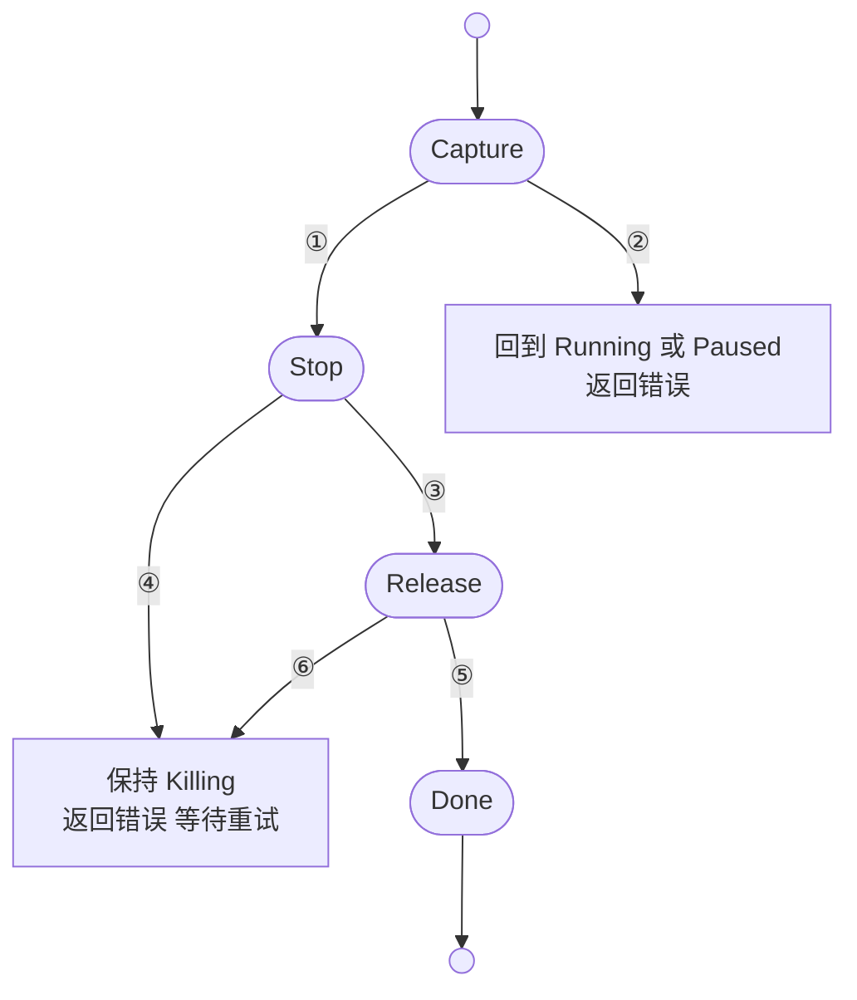
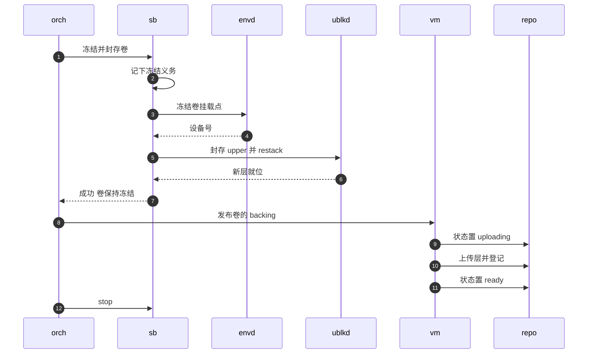

# 21 · 删除与卷的捕获提交

> 删除一台沙箱，看上去只是停掉进程、释放资源。挂了持久卷的沙箱不是这样：卷的最新内容还在节点本地的可写层里，
> 删除是把它提交回快照仓库的最后机会，而这一步有副作用、不能重复、可能失败在一半。
> 本篇讲 orchestrator 怎样把删除拆成「捕获、停止、释放」三段可重入的进度，以及捕获那一段里冻结、封存、发布与解冻的次序。
>
> **读者**：工程师。　**预备**：[第 19 篇 · 状态机与并发控制](19-state-machine-and-concurrency.md)、[第 09 篇 §6](09-sandbox-lifecycle-walkthrough.md#6-删除)。
> **代码**：`src/orchestrator/service.rs`、`src/sandbox/backend.rs`、`src/sandbox/firecracker/sandbox.rs`、`src/sandbox/firecracker/overlaybd_snapshot.rs`、`src/volume.rs`、`src/orchestrator/tests.rs`

---

## 0. 本篇要回答的问题

1. 为什么删除要分成几段并记住进度，而不是失败了就从头再来？
2. 删除一台运行中、挂了卷的沙箱时，卷的内容在什么时刻、经过哪几步变成快照仓库里可被别人挂载的层？
3. 冻结 guest 文件系统的脚本防的是什么？「先压栈再 await」保住的是什么义务？
4. 捕获失败时，哪些情况让沙箱回到原状态继续运行，哪些情况让删除继续进行而把卷标记为 Failed？
5. 显式删除与过期回收怎样避免同时删同一台沙箱？
6. 卷的内容还会在哪些时刻被发布？这些路径的失败口径一致吗？

---

## 1. 问题：删除是卷的提交点

AgentENV 的卷（volume）是一个 overlaybd 层栈（[第 31 篇 §6](31-extra-drives-and-volumes.md#6-volumemanager权威在仓库本地是缓存)、[第 16 篇 §5](16-snapshot-and-volume-api.md#5-卷对象)）。沙箱运行时，guest 对卷的写入落在节点本地的可写层（upper）里；
快照仓库里只记着这块卷**上一次发布**时的层列表。换句话说，在沙箱删除之前，卷的最新内容只存在于这一个节点上。
只要不把 upper 封存并上传，别的节点、甚至同一节点上下一个挂载它的沙箱，看到的都是旧内容。

所以删除必须先做一件事：把卷的当前内容**捕获**下来，并**发布**到快照仓库，然后才能停掉 VM、释放卷的独占预留。
这件事有三个难处。

第一，**一致性**。guest 的页缓存里可能还有没写回的脏数据，ext4 的日志可能还有没提交的事务。直接拿 upper 封存，得到的是一块文件系统层面不一致的盘。
第二，**不可重复**。封存（seal）与 restack 会改变卷的层栈：旧 upper 变成一个新的只读层，压到下层（lower）栈顶，换上新的空 upper。
一旦这个新层已经发布，重试删除时再捕获一次，就会多出一个空层，或者在 VM 已经停掉之后去冻结一个不存在的文件系统。
第三，**部分失败**。捕获、停 VM、释放预留、删记录，每一步都可能失败；失败之后，系统必须知道已经走到哪里，下一次从哪里继续。

若删除失败后从头重试，会重复捕获；若失败后放弃卷，写入就丢了；若捕获失败也照常发布，仓库里会出现指向半新半旧层栈的卷。
`delete_sandbox_impl()` 围绕这三种错误设计。

---

## 2. 入口与互斥

删除的入口是 `Orchestrator::delete_sandbox()`。它把 `delete_sandbox_inner()` 放进 `run_cancellation_safe()`，
HTTP 调用方断开不会打断删除（[第 19 篇 §6](19-state-machine-and-concurrency.md#6-取消安全操作不随请求一起死)）。
这一点对卷尤其重要：`SandboxBackend::freeze_and_snapshot_volumes()` 的文档写明，丢弃这个 future 不会取消 guest 里的 I/O，调用方必须持有所有权直到完成、解冻或停止。

`delete_sandbox_inner()` 的第一步是取这台沙箱的**删除进度锁**。`Orchestrator` 有一张表 `deletions: Mutex<HashMap<SandboxId, Arc<Mutex<DeleteProgress>>>>`，
`deletion_progress()` 按沙箱 id 取出（不存在则以缺省值 `Capture` 新建）一个 `Arc<Mutex<DeleteProgress>>`。
拿到这把锁之后：

- 进度是 `Done`：前一个删除者已经完成，直接返回成功。这种情况出现在多个删除者排队等同一把锁时，排在后面的拿到锁时条目已被移出表，但它手里的 `Arc` 仍指向那份 `Done`。
- 进度是 `Stop` 或 `Release`：上一次删除失败在后半段，沙箱仍处于 Killing，直接以 `Killing` 为「先前状态」调用 `delete_sandbox_impl()` 续做。
- 进度是 `Capture`：正常起点。以 `[Running, Paused]` 为期望集合做 CAS 到 Killing；遇到过渡态就 `wait_for_transition()` 等它结束再重试，
  遇到 Killing 也等，等到的结果若是回滚到了稳定态，同样重试 CAS（[第 19 篇 §7](19-state-machine-and-concurrency.md#7-同一沙箱上的并发操作)）。
  CAS 返回的先前状态（Running 或 Paused）决定后面是否需要冻结。若 store 报沙箱不存在，顺手把 `deletions` 里的空条目移除。

过期回收（[第 23 篇 §4.2](23-auto-eviction-and-ttl.md#42-一轮做什么)）用的是**同一把锁**。`evict_expired_sandboxes()` 对每台过期的 Running 沙箱先取 `deletion_progress()` 并加锁，
再用 `claim_expired_running_sandbox()` 在 CAS 回调里二次确认过期、认领为 Pausing 或 Killing；认领为 Killing 时直接调用 `delete_sandbox_impl(…, Running, &mut progress)`。
显式删除与回收因此不会同时推进同一台沙箱的删除进度，后到者在锁上排队，拿到锁后按进度续做或直接成功。

---

## 3. DeleteProgress：可重入的进度

`DeleteProgress` 定义在 `src/orchestrator/service.rs`，只有四个取值：

```rust
#[derive(Default)]
enum DeleteProgress {
    #[default]
    Capture,
    Stop { capture_failed: bool },
    Release { capture_failed: bool },
    Done,
}
```

`capture_failed` 是唯一跨段携带的信息：捕获阶段遇到了**不可恢复**的失败，删除仍要继续，但到了释放阶段必须把卷标记为 Failed，而不是当作成功捕获。
下图是进度的推进与失败时的去向，编号对应图下的表；④ ⑥ 之后的下一次删除分别从 Stop、Release 续做。



| 编号 | 触发 | 动作 |
|---|---|---|
| ① | 捕获成功，或捕获不可恢复地失败 | 记下 `capture_failed`，进入 Stop |
| ② | 捕获可恢复地失败 | 解冻、放回句柄与路由、CAS Killing → 先前状态，进度保持 Capture |
| ③ | 后端 `stop()` 成功 | 进入 Release |
| ④ | `stop()` 失败 | 句柄放回 `sandboxes`，状态保持 Killing，返回错误；下次删除从 Stop 续做 |
| ⑤ | 卷的失败标记、预留释放与记录删除都成功 | 进入 Done，条目移出 `deletions` |
| ⑥ | Release 中任一步失败 | 状态保持 Killing，返回错误；下次删除从 Release 续做 |

几个细节值得注意。

**进度只在内存里。** `DeleteProgress` 不持久化。`server` 进程退出后它随 `deletions` 表一起消失；运行中沙箱本来也不持久化（[第 22 篇 §1](22-persistence-across-restarts.md#1-问题重启之后什么还在)），
暂停沙箱的删除若停在 Release，重启后它会作为 Paused 重新出现，再次删除时从 Capture 开始。
对暂停沙箱而言 Capture 只做发布，不涉及冻结，重做的代价是一次重复上传。

**句柄的去留跟着进度走。** `delete_sandbox_impl()` 一开始就用 `detach_sandbox_handle_and_route()` 把句柄与代理路由一起摘下，此后数据面流量不再能进入这台沙箱。
失败在 Stop 时句柄被放回 `sandboxes`，因为 VM 可能还活着，下一次删除需要再拿到它去停；失败在 Release 时 VM 已经停了，句柄不再放回。
两种情况下路由都不恢复：沙箱处于 Killing，不应再接流量。

**失败返回错误，但删除可能已经完成。** 捕获不可恢复地失败、而停止与释放都成功时，函数在最后仍返回 `SandboxOperationFailed`，此时沙箱已经从 store 移除。
调用方看到的是删除失败，再查却是 404。推论：这样做是为了把「卷没有被成功捕获」这件事报告给调用方，代价是错误码不再表示「沙箱还在」。

`src/orchestrator/tests.rs` 的 `volume_deletion_stop_failure_preserves_runtime_for_retry()` 覆盖了 ④：让 `stop()` 连续失败两次，断言两次删除都返回错误、状态停在 Killing、句柄仍在表中、没有发生解冻，第三次删除成功。
`delete_when_stop_fails_returns_error_and_allows_retry()` 覆盖不挂卷时的同一路径。

---

## 4. Capture：冻结、封存、发布

捕获段做两件事：若先前状态是 Running 且挂了卷，调用后端的 `freeze_and_snapshot_volumes()`；然后无论先前状态如何，都调用 `publish_sandbox_volume_backings()`。
先前是 Paused 的沙箱已经没有 VM，卷的 upper 在暂停时已经 restack 过（[第 31 篇 §5](31-extra-drives-and-volumes.md#5-暂停与快照时卷去了哪里)），这里只剩发布。

下图是运行中沙箱的捕获时序，消息 1 即 `freeze_and_snapshot_volumes()`，消息 8 即 `recover_and_publish_backings()`。参与者：`orch` 为 orchestrator，`sb` 为 `FirecrackerSandbox` 后端，`envd` 为 guest 内的 envd，`ublkd` 为 ublk-daemon，`vm` 为 `VolumeManager`，`repo` 为快照仓库。



### 4.1 为什么是冻结

一台即将被停掉的 VM，它页缓存里没有写回的数据在 VM 停止时就丢了。要让封存下来的 upper 是一块干净的文件系统，需要两个保证：
所有脏数据已经落到块设备上，并且此后不再有新的写入。`fsfreeze` 正好同时给出这两个保证：它让文件系统把脏数据与日志刷到设备，然后挂起所有新的写操作，直到解冻。

运行中的另一条卷捕获路径 `snapshot_volumes()`（供 fork 之前的 `snapshot_volume_mounts()` 使用）选了不同的做法：先在 guest 里 `sync`，再 `PATCH /vm Paused` 暂停 VM，restack 之后立即恢复 VM。
推论：两者的差别来自 VM 之后的命运。`snapshot_volumes()` 之后 VM 继续运行，`sync` 与暂停之间漏掉的写入会在恢复后写进新的 upper，不会丢；
删除之后 VM 不再运行，任何没落盘的写入都会丢，所以要用冻结把「刷写」与「禁止新写」合成一个原子的边界。

### 4.2 guest 内的冻结脚本

`freeze_and_snapshot_volumes()` 先从启动配置的附加盘里挑出所有可写、并且有持久输出目录（`snapshot_output_dir()`）的盘，也就是可写的卷，取它们的 guest 挂载路径。
对每个挂载点，`set_volume_freeze()` 经 envd 以 root 身份执行一段 busybox 脚本，超时 30 s。脚本的要点：

```bash
exec 3< "$1"
device=$(/agentenv/bin/busybox stat -Lc %d /proc/self/fd/3)
if [ "$2" = --freeze ]; then
    test "$device" != "$(/agentenv/bin/busybox stat -c %d /)"
else
    test "$device" = "$3"
fi
/agentenv/bin/busybox fsfreeze "$2" /proc/self/fd/3
printf '%s\n' "$device"
```

它先用文件描述符 3 打开挂载点，此后的设备号检查与 `fsfreeze` 都通过 `/proc/self/fd/3` 进行，而不是再按路径查找一次。
代码注释给出的理由是：若在检查与 ioctl 之间挂载点被卸载，按路径查找会落到底下的根文件系统上，而冻结根文件系统会把 envd 自己也冻住，这台 VM 就再也无法通过 envd 操作了。
冻结时脚本要求设备号**不等于**根文件系统的设备号；解冻时要求设备号**等于**冻结时记下的那个，防止解冻到别的文件系统。
脚本用的 busybox 来自 tools 盘的 `/agentenv/bin/`（[第 26 篇](26-sandbox-block-devices.md)），不依赖用户镜像里有没有 `fsfreeze`。

### 4.3 先压栈再 await

冻结循环的写法是这一段最需要注意的地方：

```rust
for mount in mounts {
    // Record the mount before awaiting so cancellation leaves a
    // thaw obligation on the owned sandbox handle.
    self.frozen_volume_mounts.push((mount.clone(), String::new()));
    let output = self
        .set_volume_freeze(&mount, None)
        .await
        .map_err(SandboxCaptureError::terminal)?;
    if output.exit_code != 0 {
        self.frozen_volume_mounts.pop();
        anyhow::bail!("freeze volume {} failed: {}", …);
    }
    self.frozen_volume_mounts.last_mut().unwrap().1 = output.stdout.trim().to_owned();
}
```

`frozen_volume_mounts` 是后端对象上的一个栈，记录「已经冻结、将来必须解冻」的挂载点。挂载点在发出 RPC **之前**入栈，于是无论这次 await 是返回、出错还是被取消，
后端对象上都留着一条解冻义务，持有句柄的一方之后可以调用 `thaw_volumes()` 去履行。若顺序反过来，先 await 再入栈，RPC 已经送达 guest、冻结已经生效、future 却在返回前被丢弃，
就会留下一个被冻住却没有任何记录的文件系统。

对失败的分类同样保守。RPC 本身失败（超时、连接断开）一律视为 `SandboxCaptureError::Terminal`：注释说明此时 ioctl 的结果未知，guest 里的文件系统可能已经冻住，VM 不能再安全地交还给用户。
脚本正常返回但退出码非零，说明冻结没有发生，就把刚入栈的条目弹出，作为可恢复错误返回。
`thaw_volumes()` 从栈顶开始逐个解冻，每成功一个才弹出一个，所以解冻中途失败时，栈里留下的恰好是仍然冻着的那些挂载点。

### 4.4 封存与 restack

全部冻结之后，`snapshot_persistent_volume_drives()` 对每个可写卷调用 `restack_snapshot_overlaybd_device()`：把当前 upper 封存成卷输出目录下的 `snapshot-<uuidv7>.commit`，
让 ublk-daemon 把运行中的设备切换到「封存层为最新 lower、换上新 upper」的层栈，再把新的层列表写进卷目录的 image config。
文件名带 UUIDv7，是为了不覆盖仍被别的快照引用的旧层。restack 的机制在[第 37 篇 §3](37-seal-restack-compact.md#3-restack封存并换上新-upper)详讲。

这一步的失败也分两种。`overlaybd_snapshot.rs` 的 `LiveOverlaybdSnapshotState::finish_staging()` 规定：设备已经 restack、但后续写 image config 失败时，错误被包装成 Terminal，
因为运行中的设备与盘上的配置已经不一致；restack 发生之前的失败是普通错误，`From<anyhow::Error>` 把它映射为 Recoverable。
可恢复失败时 `freeze_and_snapshot_volumes()` 自己先调用 `thaw_volumes()`；解冻也失败，就把错误升级为 Terminal。
成功时函数返回，卷**保持冻结**：VM 马上就要停，没有必要解冻。

### 4.5 发布 backing

回到 orchestrator，`publish_sandbox_volume_backings()` 调用 `VolumeManager::recover_and_publish_backings(owner, volume_ids)`，分两步：

1. `recover_backings()`：对本沙箱独占预留的每个卷，若内存缓存里没有 image config 路径（典型情况是 `server` 重启过），就到确定的位置 `<卷根>/data/<volume_id>/image.json` 去找。
   找不到说明节点本地的层栈丢了，卷被标为 Failed 并返回错误。
2. `publish_backings()` → `publish_records()`：对每个由本沙箱独占预留的卷，先把仓库里的卷记录状态写成 `Uploading`，再 `publish_backing()` 把层上传并拿回层引用列表，最后写成 `Ready`。
   三步中任一步失败，`mark_publication_failed()` 把状态写成 `Failed`。

先写 `Uploading` 再上传的理由在注释里：让其它节点在上传期间不会挂载到旧内容。`VolumeRecord::validate_catalog_update()` 把这个协议固化为两条规则：
只有处于 `Uploading` 的记录才能替换层列表；`Failed` 的记录不能直接变回 `Ready`，必须再经过一次 `Uploading`。
`VolumeManager::reserve()` 拒绝预留 `Uploading` 与 `Failed` 的卷，所以这两个状态对其它沙箱来说都是「不可挂载」。
只读卷不参与这一切：冻结循环跳过只读盘，`publish_records()` 也只处理 `reserved_by_sandbox_id` 等于本沙箱的独占卷。

---

## 5. 捕获失败的两条去路

捕获段的结果是一个 `SandboxCaptureError`，`is_terminal()` 决定删除接下来往哪走。

| 失败点 | 分类 | 删除的去向 |
|---|---|---|
| 冻结脚本退出码非零 | Recoverable | 后端解冻已冻结的卷，删除回滚 |
| 冻结 RPC 失败或超时 | Terminal | 继续停止与释放，卷标为 Failed |
| restack 之前失败 | Recoverable | 后端解冻，删除回滚 |
| restack 之后写配置失败 | Terminal | 继续停止与释放，卷标为 Failed |
| 解冻失败 | 升级为 Terminal | 同上 |
| 发布失败 | Recoverable | orchestrator 解冻，删除回滚；卷记录已是 Failed |

**回滚**由 `delete_sandbox_impl()` 完成：若卷已冻结（`volumes_frozen` 为真，即后端调用已成功、失败发生在发布），先调用 `thaw_volumes()`，解冻失败则升级为 Terminal；
仍可恢复时，把句柄放回 `sandboxes`，`restore_proxy_route()` 恢复路由，CAS 把状态从 Killing 改回先前状态，返回错误，进度停在 Capture。
沙箱继续运行，用户可以再次删除。`volume_deletion_capture_failure_preserves_runtime()` 断言了这条路径：捕获失败后没有调用 `stop()`，状态回到 Running，代理查询仍为 Ready。

发布失败这一行有一个值得说明的后果：回滚之后沙箱在运行，它的卷在仓库里却是 Failed。这不影响它自己继续读写，只是别人暂时不能挂载；
下一次删除走到发布时，`publish_records()` 先写 `Uploading`，这是 `Failed` 唯一合法的出口，于是重试可以成功。
`volume_deletion_publication_and_terminal_cleanup_failures_are_retryable()` 用一个缺少本地 backing 的卷制造发布失败，断言卷变为 Failed、发生过解冻、沙箱回到 Running、预留仍属于这台沙箱。

**继续删除**发生在 Terminal 时：VM 已经不能安全地交还给用户，只能停掉。`capture_failed` 被记进进度，Release 段据此调用 `VolumeManager::fail_backings()`，
把本沙箱独占的卷写成 `Failed`。`delete_sandbox_impl()` 在这里的注释说明了理由：一次不完整的 restack 可能让 `image.json` 仍指向旧的层，这样的 backing 绝不能当作成功捕获发布出去。
Failed 的卷不能被预留，也不能作为新卷的父卷（`VolumeManager::create()` 对 Failed 父卷报错），只能删除。推论：代码中未见把一个无主的 Failed 卷修复回 Ready 的路径，数据需要人工处理。

模板构建器是唯一的例外。构建器沙箱（`template_builder` 为真）的卷是可选的构建缓存，`optional_cache` 为真时捕获失败不回滚、不报错，直接停止并释放；
`buildkit_worker_capture_failure_discards_optional_cache()` 覆盖这条路径（[第 53 篇](53-buildkit-in-microvm.md)）。

---

## 6. Stop 与 Release

Stop 段只调用后端的 `stop()`。`SandboxBackend::stop()` 的契约要求幂等，所以从 Stop 续做时重复调用是安全的；释放顺序见[第 25 篇](25-backend-and-firecracker-process.md)。
对冻结着卷的 VM，停止本身就结束了冻结：Firecracker 进程退出，guest 文件系统随之消失，卷的块设备随设备释放而关闭。

Release 段依次做三件事：

1. 若 `capture_failed`，`fail_backings()` 把本沙箱独占的卷标为 Failed。
2. `VolumeManager::replace_owner_for(owner, None, volume_ids)`：在快照仓库里把每个卷的预留从本沙箱移除（独占卷清空 `reserved_by_sandbox_id`，只读卷从 `read_only_mounts` 里删掉本沙箱），再更新本地缓存。
3. `remove_deleted_sandbox()`：`store.remove()` 删掉元数据，等待者从 `watch` 通道收到 `None`；广播 `Delete` 生命周期事件；`persister.delete_record_and_artifacts()` 删除持久记录与整个 `artifacts/<id>/`；
   解除 `PausedSandbox` 的镜像引用钉住；最后把条目移出 `deletions`。

次序的道理在于「谁失败了还能重试」。卷的预留在仓库里，是跨节点可见的状态；元数据在 store 里，是重试删除的入口。
先释放预留、后删元数据，释放失败时沙箱仍以 Killing 留在 store 里，下一次删除能从 Release 续做；反过来，元数据先没了，残留的预留就再也没有人去释放。
第 3 步里持久记录的删除失败只记 warn，不阻止删除完成：记录残留的后果由下次启动的 `load_all()` 兜底（[第 22 篇 §6.1](22-persistence-across-restarts.md#61-清理规则)）。

---

## 7. 卷的内容还在哪些时刻被发布

删除不是卷内容进入仓库的唯一时刻。按调用点数一遍：

| 时刻 | 调用 | 捕获方式 | 失败时卷的状态 |
|---|---|---|---|
| 删除 | `delete_sandbox_impl()` | 冻结加 restack，或暂停时已 restack | 可恢复则回滚；不可恢复则 `fail_backings()` 标为 Failed |
| 给沙箱打快照（`POST /sandboxes/{id}/snapshots`） | `VolumeManager::snapshot_volume_state()` | 由同一次捕获里的 `pause_to_dir()` 完成 restack | 发布失败标为 Failed |
| fork 时克隆独占卷 | `VolumeManager::create_child_for_owner()` | 由先前的 `snapshot_volume_mounts()` 完成 restack | 推论：发布的是新建的子卷，源卷记录不变 |
| 暂停、快照、fork 的不可恢复失败 | `finalize_terminal_volumes()` | 不再捕获，照现有 image config 发布 | 发布失败只记 warn，然后释放预留 |

暂停**不**发布卷。一台暂停的沙箱，卷的 upper 已经在暂停时 restack 进了卷目录，但仓库里的层列表仍是上一次发布时的；这些内容只在原节点上，直到删除时才被发布。
推论：暂停期间若节点磁盘丢失，卷自上次发布以来的写入随之丢失；这与暂停沙箱本身只能在原节点恢复（[第 22 篇 §1](22-persistence-across-restarts.md#1-问题重启之后什么还在)）是同一个约束。

第三行与删除的口径不同。`pause_sandbox_impl()`、`fail_snapshot_operation()` 与 fork 的不可恢复失败分支都在停掉 VM 之后调用 `finalize_terminal_volumes()`，
它直接 `recover_and_publish_backings()`，没有区分 restack 是否完整。删除路径的注释明确说不完整的 restack 不能发布，这三处却会发布。
推论：若不可恢复失败恰好发生在 restack 之后、写配置之前，这三处可能把一个指向旧层的 backing 标成 Ready。这是一处口径不一致，记入[第 68 篇](68-known-issues-and-debt.md)。

---

## 8. 代价与边界

- **冻结的持续时间**。成功路径上，卷从冻结一直保持到 VM 停止，中间包括 restack 与发布上传。guest 里的写操作在这段时间内全部挂起；由于 VM 马上要被停掉，这对用户不可见。
  但在发布失败的回滚路径上，解冻发生在一次失败的上传之后，这段挂起时间对一台继续运行的沙箱是真实的停顿。
- **串行的捕获**。冻结与 restack 都按卷逐个进行；挂了多个卷的沙箱，删除时长正比于卷的数量与各自 upper 的大小。过期回收在持锁状态下串行处理每台过期沙箱，这一代价在[第 23 篇 §8](23-auto-eviction-and-ttl.md#8-失败与串行的代价)讨论。
- **进度不跨重启**。`DeleteProgress` 只在内存里。一台运行中沙箱的删除若在进程崩溃时停在中途，重启后它不会再出现（运行中沙箱不持久化），卷的独占预留仍挂在一个已不存在的沙箱 id 名下。
  推论：`VolumeManager` 在打开时只建空缓存，代码中未见启动时回收无主预留的逻辑，这样的卷无法被再次预留或删除，需要人工清理。
- **Killing 可能长期停留**。Stop 或 Release 一再失败时，沙箱停在 Killing，`wait_for_transition()` 的等待者在 60 s 后超时（[第 19 篇 §5](19-state-machine-and-concurrency.md#5-等待一次转换结束)）；没有后台任务替用户重试删除。

---

## 9. 与 e2b infra 的对照

e2b infra 的卷是宿主上的用户态 NFS 代理导出的网络文件系统，guest 的写入经 NFS 直接落到共享存储，删除沙箱时卷上没有需要提交的东西。
AgentENV 的卷是块设备上的 overlaybd 层栈，写入先进入节点本地的 upper，所以删除必须承担冻结、封存与上传。
这里换来的是块设备的本地读写路径与可分层快照的卷，代价是删除变成一个有副作用、需要可重入进度的提交操作。

---

## 10. 小结

- 对挂了卷的沙箱，删除是卷内容进入快照仓库的提交点；暂停只在本地 restack，不发布。
- 删除进度 `DeleteProgress{Capture, Stop, Release, Done}` 保存在每台沙箱一把的进度锁里，失败后下一次删除从断点续做，捕获只做一次。
- 显式删除与过期回收共用这把锁；排队的删除者拿到锁后看到 `Done` 直接成功。
- 冻结通过 guest 内 busybox 脚本完成：固定一个文件描述符做设备号检查与 `fsfreeze`，拒绝冻结根文件系统，解冻时核对设备号。
- 挂载点在冻结 RPC 之前入栈，取消或失败都留下可履行的解冻义务；RPC 失败视为不可恢复，因为 ioctl 的结果未知。
- 可恢复失败解冻并回滚到 Running 或 Paused；不可恢复失败继续停止，并把卷标为 Failed，绝不把不完整的 restack 当作成功发布。
- 卷的发布协议是 `Uploading` → 上传 → `Ready`，失败为 `Failed`；`Failed` 只能经 `Uploading` 离开，两种状态都不可被预留。
- 释放先撤销仓库里的卷预留、后删元数据，保证释放失败时仍有重试入口。
- 暂停、快照与 fork 的不可恢复失败路径会直接发布卷，与删除路径的口径不一致；进度不跨重启，崩溃会留下无主的卷预留。

---

## 延伸阅读 / 下一篇

- 下一篇：[第 22 篇 · 跨重启持久化](22-persistence-across-restarts.md)——暂停沙箱的记录、产物与崩溃边界。
- 状态机与等待：[第 19 篇 · 状态机与并发控制](19-state-machine-and-concurrency.md)；捕获失败的同一套二分在 pause 与 snapshot 中的用法：[第 20 篇 · launch plan 与失败回滚](20-launch-plan-and-rollback.md)。
- 卷的设备与热插：[第 31 篇](31-extra-drives-and-volumes.md)；卷 API：[第 16 篇](16-snapshot-and-volume-api.md)；restack 机制：[第 37 篇](37-seal-restack-compact.md)；过期回收：[第 23 篇](23-auto-eviction-and-ttl.md)。
- 对照：[e2b 手册第 40 篇 · Volumes 与 NFS proxy](../e2b-infra/40-volumes-and-nfsproxy.md)。
