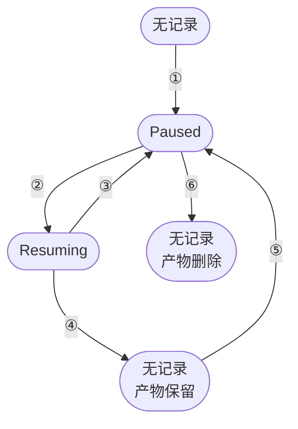

# 22 · 跨重启持久化

> `server` 进程重启之后，哪些沙箱还在？AgentENV 的回答很窄：只有暂停的沙箱。
> 本篇讲这条「只持久化 Paused」的策略怎样落到一张 RocksDB 表和一棵产物目录上，resume 为什么要先写一个 Resuming 标记，
> 启动时 `load_all()` 按什么规则保留或丢弃记录，以及进程被强杀时哪些东西会留在宿主上没人收拾。
>
> **读者**：工程师、运维。　**预备**：[第 10 篇 · 节点进程](10-node-process-and-object-model.md)、[第 19 篇 · 状态机与并发控制](19-state-machine-and-concurrency.md)、[第 21 篇 · 删除与卷的捕获提交](21-deletion-and-volume-capture.md)。
> **代码**：`src/orchestrator/persistence/mod.rs`、`src/orchestrator/persistence/file_backed.rs`、`src/local_store.rs`、`src/orchestrator/service.rs`、`src/sandbox/firecracker/sandbox.rs`、`src/sandbox/firecracker/config.rs`、`src/sandbox/access.rs`

---

## 0. 本篇要回答的问题

1. 为什么只持久化 Paused 沙箱？运行中的沙箱靠什么熬过一次计划内的重启？
2. 一条持久记录里有什么，存在哪里，写入在什么时刻算「提交」？
3. resume 为什么要分两阶段改记录？启动时遇到 Resuming 记录为什么整条丢弃，而不是退回 Paused？
4. `load_all()` 对版本不符、解码失败、产物缺失、虚拟化模式不符、孤儿目录各怎么处理？
5. 持久记录与访问令牌种子、镜像 GC 之间有什么耦合？
6. `server` 被 SIGKILL 时，Firecracker 子进程、工作目录、卷预留各自的下场是什么？

---

## 1. 问题：重启之后什么还在

一台运行中的沙箱，它的状态分布在几处：Firecracker 进程的 guest 内存、ublk 设备背后的可写层、orchestrator 内存里的元数据与句柄。
前两者跟着进程走，后者跟着 `server` 走。`server` 一退出，元数据没了；即使 Firecracker 进程还活着，新的 `server` 也没有句柄去管理它。

要让运行中的沙箱跨过重启，有两条路。一条是把运行态也落盘，重启后重新接管活着的 Firecracker 进程：要记下 API socket、网络槽位、ublk 设备、代理路由，
还要处理「落盘之后、退出之前」运行态又变了的情况。另一条是只承认一种可以完整落盘的状态，在退出前把所有沙箱都带到这个状态。

AgentENV 走第二条。可以完整落盘的状态就是 Paused：暂停时 vm_state、内存层、rootfs 与附加盘的层栈都已经写进一个目录（[第 27 篇](27-start-pause-resume-sequences.md)、[第 42 篇](42-memory-snapshot-over-ublk.md)），
VM 已经停掉，没有活着的进程需要接管。于是：

- **只有 Paused 被持久化。** Running、以及所有过渡态都只存在于内存。
- **优雅关闭时把 Running 全部暂停。** `Orchestrator::shutdown()` 最多跑三轮，Running 的普通沙箱走 `pause_sandbox_inner()`，模板构建器的 builder VM 走 `delete_sandbox_inner()`，过渡态先等它落定
  （[第 10 篇 §3.2](10-node-process-and-object-model.md#32-orchestratorshutdown只把-paused-留到下次)）。
- **重启后以 Paused 出现。** 用户再 resume，或由代理的自动恢复触发。

代价也在这条策略里：只有优雅关闭才有保护；关闭时长正比于运行中沙箱的数量与脏页量；暂停沙箱的产物在节点本地磁盘上，只能在原节点恢复。

还有一点需要先说明：「file backed」只指**持久化器**。生产环境的元数据存储仍是 `InMemoryMetadataStore`，持久化器 `FileBackedSandboxPersister` 只在几个固定时刻被调用，不是 store 的写穿后端。

---

## 2. 持久化器接口

`src/orchestrator/persistence/mod.rs` 定义了 `SandboxPersister` trait，`Orchestrator<S, F, P>` 的第三个类型参数就是它。七个方法覆盖暂停沙箱记录的全部生命周期：

| 方法 | 调用时机 | 作用 |
|---|---|---|
| `load_all()` | orchestrator 构造时 | 读出全部记录，清理无效记录与孤儿目录 |
| `allocate_artifact_root()` | 暂停开始时 | 分配本次暂停的产物目录 |
| `persist_paused()` | 暂停产物写完后 | 写入 Paused 记录 |
| `mark_resuming()` | resume 的 CAS 成功后 | 记录改为 Resuming |
| `rollback_resuming()` | resume 失败回滚时 | 记录改回 Paused |
| `delete_record()` | resume 成功后 | 删记录，保留产物 |
| `delete_record_and_artifacts()` | 删除沙箱时 | 删记录与整个产物目录 |

另一个实现 `DisabledSandboxPersister` 的方法全部是空操作，`allocate_artifact_root()` 返回 `None`，意思是后端自己管理临时产物的生命周期；测试与不需要持久化的场景用它。
测试替身 `RecordingPersister`（`persistence/mock.rs`）只记录调用顺序，供 `src/orchestrator/tests.rs` 断言「resume 先 mark 再 delete」这类次序。

---

## 3. 记录与目录

### 3.1 记录格式

`file_backed.rs` 里的记录结构是：

```rust
struct PersistedPausedRecord {
    version: u32,                         // 当前为 RECORD_VERSION = 1
    lifecycle: PersistedPausedLifecycle,  // Paused | Resuming
    metadata: SandboxMetadata,
    artifact_root: PathBuf,
    state: Value,                         // 后端编码的暂停状态
}
```

它以 JSON 序列化，key 是沙箱 id 的字符串形式。`metadata` 是 orchestrator 的完整元数据；`state` 是 `PausedSandboxState::encode()` 的输出，对持久化器不透明，
Firecracker 后端写进去的是 `FirecrackerSnapshotConfig` 的 JSON（[第 10 篇 §4.4](10-node-process-and-object-model.md#44-pausedsandboxstate不透明的暂停状态)）。
读回时由 `SandboxBackendFactory::decode_paused_state()` 解码，持久化器本身不理解其中任何字段。

### 3.2 RocksDB 与持久性

记录存在 `persisted-sandboxes/records.db`，这是一个经 `src/local_store.rs` 的 `LocalKvStore` 打开的 RocksDB 库。`LocalKvStore` 把 RocksDB 的同步 API 包进 `spawn_blocking`，
并只暴露三档持久性 `LocalStoreDurability`：`Memory` 关闭预写日志；`Wal` 写日志但不逐次 fsync；`Sync` 写日志且每次写入在确认前 fsync。
`FileBackedSandboxPersister::new()` 固定用 `Sync`，`local_store.rs` 的注释把这一档描述为「小而关键、恢复比吞吐更重要的元数据」。
暂停记录的写入频率是每次暂停一次、每次 resume 两次，逐次 fsync 的代价相对一次内存导出可以忽略。

### 3.3 产物目录

```text
$AENV_HOME/persisted-sandboxes/
├── records.db/                    RocksDB，key = 沙箱 id
└── artifacts/
    └── <sandbox_id>/
        ├── <uuidv7-a>/            第一次暂停的产物
        │   ├── vm_state.bin
        │   ├── mem_image.json
        │   ├── mem_overlaybd/     内存层
        │   ├── rootfs/            rootfs 层栈与 inherited-layers/
        │   └── drives/<id>/       非卷附加盘的层栈
        └── <uuidv7-b>/            resume 后再次暂停的产物
```

`allocate_artifact_root()` 每次暂停都在 `artifacts/<sandbox_id>/` 下新建一个 UUIDv7 命名的子目录。不复用旧目录，是因为 resume 之后运行中的 VM 仍以旧目录里的层作为 lower；
新的暂停把这些运行期产生的层以硬链接（失败时退化为稀疏复制）带进新目录的 `inherited-layers/`（`overlaybd_snapshot.rs` 的 `link_or_copy_file_blocking()`），新目录因此自足。
卷的层不在这里，它们写到卷自己的持久目录，且暂停时不发布（[第 21 篇 §7](21-deletion-and-volume-capture.md#7-卷的内容还在哪些时刻被发布)）。

旧的 UUID 子目录**不会**在新的暂停之后删除，而是一直留到沙箱被删除时由 `delete_record_and_artifacts()` 连同整个 `artifacts/<sandbox_id>/` 一起删掉。
硬链接不额外占数据空间，但每一代的 vm_state 与新生成的层是真实占用，反复暂停与恢复的沙箱会累积目录。这是一处技术债。

记录里的路径是绝对路径。`FirecrackerPausedState::decode()` 忽略传入的 `artifact_root` 参数，直接反序列化配置并调用 `validate_persisted()` 检查其中记录的文件是否存在。
推论：把 `persisted_sandbox_store_path` 整体搬到别的位置，旧记录里的路径会全部失效，下一次启动时这些记录会作为「产物缺失」被删除，连同搬过去的产物目录。

---

## 4. 写路径：一次暂停的提交点

`pause_sandbox_impl()` 里与持久化相关的步骤按顺序是：

1. 用 `protect_image_refs(PausedSandbox)` 钉住运行时引用的镜像层，防止镜像 GC 删掉暂停沙箱要用的 lower。失败则退回 Running。
2. `allocate_artifact_root()` 分配目录。此时句柄与路由还挂着，分配不改变后端，失败只需退回元数据并解除钉住。
3. 摘下句柄与路由，调用后端 `pause(artifact_root)` 把产物写进目录（[第 20 篇 §7](20-launch-plan-and-rollback.md#7-pause-的失败语义) 讲失败的二分）。
4. `persist_paused()`：`encode()` 暂停状态，构造 `lifecycle = Paused` 的记录，`put_record()` 同步写入 RocksDB。`encode()` 或写入失败时，它删除这次分配的产物目录。
5. `store.update()` 把内存元数据改成 Paused。
6. 后端 `stop()` 释放资源，广播 Pause 事件。

**第 4 步的 `put_record()` 返回就是提交点。** 在它之前崩溃，磁盘上只有一个没有记录的产物目录，下次启动作为孤儿删掉；沙箱本来处于 Running，随进程一起丢失。
在它之后崩溃，记录已经同步落盘，下次启动时沙箱以 Paused 出现。

第 4 步失败时，`pause_sandbox_impl()` 的处理是**原地恢复**：调用后端 `resume()` 让 VM 继续运行，放回句柄与路由，CAS 回 Running，返回错误。
恢复也失败时才停止 VM、`finalize_terminal_volumes()`、从 store 删除。这里的取舍是：持久化失败不等于暂停失败，VM 本身完好，与其丢掉一台沙箱，不如让它继续跑。

推论：记录的持久性强于产物的持久性。记录逐次 fsync，而产物里只有部分文件经过 `write_bytes_atomically()` 的 `sync_all()`；内存层在 `publish_memory_overlaybd_layer()` 中写临时文件后直接 rename，
vm_state.bin 由 Firecracker 写出，代码中未见对它们的 fsync。正常的进程崩溃不受影响，页缓存仍在；宿主掉电时，记录可能指向内容不完整的产物，而 `validate_persisted()` 只检查文件存在。

---

## 5. 两阶段 resume 标记

resume 改变的不只是内存状态。`resume_sandbox_inner()` 在 CAS Paused → Resuming 成功之后，立即调用 `persister.mark_resuming()`，把记录的 `lifecycle` 改成 Resuming 并同步写入；
写入失败就 CAS 回 Paused、返回错误，不启动 VM。之后 `launch_sandbox(LaunchPlan::for_resume(…))` 启动 VM。结局有两种：

- **成功**：VM 就绪、状态 CAS 到 Running、代理路由发布之后，`launch_sandbox()` 调用 `delete_record()`，**只删记录，保留产物**，因为运行中的 VM 还以这些层为 lower。
- **失败**：`rollback_failed_launch_metadata()` 把内存状态改回 Paused，再 `rollback_resuming()` 把记录改回 Paused。哪些失败点会走到这里、各自先撤销什么，见[第 20 篇 §4.1](20-launch-plan-and-rollback.md#41-三个阶段) 的回滚表：无论失败落在哪个阶段，恢复计划的元数据回滚都以这一对调用结束。

`load_all()` 遇到 `lifecycle == Resuming` 的记录时，`cleanup_invalid_record()` 删掉记录与整个 `artifacts/<sandbox_id>/`，沙箱不再出现。
代码只留下一条日志 discarding paused sandbox record left in resuming state，没有写明理由。推论：Resuming 记录意味着进程在 resume 进行中退出，此时无法从磁盘判断 VM 是否已经跑过。
若跑过，guest 已经在卷上写过数据、对外发过请求，而卷的层不随沙箱的暂停产物回滚；把记录退回 Paused 再恢复一次，等于让 guest 回到过去的内存状态，面对一块比它的记忆更新的卷。
丢弃是不会产生这种分叉的唯一选择，代价是一台本来可以恢复的沙箱没了。

两个收尾写入的失败都只记 warn。`delete_record()` 失败，记录残留为 Resuming；沙箱此后若在运行中随进程退出，下次启动按 Resuming 丢弃，结果与 Running 沙箱的正常丢失一致，只是多删了一个本来就会被当作孤儿删掉的目录。
`rollback_resuming()` 失败更值得注意：内存里沙箱是 Paused，盘上记录却是 Resuming，下次重启这台完好的暂停沙箱会被丢弃。这是一处技术债。

下图是一台沙箱的持久记录在各操作下的变化。



| 编号 | 触发 | 写入 | 若在此后崩溃，下次启动 |
|---|---|---|---|
| ① | 暂停，`persist_paused()` | 新记录 Paused | 以 Paused 恢复 |
| ② | resume，`mark_resuming()` | 改为 Resuming | 记录与产物丢弃 |
| ③ | resume 失败，`rollback_resuming()` | 改回 Paused | 以 Paused 恢复 |
| ④ | resume 成功，`delete_record()` | 删记录 | 沙箱丢失，产物作为孤儿删除 |
| ⑤ | 运行中再次暂停 | 新记录，新 UUID 目录 | 以 Paused 恢复，旧目录随之保留 |
| ⑥ | 删除，`delete_record_and_artifacts()` | 删记录与目录 | 无残留 |

---

## 6. 启动：`load_all()` 与它的耦合

### 6.1 清理规则

`Orchestrator::new_inner_with_volumes()` 的第一步就是 `persister.load_all(&factory)`。`FileBackedSandboxPersister::load_all()` 扫描 RocksDB 的全部条目，逐条判断：

| 情形 | 判定位置 | 处理 |
|---|---|---|
| JSON 解码失败或版本不是 1 | `decode_record()` | 删记录；产物留给后面的孤儿清理 |
| `lifecycle` 为 Resuming | `load_all()` | 删记录与产物 |
| 虚拟化模式与节点不符 | `load_all()` | 保留记录与产物，以无暂停状态的 Paused 载入 |
| 后端解码或产物校验失败 | `into_metadata()` | 删记录与产物 |
| 其余 | `into_metadata()` | 以 Paused 载入，附带解码后的暂停状态 |
| 产物目录没有对应的保留记录 | `cleanup_orphan_artifacts()` | 删目录 |

几条规则背后的取舍：

- **版本不符即删除。** 没有迁移路径；记录格式一旦升级，旧记录会被当作无效删掉。当前只有版本 1，这是为将来留下的一个约束。
- **产物校验在启动时做。** `validate_persisted()` 检查 vm_state、内存层 image config、rootfs image config 是否存在、rootfs 虚拟大小非零、附加盘集合合法；
  注释说明它把节点启动依赖（如 tools 盘版本的解析）推迟到 resume 时才检查。产物缺失的记录在启动时就被清掉，而不是等用户 resume 时才报错。
- **模式不符保留但不可恢复。** 虚拟化模式（KVM / PVM）是快照兼容域（[第 61 篇](61-pvm.md)）。`into_metadata_without_runtime_state()` 把 `paused_state` 置空，
  这样的沙箱能被列出、能被删除，resume 时 `resume_sandbox_inner()` 返回 `VirtualizationModeMismatch`。两种模式的记录因此可以在同一目录里共存，节点切回原模式后仍可恢复。
- **孤儿按沙箱 id 判定。** `cleanup_orphan_artifacts()` 只看 `artifacts/` 下以合法沙箱 id 命名的目录，对应记录未被保留就整个删除；不看 UUID 子目录，所以同一沙箱的旧代目录不会被这一步清理。

`load_all()` 本身的错误会用 `?` 传出，orchestrator 构造失败，`server` 启动失败；清理过程中删除目录的 I/O 错误也属于这一类。
推论：一个无法删除的残留目录（例如权限问题）会让节点无法启动，而不是被跳过。

### 6.2 令牌种子

`load_all()` 之后，`persisted_sandboxes_require_managed_seed()` 检查载入的记录里是否有 `secure` 为真或 `allow_public_traffic` 为假的沙箱。
有的话，`SandboxAccessTokenGenerator::load_or_create()` 以 `managed_seed_must_exist = true` 调用：未显式配置种子、而 `$AENV_HOME/secrets/` 下的托管种子文件又不存在时，启动直接失败。

理由在[第 13 篇 §3](13-authentication.md#3-沙箱级-token无状态派生)：沙箱访问令牌是种子对沙箱 id 的 HMAC，不存储。种子丢了再生成一个新的，恢复出来的沙箱里 envd 认的是旧令牌，
控制面算出的是新令牌，两边永远对不上。与其恢复出一批不可访问的沙箱，不如拒绝启动，让运维去找回种子。
显式配置种子时这道检查被跳过，种子被改动不会被发现，旧令牌静默失效。

### 6.3 镜像 GC 的 fail-closed

载入的记录被逐条 `store.add()` 进元数据存储之后，若镜像缓存 GC 开启，构造函数先调用 `reconcile_paused_at_startup()`：
对每个带暂停状态的沙箱 `protect_image_refs(PausedSandbox, runtime_artifacts())`，再 `image_refs.reconcile_paused()` 撤掉不在名单里的暂停保护。
这一步成功才启动镜像维护任务；失败只记 warn，**不启动 GC**。

先钉住、再核对、最后才允许 GC，是因为 GC 一旦在核对完成之前运行，就可能删掉某台暂停沙箱的 lower，而那台沙箱要到用户 resume 时才会发现层不见了。
fail-closed 的代价是：核对失败时节点会一直不做 GC，直到下一次重启，缓存只增不减。

模式不符的记录没有暂停状态，不进入 `restored_paused`，因此不会被钉住，`reconcile_paused()` 还会撤掉它们上一轮留下的保护。
推论：在一个切换过虚拟化模式的节点上，GC 可能删掉这些暂时不可恢复的沙箱所需的镜像层，切回原模式后它们也无法 resume。

---

## 7. 崩溃一致性边界

以上讨论的都是记录本身的一致性。`server` 被 SIGKILL 或崩溃时，宿主上还有几类资源，它们的去向如下。

| 资源 | 崩溃后 | 依据 |
|---|---|---|
| 运行中沙箱的元数据 | 丢失 | 只持久化 Paused |
| Firecracker 子进程 | 继续运行，成为孤儿 | `process_group(0)`；`kill_on_drop` 只在 Drop 时生效 |
| ublk-daemon | 检测到父进程退出后自行关闭 | daemon 用 `pidfd_open(parent_pid)` 监视 `server` |
| 网络命名空间挂载 | 下次启动清理 | `prepare_runtime()` 卸载并删除残留的 `agentenv-ns-*` |
| Firecracker 工作目录 | 残留 | 每台沙箱一个 `TempDir`，进程被杀时不执行析构 |
| 卷的独占预留 | 残留在快照仓库 | 代码中未见启动时回收 |
| 运行中沙箱的产物目录 | 下次启动作为孤儿删除 | `cleanup_orphan_artifacts()` |

Firecracker 子进程由 `src/sandbox/firecracker/instance.rs` 的 `spawn_with_netns()` 启动，`cmd.process_group(0)` 让它脱离 `server` 的前台进程组，终端里的 Ctrl+C 不会同时打到它；
`src/privileges.rs` 给命令设了 `kill_on_drop(true)`，`FirecrackerInstance` 的 `Drop` 也会 `start_kill()`。但这些都依赖 `server` 进程里的析构代码执行，SIGKILL 时一行也不会跑。
代码中未见 `PR_SET_PDEATHSIG`，也未见启动时查找并回收残留 Firecracker 进程的逻辑。

ublk-daemon 的做法不同。`storage/ublk-daemon/src/main.rs` 打开父进程的 pidfd，父进程退出时 pidfd 变为可读，daemon 进入关闭流程；注释说明选 pidfd 而不是 `PR_SET_PDEATHSIG`，
是因为后者在调用 fork 的那个**线程**退出时就会触发。推论：daemon 关闭后，孤儿 Firecracker 进程背后的 ublk 设备随之消失，guest 的块 I/O 开始出错，但进程本身与它占用的 guest 内存仍在，直到被人工杀掉。
新启动的 `server` 会清理 netns 挂载，孤儿进程所在的网络命名空间失去名字，但只要进程还在，命名空间本身就还在。

这张表说明了「只持久化 Paused」的边界：它保证的是**计划内重启**不丢暂停沙箱，并把运行中的沙箱在关闭时转成暂停沙箱；它不保证崩溃时的资源回收。

「计划内」本身也有时限。`scripts/install.sh` 写出的 systemd 单元设了 `KillMode=process` 与 `TimeoutStopSec=30`。
注释说明了前者的理由：缺省的 control-group 模式会在停止时立即 SIGKILL 全部 Firecracker 子进程，`server` 来不及暂停它们。
`KillMode=process` 让 systemd 只向 `server` 主进程发 SIGTERM；但 30 s 后主进程仍未退出，systemd 就只 SIGKILL 主进程，cgroup 里的其余进程照这个模式不受处理。
而关闭时的暂停是逐台串行的（[第 10 篇 §3.2](10-node-process-and-object-model.md#32-orchestratorshutdown只把-paused-留到下次)），耗时正比于运行中沙箱的数量与脏页量。
推论：运行中沙箱足够多时，`systemctl stop` 或 `restart` 会在暂停做完之前杀掉 `server`，尚未暂停的沙箱落入上表的崩溃情形，它们的 Firecracker 进程成为孤儿并留在单元的 cgroup 里，下一次启动不会回收。
这两个设置在 `KillMode=process` 下互相牵制：放宽 `TimeoutStopSec` 能让暂停做完，却拉长停止时间；而在主进程退出后清理 cgroup 残留进程的步骤，单元里没有。
部署侧怎样补上这一步，见[第 59 篇](59-host-setup-and-privileges.md)与[第 60 篇](60-deployment.md)。

多节点部署还有一个窗口。关闭序列先停 reporter：`ObservabilityReporter::shutdown()` 调用 `UnregisterNode`，scheduler 的 `UnregisterNode()` 用空列表 `ReconcileNode()`，撤掉这个节点名下的全部绑定；
然后才暂停沙箱、退出进程。从注销到新进程启动、首个心跳把载入的沙箱 id 重新上报（`list_sandbox_ids()` 包含暂停沙箱）之间，gateway 查不到这些沙箱的绑定，请求返回 404，
包括本来可以触发自动恢复的数据面请求（[第 57 篇](57-heartbeat-and-cpu-intersection.md)、[第 55 篇 §8](55-gateway.md#8-gateway-自己产生的状态码)）。

---

## 8. 与 e2b infra 的对照

e2b infra 的 Pause 把内存与 rootfs 的差分上传到对象存储，上传完成后可以在别的节点恢复；节点本地只是缓存。
AgentENV 的暂停产物与记录都在节点本地的 `persisted-sandboxes/`，没有上传步骤，暂停与恢复不经过网络，但暂停沙箱绑定在原节点上，节点磁盘丢失即沙箱丢失。
两者都只在显式或计划内的暂停时落盘，运行中的沙箱都不跨进程崩溃。

---

## 9. 小结

- AgentENV 只持久化 Paused；运行中的沙箱靠优雅关闭时的批量暂停转成 Paused，builder VM 直接删除，崩溃时不受保护。
- 持久化器与元数据存储是两件事：store 在内存，`FileBackedSandboxPersister` 只在暂停、resume、删除、启动四类时刻被调用。
- 记录是带版本与 lifecycle 的 JSON，存于 RocksDB，每次写入同步 fsync；后端状态对持久化器不透明。
- 每次暂停一个新的 UUIDv7 产物目录，靠硬链接自足；旧目录保留到删除，反复暂停会累积占用。
- 暂停的提交点是记录写入；写入失败时原地恢复 VM，而不是丢掉沙箱。
- resume 先把记录改成 Resuming 再启动 VM；启动时遇到 Resuming 一律丢弃，避免 guest 内存回到过去而卷已前进。
- `load_all()` 删除版本不符、解码失败、产物缺失与孤儿目录，保留但不恢复模式不符的记录；它的 I/O 错误会阻止启动。
- 有 secure 或禁公网流量的暂停记录时，托管种子缺失直接拒绝启动；镜像 GC 先钉住全部暂停沙箱再核对，失败则不启动 GC。
- SIGKILL 后 Firecracker 子进程成为孤儿、工作目录与卷预留残留，ublk-daemon 经 pidfd 自行退出；代码不负责这些回收。
- 安装脚本的 systemd 单元用 `KillMode=process` 加 `TimeoutStopSec=30`：串行暂停超过 30 s 时只有 `server` 被杀，余下的 Firecracker 进程成为孤儿。
- 多节点下关闭先注销节点，重启前后存在暂停沙箱查不到绑定的 404 窗口。

---

## 延伸阅读 / 下一篇

- 下一篇：[第 23 篇 · 自动驱逐与 TTL](23-auto-eviction-and-ttl.md)——过期的 Running 沙箱怎样被暂停或删除。
- 关闭序列：[第 10 篇 · 节点进程](10-node-process-and-object-model.md)；暂停与恢复的 Firecracker 调用：[第 27 篇](27-start-pause-resume-sequences.md)；失败回滚：[第 20 篇](20-launch-plan-and-rollback.md)。
- 令牌：[第 13 篇 · 认证与凭据](13-authentication.md)；镜像缓存与 GC：[第 45 篇](45-oci-to-overlaybd.md)；心跳与注销：[第 57 篇](57-heartbeat-and-cpu-intersection.md)；ublk-daemon：[第 41 篇](41-ublk-daemon.md)。
- 对照：[e2b 手册第 37 篇 · Pause：脏页判定与差分导出](../e2b-infra/37-pause-and-snapshot.md)。
