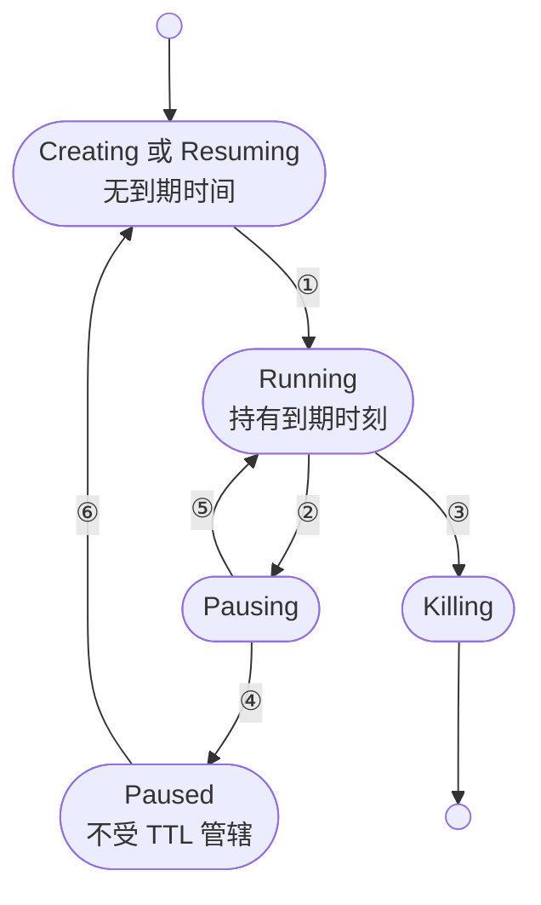
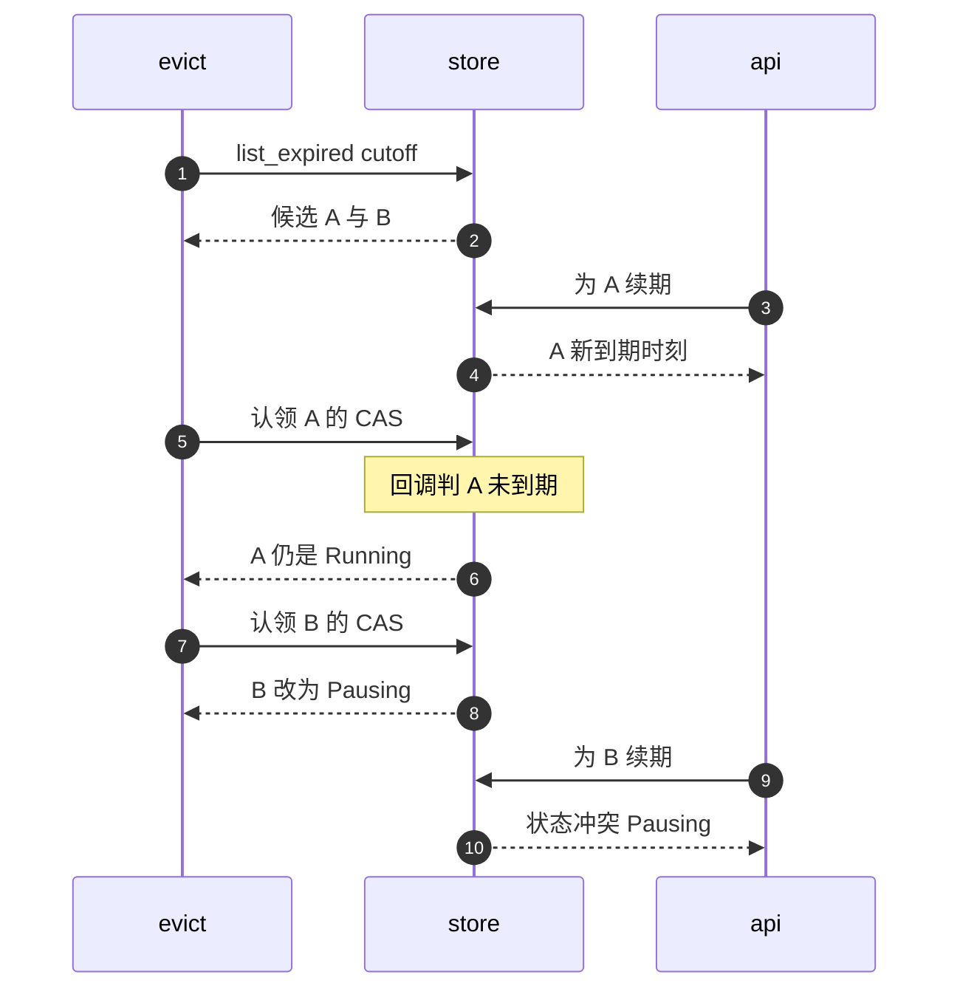

# 23 · 自动驱逐与 TTL

> agent 工作负载里，客户端崩溃、忘记关闭、网络中断都很常见，没有人收尾的沙箱会一直占着节点的内存与 CPU。
> AgentENV 给每台运行中的沙箱一个到期时间，由 orchestrator 里每秒一轮的后台任务在到期后暂停或删除它。
> 本篇讲到期时间怎样表示、怎样索引、怎样在「列出」与「认领」之间不误伤刚续过期的沙箱，以及串行执行的代价。
>
> **读者**：工程师。　**预备**：[第 19 篇 · 状态机与并发控制](19-state-machine-and-concurrency.md)、[第 14 篇 · 沙箱生命周期 API](14-sandbox-api.md)。
> **代码**：`src/orchestrator/store/metadata.rs`、`src/orchestrator/store/in_memory.rs`、`src/orchestrator/service.rs`、`src/api/proxy.rs`、`src/api/impls/sandbox.rs`、`src/orchestrator/tests.rs`

---

## 0. 本篇要回答的问题

1. TTL 在元数据里由哪几个字段表示？`NewTimeout` 的四个变体分别怎样重算到期时间，计时从哪一刻开始？
2. 到期的沙箱由谁来处理、多久检查一次，为什么只处理 Running 状态？
3. 回收任务列出过期沙箱之后、真正动手之前，用户恰好续了期，怎样保证不误伤？
4. 驱逐与显式 delete、显式 pause、代理自动恢复同时发生时，各方分别得到什么？
5. 代理自动恢复为什么要求「至少 300 s」的 TTL？数据面流量会不会顺带续期？
6. 驱逐失败时会发生什么？大量沙箱同时到期时，串行执行意味着什么？

---

## 1. 问题：没人收尾的沙箱

一台沙箱从创建起就占着节点资源：Firecracker 进程、guest 内存、网络槽位、ublk 设备。
SDK 用户的程序可能在任何时刻退出，退出前未必调用 delete；同一个 agent 框架开出的沙箱，
也可能因为上层任务被取消而再也没人访问。节点不能等用户想起来，必须自己判断「这台沙箱已经没人要了」。

最常见的判据是租约：每台沙箱带一个到期时间，客户端要继续用就续期，到期即回收。
接下来有三个设计问题。第一，到期时间怎样表示，续期怎样改它。
第二，谁来发现到期：每台沙箱一个定时器，还是一个周期性扫描。
第三，到期之后做什么：直接删除，还是暂停落盘，留给用户以后恢复。

每台沙箱一个 `tokio::time::sleep` 定时器看起来最精确，但续期要取消并重新布置定时器，
定时器触发时还要和正在进行的 pause、delete 竞争状态；进程重启后定时器全部丢失。
周期扫描全表则简单，但每轮代价正比于沙箱总数。
AgentENV 的做法介于两者之间：到期时间作为绝对时刻写进元数据，元数据存储按到期时刻维护一个有序索引，
后台任务每秒取索引中「已到期」的前缀，逐个用 CAS 认领后执行。
到期之后的动作由每台沙箱自己的 `timeout_action` 决定。

---

## 2. TTL 的数据表示

### 2.1 四个字段

`SandboxMetadata`（`src/orchestrator/store/metadata.rs`）里与 TTL 有关的字段有四个：

| 字段 | 类型 | 含义 |
|---|---|---|
| `timeout` | `Option<Duration>` | TTL 的长度；`None` 表示不过期 |
| `expires_at` | `Option<SystemTime>` | 到期的绝对时刻；由 `timeout` 和「从何时起算」推出 |
| `timeout_action` | `SandboxTimeoutAction` | 到期动作：`Pause` 或 `Delete`，缺省 `Pause` |
| `auto_resume` | `bool` | 暂停后，发往它的代理请求能否把它拉起 |

两个时间字段并存是有意的。`expires_at` 供索引与判定用；`timeout` 记住「这台沙箱习惯的租约有多长」，
供后续的 `UseExisting` 与 `EnsureMinimum` 使用。判定函数 `is_expired(now)` 的条件是 `expires_at <= now`，
`expires_at` 为 `None` 时永远不过期。

`timeout_action` 在 API 层由请求体的 `autoPause` 决定（`src/api/impls/sandbox.rs` 的 `sandboxes_post()` 与 `sandboxes_cold_post()`）：
显式传 `false` 得到 `Delete`，不传或传 `true` 都得到 `Pause`。这意味着 AgentENV 的缺省行为是「到期即暂停」，
沙箱的内存与磁盘会被落盘保存，而不是丢弃。

### 2.2 `NewTimeout` 的四个变体

所有改 TTL 的路径最终都走 `SandboxMetadata::update_timeout(NewTimeout)`：

```rust
let timeout = match new_timeout {
    NewTimeout::UseExisting => self.timeout,
    NewTimeout::Set(timeout) => Some(timeout),
    NewTimeout::EnsureMinimum(minimum) => match self.timeout {
        Some(existing) => Some(existing.max(minimum)),
        None => Some(minimum),
    },
    NewTimeout::None => None,
};
self._set_timeout(timeout, from);   // expires_at = from + timeout
```

`from` 总是调用时的 `SystemTime::now()`。由此有两条容易忽略的性质。
其一，四个变体都**从现在起**重算到期时刻，`UseExisting` 不是「保留原到期时刻」，而是「按原长度重新起租」。
其二，`EnsureMinimum` 比较的是**长度**而不是剩余时间：原 TTL 是 900 s 时，它得到「现在起 900 s」，不管原先还剩多少。

`keep_alive_for()` 是另一条路：它不经 `NewTimeout`，而是在 CAS 回调里直接 `set_timeout(Some(t))`，
并在 `allow_shorter = false` 时先比较新旧到期时刻，新的不晚于旧的就放弃更新。

### 2.3 计时从 Running 开始

创建与恢复的过渡态元数据不带到期时间：创建时 `SandboxMetadata` 用 `Default`，`expires_at` 为 `None`；
恢复时 Paused 记录里的旧 `expires_at` 早已过去，但状态不是 Running，回收任务不理会它。
真正的起租点在 `launch_sandbox()` 的最后一次 CAS：把过渡态改成 Running 的同一个回调里调用
`metadata.update_timeout(plan.timeout())`（`src/orchestrator/service.rs`）。
fork 的子沙箱也是在写入 Running 元数据时调用 `update_timeout(new_timeout)`。

这样做的收益是：冷启动拉镜像、等 envd 就绪、从仓库下载层所花的时间都不计入用户的租约，
一台 15 s TTL 的沙箱不会因为创建花了 10 s 而只剩 5 s 可用。代价是 TTL 不能约束「卡在 Creating 的沙箱」，
那要靠 [第 20 篇](20-launch-plan-and-rollback.md) 的失败回滚与 envd 就绪超时。

### 2.4 谁在构造 `NewTimeout`

回顾（详见 [第 14 篇 §4](14-sandbox-api.md#4-四个改-ttl-的入口)）：

| 入口 | 传给 orchestrator 的值 | 不给值时 |
|---|---|---|
| v1 创建、冷启动 | `Set(timeout)` | `default_sandbox_timeout_secs`，15 s |
| v2 创建、v2 connect | `Set(timeout)` | 300 s |
| `POST /resume` | `Set(timeout)` | 15 s |
| connect 恢复暂停沙箱 | `Set(timeout)` | v1 必填，v2 为 300 s |
| fork | `Set(timeout)` 或 `UseExisting` | 继承源沙箱的 TTL 长度 |
| 代理自动恢复 | `EnsureMinimum(300 s)` | — |
| BuildKit builder VM | `Set(请求 timeout + 3900 s)`，动作 `Delete` | 请求 timeout 缺省 3600 s |

`NewTimeout::None` 在 v0.2.3 里只出现在测试中，API 层没有任何入口能创建或恢复出一台永不过期的沙箱；
`sandbox_model()` 里把 `expires_at = None` 映射成「一百年后」的 `end_at` 分支，对 API 创建的沙箱实际不会走到。
另一方面，代码里也没有 TTL 上限：请求可以给出任意大的 `timeout`，节点照单全收。

到期时刻用的是墙上时钟 `SystemTime`，而回收任务的节拍用的是 tokio 的单调时钟。
推论：NTP 把系统时间往前拨时，一批沙箱会提前到期；往回拨时，到期会推迟。代码里没有对时钟跳变做防护。

---

## 3. 过期索引

`InMemoryMetadataStore` 的内部结构（`src/orchestrator/store/in_memory.rs` 的 `StoreInner`）除了记录表，
还有一个按到期时刻排序的集合：

```rust
struct StoreInner {
    records: HashMap<SandboxId, SandboxRecord>,
    by_expiry: BTreeSet<(SystemTime, SandboxId)>,
}
```

元组的第二项让同一时刻到期的多台沙箱各占一项。索引与记录在同一把 `RwLock` 下维护：
`add()` 插入索引项；`update()` 先删旧项再插新项；`update_if_state()` 只在回调前后 `expires_at` 真的变化时才重建索引项；
`remove()` 删除索引项。因为同在一把写锁内，索引与记录不会出现「记录已改、索引未改」的中间态。

查询过期沙箱是一次范围扫描：

```rust
inner.by_expiry
    .range(..=(now, SandboxId::max()))
    .filter_map(|(_, sandbox_id)| inner.records.get(sandbox_id))
    .map(|record| record.metadata.clone())
    .collect()
```

上界用 `(now, SandboxId::max())`，保证到期时刻恰为 `now` 的所有项都被包含。
这一轮的代价正比于「已到期」的项数，而不是沙箱总数，这是有序索引相对于全表扫描的收益。

但「已到期」不等于「待处理」。pause 的成功路径（`pause_sandbox_impl()`）只把状态改成 Paused，不清除 `expires_at`；
一台被驱逐暂停的沙箱，它的过去时刻会一直留在索引里，直到它被恢复（重新起租）或删除。
于是节点上暂停的沙箱越多，每秒一轮的 `list_expired()` 克隆出的元数据就越多，再被回收任务逐条以「不是 Running」跳过。
这是一处代价随暂停沙箱数线性增长的技术债：在 pause 成功时把 `expires_at` 清掉，或者让索引只收 Running 记录，都能消除它。

---

## 4. 回收任务

### 4.1 节拍与退出

`start_auto_evict_task()` 在 orchestrator 构造时启动（`service.rs` 的 `new_inner_with_volumes()`），与指标采样任务相邻：

- 周期取 `[orchestrator].auto_evict_interval_ms`，缺省 1000；`tokio::time::interval` 的 `MissedTickBehavior::Skip`
  让一轮超时之后不补跑积压的节拍，而是等下一个对齐的节拍。
- 任务只持有 `Weak<Self>`，每个节拍 `upgrade()` 一次；orchestrator 被丢弃后任务自行退出，
  测试 `auto_evict_task_does_not_keep_orchestrator_alive` 验证这一点。
- `tokio::select!` 同时等待关闭信号与节拍；`evict_expired_sandboxes()` 开头还检查一次 `is_shutting_down()`。

`select!` 只在两个分支之间竞争「谁先就绪」，节拍分支的处理体开始执行后不会被关闭信号打断。
推论：关闭时恰好在跑的那一轮驱逐会做完当前的 pause 或 delete，关闭流程对同一沙箱的 pause 会在 CAS 时看到 Pausing 并合并到它的结果上（[第 19 篇 §7](19-state-machine-and-concurrency.md#7-同一沙箱上的并发操作)）。

`config/default.toml` 的注释说 `metrics_interval_secs = 0` 关闭指标采样，但 `auto_evict_interval_ms` 没有类似的开关。
推论：把它设成 0 时 `tokio::time::interval` 会因周期为零而 panic，panic 发生在后台任务里，驱逐静默停止，进程继续运行。

### 4.2 一轮做什么

`evict_expired_sandboxes()` 的步骤：

1. 取 `eviction_cutoff = SystemTime::now()`，调用 `store.list_expired(eviction_cutoff)`。
2. 逐条遍历：状态不是 Running 的跳过。
3. 按 `timeout_action` 决定要认领成的状态：`Pause` 对应 Pausing，`Delete` 对应 Killing。
4. 取这台沙箱的 `deletion_progress` 锁，与显式删除共用同一把（[第 21 篇](21-deletion-and-volume-capture.md)）。
5. `claim_expired_running_sandbox()` 用 CAS 认领；认领成功后直接调用 `pause_sandbox_impl()`，
   或以 `previous_state = Running` 调用 `delete_sandbox_impl()`。
6. 成功的 ID 记入返回值；失败只记一条 warn，继续下一台。

第 5 步绕过了 `pause_sandbox_inner()` 与 `delete_sandbox_inner()`，因为那两者的工作是「从 Running CAS 到过渡态」，
而这一步已经在认领时完成了。它也没有包在 `run_cancellation_safe()` 里：回收任务本身就是后台任务，没有会中途离开的 HTTP 调用方。

下图是一台沙箱在 TTL 视角下的生命周期，编号见图下表。



| 编号 | 触发 | 对 TTL 的影响 |
|---|---|---|
| ① | `launch_sandbox()` 最后一次 CAS | `update_timeout(plan.timeout())`，从此刻起租 |
| ② | 某一轮列出它，`timeout_action = Pause` 且认领成功 | CAS 回调里再判一次是否到期，仍到期才改成 Pausing |
| ③ | 同上，`timeout_action = Delete` | 认领成 Killing，进入可重入删除 |
| ④ | 暂停成功 | `expires_at` 不清除，但 Paused 不再受回收任务管辖 |
| ⑤ | 可恢复的暂停失败 | 回到 Running，`expires_at` 不变，下一轮再次被认领 |
| ⑥ | 显式 resume、connect，或 `auto_resume` 的代理请求 | 进入 Resuming，到 ① 重新起租 |

图中没有画出的是 Running 上的续期：connect、`/timeout`、`/refreshes` 与对运行中沙箱的 resume
经 `keep_alive_for()` 或 `maybe_update_running_timeout()` 重算到期时刻，不改变状态；
认领时发现已被续期，沙箱也留在 Running（[§5](#5-列出与认领之间)）。

图里有一条不对称值得注意：TTL 只管 Running。暂停之后的沙箱没有第二个 TTL，它的记录与制品会一直留在节点上，
直到有人显式删除（[第 22 篇](22-persistence-across-restarts.md)）。到期即暂停在内存上释放了资源，在磁盘上则把成本转成了长期占用。

---

## 5. 列出与认领之间

`list_expired()` 返回的是元数据的克隆，是某一时刻的快照。从拿到快照到对某台沙箱动手，中间隔着对前面几台沙箱的 pause 或 delete，
可能是好几秒。这段时间里用户完全可能调用了 `/timeout` 或 connect，把这台沙箱的到期时刻推到了将来。
如果回收任务凭快照里的「已到期」直接动手，就会暂停或删除一台刚刚续过期的沙箱。

`claim_expired_running_sandbox()` 用 [第 19 篇 §4](19-state-machine-and-concurrency.md#4-cas-原语) 的 `update_if_state()` 解决这个问题：
期望集合是 `[Running]`，回调读的是存储里的**最新**元数据，在回调里再判一次 `is_expired(cutoff)`，
只有仍然到期才把状态改成 Pausing 或 Killing。结果分四种：

| CAS 结果 | 含义 | 回收任务的动作 |
|---|---|---|
| 成功且状态已改成目标态 | 认领成功 | 执行 pause 或 delete |
| 成功但状态仍是 Running | 期间被续期，回调没有改状态 | 跳过 |
| `StateConflict` | 期间有人把它带离了 Running | 跳过 |
| `SandboxNotFound` | 期间被删除 | 跳过 |

这里的 `cutoff` 固定为本轮开始时的时刻，而不是认领时的 `now`。
任何续期写入的到期时刻都是「续期时的 now 加上一段正的 TTL」，必然晚于本轮的 `cutoff`，所以续期只要先于认领提交，就一定赢。
反过来，一台在本轮遍历期间才到期的沙箱不会被这一轮认领，留给下一轮，这让「本轮处理哪些沙箱」在列出那一刻就确定下来。

下面的时序图里，`evict` 是回收任务，`store` 是元数据存储，`api` 是一个续期请求（connect 或 `/timeout`）。
前半段是续期先提交，后半段是认领先提交。



第 10 步的失败来自 `keep_alive_for()`：它只在 Creating、Resuming、Snapshotting、Forking 四个过渡态上等待，
遇到 Pausing 或 Killing 直接返回 `InvalidSandboxState`。认领一旦提交，到期就不可撤回。

`src/orchestrator/tests.rs` 用替身存储的闸门把这两种交错固定下来：
`keep_alive_success_wins_against_inflight_auto_evict` 让回收任务停在 `list_expired()` 之后，先完成续期，再放行，断言不发生驱逐；
`auto_evict_claim_prevents_late_keep_alive_success` 让回收任务停在认领之后，断言续期失败并报告认领态；
`auto_evict_revalidates_later_candidate_after_prior_claim` 验证在处理第一台的过程中，第二台被续期后同样会被跳过。

---

## 6. 与其它操作的交互

回收任务与其它操作者通过两样东西协调：状态 CAS 与 `deletion_progress` 锁。
后者对 `Pause` 动作也要取，是因为认领之后紧接着的 pause 可能长达数秒，期间若有显式 delete 到达，
它会在 `delete_sandbox_inner()` 开头等这把锁，而不是看到 Pausing 再走 60 s 超时的 `wait_for_transition()`；
锁释放时沙箱已是 Paused，delete 的 CAS `[Running, Paused] → Killing` 直接成功。

| 驱逐进行中到达的操作 | 看到的状态 | 结果 | 代码 |
|---|---|---|---|
| 显式 delete | 先等 `deletion_progress` 锁 | 驱逐完成后再删 | `delete_sandbox_inner()` |
| 显式 pause | Pausing | 合并到驱逐的结果上 | `join_concurrent_pause()` |
| `/timeout`、`/refreshes` | Pausing 或 Killing | `InvalidSandboxState` | `keep_alive_for()` |
| connect | Pausing | 400，「cannot be resumed」 | `sandboxes_sandbox_id_connect_post()` |
| 代理请求 | Pausing | 410 | `resolve_proxy_request()` |

connect 在 Pausing 时返回 400 而不是等暂停结束再恢复，因为 `resume_sandbox_inner()` 只等 Resuming，
遇到 Pausing 落入「其它状态」分支。对客户端而言，这是一个需要重试的瞬时错误，但 400 状态码不提示可以重试。

template builder 是另一类使用者。BuildKit builder VM 以 `Delete` 动作创建，TTL 是构建超时加 3900 s
（`src/api/impls/image_build/worker.rs`），作为构建会话异常时的兜底；测试 `buildkit_worker_eviction_skips_vm_snapshot`
断言它被驱逐时不做内存快照。步骤路径的构建 VM 不经 orchestrator 创建（[第 52 篇](52-template-builder.md)），不受 TTL 管辖。

---

## 7. 与代理自动恢复的联动

`timeout_action = Pause` 加 `auto_resume = true` 组成一种「按需运行」的模式：没人访问时沙箱到期暂停，
有请求进来时由反向代理把它拉起（[第 17 篇](17-reverse-proxy.md)）。

`resolve_proxy_request()`（`src/api/proxy.rs`）先查运行时路由表；查不到时 `proxy_lookup_for()` 读元数据，
状态为 Paused 时返回 `ProxyLookupResult::Paused { auto_resume }`。允许自动恢复时，
`try_auto_resume()` 以 60 s 的超时调用 `resume_sandbox(id, NewTimeout::EnsureMinimum(300 s))`，
成功后再查一次路由；每个请求只尝试一次。超时只让这个代理请求放弃：resume 跑在 `run_cancellation_safe()` 里，会在后台继续完成。

用 `EnsureMinimum` 而不用 `UseExisting`，是为了防止抖动。一台以缺省 15 s TTL 创建的沙箱，若按原长度起租，
恢复后 15 s 就会再次到期暂停；而每次 pause 都要导出脏页、写一层内存层，每次 resume 都要重新打开层栈。
请求稀疏到间隔略大于 15 s 时，节点会把大部分时间花在暂停与恢复上。
`auto_resume_min_sandbox_timeout_secs`（缺省 300）给出一个下限，同时保留用户配置的更长 TTL。

另一个容易误会的点是：**数据面流量不续期**。代理路径上没有任何地方调用 `keep_alive_for()`，
一台正被持续访问的沙箱到期时照样会被暂停；暂停期间到达的请求得到 410，暂停完成后的请求再触发自动恢复。
推论：经代理建立的长连接（例如 WebSocket）会在暂停时被切断。需要「有流量就不过期」的用户，必须在客户端定期调用 connect 或 `/refreshes`。
这里的取舍是代理热路径上只读路由表、不写元数据。

---

## 8. 失败与串行的代价

**失败重试的节奏由节拍决定。** 可恢复的暂停失败（例如分配制品目录失败、持久化失败但 VM 成功恢复）
把状态 CAS 回 Running，`expires_at` 不变（`pause_sandbox_impl()` 的各个回退分支）。
下一轮它仍在过期前缀里、仍是 Running，于是被再次认领。推论：持续性的故障（例如快照目录所在的盘满了）
会让同一台沙箱每秒被尝试暂停一次，每次都走一遍快照与回退，日志里每秒一条 warn，直到故障消除或用户删除它。

`Delete` 动作的失败分两种。卷捕获的可恢复失败把状态退回 Running，下一轮同样重试；
stop 或 release 阶段的失败让沙箱停在 Killing、保留删除进度，而回收任务只看 Running，不会再碰它，
需要一次显式 delete 从断点继续（[第 21 篇](21-deletion-and-volume-capture.md)）。

**串行执行放大延迟。** 一轮里的沙箱逐个 `await`，没有并发。暂停一台沙箱的成本正比于它的脏页量（[第 42 篇](42-memory-snapshot-over-ublk.md)），
N 台同时到期时，排在最后的那台要等前面 N−1 次暂停全部完成；这一轮跑多久，下一轮就推迟多久，
期间新到期的沙箱也在等。TTL 因此只保证「不早于到期时刻回收」，不保证「到期时刻附近回收」。
批量创建、相同 TTL 的工作负载最容易撞上这一点：它们几乎同时到期，资源释放被拉成一条长尾。

串行的收益是简单：同一时刻节点上最多只有一个驱逐引发的暂停在导出内存，不会因为一批沙箱同时到期而让磁盘与内存带宽瞬间饱和。
推论：按有界并发（类似指标采样的 `ceil(n/5)`）处理一轮候选，可以在两者之间取折中；v0.2.3 没有这样做。

**残留的删除进度项。** 回收任务为每台认领的沙箱在 `deletions` 表里创建一项 `DeleteProgress`，
只有走完删除（`remove_deleted_sandbox()`）或遇到 `SandboxNotFound` 时才移除。
被驱逐暂停的沙箱会带着一项初始进度留在表里，直到它被删除；项很小，数量以节点上的沙箱数为界。

---

## 9. 与 e2b infra 的对照

e2b infra 的 TTL 由 API 服务持有，evictor 每 50 ms 扫一次到期集合，对每条到期记录起一个 goroutine 执行 kill 或 pause，
并在写入时把到期时间截断到团队档位的最长时长以内。AgentENV 把 TTL 放在每个节点 orchestrator 的元数据里，
因为它要支持没有中心 API 的单节点部署，而 scheduler 的绑定保证一台沙箱只归一个节点管。
代价是回收在单节点内串行、1 s 一轮，且没有 TTL 上限。

---

## 10. 小结

- TTL 由 `timeout`（长度）与 `expires_at`（绝对时刻）共同表示；`NewTimeout` 四个变体都从调用时刻起重算，`EnsureMinimum` 比较的是长度。
- 起租点在过渡态 CAS 成 Running 的那一刻，创建与恢复本身的耗时不计入租约。
- API 层不能创建永不过期的沙箱，也没有 TTL 上限；`autoPause` 不传时到期动作是 `Pause`。
- 过期索引是与记录同锁维护的 `BTreeSet<(SystemTime, SandboxId)>`，`list_expired()` 是一次前缀范围扫描。
- 暂停成功不清除 `expires_at`，暂停的沙箱永久留在过期前缀里，每轮被克隆后跳过，代价随暂停沙箱数增长。
- 回收任务每秒一轮、`Skip` 积压节拍、持 `Weak` 引用；只处理 Running，暂停之后的沙箱不再有 TTL。
- 认领在 CAS 回调里以本轮固定的 `cutoff` 再判一次是否到期：续期先提交则续期赢，认领先提交则续期失败。
- 驱逐持 `deletion_progress` 锁，显式 delete 等它完成再删；显式 pause 合并结果；connect 在 Pausing 时得到 400。
- 代理自动恢复用 `EnsureMinimum(300 s)` 防止暂停与恢复抖动；数据面流量不续期。
- 可恢复的失败让沙箱回到 Running 且仍已到期，下一轮立即重试；一轮内串行执行，大批同时到期时释放延迟成长尾。

---

## 延伸阅读 / 下一篇

- [第 19 篇 · 状态机与并发控制](19-state-machine-and-concurrency.md)：CAS 原语与并发合并规则。
- [第 21 篇 · 删除与卷的捕获提交](21-deletion-and-volume-capture.md)：`Delete` 动作内部的可重入进度。
- [第 17 篇 · 反向代理](17-reverse-proxy.md)：自动恢复所在的请求路径。
- [e2b 手册第 18 篇 · 沙箱生命周期 API](../e2b-infra/18-sandbox-lifecycle-api.md)、[e2b 手册第 20 篇 · 沙箱运行态存储](../e2b-infra/20-sandbox-state-storage.md)：API 层 evictor 与到期集合的另一种做法。
- 下一篇：[第 24 篇 · 指标与生命周期事件](24-metrics-and-events.md)。
