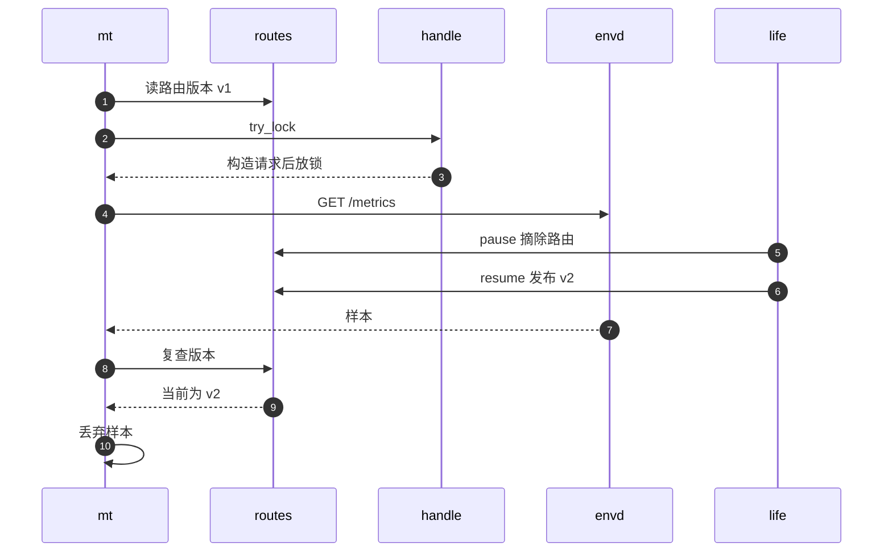
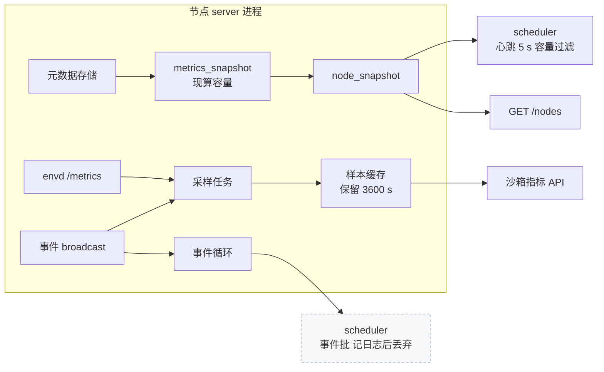

# 24 · 指标与生命周期事件

> 一个节点要回答三类「现在怎么样」的问题：调度器要知道节点上还剩多少容量，用户要看每台沙箱里 CPU 与内存用了多少，
> 运维要看每类操作花了多长时间。AgentENV 用三套互不相同的机制分别回答它们：从元数据现算的容量快照、
> 带「代数」校验的 guest 采样环，以及进程内的 Prometheus 记录器。另有一条生命周期事件广播，它的用途比名字所暗示的窄。
>
> **读者**：工程师、运维。　**预备**：[第 19 篇 · 状态机与并发控制](19-state-machine-and-concurrency.md)、[第 10 篇 · 节点进程与对象模型](10-node-process-and-object-model.md)。
> **代码**：`src/orchestrator/metrics.rs`、`src/orchestrator/sandbox_metrics.rs`、`src/sandbox/metrics.rs`、`src/orchestrator/service.rs`、`src/observability/service.rs`、`src/observability/reporter.rs`、`src/observability/prometheus.rs`、`crates/observability/src/lib.rs`

---

## 0. 本篇要回答的问题

1. 节点报告的运行沙箱数、已分配 CPU 与内存是怎么算出来的？为什么不用增减计数器？
2. 八个状态分别计入哪一类计数？暂停的沙箱为什么要单独统计？
3. guest 指标从哪里来、多久采一次？采样怎样做到不阻塞 pause、delete 这些持锁的生命周期操作？
4. 一台沙箱暂停又恢复后，旧样本怎样不被当成新实例的数据？「代数」指的是什么？
5. 生命周期事件由谁发出、谁在接收？丢了会怎样？
6. Prometheus 暴露了哪些指标、在哪个进程的哪个端口上？

---

## 1. 问题：三种观测需求

**容量**是给调度器用的。scheduler 根据每个节点报告的运行沙箱数、已分配 CPU 与内存过滤候选节点（[第 56 篇](56-scheduler.md)），
数字偏高会让节点空着却不接活，偏低会让节点超卖。这类数字必须与节点的真实状态一致，但可以容忍几秒的滞后。

**guest 资源**是给用户看的。E2B 兼容的 API 提供 `GET /sandboxes/metrics` 与 `GET /sandboxes/{id}/metrics`，
返回 guest 内看到的 CPU 使用率、内存与磁盘用量。这些数据只有 guest 里的 envd 知道，宿主要去问。

**操作时延**是给运维看的。创建、暂停、恢复各花了多久，块设备操作、对象存储上传有多少失败与取消，需要按分布而不是平均值看。

最省事的容量算法是增减计数器：创建成功加一，删除减一。它的问题在于每一条让沙箱消失的路径都要记得减一。
orchestrator 里让沙箱从元数据存储里消失的路径不止删除一条：暂停、快照、fork 的终结性失败都会直接 `store.remove()`
（`pause_sandbox_impl()`、`fail_snapshot_operation()`、`fork_sandbox_inner()` 里的终结分支），
漏掉其中任何一条，计数就会永久漂移，而且只能靠重启纠正。AgentENV 选择了另一条路。

---

## 2. 容量快照：现算而不是累加

### 2.1 `OrchestratorMetrics`

`Orchestrator::metrics_snapshot()`（`src/orchestrator/service.rs`）返回一个 `OrchestratorMetrics`（`src/orchestrator/metrics.rs`）：

| 字段 | 来源 |
|---|---|
| `create_successes`、`create_fails` | 两个 `AtomicU64` 累加器 |
| `running_sandbox_count`、`starting_sandbox_count` | 扫描元数据存储现算 |
| `allocated_cpu`、`allocated_memory_bytes` | 同上 |
| `paused_sandbox_count`、`paused_allocated_cpu`、`paused_allocated_memory_bytes` | 同上 |

只有两个创建计数器是累加的，因为它们统计的是历史上的尝试次数，失败的那次可能根本没有留下元数据，无从现算。
它们用 `Ordering::Relaxed` 更新：两个计数器互不相关，也不与其它数据构成不变量，不需要更强的内存序。
fork 的每个子沙箱计一次成功或失败；关闭期间被拒绝的创建也计一次失败（`create_sandbox_inner()` 开头的 `ensure_accepting_lifecycle_operations()` 分支）。

其余字段每次都在 `store.list_with_callback()` 里遍历全部记录，对每条记录取 `SandboxContribution::new(state, resources)`，
再用 `aggregate_resource_metrics()` 以饱和加法累加。因为算的是「此刻存储里有什么」，任何一条移除路径漏没漏发通知都不影响结果，
快照与存储天然一致。代价是每次快照都是 O(沙箱数) 的扫描，并且在存储的读锁下进行；
调用者是心跳（缺省 5 s 一次）与 `GET /nodes`，频率低，这个代价可以接受。

### 2.2 状态到资源的映射

`SandboxContribution::new()` 是「哪个状态算什么」的唯一定义：

| 状态 | running | starting | allocated CPU / 内存 | paused_* |
|---|---|---|---|---|
| Creating、Resuming | — | 计入 | 计入 | — |
| Running | 计入 | — | 计入 | — |
| Pausing、Snapshotting、Forking、Killing | 计入 | — | 计入 | — |
| Paused | — | — | — | 计入 |

判据是「VM 是否还活着、资源是否还占着」。Pausing 期间 VM 还在导出内存，Killing 期间 VM 可能还在冻结卷，
它们的内存都没有释放，所以计入 running 与 allocated。Creating 与 Resuming 单独计为 starting，
供调度器限制「同时启动中」的沙箱数，但它们的 CPU 与内存同样已被预留。
`metrics.rs` 的文档注释把 running 的过渡态列为「Pausing、Snapshotting、Killing」，漏了代码里也计入的 Forking，注释与代码不一致。
统计不区分 template builder：BuildKit builder VM 同样计入。

暂停的沙箱单独计入 `paused_*`。它们已经释放了 VM 侧的内存与 CPU，但随时可能被恢复，恢复时要重新占用这些资源。
scheduler 的 `withinLimit()`（`services/scheduler/internal/filter.go`）因此提供两组上限：
只看活跃集合的 `MaxSandboxCount`、`MaxCPUAllocatedPercent` 等，以及把暂停沙箱加进来的 `MaxSandboxCountIncludingPaused`、`MaxAllocatedCPUIncludingPaused`、`MaxAllocatedMemoryBytesIncludingPaused`。
前者衡量「现在挤不挤」，后者衡量「如果都恢复会不会超卖」。把两者混在一个数里，调度器就无法分别设限。

### 2.3 这些数字怎样离开节点

`ObservabilityService::node_snapshot()`（`src/observability/service.rs`）把容量快照、主机指标、节点身份与沙箱 ID 名单拼成一个 `NodeSnapshot`。
它有两个消费者：`GET /nodes` 的处理函数（`src/api/impls/admin.rs`）与心跳上报（`src/observability/reporter.rs`，[第 57 篇](57-heartbeat-and-cpu-intersection.md)）。
心跳里的 `sandbox_count` 是 `running_sandbox_count`，不含 starting；`sandbox_ids` 是存储里的全部 ID 加上正在构建的模板 ID（`list_sandbox_ids()`），含暂停的沙箱。

推论：scheduler 的比较是 `计数 > 上限` 才排除，计数恰好等于上限的节点仍会被选中，而 starting 不计入 `MaxSandboxCount`；
心跳又有几秒的滞后。一波并发创建因此可能让节点的活跃沙箱数越过配置的上限。这属于调度一侧的语义，在第 56 篇讨论。

---

## 3. guest 指标采样

### 3.1 样本从哪里来

guest 资源数据来自 envd 的 `GET /metrics`。`FirecrackerSandbox` 的 `metrics_sample()`（`src/sandbox/firecracker/sandbox.rs`）
克隆出沙箱的 `EnvdInstance`，返回一个调用 `EnvdInstance::metrics()` 的 future；后者先 `ensure_live()`，再请求 envd，
最后由 `SandboxMetric::try_from()`（`src/sandbox/metrics.rs`）解码并校验：
CPU 数必须为正，使用率必须是非负有限数，五个字节量都不能为负，缺一个字段就整条丢弃。

`SandboxMetric` 有八个字段：`timestamp`、`cpu_count`、`cpu_used_pct`、`mem_used`、`mem_total`、`mem_cache`、`disk_used`、`disk_total`。
源文件开头的注释强调它们是 **guest 视角**的资源样本，不是宿主上 Firecracker 进程的 RSS，也不是分配计数。
`timestamp` 取自 envd 报告的秒级时间戳，也就是 guest 的时钟。

### 3.2 采样任务

`start_metrics_task()`（`src/orchestrator/sandbox_metrics.rs`）在 orchestrator 构造时启动，`[orchestrator].metrics_interval_secs = 0` 时不启动。
它在一个 `biased` 的 `select!` 里等三样东西，优先级依次是：关闭信号、生命周期事件、定时器（缺省 15 s，`MissedTickBehavior::Skip`）。

- 定时器到点：对**所有** Running 沙箱采样一轮。
- 收到 Create、Resume 或 Fork 事件：只对事件里的那台沙箱采样一次，让新实例不必等满一个周期就有第一条数据。
  其它事件与 `Lagged` 错误直接忽略。

任务持有 `Weak<Self>`，每次动手前 `upgrade()`；采样本身也包在第二个 `select!` 里，关闭信号到达时整轮放弃。

### 3.3 一轮采样

`collect_sandbox_metrics(target)` 的步骤：

1. 按保留期 `metrics_retention_secs`（缺省 3600 s）修剪样本缓存。
2. `store.list()` 取全部元数据，筛出 Running；并发度取 `ceil(Running 数 / 5)`（`metrics_concurrency()`）。
3. 对每台沙箱：读运行时路由表里这台沙箱的路由版本，作为本次采样的**代数**；没有路由就跳过。
4. 如果是事件触发的单台采样，且缓存里最新一条样本已经是这个代数，跳过，避免重复。
5. 克隆沙箱句柄，`try_lock()`；锁被占用就跳过。拿到锁后只调用 `metrics_sample()` 生成 future，随即放锁。
6. 在锁外以 200 ms 超时等待这个 future。
7. 成功后再查两件事：存储里的状态仍是 Running，路由版本仍等于第 3 步读到的代数。两者都满足才写入缓存。

第 5 步是这套采样不干扰生命周期操作的关键。pause、delete、snapshot 都要持有沙箱句柄上的 `Mutex` 数秒
（[第 10 篇 §4.2](10-node-process-and-object-model.md#42-三张表与锁顺序)）。如果采样用 `lock().await`，它会排在这些操作后面白等；
更糟的是，如果采样持锁去做网络 I/O，一台 envd 卡住的沙箱就能把随后到来的 pause 拖住。
`try_lock()` 加「锁内只构造、锁外才等待」把采样对句柄锁的占用缩到几乎为零。
代价是正在做生命周期操作的沙箱这一轮没有数据，样本序列会出现空洞。

### 3.4 代数

代数是运行时路由表 `ProxyRouteTable`（`src/orchestrator/proxy.rs`）里每条路由的 `version`。
它来自 orchestrator 上一个全局的 `next_proxy_route_version: AtomicU64`，每次 `upsert_proxy_route()` 或 `upsert_proxy_route_if_current_handle()` 都 `fetch_add` 取一个新值。
路由在 launch 完成、fork 子沙箱启动、失败的 pause 原地恢复时被写入；pause 开始时被摘除（`detach_sandbox_handle_and_route()`）。
于是同一个沙箱 ID 每「活」一次，就有一个新的、比之前都大的版本号。用它标记样本，等于给样本打上「这是哪一次运行的数据」的标签。

图中 `mt` 是采样任务，`routes` 是运行时路由表，`handle` 是沙箱句柄，`life` 是一次 pause 加 resume。
推论：在 200 ms 的采样超时内完成一次暂停与恢复并不现实，写入侧的复查更多是在兜住「失败的 pause 原地恢复」这类快速换代；
代数真正频繁起作用的地方在读侧与去重：

- `latest_sandbox_metrics()` 只返回**当前**代数的最新样本。一台刚恢复、还没被重新采样的沙箱，`GET /sandboxes/metrics` 里没有它，而不是给出暂停前的旧数字。
- 第 4 步的去重以代数为键：恢复事件触发的采样一定会执行，因为新代数下还没有样本。

失败的 pause 原地恢复也会换代，此时 VM 并没有换。这是保守的选择：宁可让一条连续的序列被切成两代，也不让旧实例的数据冒充新实例。

### 3.5 存储与查询

样本缓存是 `SandboxMetrics`：`HashMap<SandboxId, VecDeque<Sample>>`，外面一把 `tokio::sync::Mutex`。
每条 `Sample` 记录代数、宿主侧的 `Instant` 与 `SandboxMetric`。修剪按宿主单调时钟进行，与 guest 时钟无关。

| 端点 | orchestrator 方法 | 行为 |
|---|---|---|
| `GET /sandboxes/metrics?sandbox_ids=…` | `latest_sandbox_metrics()` | 最多 100 个互不相同的 ID；只返回 Running 且有当前代数样本的沙箱 |
| `GET /sandboxes/{id}/metrics?start=&end=` | `sandbox_metrics_history()` | 沙箱不在存储中返回 404；返回保留期内所有代数的样本，按 guest 时间戳过滤并排序 |

两个端点的口径不同：「最新值」只认当前实例，「历史」跨越暂停与恢复。暂停中的沙箱仍能查到暂停前一小时内的历史，但不会出现在最新值列表里。
`start` / `end` 比较的是 guest 报告的时间戳。推论：guest 时钟在快照恢复后若未及时校准，按时间窗查询会与宿主时间错位。

这套设计的代价有三处。第一，样本只在进程内存里，重启后全部丢失，最多保留一小时，节点之间也不共享。
第二，删除沙箱时不清理它的样本，它们留在缓存里直到保留期过去；API 因存储里没有该 ID 而返回 404，数据不可见，但占着内存。
第三，事件触发的单台采样同样要 `store.list()` 一次全表。推论：一波 N 个创建会触发 N 次全表扫描，代价是 O(N²)。

---

## 4. 生命周期事件

### 4.1 谁发、发什么

`SandboxLifecycleEvent`（`src/orchestrator/types.rs`）只有三个字段：类型、沙箱 ID、资源规格。类型有五种，发布点都在 `service.rs`：

| 类型 | 发布点 | 时机 |
|---|---|---|
| Create | `create_sandbox_inner()` | launch 成功之后 |
| Fork | `fork_sandbox_inner()` | 每个启动成功的子沙箱一条 |
| Pause | `pause_sandbox_impl()` | 持久化成功、VM 停止之后 |
| Resume | `resume_sandbox_inner()` | launch 成功、释放 PausedSandbox 镜像引用之后 |
| Delete | `remove_deleted_sandbox()` | 从存储移除之后 |

没有快照事件；前面列出的三类终结性失败直接 `store.remove()`，**不发 Delete**。
事件通过 `tokio::sync::broadcast` 发布，容量 `SANDBOX_EVENT_CHANNEL_CAPACITY = 1024`；
`publish_sandbox_event()` 忽略 `send()` 的错误，没有订阅者时事件直接消失。broadcast 的语义是每个订阅者各自读同一个环形缓冲，
慢的订阅者落后超过容量时，下一次接收得到 `Lagged(n)`，丢掉最旧的 n 条。

### 4.2 谁在收

订阅者有两个。一个是 §3.2 的采样任务，只关心 Create、Resume、Fork。另一个是心跳上报器的事件循环（`src/observability/reporter.rs` 的 `start()`）：
`recv_sandbox_event_batch()` 阻塞等第一条，再用 `try_recv()` 把缓冲里现有的全部取出凑成一批，
`Lagged` 时记 warn 后继续；`send_sandbox_events()` 以 10 s 超时调用 scheduler 的 `ReportSandboxEvent`，失败只记 warn，这一批不重试。

在 scheduler 一侧，`services/scheduler/internal/service.go` 的 `ReportSandboxEvent()` 只打一条 debug 日志「scheduler ignored sandbox event batch」，然后返回成功。
也就是说，在 v0.2.3 里，事件离开节点之后没有任何消费者。

下图是三类观测数据离开 orchestrator 的路径。

### 4.3 为什么这样也能工作

调度器需要的是「节点上现在有哪些沙箱、占了多少资源」，这是**状态**；事件描述的是**变化**。
心跳每次都带着完整的沙箱 ID 名单与现算的容量，是一种电平触发（level-triggered）的同步：丢一次心跳，下一次自然补齐。
事件是边沿触发（edge-triggered）的：丢一条就永远丢了，而 §4.1 已经说明它本身就不完整。
把权威放在心跳上，事件最多只能做「提前得知」的提示，这正是事件路径可以「尽力而为」、甚至被对端忽略而系统照常运转的原因。

代价是延迟：scheduler 对节点变化的感知最多滞后一个心跳周期。事件通道与 `ReportSandboxEvent` RPC 已经就位，
推论：它们是为将来缩短这段滞后预留的；在 v0.2.3 里，它的唯一实际效果是每次生命周期变化都多一次节点到 scheduler 的 gRPC 调用。

---

## 5. Prometheus 指标

### 5.1 记录器与暴露位置

`crates/observability/src/lib.rs` 的 `init_prometheus_recorder()` 用 `metrics_exporter_prometheus` 安装全局记录器，
所有直方图共用一组时延桶（注释要求与 Go 服务的 `services/shared/observability/buckets.go` 保持一致），
两个 ZFile 读路径直方图另配一组微秒级的桶；后台每 5 s 跑一次 `run_upkeep()`。

有两个进程各自安装记录器、各自暴露：

- `server`：`src/bin/server.rs` 启动时初始化，控制面路由器上挂 `GET /metrics`（`src/api/server.rs`）。
  `require_auth()`（`src/api/impls/auth.rs`）对非代理请求的 `/health` 与 `/metrics` 免鉴权。
- ublk-daemon：`storage/ublk-daemon/src/metrics_server.rs` 在 `[ublk].daemon_metrics_listen_addr`（`config/default.toml` 为 `0.0.0.0:9103`）上单独监听；留空则不开。
  Rust 版 overlaybd 跑在 daemon 进程里，它的指标只出现在这个端口上。

### 5.2 指标一览

| 指标 | 类型 | 主要标签 | 记录位置（进程） |
|---|---|---|---|
| `agentenv_http_request_duration_seconds` | 直方图 | method、route、route_source、status | `http_metrics_middleware()`（server） |
| `agentenv_sandbox_stage_duration_seconds` | 直方图 | operation、stage、status | `SandboxStageTimer`（server） |
| `agentenv_sandbox_stage_inflight` | gauge | operation、stage | 同上 |
| `agentenv_ublk_operation_duration_seconds` | 直方图 | operation、status | `src/sandbox/ublk/device.rs`（server） |
| `agentenv_snapshot_oss_operation_duration_seconds` | 直方图 | operation、artifact、status | OSS 客户端（server） |
| `agentenv_snapshot_oss_upload_bytes_total` | 计数器 | operation、artifact | 同上 |
| `agentenv_image_resolve_stage_duration_seconds`、`agentenv_image_resolve_cache_total` | 直方图、计数器 | stage、status；result、image_format、registry | `src/image/resolver.rs`（server） |
| `agentenv_overlaybd_data_bytes`、`agentenv_ext4_used_bytes`、`agentenv_trim_reclaimable_bytes` | gauge | dev_id、kind | `record_restack_usage_stats()`（server） |
| `agentenv_overlaybd_remote_*`、`agentenv_overlaybd_zfile_*` | 直方图、计数器 | codec、status、reason | `storage/overlaybd/src/metrics.rs`（ublk-daemon） |

几处读数时要知道的细节：

- **route 标签是有界的。** `http_route_label()` 把已知路径归一成模板（`/sandboxes/{sandbox_id}/pause` 等），其余一律记为 `unmatched`，
  以免沙箱 ID 进入标签、撑爆时间序列数。代价是 connect、`/timeout`、`/refreshes`、指标端点本身都落进 `unmatched`，无法分开看。
  `route_source` 区分控制面与三种代理入口（Host、头、前缀，[第 17 篇](17-reverse-proxy.md)）。
- **stage 计时只覆盖 API 入口。** `SandboxStageTimer` 包在 `create_cold`、`create_warm`、`fork`、`pause`、`snapshot`、`resume` 六个处理函数上；
  delete 没有计时，回收任务与关闭流程直接调用 orchestrator 的暂停（[第 23 篇](23-auto-eviction-and-ttl.md)）也不经过它。按这个指标估算节点上的暂停次数会偏低。
- **`canceled` 是一种独立的结果。** `MetricGuard` 创建时把状态预置为 `canceled`，只有显式 `finish()` 才改成 `ok` 或 `error`；
  future 被丢弃（例如调用方超时）时 `Drop` 以 `canceled` 记一笔。ublk 设备操作与 OSS 上传用它，于是「取消」与「失败」可以分开统计。
- **ZFile 的两个时延直方图是抽样的。** 注释写明每线程 1/1024 抽样，`_count` 是样本数而不是读次数；读次数要看对应的计数器。
- **按 `dev_id` 的 gauge 不会被移除。** 它们在每次 restack 时顺带设置，代码里没有删除这些序列的地方。推论：设备释放后旧值仍留在导出结果里，直到同一个设备号被复用并再次写入。

---

## 6. 与 e2b infra 的对照

e2b infra 的 orchestrator 在 OTel 回调里每 5 s 向 envd 拉一次指标，单次超时 100 ms，并发度同样按沙箱数除以 5，样本经采集器写入 ClickHouse，由 API 读回；
生命周期事件在状态变化时构造，扇出到 ClickHouse 与 Redis Stream。AgentENV 把样本留在节点进程内存的环形缓存里，事件发往一个丢弃它的 scheduler，
因为它要在没有外部数据库的单节点部署下也能回答指标查询。代价是历史最多一小时、重启即失，事件对外没有消费者。

---

## 7. 小结

- 容量快照除两个创建计数器外全部从元数据存储现算，任何移除路径漏发通知都不会让它漂移；代价是每次快照扫描全表。
- 状态到资源的映射集中在 `SandboxContribution::new()`：VM 还活着的过渡态计入 running 与 allocated，Creating 与 Resuming 计为 starting，Paused 单独计数。
- 暂停沙箱单独统计，让 scheduler 能分别对「当前负载」与「全部恢复后的负载」设限。
- guest 样本来自 envd `/metrics`，周期 15 s 加 Create、Resume、Fork 事件触发，并发度 `ceil(n/5)`，单次 200 ms 超时。
- 采样用 `try_lock()`，锁内只构造 future、锁外等待，不拖住持锁的生命周期操作；代价是样本出现空洞。
- 代数是全局递增的路由版本号；最新值只认当前代数，历史跨越暂停与恢复，失败的 pause 原地恢复也会换代。
- 样本只在进程内存里保留 3600 s；删除的沙箱样本不即时清理；事件触发的采样也要全表扫描。
- 生命周期事件只有五种，终结性失败的移除不发 Delete；broadcast 容量 1024，落后即丢。
- 事件上报到 scheduler 后被直接丢弃；系统的权威同步是心跳里的完整名单与现算容量。
- Prometheus 指标分属 server 与 ublk-daemon 两个进程两个端口；route 标签有界，stage 计时不覆盖后台暂停与删除。

---

## 延伸阅读 / 下一篇

- [第 57 篇 · 心跳、节点可观测与 CPU 模板交集](57-heartbeat-and-cpu-intersection.md)：心跳的内容与 scheduler 的处理。
- [第 56 篇 · scheduler](56-scheduler.md)：容量上限怎样参与放置。
- [第 28 篇 · MMDS 与 envd](28-mmds-and-envd.md)：envd 客户端与 `live` 标志。
- [e2b 手册第 51 篇 · 端口、权限与指标](../e2b-infra/51-envd-ports-permissions-metrics.md)、[e2b 手册第 60 篇 · 遥测：tracing、metrics、logs](../e2b-infra/60-telemetry.md)、[e2b 手册第 61 篇 · 沙箱事件与 webhook](../e2b-infra/61-events-and-webhooks.md)：同类数据在 e2b infra 中的去向。
- 下一篇：[第 25 篇 · 后端抽象与 Firecracker 进程](25-backend-and-firecracker-process.md)。
