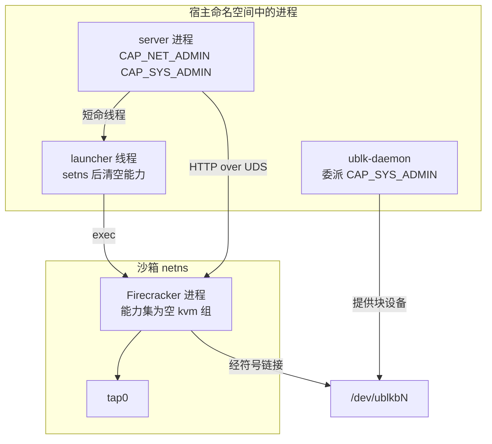
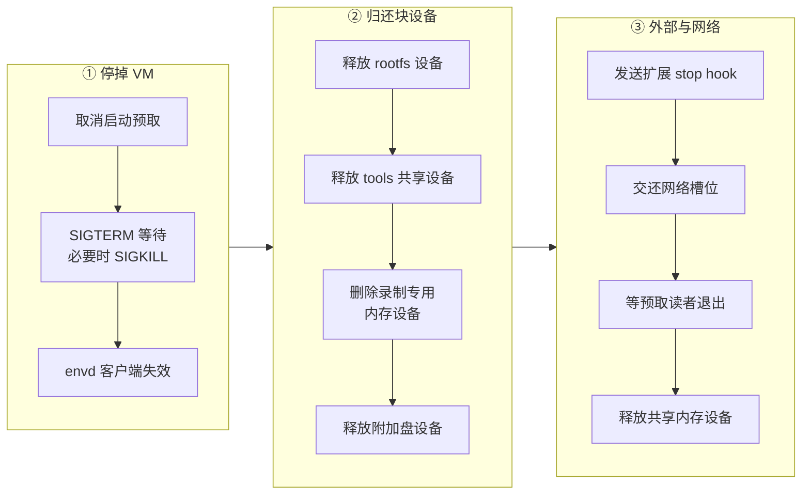

# 25 · 后端抽象与 Firecracker 进程

> orchestrator 只认识「一台能启动、暂停、捕获与停止的沙箱」，具体的虚拟化技术藏在两个 trait 后面。
> 在 Firecracker 后端里，这台沙箱首先是一个子进程：它被放进一个网络命名空间、去掉全部能力、通过一个 Unix socket 接受配置。
> 本篇讲这个进程怎样被拉起、server 怎样和它说话、停下来时资源按什么顺序释放，以及不用 jailer 留下了哪些空白。
>
> **读者**：工程师、运维、安全评审。　**预备**：[第 10 篇 · 节点进程与对象模型](10-node-process-and-object-model.md#43-两个后端-trait)、[第 19 篇 · 状态机与并发控制](19-state-machine-and-concurrency.md)。
> **代码**：`src/sandbox/backend.rs`、`src/sandbox/firecracker/{sandbox,instance,socket,connector,factory,config}.rs`、`src/privileges.rs`、`crates/linux-cap/src/lib.rs`、`adev/src/codegen.rs`、`scripts/install.sh`

---

## 0. 本篇要回答的问题

1. `FirecrackerSandbox` 这个对象里装了哪些资源？哪些随它的工作目录一起消失，哪些必须显式归还？
2. Firecracker 进程是怎样被放进网络命名空间、又怎样做到不带任何 Linux 能力的？这个结论在什么部署下不成立？
3. AgentENV 不用 jailer。jailer 的哪些职责由别的机制承担了，哪些没有人承担？
4. server 用什么客户端调用 Firecracker 的 REST API？请求没有超时会造成什么后果？
5. `stop()` 为什么必须先停进程、再还块设备、把扩展 hook 放在释放网络之前、把共享内存设备放在最后？

---

## 1. 问题：一台沙箱背后是一组彼此依赖的资源

一台运行中的沙箱在节点上占用的东西远不止一个进程：一个网络槽位（netns、veth、tap 与 iptables 规则），
三类以上的 ublk 块设备（tools 盘、用户 rootfs、内存快照设备、附加盘），一个工作目录（API socket、设备符号链接、可写层文件、日志），
一个 envd 客户端，以及可能已经通知过外部系统的扩展 hook。这些资源之间有使用关系：
Firecracker 进程打开着块设备与 tap；guest 内的 envd 只能经由网络槽位访问；扩展 hook 可能在那个 netns 里布置过东西。

于是有两类问题必须由后端回答。一是**构造**：资源按什么顺序准备，进程在什么身份下运行，失败时怎样不泄漏。
二是**拆除**：资源按什么顺序归还，才不会出现「设备已经交给下一个租户，旧进程还在往里写」这类错误。
orchestrator 不应该知道这些细节，它只需要一个满足约定的对象。

---

## 2. 回顾：后端 trait 的约定

[第 10 篇 §4.3](10-node-process-and-object-model.md#43-两个后端-trait) 已经介绍过 `SandboxBackend`（一台沙箱的生命周期）与
`SandboxBackendFactory`（构造与解码暂停状态）的分工。这里只补充三条与 Firecracker 实现直接相关的约定，均来自 `src/sandbox/backend.rs` 的文档注释。

- **持有方式。** trait 要求 `Send + 'static`，因为 orchestrator 把每台沙箱放在 `Arc<Mutex<Box<dyn SandboxBackend>>>` 里。
  所有生命周期操作都要先拿这把互斥锁，这一点在第 6 节讨论超时时会变得重要。
  `metrics_sample()` 是唯一的例外设计：它在锁内只构造一个自有的 future，释放锁之后再去轮询，避免采样阻塞生命周期操作。
- **幂等。** `stop()` 与 `resume()` 被要求可以重复调用而不报错。回滚路径与关闭路径都可能对同一台沙箱再调一次 `stop()`。
- **可恢复失败的承诺。** 捕获类方法返回 `SandboxCaptureError::Recoverable` 时，后端必须已经把沙箱恢复到运行状态；
  `Terminal` 表示运行期已被改动，调用方只能停止它。

另有一个独立的 `SandboxExecutor` trait，提供在 guest 内执行命令的能力。它用 `#[async_trait(?Send)]` 声明，
注释给出的原因是 `FirecrackerSandbox` 持有的 tonic 客户端不是 `Sync`，于是 `&Self` 不是 `Send`，生成的 future 也就不能要求 `Send`。

工厂一侧，`FirecrackerSandboxFactory`（`src/sandbox/firecracker/factory.rs`）只多做两件事：
`build()` 用 `filter_extra_boot_args()` 按配置的前缀白名单过滤调用方传入的内核参数（每个参数只允许字母数字与 `_-./+=`），
并在持有 CPU 模板时把模板 JSON 放进配置。其余构造逻辑都在 `FirecrackerSandbox` 的关联函数里。

---

## 3. `FirecrackerSandbox`：一份资源清单

`FirecrackerSandbox`（`src/sandbox/firecracker/sandbox.rs`）的字段可以按资源类别归成五组：

| 类别 | 字段 | 释放方式 |
|---|---|---|
| 启动描述 | `id`、`launch`（`LaunchMode::Fresh` 或 `Resume`）、`runtime_policy` | 无需释放 |
| 进程与目录 | `fc_instance`、`work_dir`（`TempDir`） | `stop()` 杀进程；目录随对象析构删除 |
| 网络 | `network_slot`、`current_network_policy` | `stop()` 交还 `NetworkManager` |
| 块设备 | `tools_ublk_device`、`rootfs_runtime`、`mem_ublk_device`、`mem_dedicated_device`、`extra_drive_runtimes` | `stop()` 逐个交还 ublk-daemon |
| guest 通道与外部 | `envd_instance`、`startup_prefetch_task`、`custom_extension_hook_guard`、`live_snapshot_root` 等 | `stop()` 中分别失效、停止、发送 stop hook |

`LaunchMode` 只有两个变体：`Fresh` 携带 `FirecrackerSandboxConfig`，从镜像冷启动；`Resume` 携带 `FirecrackerSnapshotConfig`，从快照恢复。
`start_nowait()` 先准备 tools 盘，再校验 launch 配置，然后分派到 `start_fresh()` 或 `start_resume()`；两条路径的 Firecracker 调用序列在[第 27 篇](27-start-pause-resume-sequences.md)。

工作目录由 `create_firecracker_work_dir()`（`src/sandbox/firecracker/config.rs`）在配置的父目录下以前缀 `agentenv-fc-` 创建。
它是理解后面几节的关键，因为 Firecracker 的 `current_dir` 被设成这里，所有 drive 都用相对路径的符号链接引用：

```text
agentenv-fc-XXXX/                     FirecrackerSandbox::work_dir（TempDir）
├── firecracker.socket                API socket，FirecrackerInstance::new() 固定的文件名
├── rootfs.ext4  -> /dev/ublkbN       tools 盘：共享只读 ublk 设备，或旧式 ext4 文件
├── user-rootfs  -> /dev/ublkbM       用户 rootfs：本沙箱独占的可写 ublk 设备
├── overlaybd/                        用户 rootfs 的运行时目录（可写 upper 与 image.json）
├── extra-drive-<id> -> /dev/ublkbK   每块附加盘一个
├── extra-drive-runtime-<id>/         附加盘的运行时目录
├── agentenv_volume_slot_<i>.img      预留的卷槽位：4 KiB 占位文件或指向卷设备的链接
└── logs/                             未配置 serial_output_base_dir 时的日志目录
```

文件名 `rootfs.ext4` 是历史命名：它现在通常指向 tools 盘的 ublk 设备，而不是一个 ext4 文件（[第 26 篇](26-sandbox-block-devices.md)）。
预热池命中时，`start_resume()` 会把 `work_dir` 与 `fc_instance` 整个换成池里那一份（`std::mem::replace`），
构造时建的那个空目录与未启动的实例随即被丢弃（[第 32 篇](32-warm-pools.md)）。

---

## 4. 拉起进程：`spawn_with_netns()`

### 4.1 命令行与进程属性

`FirecrackerInstance::spawn_with_netns()`（`src/sandbox/firecracker/instance.rs`）组装的命令只有三个参数：

```text
firecracker --api-sock <work_dir>/firecracker.socket \
            --mmds-size-limit 1048576 \
            --http-api-max-payload-size 1048576
```

两个上限都从上游的 51200 字节提到 1 MiB。注释说明原因是 MMDS 里要放透传的原始镜像配置（`imageConfigs`，[第 28 篇](28-mmds-and-envd.md)）。
两者必须一起提：上游 Firecracker v1.15.1 的 `main.rs` 在未指定 `mmds-size-limit` 时取 API 负载上限作为 MMDS 上限，
而 `PUT /mmds` 的请求体本身也要过 API 负载上限这一关。`set_mmds()` 在发送前先序列化并比较长度，超过 1 MiB 直接报错，不让 Firecracker 去拒绝。

命令上的其它属性：

- `process_group(0)`：Firecracker 自成一个进程组。推论：这样在终端里对 server 按 Ctrl-C 时，SIGINT 只送到 server 所在的前台进程组，
  Firecracker 不会随之退出，server 才有机会在关闭序列里把它们暂停落盘（[第 10 篇](10-node-process-and-object-model.md)）。
  `scripts/install.sh` 生成的 systemd 单元用 `KillMode=process` 达到同样目的，单元里的注释写的正是这个理由。
- `current_dir(work_dir)`：drive 路径都是相对路径，注释称这一步「crucial」。
- stdin 接 `/dev/null`；stdout / stderr 只在配置了 Firecracker 日志级别或显式给了路径时才接到日志文件（追加模式），否则也接 `/dev/null`。
- `kill_on_drop(true)`：在 `spawn_tokio_command_scoped()` 里设置，`Child` 被丢弃时向进程发 SIGKILL。

spawn 成功后，server 把 `/proc/<pid>/oom_score_adj` 写成 1000，让内存耗尽时内核优先杀 Firecracker 而不是 server。写失败只记警告。
这个取舍是：一台沙箱被 OOM 杀掉只损失它自己；server 被杀掉则全部沙箱的状态机、路由与关闭保护一起消失。

### 4.2 进入 netns 并清空能力

Linux 的能力集与网络命名空间归属都是**线程**级别的属性。server 是一个多线程的 tokio 进程，
它的线程带着 `CAP_NET_ADMIN` 与 `CAP_SYS_ADMIN`（启动时由 `require_runtime_capabilities()` 校验，[第 59 篇](59-host-setup-and-privileges.md)）。
如果在某个 worker 线程上直接 `setns` 再 spawn，那个 worker 就留在了沙箱的 netns 里；如果用 `pre_exec` 钩子在子进程里做，
多线程进程里的 `fork` 后代码受到严格限制，也失去 `posix_spawn` 快路径。

`privileges::spawn_tokio_command_scoped()`（`src/privileges.rs`）的做法是**专门起一个短命的 OS 线程**（名为 `aenv-process-launcher`）：

```rust
thread::Builder::new().name("aenv-process-launcher".to_string()).spawn(move || {
    let result = (|| {
        before_capability_scope()?;   // Firecracker 传入的闭包：setns(netns, CLONE_NEWNET)
        linux_cap::configure_current_process_capabilities(capabilities)?;  // capabilities = &[]
        let _runtime_guard = runtime.enter();
        command.kill_on_drop(true);
        command.spawn()
    })();
    if let Err(Ok(child)) = sender.send(result) {
        terminate_unclaimed_child(child);
    }
})?;
```

顺序不能换：`setns` 需要 `CAP_SYS_ADMIN`，所以必须在清空能力之前做。
`configure_current_process_capabilities(&[])`（`crates/linux-cap/src/lib.rs`）先清空 ambient 集，再用 `capset` 把本线程的 effective、permitted、inheritable 三组都设为空。
子进程在 exec 时继承这个线程的 netns 与能力集，于是 Firecracker 一出生就在沙箱的 netns 里、不带任何能力；
发起调用的 tokio worker 线程两者都没有改变。netns 文件在调用线程里就已打开，launcher 线程只拿到一个文件描述符。
如果等待结果的一方已经放弃（`oneshot` 接收端被丢弃），launcher 线程用 `terminate_unclaimed_child()` 杀掉并回收这个没人认领的子进程。

图 1 是拉起之后的进程与资源关系。



这个「不带能力」的结论有一个前提：**server 不以 root 运行**。`src/privileges.rs` 的测试注释写明，
euid 为 0 的进程在 `execve` 时会由内核从 bounding 集重新授予 permitted 与 effective（除非设置了 `SECBIT_NOROOT`），
所以在 root 下测试只能断言 inheritable 与 ambient 为空。生产部署由 `scripts/install.sh` 生成的 systemd 单元承担这个前提：
`User=aenv`、`AmbientCapabilities` 与 `CapabilityBoundingSet` 都只有那两个能力、`NoNewPrivileges=true`、`SupplementaryGroups=kvm`。
在这套部署下 Firecracker 是一个普通的非特权进程，靠 `kvm` 组访问 `/dev/kvm`，靠 udev 规则（`src/setup/ublk.rs` 把 `ublkb*` 设为 server 所在组可读写）访问块设备。
开发时直接以 root 运行 server，Firecracker 就会带着完整的能力集。

### 4.3 等 socket 出现

`wait_for_ready()` 只做一件事：每 `socket_poll_ms`（默认 1 ms）检查一次 socket 文件是否存在，最多等 `socket_timeout_secs`（默认 3 s）。
每轮先 `try_wait()`，进程已经退出就立即报错，而不是等满超时。
两类错误都会附上 stderr 文件末尾最多 4096 字节；没有捕获 stderr 时写「not captured」。这是排查 Firecracker 起不来时唯一的现场。

---

## 5. 不用 jailer：哪些隔离有，哪些没有

上游 Firecracker 配套的 jailer 在 exec 之前完成 chroot、降权、命名空间、cgroup 与资源上限（见 Firecracker 手册第 43 篇）。
AgentENV v0.2.3 的代码里没有 jailer 的调用，spawn 的参数也只有上面三个。逐条对照：

| jailer 的职责 | AgentENV v0.2.3 | 结果 |
|---|---|---|
| 降到非特权 uid / gid | Firecracker 继承 server 的 uid，生产部署是 `aenv` | 有，但与 server 同一个 uid |
| 不带能力 | launcher 线程清空三组能力与 ambient | 有，前提是 server 非 root |
| 进入网络命名空间 | launcher 线程 `setns` | 等价 |
| chroot、新 mount 命名空间 | 无；只把 cwd 设为工作目录、用相对路径符号链接 | 缺失：只固定了命名，没有限制可达范围 |
| 新 PID 命名空间 | 无 | 缺失 |
| cgroup 限额 | 无；`src/` 中只有观测与容量探测代码提到 cgroup | 缺失 |
| rlimit | 无单独设置，继承 server 的（systemd 单元 `LimitNOFILE=1048576`） | 未收紧 |

Firecracker 自身的 seccomp 过滤器仍然生效：命令行里没有关闭它的参数。剩下的边界因此是三层：KVM 的硬件隔离、seccomp 的系统调用过滤、无能力的非特权 uid。

缺口集中在「同一个 uid」上。Firecracker 的 seccomp 对 `open` / `openat` 无条件放行（Firecracker 手册第 42 篇），文件访问只剩 DAC 一道检查。
推论：一个从 guest 逃逸到 VMM 进程的攻击者，能以 `aenv` 身份打开 server 能打开的一切——
其它沙箱的 `/dev/ublkb*`（udev 规则让 server 所在组可读写）、其它沙箱的工作目录与可写层文件、
`$AENV_HOME/secrets/` 下属主为 server 有效 uid、权限 `0600` 的 API key 与 token seed（[第 13 篇](13-authentication.md)）。
没有 cgroup 意味着单台沙箱的 CPU 与内存不受宿主侧限额约束，内存只能靠 `oom_score_adj` 在耗尽时兜底。
这些取舍换来的是更少的部件与更短的启动路径：不需要准备 jail 目录、不需要硬链接或复制二进制、不需要 root 启动器。
把 Firecracker 放进独立 uid、mount 命名空间与 cgroup，是在现有结构上收紧隔离最直接的方向。

---

## 6. 和 Firecracker 说话：手写的 UDS 客户端

### 6.1 只生成了数据模型

`thirdparty/firecracker-client` 是从 `firecracker.yaml` 生成的 Rust crate，但生成命令（`adev/src/codegen.rs` 的 `run_firecracker()`）
带着 `--global-property models,supportingFiles`，只生成 serde 模型；`src/apis/` 下只有 `configuration.rs` 与 `mod.rs`，没有任何请求函数。
这份 spec 来自 AENV 补丁版 Firecracker，所以模型里有上游没有的 `DirtyMemoryRanges`、drive 的 `direct` 字段与可选的 `mem_file_path`（[第 67 篇](67-firecracker-patch-layer.md)）。

真正发请求的是两个小文件。`UnixConnector`（`connector.rs`）是一个 tower `Service<Uri>`，每次调用都 `UnixStream::connect(path)`，忽略 URI 本身。
`UnixSocketClient`（`socket.rs`）把它装进 hyper-util 的 legacy `Client`，`request()` 的逻辑是：
拼出 `http://localhost{path}`，把请求体序列化成 JSON，带上 `Content-Type` 与 `Accept`；
非 2xx 时把状态码与响应体一起放进错误；空响应体按 JSON `null` 反序列化；`request_no_content()` 用 `IgnoredAny` 丢弃响应。
`FirecrackerInstance` 在它之上为每个用到的端点包一层方法：`set_machine_config()`、`add_drive()`、`patch_drive_path()`、
`set_mmds()`、`pause()`、`create_state_only_snapshot()`、`get_dirty_memory_ranges()`、`load_snapshot_file()` 等。

这种「模型生成、调用手写」的分法让请求类型与 spec 保持同步，又不必依赖生成器对 Unix socket 传输的支持。
代价是 crate 的 README 里端点表为空，读代码的人容易以为用的是生成的 API 客户端。

### 6.2 没有请求超时

`UnixSocketClient::request()` 直接 `self.client.request(req).await`，外面没有 `tokio::time::timeout`，连接器也没有设超时。
socket 的 3 s 超时只覆盖「socket 文件出现」这一步，此后的每个 REST 调用都可以无限期地等。

后果沿着第 2 节的锁传播。一个卡住的 Firecracker 调用，会让持有这台沙箱 `Mutex` 的任务一直挂着；
orchestrator 的其它等待者靠 `wait_for_transition()` 的 60 s 兜底放弃（[第 19 篇 §5](19-state-machine-and-concurrency.md#5-等待一次转换结束)），
而持锁任务本身因为跑在 `run_cancellation_safe()` 的独立任务里，也不会因请求方断开而结束。沙箱停在过渡态，直到有人干预。
推论：可行的干预是从外部杀掉那个 Firecracker 进程，Unix socket 断开后挂起的请求才会以错误返回，回滚路径随之运行。

同一个 server 对 ublk-daemon 的 RPC 是有超时的：`storage/ublk-daemon/src/client.rs` 里普通请求 30 s，快照类 360 s，
创建运行时设备取 360 s 与「扩容超时 + 120 s」中较大者。Firecracker 一侧缺的就是这样一层按端点分级的上限。
难点在于 `PUT /snapshot/create`、`PUT /snapshot/load` 的耗时与内存大小、设备后端有关，给一个统一的短超时会误杀正常的大 VM。

---

## 7. 停止：资源释放的顺序

### 7.1 `FirecrackerInstance::stop()`

进程层面的停止很简单：取出 `Child`，发 SIGTERM，在 `socket_timeout` 内等它退出，等不到就 `start_kill()`（SIGKILL）后再 `wait()`，最后删 socket 文件。
它不调用 `SendCtrlAltDel` 之类的 API。上游 Firecracker 不为 SIGTERM 注册处理器（AENV 补丁版的 `src/vmm/src/signal_handler.rs` 同样只处理 SIGBUS、SIGSEGV、SIGSYS 等八个信号），
所以 SIGTERM 走内核默认动作，进程立即终止，guest 没有机会有序关机——对沙箱这不是问题，需要保留的状态在 pause 时已经写出。
等待 SIGKILL 之后的 `wait()` 没有超时。推论：如果进程卡在不可中断的 I/O 上（例如 ublk 设备背后的 daemon 无响应），这一步会一直等。
这个函数的所有错误都被忽略，当前实现总是返回 `Ok`。

### 7.2 `FirecrackerSandbox::stop()`

整台沙箱的 `stop()` 按图 2 的三列执行，每列内自上而下。



每一步为什么在那个位置：

| 步骤 | 位置的理由 |
|---|---|
| 取消预取 | 本地 startup pack 预取任务在读共享内存设备；先发取消，让它在后面的步骤进行期间收尾 |
| 停 Firecracker | 进程持有块设备、tap 与 socket 的打开句柄。设备必须在进程退出后才能交还：rootfs 设备开着预热池时会回到 daemon 的空闲池，旧进程若还在写，写入就落进下一个使用者的设备。进程停止失败时直接返回、保留全部句柄，留给下一次 `stop()` |
| envd 失效 | 先把 `live` 标志清掉，之后任何持有这个客户端克隆的调用都会快速失败 |
| rootfs 与附加盘 | `release_device()` 在预热池开启时交还 daemon 复用，否则删除；注释规定 rootfs 必须在停进程之后、清理网络之前，未说明后半句的理由 |
| tools 共享设备 | 显式 `release()`，注释说明是为了不让后台的 Drop 清理与紧随其后的同镜像 resume 竞争；节点会常驻一份最近使用的 tools 设备，这一步通常只减少引用 |
| 录制专用内存设备 | 只用 `delete_device()`，决不交还预热池，因为它只为一次录制存在 |
| 扩展 stop hook | 在交还网络槽位**之前**发送。槽位一旦回池，同一个 netns 可能马上分给别的沙箱，扩展方在里面做的清理就会作用到错误的租户上。发送失败只记日志，不让 `stop()` 失败 |
| 交还网络槽位 | 失败不立即返回，记下错误，等其余资源都释放完再报告 |
| 等预取读者、释放共享内存设备 | 预取读者自己持有共享内存设备的一份引用。`SharedReadOnlyDevice::release()` 只在自己是最后一个引用时才真正释放，所以必须先等读者退出（最多 `socket_timeout`）；注释说明把这两步放在最后，是为了先释放与它无关的资源 |

### 7.3 没有调用 `stop()` 时

`FirecrackerSandbox` 的 `Drop` 是一条尽力而为的路径：让 envd 客户端失效，丢弃扩展 hook guard（它在析构时以 fire-and-forget 方式发送 stop），
交还网络槽位，并丢弃块设备句柄。rootfs 与附加盘的句柄只是数据（设备号与路径），丢弃它们**不会**通知 daemon，
注释写明这些设备留在 daemon 里，直到 daemon 自己关闭或有人显式删除；共享只读设备的最后一个引用被丢弃时，会在后台任务里异步释放（[第 26 篇](26-sandbox-block-devices.md)）。
随后字段按声明顺序析构：`work_dir` 在 `fc_instance` 之前，所以工作目录先被删除，`FirecrackerInstance` 的 `Drop` 再发 SIGKILL（不等待回收）并删除 socket。
推论：进程退出之前它仍持有已被删除的文件的句柄，数据要等进程退出后才释放。

更极端的情况是 server 自己被 SIGKILL：`Drop` 不会运行，`kill_on_drop` 也就不起作用；systemd 的 `KillMode=process` 只杀主进程，
Firecracker 子进程留在宿主上。重启后谁来处理这些孤儿进程，见[第 22 篇](22-persistence-across-restarts.md)。

---

## 8. 与 e2b infra 的对照

e2b infra 不直接 exec Firecracker，而是经由 `unshare -m`、一段 bash 脚本与 `ip netns exec` 四层拉起，并用 `CLONE_INTO_CGROUP` 把进程原子地放进按沙箱划分的 cgroup，同样不用 jailer、也不降权（见 e2b 手册第 28 篇）。
AgentENV 用一个短命线程完成 `setns` 与能力清空、直接 spawn，得到的是一个非特权、无能力的进程，但没有 mount 命名空间与 cgroup。
两者在 jailer 的职责表上缺的格子恰好不同：e2b infra 缺降权，AgentENV 缺 cgroup 与文件系统边界。

---

## 9. 小结

- `SandboxBackend` 的实现被放在一把互斥锁后面；`stop()`、`resume()` 必须幂等，Recoverable 失败必须先恢复运行，这几条约定是回滚与关闭路径能重复调用后端的前提。
- `FirecrackerSandbox` 是一份资源清单：进程、工作目录、网络槽位、四类块设备、envd 客户端与扩展 hook；工作目录里的相对路径符号链接是 drive 配置的寻址方式。
- Firecracker 由一个短命 launcher 线程拉起：先 `setns` 进沙箱 netns，再清空三组能力与 ambient，然后 spawn；调用线程的命名空间与能力不受影响。
- 「Firecracker 不带能力」只在 server 非 root 时成立；生产的 systemd 单元以 `aenv` 用户、受限 bounding 集与 `NoNewPrivileges` 保证这一点。
- 不用 jailer 的结果是：有降权与无能力，没有 chroot、mount 命名空间、PID 命名空间与 cgroup；Firecracker 与 server 同 uid，是最主要的隔离缺口。
- MMDS 与 API 负载上限一起提到 1 MiB，以容纳透传的镜像配置；超过时 server 在发送前报错。
- Firecracker 客户端是手写的 UDS hyper 客户端，只复用生成的模型；它没有请求超时，卡住的调用会让沙箱停在过渡态，直到外部杀掉进程。
- `stop()` 的顺序由使用关系决定：先停进程再还设备，扩展 hook 在网络槽位回池之前，持有共享设备引用的预取读者退出之后才释放共享内存设备。
- 不经 `stop()` 的析构会把 rootfs 与附加盘设备留在 daemon 里；server 被 SIGKILL 时 Firecracker 子进程成为孤儿。

## 延伸阅读 / 下一篇

- 下一篇：[第 26 篇 · 沙箱的块设备](26-sandbox-block-devices.md)——工作目录里那几个符号链接背后的设备从哪里来、怎么共享、怎么归还。
- 调用序列：[第 27 篇](27-start-pause-resume-sequences.md)；预热的 Firecracker 进程：[第 32 篇](32-warm-pools.md)；扩展 hook 的 guard：[第 33 篇](33-custom-extension-hooks.md)；能力模型与宿主准备：[第 59 篇](59-host-setup-and-privileges.md)；补丁端点：[第 67 篇](67-firecracker-patch-layer.md)。
- [Firecracker 手册第 43 篇 · jailer](../firecracker/43-jailer.md)、[Firecracker 手册第 42 篇 · seccomp](../firecracker/42-seccomp.md)、[Firecracker 手册第 07 篇 · 进程启动](../firecracker/07-process-startup.md)：被省略的那一层隔离与 Firecracker 的信号处理。
- [e2b 手册第 28 篇 · Firecracker 进程管理](../e2b-infra/28-firecracker-process-management.md)：同一个问题的另一种拆法。
