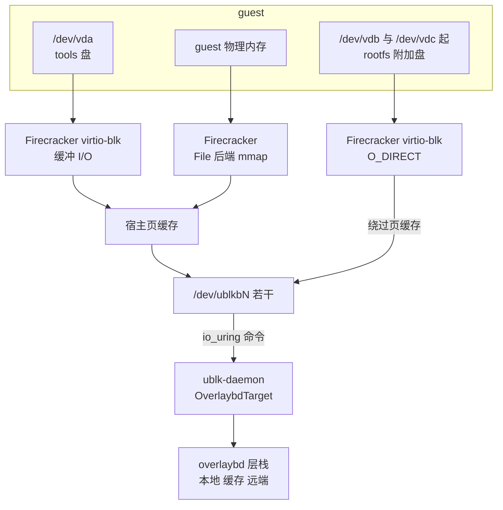
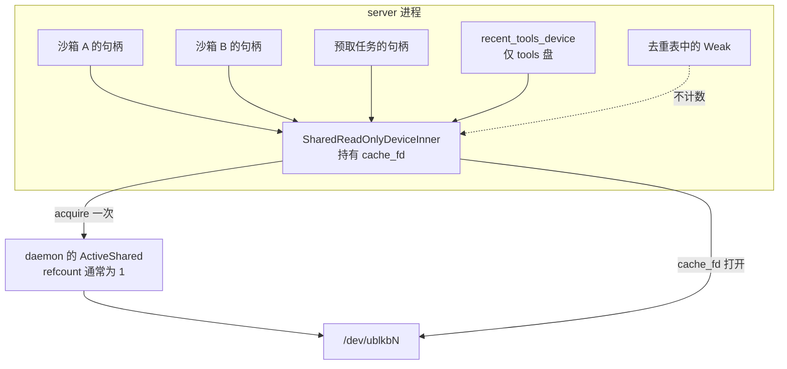

# 26 · 沙箱的块设备：tools 盘、rootfs 与内存设备

> 一台沙箱在宿主上挂着好几个 `/dev/ublkbN`：一块所有沙箱共用的只读 tools 盘、一块自己独占的可写 rootfs、若干附加盘，
> 恢复出来的沙箱还多一块与同快照的其它沙箱共用的只读内存设备。本篇站在节点一侧，讲每块设备从哪里来、guest 看到的是什么、
> 共享设备怎样计数与归还，以及为什么可写盘用 O_DIRECT 打开而 tools 盘不用。daemon 内部怎样服务这些设备留给第 41 篇。
>
> **读者**：工程师、存储方向的读者。　**预备**：[第 25 篇 · 后端抽象与 Firecracker 进程](25-backend-and-firecracker-process.md)、[第 04 篇 · io_uring 与 ublk](04-io-uring-and-ublk.md)、[第 05 篇 · overlaybd 与按需加载](05-overlaybd-and-lazy-loading.md)。
> **代码**：`src/sandbox/ublk/{device,overlaybd}.rs`、`src/sandbox/firecracker/{sandbox,config,factory}.rs`、`src/sandbox/extra_drive.rs`、`src/setup/deps.rs`、`src/image/resolver.rs`、`tools-image/`、`storage/ublk-daemon/src/{client,runtime}.rs`

---

## 0. 本篇要回答的问题

1. guest 里的 `/dev/vda`、`/dev/vdb`、`/dev/vdc` 分别是什么？内存设备为什么不在这个列表里？
2. `UblkDeviceManager` 在节点里扮演什么角色？哪些设备是独占的，哪些是共享的？
3. 共享只读设备为什么要有两级引用计数？`cache_fd` 保住的是什么？
4. 用户 rootfs 的可写层在哪里、用哪种布局、什么时候允许改变大小？
5. 为什么 rootfs 与附加盘以 O_DIRECT 打开，tools 盘却走宿主页缓存？
6. tools 盘的内容从哪里来，为什么一个快照要钉住它创建时的 tools 版本？

---

## 1. 问题：一台沙箱要几块盘，各自的生命期不同

最朴素的做法是给每台沙箱一块盘：用户镜像，里面已经装好 guest 内的守护进程。e2b infra 就是这样做的（见 e2b 手册第 43 篇），
代价是每个模板都要在构建时把守护进程写进用户的文件系统。AgentENV 选择让用户镜像保持原样，于是至少需要两块盘：
一块放 AgentENV 自己的引导程序与 envd，一块放用户的根文件系统。再加上用户请求的附加盘、为卷预留的槽位，
以及恢复快照时承载 guest 内存的那块设备，一台沙箱在宿主上同时打开的块设备有三类以上。

这几类设备的**生命期与共享范围**完全不同：

| 维度 | tools 盘 | 用户 rootfs | 附加盘 / 卷槽位 | 内存设备 |
|---|---|---|---|---|
| guest 可见 | `/dev/vda`，只读 root 设备 | `/dev/vdb`，可写 | `/dev/vdc` 起 | 不可见，是 guest 内存的后备 |
| 共享范围 | 同一 tools 版本的全部沙箱 | 独占 | 独占（只读卷另论，见第 31 篇） | 同一内存快照的全部沙箱 |
| 节点侧句柄 | `SharedReadOnlyDevice` | `OverlaybdRuntimeHandle` | `OverlaybdRuntimeHandle` | `SharedReadOnlyDevice` |
| Firecracker 打开方式 | 缓冲 I/O，`Sync` 引擎 | O_DIRECT，`Async` 引擎 | O_DIRECT，`Async` 引擎 | `snapshot/load` 的 File 后端 mmap |
| 存活到 | 节点上最后一个使用者之后仍保留一份 | 沙箱 stop | 沙箱 stop | 最后一个使用者 stop |

图 1 把一台从快照恢复的沙箱的设备栈画在一起：guest 的读写经 Firecracker 的设备模型或内存映射到达宿主的 ublk 块设备，
内核把请求经 io_uring 命令交给 ublk-daemon，daemon 在 Rust 版 overlaybd 的层栈上完成读写。



本篇余下的部分逐列解释这张表。

---

## 2. guest 看到的设备

### 2.1 命名

Firecracker 按 `PUT /drives` 的顺序把 virtio-blk 设备呈现给 guest。`configure_microvm()`（`src/sandbox/firecracker/sandbox.rs`）的顺序固定：

| guest 设备 | drive_id | 工作目录中的路径 | 属性 |
|---|---|---|---|
| `/dev/vda` | `rootfs` | `rootfs.ext4` → tools 设备 | `is_root_device`、只读、`direct = false`、`Sync` |
| `/dev/vdb` | `user_rootfs` | `user-rootfs` → rootfs 设备 | 可写、`direct = true`、`Async`、预启动限流 |
| `/dev/vdc` … | 附加盘的 id | `extra-drive-<id>` → 附加盘设备 | `direct = true`、`Async` |
| 其后 | `agentenv_volume_slot_<i>` | `agentenv_volume_slot_<i>.img`：4 KiB 占位或卷设备 | 同上 |

drive_id 常量在 `src/sandbox/extra_drive.rs`。名字有误导性：`rootfs` 这个 drive_id 与 `rootfs.ext4` 这个文件名指的是 **tools 盘**，
它才是内核意义上的 root 设备；用户的根文件系统是 `user_rootfs`。文档 `docs/src/internals/architecture.md` 把 `/dev/vda` 标成 rootfs，与代码不符。

附加盘从 `vdc` 排到 `vdz`，所以 `MAX_EXTRA_DRIVES = (b'z' - b'c' + 1)`，即 24（`src/sandbox/firecracker/config.rs`）。
`prepare_volume_drive_slots()` 检查物理附加盘数加卷槽位数不超过这个上限。卷槽位为什么要在第一次启动时就预留，是第 31 篇的主题：
快照恢复之后 Firecracker 不能再新增 virtio-blk 设备，只能通过替换符号链接再 `PATCH /drives` 改变一个已有槽位的后端。

内存设备不出现在这张表里。它不是一块盘，而是 `PUT /snapshot/load` 请求里 `mem_backend.backend_path` 指向的块设备路径，
Firecracker 把它 mmap 成 guest 的物理内存（[第 27 篇](27-start-pause-resume-sequences.md)、[第 42 篇](42-memory-snapshot-over-ublk.md)）。

### 2.2 guest 内的接力

tools 盘的根目录下有一个 `/init`（`tools-image/init`），它是内核启动后的 PID 1，用 tools 盘里的 busybox 完成接力：
挂 `proc`、`sysfs` 与 cgroup2；把 `/dev/vdb` 以读写方式挂到 `/mnt/user`；把 tools 盘的 `/agentenv` 目录 bind 进用户文件系统；
读内核命令行里的 `agentenv_drives=vdc:/mnt/x[:sub],…` 挂载附加盘；然后 `pivot_root` 进用户文件系统，
`exec /agentenv/pivot-init`，后者在 `runsv` 下监督 envd 并把 PID 1 交给用户镜像自己的入口。
这就是 boot args 里必须有 `init=/init` 的原因：`start_fresh()` 在调用方没有给出任何 `init=` 时自动补上。

这条接力的结果是：pivot 之后 guest 的根是用户镜像，tools 盘只以 `/agentenv` 的形式留着。
运行期的运维操作（mount、fsfreeze、sync）都调用 `/agentenv/bin/busybox`，不依赖用户镜像里有什么工具（[第 28 篇](28-mmds-and-envd.md)）。

---

## 3. `UblkDeviceManager`：节点侧的设备客户端

所有 ublk 设备都由独立的 ublk-daemon 进程创建与服务（[第 41 篇](41-ublk-daemon.md)）。`server` 进程里与它对话的是一个全局单例
`UblkDeviceManager`（`src/sandbox/ublk/device.rs`），存放在 `OnceCell` 里：`init_global()` 在节点启动时 spawn daemon 并建立客户端，
之后各处用 `global()` 取得它。daemon 起不来时 `init_global()` 只记一条错误，单例里客户端为 `None`，
所有设备操作都以「ublk daemon client is unavailable」失败；`start_resume()` 在分配任何资源之前先检查 `is_available()`，快速失败。

单例对外的操作可以分成三组：

| 组 | 方法 | 对象 |
|---|---|---|
| 独占设备 | `create_overlaybd_runtime_device()`、`release_device()`、`delete_device()` | rootfs、附加盘 |
| 共享只读设备 | `get_or_create_shared_tools()`、`get_or_create_shared_mem()`、`SharedReadOnlyDevice::release()` | tools 盘、内存设备 |
| 快照与预取 | `restack_snapshot_device()`、`create_dedicated_mem_device()`、`start_pack_recording()`、`prefetch_startup_pack()`、`notify_sandbox_ready()` | 第 37、41、43 篇 |

`release_device()` 的语义取决于块设备预热池是否开启（`[pool.block] enabled`，`default.toml` 中为 true）：
开启时调 daemon 的 `release_overlaybd`，设备回到 daemon 的空闲池；关闭时直接 `delete_device()`。
与 Firecracker 的 REST 客户端不同，这里的每个 RPC 都有超时：`storage/ublk-daemon/src/client.rs` 中普通请求 30 s、快照类 360 s，
创建运行时设备取 360 s 与「扩容超时 + 120 s」中较大者（`runtime_device_timeout()`）。

---

## 4. 共享只读设备与两级引用计数

### 4.1 为什么要共享

同一快照恢复出来的 N 台沙箱，内存镜像的内容完全相同；同一 tools 版本下的全部沙箱，tools 盘的内容也完全相同。
如果每台沙箱各开一个设备，同样的数据会在宿主页缓存里出现 N 份，缺页时也要回源 N 次。
共享一个 `/dev/ublkbN` 之后，所有 Firecracker 进程打开的是同一个块设备，它们的读命中同一份页缓存。
对内存设备来说这就是跨沙箱的内存去重，第 42 篇详细讨论。

### 4.2 节点一级：`Weak` 去重表

`get_or_create_shared_readonly()` 以**规范化后的 image.json 路径**为 key（`fs::canonicalize`，失败时用原路径），
查 `shared_readonly_devices: DashMap<PathBuf, Weak<SharedReadOnlyDeviceInner>>`：

1. 若 `shared_readonly_releases` 里有这个 key 的 `Notify`，说明上一代设备正在后台释放，先等它完成再重来。
   注释给出的原因是避免 daemon 复用一份过期的已打开镜像状态。
2. 快路径：`Weak::upgrade()` 成功且未被标记 `released`，克隆一份强引用返回。
3. 慢路径：向 daemon 申请设备。预热池开启时调 `acquire_overlaybd(…, AccessMode::Shared)`，关闭时调 `create_overlaybd`。
   随后打开设备文件得到 `cache_fd`，构造 `Arc<SharedReadOnlyDeviceInner>`。
4. 用 `entry().or_insert_with()` 插入。若发现另一个并发调用者已经插入了一个活着的设备，就改用对方的，
   自己这份 `inner` 被丢弃，触发它的自动释放；若表里的 `Weak` 已经失效，就用自己的覆盖。

`SharedReadOnlyDevice` 只是 `Arc<SharedReadOnlyDeviceInner>` 的包装，克隆即加一。每台使用它的沙箱持有一份，
所以**节点一级的计数是 `Arc` 的强引用数**，表里存的是 `Weak`，不参与计数。

### 4.3 daemon 一级：`ActiveShared.refcount`

daemon 侧的 `PoolState` 用 `(image_config, global_config)` 作为共享设备的 key，每个 `ActiveShared` 带一个 `refcount`
（`storage/ublk-daemon/src/server.rs`）：Shared 模式的 acquire 加一，release 减一，减到零才把设备退回空闲池。
节点在一代设备上只向 daemon acquire 一次，所以正常情况下 daemon 侧的计数是 1；
它在并发竞争（4.2 第 4 步里输掉的那份）与跨 global 配置的情形下才大于 1。

两级计数各管一件事：节点一级决定「这个节点上还有没有沙箱在用」，daemon 一级决定「这个内核设备还有没有任何持有者」。
节点一级用 `Arc` 是因为 Firecracker 进程、预取任务都需要独立地持有设备，且不应为每次克隆付一次 RPC；
daemon 一级则让设备的去留不依赖某一个客户端的内存状态。图 2 是这两级的关系。



### 4.4 `cache_fd`：保住页缓存的那个打开者

`SharedReadOnlyDeviceInner` 里有一个看似多余的字段：设备文件的一个打开句柄。注释解释了它的作用：

```rust
// Linux clears a block device's page cache when its last opener closes
// (blkdev_put_whole -> kill_bdev). Keep an opener between sandbox launches;
// the daemon's /dev/ublkcN handle does not keep /dev/ublkbN open. This does
// not prevent normal cache reclaim under memory pressure.
cache_fd: std::sync::Mutex<Option<File>>,
```

daemon 打开的是字符设备 `/dev/ublkcN`（数据面的 io_uring 命令通道），不算块设备 `/dev/ublkbN` 的打开者。
如果没有 `cache_fd`，在「上一台沙箱的 Firecracker 已经退出、下一台还没有打开设备」这个窗口里，块设备的打开者数降到零，
内核丢弃整个页缓存，下一台沙箱只能重新回源。`cache_fd` 让页缓存的寿命等于节点侧 `Arc` 的寿命，而不是某个 Firecracker 进程的寿命。
它不阻止内存压力下的正常回收。

对 tools 盘，`get_or_create_shared_tools()` 还把最近一次取得的设备克隆一份放进 `recent_tools_device`，
于是即使节点上暂时没有任何沙箱，当前 tools 版本的设备与它的页缓存也一直保留；其它旧版本只由仍在运行的沙箱持有。
内存设备没有这样的常驻引用：同一快照的最后一台沙箱 stop 之后，设备随即释放，页缓存一并丢弃。

### 4.5 两条释放路径

- **显式**：`SharedReadOnlyDevice::release()` 只在自己是最后一个强引用时才动手：置 `released`、登记一个 `Notify`、关掉 `cache_fd`、
  从去重表移除失效项、调 `release_device()`，最后唤醒等待者。不是最后一个时直接返回 `Ok`。
  `FirecrackerSandbox::stop()` 走这条路，并且先等持有引用的预取任务退出（[第 25 篇 §7](25-backend-and-firecracker-process.md#7-停止资源释放的顺序)）。
- **隐式**：最后一个 `Arc` 被丢弃时，`SharedReadOnlyDeviceInner` 的 `Drop` 关掉 `cache_fd`、登记 `Notify`，再在当前 tokio runtime 上 spawn 一个后台任务完成同样的释放。
  runtime 已经不存在时（进程退出阶段的静态析构），跳过异步清理，由 daemon 退出与内核回收设备。

隐式路径的问题是时机不确定：后台任务还没跑完，同一镜像的下一次 resume 就可能来申请。4.2 第 1 步的 `Notify` 等待就是为这个竞争设的；
`stop()` 选择显式释放 tools 设备，注释说明也是为了不与随后的同镜像 resume 竞争。

---

## 5. 用户 rootfs：每台沙箱独占的可写设备

### 5.1 运行时物化

rootfs 设备由 `create_overlaybd_runtime_device()` 创建，请求体 `CreateOverlaybdRuntimeDeviceRequest`（`storage/ublk-daemon/src/client.rs`）带着：
源 image.json、overlaybd 全局配置、运行时目录（`<work_dir>/overlaybd`）、是否只读、可写层模式、请求的虚拟大小、已知的源大小、是否允许缩小。
daemon 在 `materialize_overlaybd_runtime()`（`storage/ublk-daemon/src/runtime.rs`）里把源镜像「物化」成这台沙箱自己的运行时镜像：

1. 认领运行时目录（失败时整个目录清理掉）。
2. 确定源镜像的基础虚拟大小，按请求校验目标大小。
3. 决定可写层：只读请求没有 upper；源 image.json 已经带一个有效 upper 时沿用它；否则按请求的模式新建。
4. 新建时在运行时目录写出 upper 的 data 文件，`logStructured` 与 `hybridLogStructured` 另有一个 index 文件，`sparse` 没有。
5. 写出运行时 image.json。目标大小与基础大小不同时，调用 overlaybd 工具 `overlaybd-resize`（daemon 内全局串行），再用 Rust 版 overlaybd 重新打开验证。

返回的 `OverlaybdRuntimeHandle` 记下设备、运行时 image.json 路径与实际虚拟大小。节点把 `user-rootfs` 符号链接指向设备；
建链接失败时立即把设备交还 daemon，不留半成品。

### 5.2 可写层的模式

`[ublk.overlaybd] runtime_upper_mode` 的代码默认值与 `default.toml` 都是 `hybridLogStructured`（`src/cfg.rs` 的 `UblkOverlaybdTomlConfig`）。
有一处容易看错：`FirecrackerSandboxFactory::build()` 构造 `OverlaybdConfig` 时写的是 `UpperMode::LogStructured`，
但随后调用的 `FirecrackerSandboxConfig::from_app_config_with_user_image()` 会用全局配置覆盖它，所以冷启动的 rootfs 实际用 Hybrid 布局。
三种布局的差别——追加写、原地写、Hybrid 的分片规划——在[第 36 篇](36-read-write-paths-and-rw-layouts.md)；Hybrid RW 是 AgentENV 扩展的格式，不与上游 overlaybd 兼容。

### 5.3 大小只在冷启动时改变

冷启动时，请求的大小来自 API 的 `disk_size_mib`（为 0 表示沿用镜像大小），`allow_shrink` 取 `[ublk.overlaybd] allow_shrink`（默认 false）。
恢复时，`start_resume()` 把请求大小与已知源大小都设成快照记录的 `rootfs_virtual_size`，`allow_shrink = false`；
daemon 只在两者不同的时候才扩容，于是恢复永远不改大小。这是必须的：guest 的文件系统与内核的块设备容量记录都在快照里，
恢复后设备容量变了，guest 看到的就是一块与它的超级块不一致的盘。daemon 还拒绝对沿用既有 upper 的镜像改大小（「resizing requires a fresh writable OverlayBD upper」）。

### 5.4 可写层住在工作目录里

运行时目录是 `<work_dir>/overlaybd`，也就是说 upper 文件位于沙箱的 `TempDir` 之内（[第 25 篇 §3](25-backend-and-firecracker-process.md#3-firecrackersandbox一份资源清单)）。
沙箱被删除、对象析构时，目录连同 upper 一起删除。暂停时，`restack_snapshot_device()` 让 daemon 把当前 upper 原地封存、压到 lower 栈顶并写进快照目录，
这样快照目录不依赖即将被删除的工作目录（[第 37 篇](37-seal-restack-compact.md)）。restack 中途失败若已改变了磁盘状态，
节点把 daemon 的 `RestackSnapshotTerminalFailure` 转成 `SandboxCaptureError::Terminal`，告诉 orchestrator 这台沙箱不能再当作可运行的。

附加盘走同一条物化路径（`prepare_extra_drives()`，`src/sandbox/extra_drive.rs`），运行时目录是 `extra-drive-runtime-<id>`；
其中任何一块失败都会回滚已建好的符号链接与设备。

---

## 6. O_DIRECT：哪些盘绕过宿主页缓存

### 6.1 补丁做了什么

上游 Firecracker v1.15.1 的 virtio-blk 总是以缓冲 I/O 打开后端文件。AENV 补丁版 Firecracker 给 drive 加了一个 `direct` 字段
（提交「feat(virtio-blk): add direct option to open backing file as O_DIRECT」，[第 67 篇](67-firecracker-patch-layer.md)）：
`DiskProperties::open_file()` 在 `direct` 为真时带上 `O_DIRECT`；同步与异步两个文件引擎都接受这个标志，
guest 缓冲区地址不满足 512 字节对齐时，用 `AlignedBuf` 做一次反弹拷贝（偏移与长度的对齐由 virtio-blk 协议保证）；
`direct` 还被写进设备的快照状态，`PATCH /drives` 换后端文件时沿用原来的取值。

### 6.2 为什么可写盘用它

`configure_microvm()` 对 `user_rootfs`、物理附加盘与卷槽位都传 `direct = true`，对 tools 盘传 `false`。代码里没有注释说明这个选择，以下两条是推论。

推论一：**避免双重缓存。** guest 内核对 `/dev/vdb` 已经有自己的页缓存。宿主再以缓冲 I/O 打开 `/dev/ublkbM`，
同样的数据会在宿主页缓存里再存一份；而 rootfs 设备每台沙箱独占，这份宿主缓存不能被别的沙箱复用，只占内存。
在以密度为目标的节点上，这是纯粹的浪费。

推论二：**让「写完成」等于「数据已到 daemon」。** 以缓冲 I/O 打开时，guest 的一次写完成只意味着数据进了宿主页缓存，
真正送到 ublk-daemon 要等回写。暂停时 daemon 要封存可写层，如果还有脏页停在宿主页缓存里，封存出来的层就缺了这部分数据，
除非在封存前对设备做一次 flush。以 O_DIRECT 打开后，Firecracker 报告完成的写都已经经过 ublk 到达 daemon，封存看到的就是 guest 认为已写入的全部内容。

代价是 guest 的每次读未命中都要穿过 ublk 与 daemon，宿主页缓存不再充当第二级缓存；读性能完全依赖 guest 页缓存与 daemon 侧的块缓存（[第 39 篇](39-block-cache-and-background-download.md)）。

### 6.3 为什么 tools 盘不用

tools 盘的情况正好相反：它只读、全节点共享一个设备，宿主页缓存里的那一份被所有沙箱的读共享，并由 `cache_fd` 与 `recent_tools_device` 刻意保留（4.4 节）。
在这里用 O_DIRECT 会把共享缓存的收益整个扔掉。只读也意味着不存在推论二里的脏页问题。
tools 盘用 `Sync` 引擎、其它盘用 `Async` 引擎，代码同样没有给出理由。推论：tools 盘的读在节点稳定后大多命中宿主页缓存，
同步路径更简单；可写盘的 I/O 要穿过 daemon，异步引擎可以让多个请求同时在途。

内存设备不经过 virtio-blk，也就不涉及 `direct` 字段：File 后端的 mmap 天然走块设备页缓存，这正是共享的基础。

---

## 7. tools 盘的来源与版本

### 7.1 镜像

`tools-image/Dockerfile` 是 tools 盘的构建配方，分三个阶段：从 `e2b-dev/infra` 的指定 ref（`ENVD_REF`，默认 `2026.17`）静态编译 envd；
在 `busybox:1.37.0-musl` 的基础上组装一个极小的根文件系统，只包含 `/init`、`/agentenv/pivot-init`、`/agentenv/envd`、`/agentenv/bin/busybox`
与记录版本号的 `/agentenv/tools-drive-version`，并检查 busybox 带有 `runsv`、`svlogd`、`nice`、`ionice` 这几个 applet；
最后导出成 `scratch` 镜像，打上标签 `io.agentenv.tools-drive.format=oci-rootfs-v1`。
发布位置由 `config/deps_manifest.toml` 的 `[tools]` 给出：`ghcr.io/kvcache-ai/agentenv-tools:{version}`，当前版本 `0.1.1`。
`tools-image/README.md` 规定版本不可变：任何字节变化都要发新版本。

### 7.2 节点上的解析

节点不在启动时构建这个镜像，而是在第一次需要时解析。`setup/deps.rs` 的 `ensure_tools()` 只负责一件事：配置了本地 `tools.drive_path` 时把它安装到版本目录。
真正的解析在 `resolve_tools_image()`，由 `FirecrackerSandbox::prepare_tools_drive()` 在每次 `start_nowait()` 的开头调用，同一版本路径上有一把异步锁防止重复准备：

1. 版本目录（`$AENV_HOME/deps/tools/<version>/`）里已有非空的 `tools.ext4`：返回 `None`，走旧式 ext4 文件。
2. 这是当前配置的版本且配置了 `tools.drive_path`：安装本地 ext4，返回 `None`。
3. 版本目录里已有 `image.json`：返回它。
4. 否则用 `ImageResolver::resolve_tools()` 拉取 OCI 镜像。镜像带 `oci-rootfs-v1` 标签时转换成 overlaybd，由 `install_tools_image()` 把层文件硬链接（失败则复制）进版本目录、
   改成相对路径、强制开启后台下载（「Always prefetch tools independently of user disks and memory」），写出 `image.json`。
   镜像不带这个标签时（`resolve_tools()` 返回 `None`），回落到用 regctl 从镜像里取出 `tools.ext4` 的旧方式。

返回 `image.json` 时，`get_or_create_shared_tools()` 得到共享 tools 设备，`link_tools_drive()` 把 `rootfs.ext4` 链到 `/dev/ublkbN`；
返回 `None` 时，`rootfs.ext4` 直接链到那个 ext4 文件，Firecracker 以缓冲 I/O 读它，同样被宿主页缓存共享。

### 7.3 版本钉在快照上

`FirecrackerCommonConfig` 有一个 `tools_drive_version` 字段，随快照配置持久化；恢复时按快照里的版本解析 tools 盘，而不是按节点当前配置的版本。
测试 `paused_state_without_tools_drive_version_remains_readable_but_not_resumable` 说明，缺这个字段的旧暂停记录能读出来，但不能恢复。
推论：被恢复的 guest 的内核里有对 `/dev/vda` 文件系统的缓存（dentry、inode、页缓存），这些状态都在内存快照里；
换一个内容不同的 tools 盘，guest 会用旧的元数据去读新的块，结果不可预期。于是升级 tools 只影响之后的冷启动，已有快照继续使用旧版本，
节点上同时存在多个 tools 版本的共享设备，各自由使用它的沙箱持有。

---

## 8. 归还

`FirecrackerSandbox::stop()` 中块设备的归还顺序与理由见[第 25 篇 §7](25-backend-and-firecracker-process.md#7-停止资源释放的顺序)：进程先停，
然后 rootfs 与附加盘 `release_device()`，tools 设备显式 `release()`，录制专用内存设备只 `delete_device()`，共享内存设备最后释放。

两个边界情况值得记下。一是不经 `stop()` 的析构：rootfs 与附加盘的句柄只是设备号与路径，丢弃它们不通知 daemon，
设备留在 daemon 里直到 daemon 关闭，而工作目录（含 upper 文件）已随 `TempDir` 删除——这些设备是泄漏的。
二是 `UblkBackend` 的反序列化会识别旧版的 `"Cow"` 后端并直接报错，要求重建沙箱；持久化的暂停记录若来自那个版本，只能丢弃。

---

## 9. 与 e2b infra 的对照

e2b infra 在模板构建时把 envd 与它的 systemd 单元写进用户的根文件系统，每台沙箱只有一块经 NBD 提供的 rootfs，内存则由每台沙箱各自的 uffd 处理器提供（见 e2b 手册第 33、43 篇）。
AgentENV 把 envd 放在单独的共享 tools 盘上，用户镜像不被修改、tools 可以独立升级，代价是每台沙箱多一块设备、多一次 `pivot_root`，以及快照必须钉住 tools 版本。
内存走块设备而不是 uffd，换来的是跨沙箱共享页缓存，第 44、66 篇展开这一对比。

---

## 10. 小结

- guest 的 `/dev/vda` 是只读的 tools 盘与 root 设备，`/dev/vdb` 是用户 rootfs，`/dev/vdc` 起是附加盘与卷槽位，合计最多 24 个；内存设备不是 virtio-blk，而是 File 后端的 mmap 对象。
- drive_id `rootfs` 与文件名 `rootfs.ext4` 指 tools 盘，是历史命名；`architecture.md` 把 `/dev/vda` 标成 rootfs，与代码不符。
- `UblkDeviceManager` 是 daemon 客户端的全局单例；独占设备按预热池开关回池或删除，所有 daemon RPC 都有超时。
- 共享只读设备以规范化的 image.json 路径去重，节点一级用 `Arc` 计数、`Weak` 建表，daemon 一级用 `ActiveShared.refcount`；正常情况下 daemon 侧计数为 1。
- `cache_fd` 让块设备页缓存的寿命等于节点侧引用的寿命；tools 盘另有 `recent_tools_device` 常驻一份，内存设备没有。
- rootfs 由 daemon 物化成工作目录里的运行时镜像，默认 Hybrid 布局；大小只在冷启动时改变，恢复永不改变。
- 可写盘以 AENV 补丁版 Firecracker 的 `direct` 选项走 O_DIRECT，推论的理由是避免双重缓存并保证封存时没有滞留在宿主的脏页；tools 盘为共享缓存而走缓冲 I/O。
- tools 盘由 `tools-image/` 构建、以 OCI 镜像发布，节点在首次使用时转换成 overlaybd；版本随快照持久化，旧快照不随节点升级 tools。
- 不经 `stop()` 析构会把独占设备泄漏在 daemon 里。

## 延伸阅读 / 下一篇

- 下一篇：[第 27 篇 · 启动、暂停与恢复的 Firecracker 调用序列](27-start-pause-resume-sequences.md)——这些设备在哪一步被创建、挂上与换掉。
- daemon 侧：[第 41 篇 · ublk-daemon](41-ublk-daemon.md)（预热池、占位镜像、运行时物化）；内存设备：[第 42 篇](42-memory-snapshot-over-ublk.md)；可写层布局：[第 36 篇](36-read-write-paths-and-rw-layouts.md)；封存与 restack：[第 37 篇](37-seal-restack-compact.md)；卷槽位：[第 31 篇](31-extra-drives-and-volumes.md)；补丁：[第 67 篇](67-firecracker-patch-layer.md)。
- [Firecracker 手册第 27 篇 · virtio-block](../firecracker/27-virtio-block.md)、[Firecracker 手册第 38 篇 · 快照加载](../firecracker/38-snapshot-load.md)：上游 virtio-blk 与 File 后端。
- [e2b 手册第 33 篇 · NBD 与 rootfs](../e2b-infra/33-nbd-and-rootfs.md)、[e2b 手册第 43 篇 · rootfs 构建](../e2b-infra/43-rootfs-construction.md)：envd 写进 rootfs 的做法。
