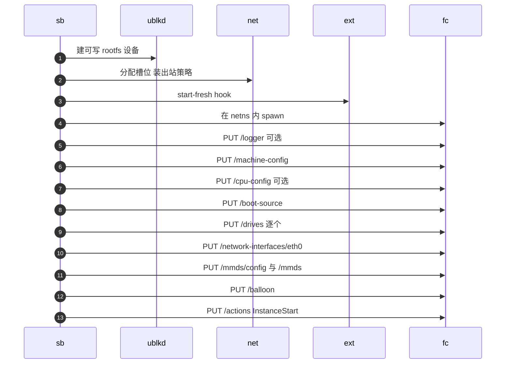
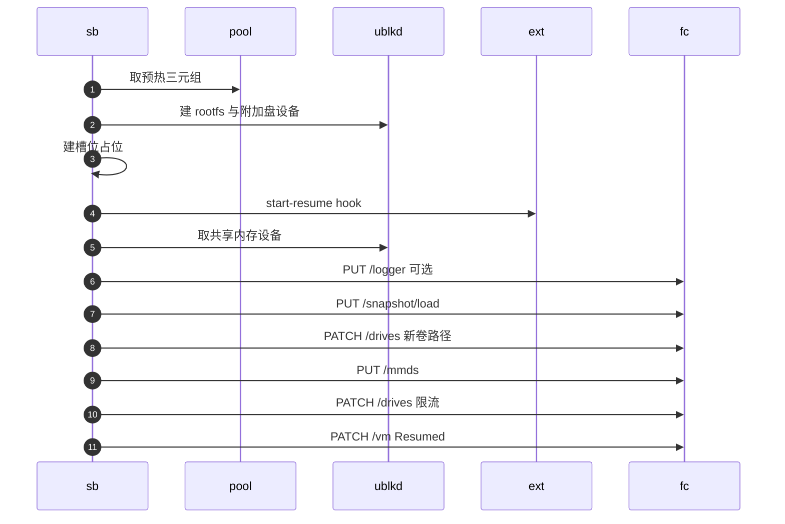
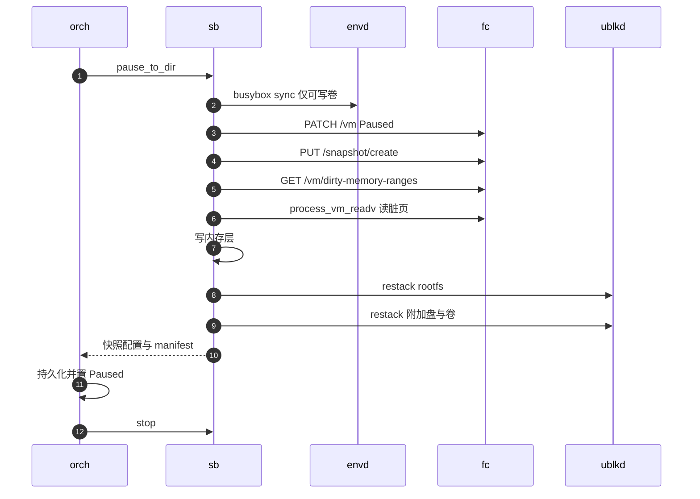

# 27 · 启动、暂停与恢复的 Firecracker 调用序列

> 一台沙箱在 Firecracker 层面只有三种「生」的方式：冷启动、从快照恢复、暂停时写出快照。
> 本篇逐个端点地走一遍这三条序列，重点是每一步为什么在那个位置 —— 哪些配置只能在启动前发、哪些在恢复后必须重发、哪些文件必须先就位。
>
> **读者**：要改动沙箱运行时、排查启动或恢复失败的工程师。　**预备**：[第 09 篇 · 一个沙箱的一生](09-sandbox-lifecycle-walkthrough.md)、[第 25 篇 · 后端抽象与 Firecracker 进程](25-backend-and-firecracker-process.md)、[第 26 篇 · 沙箱的块设备](26-sandbox-block-devices.md)
> 　**代码**：`src/sandbox/firecracker/sandbox.rs`、`src/sandbox/firecracker/instance.rs`、`src/sandbox/firecracker/config.rs`、`src/sandbox/firecracker/factory.rs`、`src/sandbox/manifest.rs`

---

## 0. 本篇要回答的问题

1. 冷启动在发出第一个 Firecracker API 请求之前要准备哪些东西，为什么 Firecracker 进程排在准备工作的最后？
2. 内核命令行（boot args）由哪几段拼成，各段由谁负责、谁来过滤？
3. 从快照恢复时，哪些配置不再发送、哪些必须重发？卷槽位的占位文件为什么一个都不能少？
4. 暂停的顺序为什么是「sync → Paused → 状态快照 → 脏页区间 → 内存成层 → restack」？
5. 为 snapshot、fork、模板构建做的 capture 与 pause 共用哪段代码，差别在哪里？
6. 这几条序列里还留着哪些遗留分支与技术债？

---

## 1. 问题：配置窗口只开一次

Firecracker 的 API 把调用分成两类：启动前（pre-boot）的配置调用，和启动后（post-boot）的控制调用。
machine-config、boot-source、cpu-config、logger、网卡、MMDS 配置、balloon 都只能在 `InstanceStart` 之前设；
`PUT /snapshot/load` 则要求进程**完全没有被配置过**，加载之后，大部分启动前的配置就再也发不进去了。
这是 Firecracker 自己的状态机（见 Firecracker 手册的 API 与快照加载两篇），AgentENV 只能顺着它排序。

于是三条序列各有一个「只开一次」的窗口：

- **冷启动**：所有设备、内核参数、网络与 MMDS 必须在 `InstanceStart` 之前一次配齐；启动后不能再加 virtio-blk 设备。
- **恢复**：设备布局完全继承自 `vm_state.bin`，只能在 load 与 `PATCH /vm Resumed` 之间做少量补丁。
- **暂停**：VM 处于 Paused 的那段时间里，内存、rootfs、附加盘必须被一致地写出。

三条序列的入口都在 `src/sandbox/firecracker/sandbox.rs`。`FirecrackerSandbox::start_nowait()` 先调 `prepare_tools_drive()` 取共享的 tools 盘设备，
再按 `LaunchMode` 分派到 `start_fresh()` 或 `start_resume()`；暂停入口是 `pause_to_dir()`。
请求由 `src/sandbox/firecracker/instance.rs` 的 `FirecrackerInstance` 发出，每个端点一个方法，底层是手写的 UDS HTTP 客户端，**没有请求超时**（[第 25 篇](25-backend-and-firecracker-process.md)）。

### 1.1 工作目录与相对路径

`spawn_with_netns()` 把 Firecracker 进程的当前目录设成沙箱的工作目录（代码注释：「This is crucial for relative paths to work」），
所有块设备都以**相对路径**交给 Firecracker：

```text
<work_dir>/
├── firecracker.socket                 API socket
├── rootfs.ext4  -> /dev/ublkbA        tools 盘（共享只读），drive id = rootfs
├── user-rootfs  -> /dev/ublkbB        用户 rootfs（每沙箱可写），drive id = user_rootfs
├── overlaybd/                         rootfs 可写 upper 的运行时目录
├── <extra drive 的附加文件或链接>
└── agentenv_volume_slot_<i>.img       卷槽位：4 KiB 占位文件，或指向卷设备的 symlink
```

相对路径的意义在恢复时才显现：`vm_state.bin` 里记下的是这些名字，而不是某个具体的 `/dev/ublkbN`。
恢复出来的沙箱在一个新的工作目录里重新建出**同名**的链接，指向新的设备，Firecracker 打开的就是新设备。
这也是预热池命中时 `start_resume()` 要把 `self.work_dir` 换成预热条目自带的那个目录的原因：预热进程的当前目录已经固定（§4.1）。

---

## 2. 冷启动的准备阶段

冷启动由 `FirecrackerSandboxFactory::build()`（`src/sandbox/firecracker/factory.rs`）构造配置，
`FirecrackerSandbox::new_with_id()` 把附加盘分成「物理附加盘」与「卷」两组，物理盘在前、卷在后，
并按 `min(volume.max_volume_count, 24 − 物理盘数)` 记下要预留的卷槽位数（24 即 `config.rs` 的 `MAX_EXTRA_DRIVES`，对应 vdc 到 vdz）。

`start_fresh()` 的准备顺序：

1. `link_tools_drive()`：工作目录里建 `rootfs.ext4` 链接，指向共享的 tools 盘设备。
2. `UblkDeviceManager::create_overlaybd_runtime_device()`：为用户镜像建一个可写的 overlaybd 设备，链接为 `user-rootfs`；
   daemon 返回的 `actual_virtual_size` 记进 `current_rootfs_virtual_size`，暂停时要用它（§5.3）。
3. `prepare_extra_drives(…, ExtraDrivePrepareMode::Fresh)`：为每个附加盘与卷准备设备。
4. `NetworkManager::allocate_any()` 分配网络槽位，`Slot::set_egress_policy()` 在 netns 里装出站策略。
5. 扩展的 start-fresh hook（若配置了 custom extension），可能返回额外的 boot args。
6. 拼完 boot args（§2.1）后，`spawn_with_netns()` 在槽位的 netns 里拉起 Firecracker，构造 `EnvdInstance`，等 API socket 出现。

Firecracker 进程排在最后。推论：这样排有两个好处 —— 前面任何一步失败都不必回收进程；
boot args 依赖网络槽位（`ip=`）与扩展的返回值，进程起来时它们必须已经确定。
代价是这些准备工作全部串行，冷启动不能从进程预热池受益（预热池只服务恢复，[第 32 篇](32-warm-pools.md)）。

### 2.1 boot args 的拼装

boot args 是冷启动独有的输入，恢复时**不重放**（guest 内核早已启动）。它由下表各段依次拼接：

| 段 | 来源 | 过滤 / 规则 |
|---|---|---|
| 基础参数 | `[firecracker] boot_args`，未配置时用 `config.rs` 的 `DEFAULT_BOOT_ARGS` | 无 |
| API 传入的 `extraBootArgs` | `factory.rs` 的 `build()` 追加 | `filter_extra_boot_args()`：字符白名单 + `allowed_extra_boot_args_prefixes` 前缀；前缀表为空时全部丢弃 |
| `init=/init` | `start_fresh()` | 仅当已有参数里没有任何 `init=` 时补上；tools 盘里的 `/init` 负责 pivot 到用户 rootfs |
| `agentenv_drives=` | `build_drives_boot_arg()` | 形如 `vdc:/mnt/data,vdd:/mnt/logs:sub/path`，按附加盘顺序从 c 开始编号 |
| `ip=` | `Slot::build_ip_boot_arg()` | `ip=<vm_ip>::<tap_ip>:<mask>:instance:eth0:off:<dns>`，地址见[第 29 篇](29-network-slots.md) |
| 扩展返回的参数 | start-fresh hook 的响应 | 原样追加，不经前缀过滤 |
| DAMON 监控区间 | `add_damon_monitor_region()` | 已显式给出区间时不动；两个值都写成 `0` 时按内存布局重算 |

最后一段值得一看。`damon_monitor_region()` 按体系结构计算 guest 物理内存的范围：x86_64 从 4096 开始，
内存超过 3 GiB 时终点加 1 GiB，超过 255 GiB 时加 257 GiB（推论：跳过 Firecracker 在 4 GiB 以下留出的 MMIO 空洞等地址区间）；aarch64 从 2 GiB 开始。
DAMON reclaim 只回收 guest 内的冷页缓存，与 balloon 的 free page reporting 配合把物理页还给宿主（§3）。
前缀过滤只作用于 API 传入的参数；扩展是运维方部署的可信组件，它返回的参数不过滤 —— 这把内核命令行的一部分控制权交给了扩展。

`DEFAULT_BOOT_ARGS` 与 `config/default.toml` 的 `boot_args` 不一致：前者没有 `mitigations=off`、`init=/init`、
`page_reporting.page_reporting_order=6`。`init=/init` 会被补上，另外两项只在使用发行配置文件时生效。

---

## 3. 冷启动的配置序列

`configure_microvm()` 按下面的顺序发请求，最后由 `FirecrackerInstance::start()` 发 `InstanceStart`。
图中 `sb` 是 `FirecrackerSandbox`，`ublkd` 是 ublk-daemon，`net` 是网络槽位，`ext` 是自定义扩展，`fc` 是 Firecracker 进程。



几个端点的参数有讲究：

- **machine-config**：`smt` 固定为 false，`track_dirty_pages` 来自 `memory_snapshot.track_dirty_pages`（缺省 true；PVM 模式下在配置归一化时被强制改成 false，见 `src/cfg.rs`）。
  这个开关决定暂停时脏页区间从哪里来（[第 42 篇](42-memory-snapshot-over-ublk.md)）。
- **cpu-config**：只有 `cpu_config_json` 非空时才发。它是 scheduler 下发的集群 CPU 特性交集，经 `cpu_config_arc` 注入工厂，推论：作用是让快照能在集群里的其它节点上恢复（[第 57 篇](57-heartbeat-and-cpu-intersection.md)）。
- **drives**：顺序就是 guest 里的设备名。Firecracker 把 root 设备排在第一个，其余按加入顺序编号，代码注释据此写明「Drive 0 (/dev/vda)」「Drive 1 (/dev/vdb)」「Drive 2+」：

| drive id | guest 设备 | root / 只读 | `direct` | io_engine | 限流 |
|---|---|---|---|---|---|
| `rootfs`（tools 盘） | vda | 是 / 是 | false | Sync | 无 |
| `user_rootfs` | vdb | 否 / 否 | true | Async | 启动前就挂上 |
| 物理附加盘 | vdc 起 | 否 / 按盘 | true | Async | 无 |
| `agentenv_volume_slot_<i>` | 紧随其后 | 否 / 否 | true | Async | 无 |

  `direct` 字段是 AENV 补丁版 Firecracker 新增的 drive 选项，以 O_DIRECT 打开后端文件（[第 67 篇](67-firecracker-patch-layer.md)）；
  为什么磁盘要绕开宿主页缓存而 tools 盘不绕，在[第 26 篇](26-sandbox-block-devices.md)讲。
  rootfs 的限流放在启动前的 drive 配置里而不是启动后 PATCH，注释给的理由是「从 guest 第一次 I/O 起就生效」，不留一个不限流的窗口。
- **卷槽位**：`prepare_volume_drive_slots()` 以 `create_new` 建出 `agentenv_volume_slot_<i>.img`，长度 4 KiB；
  本次就要挂的卷由 `bind_volume_drive_slot()` 删掉占位文件、换成指向卷设备的 symlink，然后所有槽位一并 `PUT /drives`。
  没用上的槽位以 4 KiB 的空盘形式存在于 guest 里，留给日后恢复时「热插」（[第 31 篇](31-extra-drives-and-volumes.md)）。
- **网卡与 MMDS**：网卡 `eth0` 绑 netns 里的 `tap0`；`PUT /mmds/config` 设 V2 并只挂在 eth0 上；`PUT /mmds` 前先在本地检查序列化后不超过 1 MiB（[第 28 篇](28-mmds-and-envd.md)）。
- **balloon**：`amount_mib = 0`、`deflate_on_oom = true`、`free_page_reporting = true`。目的不是撑大气球，而是打开 free page reporting，
  让 guest 把空闲页报告给宿主，与 DAMON reclaim 配合。balloon 的状态保存在 `vm_state.bin` 里，恢复路径不再配置它。

---

## 4. 从快照恢复

`start_resume()` 服务两种调用：从模板（已提交快照）创建沙箱，和恢复本节点上暂停的沙箱。二者的差别只在 `FirecrackerSnapshotConfig` 的来源 ——
前者由 `FirecrackerSnapshotConfig::from_runnable_snapshot()` 从快照 manifest 构造，后者由暂停时写下的不透明状态解码（[第 10 篇](10-node-process-and-object-model.md)）。

### 4.1 load 之前：设备必须先就位

1. **快速失败**：先确认 `UblkDeviceManager::is_available()`。内存恢复必须走 ublk 设备，在分配任何进程或 netns 之前就检查。
2. **预热池**：只在没有自定义 stdout / stderr 路径时尝试 `FirecrackerPool::try_acquire()`，而且预热进程的日志捕获方式必须与本次一致。
   命中后把槽位、工作目录与进程三者一起换进来，用 `relocate_warm_log()` 搬日志文件。
3. **tools 盘与 rootfs**：同名链接重建。rootfs 设备以快照记录的 `rootfs_virtual_size` 同时作为请求大小与已知源大小，`allow_shrink = false`。
   推论：guest 内核在快照之前已经看到了这个容量，恢复后的设备必须一字节不差。
4. **附加盘与卷槽位**：`prepare_snapshot_backing_drives()` 以 Resume 模式准备附加盘；`prepare_volume_drive_slots()` 建出**全部**槽位占位文件。
   注释给出理由：「Snapshot loading reopens every serialized slot path, so all placeholders must exist.」少一个文件，load 就失败。
5. **网络与扩展**：预热池未命中时现场分配槽位并 spawn；随后装出站策略、调 start-resume hook（录制 startup pack 的一次性 VM 不触发）、构造 `EnvdInstance`。
6. **内存设备**：通常走 `get_or_create_shared_mem()`，同一份内存镜像的沙箱共享一个只读 ublk 设备；录制 startup pack 时改用专用设备，并在 load **之前**启动首触页录制。
   这一步的细节在[第 42 篇](42-memory-snapshot-over-ublk.md)与[第 43 篇](43-startup-pack-and-prefetch.md)。

卷的绑定时机分两种情况，由 `initial_guest_drive_mounts` 是否为空决定。恢复暂停的沙箱时，所有卷都已在快照里，`bind_volume_drive_slot()` 在 load **之前**完成，
Firecracker 打开的就是真实的卷设备。从模板创建并带了 `volumeMounts` 时，模板的 vm_state 里这些槽位还是 4 KiB 占位盘，
于是 load 时先打开占位文件，load 之后再换链接并 `PATCH /drives`（§4.2）。

### 4.2 load 与 load 之后



`load_snapshot_file()` 发出的请求体：

```json
{
  "snapshot_path": "<规范化后的 vm_state.bin 路径>",
  "mem_backend": { "backend_type": "File", "backend_path": "/dev/ublkbN" },
  "resume_vm": false,
  "track_dirty_pages": true,
  "network_overrides": [ { "iface_id": "eth0", "host_dev_name": "tap0" } ]
}
```

内存后端类型是 File，路径却是一个块设备。上游 Firecracker v1.15.1 用 fstat 取内存文件大小，对块设备得到 0；
AENV 补丁版 Firecracker 改成 seek 到末尾取大小，块设备才能当内存文件用（[第 67 篇](67-firecracker-patch-layer.md)）。
`network_overrides` 把快照里的 eth0 改绑到新 netns 里的 `tap0` —— 每个 netns 里的 tap 都叫这个名字，所以覆写的值永远相同。
`resume_vm = false` 让 load 与恢复分开，中间留出三步补丁：

- **新卷**：对 load 之后才绑定的卷，`patch_drive_path()` 发 `PATCH /drives/<slot>`，让 Firecracker 重新打开路径并报告真实容量。
- **MMDS**：Firecracker 的快照只保存 MMDS 的版本配置（上游 `src/vmm/src/device_manager/persist.rs` 的 `MmdsState` 只有 version 与 imds_compat），不保存数据。
  所以 `PUT /mmds/config` 不必重发，`PUT /mmds` 必须重发，而且新沙箱的 `instanceID` 与 token 哈希本来就不同（[第 28 篇](28-mmds-and-envd.md)）。
- **限流**：`reconcile_disk_rate_limiter()` 按本节点当前的 `[machine]` 限流配置重算，经 `PATCH /drives/user_rootfs` 覆写快照里继承来的限流器。
  带宽与 IOPS 两个桶**总是**都写：未配置的维度显式设成不限，否则继承来的旧值会留下。注释强调要在 `resume()` 之前做，guest 一开始 I/O 就是新限流。

不发的同样重要：machine-config、boot-source、网卡都在 vm_state 里；balloon 状态在 vm_state 里（`start_resume()` 开头的注释）；
cpu-config 是启动前调用，CPU 状态已序列化在 vm_state 里，`from_runnable_snapshot()` 的注释写明重设「is incorrect and is rejected by Firecracker anyway」。

---

## 5. 暂停：把一台 Paused 的 VM 写成快照

### 5.1 序列

orchestrator 在 `pause_sandbox_impl()` 里摘掉句柄与代理路由后调后端 `pause(Some(artifact_root))`，即 `pause_to_dir()`。



### 5.2 每一步为什么在那个位置

- **sync 在 Paused 之前**：它是经 envd 在 guest 里以 root 执行 `/agentenv/bin/busybox sync`，guest 必须在跑。
  只有挂了可写持久卷（`has_writable_persistent_volumes()`）才做。推论：rootfs 不需要 sync，因为 guest 页缓存里尚未落盘的 rootfs 数据就在内存里，会随内存层一起保存，恢复时两者一致；
  卷则会被单独发布、可能被别的沙箱挂载，它的盘上内容必须自洽。
- **Paused 在一切写出之前**：Firecracker 只允许对暂停的 VM 建快照；之后的内存读取与 restack 也都依赖 guest 不再写内存与磁盘。
- **状态快照不带内存文件**：`create_state_only_snapshot()` 发 `PUT /snapshot/create`，`snapshot_type = Diff`，没有 `mem_file_path`。
  上游 v1.15.1 里这个字段必填；AENV 补丁版 Firecracker 把它改成可选，缺省时 `create_snapshot()`（`src/vmm/src/persist.rs`）只写状态文件，
  既不写内存，也不动脏页记录 —— 此时 `snapshot_type` 只影响日志与时延指标的归类。代码注释说明，这一步之后 `vm_state.bin` 已代表这个暂停状态，之后任何错误都中止本次快照。
- **脏页区间在状态快照之后**：AENV 补丁版 Firecracker 新增的 `GET /vm/dirty-memory-ranges` 返回每段脏区间的宿主虚拟地址、镜像内偏移与长度，
  查询在逻辑上不清除脏位（[第 67 篇](67-firecracker-patch-layer.md)）。`convert_dirty_memory_to_overlaybd()` 再用 `process_vm_readv` 从 Firecracker 进程的地址空间读这些页，
  写成 `mem_overlaybd/` 下的一层，`build_mem_snapshot_image_config()` 把它压在来源内存层栈之上并写出 `mem_image.json`。本地一律写 Raw，压缩留到发布时。
  区间怎样变成段映射、层栈怎样继承与压实，是[第 42 篇](42-memory-snapshot-over-ublk.md)的内容。
- **restack 在内存之后**：`restack_snapshot_overlaybd_rootfs()` 让 daemon 把 rootfs 的可写 upper 原地封存、压到 lower 栈顶（[第 37 篇](37-seal-restack-compact.md)、[第 41 篇](41-ublk-daemon.md)）。
  VM 仍处于 Paused，upper 不会再有新写入。附加盘由 `snapshot_extra_drives()` 逐个 restack：普通附加盘写到 `<dir>/drives/<id>/snapshot.commit`；
  卷写到它自己的持久目录，文件名带 UUIDv7（`snapshot-<uuid>.commit`），因为同一目录里更早的层可能仍被引用，不能覆盖。

失败时 `pause_to_dir()` 删掉写了一半的目录。错误默认被归为可恢复（`SandboxCaptureError` 的 `From<anyhow::Error>`），
`recover_capture_failure()` 对可恢复错误发 `PATCH /vm Resumed` 把 VM 救回运行；救不回来才升级为终止性错误。失败语义在[第 20 篇](20-launch-plan-and-rollback.md)。

### 5.3 产物：两份描述

`snapshot_to_dir()` 最后组装两样东西：

- **`FirecrackerSnapshotConfig`**：给本节点恢复用。它复制启动时的公共配置，再换上**当前**的出站策略与扩展参数（运行中可能被改过）、
  restack 之后的附加盘列表、指向新 rootfs 层栈的镜像配置与 `rootfs_virtual_size`。缺少后者时 `snapshot_rootfs_virtual_size()` 直接报错 —— 这正是冷启动第 2 步要缓存设备实际大小的原因。
- **`SandboxSnapshotManifest`**（`src/sandbox/manifest.rs`）：给提交到快照仓库用，记录 vm_state、内存、rootfs、附加盘、`volume_drive_slots` 与 `physical_extra_drive_count`。
  它**不含卷**：`manifest_extra_drives` 过滤掉了 `is_volume()` 的盘，卷的快照单独记录（[第 46 篇](46-snapshot-object-model.md)）。
  于是从模板启动时，`from_runnable_snapshot()` 读到的附加盘只有物理盘，卷由本次启动的 `volumeMounts` 决定。

---

## 6. capture 与 pause：同一段代码，四种收尾

`pause_to_dir()` 是所有「把 VM 写成快照」操作的共同核心，差别只在目录归谁、写完之后 VM 怎么办：

| 入口（`SandboxBackend` 方法） | 调用方 | 写到哪里 | 写完之后 |
|---|---|---|---|
| `pause(Some(root))` | orchestrator 的 pause | `artifacts/<id>/<uuidv7>/` | 不恢复；orchestrator 持久化后 `stop()` |
| `snapshot()` | orchestrator 的 capture | 托管根下的 `<uuidv7>/` | 原地 `PATCH /vm Resumed` |
| `fork()` | orchestrator 的 fork | `FirecrackerSandbox::pause()` 的托管根 | 源 VM 原地恢复，再并发启动各子 VM |
| `capture_to_dir()` | 模板构建（`src/template/runner.rs`） | 调用方给的目录 | 不恢复；调用方随后 stop |

托管根是 `managed_snapshot_base()` 下按沙箱 ID 分的目录（`[firecracker] work_dir/managed-snapshots`，未配置时在系统临时目录下），由 `PersistentSnapshotRootGuard` 的引用计数管理生命周期。
capture 之后原地恢复失败会被直接标成终止性错误：VM 的快照已经写好，但它自己回不到运行态。
这四种收尾都不触发自定义扩展的 hook：hook 只在 `start_fresh()`、`start_resume()` 与 `stop()` 里发送。snapshot 与 fork 原地恢复的源 VM 对扩展而言从未停过；pause 的收尾是一次普通的 `stop()`，其中的 stop hook 排在归还块设备之后、交还网络槽位之前（[第 25 篇 §7.2](25-backend-and-firecracker-process.md#72-firecrackersandboxstop)、[第 33 篇 §3.3](33-custom-extension-hooks.md#33-stop拆除序列中间的一步)）。
另有一个只处理卷的变体 `snapshot_volumes()`：sync → `PATCH /vm Paused` → restack 可写卷 → `PATCH /vm Resumed`，不碰内存与 rootfs。

---

## 7. 端点调用表

| 端点 | 冷启动 | 恢复 | 暂停 / capture | 来源 |
|---|---|---|---|---|
| `PUT /logger` | 配了 `firecracker.log_level` 时 | 同左 | — | 上游 |
| `PUT /machine-config` | 是 | — | — | 上游 |
| `PUT /cpu-config` | 有集群 CPU 配置时 | 禁止 | — | 上游 |
| `PUT /boot-source` | 是 | — | — | 上游 |
| `PUT /drives/{id}` | 每块盘一次 | — | — | 上游；`direct` 为补丁新增 |
| `PATCH /drives/{id}` | — | 新卷路径；rootfs 限流 | — | 上游 |
| `PUT /network-interfaces/eth0` | 是 | 由 `network_overrides` 代替 | — | 上游 |
| `PUT /mmds/config` | 是 | — | — | 上游 |
| `PUT /mmds` | 是 | 是 | — | 上游 |
| `PUT /balloon` | 是 | — | — | 上游 |
| `PUT /actions InstanceStart` | 是 | — | — | 上游 |
| `PUT /snapshot/load` | — | File 后端指向块设备 | — | 上游；块设备取大小靠补丁 |
| `PATCH /vm` | — | Resumed | Paused；capture 后 Resumed | 上游 |
| `PUT /snapshot/create` | — | — | 只写状态 | 补丁使 `mem_file_path` 可选 |
| `GET /vm/dirty-memory-ranges` | — | — | 是 | 补丁新增 |

四个被用到的补丁行为 —— `mem_file_path` 可选、`dirty-memory-ranges`、seek 取内存文件大小、drive `direct` —— 全部出现在这张表里。

---

## 8. 遗留路径与技术债

- **`load_snapshot_uffd()`**：`instance.rs` 里以 `#[allow(dead_code)]` 保留的 Uffd 后端加载方法，`resume_vm` 直接为 true。
  它对应的按缺页供给内存的方案已被「只读 ublk 设备 + File 后端」取代，两种方案的比较在[第 44 篇](44-uffd-alternative.md)。
- **非 ublk 的 rootfs 分支**：`snapshot_to_dir()` 在 `ublk_config` 为空时用 `copy_cow()` 复制 `work_dir/rootfs.ext4`。
  这个名字现在指向 tools 盘的链接，而冷启动总会设置 `ublk_config`，所以该分支实际不可达；`start_resume()` 里对应地在 `ublk_config` 为空时不建 `user-rootfs`，load 会因找不到盘失败。
- **REST 调用无超时**：Firecracker 卡住时，持有沙箱锁的启动、恢复或暂停会一直挂着（[第 25 篇](25-backend-and-firecracker-process.md)）。
- **默认 boot args 两处维护**：`DEFAULT_BOOT_ARGS` 与 `default.toml` 已经不一致（§2.1），DAMON 参数要两边同步。
- **扩展的 boot args 不过滤**：这是信任扩展的取舍，后果是扩展的错误参数会直接进入 guest 内核命令行。

---

## 9. 与 e2b infra 的对照

e2b infra 的恢复同样用 `resume_vm = false` 把 load 与恢复分开，但它要在两者之间等 uffd 服务接管内存，并且先 `PATCH /vm Resumed` 再写 MMDS；
AgentENV 的内存是一个现成的块设备，load 返回即可补丁，MMDS 在恢复之前写好，guest 不会读到空的 MMDS。
暂停时两边都只让 Firecracker 写状态文件、由宿主自己读脏页，区别在于 e2b infra 先取脏页位图与内存映射、再自行换算脏块（e2b 手册第 37 篇），AgentENV 依赖补丁版 Firecracker 直接返回带宿主虚拟地址的脏页区间。

---

## 10. 小结

- 三条序列的形状由 Firecracker 的 API 状态机决定：启动前配置只开一次，load 要求未配置的进程，加载后只能做少量补丁。
- 所有块设备以工作目录内的相对链接交给 Firecracker；恢复时在新目录里重建同名链接，就换上了新设备。
- 冷启动把 Firecracker 进程放在准备工作的最后，boot args 由基础参数、过滤后的 API 参数、`init=`、`agentenv_drives=`、`ip=`、扩展参数与 DAMON 区间拼成。
- rootfs 限流在冷启动时作为启动前配置挂上，恢复时在 `Resumed` 之前 PATCH 覆写，两条路都不留不限流的窗口。
- 恢复前必须建出全部卷槽位占位文件；已在快照里的卷在 load 前绑定，模板启动新加的卷在 load 后经 `PATCH /drives` 换上。
- 恢复不重发 machine-config、boot-source、cpu-config、网卡与 balloon；MMDS 数据不在快照里，必须重写。
- 暂停顺序是 sync（仅可写卷）→ Paused → 只写状态的 Diff 快照 → 脏页区间 → 内存成层 → restack rootfs 与附加盘，VM 全程保持 Paused。
- snapshot、fork、模板构建与 pause 共用 `pause_to_dir()`，差别只在目录归属与写完之后是原地恢复还是停机。
- 被用到的四个 AENV 补丁行为全部落在这三条序列上：可选 `mem_file_path`、`dirty-memory-ranges`、seek 取内存文件大小、drive `direct`。

## 延伸阅读 / 下一篇

- 下一篇：[第 28 篇 · MMDS 与 envd](28-mmds-and-envd.md) —— 恢复序列里重写的 MMDS 装了什么，`Resumed` 之后宿主怎样等 guest 就绪。
- [第 42 篇 · 内存快照](42-memory-snapshot-over-ublk.md)：脏页区间怎样变成 overlaybd 层，共享内存设备怎样复用页缓存。
- [第 67 篇 · Firecracker 补丁层](67-firecracker-patch-layer.md)：本篇用到的四个补丁行为的实现。
- [第 31 篇 · 附加盘与卷](31-extra-drives-and-volumes.md)：卷槽位与恢复后热插的完整流程。
- [e2b 手册第 28 篇 · Firecracker 进程管理](../e2b-infra/28-firecracker-process-management.md)、[e2b 手册第 37 篇 · Pause](../e2b-infra/37-pause-and-snapshot.md)：e2b infra 的同类序列。
