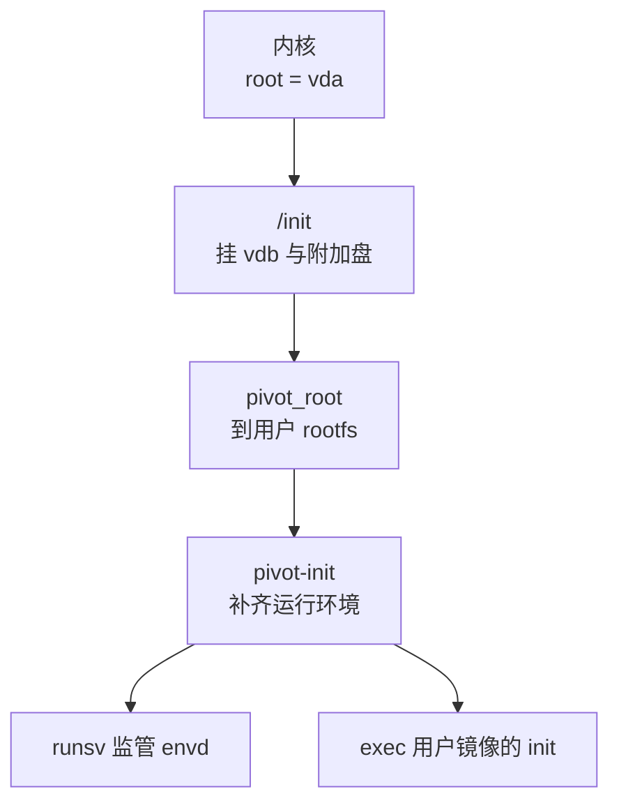
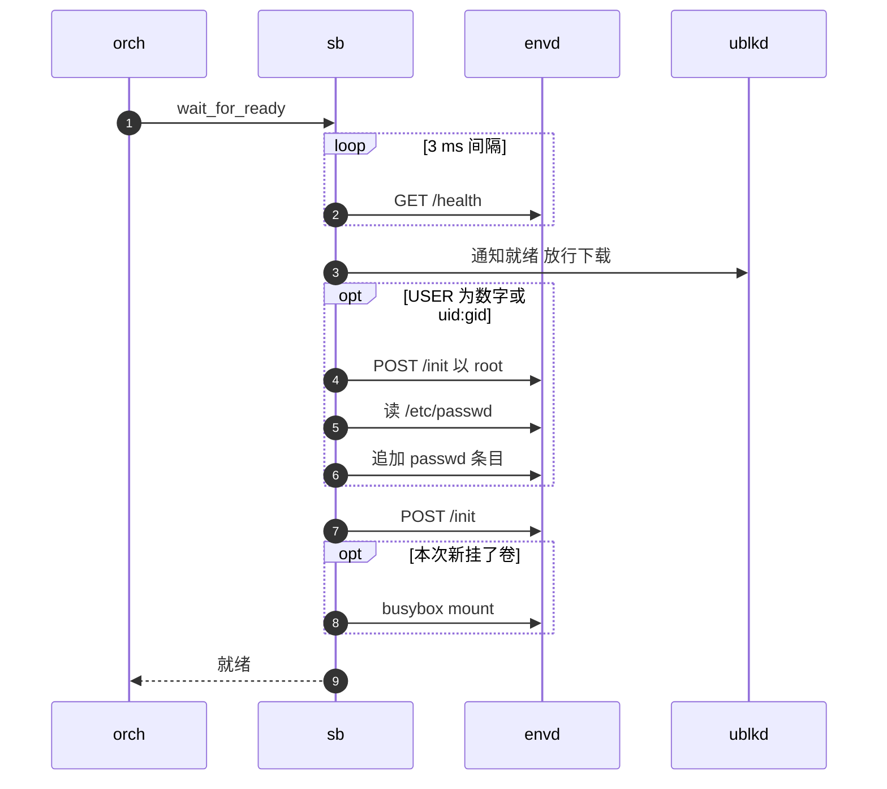

# 28 · MMDS 与 envd

> 同一份模板快照会恢复出成百上千台沙箱，它们的内存在恢复那一刻一模一样。
> 「这一次运行是谁、凭什么访问它、现在几点」必须由宿主在每次启动时注入。
> 本篇讲注入的两条通道 —— Firecracker 的 MMDS 与 guest 里的 envd —— 以及宿主怎样判断 guest 就绪、怎样在 guest 里执行运维命令。
>
> **读者**：要理解沙箱身份与就绪判定、或要调试「沙箱起来了但用不了」的工程师。　**预备**：[第 13 篇 · 认证与凭据](13-authentication.md)、[第 27 篇 · 启动、暂停与恢复的 Firecracker 调用序列](27-start-pause-resume-sequences.md)
> 　**代码**：`src/sandbox/firecracker/mmds.rs`、`src/sandbox/envd.rs`、`src/sandbox/envd/user.rs`、`src/sandbox/process.rs`、`thirdparty/envd/src/transport.rs`、`tools-image/`

---

## 0. 本篇要回答的问题

1. 宿主经哪两条通道把身份交给 guest，各自送什么、为什么要两条？
2. MMDS 里有哪些字段，为什么字段名与 E2B 相同、token 只放哈希？它在冷启动与恢复时分别何时写入？
3. envd 从哪里来、怎样被拉起？宿主怎样判定它就绪，为什么每次启动与恢复都要再发一次 `/init`？
4. Dockerfile 的 `USER` 是数字或 `uid:gid` 时，为什么要发两次 `/init`？
5. 宿主连 envd 的 HTTP 与 gRPC 客户端为什么不保留连接、为什么要探测协议版本？
6. 宿主在 guest 里执行 mount、sync 这类命令时以谁的身份、依赖什么？

---

## 1. 问题：guest 不知道自己是谁

从模板创建沙箱是一次快照恢复（[第 09 篇](09-sandbox-lifecycle-walkthrough.md)）。恢复出来的 guest 内存是模板制作时的内存：
时钟停在那一刻，进程里记着的访问令牌属于构建模板的那台 VM，环境变量也是模板的。同一模板的所有沙箱在这一点上完全相同。
所以每台沙箱的「本次身份」只能从外部注入，而且必须在用户的请求到达之前完成。

AgentENV 沿用 E2B 的做法，用两条互补的通道：

- **MMDS**（microVM metadata service）：Firecracker 提供的元数据服务。宿主经 Firecracker API 写入一段 JSON，guest 从链路本地地址 `169.254.169.254` 读取。
  它是**带外**的：内容不经过沙箱的网络栈与 netns，guest 里的代码无法伪造。宿主只写，不知道 guest 何时读。
- **envd 的 `/init`**：宿主经网络向 guest 内的 envd 守护进程 `POST /init`，把令牌、环境变量、工作目录、默认用户与当前时间推进去。
  它是**推送**的：宿主知道它何时成功。但 envd 需要一个可信的依据来判断「这个换令牌的请求确实来自宿主」——这个依据来自 MMDS 里的令牌哈希。

第三条通道是运维通道：宿主以 envd 的进程与文件系统 gRPC 服务为「手」，在 guest 里执行挂载、冻结、sync 等命令（§6）。

---

## 2. MMDS：带外的身份

### 2.1 字段

`src/sandbox/firecracker/mmds.rs` 的 `MmdsMetadata` 序列化成下面的 JSON。前四个字段名与 e2b infra 的 `MmdsMetadata` 相同，因为 guest 里跑的是 e2b infra 的 envd，它按这些名字读取（§3.1）：

| JSON 字段 | Rust 字段 | 值 |
|---|---|---|
| `instanceID` | `sandbox_id` | 本次沙箱 ID |
| `envID` | `snapshot_id` | 从模板创建时是快照记录 ID；冷启动时是镜像引用；缺省 `"unknown"` |
| `address` | `logs_collector_address` | 恒为空串 |
| `accessTokenHash` | `access_token_hash` | 访问令牌的 SHA-512 十六进制；无令牌时为空串的 SHA-512 |
| 其它顶层键 | `extra`（`#[serde(flatten)]`） | 目前只有 `imageConfigs` |

`accessTokenHash` 总有值：非 secure 沙箱写的是 `SHA-512("")`，与 e2b infra 的约定一致 —— 宿主以此**显式**表达「允许不带令牌」，guest 侧不必区分「无令牌」与「字段缺失」。
放哈希而不放令牌，是因为 MMDS 对 guest 里的任何进程都可读；读到哈希不能拿去访问 envd。envd 收到 `/init` 时，对请求里的令牌做 SHA-512 再与 MMDS 比较
（e2b infra 侧的校验逻辑见 e2b 手册第 48 篇）。令牌本身的派生方式在[第 13 篇](13-authentication.md)。

`address` 恒为空。推论：按 e2b 手册对 envd 的描述，envd 只在这个地址非空时才启动日志外送，所以 AgentENV 的沙箱里 envd 不向宿主推日志；envd 的日志写在 guest 内的 `/var/log/agentenv/`（§3.1）。

`extra` 以 flatten 方式合并到顶层。`with_extra()` 先删掉与四个保留字段同名的键，调用方塞进来的数据不能覆盖身份与令牌哈希。
唯一的 extra 是 `imageConfigs`：一个数组，每项是 `{driveId?, mountPath, config}`，`config` 是源 OCI 镜像配置原样的 JSON（`src/types/image_configs.rs`），
来自快照记录的 `image_configs` 或冷启动时解析出的镜像配置（`src/orchestrator/service.rs` 的 `create_sandbox_inner()`）。
仓库里没有 guest 侧读取它的代码；推论：它是留给 guest 里的用户程序按需读取的（例如取镜像的 `Cmd`、`Env`）。

### 2.2 大小与写入时机

`imageConfigs` 可能很大，所以 `spawn_with_netns()` 用 `--mmds-size-limit 1048576` 把 Firecracker 的 MMDS 上限提到 1 MiB，
并把 `--http-api-max-payload-size` 设成同样的值 —— `PUT /mmds` 的请求体要经过 API 服务器，两个上限必须一起放宽。
`FirecrackerInstance::set_mmds()` 在发请求前先序列化检查一次，超限就直接报错，错误信息提示「imageConfigs may be too large」。

| 场景 | 配置 | 数据 | 位置 |
|---|---|---|---|
| 冷启动 | `PUT /mmds/config`：V2，只挂 eth0 | `PUT /mmds`，在 `InstanceStart` 之前 | `configure_microvm()` |
| 从快照恢复 | 不发，版本配置在快照里 | `PUT /mmds`，在 load 之后、`PATCH /vm Resumed` 之前 | `start_resume()` |

恢复时必须重写数据：Firecracker 的快照只保存 MMDS 的版本配置（上游 `src/vmm/src/device_manager/persist.rs` 的 `MmdsState` 只有 version 与 imds_compat），
数据存储在 load 之后是空的。写在 `Resumed` 之前，guest 恢复运行的第一刻读到的就是本次的内容。

两种恢复的身份来源不同：

- **从模板创建**：`FirecrackerSandbox::snapshot_config_for_launch()` 新建一份 `MmdsMetadata::new(sandbox_id, snapshot_id)`，挂上本次令牌的哈希与 `extra_mmds`。
- **恢复暂停的沙箱、fork 的子沙箱**：`from_snapshot_config_with_override()` 沿用快照配置里保存的那份元数据（包括 `envID` 与 `imageConfigs`），只把 `instanceID` 换成本次 ID、把令牌哈希按本次令牌重算。
  令牌本身在 `FirecrackerCommonConfig` 里标了 `#[serde(skip)]`，不随暂停状态落盘，恢复时由 orchestrator 重新派生。

MMDS 用 V2：guest 要先 `PUT` 换一个会话 token，再带着它 `GET`。这让 guest 里的 SSRF 类漏洞难以顺手读走元数据（e2b 手册第 48 篇）。只挂在 eth0 上，因为沙箱只有这一块网卡。

---

## 3. envd：guest 里的代理人

### 3.1 来源与拉起

envd 是 e2b infra 的 guest 守护进程，在 AgentENV 里**不在用户镜像里**，而在 tools 盘（vda）上。
`tools-image/Dockerfile` 从 `e2b-dev/infra` 的 `packages/envd` 编译它（`ENVD_REF` 缺省 `2026.17`），与 BusyBox、`/init`、`/agentenv/pivot-init` 一起打成 tools 盘镜像。
所以用户镜像里不需要装任何 E2B 组件；代价是 envd 的版本跟着 tools 盘走，而不是跟着模板走。

guest 的启动链（内核 `init=/init` 指向 tools 盘）：



`tools-image/init` 挂上 `/dev/vdb`（用户 rootfs），按 `agentenv_drives=` 挂附加盘，把 tools 盘 bind 到用户 rootfs 的 `/agentenv`，然后 `pivot_root`。
`tools-image/pivot-init` 在用户的文件系统里补齐 envd 需要的东西：devpts、`/dev/shm`、tmpfs 的 `/run`、拉起 `lo`、
为缺 `nice` / `ionice` 的精简镜像链上 BusyBox、没有 `/etc/passwd` 时写一条 root、从内核 `ip=` 参数留下的 `/proc/net/pnp` 生成 `/etc/resolv.conf`。
envd 由 `busybox runsv` 监管，崩溃或被杀后自动重启；最后 `exec` 用户镜像自己的 init（依次找 `/init`、`/sbin/init`、`/bin/init`、`/bin/sh`）。
这些步骤只在冷启动时执行一次；从快照恢复的 guest 直接从快照那一刻继续运行，envd 早已在跑。

配置里的 `[envd] version`（缺省 `0.5.15`）是「tools 盘里应当是这个版本」的声明，运行时并不核对。
冷启动沙箱的元数据直接报告这个配置值（`service.rs` 的 `configured_runtime_versions()`）；模板构建则在 builder VM 里实际执行 `envd --version` 探测并记进快照（`src/snapshot/types/version.rs` 的 `probe_envd_version()`）。
两处来源不同，换了 tools 盘而忘改配置时，冷启动沙箱报告的版本会与实际不符。

### 3.2 地址

宿主访问 envd 的地址是 `http://<host_interaction_ip>:<control_plane_port>`，端口来自 `[tools] control_plane_port`（缺省 49983）。
`host_interaction_ip` 是网络槽位分配给宿主侧的地址，宿主经 netns 里的 DNAT 到达 guest 的 eth0（[第 29 篇](29-network-slots.md)）。
`start_fresh()` 与 `start_resume()` 都在拿到槽位后用这个地址构造 `EnvdInstance`，此时 guest 还没有开始运行。

---

## 4. 就绪与 `/init`

### 4.1 `wait_for_ready()` 的顺序

orchestrator 的 `launch_sandbox()` 在后端 `start_nowait()` 返回、句柄登记之后调 `FirecrackerSandbox::wait_for_ready()`（[第 20 篇](20-launch-plan-and-rollback.md)）。
冷启动、从模板创建、恢复暂停的沙箱都走这一步。图中 `orch` 是 orchestrator，`sb` 是 `FirecrackerSandbox`，`ublkd` 是 ublk-daemon。



`EnvdInstance::wait_for_ready()` 的参数来自 `[envd]`：`init_timeout_secs` 缺省 60，`poll_ms` 缺省 3。
单次 `/health` 探测有 1 s 的上限（`HEALTH_PROBE_TIMEOUT`），并且不超过剩余总时长，所以一个挂住的探测不会让等待超出 60 s（测试 `readiness_deadline_bounds_a_hung_health_probe` 验证这一点）。
3 ms 的轮询间隔意味着就绪判定的分辨率很高；代价是 guest 起来之前会有大量失败的探测，每次都是一条新的 TCP 连接（§5.1）。

`/health` 通过之后、`/init` 之前，`wait_for_ready()` 通知 ublk-daemon 「这台沙箱已经起来」，让 daemon 放行为 tools、内存、rootfs 暂缓的后台下载（[第 39 篇](39-block-cache-and-background-download.md)）。
排在 `/init` 之前，是因为 envd 能回应 `/health` 就说明启动关键路径上的读已经过去了。新挂的卷在 `/init` 之后挂载，因为挂载要经 envd 执行命令（[第 31 篇](31-extra-drives-and-volumes.md)）。

这一切发生在代理路由发布之前：orchestrator 在 `wait_for_ready()` 成功、状态 CAS 到 Running 之后才 `upsert_proxy_route_if_current_handle()`（[第 09 篇](09-sandbox-lifecycle-walkthrough.md)），
外部的数据面请求在 `/init` 完成之前到不了 envd。

### 4.2 `/init` 的内容

`EnvdInstance::post_init()` 发出的请求体（`InitPostRequest`，由 `thirdparty/envd/http-client/envd.yaml` 生成）：

```json
{
  "accessToken": "<本次令牌，非 secure 沙箱缺省>",
  "envVars": { "HOME": "/app" },
  "defaultWorkdir": "/work",
  "defaultUser": "root",
  "timestamp": "2026-10-11T08:00:00.000+00:00"
}
```

令牌同时放在 `X-Access-Token` 头里（生成客户端的 `api_key` 配置，spec 的 `AccessTokenAuth`）与请求体里，测试 `init_sends_access_token_in_header_and_body` 断言两处都有。
`timestamp` 每次请求现取 `Utc::now()`，envd 据此把 guest 时钟拨到现在。e2b infra 的 spec 还有 `hyperloopIP`、`volumeMounts`、`caBundle` 三个字段，AgentENV 都不填：
它没有 hyperloop 通道，卷由宿主自己挂载。

为什么每次启动都要发，包括恢复暂停的沙箱：

- **时钟**：快照里的 guest 时钟停在暂停那一刻，恢复后差多少取决于暂停了多久。
- **令牌**：从模板创建的沙箱，envd 内存里是构建模板时的令牌；新令牌必须经 `/init` 换进去，envd 用 MMDS 里刚写的哈希判定这次换令牌是宿主授权的。
  恢复暂停的沙箱时令牌不变（令牌是对沙箱 ID 的确定性派生），但 envd 进程可能被 runsv 重启过，内存里的令牌已经丢失 —— 推论：`/init` 同时起到补灌的作用。
- **环境与默认值**：launch 时传入的环境变量合并在模板的环境变量之上（`snapshot_config_for_launch()`），只有经 `/init` 才进入 envd。

`/init` 失败会让 `wait_for_ready()` 失败，orchestrator 按启动失败回滚（[第 20 篇](20-launch-plan-and-rollback.md)）。
AgentENV 不重试 `/init`，因为它只在 `/health` 已经通过之后才发。

### 4.3 数字 `USER`：两次 `/init`

Dockerfile 允许 `USER 1000` 或 `USER 1000:1000` 这样只给数字、甚至镜像里没有对应账户的写法；envd 却要一个用户名。
`src/sandbox/envd/user.rs` 的 `needs_resolution()` 判定：值全是数字、或包含 `:`，就要解析。解析流程在 `EnvdInstance::init()` 里：

1. **先以 root 引导一次**：`post_init(None, "/", "root")`，只带令牌，不带环境变量。注释说明要先让这一代运行时通过认证，恢复之后也一样 —— 下面读文件的请求要用新令牌。
2. **读账户文件**：经 envd 的 `GET /files`、以 root 读 `/etc/passwd`；`USER` 里的组是名字而不是数字时再读 `/etc/group`。单个文件上限 1 MiB，404 视为空文件。整个解析限时 30 s。
3. **`resolve_user()`**：数字 UID 能在 passwd 里找到、且组与该账户的主组相同，就用那个账户名；否则造一个名字 `aenv-<uid>-<gid>`（重名时加 `-1`、`-2` 后缀）。
   注释的理由是：显式的 `UID:GID` 不应改写已有用户的主组。
4. **补账户**：需要新条目时，以 root 执行 `/agentenv/bin/busybox sh -c "printf … >> /etc/passwd"`（限时 10 s）。
   条目写进用户 rootfs，会随快照保存；下一次恢复时 `resolve_user()` 找到字段完全匹配的同名条目，直接复用，不再追加。
5. **正式 `/init`**：带上解析后的用户名、环境变量与工作目录。

代价是这类沙箱每次启动多三次往返，并且宿主会改写 guest 的 `/etc/passwd`。

---

## 5. 客户端：不信任「同一个 IP 还是同一台 VM」

### 5.1 引导 HTTP 客户端

`/health`、`/init`、`/files`、`/metrics` 走 OpenAPI 生成的 HTTP 客户端。所有 `EnvdInstance` 共享一个 `ENVD_BOOTSTRAP_HTTP_CLIENT`，构造时 `pool_max_idle_per_host(0)`：不保留任何空闲连接。
注释给的理由是「Bootstrap addresses can be reused across sandbox runtime generations」—— 网络槽位会回收复用（[第 32 篇](32-warm-pools.md)），同一个 `host_interaction_ip` 下一刻可能属于另一台 VM，
一条保留下来的连接可能连着上一台 VM 的 envd。不复用连接的代价是每个请求一次 TCP 握手；宿主到 guest 只隔一层 netns，这个代价很小。

### 5.2 失效标志

`EnvdInstance` 可以被克隆（指标采样任务、`Executor` 都持有克隆），所有克隆共享一个 `live: Arc<AtomicBool>`。
`FirecrackerSandbox::stop()` 停掉 Firecracker 进程后调 `invalidate()`，此后任何克隆调 `metrics()`、`process_client()`、`filesystem_client()` 都直接报错「sandbox runtime is no longer active」。
这与 §5.1 是同一个问题的两面：IP 会被下一台 VM 复用，旧句柄不能悄悄连到新 VM 上。`/health` 与 `/init` 不检查这个标志，它们只在启动路径上由当前句柄调用。

### 5.3 gRPC 客户端与协议探测

进程与文件系统服务走 gRPC。`thirdparty/envd/src/lib.rs` 的 `ProcessClient::connect()` / `FilesystemClient::connect()` 每次都经 `transport.rs` 的 `new_channel()` 建一个新通道，
通道的实现是 `DualClient`：一个只讲 HTTP/2（prior knowledge）的 hyper 客户端，加一个 HTTP/1.1 客户端。

- **首次请求先探测**：向 `/` 发一个 `OPTIONS`，用 HTTP/2 客户端。成功就记为 H2，失败就记为 H1，并把之后请求的版本强制为 HTTP/1.1。结果缓存在这个通道里。
- **令牌**：每个请求加 `x-access-token` 头，头值标记为 sensitive（不进调试输出）。
- **TCP_NODELAY**：两个客户端都关掉 Nagle，注释的理由是 envd 交换的都是小帧，合并发送只增加延迟。

推论：探测结果只缓存在单个通道里，而 `Executor` 每次操作都新建客户端，所以每次操作都要多做一次探测。
按 e2b 手册第 48 篇，e2b infra 2026.09 的 envd 只讲 HTTP/1.1，若 tools 盘里的 envd 仍是如此，这次 H2 探测每次都会失败、白白多一个往返。

---

## 6. `Executor`：宿主在 guest 里的手

`src/sandbox/process.rs` 的 `Executor` 在 envd 的进程服务之上封装了「运行命令并收集输出」（`run_command_with_opts()`）、「启动长进程」（`start_process()`，返回可写 stdin、发信号的 `ProcessHandle`）与 `create_dir_all()`。
stdout 与 stderr 合计超过 10 MiB（`MAX_OUTPUT_BYTES`）就报错。

以谁的身份运行，取决于是否调了 `with_root_user()`：

| 来源 | 身份 | 用途 |
|---|---|---|
| `SandboxExecutor::executor()`、`Executor::for_endpoint()` | envd 的默认用户（`/init` 设定的 `defaultUser`） | 版本探测、镜像构建 worker 等 |
| `Executor::new(...).with_root_user()`（模块内可见） | root | 建目录、`mount` / `umount`、`sync`、`fsfreeze`、追加 passwd 条目 |

`with_root_user()` 在 gRPC 请求上加 `authorization: Basic cm9vdDo=`，即 `root:` 的 base64。envd 用 HTTP Basic 的用户名选择 guest 账户，这不是凭据，认证仍靠令牌（e2b 手册第 48 篇）。
推论：因此任何持有沙箱令牌的调用方都能选择以 root 执行，这与 e2b infra 的语义相同。

宿主执行的运维命令全部显式调用 `/agentenv/bin/busybox`：`run_guest_command()` 执行 mount、umount、sync，`set_volume_freeze()` 在 guest 里跑一段 busybox 脚本做 fsfreeze（[第 21 篇](21-deletion-and-volume-capture.md)）。
建目录则走 envd 的文件系统服务 `MakeDir`，注释写明这样「no binary from the guest image is involved」。
这样做把运维通道从用户镜像里解耦：精简镜像里没有 `mount` 或 `sync`，或者装了行为不同的版本，都不影响宿主的操作。代价是这些操作都依赖 tools 盘的 BusyBox 版本与 bind 到 `/agentenv` 的挂载仍然存在。

---

## 7. 与 e2b infra 的对照

e2b infra 在 `PATCH /vm Resumed` 之后才写 MMDS，`address` 填日志收集地址，`/init` 还带 `hyperloopIP` 建立 guest 到宿主的事件通道；AgentENV 在恢复之前写 MMDS，`address` 为空，没有 hyperloop。
e2b infra 不单独探测 `/health`，而是以短超时无限重试 `/init` 本身来同时完成就绪判定与初始化；AgentENV 先以 3 ms 间隔轮询 `/health`，再发一次 `/init`，中间插入通知 ublk-daemon 的一步。
envd 在 e2b infra 里随模板 rootfs 构建，在 AgentENV 里随 tools 盘分发，用户镜像不含 E2B 组件，代价是 envd 的升级与模板解耦、版本声明需要另行维护。

---

## 8. 小结

- 身份注入有两条通道：MMDS 是 Firecracker 提供的带外元数据，`/init` 是宿主经网络推给 envd 的初始化请求；前者为后者提供可信的令牌哈希。
- `MmdsMetadata` 的四个字段名与 e2b infra 相同，`accessTokenHash` 是 SHA-512，无令牌时是空串的哈希；`address` 恒为空；`imageConfigs` 以 flatten 方式附加，不能覆盖保留字段。
- MMDS 上限与 API 请求体上限一起提到 1 MiB；冷启动在 `InstanceStart` 前写，恢复时在 load 后、`Resumed` 前重写，因为快照不保存 MMDS 数据。
- envd 来自 tools 盘，由 `/init` → `pivot-init` → `runsv` 拉起并监管；`[envd] version` 只是声明，模板构建时才实际探测。
- 就绪判定是 `/health` 轮询（3 ms 间隔、单次 1 s、总计 60 s），之后通知 ublk-daemon、发 `/init`、挂新卷；这一切发生在代理路由发布之前。
- 每次启动与恢复都发 `/init`，用于校时、换入令牌与环境变量；数字或 `uid:gid` 形式的 `USER` 需要先以 root 引导一次、解析 passwd，必要时追加 `aenv-<uid>-<gid>` 条目。
- 宿主侧客户端假定「同一个 IP 不一定是同一台 VM」：引导 HTTP 客户端不保留连接，`EnvdInstance` 停机后通过共享标志让所有克隆失效。
- gRPC 通道首次请求探测 HTTP/2，失败回落 HTTP/1.1；探测结果不跨通道缓存。
- 运维命令以 root 身份、经 tools 盘的 BusyBox 执行，不依赖用户镜像里的任何二进制。

## 延伸阅读 / 下一篇

- 下一篇：[第 29 篇 · 网络（一）：槽位、命名空间与地址计划](29-network-slots.md) —— `host_interaction_ip` 与 guest 地址怎样分配，宿主怎样到达 49983 端口。
- [第 13 篇 · 认证与凭据](13-authentication.md)：令牌的派生与数据面鉴权。
- [第 27 篇 · 启动、暂停与恢复的 Firecracker 调用序列](27-start-pause-resume-sequences.md)：MMDS 写入在三条序列中的位置。
- [e2b 手册第 48 篇 · envd 总览](../e2b-infra/48-envd-overview.md)：envd 侧对 MMDS 与 `/init` 的处理。
- [e2b 手册第 36 篇 · 代理与 envd 通信](../e2b-infra/36-orchestrator-proxy-and-envd-client.md)：e2b infra 的 `/init` 重试与超时。
