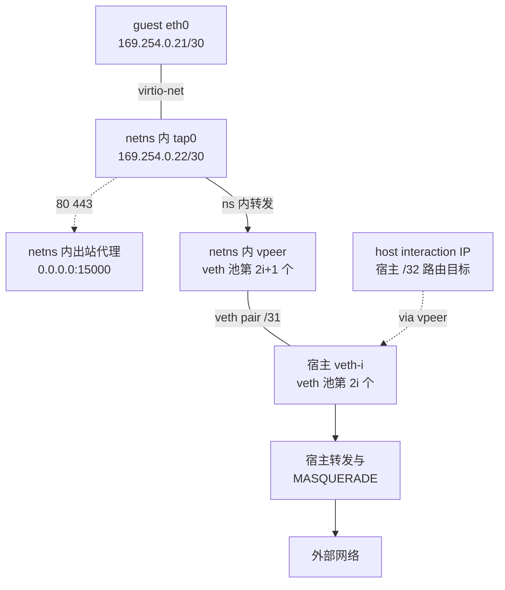
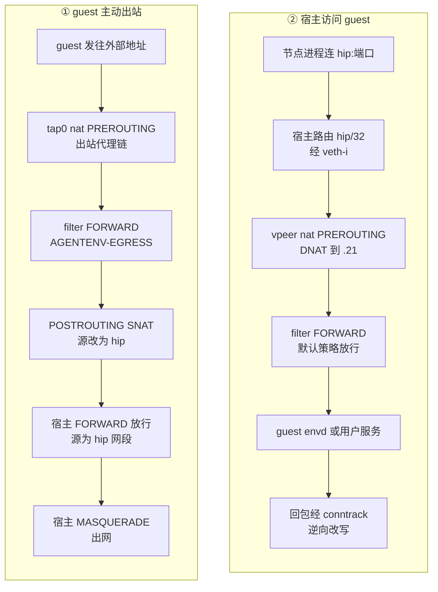

# 29 · 网络（一）：槽位、命名空间与地址计划

> 每台沙箱都要有一张能上网、能被宿主访问、又彼此隔离的网卡，而这张网卡的配置会随内存快照一起被冻结。
> AgentENV 把「一台沙箱的网络」做成一个可复用的单元——网络槽位（slot）：一个网络命名空间、一对 veth、一个 tap 和一组 iptables 规则，全部由一个整数编号推导。
> 本篇讲这个单元的拓扑、地址计划、包路径、创建与清理，以及「所有槽位里 VM 地址都一样」这条约束从哪里来、要付出什么。
>
> **读者**：系统与网络工程师。　**预备**：[第 06 篇 · 网络命名空间、iptables 与透明代理](06-netns-iptables-transparent-proxy.md)、[第 25 篇 · 后端抽象与 Firecracker 进程](25-backend-and-firecracker-process.md)。
> **代码**：`src/sandbox/network/mod.rs`、`src/sandbox/network/address_plan.rs`、`src/sandbox/network/slot.rs`、`src/sandbox/network/manager.rs`、`src/sandbox/network/iptables_util.rs`、`src/cfg/network.rs`、`src/setup/network_capacity.rs`

---

## 0. 本篇要回答的问题

1. 一台沙箱的网络由哪些接口组成？每个接口的地址怎样从槽位号算出来？
2. 为什么所有槽位里 guest 与 tap 的地址完全相同？这和快照有什么关系？
3. guest 主动出网、宿主访问 guest 时，包各自经过哪些 NAT 与过滤规则？
4. 创建一个槽位要做哪些内核操作？为什么要放在单独的线程里做？
5. `NetworkManager` 怎样分配、回收、复用槽位？进程崩溃后残留的接口怎样处理？
6. 这套设计依赖宿主的哪些前提？哪些边界情况它没有覆盖？

---

## 1. 问题：一张网卡要满足的四个条件

Firecracker 的 virtio-net 设备在宿主一侧对应一个 tap 设备，guest 发出的每个以太网帧都写进这个 tap（见 Firecracker 手册第 30 篇）。
至于 tap 接在哪里、包怎样出网、宿主怎样找到 guest，Firecracker 不管，由上层决定。AgentENV 对这件事有四个要求。

第一，**隔离**。一个节点上可能同时有成千上万台沙箱。它们不能互相访问，也不能主动连宿主上的服务；
出站流量还要能按每台沙箱的策略过滤（[第 30 篇](30-egress-policy-and-proxy.md)）。

第二，**宿主可达**。节点进程要访问 guest 里的 envd（[第 28 篇](28-mmds-and-envd.md)），反向代理要把用户请求转发到 guest 的任意端口（[第 17 篇](17-reverse-proxy.md)）。
所以每台沙箱要有一个从宿主看唯一的地址。

第三，**快照可移植**。guest 的网络配置——IP、网关、路由、ARP 表——都在 guest 内核的内存里，暂停时随内存快照冻结。
恢复时不会重新执行 boot args，如果恢复后接入的网络和快照时不同，guest 不会察觉，只会发现网络不通。

第四，**能复用**。建一个命名空间要十几次 netlink 调用、两次外部命令和两次 `iptables-restore`，最好提前建好放进池里。

第二条要求地址唯一，第三条要求地址固定。AgentENV 给每台沙箱两个地址：guest 看到的在所有槽位里都一样，宿主看到的每个槽位一个，
两者由槽位命名空间里的 NAT 转换。

---

## 2. 拓扑与地址计划

### 2.1 拓扑

一个槽位由 `Slot` 结构（`src/sandbox/network/slot.rs`）表示，包含以下内核对象：

- 一个网络命名空间，bind mount 到 `$AENV_RUNTIME/netns/agentenv-ns-<uuidv7>`，这样它不依赖任何进程存活；
- 命名空间里的 `tap0`，Firecracker 进程 `setns` 进这个命名空间后打开它（[第 25 篇](25-backend-and-firecracker-process.md)）；
- 一对 veth：命名空间一端叫 `vpeer`，宿主一端叫 `veth-<槽位号>`；
- 命名空间内的 iptables 规则，以及宿主上一条指向这个槽位的 `/32` 路由。

guest 的 `eth0` 与 `tap0` 之间是一条 `/30` 链路，`vpeer` 与 `veth-<i>` 之间是一条 `/31` 点对点链路，命名空间本身打开 IPv4 转发，起路由器的作用。

图中虚线的出站代理只在策略含域名规则时才启动，第 30 篇详讲。

### 2.2 地址计划

`NetworkAddressPlan::slot_ips()`（`src/sandbox/network/address_plan.rs`）由槽位号 `i` 算出三个地址：

| 名称 | 来源 | 默认值（槽位 i） | 配在哪里 |
|---|---|---|---|
| host interaction IP | `host_interaction_cidr` 的第 i 个地址 | `10.11.0.0/16` 中的第 i 个 | 不配在任何接口上，只是宿主路由的目标 |
| veth 宿主端 | `veth_cidr` 的第 2i 个地址 | `10.12.0.0/16` 中的第 2i 个 | 宿主 `veth-<i>`，`/31` |
| veth 命名空间端 | `veth_cidr` 的第 2i+1 个地址 | `10.12.0.0/16` 中的第 2i+1 个 | `vpeer`，`/31` |
| VM 地址 | 固定链路 `169.254.0.20/30` 的第 1 个 | `169.254.0.21` | guest `eth0` |
| tap 地址 | 固定链路的第 2 个 | `169.254.0.22` | `tap0`，也是 guest 的网关 |

前两个网段可以在 `[network.internal]` 里改，第三个不能。`NetworkConfig::resolved_internal()`（`src/cfg/network.rs`）在启动时校验三件事：
`host_interaction_cidr` 至少有 32768 个地址，`veth_cidr` 至少有 65536 个，三个网段两两不重叠。
数字来自 `NETWORK_MAX_SLOTS = 32768`：槽位号的取值范围是 1 到 32767，槽位 0 永久保留，因为它会算出网段的网络地址本身。

host interaction IP 不配在任何接口上，这一点容易误读。`Slot::configure_host_interface_async()` 在宿主上只给 `veth-<i>` 配 `/31` 地址，
然后执行 `ip route add <hip>/32 via <vpeer 地址> dev veth-<i>`，把这个地址变成一个路由目标：发往它的包被交给命名空间，由命名空间里的 DNAT 改写成 VM 地址。
`docs/src/internals/networking.md` 的拓扑图把它标成「/31 per slot」，与代码不符。

### 2.3 为什么 VM 地址必须固定

`src/cfg/network.rs` 里 `FIXED_NETWORK_VM_LINK_CIDR` 的注释把这条链路定性为「快照 ABI 的一部分」。理由如下：

- 冷启动时，guest 的网络由内核命令行的 `ip=` 参数配置。`Slot::build_ip_boot_arg()` 生成
  `ip=169.254.0.21::169.254.0.22:255.255.255.252:instance:eth0:off:<dns>`，guest 内核在启动早期据此配好 `eth0`，不需要 DHCP。
- 恢复时，Firecracker 加载的是快照里的 guest 内存，boot args 不会再执行一遍，guest 认为自己仍然是 `169.254.0.21`、网关仍然是 `169.254.0.22`。
- 一个快照可能在任何槽位、任何节点上恢复（模板就是被反复恢复的快照）。只要每个槽位的 tap 地址、tap 名字都一样，guest 就察觉不到换了槽位。

tap 的名字也是这份约定的一部分：每个命名空间里都叫 `tap0`，`start_resume()` 加载快照时传的 `network_overrides` 是固定的 `eth0 → tap0`。
注释同时说明了放开这条约束的前提：先把链路网段写进快照 manifest，并为没有这个字段的旧快照定义缺省行为。

这里放弃了「guest 地址能表达身份」换取「快照与槽位解耦」。代价是宿主侧必须做一次地址转换，
而且同一个 guest 地址在不同时刻属于不同租户，这一点在 §6.3 与[第 30 篇](30-egress-policy-and-proxy.md)的安全讨论里还会出现。

---

## 3. 包路径

命名空间内的基础规则由 `Slot::configure_namespace_iptables_rules()` 安装，宿主上的全局规则由 `global_host_iptables_commands()`（`src/sandbox/network/manager.rs`）安装。
两组规则合起来决定了两个方向的包路径。

**guest 出站**（①）。guest 把包发给网关 `169.254.0.22`，包从 `tap0` 进入命名空间。
nat 表 PREROUTING 的第一条跳到 `AGENTENV-EGRESS-PROXY` 链，策略含域名规则时 TCP 80/443 在这里被重定向给出站代理，其它包继续路由。
filter 表 FORWARD 的第一条跳到 `AGENTENV-EGRESS` 链做出站判定（第 30 篇）；通过后，基础规则 `-i tap0 -o vpeer -j ACCEPT` 放行。
包从 `vpeer` 离开前，POSTROUTING 的 `-o vpeer -s 169.254.0.21 -j SNAT --to <hip>` 把源地址改成本槽位的 host interaction IP。
进入宿主后，`-i veth-+ -s 10.11.0.0/16 -j ACCEPT` 让它通过 FORWARD——即使宿主 FORWARD 的默认策略是 DROP 也能通过——
最后 `-s 10.11.0.0/16 -j MASQUERADE` 把源地址再改成宿主出口地址。一个包因此经过两次源地址转换：
命名空间里那次给它一个宿主可路由、可区分槽位的身份，宿主上那次让它能出网。

命名空间里还有第二条 SNAT：`-o vpeer -s <vpeer 地址> -j SNAT --to <hip>`。它针对出站代理自己发起的上游连接——
代理运行在命名空间内，连接的源地址是 `vpeer` 的地址而不是 guest 地址，SNAT 之后才能匹配宿主上按 host interaction 网段写的 FORWARD 与 MASQUERADE 规则。

**宿主访问 guest**（②）。envd 客户端与反向代理都连 `<hip>:<端口>`（envd 端口是 49983）。
宿主路由把包经 `veth-<i>` 交给命名空间，`-i vpeer -d <hip> -j DNAT --to 169.254.0.21` 把目的地址改成 guest 地址，包经 `tap0` 进入 guest。
guest 的回包走出站方向：`AGENTENV-EGRESS` 的第一条是 conntrack `ESTABLISHED,RELATED` 放行，所以出站策略再严也不影响这些回包；
conntrack 把源地址逆向改回 `<hip>`，宿主收到的回包看起来就来自它连接的地址。

宿主上的 INPUT 规则只有两条：来自 `veth-+`、源地址在 host interaction 网段的包，`ESTABLISHED,RELATED` 放行，其余 REJECT。
效果是 guest 不能主动连宿主上的任何服务，宿主主动发起的连接不受影响。

**guest 的 DNS**。`ip=` 的第八个字段是 guest 的 DNS 服务器，由 `resolve_guest_dns_server()` 选出：
依次读 `/run/systemd/resolve/resolv.conf` 与 `/etc/resolv.conf`，取第一个不是 loopback 的 IPv4 nameserver；都取不到就退回 `8.8.8.8`，并打一条 warn。
跳过 loopback 是必须的：宿主上的 `127.0.0.53` 对 guest 没有意义。
出站链为这个地址单独开了 UDP 与 TCP 53 端口的口子，排在所有拒绝规则之前（第 30 篇）。

---

## 4. 创建一个槽位

### 4.1 为什么要开线程

网络命名空间的成员关系是**线程级**的：`unshare(CLONE_NEWNET)` 与 `setns()` 只改变调用线程。
在 tokio 的工作线程上做这件事，会让这个线程上之后调度到的任何任务都跑在沙箱的命名空间里。
所以 `Slot::create_network()` 每次都 `thread::spawn` 一个新线程，在里面 `unshare`，做完就让线程退出。

线程退出后命名空间还要存在，靠的是 bind mount：先在 netns 目录下建一个空文件，再把 `/proc/thread-self/ns/net` bind mount 上去。
之后任何人都可以打开这个文件、用 `setns` 进入命名空间——Firecracker 的启动、出站策略的更新、出站代理的监听线程都这样做。

veth 的宿主一端要移回宿主命名空间，这需要一个指向宿主命名空间的 fd。`host_ns_fd()` 在第一次被调用时打开 `/proc/thread-self/ns/net` 并缓存进 `OnceLock`。
这隐含一个约束：第一次调用必须发生在仍处于宿主命名空间的线程上。`create_network()` 在 spawn 之前就调用它，满足这个约束。
函数旁的注释写的是 `/proc/1/ns/net`，与代码不一致；用 `thread-self` 的好处是 `server` 本身跑在容器里时，拿到的是 `server` 所在的命名空间，而不是宿主 init 进程的命名空间。

### 4.2 步骤

`create_network()` 分两段：命名空间线程里的 `setup_namespace_internal()`，以及回到宿主侧的 `configure_host_interface_async()`。

在命名空间线程里：

1. 建 netns 文件，`unshare(CLONE_NEWNET)`，bind mount。
2. 起一个 `current_thread` tokio runtime，用 rtnetlink 建 veth 对 `veth-<i>` / `vpeer`。
3. 用 `NetNsFd` 属性把 `veth-<i>` 移回宿主命名空间。
4. `lo` 置 up；`vpeer` 配 `/31` 地址并置 up。
5. 在 `CAP_NET_ADMIN` 作用域里执行 `ip tuntap add tap0 mode tap`，再用 netlink 给 `tap0` 配 `169.254.0.22/30` 并置 up。
6. 加默认路由，网关是 veth 宿主端地址。
7. 写命名空间内的 `/proc/sys/net/ipv4/ip_forward = 1`。
8. 把 `tap0` 与 `vpeer` 的 `neigh/<if>/retrans_time_ms` 调到 100。
9. 安装命名空间基础规则与出站链骨架（`configure_namespace_iptables_rules()`、`initialize_namespace_egress_chain()`）。

回到宿主侧（在另一个线程的 `current_thread` runtime 里）：

10. 给 `veth-<i>` 配 `/31` 地址并置 up。
11. 执行 `ip route add <hip>/32 via <vpeer 地址> dev veth-<i>`。
12. 把 `veth-<i>` 的 `retrans_time_ms` 也调到 100。

几个细节值得解释。

**`/31` 地址为什么手工拼 netlink 消息。** `/31` 点对点链路（RFC 3021）没有广播地址，而 rtnetlink crate 的地址构造器总会算出一个广播地址填进去。
`add_address_no_broadcast()` 因此自己构造 `RTM_NEWADDR` 消息，只带 `IFA_ADDRESS` 与 `IFA_LOCAL` 两个属性。

**宿主路由为什么调外部命令。** 注释说明，用 netlink 添加「网关位于 `/31` 子网」的路由在一些内核配置下有兼容问题，所以改用 `ip route add`。
`tap0` 用 `ip tuntap` 创建也是同类选择。两条外部命令都通过 `privileges::run_with_scoped_capabilities()` 在一个只持有 `CAP_NET_ADMIN` 的临时线程里执行，
这个临时线程继承调用线程的命名空间，所以 `ip tuntap` 建出的 `tap0` 落在沙箱命名空间里（权限模型见[第 59 篇](59-host-setup-and-privileges.md)）。

**ARP 重传间隔。** 内核缺省的邻居重传间隔是 1 s，代码注释把这项调整与 resume 的尾延迟关联。
推论：同一槽位先后两台 VM 的地址相同而 MAC 不同（`add_network_interface()` 不指定 `guest_mac`），`tap0` 上的旧邻居表项要重新解析，降到 100 ms 缩短第一次重传前的等待。

**半途失败。** `create_network()` 一开始就把 `cleanup_armed` 置真。任何一步失败，调用方 `allocate_fresh_slot()` 都会清掉位图里的这一位并丢弃 `Slot`，
而 `Slot` 的 `Drop` 会以同步方式执行 `cleanup(true)`，把已经建出来的部分拆掉。

### 4.3 iptables 的提交方式

所有规则都经 `iptables_util.rs` 的 `apply_iptables_commands()` 提交：把一组 `IptablesRestoreCommand`（新建链、清空链、插入、追加、删除）
渲染成一份 `iptables-restore` 脚本，用 `--noflush` 一次写入。脚本按表分组，每个表一个 `COMMIT`，
`build_restore_script()` 用 `debug_assert` 检查命令确实按表聚在一起。好处是一个表内的规则要么全部生效、要么全部不生效，
也省去了逐条 fork `iptables` 的开销。

删除走另一条路：只含 `Delete` 的命令组逐条提交，遇到「规则不存在」类错误就跳过。这样清理是幂等的，不需要先查询规则、再解析成参数。

AgentENV 自己不写 nftables 规则，`nft` 只用于启动时的冲突探测（§5.1）。推论：宿主上的 `iptables-restore` 若是 iptables-nft 前端，规则实际落在 nftables 的兼容表里，对 AgentENV 透明。

---

## 5. `NetworkManager`：分配、复用与清理

### 5.1 单例与初始化

`NetworkManager::global()` 是进程级单例。第一次调用时，`with_config()` 按顺序做四件事：

1. 在 `AtomicBitSet` 位图里预占槽位 0；
2. `reserve_existing_host_veth_slots()` 扫描 `/sys/class/net`，把已存在的 `veth-<i>` 对应的位全部置上；
3. `log_external_conflicts()` 用 `ip addr`、`ip route`、`iptables-save`、`nft list ruleset` 的输出做冲突探测，只告警不阻止；
4. `install_global_host_iptables()` 安装 §3 的五条宿主规则。

第 2 步针对上一次运行没清干净的接口，或同机另一个使用相同命名的进程。
第 3 步按网段前缀与 `veth-` 前缀做字符串匹配，`network_conflict_pattern()` 的注释承认它对不按八位组对齐的网段会多报或漏报。

宿主规则安装失败时只打 warn，不让初始化失败；`allocate_fresh_slot()` 每次分配新槽位前检查 `HOST_IPTABLES_INSTALLED`，没装上就重试一次，再失败才报错。
同时，`global()` 用 `libc::atexit` 注册一个退出钩子：静态单例的 `Drop` 不会在进程退出时执行，钩子负责在进程正常退出时排空预热池并删除宿主规则。

### 5.2 分配与释放

`allocate_any()` 先试预热池（`WarmPool<Slot>`）。命中就直接返回，池子低于低水位时唤醒维护线程补充；
不命中就走 `allocate_fresh_slot()`：`set_next_free_bit()` 原子地占一位，`Slot::new()` 算地址并生成 UUIDv7 命名的命名空间名，`create_network()` 建网。

`release()` 把槽位交回池子，不拆命名空间。池满时（或进入关闭流程后）才调用 `cleanup_slot_and_release_bit()` 真正清理并清掉位。
预热池的水位与 `fill_target` 的增长规则在[第 32 篇](32-warm-pools.md)。

一个槽位的出站状态跨租户复用时要先清掉。`Slot` 用 `user_egress_rules_present` 记录用户链里有没有规则，
下一位租户若没有规则而这个标志为真，`set_egress_policy()` 会先清空用户链；两边都为空时直接返回，不进命名空间（第 30 篇）。

后端的使用点在 `src/sandbox/firecracker/sandbox.rs`：冷启动路径调用 `allocate_any()`，把 `ip=` 拼进 boot args，再应用出站策略；
恢复路径若从 Firecracker 预热池拿到了进程，就直接用随进程一起预建的槽位，否则现分配一个并在其中 spawn Firecracker。
`stop()` 在发出扩展的 stop hook 之后 `release()` 槽位，句柄被丢弃时 `Drop` 也会兜底释放。

### 5.3 清理

`Slot::cleanup()` 的顺序是：

1. 拆掉这个槽位的出站代理（停止监听、断开已有连接）——监听线程持有命名空间，不先停它命名空间就不会消失；
2. 删除宿主端 `veth-<i>`，veth 对的另一端 `vpeer` 随之消失；正常路径用 netlink，失败或 panic 时退回 `ip link del`；
3. 循环 `umount` netns 文件直到返回 `EINVAL`（同一文件可能被挂载多次）；
4. 删除 netns 文件。

任何一步失败都把 `cleanup_armed` 重新置真并返回错误，允许之后再试。宿主路由不需要单独删除，接口消失时内核会一并删掉经过它的路由。
`cleanup()` 的文档注释还写着「删除宿主侧 MASQUERADE 规则」，而 MASQUERADE 现在是全局的一条规则，只在 `NetworkManager` 关闭时删除。注释已经过时。

进程重启时，`ensure_environment()` 先调用 `network::prepare_runtime()`，把 netns 目录下所有 `agentenv-ns-*` 文件反复 `umount` 后删除。
命名空间没有了挂载点，也没有进程在里面，内核就会销毁它，veth 随之消失。

### 5.4 宿主容量

`src/setup/network_capacity.rs` 列出大规模部署要调的六个内核参数：邻居表的 `gc_thresh1/2/3`（4096 / 8192 / 16384）、`nf_conntrack_max`（1048576）、
`kernel.pid_max`（4194304）、`fs.inotify.max_user_instances`（8192）。
`server --setup-host` 以 root 运行时把它们连同 `net.ipv4.ip_forward = 1` 写进 `/etc/sysctl.d/99-aenv.conf` 并立即调整；
普通启动的 `ensure_environment()` 只检查，低于推荐值时告警，但 `ip_forward` 不为 1 会直接拒绝启动。
在容器里运行时默认跳过调整，除非设置 `AENV_FORCE_SYSCTL_TUNING`。
写入与检查的分工见[第 59 篇 §4.1](59-host-setup-and-privileges.md#41---setup-host-做了什么)。

容量的另一面是槽位号本身。1 到 32767 是整个节点的预算：运行中的沙箱、网络槽位预热池里的空闲槽位、
Firecracker 进程池里随进程预建的槽位，各占一位（[第 32 篇](32-warm-pools.md)），§6.5 的残留接口也占位。
推论：估算单节点能同时运行多少台沙箱时，要先从这个预算里扣掉两个池的上限与残留数。

---

## 6. 边界与代价

### 6.1 依赖宿主防火墙的前提

宿主规则只覆盖「从 veth 进来」与「发往 veth 去」两个方向的已知情形，其余交给宿主原有的策略。两个推论：

- 命名空间里 FORWARD 的默认策略是 ACCEPT，`-i vpeer -o tap0` 那条 `RELATED,ESTABLISHED` 规则并不阻止新连接。
  宿主上发往 host interaction 网段的新连接只匹配到 `-o veth-+ ... RELATED,ESTABLISHED`，之后落到宿主 FORWARD 的默认策略。
  推论：宿主 FORWARD 默认放行、且局域网里有人把 `10.11.0.0/16` 路由到这台节点时，外部主机可以绕过反向代理直接连到 guest 端口，也就绕过了数据面鉴权（[第 13 篇](13-authentication.md)）。
  部署时宿主 FORWARD 应该默认 DROP，或者至少不接受外部接口进来、发往该网段的包。
- 宿主规则用追加（`-A`）写进 FORWARD。推论：宿主 FORWARD 链里若已有更早的显式 DROP（例如容器运行时自己的链），沙箱流量会在到达 AgentENV 的规则之前被丢弃。

### 6.2 只有 IPv4

guest 只有 `ip=` 配置的 IPv4 地址，宿主规则与命名空间规则也只写 iptables，不写 ip6tables。API 层拒绝 IPv6 CIDR（第 30 篇）。
推论：guest 里的 IPv6 只有链路本地地址，没有出网路由。

### 6.3 地址复用的后果

同一个 host interaction IP 会先后分给不同的沙箱，guest 地址更是所有沙箱共用。三处代码因此要额外小心：

- 反向代理不复用到上游的连接，否则一个已经换了主人的地址上可能还挂着旧连接（[第 17 篇](17-reverse-proxy.md)）；
- 出站代理的策略按 host interaction IP 索引，槽位回池后仍可能残留上一位租户的代理状态（第 30 篇）；
- 命名空间的 conntrack 表与 `tap0` 的邻居表在回池时不清空（`src/sandbox/network/` 下没有任何 conntrack 操作），安全影响在[第 30 篇](30-egress-policy-and-proxy.md)讨论。

### 6.4 DNS 在冷启动时冻结

guest 的 DNS 服务器在冷启动时由 `ip=` 写进 guest 内核，之后不再改变；而出站链里放行的 DNS 地址是每个槽位创建时、在当时那台节点上重新解析的。
推论：快照在另一台节点（或宿主 `resolv.conf` 改过之后）恢复时，若两边选出的 nameserver 不同，而 guest 记住的那个又落在 `always_denied_cidrs` 里（常见于 `10.0.0.0/8` 内的云厂商 DNS），guest 的 DNS 查询会被拒绝。
跨节点恢复的集群应保证各节点选出相同的 nameserver。

### 6.5 残留接口永久占位

`reserve_existing_host_veth_slots()` 只把残留接口的位置上，从不尝试清理它们。
推论：`server` 被 SIGKILL 后，孤儿 Firecracker 进程仍在命名空间里，命名空间不随 `prepare_runtime()` 的 umount 消失，`veth-<i>` 一直存在；
重启后的进程会把这些槽位当作占用，直到运维手工删除接口。槽位总数够大，这通常不是容量问题，但残留的命名空间、路由与 guest 都还在。

---

## 7. 与 e2b infra 的对照

两者的拓扑几乎相同：guest `169.254.0.21`、tap `169.254.0.22`、host IP 取自 `10.11.0.0/16`、veth 用 `/31`，命名空间内 SNAT / DNAT 加宿主 MASQUERADE。
e2b infra 用 Consul KV 或 `/var/run/netns` 目录做槽位分配、命名空间内用 nftables，并把出站代理放在宿主上的一个进程里；
AgentENV 用进程内位图分配，规则全部经 `iptables-restore` 批量提交，代理放进每个命名空间。
代价是 AgentENV 的槽位状态只存在于一个进程的内存里，重启后只能靠扫描接口名恢复占用情况。

---

## 8. 小结

- 一个网络槽位 = 一个 bind mount 出来的 netns + `tap0` + veth 对 + 命名空间内 iptables + 一条宿主 `/32` 路由，所有地址由槽位号推导，槽位 0 保留。
- guest 与 tap 地址固定为 `169.254.0.21` / `169.254.0.22`，tap 名固定为 `tap0`：恢复不重放 boot args，快照因此能在任意槽位恢复。
- host interaction IP 不配在接口上，只是宿主路由目标；命名空间里的 DNAT 把它映射到 guest，SNAT 把 guest 的源地址映射回它。
- 出站包经两次源地址转换：命名空间 SNAT 给槽位身份，宿主 MASQUERADE 给出网地址；出站代理的上游连接靠第二条 SNAT 获得同一身份。
- 宿主 INPUT 只放行已建立连接的回包，guest 不能主动连宿主服务。
- 命名空间操作放在一次性线程里，因为 netns 成员关系是线程级的；`host_ns_fd()` 必须先于任何 `unshare` 被调用。
- 规则以表为单位、用 `iptables-restore --noflush` 批量提交；删除逐条提交并容忍「规则不存在」；nft 只用于冲突探测。
- `NetworkManager` 用原子位图分配槽位，启动时把残留 `veth-*` 预占，回收时优先回池而不拆命名空间。
- 依赖宿主 FORWARD 默认拒绝来自外部的流量；只支持 IPv4；guest 的 DNS 在冷启动时冻结。

---

## 延伸阅读 / 下一篇

- [第 06 篇 · 网络命名空间、iptables 与透明代理](06-netns-iptables-transparent-proxy.md)：本篇用到的内核机制。
- [第 17 篇 · 反向代理](17-reverse-proxy.md)：host interaction IP 的使用方之一。
- [第 28 篇 · MMDS 与 envd](28-mmds-and-envd.md)：envd 地址 `http://<hip>:49983`。
- [第 32 篇 · 预热池](32-warm-pools.md)：网络槽位池的水位与维护线程。
- [e2b 手册第 07 篇 · 沙箱网络的内核基础](../e2b-infra/07-linux-networking-for-sandboxes.md)、[e2b 手册第 35 篇 · 沙箱网络](../e2b-infra/35-sandbox-networking.md)：同一拓扑在 e2b infra 中的实现。
- [Firecracker 手册第 30 篇 · virtio-net：tap、收发路径与 offload](../firecracker/30-virtio-net.md)：tap 另一侧的设备模拟。
- 下一篇：[第 30 篇 · 网络（二）：出站策略与透明代理](30-egress-policy-and-proxy.md)。
