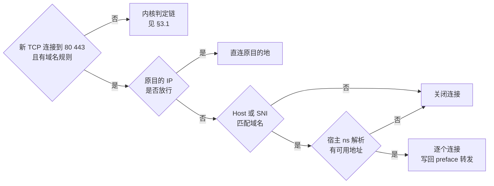
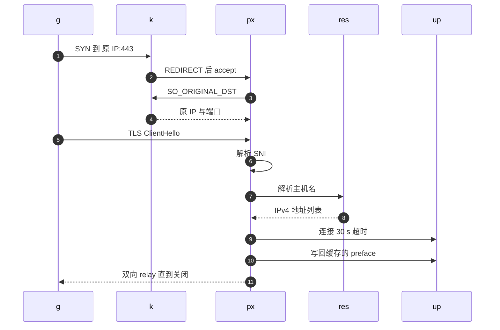

# 30 · 网络（二）：出站策略与透明代理

> agent 在沙箱里执行的是不受信任的代码，平台要能回答「它能连到哪里」。按 IP 网段放行或拒绝可以交给内核，
> 按域名放行却不行：内核只看得到 IP，而同一个域名背后的 IP 会变，同一个 IP 背后又可能有成百个域名。
> 本篇讲 AgentENV 的出站策略怎样拆成两半——内核里的 iptables 链与命名空间内的透明代理——各自负责什么、按什么顺序判定、怎样在不中断连接的前提下替换，以及这套机制挡不住什么。
>
> **读者**：系统、网络与安全工程师。　**预备**：[第 29 篇 · 网络（一）](29-network-slots.md)、[第 06 篇 · 网络命名空间、iptables 与透明代理](06-netns-iptables-transparent-proxy.md)。
> **代码**：`src/sandbox/network/policy.rs`、`src/sandbox/network/egress_proxy.rs`、`src/sandbox/network/resolver.rs`、`src/sandbox/network/slot.rs`、`src/api/impls/sandbox.rs`、`src/orchestrator/service.rs`

---

## 0. 本篇要回答的问题

1. 一条出站策略由哪些字段组成？API 字段怎样映射到它？没有任何规则时运行时做了什么？
2. 一个出站包在内核里按什么顺序被判定？哪些拒绝是用户策略推翻不了的？
3. 域名规则为什么要用代理实现？代理怎样拿到原目的地、怎样识别域名、为什么在宿主命名空间里做解析？
4. 域名放行与用户 CIDR 拒绝冲突时谁优先？API 层为什么要求域名规则配合 deny `0.0.0.0/0`？
5. 运行中替换策略时，新旧策略怎样交接？已有连接怎样处理？
6. 这套机制的代价与盲区在哪里：线程模型、按连接授权、DNS、预热槽位的跨租户残留？

---

## 1. 问题：内核只认得 IP

最简单的出站控制是在 FORWARD 链上按目的网段 ACCEPT 或 REJECT。它便宜、在内核里完成、对所有协议有效。
但 agent 的使用者通常想说的是「只允许访问 `pypi.org` 和 `*.github.com`」。把域名在下发时解析成 IP 写进规则有三个问题：
CDN 背后的 IP 随时间、随解析位置变化；一个 IP 上可能托管着大量无关域名；而 guest 可以改自己的 `/etc/hosts`，让一个被允许的域名指向任意 IP。

能看到域名的地方只有连接本身：HTTP 请求的 `Host` 头、TLS ClientHello 的 SNI 扩展。读它们需要终止 TCP 连接，也就是一个代理。
代理贵：每条连接要多一次用户态拷贝，要为它分配线程或任务，还要处理各种协议细节。
AgentENV 的拆分是：**IP 网段规则全部留在内核**，代理只在策略里出现域名规则时才启动，且只接管 TCP 80 与 443。

---

## 2. 策略对象与 API 映射

### 2.1 `SandboxNetworkPolicy`

`src/sandbox/network/policy.rs` 定义了三层结构：

| 字段 | 类型 | 含义 |
|---|---|---|
| `allow_public_traffic` | bool | 入站：数据面是否要求 traffic token（[第 13 篇](13-authentication.md)），与出站无关 |
| `base_policy` | `Default` / `Allow` / `Deny` | 没有命中任何显式规则时的去向 |
| `egress.allowed_cidrs` | `Vec<IpNetwork>` | 显式放行的网段 |
| `egress.allowed_domains` | `Vec<String>` | 放行的域名或 `*.后缀` |
| `egress.denied_cidrs` | `Vec<IpNetwork>` | 显式拒绝的网段 |

API 层（`src/api/impls/sandbox.rs`）的映射：`allowInternetAccess` 为 true、false、缺省分别对应 `Allow`、`Deny`、`Default`；
`network.allowOut` 中能解析成 IP 或 CIDR 的进 `allowed_cidrs`，其余当作域名；`network.denyOut` 只接受 IP 或 CIDR。
`SandboxNetworkEgressPolicy::new()` 把单个 IP 规范化成 `/32`，按规范化后的值去重并保留原顺序；
`normalize_domain_pattern()` 把域名转成小写并按 DNS 标签规则校验，带 `*.` 前缀的保留通配。
`Allow` 与 `Default` 在运行时行为相同，区别只在查询接口里回显 `allowInternetAccess` 是 true 还是 null。

创建与 `PUT /network` 都会再过两道校验：`validate_ipv4_cidrs()` 拒绝任何 IPv6 网段；
`validate_domain_allowlist()` 要求出现域名规则时 `denyOut` 必须包含 `0.0.0.0/0`，原因见 §4.3。`PUT /network` 的替换语义见[第 14 篇 §7](14-sandbox-api.md#7-put-network只换出站策略)。

### 2.2 没有规则时什么都不做

orchestrator 交给后端的不是完整策略，而是 `SandboxNetworkPolicy::runtime_policy()`：只有 `base_policy == Deny` 或存在任何显式规则时才返回 `Some`，否则返回 `None`。
后端的 `Slot::set_egress_policy()` 拿到 `None`，又发现 `user_egress_rules_present` 为假，就直接返回，不进命名空间、不调用 `iptables-restore`。
这是最常见的情形——默认放行的沙箱——所以它被做成零开销。

策略随沙箱生命周期流动：冷启动时 `start_fresh()` 在分配槽位后、启动 VM 前应用；暂停时 `snapshot_to_dir()` 把当前生效的策略写进 `FirecrackerSnapshotConfig`，
恢复时 `start_resume()` 再应用一次；从模板或快照创建新沙箱时，用的是本次请求的策略，源快照里的策略被覆盖。

---

## 3. 内核中的判定链

### 3.1 链的结构

槽位创建时，`initialize_namespace_egress_chain()` 在命名空间里建三条自定义链，并把入口插到内置链的第一位：

```text
filter FORWARD  -I 1  -i tap0 -o vpeer -j AGENTENV-EGRESS
nat PREROUTING  -I 1  -i tap0 -j AGENTENV-EGRESS-PROXY

AGENTENV-EGRESS（静态，槽位生命周期内不变）
  1  -m conntrack --ctstate ESTABLISHED,RELATED            -j ACCEPT
  2  -d <guest DNS>/32 -p udp --dport 53                   -j ACCEPT
  3  -d <guest DNS>/32 -p tcp --dport 53                   -j ACCEPT
  4  -d 10.11.0.0/16 | 10.12.0.0/16 | 169.254.0.20/30      -j REJECT   内部网段
  5  -d <always_denied_cidrs 每条>                          -j REJECT   节点级绝对拒绝
  6                                                         -j AGENTENV-USER-EGRESS

AGENTENV-USER-EGRESS（每次替换先 -F）
  allowed_cidrs 每条   -j ACCEPT
  denied_cidrs 每条    -j REJECT
  base = Deny 时       -d 0.0.0.0/0 -j REJECT

AGENTENV-EGRESS-PROXY（nat 表，每次替换先 -F）
  有域名规则时   -p tcp --dport 80   -j REDIRECT --to-ports 15000
                 -p tcp --dport 443  -j REDIRECT --to-ports 15000
```

（为节省篇幅省略了每条规则共有的 `-i tap0 -o vpeer` 匹配。）用户链返回后，包回到 FORWARD 的基础规则 `-i tap0 -o vpeer -j ACCEPT`，所以未命中任何规则即放行。

`always_denied_cidrs` 来自 `[network.egress]`，缺省是 `10.0.0.0/8`、`100.64.0.0/10`、`127.0.0.0/8`、`169.254.0.0/16`、`172.16.0.0/12`、`192.168.0.0/16`：
节点所在的内网、云厂商的元数据服务（`169.254.169.254`）都在其中。第 4 条拒绝的是**整个**内部地址池而不只是本槽位的地址，
注释给出的理由是防止一台沙箱访问另一台沙箱的命名空间或 VM 链路地址。

规则的顺序决定了三条性质。第一，**已建立连接的回包永远放行**，所以宿主发起的 envd 与反向代理连接不受出站策略影响，替换策略时已有连接也不会被新规则切断。
第二，**DNS 永远放行**，而且排在一切拒绝之前，即使 guest 的 DNS 服务器本身落在 `10.0.0.0/8` 里。
第三，**绝对拒绝在用户链之前**，用户写 `allowOut: ["10.0.0.0/8"]` 也进不了内网。

### 3.2 只处理 IPv4

`build_user_egress_commands()` 遇到 IPv6 网段直接跳过，`SO_ORIGINAL_DST` 只按 `sockaddr_in` 解析，解析器设为 `Ipv4Only`。
API 层已经拒绝 IPv6 网段，所以运行时那几处 IPv6 分支只为兼容已持久化的旧记录而保留；注释明确说明，完整的 IPv6 需要 ip6tables、路由与代理三方面一起改。

---

## 4. 透明代理

### 4.1 判定流程

策略带域名规则时，`Slot::set_egress_policy()` 先调用 `EgressProxy::ensure_listener()`：开一个线程，`setns` 进沙箱命名空间，在 `0.0.0.0:15000` 上监听。
端口在每个命名空间里都是 15000，因为每个命名空间有自己的端口空间。之后 nat 表把 guest 发往任意地址 80 / 443 端口的 SYN 重定向到这个监听，代理接受连接后按下图判定：



`is_ip_allowed()` 的顺序是：绝对拒绝（`always_denied_cidrs` 加内部地址池）→ `allowed_cidrs` 放行 → `denied_cidrs` 拒绝 → 只要存在域名规则就拒绝 → 否则看 `base_policy` 是否为 `Deny`。
第四步保证了「域名白名单是 opt-in 能力」：探测不到主机名、或主机名不匹配时，不会退回到基础策略放行。
`is_domain_allowed()` 先匹配主机名，再对每个解析结果检查绝对拒绝。

一个直接访问 IP 的 HTTPS 连接没有 SNI。若这个 IP 在 `allowed_cidrs` 里，第一步就放行；否则主机名为空，按 fail-closed 拒绝。

### 4.2 一条连接的时序

下图的参与者：`g` 是 guest 内的应用，`k` 是命名空间里的内核网络栈，`px` 是代理为这条连接开的线程，`res` 是宿主命名空间里的解析线程，`up` 是上游服务器。



各步的实现与限额：

- **原目的地**。`original_destination()` 用 `getsockopt(SOL_IP, SO_ORIGINAL_DST)` 取回 REDIRECT 之前的目的地址，要求返回完整的 `sockaddr_in` 且地址族为 `AF_INET`。
- **识别主机名**。`handle_connection()` 循环读 guest 发来的字节，最多缓存 64 KiB、最多等 10 s。`parse_protocol_host()` 在原端口为 443 或首字节为 22（TLS handshake 记录类型）时按 TLS 解析，否则按 HTTP 解析。
  `parse_tls_sni()` 先拆记录再拼 handshake 消息，所以 ClientHello 被拆成多个 TLS 记录时也能取到 SNI。
  `parse_http_host()` 用 httparse 解析请求头：没有 `Host` 时继续读，出现多个 `Host` 或值里有控制字符、空白时返回空串，由策略按 fail-closed 拒绝。
  `normalize_host()` 去掉端口与末尾的点并转成小写；带方括号的 IPv6 字面量一律当作空串。
- **可信解析**。`HostNetResolver`（`src/sandbox/network/resolver.rs`）是一个常驻线程，启动时 `setns` 回宿主命名空间，用 hickory 解析器按宿主的系统配置查询：
  只查 IPv4、单次查询超时 5 s、不重试、最多 16 个并发、请求队列容量 128，调用方最多等 30 s。队列满或超时都算「无可用地址」。
  解析在宿主命名空间做，guest 的 `/etc/hosts`、DNS 配置与路由都影响不到它；代理连接的是自己解析出的地址，而不是 guest 原本要连的 IP。
- **连接与转发**。对每个候选地址 `TcpStream::connect_timeout()`，30 s 超时，失败就试下一个。连上后先把缓存的 preface 写给上游，再 `relay()` 双向拷贝，单向结束时只关闭那一侧。
  代理不终止 TLS、不改写 HTTP，guest 与上游之间的 TLS 会话端到端。

被拒绝的连接对 guest 来说是「连接建立后立即被关闭」，而不是内核链里那种 REJECT。原因是代理必须先完成三次握手才能读到 Host 或 SNI。

代理发起的上游连接从命名空间本地发出，走的是命名空间的 OUTPUT 链，不经过 `AGENTENV-EGRESS` 所在的 FORWARD 链。
因此代理不能依赖内核规则替它挡住内网地址，`is_absolutely_denied()` 在代码里再查一遍绝对拒绝，就是为此。
这些连接的源地址是 `vpeer` 的地址，由[第 29 篇](29-network-slots.md)讲的第二条 SNAT 改成本槽位的 host interaction IP。

### 4.3 优先级：域名放行压过 CIDR 拒绝

`is_domain_allowed()` 的注释写明：用户的 CIDR 拒绝不推翻显式的域名放行，这与 E2B 的优先级一致；平台与槽位级的绝对拒绝仍然有效。
具体地说，策略 `allowOut: ["api.example.com"], denyOut: ["0.0.0.0/0"]` 下，guest 连 `api.example.com:443`：
内核层面这个连接被重定向，根本到不了 FORWARD 链里那条 `0.0.0.0/0` 拒绝；代理层面 `is_ip_allowed()` 因为 `denied_cidrs` 命中而返回否，转入域名分支，域名匹配后放行。

这也解释了 API 层为什么要求域名规则配合 deny `0.0.0.0/0`。代理只接管 80 与 443；如果基础策略仍是放行，guest 换个端口或改用 UDP 就能绕过域名白名单，白名单只是摆设。
`validate_domain_allowlist()` 的注释同时说明了它不做的事：不拒绝「域名加 CIDR」的混合策略，显式放行的网段在所有端口上照样有效。

`domain_matches()` 支持精确匹配与 `*.后缀`。`*.example.com` 匹配 `a.example.com` 与 `a.b.example.com`，不匹配 `example.com` 本身。
函数里还有一个 `*` 分支，但 `normalize_domain_pattern()` 会拒绝单独的 `*`，所以经 API 进来的策略走不到这一支。

---

## 5. 不中断地替换策略

### 5.1 orchestrator 层

`replace_sandbox_network_policy_inner()`（`src/orchestrator/service.rs`）只接受 Running 状态的沙箱，从元数据里回填 `allow_public_traffic`（入站属性不允许借此修改），
拿不到句柄时返回 `SandboxOperationConflict`。随后在句柄锁内调用后端的 `update_network_policy()`，成功后才用 `update_if_state()` 写回元数据。
这一过程不持有逻辑锁，与 pause 并发时的不一致窗口见[第 19 篇 §7](19-state-machine-and-concurrency.md#7-同一沙箱上的并发操作)。

### 5.2 代理的两阶段状态

后端最终落到 `Slot::set_egress_policy()`。`EgressProxy` 是 `NetworkManager` 持有的进程级对象，按 host interaction IP 索引每个槽位的状态：
`pending` 是已准备、尚未对新连接可见的策略，`active` 是新连接读取的策略。每条连接在开始处理时复制一份 `active`，之后不再重读。
iptables 的替换是一次 `iptables-restore`：flush 用户链与代理链、写入新规则。四种情形如下：

| 旧策略用代理 | 新策略用代理 | 步骤 | iptables 失败时 |
|---|---|---|---|
| 否 | 否 | 只替换两条链（两者都无规则时直接返回） | 返回错误，代理不变 |
| 否 | 是 | 起监听 → `prepare` → 立即 `activate` → 替换两条链 | `teardown`：停监听并断开连接 |
| 是 | 是 | `prepare` 写入 pending → 替换两条链 → `activate` | `discard_pending`，旧 active 继续生效 |
| 是 | 否 | 替换两条链（REDIRECT 消失）→ `deactivate` | 返回错误，代理不变 |

第二行先激活再装 REDIRECT 的理由写在注释里：在 REDIRECT 生效之前，没有连接能到达监听，提前激活不会放行任何东西，却保证了 REDIRECT 生效的那一刻就有策略可用。
第三行的顺序保证了替换期间新连接总能读到一份完整的策略——要么旧的、要么新的。
第四行的 `deactivate()` 停止监听、清空 pending 与 active，但**不断开已有连接**：已经被授权的 relay 继续按接受时的策略快照运行，直到对端关闭或槽位被 `teardown()`。

`docs/src/internals/networking.md` 写的是「移除策略或槽位时关闭所有被跟踪的连接」，前半句与 `deactivate()` 的实现不符。

推论：iptables 的「一次提交」只在单个表内是原子的。脚本含 filter 与 nat 两个 `COMMIT`，若 filter 表提交成功而 nat 表失败，用户链已经换成新规则，
`set_egress_policy()` 却按失败处理，`user_egress_rules_present` 保持旧值，与内核状态不一致。

---

## 6. 代价与盲区

### 6.1 线程模型

代理用阻塞 I/O 加线程实现。每个启用了域名规则的命名空间有一个监听线程，监听套接字是非阻塞的，没有连接时睡 5 ms 再试，每轮顺便回收已结束的连接线程。
每条连接一个处理线程，进入 relay 后再多开一个线程负责反方向拷贝，所以一条活跃连接占两个线程。每个代理最多 256 条连接，超出的连接被直接关闭。
没有空闲超时：注释说明 E2B 允许长连接，这里也不限制。

代价是规模越大开销越大：一千个启用了域名规则的沙箱就有一千个每 5 ms 醒一次的线程；连接多时线程数是连接数的两倍。
换来的是实现简单：每个线程从生到死都在同一个命名空间里，不必在异步 runtime 的工作线程上来回 `setns`。

### 6.2 按连接授权

注释明确写着：域名检查按 TCP 连接进行，与 E2B 只检查首个 Host / SNI 一致；同一条 keep-alive 连接上的后续 HTTP 请求不再解析。由此可以推出三类盲区（推论）：

- 明文 HTTP 的 keep-alive 连接上，后续请求可以换成另一个 `Host`，只要上游服务器愿意处理。
- TLS 内层的 HTTP `Host` 不可见。授权看 SNI，代理连接的是 SNI 解析出的地址；若该地址是共享 CDN 入口，内层请求可以指向同一 CDN 上的其它站点（domain fronting）。
- HTTP/2 客户端可能复用一条已授权的连接访问证书覆盖的其它域名；启用 ECH 的客户端发出的外层 SNI 不是真正要访问的域名。

### 6.3 DNS 是一条常开的通道

`AGENTENV-EGRESS` 无条件放行发往 guest DNS 服务器的 53 端口，`base = Deny` 也不例外。这保证了域名规则下 guest 能解析域名，
但推论：一台「禁止出网」的沙箱仍可以通过递归 DNS 查询把数据编码进查询名送出去。对这类风险敏感的部署需要在 DNS 服务器一侧另做控制。

### 6.4 预热槽位的跨租户残留

网络槽位回到预热池时不拆命名空间（[第 32 篇](32-warm-pools.md)），下一位租户得到的是同一个命名空间、同一个 host interaction IP、同一个 guest 地址。
复位只做两件事：`user_egress_rules_present` 为真时 flush 用户链与代理链；代理按新策略 activate 或 deactivate。没有复位的有三样：

- **conntrack 表**。`src/sandbox/network/` 下没有任何 conntrack 操作。推论：新租户的连接若恰好与旧条目五元组相同，会被判定链第 1 条当作已建立连接放行，跳过后面的拒绝；nat 表的转换也按旧条目执行。五元组碰撞依赖源端口巧合，概率不高但不为零。
- **邻居表**。`tap0` 上指向 `169.254.0.21` 的表项仍是旧 VM 的 MAC，要等失效后重新解析（[第 29 篇](29-network-slots.md)讲的 ARP 重传调优与此相关）。
- **代理的旧连接**。推论：`stop()` 只把槽位 `release()` 回池，不调用 `teardown()`；若下一位租户的策略不用代理，`deactivate()` 也不断开已有连接。
  于是上一位租户经代理建立、上游尚未关闭的 relay 线程会一直存活到槽位真正被清理，占用线程与 256 条的连接额度；上游再发来的数据被写往新 VM 的同一地址，通常只会换来一个 RST。

---

## 7. 与 e2b infra 的对照

e2b infra 把所有出站 TCP 都重定向给宿主上的一个代理进程，用户网段规则在内核里只对非 TCP 生效，每条连接都重读一次沙箱当前配置。
AgentENV 只在有域名规则时才为 80 / 443 启动命名空间内的代理，其余 TCP 在内核里按网段判定，代价是代理线程随沙箱数增长、策略按接受时的快照生效。
两者的「域名放行优先于 CIDR 拒绝」一致；DNS 的处理不同：e2b infra 在有域名规则时把 `8.8.8.8` 加进允许网段，AgentENV 则无条件放行 guest 的 DNS 服务器。

---

## 8. 小结

- 出站策略 = 基础策略 + 允许网段 + 允许域名 + 拒绝网段；无规则时 `runtime_policy()` 为 `None`，后端零开销。
- 内核判定链的顺序是：已建立连接 → DNS → 内部地址池与 `always_denied_cidrs` 拒绝 → 用户允许 → 用户拒绝 → `Deny` 时全拒绝；绝对拒绝不可被用户推翻。
- 代理只在有域名规则时启动，只接管 TCP 80 / 443；其它端口与协议只看网段，所以域名规则必须配合 deny `0.0.0.0/0`。
- 代理用 `SO_ORIGINAL_DST` 取原目的地，按 Host / SNI 授权，在宿主命名空间里解析并连接自己解析出的地址；guest 的 DNS 与 hosts 无法影响它。
- 域名放行压过用户 CIDR 拒绝，绝对拒绝仍然有效；代理的上游连接不经过 FORWARD 链，绝对拒绝由代码再查一遍。
- 被代理拒绝的连接表现为建立后立即关闭；探测不到主机名时 fail-closed。
- 替换策略用 pending / active 两阶段；每条连接持有接受时的策略快照，取消代理不断开已有连接。
- 授权按 TCP 连接：keep-alive、TLS 内层 Host、HTTP/2 复用都不再检查；DNS 53 端口始终放行。
- 线程模型是每命名空间一个 5 ms 轮询的监听线程加每连接两个线程，每代理最多 256 条连接。
- 预热槽位复用时不清 conntrack、邻居表与代理旧连接，存在理论上的跨租户残留。

---

## 延伸阅读 / 下一篇

- [第 29 篇 · 网络（一）：槽位、命名空间与地址计划](29-network-slots.md)：本篇的链挂在哪里、SNAT 怎样给代理连接身份。
- [第 14 篇 · 沙箱生命周期 API](14-sandbox-api.md)：`network` 与 `allowInternetAccess` 字段、`PUT /network`。
- [第 32 篇 · 预热池](32-warm-pools.md)：槽位为什么会跨租户复用。
- [第 68 篇 · 已知问题与技术债](68-known-issues-and-debt.md)：本篇提到的不一致之处的汇总。
- [e2b 手册第 35 篇 · 沙箱网络](../e2b-infra/35-sandbox-networking.md)：e2b infra 的 tcpfirewall 与槽位复位。
- 下一篇：[第 31 篇 · 附加盘与卷：预留槽位与热插](31-extra-drives-and-volumes.md)。
