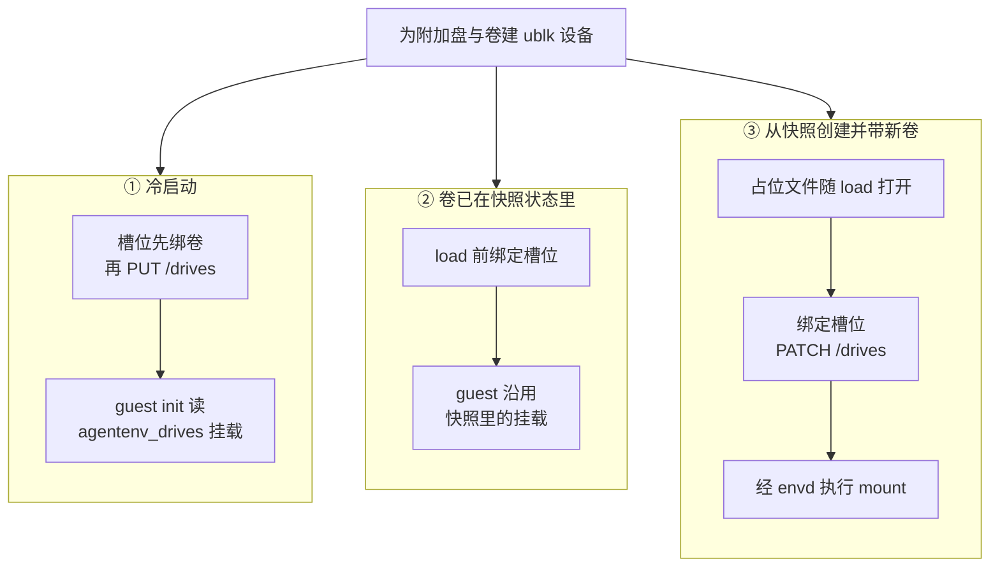
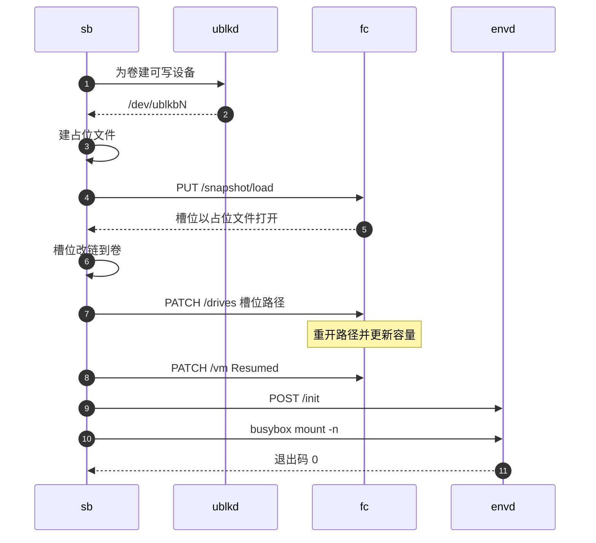

# 31 · 附加盘与卷：预留槽位与热插

> 一台沙箱除了 tools 盘与 rootfs，还可以挂两类块设备：随沙箱生灭的附加盘，与比沙箱活得久的卷。
> 难点在于 Firecracker 恢复快照后不能再新增 virtio-blk 设备，而卷恰恰常在「从模板快照创建」时才挂上。
> 本篇讲 AgentENV 怎样用首次启动时预留的占位槽位绕过这条限制，以及卷在 guest 内被谁、按什么选项挂载。
>
> **读者**：工程师、存储方向的研究者。　**预备**：[第 26 篇 · 沙箱的块设备](26-sandbox-block-devices.md)、[第 27 篇 · 启动、暂停与恢复的 Firecracker 调用序列](27-start-pause-resume-sequences.md)。
> **代码**：`src/sandbox/extra_drive.rs`、`src/volume.rs`、`src/sandbox/firecracker/sandbox.rs`（`new_with_id`、`configure_microvm`、`start_resume`、`prepare_volume_drive_slots`、`bind_volume_drive_slot`、`mount_initial_guest_drives_inner`）、`src/api/impls/volumes.rs`、`tools-image/init`

---

## 0. 本篇要回答的问题

1. 为什么卷不能像普通附加盘那样在启动时直接 `PUT /drives`？限制来自哪里？
2. 一台沙箱的 `/dev/vdc` 到 `/dev/vdz` 是怎样分配的？「卷槽位」在宿主上是什么文件，为什么只有 4 KiB？
3. 冷启动、恢复暂停的沙箱、从快照创建并挂新卷，这三种情况下卷分别在哪一步接到设备上、由谁在 guest 内挂载？
4. 只读卷为什么要用 `ro,noload` 挂载？`subPath` 是怎样实现的？
5. 卷的权威记录在哪里？暂停或快照时卷的数据去了哪里？
6. 这套设计放弃了什么？哪些上限在第一次启动时就被固定了？

---

## 1. 问题：恢复之后不能再插盘

Firecracker 的设备集合是在启动前用 `PUT /drives`、`PUT /network-interfaces` 等调用一次性配置的。
`InstanceStart` 之后，`PUT /drives` 不再接受新的 drive id；能改的只有已有 drive 的宿主路径与限流（`PATCH /drives`）。
快照恢复更严格：`PUT /snapshot/load` 从 vm_state 里重建全部设备，每个 virtio-blk 设备的 id、宿主路径都写在 vm_state 里，
load 时 Firecracker 按这些路径重新打开文件。这台恢复出来的 VM 没有「启动前」阶段，也就没有机会多加一块盘
（Firecracker 的设备模型见 Firecracker 手册相关篇目，这里只用这一条结论）。

AgentENV 的主路径恰恰是快照恢复：从模板创建沙箱就是恢复模板的快照（[第 09 篇 §2](09-sandbox-lifecycle-walkthrough.md#2-从模板创建)）。
而卷的典型用法是「同一个模板，每次创建时挂上不同的数据盘」。模板构建时不可能知道将来会挂哪块卷，
如果设备集合在模板快照里已经定死，从模板创建的沙箱就永远挂不上卷。

解决办法是在**第一次冷启动**时就多配几块 virtio-blk 设备，先用占位文件撑着，以后需要时把占位文件换成真实设备、
再用 `PATCH /drives` 让 Firecracker 重新打开路径。这几块预留的设备叫**卷槽位**（volume slot）。
它们从冷启动开始就存在于每一代快照的 vm_state 里，所以任何一次恢复都能用上。

---

## 2. 两类盘：附加盘与卷

AgentENV 里，tools 盘（vda）与用户 rootfs（vdb）之外的块设备都用同一个类型描述：`src/sandbox/extra_drive.rs` 的 `ExtraDrive`。
它目前只有一个变体 `ExtraDrive::Overlaybd`，即所有附加设备都是一个 overlaybd 层栈，经 ublk-daemon 暴露成 `/dev/ublkbN`
（设备栈见[第 26 篇](26-sandbox-block-devices.md)）。变体里的 `volume` 字段把它分成两类：

| 维度 | 物理附加盘（`volume = false`） | 卷（`volume = true`） |
|---|---|---|
| 来源 | 冷启动请求的 `attachedDrives[]`，内容来自一个 OCI 镜像 | 卷 API 创建的持久块存储（[第 16 篇](16-snapshot-and-volume-api.md)） |
| 能在何时加入 | 只有冷启动（`/sandboxes-cold`） | 冷启动，或任何一次从快照创建 |
| 生命周期 | 跟沙箱走；暂停、快照时随沙箱一起捕获 | 独立于沙箱；权威记录在快照仓库 |
| 在快照 manifest 里 | 记在 `attached_drives` | 不记；只记槽位数，卷的层另存 |
| Firecracker 里的 drive id | 用户给的 `driveID` | 固定的 `agentenv_volume_slot_<i>` |
| 写入落在哪里 | 沙箱工作目录下的运行时 upper | 卷自己的数据目录 |

`ExtraDrive` 的几个字段决定了它怎样挂进 guest：`mount_path`（缺省 `/mnt/<driveID>`）、`read_only`、可选的 `sub_path`、
`virtual_size`，以及卷才有的 `snapshot_output_dir`。`virtual_size` 的含义随阶段变化，字段注释写得很清楚：
冷启动时它是 API 请求的目标大小（`diskSizeMB`），可以为空，由 daemon 读源镜像的大小；
恢复时它是快照元数据里记下的实际设备大小。`ExtraDrivePrepareMode::device_sizes()` 把这两种语义翻译成 daemon 请求里的
`requested_virtual_size` 与 `known_source_virtual_size` 两个参数，并且只在冷启动时允许缩小（`allow_shrink`）。

### 2.1 入口校验

`ExtraDrive::try_new_overlaybd_with_mount_path()` 在构造时就做完全部校验，三个函数各管一件事：

- `validate_drive_id()`：只允许 ASCII 字母、数字与下划线；`rootfs`、`user_rootfs` 与 `agentenv_volume_slot_` 前缀是保留名。
  卷的 drive id 就是卷 ID（`vol_<uuid>`），恰好满足这条规则。
- `validate_mount_path()`：必须是绝对路径、不是 `/`、不含空白 / 逗号 / 冒号 / `..`，且不与保留路径
  `/proc`、`/sys`、`/dev`、`/run`、`/agentenv`、`/opt/agentenv` 互为前缀。「互为前缀」意味着 `/opt` 也被拒绝，
  因为把盘挂在 `/opt` 上会遮住 `/opt/agentenv`。`/tmp` 故意不保留：它属于 guest 文件系统，遮住它不会藏起 AgentENV 的控制文件。
- `validate_sub_path()`：必须是相对路径，同样不含空白、逗号、冒号与 `..`。

禁止逗号与冒号不是出于文件系统的限制，而是因为挂载表要拼进内核命令行（§4.1）：`agentenv_drives=vdc:/mnt/a,vdd:/mnt/b:sub`
用逗号分条、冒号分字段，校验保证了这两个分隔符没有歧义。

卷的挂载表另有一层校验，在 `src/api/impls/volumes.rs` 的 `resolve_volume_mounts_inner()`：数量不超过 `limits.max_mounts`、
挂载路径两两不互为前缀、同一卷不挂两次、卷大小不超过上限。它对挂载表**按挂载路径排序**后逐个处理，
这让同一组卷每次得到相同的设备顺序。推论：从沙箱快照恢复卷时（§4.2）槽位与卷的对应关系能保持不变，依赖的正是这次排序。

---

## 3. 设备命名与槽位

guest 内核按 virtio-blk 设备的配置顺序命名 `/dev/vda`、`/dev/vdb`……。AgentENV 固定了前两个，其余按「先物理附加盘、后卷槽位」排列。
`src/sandbox/firecracker/config.rs` 的 `MAX_EXTRA_DRIVES` 定义为 `b'z' - b'c' + 1`，即 vdc 到 vdz 共 24 个；
`src/volume.rs` 的 `MAX_VOLUME_MOUNTS = 24` 是同一个上限的另一处写法。

```text
guest 设备    Firecracker drive id         宿主工作目录里的路径（Firecracker 的 cwd）
/dev/vda      rootfs                       rootfs.ext4                 -> tools 共享设备（只读，root）
/dev/vdb      user_rootfs                  user-rootfs                 -> /dev/ublkbN（可写）
/dev/vdc      <driveID>                    extra-drive-<driveID>       -> /dev/ublkbN   物理附加盘 0
  …           …                            …                                            物理附加盘 P-1
/dev/vd(c+P)  agentenv_volume_slot_0       agentenv_volume_slot_0.img  4 KiB 占位文件，或
                                                                       -> extra-drive-vol_xxx -> /dev/ublkbM
  …           agentenv_volume_slot_<S-1>   agentenv_volume_slot_<S-1>.img
其中 P = physical_extra_drive_count，S = volume_drive_slots，P + S <= 24
```

槽位数在 `FirecrackerSandbox::new_with_id()`（冷启动）里确定：先把 `extra_drives` 按 `is_volume()` 分成物理盘与卷两组，
`physical_extra_drive_count` 记物理盘数，`volume_drive_slots = min(volume.max_volume_count, 24 - P)`；
`volume.max_volume_count` 缺省是 4，`validate_volume_limits()` 要求它在 1 到 24 之间。
若这次冷启动带的卷比槽位多，构造直接失败。之后两组按「物理在前、卷在后」重新拼回 `extra_drives`，
后续所有代码都靠 `physical_extra_drive_count` 这个分界点切分。

槽位文件由 `prepare_volume_drive_slots()` 创建：在工作目录里以 `create_new` 打开 `agentenv_volume_slot_<i>.img`，
`set_len(4096)`，即常量 `VOLUME_DRIVE_PLACEHOLDER_SIZE`。推论：大小取 4 KiB 而不是 0，是为了让 guest 看到一块有效的、
只有一个页大小的磁盘，而不是零容量设备；它不承载任何数据，guest 也不会去挂载它。
`bind_volume_drive_slot()` 把占位文件删掉，换成指向 `extra-drive-<卷 ID>` 的符号链接，后者再链到卷的 ublk 设备。

注意所有路径都是**相对路径**，相对于 Firecracker 进程的工作目录。vm_state 里记录的也是这些相对路径，
所以换一个工作目录恢复时，只要同名文件存在，Firecracker 就能重新打开它们。这也是 `start_resume()` 里一段注释强调的约束：
snapshot load 会重新打开每个序列化的槽位路径，**所有占位文件都必须存在**，即使这次恢复一块卷也不挂。

两个计数随快照持久化：`FirecrackerCommonConfig` 与快照 manifest（`src/sandbox/manifest.rs` 的 `SandboxSnapshotManifest`）
都有 `volume_drive_slots` 与 `physical_extra_drive_count` 两个字段。旧快照没有槽位（`volume_drive_slots == 0`），
`from_snapshot_config_with_override()` 与 `FirecrackerSnapshotConfig::from_runnable_snapshot()` 此时把所有附加盘都当物理盘处理，
这样的快照不能再挂任何卷。

---

## 4. 三条接线路径

卷的设备准备在三种情况下相同：`prepare_extra_drives()` 为每块盘调用 `UblkDeviceManager::create_overlaybd_runtime_device()`
得到一个 ublk 设备，在工作目录建 `extra-drive-<id>` 符号链接；任何一块失败，`PreparedDrives::cleanup()` 释放已建的设备并删链接。
不同的是**槽位何时绑定**、**guest 内由谁挂载**。下图把三条路径并列：



### 4.1 冷启动

`start_fresh()` 准备好附加盘后，用 `build_drives_boot_arg()` 拼出 `agentenv_drives=` 参数：第 i 块附加盘对应 `vd(c+i)`，
每条是 `vd<字母>:<mountPath>[:<subPath>]`。注意它遍历的是**全部** `extra_drives`（物理盘在前、卷在后），
因为卷在冷启动时恰好占据前几个槽位，第 j 块卷就在 `vd(c+P+j)`。

`configure_microvm()` 先 `PUT` tools 盘与 rootfs，再 `configure_extra_drives()` 配物理盘，然后建全部槽位，
把本次带的卷绑定到前几个槽位，最后把槽位也逐个 `PUT /drives`。也就是说，冷启动时卷和占位文件一样，
是作为普通 drive 在启动前配进去的，不需要任何热插。

guest 侧的挂载在 `tools-image/init` 里完成。它在 `pivot_root` 之前读 `/proc/cmdline`，对每条记录 `mkdir -p /mnt/user<mountPath>`，
再 `mount -n /dev/<dev>` 到这个目录（此时用户 rootfs 还挂在 `/mnt/user`）。有 `subPath` 时先挂到暂存目录
`/mnt/user/.agentenv-drive-<dev>`，把子目录 `--bind` 到目标，再 `umount -l` 暂存挂载，只留下 bind。
挂载失败只打印 `INIT WARN`，不让启动失败。

### 4.2 卷已在快照状态里：load 前绑定

有两种情况卷已经是 vm_state 的一部分：

- **恢复暂停的沙箱**。暂停时 `FirecrackerSnapshotConfig` 原样保存了包括卷在内的 `extra_drives`（§5），恢复时卷还是那几块。
- **从沙箱快照创建、请求没带 `volumeMounts`**。`src/api/impls/sandbox.rs` 的 `restore_snapshot_volume_mounts()`
  用快照里记录的卷层新建同样多的卷，并置 `extra_drives_in_snapshot = true`（[第 14 篇 §3](14-sandbox-api.md#3-从模板创建)）。

这两种情况下 guest 的内存里已经有这些卷的挂载，`start_resume()` 在 `prepare_volume_drive_slots()` 建好占位文件之后、
`load_snapshot_file()` 之前，就用 `bind_volume_drive_slot()` 把对应槽位换成卷的设备。
load 时 Firecracker 打开的就是真实设备，guest 恢复后接着使用原来的挂载，宿主不做任何 guest 侧操作。
这要求新卷的内容与 guest 内存里的文件系统状态一致：恢复出的卷来自同一次捕获，满足这个前提。

### 4.3 新卷：load 之后热插

从快照（典型是模板）创建并带 `volumeMounts` 时，这些卷不在源 vm_state 里。
`FirecrackerSandbox::from_snapshot()` 先在 `snapshot_config_for_launch()` 里检查卷数不超过快照的 `volume_drive_slots`，
把卷追加到 `extra_drives` 末尾；再由 `initial_guest_drive_mounts_for_snapshot_launch()` 记下每块卷的槽位下标
（从 `physical_extra_drive_count` 开始）。这张表非空就是「有新卷」的标志。

下图是这条路径。`sb` 是 `FirecrackerSandbox`，`ublkd` 是 ublk-daemon，`fc` 是 Firecracker 进程，`envd` 是 guest 内的守护进程。



第 4 步 load 时槽位还是 4 KiB 的占位文件。第 6、7 步对每块新卷先 `bind_volume_drive_slot()`，
再 `FirecrackerInstance::patch_drive_path()` 发 `PATCH /drives/<槽位 id>`，`path_on_host` 填槽位文件名。
Firecracker 这一侧是上游 v1.15.1 就有的行为：`Vmm::update_block_device_path()` 调 `VirtioBlock::update_disk_image()`，
重新打开路径（此时已是指向 ublk 设备的符号链接）、按新文件大小更新配置空间里的 `capacity`，设备已激活时触发一次 config 中断（图中第 7 步之后的注释），
guest 驱动据此刷新磁盘容量。AENV 补丁版 Firecracker 只在重新打开时多传了一个 `direct` 标志（O_DIRECT，[第 67 篇](67-firecracker-patch-layer.md)），
语义不变。整个过程发生在 `PATCH /vm Resumed` 之前，guest 第一次运行时看到的就已经是新容量。

guest 内的挂载要等到 envd 就绪。`wait_for_ready()` 在 `POST /init` 之后调用 `mount_initial_guest_drives()`，
后者把工作放进 `spawn_blocking`，由 `mount_initial_guest_drives_inner()` 对每块卷用 root 身份经 envd 执行
`/agentenv/bin/busybox mount -n`（选项见 §4.4）。与冷启动的 init 不同，这里任一步失败都会让 `wait_for_ready()` 返回错误，
整次启动按 launch 失败回滚（[第 20 篇](20-launch-plan-and-rollback.md)）。

`start_resume()` 里「load 前绑定」与「load 后热插」是二选一的：`has_new_volume_attachments` 为真时所有卷都走热插，否则全部在 load 前绑定。
一次启动的卷要么全部来自快照、要么全部是请求新给的，二者不会混合，所以不需要逐块判断。

### 4.4 guest 内挂载的三个细节

**只读卷用 `ro,noload`。** 卷的快照是崩溃一致的：暂停前只做了 `sync`，没有卸载文件系统，ext4 的超级块上
needs-recovery 标志还在。只读卷的 overlaybd 设备没有可写 upper（`storage/ublk-daemon/src/runtime.rs` 的 `resolve_upper_mode()`
对 `read_only` 直接返回 `Absent`），回放日志的写入会失败，挂载随之失败。`noload` 让 ext4 跳过日志回放，`ro` 同时在 guest 侧强制只读。
代码注释把这条理由写在 `mount_initial_guest_drives_inner()` 里。

**`subPath` 走暂存目录。** 有 `sub_path` 时，先把设备挂到 `/run/agentenv-drive-<driveID>`，再把 `<暂存>/<subPath>` `--bind` 到目标，
最后 `umount -l` 暂存挂载。语义与 Kubernetes 的 `subPath` 相同：guest 只看到盘里的一个子目录。
推论：卷 API 构造的卷 `ExtraDrive` 一律不带 `sub_path`（`resolve_volume_mounts_inner()` 传入 `None`），
所以 v0.2.3 里这条分支只对物理附加盘有意义，而物理附加盘只在冷启动出现、由 init 挂载，热插路径上的 `sub_path` 分支目前没有调用方会触发。

**陈旧挂载先卸再挂。** 从模板创建时，模板快照的 guest 也许在同一路径上还留着构建时的挂载。
`mount_guest_path_with_options()` 第一次 `mount` 失败后，先 `umount -l` 目标，再重试一次；
注释的说法是不能因为目标路径相同就接受一个陈旧的快照挂载。

---

## 5. 暂停与快照时卷去了哪里

**暂停前先 sync。** `pause_to_dir()` 在 `PATCH /vm Paused` 之前检查 `has_writable_persistent_volumes()`
（有可写且带 `snapshot_output_dir` 的盘），有则经 envd 在 guest 内执行 `busybox sync`，把页缓存里的脏数据推到块设备。
这一步保证的只是「已写入的数据落到设备」，不是文件系统的干净卸载，这正是 §4.4 需要 `noload` 的原因。

**卷的 upper 封存到卷自己的目录。** `snapshot_extra_drives()` 对每块附加盘调用 `restack_snapshot_overlaybd_device()`
（restack 的机制见[第 37 篇](37-seal-restack-compact.md)）。物理附加盘输出到 `<快照目录>/drives/<driveID>/snapshot.commit`；
卷输出到它的 `snapshot_output_dir`，即 `VolumeManager::data_dir()`（`<卷根>/data/<卷 ID>`），文件名是 `snapshot-<uuidv7>.commit`。
文件名每次都不同，因为卷目录会跨多次暂停复用，固定名字会覆盖一个仍被 `image.json` 引用的 lower。
只有独占（Exclusive）卷有 `snapshot_output_dir`，只读卷的这个字段为 `None`。

**manifest 不记卷。** `snapshot_to_dir()` 把卷从 `manifest_extra_drives` 中过滤掉，manifest 只记物理附加盘、
`volume_drive_slots` 与 `physical_extra_drive_count`。暂停状态（`FirecrackerSnapshotConfig`）则保留全部 `extra_drives`，
所以恢复暂停的沙箱时卷原样回来（§4.2）。已提交快照里卷的内容另由 API 层的 `snapshot_sandbox_volumes()` 记成卷层列表
（[第 16 篇](16-snapshot-and-volume-api.md)），从这个快照创建时再恢复成新卷。

不暂停只捕获卷的路径是 `SandboxBackend::snapshot_volumes()`：`sync` → `PATCH /vm Paused` → `snapshot_persistent_volume_drives()`
逐块 restack 可写卷 → `resume()`。删除时的 freeze / restack / thaw 在[第 21 篇](21-deletion-and-volume-capture.md)；
fork 时独占卷每个子沙箱克隆一份、只读卷共享，子沙箱只允许**替换**快照里已有的卷 drive、不允许追加
（`snapshot_config_for_fork()`），细节在[第 51 篇](51-fork.md)。

---

## 6. `VolumeManager`：权威在仓库，本地是缓存

`src/volume.rs` 的 `VolumeManager` 管理卷的目录与数据。它的 `records` 只是缓存：`get()` 每次都向 `SnapshotRepository::get_volume()` 取记录，
再用本地缓存补上 `backing_image_config`（本节点上已物化的 `image.json` 路径），并且只有本地记录的 `backing_layers` 与仓库一致、
文件仍存在时才采用（`current_local_backing()`）。

| 字段 / 概念 | 取值 | 说明 |
|---|---|---|
| `mode` | `Exclusive`（缺省）/ `ReadOnly` | 独占卷同一时刻只有一个 owner；只读卷可被多个沙箱同时挂载 |
| `status` | `Ready` / `Uploading` / `Failed` | 只有 Ready 的卷能被预留 |
| `reserved_by_sandbox_id` | owner 或空 | 独占卷的持有者；创建期间是临时 owner `pending-<uuid>` |
| `read_only_mounts` | owner 列表 | 只读卷的挂载者 |
| `backing_layers` | 层引用列表 | 仓库拥有的不可变层；本地 `image.json` 只是缓存 |
| 大小 | 缺省 64 GiB，上限 `volume.max_size_mb` = 256 GiB | `DEFAULT_VOLUME_SIZE_MB` 与 `[volume]` 节 |

**预留。** `reserve()` 对只读卷调 `reserve_read_only_volume()` 追加一个挂载者，对独占卷调 `reserve_volume()`，
后者在仓库里原子地占位，已被别人持有就返回 `VolumeError::Reserved`。预留之后 `materialize_backing()` 把层物化到本节点的
`data/<卷 ID>/image.json`，这个路径就是 `ExtraDrive` 的 `image_config_path`。owner 从 pending 转给沙箱 ID 的过程在
[第 14 篇](14-sandbox-api.md)与[第 16 篇](16-snapshot-and-volume-api.md)。

**发布。** `publish_records()` 先把状态写成 `Uploading` 并持久化，再上传可写 upper（`publish_backing()`），成功后写回 `Ready`；
任何一步失败都标 `Failed`。先改状态后上传，是为了让别的节点在上传期间不会挂载到旧内容。

**创建。** 空卷由 `create_empty_backing()` 生成：建一个稀疏文件、`mkfs.ext4 -q -F`、用 `overlaybd::tools::package_raw_as_overlaybd()`
打包成一层 `base.commit`，再删掉原始文件。所以卷在 guest 里总是 ext4。从镜像或另一块卷克隆时，
`create_child_backing()` 把父卷的每个 lower 硬链接（失败时复制）到新卷目录；父卷未被持有且已有已发布的层时，
干脆直接复用父卷的 `backing_layers`，等挂载时再物化。

**删除。** `delete()` 在卷仍被持有（独占 owner 或任何只读挂载者）时拒绝，否则删仓库记录与本地数据目录。

---

## 7. 代价与边界

**槽位数在第一次冷启动时就定死。** `volume_drive_slots` 写进 vm_state 与 manifest，之后每一代快照都继承它。
运维把 `volume.max_volume_count` 从 4 调到 8，只影响此后冷启动的模板；旧模板仍然只有 4 个槽位，
而 API 层的 `limits.max_mounts` 已按新配置放行 8 块，超出部分会在 `snapshot_config_for_launch()` 的检查里失败。
推论：这个失败发生在 orchestrator 内部，返回的是服务端错误而不是请求校验错误。

**槽位占用设备号，即使不用。** 每台沙箱都带着 `S` 块 4 KiB 的空盘，guest 里能看到 `/dev/vd*` 多出几块，
物理附加盘最多只剩 `24 - S` 个位置。没有槽位的旧快照永远不能挂卷。

**物理附加盘没有热插。** 它们只能在冷启动时给出，从快照创建时不能新增，因为槽位只为卷预留。

**只读在 Firecracker 层没有体现。** 卷槽位总是以可写 drive 配置（`prepare_volume_drive_slots()` 里 `read_only: false`），
因为同一个槽位今天挂独占卷、明天可能挂只读卷，而 `PATCH /drives` 不能改只读属性。只读卷的写保护靠两层：
overlaybd 设备没有 upper，写入返回错误；热插路径在 guest 侧加 `ro`。冷启动路径的 init 并不区分只读，
推论：冷启动挂只读卷时 guest 以读写方式挂载 ext4，第一次元数据写入会在 overlaybd 层得到 I/O 错误，
这一组合在 v0.2.3 的测试里没有找到覆盖。

**挂载失败的语义两条路径不一致。** init 里挂载失败只打 `INIT WARN`，沙箱照常就绪、挂载点下是空目录；
热插路径挂载失败则让创建失败。前者的失败对 API 调用方不可见。

**跨类挂载路径没有交叉检查。** 推论：`resolve_attached_drives()` 只拒绝物理附加盘之间完全相同的路径，`resolve_volume_mounts_inner()`
只检查卷之间的前缀重叠；冷启动同时给出两类盘时，二者的挂载路径互相嵌套或相同不会被拒绝，结果取决于 init 里的挂载顺序。

---

## 8. 与 e2b infra 的对照

e2b infra 的卷是宿主上一个用户态 NFSv3 代理导出的目录：guest 里的 envd 在 `/init` 时 `mount -t nfs`，代理按连接源地址认出沙箱（见 e2b 手册第 40 篇）。
网络文件系统不占 virtio-blk 设备，也不受「恢复后不能加设备」的约束，还能让多个沙箱同时读写同一卷。
AgentENV 把卷做成块设备，读写路径与 rootfs 共用 overlaybd 与 ublk，代价是需要预留槽位、独占卷同时只能有一个写者。

---

## 9. 小结

- Firecracker 恢复快照后不能新增 virtio-blk 设备；AgentENV 在首次冷启动时按 `min(max_volume_count, 24 - 物理盘数)` 预留卷槽位，之后靠换符号链接加 `PATCH /drives` 实现热插。
- 设备顺序固定为 vda = tools 盘、vdb = 用户 rootfs、vdc 起先物理附加盘后卷槽位，上限 vdz；槽位是工作目录里的 4 KiB 占位文件，路径是相对路径。
- snapshot load 会重新打开 vm_state 里的每个槽位路径，所以每次恢复都必须先建好全部占位文件。
- 冷启动的卷在启动前直接配进槽位，由 guest init 读 `agentenv_drives=` 挂载；卷已在快照状态里时在 load 前绑定，guest 沿用原挂载；新卷在 load 后热插、经 envd 挂载。
- `PATCH /drives` 重开路径、更新容量、发 config 中断是上游 Firecracker 的行为，AENV 补丁版只多传了 `direct` 标志。
- 只读卷挂载用 `ro,noload`，因为卷快照只是 `sync` 过的崩溃一致状态，只读设备无法回放 ext4 日志。
- 卷的 upper 封存到卷自己的数据目录、文件名带 UUID；manifest 只记物理附加盘与槽位数，卷内容由 API 层记成卷层。
- `VolumeManager` 的权威记录在快照仓库，本地缓存只在层列表一致时可用；发布前先标 `Uploading`。
- 槽位数随第一次冷启动固化、只读属性不在 Firecracker 层体现、两条挂载路径的失败语义不同，是这套设计的主要边界。

---

## 延伸阅读 / 下一篇

- [第 16 篇 · 快照与卷 API](16-snapshot-and-volume-api.md)：卷的创建、预留与 owner 转移。
- [第 21 篇 · 删除与卷的捕获提交](21-deletion-and-volume-capture.md)：删除时 freeze、restack、thaw 卷。
- [第 26 篇 · 沙箱的块设备](26-sandbox-block-devices.md)：附加盘所在的 ublk 设备栈。
- [第 27 篇 · 启动、暂停与恢复的 Firecracker 调用序列](27-start-pause-resume-sequences.md)：槽位相关调用在完整序列中的位置。
- [第 37 篇 · 封存、restack 与 compact](37-seal-restack-compact.md)：卷 upper 封存的机制。
- [第 51 篇 · fork](51-fork.md)：fork 时卷的克隆与替换。
- [e2b 手册第 40 篇 · Volumes 与 NFS proxy](../e2b-infra/40-volumes-and-nfsproxy.md)：同一需求的网络文件系统方案。
- 下一篇：[第 32 篇 · 预热池](32-warm-pools.md)。
