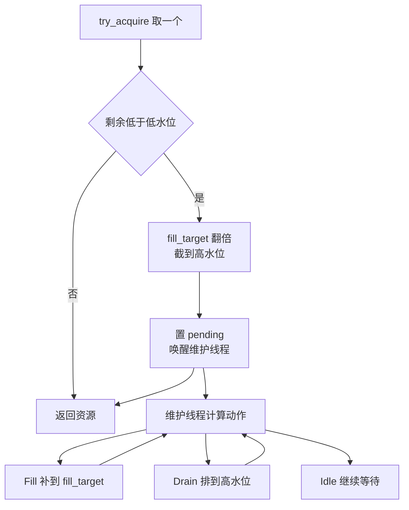
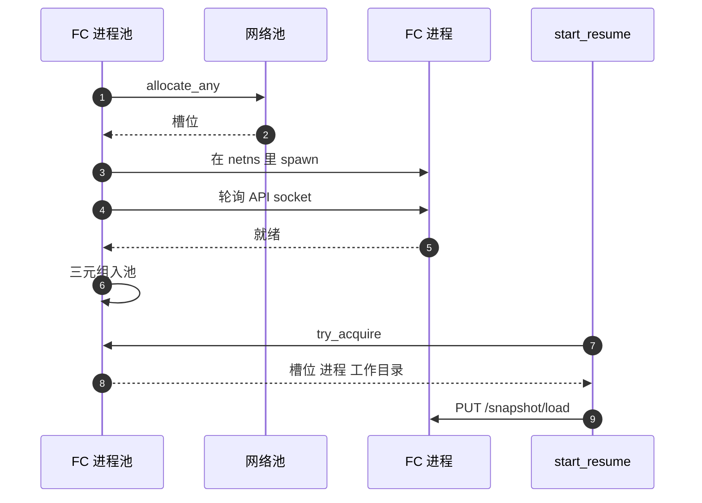

# 32 · 预热池：网络、块设备与 Firecracker 进程

> 恢复一台沙箱之前，节点要先有一个网络命名空间、几块 ublk 设备和一个在那个命名空间里跑着的 Firecracker 进程。
> 这三样东西都与「哪台沙箱」无关，却都要花时间建。AgentENV 用三个预热池把它们挪出关键路径，
> 三个池共用一个通用的水位线实现，但填充方式、复用方式与边界各不相同。本篇讲这个通用实现与三个池各自的取舍。
>
> **读者**：工程师、系统方向的研究者。　**预备**：[第 25 篇 · 后端抽象与 Firecracker 进程](25-backend-and-firecracker-process.md)、[第 29 篇 · 网络（一）](29-network-slots.md)、[第 26 篇 · 沙箱的块设备](26-sandbox-block-devices.md)。
> **代码**：`crates/warm-pool/src/lib.rs`、`src/sandbox/network/manager.rs`、`src/sandbox/firecracker/pool.rs`、`src/sandbox/firecracker/sandbox.rs`（`start_resume`）、`src/cfg.rs`（`[pool]`）、`storage/ublk-daemon/src/server.rs`（`PoolState`，只引用）

---

## 0. 本篇要回答的问题

1. 恢复路径上哪些准备工作与沙箱身份无关、可以提前做？提前做的代价是什么？
2. 通用的 `WarmPool<T>` 怎样决定补多少、排多少？`fill_target` 为什么只升不降？
3. 网络槽位回池时做了什么、没做什么？`pool.network.enabled = false` 为什么关不掉网络池？
4. 块设备池为什么不用后台维护线程？空闲设备挂在什么镜像上？
5. Firecracker 进程池里的一项为什么是「槽位 + 进程 + 工作目录」三元组？为什么只有 resume 用它？
6. 三个池在失败、关闭与跨租户复用上各有哪些边界？

---

## 1. 问题：关键路径上与身份无关的工作

回顾[第 27 篇](27-start-pause-resume-sequences.md)的恢复序列：在 `PUT /snapshot/load` 之前，`start_resume()` 要依次拿到

- 一个**网络槽位**：新建一个 netns、一对 veth、一个 tap，装好基础 iptables 规则（[第 29 篇](29-network-slots.md)）。
  这要在新线程里 `unshare`、发若干条 netlink 消息、跑一次 `iptables-restore`。
- 若干个 **ublk 设备**：rootfs 的可写设备、附加盘与卷的设备、共享内存设备。每个新设备都要经 ublk 控制环发 ADD / START 命令、
  起队列线程（[第 40 篇](40-ublk-library.md)、[第 41 篇](41-ublk-daemon.md)）。
- 一个 **Firecracker 进程**：在槽位的 netns 里 spawn，再轮询它的 API socket 直到可连（[第 25 篇](25-backend-and-firecracker-process.md)）。

这三样东西有一个共同点：创建时不需要知道是哪台沙箱、哪个快照。槽位的地址计划让所有槽位里 VM 与 tap 的地址相同；
ublk 设备可以先挂一个占位镜像、用时再换目标；Firecracker 进程在收到第一个 API 请求之前是一个空白的 VMM。
所以它们都可以**提前建好放在池里**，请求来时直接取。

代价也是共同的。第一，空闲资源本身占东西：槽位占内核网络对象与槽位号，设备占 ublk 设备号与队列线程，进程占内存与 PID。
第二，复用意味着残留：上一个租户在槽位里留下的连接跟踪表项、在设备页缓存里留下的数据，都要么清掉、要么接受。
第三，池要决定「备多少」，备少了遇到突发仍然走慢路径，备多了浪费。下面先讲三个池共用的「备多少」的逻辑。

---

## 2. 通用实现：`WarmPool<T>`

`crates/warm-pool/src/lib.rs` 的 `WarmPool<T>` 只管池的机制，不管资源怎样创建与销毁，后者由各个池在回调里提供。它的状态是：

| 字段 | 作用 |
|---|---|
| `pool: Mutex<VecDeque<T>>` | 空闲资源队列；取从队头，排空从队尾 |
| `config: PoolConfig` | `low_watermark`、`high_watermark`、`maintenance_enabled`、`startup_prewarm` |
| `fill_target: Mutex<usize>` | 当前补充目标，初值为低水位 |
| `maintenance_signal` + `maintenance_cv` | condvar 唤醒维护线程的 pending / stop 标志 |
| `shutting_down: AtomicBool` | 关闭后拒绝取用与归还 |

三个池的水位来自同一个 `[pool]` 节：`low_watermark = 2`、`high_watermark = 64`（`src/cfg.rs` 的 `PoolTomlConfig`）。
`PoolConfig::validate()` 在低水位高于高水位时把低水位压到高水位并打 warn；`AppConfig` 的 `validate_pool_config()` 则对启用的池直接拒绝这种配置。

### 2.1 补多少、排多少

`compute_maintenance_action(pool_len)` 只有三种结果：空闲数低于 `fill_target` 时 `Fill(fill_target - len)`；
高于高水位时 `Drain(len - high)`，一次排净；其余 `Idle`。补的目标不是低水位，而是 `fill_target`，这是「备多少」的关键。

`fill_target` 在每次取用时更新。`try_acquire()` 与 `try_acquire_where()` 取完后调用 `record_acquisition_pressure(剩余数)`：
若剩余数低于低水位，`grow_fill_target_after_pressure()` 把目标翻倍，即 `max(目标, 低水位, 1) × 2`，再截到高水位；
随后若需要补充就唤醒维护线程。**取空也算压力**：池里没有资源、`try_acquire()` 返回 `None` 时同样翻倍。
于是一次从空池开始的突发也会抬高以后的备量。

以缺省水位为例，`fill_target` 的演进如下（每行是一次「取后剩余低于 2」的事件）：

| 压力事件 | 翻倍前 | 翻倍后 | 维护线程补到 |
|---|---|---|---|
| 初始 | — | 2 | 2 |
| 第 1 次 | 2 | 4 | 4 |
| 第 2 次 | 4 | 8 | 8 |
| 第 3 次 | 8 | 16 | 16 |
| 第 4 次 | 16 | 32 | 32 |
| 第 5 次及以后 | 32 | 64 | 64（封顶） |

`fill_target` 的字段注释明确说这是有意为之：它在进程生命周期内**只升不降**，节点一旦观察到突发需求，
就保留更多的预热容量，而不是退回冷启动时的行为。代价是突发过后，节点会一直多备着资源，直到进程重启。

### 2.2 归还与维护线程

`release()` 的语义取决于 `maintenance_enabled`。开启维护时，归还的资源**总是**入队，即使超过高水位，排空交给维护线程统一决定；
关闭维护时，队列已达高水位就把资源退回给调用方（`Err(resource)`），由调用方销毁。
维护线程补充时用的是另一个入口 `try_push_bounded()`：只有队列低于高水位才入队，否则退回，避免补充本身越过上限。

维护线程由 `start_maintenance_worker()` 启动，要求 `&'static self`，因为线程在池的整个生命周期里持有回调；三个池都是进程级单例，满足这一点。
线程在 condvar 上等 `pending`，醒来后调一次回调，然后自己重新计算动作：只要不是 `Idle`，就不再等待，立刻进入下一轮。
关闭时 `drain_all()` 先置 `shutting_down`，再置 `stop` 并 join 维护线程，最后把队列里剩下的资源全部交还调用方销毁。

---

## 3. 网络槽位池

`src/sandbox/network/manager.rs` 的 `NetworkManager` 单例持有一个 `WarmPool<Slot>`。槽位的内容在[第 29 篇](29-network-slots.md)：netns、veth、tap、路由与基础规则。

**取用。** `allocate_any()` 先 `pool.try_acquire()`，命中就直接返回，剩余低于低水位时再请求一次维护；
不命中走 `allocate_fresh_slot()`：必要时补装宿主全局 iptables，从位图取一个空闲槽位号，`Slot::create_network()` 现场建网络。
维护线程的回调 `run_pool_maintenance_cycle()` 补充时调用的也是 `allocate_fresh_slot()`，一旦失败就结束本轮。

**归还。** `release()` 不拆任何东西，直接把槽位放回池里；关闭中或池满（维护关闭时）才 `cleanup_slot_and_release_bit()`
拆掉内核对象并清位图。槽位回池时**不重建 namespace**，也不立即清理上一位用户的出站规则。
清理推迟到下一位用户：`Slot::set_egress_policy()` 用 `user_egress_rules_present` 记录槽位里是否装着用户规则，
新沙箱无论有没有策略都会调用它（`start_fresh()` 与 `start_resume()` 都在 spawn 或 load 之前调用），
旧规则存在时这次调用会把命名空间里的用户链重写成新策略。没有规则且旧槽位也干净时，它直接返回，不进入命名空间。

这种「惰性复位」省掉了归还时的一次命名空间操作，代价是复位的范围只到 iptables 用户链与透明代理状态：
conntrack 表与邻居缓存不会被清空。不同租户先后用同一个槽位时，后者的 netns 里可能还留着前者的连接跟踪项，
这一点的安全讨论在[第 30 篇](30-egress-policy-and-proxy.md)。

**两个配置开关的实际效果。** `network_pool_config()` 把 `maintenance_enabled` 设为 `enabled && maintenance_enabled`，
没有任何地方读取 `[pool.network] enabled` 去禁止入队。于是 `enabled = false` 只是关掉维护线程：
`release()` 走「维护关闭」的分支，仍然把槽位缓存到高水位为止，`allocate_any()` 也仍然先从池里取。
所谓「禁用网络池」并不彻底。另一个开关 `[pool.network] startup_prewarm` 也没有读取者：网络池的预热来自维护线程，
它在 `NetworkManager::global()` 首次初始化时启动并立即请求一次维护，补到低水位，不看这个开关。

---

## 4. 块设备池

块设备池在 ublk-daemon 进程里，不在 `server` 进程里。daemon 的 `PoolState`（`storage/ublk-daemon/src/server.rs`）
同样用一个 `WarmPool<PooledDevice>` 存空闲设备，但它的**维护线程被强制关闭**：
`server` 侧 `block_pool_config()` 与 daemon 侧 `main.rs` 都把 `maintenance_enabled` 写死为 `false`，注释给出两条理由：
补充需要走异步的 ublk 控制环，而通用维护线程是同步线程；补充需要知道当前请求的镜像大小，设备的「形状」与镜像相关。
daemon 内部的设备管理在[第 41 篇](41-ublk-daemon.md)，这里只讲它作为一个池的行为。

**复用一台空闲设备。** `prepare_overlaybd_device()` 先 `take_idle_device()`：内核支持 `UBLK_F_UPDATE_SIZE` 时取任意一台，
随后若扇区数不同就在线改大小；不支持时只能用 `try_acquire_where()` 挑扇区数完全相同的那台。取到后 `swap_state()` 把设备的目标换成本次请求的镜像。
池中没有合适的设备就现场创建。

**归还到占位镜像上。** 设备释放时（独占设备直接释放，共享设备引用计数归零时），`idle_released_device()` 先用 `BLKFLSBUF`
清掉这台设备的页缓存，再把目标换成一个由 daemon 自己生成、与原镜像**同样大小**的稀疏占位镜像，然后 `try_push_bounded()` 入队；
池满就停掉设备。换到占位镜像的理由写在 `PoolState::placeholders` 的注释里：空闲设备不能继续钉住刚释放的业务镜像。
清页缓存的目的是让下一位用户读不到上一位用户留在设备页缓存里的数据。
失败处理在两类步骤上不同。生成占位镜像或 `swap_state()` 失败时，设备被停掉删除，而不是挂着业务镜像进池；清页缓存却是尽力而为：`clear_page_cache()` 打不开设备或 ioctl 返回错误时只打一条 warn，设备照常换上占位镜像、进入空闲队列。推论：这种情况下旧租户的页可能仍留在这台设备的页缓存里，下一位用户取到它、换上自己的镜像之后，读到的页缓存命中未必来自自己的镜像。

**补充挂在请求路径上。** 每次取用或归还后，若 `startup_prewarm` 为真，就调用 `schedule_idle_pool_refill()`：
用 `refill_inflight` 原子标志合并并发请求，`tokio::spawn` 一个任务，按**本次请求的设备大小**创建占位设备补到 `fill_target`；
失败时睡 1 s 再放开标志，避免持续失败时被并发请求绕过退避。所以 daemon 里的 `startup_prewarm` 名不副实：
它不控制启动时的预热，而控制请求路径上的补充。它的缺省值在 `server` 与 daemon 两侧也不同（[第 11 篇 §5](11-configuration.md#5-同一个文件的第二个读者)）。
`fill_target` 的翻倍逻辑在这里照样生效，因为它记在 `try_acquire()` 里，与维护线程是否开启无关。

---

## 5. Firecracker 进程池

`src/sandbox/firecracker/pool.rs` 的 `FirecrackerPool` 存的不是单个进程，而是一个三元组 `WarmFirecracker { slot, fc_instance, work_dir }`，
注释称它为「不可分割的所有权单元」。三者绑在一起是由 Firecracker 的使用方式决定的：

- **进程必须生在槽位的 netns 里。** Firecracker 要打开 netns 里的 `tap0`，`spawn_with_netns()` 在 spawn 前 `setns` 进槽位的命名空间
  （[第 25 篇](25-backend-and-firecracker-process.md)）。进程一旦起来就不能再换命名空间，所以进程与槽位只能一起预建、一起交出。
- **工作目录是进程的 cwd。** 沙箱的所有 drive、vm_state 都用相对路径引用（[第 31 篇 §3](31-extra-drives-and-volumes.md#3-设备命名与槽位)），
  而 cwd 在 spawn 时固定，所以工作目录也要随进程一起交出。

### 5.1 填充

`create_warm_async()` 做三件事：`NetworkManager::allocate_any()` 取一个槽位、`create_firecracker_work_dir()` 建工作目录、
在槽位 netns 里 spawn 进程并 `wait_for_ready()` 等 API socket；任一步失败都回收已拿到的部分。
维护回调 `run_maintenance_cycle()` 在 `Fill(n)` 时按 `fill_concurrency`（缺省 4）分批并发创建，一批里有失败就不再发下一批。

这个池自带一个 tokio runtime：`try_init()` 建了一个只有一个 worker 线程的多线程 runtime，维护线程用它 `block_on`。
注释的理由是池是进程级单例，可能比第一次触碰它的那个 runtime 活得更久（测试与基准里常见），所以不能保存 `Handle::current()`；
维护工作只是偶尔 spawn 进程、轮询 socket，一个 worker 足够，缺省的多线程 runtime 会为每个 CPU 核常驻一个线程。

启动时 `src/bin/server.rs` 调用 `FirecrackerPool::prime()`，最多等 10 s 让池补到低水位；超时不是错误，因为冷路径始终可用（[第 10 篇 §2.5](10-node-process-and-object-model.md#25-ublk-daemon-与预热池)）。
`prime()` 在维护关闭或 `startup_prewarm = false` 时直接跳过。

### 5.2 取用：只在 resume

池只在 `start_resume()` 里被取用，而且有两个前提：调用方没有指定 stdout / stderr 路径；`try_acquire(capture_output)` 里的输出捕获设置与池建进程时一致。
后者是因为进程的标准输出去向在 spawn 时就定了，`[firecracker] log_level` 决定要不要捕获，不一致的进程不能复用（此时也不记取用压力）。
命中后，`start_resume()` 换上三元组：槽位、工作目录与 `fc_instance` 一起替换掉沙箱对象构造时的那一份，再用 `relocate_warm_log()` 把预热期间写的日志搬到沙箱的日志路径
（跨文件系统时处理 `EXDEV`）。之后 `needs_socket_wait` 为假，恢复流程跳过 spawn 与 socket 轮询，直接进入 tools 盘、rootfs 与快照加载。

图中「FC 进程池」是 `FirecrackerPool`，第 1 到 6 步由它的维护线程执行；`net` 是网络槽位池，`sb` 是正在恢复的沙箱的 `start_resume()`。

冷启动（`start_fresh()`）不用这个池，总是现场分配槽位、spawn 进程。「snapshot load 要求未配置的进程」不能解释这个选择：
fresh 启动同样需要一个尚未配置的进程。代码里只能看到一个事实：池只接入了 `start_resume()`，注释没有给出理由。
推论：恢复是从模板创建与 resume 的共同热路径，进程 spawn 与 socket 轮询在其中占的比例更显著；冷启动要等 guest 内核从头引导，
省下这一步的意义小。另外，`start_fresh()` 在 spawn 之前调用 start-fresh 扩展 hook 并把它返回的参数拼进 boot args，
预建进程不影响这一点，所以把池接入 fresh 路径在技术上没有障碍。

### 5.3 一次性的池

与另外两个池不同，进程池里的资源**用掉就没有了**：沙箱停止时 Firecracker 进程被杀，工作目录被删，槽位经 `NetworkManager::release()` 回到**网络池**，
而不是回到进程池。进程池的补充总是新建，并且每建一项都要从网络池取一个槽位。
池里的项被排空或关闭时，`cleanup_warm_async()` / `cleanup_warm_blocking()` 停进程、删工作目录，再用 `cleanup_allocated_slot()` 直接拆掉槽位，不回网络池。

进程退出路径有两层兜底。正常关闭时 `server` 调用 `FirecrackerPool::shutdown()`（[第 10 篇 §3](10-node-process-and-object-model.md#3-关闭序列)）；
此外 `try_init()` 用 `libc::atexit` 注册了 `firecracker_pool_exit_hook()`，测试、基准等不走优雅关闭的场景也能回收。
exit hook 里 tokio 的线程局部状态可能已经销毁，所以 `shutdown_blocking(true)` 不 `block_on`，而是直接 drop `fc_instance`，
依靠它的 `kill_on_drop` 杀进程。`NetworkManager` 有同样的 exit hook。

---

## 6. 三池对照

| 维度 | 网络槽位池 | 块设备池 | Firecracker 进程池 |
|---|---|---|---|
| 所在进程 | `server`（`NetworkManager`） | ublk-daemon（`PoolState`） | `server`（`FirecrackerPool`） |
| 池中资源 | 建好的 netns、veth、tap、基础规则 | 挂在同尺寸占位镜像上的 ublk 设备 | 槽位 + 已就绪未配置的进程 + 工作目录 |
| 谁来补充 | 维护线程 | 请求路径上的异步任务 | 维护线程，按批并发 |
| 资源能否回收复用 | 能，回池不重建 | 能，清页缓存并换占位镜像 | 不能，用一次即销毁 |
| 复位方式 | 惰性：下一位用户重写出站规则 | 立即：`BLKFLSBUF` 与换目标 | 不需要 |
| 谁来取用 | fresh、resume、进程池自己 | 所有设备请求 | 只有 resume |
| 失败后的重试 | 结束本轮 | 睡 1 s | 结束本轮 |
| 关闭开关 | `enabled` 只关维护 | `[pool.block] enabled` | `[pool.firecracker] enabled` |

---

## 7. 代价与边界

**空闲资源的上限是 64 × 3。** 三个池共用一组水位，`fill_target` 又只升不降。一个经历过几次突发的节点，
稳态下可能备着数十个空闲槽位、数十台空闲 ublk 设备和数十个空闲 Firecracker 进程，而且进程池的每一项还额外占着一个槽位。
推论：槽位号容量（[第 29 篇](29-network-slots.md)）要按「运行中沙箱 + 网络池 + 进程池」来估算，三个池不能分别配置水位。

**补充失败时的重试节奏不同。** 块设备池失败后睡 1 s 再重试，并且有对应的测试（`failed_idle_pool_refill_waits_before_retry`）。
网络池与进程池的回调失败只结束本轮，而维护线程在一轮结束后若计算出的动作仍是 `Fill`，就不等待、立即再跑一轮。
推论：当失败是持续性的（例如槽位号已经耗尽，`allocate_fresh_slot()` 每次都立刻返回 `No available slots`），
这两个维护线程会不经退避地反复重试，直到有槽位被释放。

**惰性复位让残留多活一段时间。** 网络槽位回池后，上一位用户的出站规则与透明代理状态一直留到下一位用户调用 `set_egress_policy()`；
conntrack 与邻居缓存则从不清空。自定义扩展经 `networkNamespacePath` 在 netns 里加的接口、路由或规则，AgentENV 的复位根本不碰，
推论：扩展没有在 best-effort 的 stop hook 里撤销时，这些改动随槽位交给下一位租户（[第 33 篇 §6](33-custom-extension-hooks.md#6-代价与边界)、[第 30 篇 §6.4](30-egress-policy-and-proxy.md#64-预热槽位的跨租户残留)）。
块设备池在这一点上更保守：归还时立即清页缓存，只是清缓存失败不阻止设备进池。

**配置项与行为不完全对应。** `[pool.network] enabled = false` 不阻止缓存；`[pool.network] startup_prewarm` 没有读取者；
daemon 侧的 `startup_prewarm` 实际控制的是请求路径上的补充。`crates/warm-pool` 的模块文档列出「为静态单例池提供进程退出 hook」，
而 crate 里并没有这部分，exit hook 由 `FirecrackerPool` 与 `NetworkManager` 各自注册。

---

## 8. 与 e2b infra 的对照

e2b infra 的网络槽位池是两个固定容量的 channel：常驻 goroutine 预建新槽位，归还时先复位防火墙再放进复用队列，取用时复用优先（见 e2b 手册第 35 篇）；NBD 设备池同样是固定容量的预热 channel（见 e2b 手册第 33 篇）。
AgentENV 用一个水位线加只升不降的补充目标代替固定容量，并多了一个 Firecracker 进程池；代价是备量随历史峰值上涨、不会回落，网络槽位的复位推迟到下一次使用。

---

## 9. 小结

- 网络槽位、ublk 设备与 Firecracker 进程的创建都与沙箱身份无关，所以可以预建；代价是空闲资源占用、复用残留与「备多少」的选择。
- `WarmPool<T>` 用低 / 高水位与 `fill_target` 决定补与排；每次取用后剩余低于低水位（包括取空）就把 `fill_target` 翻倍，进程生命周期内只升不降。
- 开启维护时归还总是入队、由维护线程排到高水位；关闭维护时高水位是硬上限。
- 网络槽位回池不重建 namespace，出站规则由下一位用户惰性重写，conntrack、邻居缓存与扩展在 netns 里的改动都不清；`enabled = false` 只关维护，不关缓存。
- 块设备池在 daemon 里，没有维护线程，由请求路径上合并后的异步任务按当前设备大小补充；归还时清页缓存并换到同尺寸占位镜像，换镜像失败删设备，清页缓存失败只告警。
- Firecracker 进程池的一项是槽位、进程、工作目录的三元组，因为进程只能生在槽位的 netns 里、cwd 在 spawn 时固定。
- 进程池只接入 `start_resume()`，且要求输出捕获设置一致；资源用一次即销毁，槽位回到网络池。
- 三个池共用一组水位；网络池与进程池的补充失败没有退避（推论），块设备池有 1 s 退避。

---

## 延伸阅读 / 下一篇

- [第 29 篇 · 网络（一）：槽位、命名空间与地址计划](29-network-slots.md)：槽位里有什么、槽位号容量。
- [第 30 篇 · 网络（二）：出站策略与透明代理](30-egress-policy-and-proxy.md)：槽位复用时的跨租户残留。
- [第 41 篇 · ublk-daemon](41-ublk-daemon.md)：块设备池所在的 daemon 与设备的两级引用计数。
- [第 27 篇 · 启动、暂停与恢复的 Firecracker 调用序列](27-start-pause-resume-sequences.md)：预热进程在恢复序列中的位置。
- [e2b 手册第 35 篇 · 沙箱网络](../e2b-infra/35-sandbox-networking.md)、[e2b 手册第 33 篇 · NBD 与 rootfs](../e2b-infra/33-nbd-and-rootfs.md)：e2b infra 的槽位池与设备池。
- 下一篇：[第 33 篇 · 自定义扩展 hook](33-custom-extension-hooks.md)。
