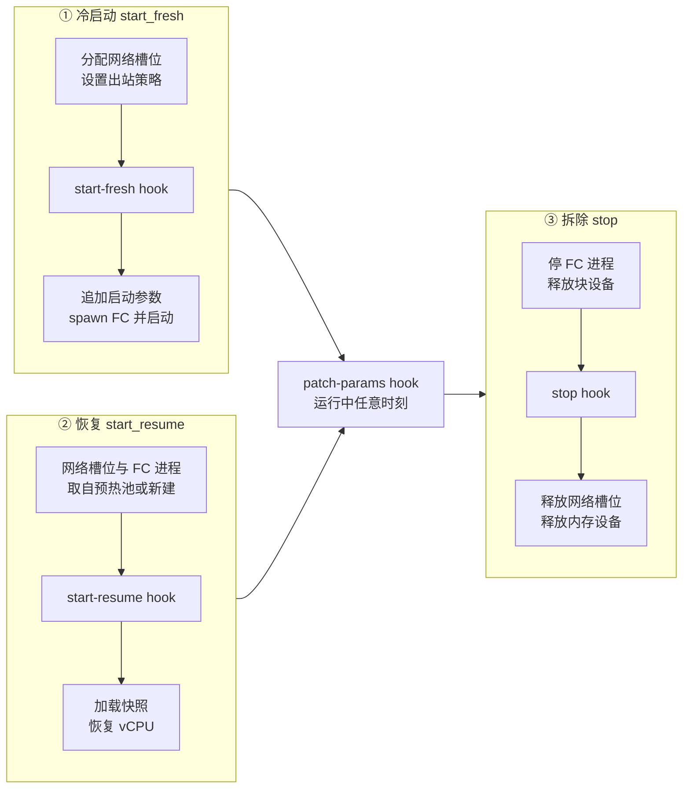
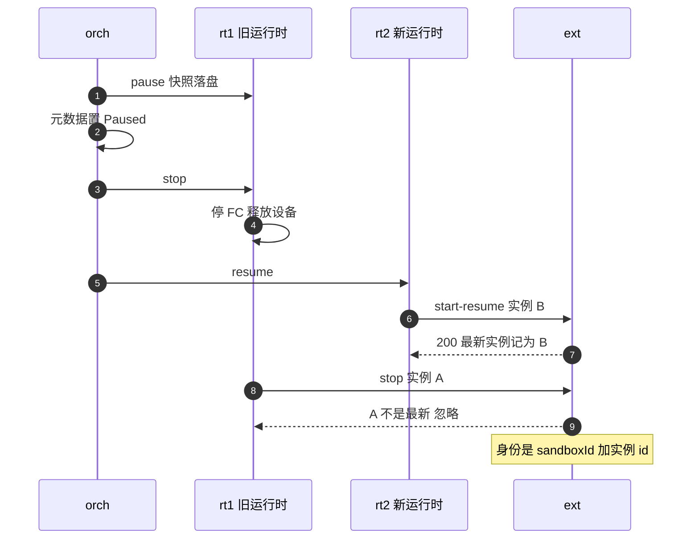

# 33 · 自定义扩展 hook

> 平台之外总有一些系统要跟着沙箱的生命周期走：给沙箱接一条 VPN、在它的网络命名空间里加防火墙规则、按运行时长计费、拉起一个 sidecar 控制器。
> AgentENV 把这些需求收拢成一个外部 HTTP 服务和四个 hook。四个 hook 的接口很小，难点在语义：沙箱 id 跨 pause / resume 复用，
> stop 通知可能丢失、也可能比下一次 start 晚到。本篇讲这四个 hook 在生命周期里的位置、失败语义，以及用实例 id 消解乱序的办法。
>
> **读者**：工程师、要写扩展服务的集成方。　**预备**：[第 19 篇 · 状态机与并发控制](19-state-machine-and-concurrency.md)、[第 27 篇 · 启动、暂停与恢复的 Firecracker 调用序列](27-start-pause-resume-sequences.md)。
> **代码**：`src/sandbox/custom_extension/client.rs`、`src/custom_extension_api/openapi.yml`、`src/sandbox/firecracker/sandbox.rs`（`start_fresh`、`start_resume`、`stop`、`Drop`）、`src/orchestrator/service.rs`（`patch_sandbox_custom_extension_params_inner`）、`src/api/impls/sandbox.rs`、`src/cfg.rs`

---

## 0. 本篇要回答的问题

1. 四个 hook 分别在生命周期的哪一步被调用？哪些失败会让沙箱操作失败，哪些只记日志？
2. 同一个沙箱 id 会经历多次「启动 → 拆除」，扩展服务怎样把一次 stop 对应到正确的那次 start？
3. start 请求超时、但扩展其实已经处理了它，这时 stop 还会不会发出？
4. 扩展参数存在哪里、怎样随快照继承？`PATCH /sandboxes/{id}/custom-extension-params` 为什么不持沙箱锁调用 hook，代价是什么？
5. 把一部分生命周期交给外部服务，AgentENV 放弃了什么？

---

## 1. 问题：外部系统怎样跟上沙箱的生命周期

AgentENV 的节点自己管理网络槽位、块设备与 Firecracker 进程，但部署方往往还有自己的基础设施要和沙箱绑在一起。
典型的例子是：沙箱启动时在它的 netns 里建一条隧道，沙箱停止时拆掉；或者按「这台沙箱从什么时候运行到什么时候」记账。
这类需求有三个共同点：它们要在**确定的时刻**被告知，要拿到**宿主侧的标识**（netns 路径、宿主交互地址），而且它们本身不属于 AgentENV。

把这些逻辑写进节点进程，每个部署方都要改 AgentENV；只暴露一个事件流，又不能让外部系统反过来影响启动（例如追加内核参数）或否决一次修改。
AgentENV 的做法是同步回调：节点在生命周期的几个点上向外部服务发 HTTP 请求，等它回答再继续。
这把外部服务放进了沙箱启动的关键路径，所以契约必须写清楚两件事：哪些失败会挡住沙箱，以及一个沙箱 id 被反复启动、拆除时，通知怎样对应起来。

第二件事是本篇的重点。AgentENV 的 pause 会停掉 VM 进程、释放网络槽位，resume 再新建一个运行时，沙箱 id 不变（[第 27 篇](27-start-pause-resume-sequences.md)）。
于是同一个 id 背后先后有多个「运行时实例」。若 stop 通知只带沙箱 id，一个迟到的旧 stop 就会被扩展当成「刚恢复的那台停了」。

---

## 2. 契约：四个 hook

扩展服务的接口由 `src/custom_extension_api/openapi.yml` 定义，方向与沙箱 API 相反：AgentENV 是客户端，扩展是服务端。
客户端代码由同一个 openapi-generator 按 `-g rust` 生成在 `src/custom_extension_api/generated/`（生成机制见[第 12 篇](12-spec-driven-server.md)），
手写部分是 `src/sandbox/custom_extension/client.rs` 的 `CustomExtensionClient`。

| hook | 调用时机 | 请求要点 | 响应 | 失败时 |
|---|---|---|---|---|
| `POST /sandbox-hook/start-fresh` | 冷启动：分配网络槽位之后、spawn Firecracker 之前 | sandboxId、sandboxInstanceId、netns 路径、宿主交互地址、参数 | 可选 `extraBootArgs` | 启动失败 |
| `POST /sandbox-hook/start-resume` | 恢复：网络槽位与 FC 进程就绪之后、加载快照之前 | 同上 | 无 | 恢复失败 |
| `POST /sandbox-hook/patch-params` | 用户 PATCH 扩展参数 | sandboxId、原样透传的 patch | 新的完整参数 | 返回 400，保留旧值 |
| `POST /sandbox-hook/stop` | 运行时拆除：FC 停止之后、释放网络槽位之前 | sandboxId、sandboxInstanceId | 无 | 只记日志 |

配置只有两项（`src/cfg.rs` 的 `CustomExtensionConfig`）：`[custom_extension].url`（环境变量 `AENV_CUSTOM_EXTENSION_URL`）与 `timeout_ms`（缺省 5000）。
`CustomExtensionClient::global()` 用一个 `OnceLock` 在第一次调用时按全局配置构建客户端；`url` 为空则返回 `None`，此后所有 hook 调用点都直接跳过。
reqwest 客户端构建失败时同样返回 `None`，只打一条 warn，扩展集成在这个进程里就此关闭。
推论：因为是进程级单例，改 URL 或超时需要重启节点进程（与[第 11 篇](11-configuration.md)讲的全局配置单例一致）。

超时设在 reqwest 客户端上（`build_from_config()` 里的 `.timeout(...)`），对四个 hook 一视同仁。
`config/default.toml` 对 `timeout_ms` 的注释写的是「非 stop hook 调用的超时」，与代码不符：stop 也受同一个超时约束。

失败的判定在生成的客户端里：连接错误、超时与非 2xx 都返回 `Err`。`hook_start_fresh()`、`hook_start_resume()`、`hook_patch_params()` 把错误向上传，
`hook_stop()` 在函数内部 `warn!` 后吞掉，签名就没有 `Result`。这是全部失败语义的来源：除 stop 外，扩展不可用就意味着沙箱启动不了。

---

## 3. 在生命周期里的位置

下图把四个 hook 放到沙箱的生命周期上。三个子图是 `FirecrackerSandbox` 的三个方法，patch-params 在 orchestrator 层，可以发生在运行中的任意时刻。pause 之后的 resume 再次进入子图 ②，图中没有画出这条回边。

### 3.1 start-fresh：唯一能影响启动的 hook

`sandbox.rs` 的 `start_fresh()` 依次准备 tools 盘、rootfs、附加盘，拼好 `agentenv_drives=` 参数，然后 `NetworkManager::allocate_any()` 分配网络槽位、
`set_egress_policy()` 装上出站策略、把 `ip=` 参数接到 boot args 后面。到这一步，netns 与宿主交互地址都已确定，hook 才有东西可报。

hook 返回的 `extraBootArgs` 去掉空白后若非空，就原样拼到 boot args 末尾；之后才调用 `add_damon_monitor_region()` 补 DAMON 监控区间，再 spawn Firecracker。
代码不对扩展给的参数做任何过滤。`add_damon_monitor_region()` 只在参数里没有 `damon_reclaim.monitor_region_start=` 或 `…_end=` 时才写入计算出的区间，
所以扩展可以借这个顺序覆盖 DAMON 区间，也可以写入任何会破坏启动的参数。

只有 start-fresh 能改启动参数，原因在 Firecracker 的快照语义：resume 不重放内核命令行，guest 内核早已按冷启动时的参数运行，
冷启动时追加的参数随内存状态一起进入快照。start-resume 因此没有响应体。

### 3.2 start-resume：在快照加载之前

`start_resume()` 先布置 tools 盘、rootfs、附加盘与卷槽位，再取网络槽位：预热池命中时槽位与已 spawn 的 FC 进程一起到手，否则当场 `allocate_any()` 并 `spawn_with_netns()`。
设好出站策略之后调用 start-resume hook，然后才准备内存设备、`PUT /snapshot/load`、`PATCH /vm Resumed`。
所以扩展收到 start-resume 时 FC 进程已经在 netns 里，但 guest 还没有恢复运行；扩展在 netns 里布置的东西，guest 恢复后的第一个包就能用上。

有一个例外：`config.pack_recording` 为真的 VM 不触发 hook。这类 VM 只为录制启动包的首触页 trace 而起（[第 43 篇](43-startup-pack-and-prefetch.md)），
代码注释的理由是不让扩展看到一台「幻影」沙箱的启动与停止。

反过来，模板构建的 VM 会触发 hook。`src/template/runner.rs` 用 `SandboxId::new()` 自己生成 id，经 `FirecrackerSandbox::new_with_id()` 或 `from_snapshot()` 起 VM，
走的就是上面两个方法，没有任何豁免。推论：扩展会看到一批在沙箱 API 里查不到的 sandboxId，参数为空对象；扩展若按沙箱计费或建资源，要能容忍这类 id。

### 3.3 stop：拆除序列中间的一步

`FirecrackerSandbox::stop()` 的顺序是：取消预取 → 停 FC 进程 → 作废 envd → 释放 rootfs 设备、tools 共享设备、录制专用内存设备、附加盘设备
→ **stop hook** → 释放网络槽位 → 停预取 reader → 释放共享内存设备（各步的理由见[第 25 篇](25-backend-and-firecracker-process.md)）。
stop hook 放在释放网络槽位之前，是为了让扩展在 netns 还属于这台沙箱时完成清理；放在 FC 停止之后，是为了让扩展清理时 guest 已经不再发包。

pause 也会触发 stop。`service.rs` 的 pause 路径在快照落盘、`persist_paused()` 成功、元数据更新为 Paused 之后，调用 `sandbox.stop()` 释放资源，stop hook 就在其中。
snapshot 与 fork 的捕获则不同：`snapshot()` 调用 `pause_to_dir()` 后原地 `resume()`，同一个运行时继续服务，不经过 `stop()`，不触发任何 hook，实例 id 也不变。
`openapi.yml` 的描述对这一点有明确说明。

---

## 4. 实例身份：`SandboxInstanceId` 与 hook guard

### 4.1 为什么 stop 会乱序

看 pause 路径的顺序：元数据先写成 Paused，再调用 `stop()`；而 `stop()` 在调 stop hook 之前还要停 FC、释放若干块设备，stop hook 本身最多再等一个超时。
Paused 一经写入，resume 就可以开始（状态转换见[第 19 篇](19-state-machine-and-concurrency.md)）。
推论：一次紧跟在 pause 之后的 resume，可能在旧运行时的 stop 发出之前就完成了 start-resume。
扩展先看到「恢复了」，后看到「停止了」，若只按沙箱 id 处理，就会把刚恢复的沙箱的资源拆掉。

下面的时序图展示这个交错与实例 id 的判定。`orch` 是 orchestrator，`rt1` 是被暂停的旧运行时，`rt2` 是 resume 新建的运行时，`ext` 是扩展服务。

办法是给每个运行时实例一个新 id。`SandboxInstanceId` 包着一个 `Uuid::now_v7()`，每次 start-fresh 或 start-resume 都生成新值，
对应的 stop 带同一个值。契约要求扩展把 `(sandboxId, sandboxInstanceId)` 当作一个运行实例的身份，
收到的 stop 若不是该沙箱「最近一次 start」的实例，就忽略。
推论：选 UUIDv7 而不是随机 UUID，使实例 id 按生成时间有序，扩展在需要时可以直接比较新旧；代码里没有依赖这个性质的地方。

### 4.2 guard：先记 id，再发请求

`CustomExtensionHookGuard` 把一个运行时实例的 hook 生命周期包成 RAII 对象，字段是客户端、沙箱 id 与 `Option<SandboxInstanceId>`。

- `start_fresh()` / `start_resume()` **先**生成实例 id 并写进 guard，**再**发请求。
  理由写在注释里：若扩展已经处理了请求、响应却因客户端超时丢了，start 在 AgentENV 看来失败了，扩展那边却已建好资源；先记下 id，拆除时就能发出匹配的 stop。
  反过来，扩展根本没收到的 start，它对应的 stop 会因为「不是最新实例」被忽略。所以多发一个 stop 是安全的，少发一个才会泄漏。
- `stop(self)` 取出 id、同步 await `hook_stop()`，之后 guard 不再持有 id。
- `Drop` 时若还持有 id，就用 `tokio::runtime::Handle::try_current()` 在当前 runtime 上 spawn 一个发 stop 的任务，不阻塞析构；不在 tokio runtime 里时只打 warn，不发。

调用点与这三条配合。`start_fresh()` 里 guard 先是局部变量，hook 成功后才存进 `self.custom_extension_hook_guard`；
hook 失败时 `?` 提前返回，局部 guard 被析构，Drop 发出 fire-and-forget 的 stop。测试 `failed_start_still_stops_on_drop_with_matching_instance_id` 覆盖的就是这条路径。
hook 成功之后的失败（例如 spawn FC 失败）由沙箱自身的清理负责：`stop()` 里 `take()` 出 guard 调用 `stop()`；没有走到 `stop()` 的沙箱在 `FirecrackerSandbox` 的 `Drop` 里 `take()` 出 guard，触发 guard 的 Drop。
字段注释把这一组合称为「stop hook 恰好送达一次」，准确的说法是「恰好**发出**一次」：发出之后是否送达，要看网络与扩展。

推论：Drop 路径 spawn 的任务若赶上进程关闭、runtime 停止，可能根本不会执行；扩展因此不能假定每个 start 都会等到 stop。

---

## 5. 扩展参数：存储、继承与修改

### 5.1 不透明的 JSON 对象

扩展参数 `CustomExtensionParams` 是一个 `serde_json::Map`，AgentENV 不解释内容，只负责存储、传递与持久化。
`custom_extension_params_is_empty()` 把 `None` 与空对象都算作「空参数」；hook 请求里缺省时发 `{}`（`empty_params()`），GET 接口对 `None` 也返回 `{}`（`params_map_to_model()`）。

创建沙箱时，`src/api/impls/sandbox.rs` 的 `validate_custom_extension_params()` 在参数非空而 `CustomExtensionClient::global()` 为 `None` 时返回 400。
这条校验用在 `sandboxes_post()` 与 `sandboxes_cold_post()`，v2 创建透传字段后复用 v1 的路径。空参数总是放行，所以没有配置扩展的节点照样能接受带 `{}` 的请求。

### 5.2 随快照持久化与继承

参数有两份副本：元数据里的 `SandboxMetadata.custom_extension_params` 供 GET 读取，后端里的 `FirecrackerSandbox.current_custom_extension_params` 供下一次快照写入。

- pause 与 capture 时，`snapshot_to_dir()` 把 `current_custom_extension_params` 写进快照配置的 common 部分，resume 时 start-resume 带的就是这份。
- 从模板或快照创建沙箱时，`create_sandbox_inner()` 计算「有效参数」：请求里给了就用请求的，否则继承快照记录里的值；`sandbox.rs` 的 `snapshot_config_for_launch()` 对快照配置做同样的覆盖。
  有效值也写进元数据，于是从这台沙箱再发布快照时，继承来的参数不会丢。
- 发布快照（`sandboxes_sandbox_id_snapshots_post()`）把元数据里的参数放进 `SnapshotPublishMetadata.custom_extension_params`。
- fork 的子沙箱由 `snapshot_config_for_fork()` 克隆源快照配置得到，参数随之继承，每个子沙箱以自己的 id 触发 start-resume。

「空对象等价于缺省」在继承这一步并不成立。覆盖用的是 `Option::or_else`：请求里显式给 `{}` 得到 `Some(空 map)`，会覆盖快照里的非空参数；省略字段才继承。
这对调用方是一个可以利用的语义（显式清空继承来的参数），但与契约里「absent 与空对象等价」的表述不一致。

### 5.3 patch：hook 在锁外

`PATCH /sandboxes/{id}/custom-extension-params` 的请求体原样作为 `patch` 交给扩展，扩展返回新的完整参数，AgentENV 把它存成当前值。
补丁的语义完全由扩展定义：可以是 JSON Merge Patch，也可以是一组命令。`patch_sandbox_custom_extension_params_inner()` 的步骤：

1. 读元数据，状态不是 Running 就返回 `InvalidSandboxState`（409）。
2. 从沙箱表取句柄，取不到返回 `SandboxOperationConflict`（409）。
3. 取全局客户端，未配置扩展时返回 `SandboxOperationFailed`；调用 patch-params hook，失败也是 `SandboxOperationFailed`。API 层把两者都映射为 400。
4. 锁住句柄，`update_custom_extension_params()` 写进后端。
5. `update_if_state([Running])` 写回元数据；与并发 pause 撞上时 `StateConflict` 被映射为 `InvalidSandboxState`，返回 409。

第 3 步不持沙箱锁，注释给出的理由是：pause 与 stop 不应被扩展的延迟挡住。代价是第 3 步到第 5 步之间的窗口。
若 pause 在此期间进入 Pausing，扩展已经接受了补丁，调用方却收到 409。
推论：更糟的交错是 pause 已经把旧参数写进快照，第 4 步随后才把新参数写进一个即将停止的后端；
暂停记录保存的是旧参数，resume 时 start-resume 带回的也是旧参数。代码注释承认这个窗口，理由是扩展状态与网络策略一样被视为暂态，
这个说法与[第 19 篇 §7](19-state-machine-and-concurrency.md#7-同一沙箱上的并发操作)讲的网络策略窗口相同。

扩展可以利用 start hook 消解这类分歧：每次 start-fresh / start-resume 都携带当时的完整参数，扩展在 start 时以请求里的参数为准重建状态，就不依赖 patch 的结果一定落盘。

AgentENV 也不串行化同一沙箱的并发 patch。两个 patch 同时调用 hook，谁的返回值最后写进元数据取决于第 4、5 步的先后。
`openapi.yml` 把这一点写进了契约：补丁语义不可交换时，扩展自己处理并发。

---

## 6. 代价与边界

这套设计用很小的接口换来了外部系统对生命周期的介入，代价分四处。

**可用性耦合。** start-fresh 与 start-resume 是同步、必须成功的调用。扩展服务宕机或变慢，节点上所有冷启动与恢复都会失败或被拖慢一个超时。
自动恢复（[第 17 篇](17-reverse-proxy.md)）与预热池都绕不过它：预热池省掉的是 FC 进程与网络槽位的准备，hook 仍在请求路径上。

**清理的责任外移。** stop 只记日志、可能乱序、Drop 路径可能不执行，AgentENV 不提供任何重放或对账接口。
扩展若在 stop 里回收资源，需要另有一条兜底的回收路径，例如定期用沙箱 API 列表比对自己持有的实例。

**网络槽位的复用。** `NetworkManager::release()` 在未关闭时把槽位原样放回预热池，不重建 netns（[第 32 篇](32-warm-pools.md)）。
推论：扩展通过 `networkNamespacePath` 在 netns 里加的接口、路由或 iptables 规则，若没有在 stop 中撤销，会随槽位被下一台沙箱继承；
而 stop 恰恰是 best-effort 的。扩展在 start hook 里先把 netns 恢复到已知状态再布置，比只依赖 stop 清理稳妥。
同理，`hostInteractionIp` 随槽位变化，pause / resume 之后可能不同，扩展要以当前 start hook 里的值为准。

**信任边界。** 扩展返回的启动参数不经过滤直接进入内核命令行，扩展拿到的 netns 路径意味着它通常以足够的权限运行在宿主上。
扩展服务因此属于节点的可信计算基，而不是一个普通的租户侧组件。

---

## 7. 小结

- 四个 hook 中只有 stop 是 best-effort；start-fresh、start-resume、patch-params 的连接错误、超时与非 2xx 都让对应操作失败。
- start-fresh 位于网络槽位分配之后、FC spawn 之前，是唯一能追加内核参数的 hook，参数不经过滤；start-resume 位于 FC 就绪之后、快照加载之前。
- pause 会触发 stop，snapshot 与 fork 的原地捕获不触发任何 hook；启动包录制 VM 不触发 hook，模板构建 VM 会触发。
- 沙箱 id 跨 pause / resume 复用，每次 start 生成新的 UUIDv7 实例 id；扩展按 `(sandboxId, sandboxInstanceId)` 判定，忽略非最新实例的 stop。
- guard 在发出 start 之前记下实例 id，保证超时后仍能发出匹配的 stop；多发的 stop 因实例 id 不匹配而无害。
- 参数随快照持久化；请求省略时继承快照中的值，显式 `{}` 会覆盖为空。
- patch 在锁外调用 hook，与 pause 竞争时返回 409，暂停记录可能保存旧参数；并发 patch 不串行化，交给扩展处理。
- `timeout_ms` 对 stop 同样生效，与 `default.toml` 的注释不符。
- 扩展服务处在每次启动与恢复的关键路径上，也处在节点的信任边界之内。

---

## 延伸阅读 / 下一篇

- [第 27 篇 · 启动、暂停与恢复的 Firecracker 调用序列](27-start-pause-resume-sequences.md)：hook 前后的完整调用序列。
- [第 25 篇 · 后端抽象与 Firecracker 进程](25-backend-and-firecracker-process.md)：stop 的资源释放顺序。
- [第 29 篇 · 网络（一）：槽位、命名空间与地址计划](29-network-slots.md)：netns 与宿主交互地址从哪里来。
- [第 19 篇 · 状态机与并发控制](19-state-machine-and-concurrency.md)：不持逻辑锁的更新与 pause 的竞争。
- [第 12 篇 · 规范驱动的服务骨架](12-spec-driven-server.md)：同一生成器的服务端方向。
- 下一篇：[第 34 篇 · LSMT 格式与索引](34-lsmt-format-and-index.md)。
