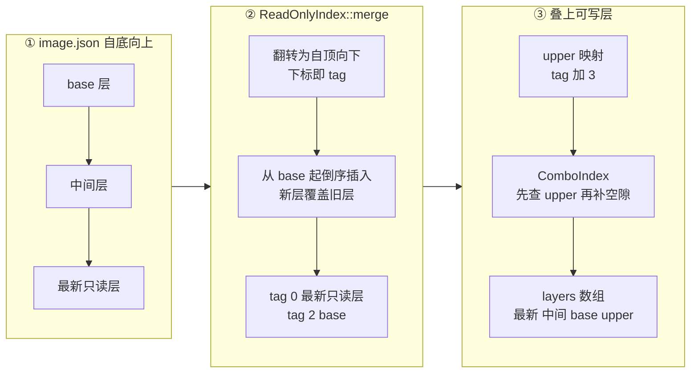

# 34 · LSMT 格式与索引

> overlaybd 的每一层都是一个 LSMT 文件：一段数据加一张「逻辑扇区 → 物理位置」的映射表。
> 多层叠在一起时，把各层的映射表合并成一张，一次二分查找就能回答「这个扇区的最新内容在哪一层的哪个位置」。
> 本篇讲 Rust 版 overlaybd 的 LSMT 磁盘格式、四种层文件形态、三种索引结构与它们之间的 tag 约定，以及 AgentENV 加在格式之外的预合并索引缓存。
>
> **读者**：存储方向的工程师，要读懂第六部分其余各篇的读者。　**预备**：[第 05 篇 · overlaybd、LSMT 与 OCI 镜像按需加载](05-overlaybd-and-lazy-loading.md)。
> **代码**：`storage/overlaybd/src/lsmt/format.rs`、`storage/overlaybd/src/lsmt/index.rs`、`storage/overlaybd/src/lsmt/file/types.rs`、`storage/overlaybd/src/lsmt/file/readonly.rs`、`storage/overlaybd/src/lsmt/file/readwrite.rs`（`LSMTFile::open`）、`storage/overlaybd/src/lsmt/file/stack.rs`、`storage/overlaybd/src/lsmt/file/helper.rs`

---

## 0. 本篇要回答的问题

1. 一个 LSMT 层文件的头尾记录了什么？哪些字段的单位容易读错？
2. 一条 16 字节的段映射怎样编码？「零段」为什么分成有物理空间与无物理空间两种？
3. 同样是 LSMT 层，sealed 只读层、RW 对、Sparse RW、Hybrid RW 在磁盘上有什么不同？
4. 多层索引怎样合并？为什么合并索引里 tag 0 是最新层，而可写层却放在 layers 数组的末尾？255 层上限从哪里来？
5. 预合并索引缓存 `PMIDX001` 用什么做 key，失效与清理靠什么？
6. 哪些部分与上游 overlaybd 逐字节兼容，哪些是 AgentENV 的扩展，证据是什么？

---

## 1. 问题：块设备的层，要能写、能叠、能远端随机读

容器镜像按层存放，一层是一个 tar 包；要用它，得先下载并解包所有层。overlaybd 的思路是把每一层做成**块设备层**：
层里只存这一层改过的扇区，外加一张映射表说明「这些扇区在本层文件的什么位置」（背景见[第 05 篇](05-overlaybd-and-lazy-loading.md)）。
读一个扇区时，从最新层往下找第一个有映射的层；没有任何层映射的扇区读作 0。

这个设计要同时满足三个约束。

- **能写**。沙箱的 rootfs 要可写，写入只能落在最上面的可写层，不能改动下面共享的只读层。
- **能叠**。一台沙箱 pause 一次，就多出一层（[第 37 篇](37-seal-restack-compact.md)）；层栈会变高，查找代价不能随层数线性增长。
- **能远端随机读**。只读层可能在对象存储或 registry 上，读一个扇区不应先下载整层；所以映射表必须小、必须能单独读出来，数据部分必须能按偏移随机访问。

LSMT（log-structured merge tree 的缩写，这里只取它「追加写 + 合并索引」的意思）给出的回答是：
每层一个文件，数据追加写入，映射表放在文件尾部或单独的索引文件里；打开层栈时把各层映射表合并成一张按逻辑偏移排序的表，此后每次查找都是一次二分。

---

## 2. 头尾与段映射：两个固定格式

### 2.1 `HeaderTrailer`

每个 LSMT 文件以一个 header 开头；sealed 只读层在文件末尾还有一个 trailer，两者是同一个结构 `HeaderTrailer`（`format.rs`），
由 flags 的 bit0 区分。结构是 packed、小端，大小 390 字节，代码里用 `const _: () = assert!(size_of::<HeaderTrailer>() == 390)` 钉住；
在文件里它独占一个 4 KiB 块（`HeaderTrailer::SPACE = 4096`），其余字节填 0。

```text
偏移  长度  字段           说明
   0     8  magic0         "LSMT\0\1\2"，即 u64 LE 0x00020100544d534c
   8    16  magic1         固定 UUID 字节，与上游相同
  24     4  size           sizeof(HeaderTrailer) = 390
  28     4  flags          位定义见下
  32     8  index_offset   索引起点，单位字节；未封口的索引文件里固定为 4096
  40     8  index_size     映射条数，不是字节数
  48     8  virtual_size   虚拟盘大小，单位字节
  56    37  uuid           带连字符的 UUID 文本加 NUL
  93    37  parent_uuid    父层 UUID，同上
 130     2  reserved
 132     1  version        1
 133     1  sub_version    1
 134   256  user_tag       提交信息
 390        （到 4096 填 0）

flags:  bit0  1 = header        0 = trailer
        bit1  1 = data 文件     0 = index 文件
        bit2  1 = sealed
        bit3  未定义
        bit4  1 = sparse RW
        bit5  1 = hybrid RW
```

两个字段的单位要特别留意。`index_offset` 是字节，`index_size` 是条数，乘以 16 才是索引的字节长度；
映射里的偏移与长度又是 512 字节扇区（下一节）。三种单位出现在同一个结构周围，读代码时要逐个对照。

打开只读层时，`helper.rs` 的 `verify_ht()` 从文件头读 header，要求 magic 正确且 bit0 为 1；
再从 `file_size - 4096` 读 trailer，要求 magic 正确、bit0 为 0、bit1 为 1、bit2 为 1。索引的位置与条数都以 **trailer** 为准。
可写层没有 trailer：`LSMTFile::open()` 若在可写层文件尾部读到一个合法 trailer，会直接报错「Cannot open a Sealed LSMT file in RW mode」。

### 2.2 `DiskSegmentMapping`

映射表的每一项是 16 字节的 `DiskSegmentMapping`，由两个小端 u64 组成，`from_memory()` / `to_memory()` 负责与内存中的 `SegmentMapping` 互转：

```text
data_low  (u64 LE)
  bit 0..49   offset    逻辑起点，单位扇区（512 B），50 位
  bit 50..63  length    段长，单位扇区，14 位，最大 16383
data_high (u64 LE)
  bit 0..54   moffset   在本层文件里的物理起点，单位扇区，55 位
  bit 55      zeroed    1 = 这一段读作 0
  bit 56..63  tag       层号，8 位
```

14 位长度意味着一条映射最多覆盖 16383 个扇区，即差 512 字节不到 8 MiB；更长的连续写入会被拆成多条。
50 位逻辑偏移与 55 位物理偏移按扇区计，远大于实际用到的范围。

tag 在磁盘上没有意义。`helper.rs` 的 `load_index()` 由 `load_index_and_reset_tags()` 调用时把每条映射的 tag 清 0，
层号只在内存中的合并视图里由合并过程重新赋值（第 4 节）。`load_index()` 还跳过 `length == 0` 的项：
`compact_to()` 用 `INVALID_SEGMENT_OFFSET`、长度为 0 的映射把索引补齐到 4 KiB 整数倍，并把补齐项计入 `index_size`，与上游 C++ 的 compact 相同，读取时靠长度为 0 把它们滤掉。
同一函数里另一个条件 `m.offset() == u64::MAX` 永远不会成立，因为 offset 只有 50 位。

### 2.3 两种零段

`zeroed = 1` 的映射读作 0，但它的 `moffset` 有两种含义（`index.rs` 的 `SegmentMapping` 注释）：

| | 无物理空间的零段（unbacked zero） | 有物理空间的零段（backed zero） |
|---|---|---|
| `moffset` | 哨兵 `NO_PHYSICAL_OFFSET` = 55 位全 1 | 一段仍然有效的物理区间 |
| 出现在哪里 | 所有只读层；discard 产生的空隙 | 只在 Hybrid 可写层里，由 discard 已写过的区间产生 |
| 有什么用 | 只表示「这里是 0」 | 之后的写入可以复用这段物理空间，不必追加 |

`NO_PHYSICAL_OFFSET` 是 AgentENV 定义的哨兵（`format.rs`），`SegmentMapping::has_physical_range()` 就是比较它。
上游写出的零段 `moffset` 是任意占位值，所以 `ReadOnlyIndex::new()` 把所有 zeroed 映射的 `moffset` 统一改成哨兵，保证只读层永远不会「借出」物理空间；
RW 层重放索引时不做这一步，否则 Hybrid 层重新打开后就丢掉了可复用的区间。
反过来，非零映射若带着哨兵，`load_index()` 报错「data mapping has no physical offset」。

---

## 3. 四种层文件形态

同一套头尾与映射，组合出四种层文件。`types.rs` 的 `LSMTFileType` 枚举了它们，`RwLayout` 是其中三种可写形态在配置里的名字。

```text
① sealed 只读层（*.commit，一个文件）
   [Header 4K][数据，扇区对齐 ...][index: N x 16 B][补齐][补 0 到 4K][Trailer 4K]
                                  ^ trailer.index_offset           ^ file_size - 4096

② RW 对（LogStructured，两个文件）
   data : [Header 4K, data 位][追加的数据 ...]
   index: [Header 4K, index 位, index_offset = 4096][16 B][16 B][16 B] ...（追加）

③ Sparse RW（一个文件，预先 truncate 到 4096 + virtual_size）
   [Header 4K, sparse 位][逻辑偏移 x 处的数据写在 4096 + x ...（其余是空洞）]

④ Hybrid RW（两个文件，与 ② 同形）
   data : [Header 4K, data 位 + hybrid 位][追加的数据，已有段可原地覆盖 ...]
   index: [Header 4K, index 位 + hybrid 位, index_offset = 4096][16 B] ...
```

**① sealed 只读层**是层栈里绝大多数层的形态，也是唯一会被发布到快照仓库、放到远端的形态。
索引紧跟在数据之后，trailer 在最后一个 4 KiB。远端读者只需读尾部 4 KiB 拿到 trailer，再按 `index_offset`、`index_size` 读出索引，数据部分按 `moffset` 随机访问。
两条写出路径的补齐方式不同：`compact_to()` 用长度为 0 的映射把索引补到 4 KiB；`LSMTFile::close_seal()` 只把索引补到 512 字节，补齐字节是 `0xff`，`index_size` 不计补齐（seal 的过程在[第 37 篇](37-seal-restack-compact.md)）。
两种补齐都不会被解析，只是风格不一致。

**② RW 对**是上游传统的可写层：数据追加到 data 文件，每写一段就往 index 文件追加一条 16 字节映射。
重新打开时，`LSMTFile::open()` 从 index 文件第 4096 字节起读出所有映射，按出现顺序插入 `MutableIndex`，后写的覆盖先写的，这就是日志重放。
index 文件长度减去 4096 必须是 16 的倍数，否则报「Index file corrupted」。

**③ Sparse RW** 没有索引文件，逻辑偏移 x 的数据直接写到 `4096 + x`。重新打开时，`create_mappings_from_sparse()` 用 `SEEK_DATA` / `SEEK_HOLE` 扫出所有已分配区间，把它们当作映射。
这要求文件系统如实报告空洞：`RwLayout::ensure_supported()` 在创建与打开时都调用 `sys::sparse_extents_are_reliable()`，不可靠的平台直接拒绝；
`LSMTFile::open()` 在重建映射前又检查一次。注释给出的理由是：多报的已分配块会被当作数据，用 0 盖住下层。

**④ Hybrid RW** 与 ② 形状相同，区别在写入策略：已经映射到本层的区间原地覆盖，空洞与下层区间才追加（策略细节在[第 36 篇](36-read-write-paths-and-rw-layouts.md)）。
它的目的是让反复改写同一区域的 upper 不再无限增长，代价是原地写失去了追加写的崩溃原子性。
`types.rs` 的 `WriteFragment::InPlace` 注释直说：原地写与 Sparse 一样，主机崩溃后可能露出撕裂的块，快照的正确性依赖上层先 quiesce / sync。
这是 AgentENV 可写层的缺省形态：`src/cfg.rs` 的 `runtime_upper_mode` 缺省为 `hybridLogStructured`。

flags 的 bit4 与 bit5 互斥。`LSMTFile::rw_layout_from_header()` 与 `validate_rw_header_pair_paths()` 遇到两位同时置位都报错；
后者还检查 data 与 index 两个文件的 UUID 一致、hybrid 位一致、index 文件的 `index_offset` 为 4096、长度对齐。

---

## 4. 索引：三种结构与 tag 约定

### 4.1 三种结构

`index.rs` 定义了查找接口 `LogIndex::lookup(segment, dst)`：给一个逻辑区间，把与之相交的映射裁剪后追加到 `dst`。三种实现各管一类层。

| 结构 | 存储 | 插入 | 查找 | 用在 |
|---|---|---|---|---|
| `ReadOnlyIndex` | 按 offset 排序的 `Vec` | 不支持；只能整体构建或 `merge()` | `partition_point` 二分找起点，顺序扫到区间末尾 | 只读层与合并后的只读栈 |
| `MutableIndex` | `BTreeSet`，按 offset 排序 | 先删掉与新段重叠的旧段，再插回左右残片 | `range` 查询 | 可写层；合并过程的中间结构 |
| `ComboIndex` | 一个 `MutableIndex` 加一个 `Arc<ReadOnlyIndex>` | 只插 upper | 先查 upper，再用 lower 填 upper 的空隙 | 读写层栈 |

`MutableIndex::insert()` 是「新写覆盖旧写」的全部实现。新段 `m` 进来时，它在 `BTreeSet` 里从 `m.end()` 往前找所有与 `m` 相交的旧段，逐个删除；
旧段伸出 `m` 左边的部分用 `backward_end_to()` 截短后插回，伸出右边的部分用 `forward_offset_to()` 前移起点后插回。
前移起点时 `moffset` 同步前移（无物理空间的零段除外），残片仍然指向正确的物理位置。插入结束后集合里的段两两不相交。

`ComboIndex::lookup()` 先从 upper 取出所有相交映射，再对它们之间的空隙逐段调用 lower 的 `lookup()`。
upper 优先，只读栈只补 upper 没有覆盖的部分，不需要把两者真正合并。

### 4.2 合并与 tag 方向

多层只读栈的合并在 `ReadOnlyIndex::merge(indexes)`：从数组最后一项向前遍历，每层的每条映射把 tag 设为它在数组里的下标，插入同一个 `MutableIndex`。
后插入的覆盖先插入的，所以**数组下标越小越新**，注释原文是「The smaller the tag is, the newer the data is」。

调用方 `stack.rs` 的 `merge_readonly_indexes()` 收到的层是自底向上的顺序（与 `image.json` 的 lowers 一致），它以最多 32 路并发（`PARALLEL_LOAD_INDEX`）读出各层索引，
按原顺序排好后整体 `reverse()`，再交给 `merge()`。`build_readonly_stack_from_merged()` 对文件数组做同样的翻转，
使 `layers[tag]` 正好是 tag 对应的层文件：`layers` 的顺序是「最新只读层、次新 …… base」。

可写层叠上去时，约定换了一个方向。`LSMTFile::open()` 把 upper 的数据文件 **push 到 layers 末尾**，`rw_tag = lower 层数`；
`ComboIndex::new()` 把 upper 里所有映射的 tag 加上只读层数（代码里留着一个 `FIXME: why do not alter upper directly?`，即为什么要清空后逐条重插）。
于是一个三层只读栈加一个可写层的 `layers` 是 `[最新只读, 次新, base, upper]`，tag 0 是最新只读层，tag 3 是 upper。
读路径只需 `layers[m.tag]` 加 `moffset * 512` 就能定位物理位置，不关心哪一层「更新」。

下图把这三步画在一起。



这两套方向并存容易让人糊涂：合并索引的语义是「小 tag 优先」，而 upper 的 tag 是最大的那个，却又最优先。
它之所以不出错，是因为 upper 根本不参与 `merge()`，优先级由 `ComboIndex` 的「先查 upper」保证，tag 只是一个数组下标。

### 4.3 255 层上限

tag 是 u8，所以一个层栈最多 256 个文件。`types.rs` 的 `MAX_STACK_LAYERS = 255`，`validate_open_files_ro_inputs()` 拒绝超过 255 个只读层的输入；
加上可写层，`rw_tag` 最大为 255，正好装进 u8。`merge()` 里的 `i as u8` 与 `ComboIndex::new()` 的 `rw_tag as u8` 都依赖这条前置检查，自身不做溢出判断。
上游 C++ 的 `SegmentMapping` 同样只有 8 位 tag，这个上限是格式本身的。

AgentENV 每次 pause 都会给 rootfs 与内存各加一层，层数会持续增长。节点侧因此给运行时产生的层设了预算，超出就整体压实成一层（`rewrite_lowers_with_runtime_roots()`，见[第 37 篇](37-seal-restack-compact.md)），离 255 留出很大余量。

### 4.4 没有被使用的 B+ 树

`index.rs` 里还有 `LinearizedBptree` 与 `IndexLBPT`：一棵线性化的 B+ 树，对应上游的同名优化，用来在超大索引上减少二分查找的缓存失效。
在 v0.2.3 里，除了 `index.rs` 自己的测试，整个仓库没有任何代码引用它们，只读层一律用 `ReadOnlyIndex`。这是一段只有测试覆盖的死代码。

---

## 5. 预合并索引缓存：`PMIDX001`

### 5.1 为什么要缓存合并结果

合并是打开层栈时的一次性开销：要读出每一层的完整索引，再逐条插入 `BTreeSet`。层数多、索引大时，这一步落在每个沙箱冷启动或恢复的关键路径上。
而同一组只读层会被大量沙箱反复打开：同一个模板的所有实例，lowers 完全相同。

AgentENV 的做法是把合并结果存成文件（`stack.rs` 的 `open_files_ro_with_premerged_cache()`），下次遇到同一组层直接读回来。
这是 AgentENV 新增的机制，文件格式与上游无关。

### 5.2 key 与文件格式

key 由 `PremergedIndexCacheKey::from_metadata()` 计算：对下面这串字节取 SHA-256。

- 固定前缀 `overlaybd-premerged-index-key-v1`、格式版本、合并算法版本、层数；
- 按**自顶向下**的顺序（与合并后 tag 的顺序一致），每层的 UUID、文件大小、虚拟大小、`index_offset`、`index_size`，以及 header 与 trailer 的 version / sub_version。

所有字段都取自各层的 header 与 trailer（`load_readonly_layers_metadata()`，同样 32 路并发），不读数据也不读索引。
任何一层的 UUID 为 nil 时，`from_metadata()` 返回 `None`，这一组层不走缓存。
`compact_to()` 在调用方没给 UUID 时写 nil UUID（注释说与 C++ 一致），所以这类层天然被排除在缓存之外。

缓存文件放在 `<cache_dir>/premerged-index/<key 的十六进制>.pmidx`，`cache_dir` 取 overlaybd 全局配置的 `cacheConfig.cacheDir`。文件由 104 字节的头与映射体组成，整数都是小端：

```text
偏移  长度  字段
   0     8  magic          "PMIDX001"
   8     4  format_version 1
  12     4  merge_version  1
  16     4  header_len     104
  20     4  layer_count
  24     8  mapping_count
  32     8  body_len       = mapping_count x 16
  40    32  key_digest     与文件名相同的 SHA-256
  72    32  body_checksum  映射体的 SHA-256
 104        映射体：mapping_count 条 DiskSegmentMapping，tag 保留
```

映射体复用 `DiskSegmentMapping` 的编码，但与层文件不同，这里的 tag **保留**合并后的层号。
`decode_premerged_index_artifact()` 读回时逐项校验：版本、层数、key 摘要、文件长度、体的 SHA-256；
`deserialize_premerged_mappings()` 再要求每条映射长度非零、tag 小于层数、按 offset 严格有序且互不重叠。任何一项不符，`try_read_premerged_index_artifact()` 打一条 warn，当作未命中，重新合并。
解码出的映射仍经过 `ReadOnlyIndex::new()`，零段同样被规范化为无物理空间。

### 5.3 去重、写入与清理

查找流程是「无锁读一次 → 取 key 锁 → 再读一次 → 合并 → 后台写」。key 锁来自进程内的一张 `HashMap<String, Weak<Mutex<()>>>`（`premerged_index_locks()`），
同一 key 的并发打开只有一个在合并，其余在锁上等待，醒来后第二次读就能命中。
写文件由 `spawn_premerged_index_artifact_write()` 放进后台任务，任务**持有锁直到写完**，先写临时文件再 rename，读者不会看到半个文件。
这张锁表是进程全局的，去重只在一个进程内有效；在 AgentENV 里所有设备都由同一个 ublk-daemon 进程服务（[第 41 篇](41-ublk-daemon.md)），所以这个假设成立。

目录大小上限由 `PremergedIndexCachePolicy::hybrid(cache_size_gb)` 给出：节点块缓存容量的 1/16，夹在 64 MiB 与 1 GiB 之间。
写入字节累计超过上限的 1/8 时触发一次扫描（进程内第一次写入总会扫描），`prune_premerged_index_dir_blocking()` 按文件修改时间从旧到新删除，直到总量不超过上限。
读命中不更新修改时间，所以这是「按写入先后淘汰」，不是严格意义上的 LRU：一个被频繁命中的老文件会先于一个刚写入、再没用过的文件被删。

key 只覆盖层的元数据。推论：两层 UUID 与各项大小都相同而内容不同时，缓存会返回错误的合并结果；这依赖「层的 UUID 在内容变化时一定改变」这一约定，代码里没有更强的校验。

---

## 6. 与上游的兼容边界

上游 overlaybd 是 C++ 实现，经典前端是 tcmu，默认分支也已带 ublk 前端（`src/ublk/`）；无论哪个前端，层文件格式都是同一套。
这一层的格式要和两类 C++ 程序互相读写。第一类是 overlaybd 工具：OCI 层经 `overlaybd-apply` / `overlaybd-commit` 转成的 sealed 层由 Rust 版 overlaybd 读取；
第二类方向相反，ublk-daemon 扩容运行时镜像时调用 `overlaybd-resize`（`storage/ublk-daemon/src/runtime.rs` 的 `run_resize_tool()`），由 C++ 去读写 Rust 创建的 upper 与 sealed 层。
扩容之后，daemon 用 `validate_rw_header_pair_paths()` 检查被外部工具原地改过的 upper 的头部与物理布局，再重新打开。
这个函数的注释写明它是为「原地修改 overlaybd upper 的外部工具」准备的廉价结构检查。

| 部分 | 状态 | 依据 |
|---|---|---|
| `HeaderTrailer` 字段、magic、bit0–bit2、bit4 | 与上游一致 | 上游 `src/overlaybd/lsmt/file.cpp` 的 `HeaderTrailer` 字段顺序与 flag 位 |
| `SegmentMapping` 的 50 / 14 / 55 / 1 / 8 位域 | 与上游一致 | 上游 `src/overlaybd/lsmt/index.h` |
| compact 的索引补齐与 `index_size` 计数 | 与上游一致 | 上游 compact 用 invalid mapping 补到 4 KiB 并计入 `index_size` |
| bit5 hybrid RW | 与上游默认分支同位同义；ReuseZero 为 Rust 版独有 | 上游 `file.cpp` 的 `FLAG_HYBRID_RW = 5`；零段处理不同，见下文 |
| backed zero、`NO_PHYSICAL_OFFSET` 哨兵 | AgentENV 扩展 | `ReadOnlyIndex::new()` 的规范化注释 |
| 预合并索引缓存 `PMIDX001` | AgentENV 扩展 | 只在本地缓存目录，不进入任何层文件 |

bit5 不能简单归为「AgentENV 扩展」。上游 containerd/overlaybd 默认分支（本书取的是 2026-10-01 的浅 clone，commit `e2a2ef3`）的 `src/overlaybd/lsmt/file.cpp` 里，
`HeaderTrailer` 同样把 bit5 定义为 `FLAG_HYBRID_RW`（注释「1:hybrid rw 0:append rw」）。浅 clone 没有历史，无法确定上游从哪个版本开始有这一位，
因此只能对照默认分支逐项核实。结论是：bit5 与上游默认分支同位同义，ReuseZero 是 Rust 版独有的行为。对照 `file.cpp` 与 Rust 版的结果如下。

- **一致的部分**。位号相同；bit4 与 bit5 同时置位在两边都被拒绝（上游报「sparse_rw and hybrid_rw flags are both set」）；
  hybrid 写入都是「已映射到本可写层的非零区间原地改写，空洞与下层区间追加」，上游在 `pwrite` 原地改写时同样不追加映射。
- **不同的部分：零段**。上游遇到本层的 zeroed 映射一律追加新数据；Rust 版的 `plan_hybrid_write()` 遇到带物理区间的 zeroed 映射，会生成 `ReuseZero` 原地写入那段物理空间。
- **由此产生的单向风险（推论）**。上游 RW 层的 `discard()` 把 zeroed 映射的 `moffset` 设为当时的数据文件 EOF，这只是占位值，那段空间并不归这条映射所有，之后的追加会写到同一位置。
  Rust 版重放 RW 索引时有意保留 zeroed 映射的 `moffset`，不做 `ReadOnlyIndex::new()` 那样的规范化，于是会把这个占位值当作 backed zero；
  后续若在该区间写入，`ReuseZero` 会覆盖上游之后追加的数据。反方向是安全的：上游读 Rust 写出的 backed zero 只看 zeroed 位，写入时一律追加。
  在 AgentENV 里，往 Hybrid upper 里写数据的只有 Rust 版 overlaybd，C++ 一侧只有 `overlaybd-resize` 会改 upper；resize 是否会写 discard 记录，本书无法从源码确认。

推论：daemon 在 Hybrid upper 上运行 `overlaybd-resize` 后要求 hybrid 位保持不变，说明 overlaybd 工具的 `v1.0.18-aenv.1` 分叉能正确处理带 bit5 的 upper；这一点无法从源码确认，因为本书不读该工具的源码。

---

## 7. 小结

- `HeaderTrailer` 是 390 字节的 packed 结构，独占一个 4 KiB 块；`index_offset` 是字节，`index_size` 是条数，映射内的偏移与长度是扇区。
- 一条映射 16 字节：offset 50 位、length 14 位、moffset 55 位、zeroed 1 位、tag 8 位；tag 在磁盘上恒被忽略，加载时清 0。
- 零段分两种：只读层里的零段一律规范化为无物理空间（`NO_PHYSICAL_OFFSET`），只有 Hybrid upper 保留可复用的物理区间。
- 四种层文件形态：sealed 单文件、RW 数据加索引两个文件、Sparse 单文件靠空洞恢复映射、Hybrid 与 RW 同形但允许原地覆盖；缺省可写布局是 Hybrid。
- `ReadOnlyIndex` 二分查找、`MutableIndex` 插入时切掉重叠、`ComboIndex` 先查 upper 再补空隙；合并后 tag 0 最新，upper 却在 layers 末尾，优先级由 `ComboIndex` 而不是 tag 保证。
- 255 层上限来自 8 位 tag，节点靠运行时层预算加压实远离它。
- 预合并索引缓存以各层元数据的 SHA-256 为 key，带完整性校验与进程内去重；清理按写入时间而非访问时间。
- LSMT 头尾、映射位域与 compact 补齐与上游一致；backed zero、哨兵与 `PMIDX001` 是 AgentENV 扩展；bit5 与上游默认分支同位同义，零段复用（ReuseZero）是 Rust 版独有，读上游写出的 hybrid upper 有覆盖风险（推论）。
- `LinearizedBptree` / `IndexLBPT` 只有测试引用，是死代码。

---

## 延伸阅读 / 下一篇

- [第 05 篇 · overlaybd、LSMT 与 OCI 镜像按需加载](05-overlaybd-and-lazy-loading.md)：分层块设备的背景。
- [第 36 篇 · 读写路径与三种可写布局](36-read-write-paths-and-rw-layouts.md)：在这些格式上的读写与 Hybrid 写入拆分。
- [第 37 篇 · 封存、restack 与 compact](37-seal-restack-compact.md)：sealed 层是怎样写出来的。
- [第 73 篇 · 持久化制品与磁盘格式总表](73-artifacts-and-formats-reference.md)：全书各种磁盘格式的对照表。
- 下一篇：[第 35 篇 · ZFile 压缩](35-zfile-compression.md)。
