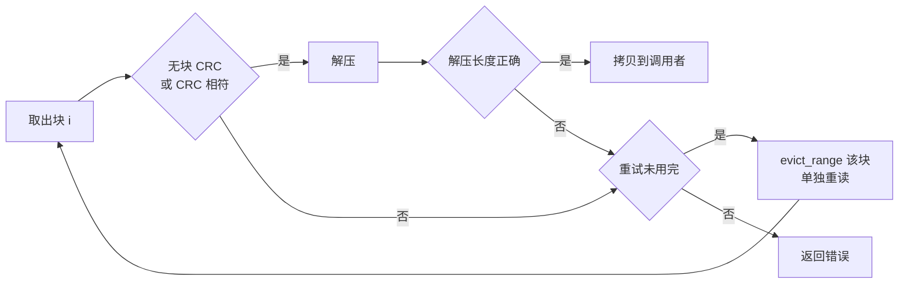
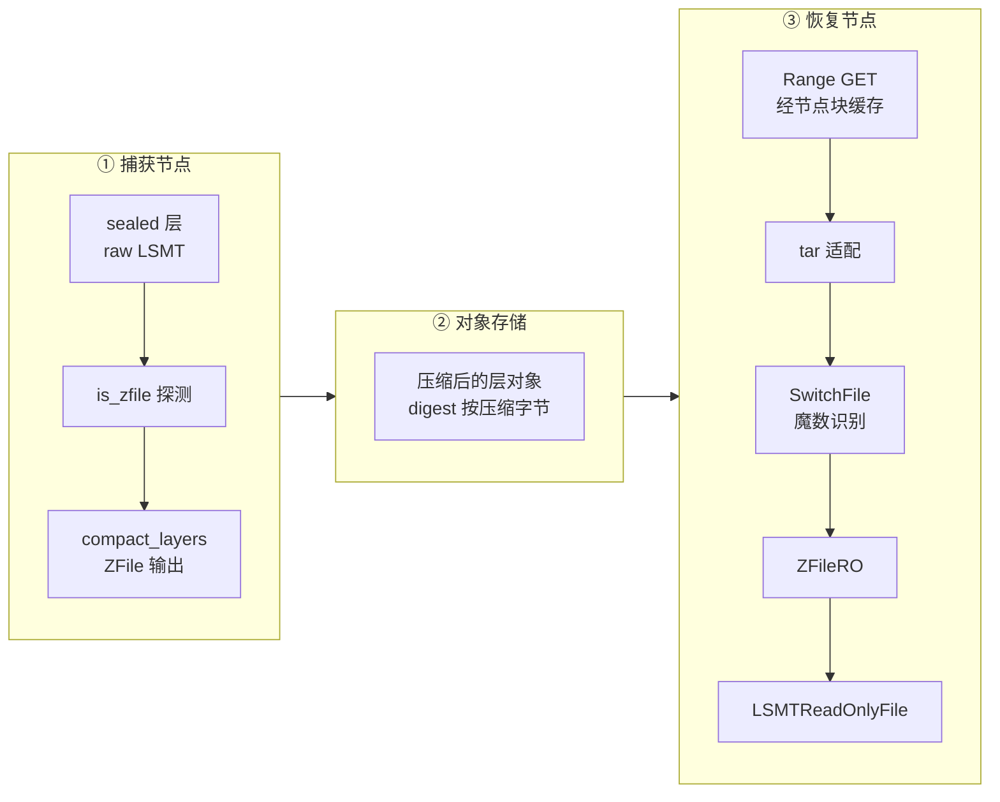

# 35 · ZFile 压缩

> 层文件要跨节点传输，体积直接决定冷恢复要搬多少字节；但 overlaybd 的读是随机的块级读，整文件压缩会让每次读都从头解压。
> ZFile 是 overlaybd 的分块压缩容器：每 4 KiB 原始数据独立压缩，用一张两级 jump table 在 O(1) 时间内找到任意块。
> 本篇讲它的字节布局、校验、读写两条路径，以及 AgentENV 只在发布时压缩、本地永远保持 raw 的策略。
>
> **读者**：存储方向的工程师；要排查远端层读取或发布体积的维护者。
> **预备**：[第 05 篇 · overlaybd、LSMT 与 OCI 镜像按需加载](05-overlaybd-and-lazy-loading.md)、[第 34 篇 · LSMT 格式与索引](34-lsmt-format-and-index.md)
> **代码**：`storage/overlaybd/src/compression/zfile.rs`、`storage/overlaybd/src/backend/switch.rs`、`src/sandbox/ublk/overlaybd.rs`、`src/snapshot/repository/backends/common/recontainerize.rs`、`src/cfg.rs`

---

## 0. 本篇要回答的问题

1. 为什么不能把层文件整体 gzip 一下了事？ZFile 用什么结构保住随机读？
2. ZFile 文件由哪几段组成？哪些字段决定读者去哪里找索引？
3. jump table 为什么分成「组基址 + 组内 u16 增量」两级？这对块的编码长度提出了什么约束？
4. 一次 `pread` 如何把若干压缩块合成一次后端读？CRC 或解压失败时重读的是什么？
5. 发布时谁把 raw 层变成 ZFile？读端怎么知道一个层是不是压缩过的？
6. 哪些部分与上游 overlaybd 逐字节兼容，哪些是 Rust 版 overlaybd 自己的选择？

---

## 1. 问题：压缩与随机读的冲突

一个 overlaybd 层（第 34 篇讲的 sealed LSMT 文件）里装的是 ext4 镜像的数据块或 guest 内存页。
这类数据可压缩性往往不差：未用的文件系统空间、内存里的零页与重复结构都很多。
层要上传到对象存储、再被别的节点按需拉取，字节数越少，网络与对象存储的开销越小。

但 overlaybd 的读取模式是**随机的小块读**：guest 读一个 4 KiB 扇区，LSMT 索引把它翻译成层文件里的一个偏移，
后端只去取那一小段（第 05 篇）。如果整个层用 gzip 一类的流式算法压成一个整体，
读第 N 个字节就要从文件头解压到 N，按需加载也就失去了意义。

ZFile 的回答是**分块压缩**：把原始文件切成固定大小的块（默认 4 KiB），每块独立压缩，
再存一张表记下每块压缩后的长度。读任意偏移时，先算出块号，查表得到这一块在压缩文件中的位置与长度，
只读这一段、只解压这一块。代价是三重：

- 块越小，压缩率越差 —— 字典无法跨块共享；
- 每块都要一条长度记录，索引随块数线性增长；
- 读一个字节也要解压一整块，读放大至少是一个块。

4 KiB 的默认块恰好与 guest 页、ext4 块对齐，让「一次缺页 = 解压一块」，读放大最小，压缩率则是被让出去的一方。

---

## 2. 文件布局

上游 `zfile.cpp` 在类定义前用一段注释画出了布局，Rust 版 overlaybd 的 `ZFileBuilder` 写出的正是这个形状：

```text
偏移 0
+--------------------------------------+
| Header            512 B（有效 96 B） |  flags: header=1, sealed=0
+--------------------------------------+
| dict              dict_size 字节     |  Rust 版恒为 0 字节
+--------------------------------------+
| block 0  压缩数据  [+ 4 B CRC]       |  opt.verify != 0 时才有 CRC
| block 1  压缩数据  [+ 4 B CRC]       |
| ...                                  |
| block N-1                            |  最后一块的原始长度可以不足 block_size
+--------------------------------------+  <- index_offset（紧接最后一块，不对齐）
| index     N x u32 每块编码长度       |  index_size = N（条数，不是字节）
+--------------------------------------+
| Trailer           512 B（有效 96 B） |  flags: header=0, sealed=1
+--------------------------------------+  <- 文件末尾
```

Header 与 Trailer 是同一个结构 `HeaderTrailer`，各占 512 B，只有前 96 B 有意义（`HEADER_TRAILER_BODY_SIZE`）：

```text
off  len  字段
  0    8  magic0              "ZFile\0\x01\0"
  8   16  magic1              "tuji.yyf@Alibaba"
 24    4  size                恒为 96
 28    4  digest              本 512 B 的 CRC32C，计算时此字段视为 0
 32    8  flags               bit0 header / bit1 data file / bit2 sealed
                              bit3 header_overwrite / bit4 calc_digest
 40    8  index_offset        index 段的字节偏移
 48    8  index_size          块数
 56    8  original_file_size  解压后的原始长度
 64    4  index_crc           index 段的 CRC32C
 68    4  reserved
 72   24  CompressOptions     block_size u32 | algo u8 | level u8 | use_dict u8 | pad
                              reserved u32 @8 | dict_size u32 @12 | verify u8 @16
```

几个细节值得指出：

- **索引信息在 Trailer 里。** 写入者事先不知道有多少块、每块多长，所以 `ZFileBuilder::new()` 先写一个 sealed=0 的 Header 占位，
  `finish()` 时才把 index 与 Trailer 追加到末尾。读者（`load_jump_table()`）先读 Header 验魔数，再去 `文件大小 - 512` 处读 Trailer，
  要求它是 trailer、是 data file、已 sealed，然后按 Trailer 里的 `index_offset` / `index_size` 读索引。
- **`header_overwrite`** 是另一种走法：`CompressArgs.overwrite_header` 为真时，`finish()` 写完 Trailer 后再把同样的索引信息写回 Header，
  并置 bit3。读者看到 bit3 就直接用 Header 里的索引位置，不再去文件尾找 Trailer。
  推论：这为「只读得到文件头部」的流式消费者准备；AgentENV 自己的写入路径都不打开它。
- **`CompressOptions`** 的默认值是 LZ4、4 KiB、`verify = 0`（`CompressOptions::default()`）。`algo` 只认 1（LZ4）与 2（ZSTD），
  `create_compressor()` 对其它值报错；`level` 字段写入但不被读取，ZSTD 固定用级别 3（`ZSTD_C_LEVEL`），与上游的 `cLevel` 相同。
- **dict** 字段保留但未实现：Rust 版的写入路径从不写字典，`dict_size` 恒为 0；读端仍把数据区起点算成 `512 + dict_size`，与上游一致。

---

## 3. 校验：一种「raw」CRC32C

ZFile 有三处校验：Header / Trailer 各自的 `digest`、index 段的 `index_crc`、以及可选的每块 CRC。
三者用的都不是标准 CRC-32C，而是上游 `crc32c_extend()` 的「raw」变体：同一个多项式，但初值为 0、出口不取反。

Rust 生态的 `crc32c` crate 只提供硬件加速的**标准** CRC-32C，其 `crc32c_append(seed, data)` 在入口把 seed 取反、出口再把状态取反。
`zfile.rs` 顶部的注释给出换算：两端各再取反一次，正好抵消，于是 `raw(state, data) == !crc32c_append(!state, data)`。

```rust
fn crc32c(data: &[u8]) -> u32 {
    !::crc32c::crc32c_append(!0, data)
}

fn crc32c_salt(data: &[u8]) -> u32 {
    !::crc32c::crc32c_append(!NOI_WELL_KNOWN_PRIME, data)
}
```

块 CRC 用 `crc32c_salt()`：初始状态不是 0 而是质数 100007（`NOI_WELL_KNOWN_PRIME`），与上游同名常量相同。
测试 `test_crc32c_consistency()` 钉住了两个函数对 `"123456789"` 的输出，并验证任意切分后链式计算等于一次性计算 ——
这正是换算式成立的前提。

写入侧，`write_header_trailer()` **总是**置 bit4（calc_digest）并计算 digest，`finish()` 总是写 `index_crc`；
块 CRC 则只在 `opt.verify != 0` 时附加。AgentENV 发布路径构造 `CompressOptions::new(algo, 4096, 0)`（`create_commit_args()`），
所以它产出的 ZFile **头尾与索引有校验，数据块没有**。块 CRC 只会出现在别的工具（例如上游 overlaybd 的转换工具）打开了 verify 的文件里。

---

## 4. jump table：两级偏移

读第 i 块需要它在压缩文件中的起点。最直接的做法是把 index 里的 N 个长度做前缀和，存成 N 个 u64 —— 每块 8 字节。
对 4 KiB 块，这张表的大小是原始数据的 1/512，一个大镜像的表就要占可观的内存。

`JumpTable`（与上游同构）把它拆成两级：每 `group_size` 个块一组，组首存一个 u64 绝对偏移（`partial_offset`），
组内每块只存相对组首的 u16 累计增量（`deltas`）：

```text
group_size = 65536 / block_size        （4 KiB 块时为 16）

块号        0     1     2   ...  15  | 16    17   ...  31  | 32 ...
partial     P0                       | P1                  | P2
deltas      0     d1    d2  ...  d15 | 0     d17  ...  d31 | 0 ...
                  ^ d_k = 组内前 k 块编码长度之和，u16

offset_at(i) = partial[i / group_size] + deltas[i]      （组首块 deltas 为 0）
```

`offset_at()` 是一次除法与两次数组访问，O(1)；每块的存储从 8 字节降到约 2.5 字节。
代价是一个硬约束：组内累计增量必须放得进 u16。`JumpTable::build()` 对每个增量检查 `next < u16::MAX`，超出就拒绝打开文件。

`group_size` 的取法让这个约束在正常情况下自动满足：一组覆盖 64 KiB 原始数据，
只要压缩后的块没有显著膨胀，组内前 `group_size − 1` 块的编码长度之和就小于 65535。
不可压缩数据经 LZ4 后会略大于原块（`LZ4_compressBound`），再加 4 B CRC，4 KiB 块下 15 块之和仍在范围内。
`block_size` 为 64 KiB 时 `group_size = 1`，每块都是组首、不存增量，所以连「压缩后超过 64 KiB」的块也能表示。
读端另有一条独立的上限：`pread_inner()` 要求 `block_size ≤ MAX_READ_SIZE`（64 KiB）。

加载索引时，`read_exact_chunks_at()` 把 index 段按 1 MiB 切片、最多 32 路并发读取（`JUMP_TABLE_READ_CHUNK_SIZE`、`JUMP_TABLE_READ_PARALLELISM`）：
远端层的 index 可能有数 MiB，串行 Range GET 会把打开时间拉长。

---

## 5. 读路径

### 5.1 打开

`zfile_open_ro(file, verify)` 调 `load_jump_table()`，失败时若 `verify` 为真就 `evict_all()` 后重试，最多两次。
这里的 `verify` 不是块 CRC 开关，而是「底层是可驱逐的缓存」的意思：`SwitchFile` 打开远端源时传 `!local`，
本地文件读坏了重读也没用，远端经过节点块缓存（第 39 篇），清掉缓存重拉才有意义。
块 CRC 是否校验由文件自身的 `opt.verify` 决定（`ZFileRO.data_verify`）。

`ZFileRO` 实现 `VirtualFile`：`size()` 返回 `original_file_size`，`write_at()` 直接报错。
于是在它之上打开的 `LSMTReadOnlyFile` 完全不知道下面是压缩的 —— LSMT 看到的是一个逻辑上的 raw 层文件。

### 5.2 批读合并

`pread_inner()` 先把请求截到原始长度，算出涉及的块号区间 `[begin_idx, end_idx)`，然后按批处理。
每批由 `plan_coalesced_batch()` 规划：从当前块开始，向后吞并**完整的**编码块，直到合计跨度将超过 64 KiB（`MAX_COALESCED_READ_SIZE`）。
第一块无论多大都算进本批，保证一个超过预算的块也能读。一批对应一次后端 `read_exact()`。

下面是一个 16 KiB 请求、四个编码块的示意（长度为示意值）：

```text
逻辑请求  [------------ 16 KiB，块 7..10 ------------]
编码块    | b7 2.1K | b8 3.9K | b9 1.2K | b10 4.1K | b11 ...
批 1      [============ 11.3 KiB ============]          一次后端读，止于 b10 末尾
上游做法  [============ min(64 KiB, 跨度) ======]~~~~~~  定长缓冲，可能读进下一块的一部分
```

注释特意说明与上游的区别：上游 C++ 读 `min(MAX_READ_SIZE, 全部跨度)` 进一个定长缓冲，超出时会截断在某个块的中间，
下一轮再从那个块重读；Rust 版的批只覆盖完整块，任何字节都不会读两次。格式不受影响，只是读策略不同。

批内逐块处理：若 `data_verify`，用 `crc32c_salt()` 校验块尾的 4 B CRC；然后解压。
完整且对齐的块直接解压进调用者缓冲区；首尾不完整的块先解压到一个按需分配的 scratch 再拷贝。
批缓冲来自线程局部的小池（`PooledBatchBuffer`，每线程最多留 4 个、每个不超过 128 KiB），稳态下不分配也不清零。
指标每线程每 1024 次 pread 采样一次计时（`ZFILE_PREAD_SAMPLE_INTERVAL`），未采样的调用只付一次 `Cell` 自增。

### 5.3 失败时重读

下图是单个块的处理流程。



重读只针对出错的那一块：`evict_range(block_begin, encoded_len)` 后单独读进 `retry_block`，最多 3 次；同批已经用掉的块不重读。
这一设计的前提是错误来自缓存里的坏数据，驱逐后从源头重拉能修好。有两个与图不完全吻合的地方，读代码时要注意：

- **解压器自身报错不重试。** `Compressor::decompress()` 对 LZ4 返回负值、ZSTD 返回错误时用 `ensure!` 报错，
  `pread_inner()` 在调用处用 `?` 直接向上传播；只有「解压成功但长度不对」才进入重试分支。
  对 AgentENV 自己发布的不带块 CRC 的文件，块内容损坏最常见的表现恰恰是解压报错，于是重读机制实际上很少起作用。
- **「精确驱逐」只在 ZFile 这一层精确。** 驱逐请求经 `SwitchFile`、tar 适配器下传到节点块缓存时，
  `CachedFile::evict_range()` 的实现是「只支持整文件驱逐」，转成 `evict_all_blocks()`：一个坏块会让这个远端文件已缓存的全部块作废。
  没有块缓存时，`RuntimeDispatchFile` 不覆盖 `evict_range()`，走 trait 默认的空实现。

### 5.4 在 ublk queue 线程上解压

`pread_with_ctx()` 让底层读经过 ublk queue 的 io_uring 提交（第 38 篇讲 `CtxRead` 与 `DirectRead` 的单态化），
但解压仍在调用线程上同步执行。设备默认只有一个 queue 线程（第 40 篇），
解压一个 64 块的 256 KiB 请求期间，这个设备上的其它在途请求都得不到 CPU。
推论：这是「代码简单、无跨线程拷贝」换「单设备 CPU 并行度」的取舍；对远端层，网络等待通常远大于解压时间，这个代价才可以接受。

---

## 6. 写路径

### 6.1 `ZFileBuilder`

`ZFileBuilder` 是流式写入器：`new()` 写占位 Header；`write()` 把输入攒满整块，不足一块的尾巴留在 `reserved_buf`；
`finish()` 压缩最后的残块、写 index、算 `index_crc`、写 Trailer，必要时回写 Header。
每块压缩后立即追加到 `moffset` 处并把长度记进 `block_len`，所以写入完全顺序，index 在最后一次性写出。

`args.workers > 1` 时，构造函数起一个常驻 `WorkerPool`：

- 每个 worker 是一个 OS 线程，各自持有一个 compressor，从一条有界通道（容量 `workers × 2`）取 `WorkItem`；
- 一次 `write_full_blocks_owned()` 把一段整块数据切成至多 `workers` 段并全部提交，再收回**全部**结果，按 `seq` 放进 `BTreeMap` 重排后依次提交写入；
- worker 内部用 `catch_unwind` 把 panic 变成该序号的错误结果，保证「提交几个就收回几个」，消费方不会永远等待；
- 任一段失败时，已收齐的结果全部丢弃，并把 `pool` 置空，之后的写入退回单线程压缩。

收集结果期间没有 `.await`，所以这个 future 在中途被取消时不会在池里留下属于上一轮的结果 —— 注释把这一点称作取消安全的依据。
代价写在 TODO 里：`pool.recv()` 是阻塞调用，会在一批压缩期间占住当前 async 任务所在的线程。

配置 `[snapshot.publish_compression] workers` 缺省为 1（`src/cfg.rs` 的 `SnapshotPublishCompressionConfig`，`default.toml` 同值），
`OverlaybdCompactOutput::from_publish_compression_config()` 把它夹到 `[1, 64]`；`WorkerPool` 自己另有 256 的上限。
因为每块独立压缩、结果按序号重排，**输出字节与 worker 数无关**，这也是配置注释所说的「不改变输出布局」。

### 6.2 `ZFileCompactWriter`：compact 与压缩一步完成

发布时要压缩的不是任意文件，而是 sealed LSMT 层。朴素做法是先 compact 出一个 raw 层文件，再整体读一遍压成 ZFile，多一次全量读写。
`ZFileCompactWriter` 实现 `storage_util::CompactWriter`，可以直接当作第 37 篇 `compact_to()` 的输出：
compact 产出的每个 512 KiB 缓冲（`ZFILE_COMPACT_WRITER_BUFFER_SIZE`）直接送进内部的 `ZFileBuilder`。

ZFile 只能顺序追加，而 `compact_to()` 默认会乱序并发写 chunk。为此 `ZFileCompactWriter::requires_ordered_writes()` 返回 true，
`compact_to()` 看到后改用 `buffered(concurrency)`：源层的读取仍然并发，写入按 chunk 顺序依次进行。
写入器自己再检查 `offset == next_offset`，任何越序写都报错；一次写失败或被取消后置 `failed`，此后所有调用都拒绝 —— 半截的 ZFile 不会被当成完整文件收尾。

于是一个层的发布形态是「LSMT 层文件，整体再套一层 ZFile」：ZFile 压缩的是 LSMT 文件的字节（含 LSMT 的 header、数据、索引与 trailer），
而不是 guest 看到的逻辑块。

---

## 7. AgentENV 的使用策略

### 7.1 本地 raw，发布时压缩

`recontainerize.rs` 的模块注释把策略说得很直接：**本地层永远是 raw**，本地恢复不付解压代价；
开启 `[snapshot.publish_compression]` 时，OSS 与 ACR 的上传路径在上传前把每个 raw 本地层「重封装」成 ZFile 一次。
`OverlaybdCompactOutput` 只有 `Raw` 与 `ZFile { algorithm, workers }` 两种取值，捕获路径从不读这个配置。



`prepare_layer_upload()` 的步骤：

1. 模式为 `Raw` 时原样上传；
2. 否则先用 `is_zfile()` 探测，已经是 ZFile 的层原样上传（幂等）；
3. 对 raw 层，调 `compact_layers()`（`src/sandbox/ublk/overlaybd.rs`）把这一个层经 `merge_files_ro()` 重写到临时文件，输出模式为 ZFile，compact 并发度 32；
4. 对产出的文件重新计算 sha256 与大小，作为上传对象的 digest。

第 4 步意味着**一个层在本地与在远端有两个不同的 digest**：managed layer 的 digest、OSS 对象键、ACR blob digest 描述的都是压缩后的字节，
调用方传进来的本地描述符只在原样上传时才被采用。另外，重写经过 `compact_to()`，产物的 LSMT uuid 为 nil（debug 日志写着 "layer uuid will be unset"）。
上传流程本身见第 48 篇。

POSIX 快照仓库不调用 `prepare_layer_upload()`，层在共享文件系统上始终是 raw。
`publish_compression.enabled` 的代码缺省与 `default.toml` 都是 true，算法缺省 LZ4。

### 7.2 读端自动识别

读端不需要任何配置。`ImageFile` 打开每个 lower 时都经过 `new_tar_file_adaptor()` → `new_switch_file()`（第 38 篇），
`SwitchFile` 内的 `try_open_zfile()` 读前 512 B：魔数与 header 位都对，就包一层 `ZFileRO`；魔数不对，原样返回。
魔数对但 digest 不对时 `is_zfile()` 报错 —— 宁可打开失败，也不把一个头部损坏的 ZFile 当 raw 文件读。
后台下载完成后 `set_switch_file()` 切到本地文件时，同样再识别一次。

由此可以推出两件事。其一，节点块缓存（第 39 篇）缓存的是**压缩后**的字节，缓存容量按压缩体积记账。
其二，启动加速的 `pack_planner`（第 43 篇）要把逻辑页翻译成远端对象里的块，对 ZFile 层借 `ZFileRO::compressed_block_extent()` 拿到编码块的位置，只查元数据不解压。

---

## 8. 与上游 overlaybd 的兼容性

| 项 | 状态 | 依据 |
|---|---|---|
| Header / Trailer 字段与偏移、flags bit0–4 | 与上游兼容 | `HeaderTrailer::decode_from_512()`；上游 `zfile.cpp` |
| raw CRC32C、块 CRC seed 100007 | 与上游兼容 | `crc32c()`、`crc32c_salt()` 与上游 `crc32c_extend()` |
| jump table 两级结构与 u16 约束 | 与上游兼容 | `JumpTable::build()` |
| LZ4 块格式、ZSTD 级别 3 | 与上游兼容 | `Lz4Compressor` 用 C liblz4；`ZSTD_C_LEVEL` |
| MINI_LZO（algo 0） | 不支持 | `create_compressor()` 只认 1、2 |
| 字典 | 不支持写；读端只跳过 `dict_size` | `ZFileBuilder` 从不写 dict |
| 上游 flags bit5（压缩 index） | 未实现；上游定义了该位但没有代码使用 | 上游 `FLAG_SHIFT_IDX_COMP` |
| 批读合并策略 | 与上游不同，不影响格式 | `plan_coalesced_batch()` 注释 |

兼容性的证据是逐字段对齐与 CRC 的已知向量；推论：仓库里没有用上游 C++ 产出的 ZFile 作夹具的测试，
「上游工具压的文件能被 Rust 版读」靠的是结构对齐而非交叉测试。

---

## 9. 与 e2b infra 的对照

e2b 手册描述的模板与快照制品（memfile、rootfs diff）以未压缩的定长块存放，按块偏移直接 Range 读取；
推论：e2b infra 2026.09 的 Go 代码中没有 LZ4 / ZSTD 的引用。
AgentENV 用一层分块压缩换跨节点传输的字节数，代价是读路径上多一次查表与解压，以及本地与远端两套 digest。

---

## 10. 小结

- ZFile 以块为单位独立压缩，用「每块编码长度」的索引保住随机读；默认 LZ4、4 KiB 块，读放大至多一个块。
- 索引信息在文件尾的 Trailer 里；`header_overwrite` 让 Header 也能携带它，AgentENV 自己不使用。
- 三处校验都是上游的 raw CRC32C 变体，Rust 版用「两端取反」把硬件加速的标准 CRC32C 换算过去；AgentENV 发布的文件有头尾与索引校验、没有块 CRC。
- jump table 用「组基址 u64 + 组内 u16 增量」把每块存储降到约 2.5 字节，`group_size = 65536 / block_size` 让 u16 约束在正常数据下自动满足。
- 读路径把连续完整块合成一次不超过 64 KiB 的后端读，不重复读字节；失败时只重读出错块，但解压器报错不重试，节点块缓存的驱逐会扩大成整文件。
- 解压在 ublk queue 线程上同步执行，单设备的 CPU 并行度因此受限。
- `ZFileCompactWriter` 让 compact 与压缩一次完成，靠 `requires_ordered_writes()` 让并发读、顺序写；输出与 worker 数无关。
- 本地层永远 raw，只在 OSS / ACR 上传前重封装；远端 digest 描述压缩后的字节。读端靠魔数自动识别，无需配置。

## 延伸阅读 / 下一篇

- 下一篇：[第 36 篇 · 读写路径与三种可写布局](36-read-write-paths-and-rw-layouts.md) —— 回到 LSMT，看一次读写如何穿过层栈。
- [第 37 篇 · 封存、restack 与 compact](37-seal-restack-compact.md)：`compact_to()` 的完整流程。
- [第 38 篇 · VirtualFile 装饰器链与远端 I/O 运行时](38-virtualfile-chain-and-remote-io.md)：`SwitchFile`、tar 适配器与 `CtxRead`。
- [第 39 篇 · 节点块缓存与后台下载](39-block-cache-and-background-download.md)：缓存压缩字节、整文件驱逐。
- [第 48 篇 · 对象存储仓库](48-object-storage-repository.md)：发布时的上传流程。
- [第 73 篇 · 持久化制品与磁盘格式总表](73-artifacts-and-formats-reference.md)：全部格式魔数与兼容性对照。
- 上游格式说明：containerd/overlaybd 仓库 `src/overlaybd/zfile/format_spec.md`。
