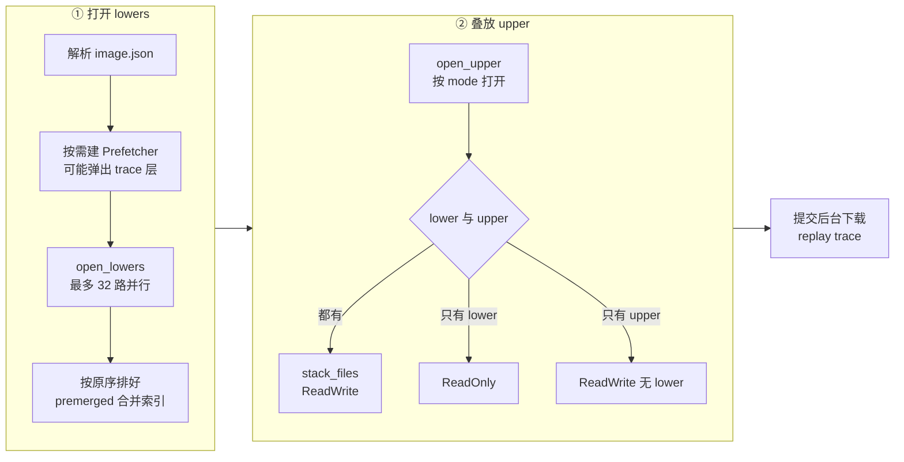
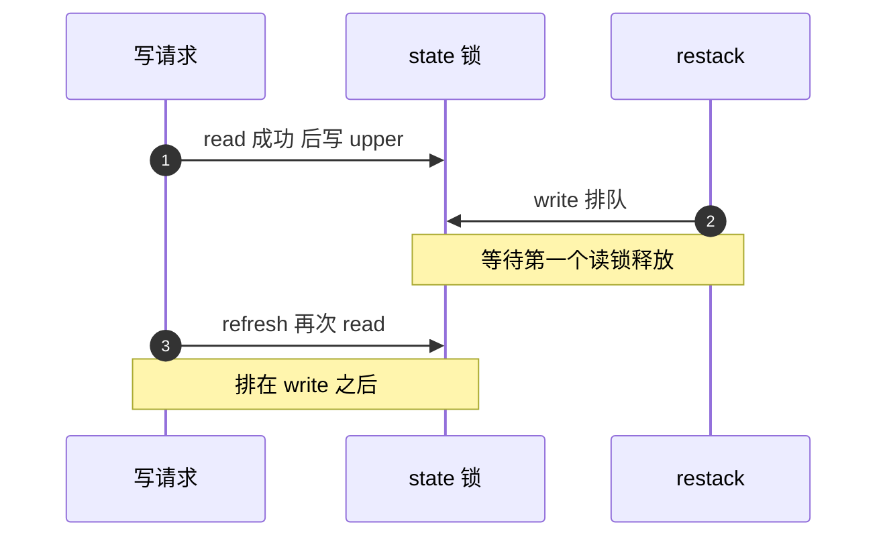

# 36 · 读写路径与三种可写布局

> 第 34 篇讲了层文件长什么样，本篇讲一次 I/O 怎样穿过层栈：`image.json` 怎样变成一个可读写的 `ImageFile`，
> 读请求怎样经索引拆成若干段物理读，写请求在 LogStructured、Sparse、Hybrid 三种可写层布局下各落到哪里。
> 三种布局在「upper 是否无限增长」「崩溃后会不会撕裂」「能否增量算 digest」上各让一步，AgentENV 的缺省是 Hybrid。
>
> **读者**：存储方向的工程师；排查 rootfs 写放大、upper 膨胀或 I/O 卡死的维护者。
> **预备**：[第 34 篇 · LSMT 格式与索引](34-lsmt-format-and-index.md)、[第 35 篇 · ZFile 压缩](35-zfile-compression.md)
> **代码**：`storage/overlaybd/src/image/image_file.rs`、`storage/overlaybd/src/lsmt/file/readwrite.rs`、`storage/overlaybd/src/lsmt/file/stack.rs`、`storage/overlaybd/src/lsmt/file/types.rs`、`storage/overlaybd/src/config.rs`、`storage/overlaybd/src/download_gate.rs`、`src/cfg.rs`

---

## 0. 本篇要回答的问题

1. 一份 `image.json` 怎样变成一个可读写的层栈？lowers 为什么并行打开，打开后怎样叠到 upper 下面？
2. `ImageFile` 外面为什么还要套一把 `tokio::sync::RwLock`？它与 LSMT 索引自己的锁是什么关系？
3. 一次读怎样拆成「空洞填零」与「若干段物理读」？Hybrid 布局下读为什么要持锁到 I/O 结束？
4. 同一个逻辑写，在 LogStructured、Sparse、Hybrid 三种布局下分别写到 upper 的哪里、写不写索引？
5. discard 在三种布局下各做什么？它们在重新打开之后还成立吗？
6. 这条路径上有哪些锁顺序问题与已知的技术债？

---

## 1. 问题：一个块设备，一叠文件

guest 看到的 `/dev/vdX` 背后是一个 ublk 设备（[第 40 篇](40-ublk-library.md)），ublk queue 线程把每个读写请求交给一个 `ImageFile`。
这个对象要同时满足几件事：

- 读要在几十个只读层与一个可写层之间找到「最新的那份数据」，没写过的地方读出 0；
- 写只能落在可写层（upper），而且 upper 的增长要可控 —— 一个长期运行的沙箱会反复覆盖同一批块；
- 暂停时整个层栈要能原子地换成「旧 upper 封存成只读层 + 新的空 upper」（restack，[第 37 篇 §3](37-seal-restack-compact.md#3-restack封存并换上新-upper)），换栈期间 I/O 不能看到半新半旧的状态；
- 远端层的读不能被后台下载抢走带宽（[第 39 篇 §6](39-block-cache-and-background-download.md#6-前台与后台的准入)）。

上游 overlaybd 用 C++ 做这件事，经典前端是 tcmu，默认分支也已带 ublk 前端（`src/ublk/`）；Rust 版 overlaybd 保留了它的配置格式与层文件格式，把对象结构与并发控制重新设计了一遍。

---

## 2. 层栈装配

### 2.1 从 `image.json` 到 `ImageFile`

`ImageConfig`（`storage/overlaybd/src/config.rs`）沿用上游的 camelCase 字段：`lowers`（每层 `file` / `dir` / `digest` / `uuid` / `repoBlobUrl` 等）、
`upper`（`data`、`index`）、`repoBlobUrl`、`accelerationLayer`、`recordTracePath`、`download`。
AgentENV 在 `upper` 里加了一个可选的 `mode`（`UpperMode`：`sparse` / `logStructured` / `hybridLogStructured`），缺省为 `logStructured`（`UpperConfig::writable_mode()`）。
这是一个 AgentENV 扩展字段，上游不认识它。

`ImageFile::open()` 调 `init_image_file()`，过程如下图。



几个要点：

- **lowers 并行打开。** `open_lowers()` 用 `buffer_unordered(PARALLEL_LOAD_INDEX)`，常量为 32（`lsmt/file/types.rs`）。
  每层的打开可能是一次本地 `open`，也可能是对 registry 或 OSS 的若干次 HTTP 往返（取大小、读 trailer、读索引），
  几十层串行打开会把冷启动拉长。结果按原下标放回 `ordered`，任何一层失败都让整个打开失败。
- **每层走装饰器链。** 本地层是 `LocalFile` → tar 适配 → `SwitchFile`（自动识别 ZFile）；本地缺失但有 uuid 时改走 P2P uuid 门面；
  远端层再加 `RuntimeDispatchFile` 与节点块缓存。这条链是第 38 篇的主题，这里只需知道 `ImageFile` 拿到的是一组 `VirtualFile`。
- **合并索引。** 所有 lower 交给 `open_files_ro_with_premerged_cache()` 合成一个 `LSMTReadOnlyFile`，它的合并索引可能直接从 `PMIDX001` 缓存读出（第 34 篇）。
- **upper 与叠放。** `open_upper()` 按 `mode` 打开 upper：Sparse 只需 `data`，另两种必须同时有 `data` 与 `index`。
  `stack_files()` 用 lower 的合并索引与层列表**重新打开一次** upper（`LSMTFile::open()`），得到一个 `ComboIndex`：先查 upper 的 `MutableIndex`，空隙处再查 lower。
  推论：upper 的索引因此在打开时被重放两遍，一遍在 `open_upper()`，一遍在 `stack_files()`。
- **不支持的上游特性显式报错。** lower 带 `targetFile` / `targetDigest` / `gzipIndex`、upper 带 `target` / `gzipIndex`（上游的 warp / turboOCI / gzip 索引）时，
  `open_lower_layer()` 与 `open_upper()` 报 "not migrated in Rust image_file yet"。lower 的这项检查放在层已经打开之后。

`ImageFile` 对外报告的逻辑块大小固定为 512（`DEFAULT_BLOCK_SIZE`），设备大小来自层栈的 `virtual_size`。

### 2.2 两把锁

`ImageFile` 的核心字段是 `state: RwLock<LiveImageState>`，其中 `LiveImageState` 持有配置与 `ImageFileBase::{ReadOnly, ReadWrite}`。
这把 `tokio::sync::RwLock` 的唯一目的是 restack：`create_snapshot_and_restack()` 拿写锁，在锁内把旧 upper 封存、建新 upper、重新叠栈，
最后把 `state.base` 整个替换掉。普通读写只拿读锁，彼此不互斥。

层栈内部还有第二把锁：`LSMTFile.index: Arc<RwLock<ComboIndex>>`，同样是 tokio 的读写锁，保护内存索引与 upper 的追加游标。
两把锁的嵌套顺序固定为「外层 `state`，内层 `index`」：

| 操作 | `ImageFile.state` | `LSMTFile.index` |
|---|---|---|
| 读 | 读锁，持有到返回 | 读锁；只在 Hybrid 且读到当前 upper 时持有到 I/O 结束 |
| 写 | 读锁，持有到返回 | **写锁**，每个 4 MiB 分片持有到该分片的物理 I/O 与索引追加结束 |
| discard | 读锁 | 写锁 |
| restack | 写锁 | 在 `state` 写锁内重建 |

第二行意味着：**同一个 `ImageFile` 上的写请求是串行的**，与布局无关。
`write_internal_generic()` 在每个分片开头拿 `index.write()`，然后才做物理写。`advance_data_append_offset()` 里那个 CAS 的注释说得明白：
追加在结构上由索引写锁串行化，CAS 只是防御性检查，失败说明有人引入了不加锁的追加路径。
代价是 ublk queue 的 16 个在途写在这里排成一队；收益是追加游标、内存索引、索引文件三者永远一致，不需要更细的同步。

---

## 3. 读路径

`LSMTFile::read_internal_into_generic()` 的步骤：

1. `check_alignment()` 要求偏移与长度都是 512 的倍数；越过 `virtual_size` 的部分截掉。
2. 按 `max_io_size`（缺省 4 MiB，`MAX_IO_SIZE`，注释说与 C++ 实现对齐）切片。ublk 单个请求最多 256 KiB，所以设备 I/O 通常只有一片；大片读主要来自 compact 与导出。
3. 每片在索引读锁下 `lookup()`，得到按逻辑地址排好的映射列表。
4. `read_mappings_into_generic()` 依次处理：映射之间的空洞填 0；`zeroed` 映射填 0；其余映射用 `read_exact()` 从 `layers[m.tag]` 的 `m.moffset × 512` 处读。末尾不足的部分填 0。

`layers[m.tag]` 就是第 34 篇讲的 tag 约定：合并索引里 tag 小的层更新，而 `LSMTFile.layers` 把 upper 放在最后，`rw_tag` 等于 lower 层数。
一次读因此可能对不同的层发出若干段物理读，它们**串行**执行：上一段完成才发下一段。

### 3.1 什么时候持锁到 I/O 结束

对 LogStructured 与 Sparse，`lookup()` 完成就放掉索引读锁，再做物理读。
LogStructured 的 upper 只追加不覆盖，拿到的映射即使在读的过程中被新写覆盖，指向的旧字节也不会被改写，读到的是一份一致的旧版本。

Hybrid 不同：它允许**原地覆盖** upper 里已有的物理段（第 4.3 节）。如果读放锁之后、物理读之前有一个原地写改了同一段，读者可能拿到半新半旧的扇区。
所以 Hybrid 分支检查映射里是否有「非零且 tag 等于 `rw_tag`」的段，有就**一直持有读锁直到这一片的全部物理读结束**；写端则持写锁做原地写，二者互斥。

代价有两个。其一，锁是按分片持有的，同一片里若还有 lower 的映射（可能是远端读），远端读期间写也被挡住。
其二，Sparse 同样原地写，但它的读路径不持锁 —— 防撕裂只在 Hybrid 上实现。推论：块设备语义本来就不保证对同一扇区并发读写的结果，
Hybrid 多加这一层，是因为它的原地写与追加写混在同一个物理文件里，作者选择在这里给出更强的保证。

### 3.2 前台读计数

`ImageFile` 的每个读入口（`read_at`、`read_at_into` 以及两个 `_with_ctx` 变体）在函数体最前面创建 `download_gate::FgReadGuard`，
进程全局的 `FG_REMOTE_INFLIGHT` 计数加一，返回时减一。后台下载在发起每个块读前看这个计数，有前台读在途就让路，只保留一个下限（第 39 篇）。
注释说明这里是「唯一」的计数点：后台下载直接读自己的源文件，从不经过 `ImageFile`。
注意计数对象是「所有经过 `ImageFile` 的读」，命中本地 upper 的读也算在内，不只是真正回源的读。
`_with_ctx` 变体把 guard 放在 async 块内部，使它在第一次 poll 时创建、完成时释放，与 ublk queue 线程上 future 的生命周期一致。

---

## 4. 写路径：三种布局

`write_internal_generic()` 先检查未 sealed、512 对齐，再按 `max_io_size` 分片，每片拿索引写锁，然后按 `file_type` 分三路。
三种布局的文件形态在第 34 篇画过，这里只看写入行为。

### 4.1 LogStructured：追加数据，追加映射

1. 物理位置取内存游标 `rw_data_append_offset`（避免每次写都调 `size()`），把整片数据写到 data 文件末尾；
2. 推进游标，并把数据喂给 `AppendDigestTracker`；
3. 构造映射 `(逻辑块, 长度, 物理块, tag=rw_tag)`，插入内存 `MutableIndex`（插入时切掉重叠的旧段）；
4. 把 tag 清零后的 16 B `DiskSegmentMapping` 追加到 index 文件。

这是上游 overlaybd 的原始布局，好处是写入永远是顺序追加：崩溃后重放 index 文件即可恢复映射，
数据先于映射落盘，推论：崩溃最多丢掉「已写数据但映射未落盘」的最后一笔，旧数据不会被破坏。
`AppendDigestTracker` 只在 upper 是新建的（data 文件长度恰为 4096）且布局为 LogStructured 时启用（`initial_append_digest()`），
它要求写入严格从 4096 开始连续追加，否则放弃；有了它，seal 时不用再读一遍文件就能得到层的 sha256（第 37 篇）。

代价是**写放大随覆盖次数线性增长**：同一个块被写一百次，data 文件里就有一百份，index 里就有一百条映射。
一个反复改写日志文件或数据库页的沙箱，upper 会远大于它实际占用的逻辑空间。

group commit（`set_index_group_commit()`）可以把映射攒够一定字节数再批量追加。推论：生产路径上没有代码打开它，缺省为 0；
唯一的设置点是 restack 时把旧 upper 的值抄给新 upper（`create_snapshot_and_restack()`），值本身仍是 0。

### 4.2 Sparse：写到逻辑偏移

Sparse upper 只有 data 文件，创建时 `truncate` 到 `virtual_size + 4096`（`create_with_metadata()`）。写入直接落在 `4096 + 逻辑偏移`，
映射只插入内存索引，**不写 index 文件**。重新打开时，`create_mappings_from_sparse()` 用 `SEEK_DATA` / `SEEK_HOLE` 扫描 data 文件的 extent，把每段数据区恢复成映射。

好处是 upper 的大小有上限（不超过虚拟盘大小），没有 index 文件。代价有三：
它把「哪些块被写过」交给文件系统的 extent 报告，所以只在空洞报告可靠的平台上允许（`RwLayout::ensure_supported()` 与 `sys::sparse_extents_are_reliable()`；
注释举了 APFS 预分配空洞的例子，那会让 upper 用零遮住 lower）；原地覆盖意味着崩溃时可能撕裂；不能增量算 digest。

### 4.3 Hybrid：能原地就原地，不能就追加

Hybrid 不是 AgentENV 的扩展：header flags bit5 在上游 overlaybd 默认分支里同样定义为 `FLAG_HYBRID_RW`，写入策略也相同，与上游默认分支同位同义；
只有下文的 `ReuseZero` 是 Rust 版独有（[第 34 篇 §6](34-lsmt-format-and-index.md#6-与上游的兼容边界)）。文件形态与 LogStructured 相同（data + index），
但写之前先由 `plan_hybrid_write()` 在 **upper 自己的** `MutableIndex` 里查这一片覆盖的映射，把写拆成三类 fragment（`types.rs` 的 `WriteFragment`）：

| fragment | 条件 | 物理写 | 索引 |
|---|---|---|---|
| `InPlace` | upper 已有非零映射 | 覆盖该映射的物理位置 | 不变 |
| `ReuseZero` | upper 有 zeroed 映射且保留了物理段 | 写进保留的物理段 | 追加一条非零映射 |
| `Append` | upper 无映射，或 zeroed 且无物理段 | 追加到 data 末尾 | 追加一条映射 |

下面是一个 8 个扇区写的拆分示例（S 为 512 B 扇区）：

```text
逻辑扇区         100  101  102  103  104  105  106  107
写请求           [=================  W  ================]

upper 现有映射   ----  [ D: phys 40..42 ]  [Z+phys 9..10] ----
                       非零，有物理段       zeroed，保留物理段

拆分结果         Append  InPlace×3          ReuseZero×2   Append×2
                 100     101..103 -> 40..42 104..105 -> 9..10   106..107
                 -> EOF                                         -> EOF'

索引追加         1 条    0 条               1 条（非零）  1 条
```

注意 lower 的映射完全不参与规划：被写的逻辑块若只存在于 lower，对 upper 来说是空隙，走 `Append`。
原地覆盖只发生在 upper 自己拥有的物理段上，所以「物理段属于哪个逻辑范围」这一绑定在 upper 的生命周期内不变。

`InPlace` 不追加映射，是 Hybrid 控制增长的关键：覆盖已写过的块既不加数据也不加索引，upper 的大小正比于**写过的不同块数**，而不是写入总量。
`ReuseZero` 必须追加一条非零映射 —— `types.rs` 的注释写道，只写数据不发布映射的话，这段在重新打开后仍会读成零。

`ReuseZero` 的前提是「zeroed 映射的物理段归这条映射所有」。Rust 版自己写出的 backed zero 满足这一点；上游 RW 层 `discard()` 写的 zeroed 映射却不满足：
它的 `moffset` 是 discard 时数据文件 EOF 的占位值，之后的追加会写到同一位置。Rust 版重放 RW 索引时保留 zeroed 映射的 `moffset`，会把这个占位值当作 backed zero，
推论：在这样一个由上游写过 discard 的 upper 上，`ReuseZero` 可能覆盖上游之后追加的数据。反方向是安全的，上游对 zeroed 映射一律追加。
这一单向覆盖风险的完整论证在[第 34 篇 §6](34-lsmt-format-and-index.md#6-与上游的兼容边界)；在 AgentENV 里会改 upper 的 C++ 程序只有 `overlaybd-resize`（[第 41 篇](41-ublk-daemon.md)）。

代价写在同一处注释里：原地写与 Sparse 有相同的持久性语义，覆盖的是 upper 里**唯一**的物理副本，宿主机崩溃后可能暴露撕裂的块；
快照的正确性依赖暂停前对 upper 的 quiesce 与 sync。Hybrid 也不启用 `AppendDigestTracker`（`initial_append_digest()` 只对 LogStructured 返回跟踪器），封存时 `close_seal()` 返回的描述符为 `None`，由调用者在发布时另行计算 digest。
封存后的产物是标准格式的 sealed 层（[第 37 篇 §2](37-seal-restack-compact.md#2-seal原地封口)），上游能读；未封存的 Hybrid upper 上游默认分支也能按 hybrid 打开，差别只在上面的零段处理。

整个 Hybrid 分支在索引写锁下完成：多个 `Append` fragment 在一片之内用局部变量 `next_append_offset` 连续分配物理位置，所有新映射在物理写全部完成后才插入内存索引。

### 4.4 AgentENV 用哪一种

`[ublk.overlaybd] runtime_upper_mode` 的代码缺省与 `default.toml` 都是 `hybridLogStructured`（`src/cfg.rs` 的 `UblkOverlaybdTomlConfig`），
它决定**新物化**的可写镜像用什么布局；已有 upper 保持自己的格式。
另一处缺省 `OverlaybdConfig::runtime_upper_mode`（`src/sandbox/ublk/overlaybd.rs`）是 serde 层面的 `LogStructured`，只在反序列化旧记录、字段缺失时生效。

冷启动的 rootfs 也是 Hybrid，这一点读代码时容易看错。`FirecrackerSandboxFactory::build()`（`src/sandbox/firecracker/factory.rs`）构造 `OverlaybdConfig` 时写的是 `UpperMode::LogStructured`，
但它随即调用 `FirecrackerSandboxConfig::from_global_config_with_user_image()`，后者在 `from_app_config_with_user_image()` 里用全局配置的 `runtime_upper_mode` 覆盖这个字段（[第 26 篇](26-sandbox-block-devices.md)）。
于是在缺省配置下，运行中沙箱的 upper 都是 Hybrid，`close_seal()` 不返回增量 digest：封存出的层在发布前要另算一遍 sha256（[第 37 篇 §2.3](37-seal-restack-compact.md#23-增量-digest-与它的适用范围)）。

| 维度 | LogStructured | Sparse | Hybrid |
|---|---|---|---|
| 物理文件 | data + index | 仅 data（预分配到虚拟大小） | data + index |
| 覆盖已写块 | 追加新副本与新映射 | 原地覆盖 | 原地覆盖，不加映射 |
| upper 大小 | 正比于写入总量 | 不超过虚拟盘大小 | 正比于写过的不同块数 |
| 崩溃撕裂 | 推论：不会破坏旧数据 | 可能 | 原地覆盖部分可能 |
| 映射恢复 | 重放 index | 扫描 extent | 重放 index |
| 增量 digest | 新建 upper 时有 | 无 | 无 |
| 读是否持锁到 I/O 结束 | 否 | 否 | 读到当前 upper 时是 |
| 与上游 | 兼容 | 兼容（flags bit4） | 与上游默认分支同位同义（flags bit5）；`ReuseZero` 为 Rust 版独有 |

---

## 5. discard

ublk 的 DISCARD 请求在可写设备上被转给 `ImageFile::discard()` → `LSMTFile::discard_range()`。它要求 512 对齐，按单段最大长度（`Segment::MAX_LENGTH` 个扇区）切分，然后：

- **LogStructured**：插入一条 `zeroed`、`moffset = NO_PHYSICAL_OFFSET` 的映射并追加到 index。逻辑上读成零、遮住 lower；物理空间**不回收**，旧数据仍在 data 文件里。
- **Sparse**：先对 `4096 + 偏移` 打洞（`rw_data_file.discard()`，即回收空间），再在内存索引插入同样的零映射；不写 index 文件。
- **Hybrid**（`discard_hybrid_range()`）：对 upper 已有的映射，保留它的物理段、只把 `zeroed` 置 1；对 upper 的空隙，补一条无物理段的零映射。
  所有映射都追加进 index。保留下来的物理段之后可以被 `ReuseZero` 复用，于是「discard 再写回」不会让 upper 增长。

Sparse 的做法有一个推论层面的缺口：打洞之后，零映射只存在于内存。重新打开时 `create_mappings_from_sparse()` 只把**数据区**恢复成映射，空洞没有映射，
读会落到 lower —— 如果这个块在 lower 里有数据，discard 前读零、重开后读出 lower 的旧内容。
`test_image_file_sparse_discard_passthrough()` 验证了重开后读零，但它的镜像没有 lower，覆盖不到这种情况。
封存不受影响：`close_seal()` 用的是内存里的映射，零映射会进入 sealed 层。

---

## 6. 锁顺序与已知问题

### 6.1 `write_at()` 的二次读锁

`ImageFile::write_at()` 持有 `state.read()` 调用底层写，之后调用 `refresh_size_metadata()`，而后者再执行一次 `self.state.read().await` —— 此时第一个读锁还没释放。
`discard()`、`truncate()`、`write_at_with_ctx()`、`write_bytes_at_with_ctx()` 都是同样的写法。

tokio 的 `RwLock` 是公平的：一旦有写者在排队，新的读者排在它后面。于是下面的交错会让两边互相等待：



推论：这是一个可能的死锁，仓库里没有覆盖「写与 restack 并发」的测试。实际触发概率低，因为节点在 restack 前已经暂停 VM，guest 不再发写（`src/sandbox/firecracker/sandbox.rs` 的 `pause_to_dir()` 先暂停 Firecracker 再 restack，见[第 27 篇](27-start-pause-resume-sequences.md)与[第 37 篇](37-seal-restack-compact.md)）；
但 daemon 侧没有任何机制保证 restack 时没有在途写。另外，每次写之后刷新一次大小本身也是额外开销：写不会改变虚拟大小，只有 `truncate()` 会。

### 6.2 其它值得记下的点

- Hybrid 读在一片之内只要碰到当前 upper，就持读锁做完整片的全部物理读，包括可能的远端 lower 读；这段时间同一镜像的写全部等待。
- 写在所有布局下都持索引写锁做物理 I/O，单个镜像的写没有并行度。
- 打开时 upper 的索引被重放两遍（第 2.1 节）。
- group commit 的代码路径完整，但生产上没有打开（第 4.1 节）。

---

## 7. 小结

- `ImageFile::open()` 并行（32 路）打开 lowers、用 premerged 缓存合并索引，再用 `stack_files()` 把 upper 叠上去得到 `ComboIndex`；上游的 warp / gzip 索引字段显式报错。
- `ImageFile.state` 这把外层 tokio 读写锁只为 restack 原子换栈而存在；`LSMTFile.index` 是内层锁，嵌套顺序固定。
- 写在三种布局下都持索引写锁完成物理 I/O，单个镜像的写是串行的；读通常查完索引就放锁。
- LogStructured 只追加，最安全、能增量算 digest，但 upper 随写入总量增长。
- Sparse 写到逻辑偏移、不写索引，靠 extent 扫描恢复映射，只在空洞报告可靠的平台允许；它的 discard 在重新打开后不持久（推论）。
- Hybrid 与上游默认分支同位同义，是缺省布局，冷启动 rootfs 也用它：`InPlace` / `ReuseZero` / `Append` 让 upper 只随写过的不同块数增长；代价是原地写可能撕裂、快照依赖 quiesce、`close_seal()` 不返回增量 digest。
- `ReuseZero` 是 Rust 版独有；遇到上游 `discard()` 留下的占位 `moffset` 时可能覆盖上游追加的数据（推论，单向风险）。
- 为防撕裂读，Hybrid 读到当前 upper 时持锁到 I/O 结束，同一分片里的远端 lower 读也因此挡住写。
- `write_at()` 等入口在持有 `state` 读锁时再取一次读锁，与排队中的 restack 写锁可能互相等待（推论，未见测试）。

## 延伸阅读 / 下一篇

- 下一篇：[第 37 篇 · 封存、restack 与 compact](37-seal-restack-compact.md) —— `state` 写锁里发生的事。
- [第 34 篇 · LSMT 格式与索引](34-lsmt-format-and-index.md)：映射位域、tag 约定、四种文件形态。
- [第 38 篇 · VirtualFile 装饰器链与远端 I/O 运行时](38-virtualfile-chain-and-remote-io.md)：lower 背后的读链与 `CtxRead` / `DirectRead`。
- [第 39 篇 · 节点块缓存与后台下载](39-block-cache-and-background-download.md)：`FgReadGuard` 计数的消费方。
- [第 40 篇 · ublk 库](40-ublk-library.md)：请求如何从内核到达 `ImageFile`。
- [第 41 篇 · ublk-daemon](41-ublk-daemon.md)：运行时镜像物化时 `runtime_upper_mode` 的使用。
- tokio `RwLock` 的公平性说明：tokio 文档 `tokio::sync::RwLock`。
