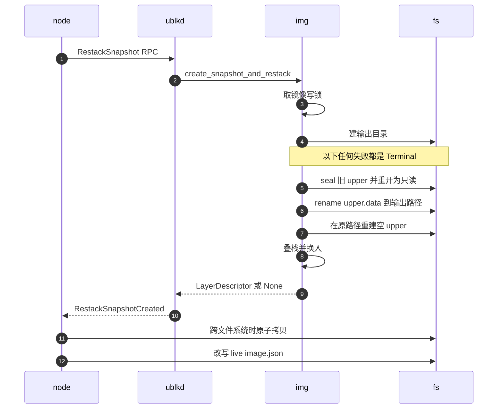
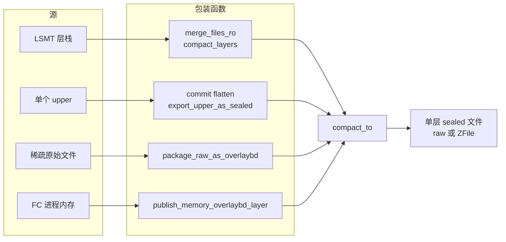

# 37 · 封存、restack 与 compact

> 快照要求把沙箱此刻的磁盘状态冻结成一个不再变化的层，而沙箱的可写层（upper）可能已经长到几十 GiB。
> Rust 版 overlaybd 用三种操作处理「可写变只读」与「多层变一层」：原地封存（seal）、封存后接着换上新 upper 的 restack、
> 把任意源按映射重写成单层文件的 compact。本篇讲这三种操作各自写了哪些字节、失败时留下什么，以及层数为什么要做预算。
>
> **读者**：工程师。　**预备**：[第 34 篇 · LSMT 格式与索引](34-lsmt-format-and-index.md)、[第 36 篇 · 读写路径与三种可写布局](36-read-write-paths-and-rw-layouts.md)。
> **代码**：`storage/overlaybd/src/lsmt/file/readwrite.rs`、`storage/overlaybd/src/lsmt/file/helper.rs`、`storage/overlaybd/src/lsmt/file/types.rs`、`storage/overlaybd/src/image/image_file.rs`、`storage/ublk-daemon/src/server.rs`、`storage/ublk-daemon/src/client.rs`、`src/sandbox/firecracker/overlaybd_snapshot.rs`、`src/sandbox/ublk/overlaybd.rs`

---

## 0. 本篇要回答的问题

1. 为什么把一个 upper 变成只读层不需要拷贝数据？seal 在文件里追加了哪些字节，又有哪些东西它不处理？
2. restack 由哪几步组成？从哪一步开始失败就不再回滚，为什么？
3. 快照目录与 upper 不在同一个文件系统时，节点怎样保证 rename 仍然成立？
4. `compact_to()` 的输入是什么？为什么同一个函数既能合并层、又能把内存脏页写成层？
5. 运行时层数预算是怎样算的？它保护的是哪一个硬上限，又有什么情况保护不到？

---

## 1. 问题：可写状态要冻结成层

沙箱暂停、做快照、fork 或给卷拍快照时，rootfs 与附加盘的 upper 里装着自上次恢复以来 guest 写下的全部数据。
快照制品需要的是一个**只读、可共享、可上传**的层；而 upper 是可写的、格式上带着 RW 布局特有的结构
（LogStructured 与 Hybrid 有独立的 index 文件，Sparse 没有 index；见[第 36 篇](36-read-write-paths-and-rw-layouts.md)）。

最直接的办法是拷贝：读出 upper 中所有有效映射，写进一个新的 sealed 文件。
Rust 版 overlaybd 保留了这条路，即 `LSMTFile::export_upper_as_sealed()`，它不改动源文件，upper 在调用后仍然可写。
代价是写入量正比于 upper 的有效数据量。`image_file.rs` 的测试注释把这一点说得很直白：
一个被 guest 写满 58 GiB 的 upper，用导出要拷 58 GiB，用原地封存只要一次 rename。

所以仓库里有三种操作，分工如下：

| 维度 | seal | restack | compact |
|---|---|---|---|
| 入口 | `LSMTFile::close_seal()`、`ImageFile::close_seal()` | `ImageFile::create_snapshot_and_restack()` | `compact_to()`（`lsmt/file/helper.rs`） |
| 输入 | 一个 upper | 一个正在服务的 `ImageFile` | 任意 `VirtualFile` 数组 + 映射数组 |
| 数据是否拷贝 | 否，原地追加 index 与 trailer | 否（内部就是 seal） | 是，按映射逐段读出再写 |
| 调用后源文件 | 不可再写 | 换上新的空 upper，继续服务 | 不变 |
| 典型用途 | 离线打包、一次性封口 | 暂停、快照、fork、卷快照 | 层数超预算、发布时转 ZFile、内存脏页成层 |

---

## 2. seal：原地封口

### 2.1 写了哪些字节

`LSMTFile::close_seal()`（`lsmt/file/readwrite.rs`）的步骤：

1. 用 `sealed.swap(true)` 置位封存标志；已经封过的文件直接报错，防止重入。此后所有写入都会得到 "File is sealed."。
2. `flush_group_commit()` 把 group commit 缓冲里尚未落盘的映射写进 index 文件。
3. 在索引读锁下对**只属于 upper 的那部分索引**（`idx.upper`）做全范围 `lookup`，得到 upper 当前有效的映射。
   这里查的是合并后的结果，被覆盖的旧映射已经被切掉。
4. 把每条映射的 tag 改成 0（封存后它是一个单层文件，自己就是第 0 层）；零段的 moffset 改成 `NO_PHYSICAL_OFFSET`。
5. 以**数据文件当前的 EOF** 作为 `index_offset`，把映射编码成 16 B 的磁盘格式写在那里，不足 512 B 的部分用 `0xff` 补齐。
6. 再补 0 到 4 KiB 边界，然后从文件开头读出 header，复制成 trailer：改写 `virtual_size`、`index_offset`、`index_size`
   （条数，不含补齐），置 sealed、data file 与 trailer 标志，写在文件末尾。

数据块一字节都没有移动。下面是 LogStructured upper 在 seal 前后的布局：

```text
seal 之前：两个文件
upper.data                                 upper.index
+---------+------------------------------+ +---------+-----------------------+
| header  | 追加写入的数据块             | | header  | 16 B 映射, 按写入顺序 |
| 4 KiB   | 含已被覆盖的旧块             | | 4 KiB   | 含已被覆盖的旧映射    |
+---------+------------------------------+ +---------+-----------------------+

seal 之后：仍是 upper.data 这个 inode, 随后被 rename 成层文件
+---------+------------------------------+--------------+-----+-----+---------+
| header  | 数据块, 原样不动             | 合并后的索引 | ff  | 00  | trailer |
| 4 KiB   |                              | 16 B x m     | 512 | 4K  | 4 KiB   |
+---------+------------------------------+--------------+-----+-----+---------+
                                         ^ index_offset = seal 前的 EOF
upper.index 不再被读取; restack 时同一路径被截断重建
```

Sparse upper 的数据文件本身就是 `HEADER + virtual_size` 大小的稀疏文件，EOF 恰好在虚拟盘末尾之后，
所以索引追加在 EOF 不会与任何虚拟块重叠，`close_seal()` 的注释专门说明了这一点。
Sparse 没有 index 文件，它的映射来自对数据文件做 `seek_data` / `seek_hole` 扫描（`create_mappings_from_sparse()`）。

### 2.2 读端为什么认得它

sealed 层的读端只看 trailer。Rust 版的 `verify_ht()`（`lsmt/file/helper.rs`）要求 trailer 的魔数正确、
是 trailer、是 data file、已 sealed；上游 overlaybd `file.cpp` 中同名的 `verify_ht()` 检查的是同样四项。
seal 从 header 复制 trailer 时没有清掉 RW 布局位，所以 Sparse 或 Hybrid upper 封出来的层，trailer 里仍带着 bit4 或 bit5。
bit5（Hybrid RW）并非 AgentENV 独有：上游默认分支同样把它定义为 `FLAG_HYBRID_RW`，两边同位同义（[第 34 篇 §6](34-lsmt-format-and-index.md#6-与上游的兼容边界)）。
两边的只读打开路径都不检查这两位，于是封出来的层可以按普通 sealed 层打开。
推论：只读路径对这两位不敏感是一个隐含依赖，如果将来某一端在只读路径上校验 RW 布局位，这些层会被拒绝。

### 2.3 增量 digest 与它的适用范围

快照发布需要层的 sha256。对一个几十 GiB 的层重新读一遍算摘要，代价与拷贝同量级。
`AppendDigestTracker`（`lsmt/file/types.rs`）的做法是在写入时顺带算：它从 4 KiB header 开始，
要求每次喂进来的字节恰好接在上一次的末尾（`absorb()` 检查 `offset == self.offset`），否则放弃追踪。
seal 追加的 index、补齐与 trailer 同样喂给它，所以 seal 结束时摘要已经是整个层文件的摘要，
`close_seal()` 直接返回 `LayerDescriptor { digest, size }`。

这只对 LogStructured 成立。`initial_append_digest()` 只为 `LSMTFileType::ReadWrite`（即 LogStructured）建追踪器，
注释说明 Sparse 与 Hybrid 会原地改写已有数据块，顺序追加的前提不成立。
而节点配置 `[ublk.overlaybd] runtime_upper_mode` 的代码默认值与 `default.toml` 都是 `hybridLogStructured`（`src/cfg.rs`）。
冷启动的 rootfs 也不例外：`FirecrackerSandboxFactory::build()` 写下的 `UpperMode::LogStructured` 随即被 `from_app_config_with_user_image()` 用全局配置覆盖，
运行中的 upper 实际是 Hybrid 布局（[第 36 篇 §4.4](36-read-write-paths-and-rw-layouts.md#44-agentenv-用哪一种)）。
所以**默认配置下 `close_seal()` 不返回增量 digest，restack 返回的 descriptor 是 `None`**：`create_snapshot_and_restack()` 写进 lowers 的 `digest` 为空，
`size` 退回到文件元数据长度。摘要要在发布时另算一遍：例如对象存储上传路径的 `recontainerize.rs` 里，`passthrough()` 在没有可信描述符时用 `FileDigest::describe()` 整体读一遍文件求 sha256，
开启发布压缩时则对重封装后的 ZFile 重新求值（[第 35 篇 §7.1](35-zfile-compression.md#71-本地-raw发布时压缩)）。增量 digest 的收益只在显式选用 `logStructured` 时兑现。

### 2.4 seal 不做的事

seal 不回收空间。LogStructured upper 里被覆盖过的旧块、被 discard 的块，在数据文件里原样留着，
只是不再被任何映射引用；封出来的层体积等于 upper 数据文件的体积，而不是有效数据量。
Hybrid 布局用原地写与零段复用减少了这种浪费（[第 36 篇](36-read-write-paths-and-rw-layouts.md)），
但同样不在 seal 时整理。空间只有在 compact 时才被真正回收，`data_stat()` 返回的 `total_data_size` 与 `valid_data_size`
之差就是这部分死数据；ublk-daemon 在 restack 后把它作为观测指标返回（`handle_restack_snapshot()`）。

另一个细节是补齐方式不统一：seal 用 `0xff` 字节把索引补到 512 B，`index_size` 只计有效条数；
`compact_to()` 用长度为 0 的无效映射（`INVALID_SEGMENT_OFFSET`）把索引补到 4 KiB，`index_size` 连补齐条目一起计入。
两种文件都能被正确读出：seal 的补齐字节落在 `index_size` 之外，不会被解析；compact 的补齐条目长度为 0，
`load_index()` 加载时跳过。但同一种格式有了两种写法。

`ImageFile::close_seal(output_layer_path)` 是 seal 在镜像层面的包装：取镜像状态的写锁、先建好输出目录
（让不可能存在的输出路径在封存之前就被拒绝）、调用 `LSMTFile::close_seal()`、最后 rename。
它的文档注释写明调用之后这个镜像不能再用。需要继续服务的调用方用的是 restack。

---

## 3. restack：封存并换上新 upper

### 3.1 为什么需要它

只有「暂停后销毁 VM」才可以让镜像在 seal 后作废。快照、fork 与卷快照都要求 VM 在拍完之后**继续运行**：
`FirecrackerSandbox` 的 `snapshot()`、`fork()`、`snapshot_volumes()`（`src/sandbox/firecracker/sandbox.rs`）
都是先 `pause_to_dir()` 或暂停 FC，拍完再 `resume()`。这时被封存的旧 upper 要同时成为两样东西：
快照制品里的最新一层，以及正在运行的设备的最新 lower。新写入则落进一个新的空 upper。

节点侧的入口是 `restack_snapshot_overlaybd_rootfs()` 与 `restack_snapshot_overlaybd_device()`
（`src/sandbox/firecracker/overlaybd_snapshot.rs`），rootfs、附加盘与卷都走它。
它经 `UblkDeviceManager::restack_snapshot_device()`（`src/sandbox/ublk/device.rs`）向 ublk-daemon 发 `RestackSnapshot` RPC；
daemon 的 `handle_restack_snapshot()` 找到设备对应的 `ImageFile`，若设备来自预热池还要先拿该镜像的写锁，
然后调用 `ImageFile::create_snapshot_and_restack()`。restack 发生在 daemon 进程里，是因为设备的 `ImageFile` 只存在于 daemon。

### 3.2 步骤

时序图里的参与者：`node` 是节点进程中的 `overlaybd_snapshot.rs`，`ublkd` 是 ublk-daemon，
`img` 是 daemon 内该设备的 `ImageFile`，`fs` 是宿主文件系统。



`create_snapshot_and_restack()` 内部，按代码顺序：

1. `self.state.write()` 取 `LiveImageState` 的写锁。所有经过 `ImageFile` 的读写都持读锁，所以这一步等到在途 I/O 全部结束，
   之后新的 I/O 被挡住。VM 此时已经暂停，挡住的主要是 FC 暂停前已提交、尚未完成的请求。
2. 校验 upper 可封存（`ensure_sealable_upper()`），建输出目录。
3. 记下当前 lowers（自底向上），调用 `close_seal_and_reopen()`：seal 旧 upper，并用**同一个文件句柄**把它重新打开成 `LSMTReadOnlyFile`。
4. 把 `upper.data` rename 到输出路径。因为第 3 步拿的是文件句柄而不是路径，rename 不影响已打开的只读层。
5. `prepare_runtime_upper()` 在原来的 data / index 路径上按原来的布局建一对新的空文件：
   `initialize_file_rw_paths()` 以截断方式打开，写入带新 uuid 的 header；Sparse 布局把 data 文件扩到 `HEADER + virtual_size`。
6. 打开新 upper，沿用旧 upper 的 `max_io_size` 与 group commit 设置；用 `open_files_ro_with_premerged_cache()` 把「旧 lowers + 刚封的层」
   重新打开成只读栈，再 `stack_files()` 把新 upper 叠上去。
7. 在 `state.config.lowers` 末尾追加刚封的层（路径、digest、size、uuid），把 `state.base` 换成新栈。

第 3 至 6 步包在一个 async 块里，整体用 `into_restack_terminal_failure()` 把错误包装成 `RestackSnapshotTerminalFailure`。
第 1、2 步的失败是普通错误。

### 3.3 Terminal 分界与不回滚的理由

一旦进入第 3 步，磁盘上的状态就开始不可逆地变化：sealed 标志已置位、数据文件末尾多了 index 与 trailer；
第 4 步之后 upper 的数据文件已经不在原路径；第 5 步之后旧 index 文件已被截断重建。
要回滚，就得截掉 trailer、把 rename 反过来、再从数据文件里重建 index 文件，而这几步本身也可能失败。
代码的选择是**不尝试回滚**，只如实报告「live 运行时可能已被改动」，由上层停掉这台沙箱、不再从这个运行时恢复它。

这个信号沿调用链原样传递：daemon 的连接处理把 `RestackSnapshotTerminalFailure` 映射成 `DaemonResponse::TerminalError`（`server.rs`）；
客户端 `UblkDaemonClient::restack_snapshot()`（`client.rs`）把它还原成客户端侧定义的同名类型 `RestackSnapshotTerminalFailure`。
客户端还有一条更保守的规则：**RPC 超时（360 s）或回复丢失也算 Terminal**，注释的理由是 seal 可能已经成功而回复丢了，
只有显式的 `Error` 回复才能证明运行时仍可安全恢复。
节点侧把它变成 `SandboxCaptureError::Terminal`（`src/sandbox/backend.rs`）。

两类错误的区别在 `FirecrackerSandbox::recover_capture_failure()`：Recoverable 错误会让 VM `resume()` 后把错误返回，沙箱照常运行；
Terminal 错误不恢复 VM。orchestrator 收到 Terminal 后停掉沙箱、对它挂载的卷执行 `finalize_terminal_volumes()`、
从元数据里删除记录（`src/orchestrator/service.rs` 的 pause、fork 与快照失败分支）。
`finalize_terminal_volumes()` 并不把卷标成「不可安全恢复」：它先调 `VolumeManager::recover_and_publish_backings()`（`src/volume.rs`）恢复并发布卷的备份，
再用 `replace_owner_for(owner, None, …)` 释放卷的占用，两步失败都只记 warn。卷的处理细节见[第 21 篇](21-deletion-and-volume-capture.md)。

### 3.4 节点侧的收尾

daemon 返回后，`capture_live_overlaybd_snapshot()` 还有三件事，失败一律经 `into_terminal_snapshot_failure()` 记为 Terminal：

- **跨文件系统。** rename 要求输出路径与 upper 在同一个文件系统。节点在发 RPC 之前用 `on_same_filesystem()` 比较两者的 `st_dev`；
  不同时，让 daemon 把层 rename 到 upper 所在目录，自己再用 `copy_file_atomically()`（临时文件、`sync_all`、persist）拷进快照目录。
  这是 restack 唯一会真正拷贝数据的情形。
- **大小核对。** 如果 descriptor 存在，比较快照目录里文件的长度与 `descriptor.size`，不等即 Terminal，并且不删除这个层，
  因为运行中的设备可能还引用着它。
- **改写 live 配置。** `rewrite_live_runtime_config_for_restack()` 把新层追加到运行时 `image.json` 的 lowers，用临时文件原子替换。
  daemon 内存里的栈与磁盘上的配置由此重新一致。

之后 `stage_overlaybd_snapshot_from_live_runtime()` 生成快照自己的 `image.json`：校验 lowers 末尾正是刚封的层，
把它弹出作为「追加层」，交给第 5 节的层数预算处理，清空 upper。
卷的备份目录会在多次暂停之间复用，所以卷的层文件名带 UUIDv7（`snapshot-<uuid>.commit`），避免后一次 restack 覆盖仍被 `image.json` 引用的旧层；
rootfs 每次快照用新目录，层名固定为 `snapshot.commit`。

---

## 4. compact：按映射重写成单层

### 4.1 接口

`compact_to(src_layers, mappings, virtual_size, commit_args)` 不关心源是什么，只要求两样东西：
一个 `VirtualFile` 数组，以及一组 `SegmentMapping`，其中 `tag` 是源数组的下标、`moffset` 是该源里的物理偏移（以 512 B 扇区计）。
它的输出由 `CommitArgs` 决定：`writer` 可以是写普通文件的 `VirtualFileWriter`，也可以是边写边压缩的 `ZFileCompactWriter`
（[第 35 篇](35-zfile-compression.md)）；`concurrency` 控制并发，缺省 1。

执行分三阶段：

1. **分块。** 写 header（未指定 uuid 时用 nil uuid，注释说明与 C++ 实现保持一致）。遍历映射：零段直接记入输出索引、moffset 置为
   `NO_PHYSICAL_OFFSET`、不占输出空间；非零段按 `writer.buffer_size()` 装进 `CompactChunk`。一个 chunk 可以由来自不同层的多段拼成，
   一段太长时跨 chunk 切开，单条不超过 `Segment::MAX_LENGTH`。每个 chunk 的输出位置在分块时就已确定。
2. **拷贝。** 并发为 1 时顺序执行。并发大于 1 时分两种：写入端要求有序（`requires_ordered_writes()`，ZFile 是这种）时，
   读取用 `buffered(concurrency)` 并发、写入按序；否则读写都放进 `buffer_unordered(concurrency)`，最后按 chunk 序号排序收集索引。
3. **收尾。** 把输出索引按逻辑偏移排序、用 `compress_raw_index()` 合并相邻条目，补齐到 4 KiB，写 index 与 trailer，最后 `finalize()`。

零块检测是关闭的：`COMPACT_ZERO_DETECTION_ENABLED = false`（`lsmt/file/types.rs`），
`compact_is_zero_block()` 的注释说上游 `file.cpp` 当前也把 `is_zero_block()` 短路成「非零」。
带零块检测的逐映射拷贝路径仍保留在代码里，只在这个常量为真时启用。

### 4.2 调用者

正因为源只是 `VirtualFile`，`compact_to()` 成了几条看似无关的路径的共同出口：



| 调用方 | 源与映射 | 用途 |
|---|---|---|
| `merge_files_ro()`（`lsmt/file/stack.rs`） | 多个 sealed 层，映射来自合并索引 | 被 `compact_layers()` 调用 |
| `compact_layers()`（`src/sandbox/ublk/overlaybd.rs`） | 本地层经 tar 适配与 `SwitchFile` 打开，raw 与 ZFile 可混用 | 层数超预算时压缩运行时后缀；发布时单层重封装成 ZFile（`recontainerize.rs`） |
| `LSMTFile::commit()` / `flatten()` / `export_upper_as_sealed()` | 本栈各层，或只取 upper 的映射 | 库层面的提交、拍平与非破坏性导出 |
| `package_raw_as_overlaybd_with_args()`（`tools/packaging.rs`） | 一个稀疏原始文件当作第 0 层，映射来自 `seek_data` | 把原始盘打包成层 |
| `publish_memory_overlaybd_layer()`（`overlaybd_snapshot.rs`） | `ProcessVmReader` 当作第 0 层，moffset 存 FC 进程的 HVA | 内存脏页成层，并发 32 |

最后一行是这个接口设计最有意思的用法：读 FC 进程内存的 `ProcessVmReader` 也实现了 `VirtualFile`，
于是「把脏页写成一个层」不需要任何专门的写层代码。细节在[第 42 篇](42-memory-snapshot-over-ublk.md)。
`compact_layers()` 与 `publish_memory_overlaybd_layer()` 都先写到同目录的临时文件，成功后 rename，失败时删除临时文件，
所以已存在的输出不会被半成品覆盖。两者的并发都是 32；`compact_layers()` 产出的层 uuid 为 nil，`recontainerize.rs` 的日志明说了这一点。

---

## 5. 运行时层数预算

### 5.1 硬上限从哪来

映射的 tag 只有 8 位，`open_files_ro()`（`lsmt/file/stack.rs`）的输入检查把 lowers 限制在 `MAX_STACK_LAYERS = 255`（常量定义在 `lsmt/file/types.rs`）。
每次暂停或快照都会多出一个 rootfs 层与一个内存层；一台沙箱反复「暂停、恢复」，层栈就一直长。
层越多，打开时要合并的索引越多（premerged index 缓存缓解的正是这件事，见[第 34 篇](34-lsmt-format-and-index.md)），
最终会撞上 255。

### 5.2 预算公式

`rewrite_lowers_with_runtime_roots()`（`overlaybd_snapshot.rs`）在生成快照的 lowers 时做预算：

1. `split_runtime_suffix()` 从第一个位于「运行时拥有的根目录」下的层开始切开 lowers。根目录有两个：托管快照目录（`managed_snapshot_base()`）
   与 `[orchestrator] persisted_sandbox_store_path`。切点之前是**稳定前缀**（模板、已发布或缓存所有的层），之后是**运行时后缀**。
   注释解释了为什么只能从第一个运行时层整体切：只收养尾部会留下悬空引用，或者改变层的先后次序。
2. 预算 = `DEFAULT_MAX_OVERLAYBD_SNAPSHOT_LAYERS (32) − 稳定前缀层数 / 4`，最小为 1。
3. 运行时后缀层数加上本次追加的层，若超过预算，就用 `compact_layers()` 把它们整体压成一层：rootfs 写成 `managed-base.commit`，
   内存写成 `mem_compacted.commit`，一律 raw。后缀里有远端层（`file` 为空）时报错，因为 compact 只读本地文件。
4. 未超出时，把运行时后缀逐个硬链接进快照目录的 `inherited-layers/NNNN/`；硬链接失败（例如跨文件系统）退回 `cp --reflink=auto --sparse=always`。
   于是每个快照目录在文件系统层面自足，删除旧快照不会让新快照的 lower 消失。

| 稳定前缀层数 | 运行时后缀预算 | 说明 |
|---|---|---|
| 0 | 32 | 冷启动出来的沙箱 |
| 32 | 24 | 注释里给的例子 |
| 124 及以上 | 1 | 每次快照都把运行时后缀压成一层 |

前缀越长预算越小，这样总层数始终远离 255，又不会在前缀本来就长时每次暂停都触发压缩。
代价是超预算那一次暂停要把整个运行时后缀读一遍、写一遍，暂停耗时在这一次跳升；预算本身是代码常量，没有配置项。

### 5.3 预算管不到的地方

预算只作用于**快照的** `image.json`。restack 之后，运行中设备的栈是「旧栈 + 刚封的层」，live 配置也只是追加（第 3.4 节），
不会被压缩。推论：一台长期运行、被反复快照或 fork 的沙箱，其 live 栈每次多一层，没有任何压缩；
到第 256 次左右，restack 第 6 步重开只读栈会因超过 255 层而失败，而这一步失败是 Terminal。仓库里没有看到针对这一情形的测试。

---

## 6. 与 e2b infra 的对照

e2b infra 暂停时从 NBD overlay 的 cache 里导出磁盘 diff，再把 diff 映射与上一代 header 合并成一张覆盖整盘的新映射表，
每一代都是「一张表引用多个 build 的数据文件」，不存在层数上限，也没有数据层面的压缩（见 e2b 手册第 37 篇）。
AgentENV 保留逐层的索引、在打开时合并，用层数预算与 compact 控制栈高；
换来的是每个层都是标准 LSMT 文件、可以单独上传与共享，代价是需要预算与偶发的整段重写。

---

## 7. 小结

- seal 原地封口：在数据文件 EOF 追加合并后的索引与由 header 复制的 trailer，数据块不动；代价是死数据不回收。
- 增量 sha256 只在 LogStructured upper 上有效；默认 `runtime_upper_mode = hybridLogStructured`，冷启动 rootfs 也是 Hybrid，`close_seal()` 不返回增量 digest，发布时另算。
- seal 出来的层保留 RW 布局位，Rust 与上游的只读打开都不检查这两位。
- restack = 写锁下 seal、rename、在原路径重建空 upper、重开只读栈、换入；从 seal 开始的任何失败都是 `RestackSnapshotTerminalFailure`。
- 不回滚是因为 seal 之后磁盘状态不可逆；RPC 超时（360 s）或回复丢失也按 Terminal 处理，Terminal 会让沙箱被停掉并删除，挂载的卷先恢复发布、再释放。
- 跨文件系统时 daemon 在 upper 所在目录 restack，节点再原子拷贝；这是 restack 唯一拷贝数据的情形。
- `compact_to()` 只需要 `VirtualFile` 数组与映射，所以层合并、ZFile 重封装、原始盘打包与内存脏页成层共用一个实现；零块检测关闭。
- 运行时后缀的层数预算是 `32 − 稳定前缀 / 4`（至少 1），超出则压成一层，否则硬链接进快照目录。
- 预算只管快照配置，不管运行中设备的栈；长期运行并反复快照的沙箱，其 live 栈没有上限保护。

---

## 延伸阅读 / 下一篇

- [第 36 篇 · 读写路径与三种可写布局](36-read-write-paths-and-rw-layouts.md)：三种 upper 布局的写入方式，seal 的输入从哪来。
- [第 41 篇 · ublk-daemon](41-ublk-daemon.md)：`RestackSnapshot` RPC、三类错误语义与预热池的镜像锁。
- [第 42 篇 · 内存快照](42-memory-snapshot-over-ublk.md)：`ProcessVmReader` 与 `compact_to()` 怎样把脏页写成层。
- [第 47 篇 · POSIX 仓库与提交协议](47-posix-repository.md)：封存好的层怎样进入快照仓库。
- [e2b 手册第 37 篇 · 暂停与快照](../e2b-infra/37-pause-and-snapshot.md)：diff 与映射表合并的另一种做法。
- 下一篇：[第 38 篇 · VirtualFile 装饰器链与远端 I/O 运行时](38-virtualfile-chain-and-remote-io.md)。
