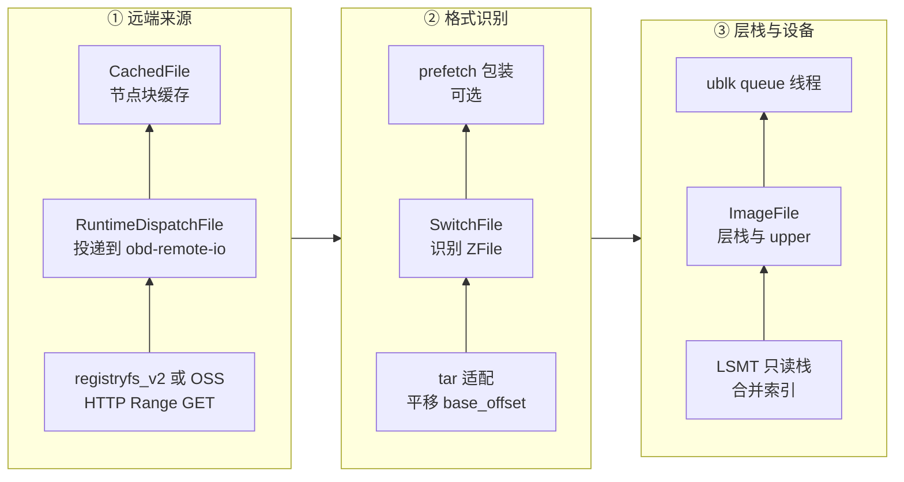
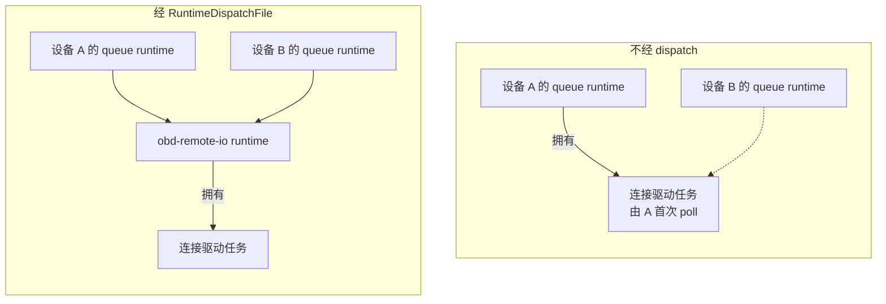

# 38 · VirtualFile 装饰器链与远端 I/O 运行时

> overlaybd 的一个层可能是本地文件，可能是 tar 包裹的 blob，可能是 ZFile 压缩件，也可能远在镜像仓库、对象存储或另一个节点上。
> Rust 版 overlaybd 用一个 `VirtualFile` trait 把它们统一成「按偏移读写的文件」，再把各种能力做成一层层包装。
> 本篇讲这条装饰器链的组成、同一份代码怎样同时服务后台任务与 ublk queue 线程，以及远端 I/O 为什么必须钉在一个专用的 tokio runtime 上。
>
> **读者**：工程师。　**预备**：[第 07 篇 · Rust 异步](07-rust-async-primer.md)、[第 36 篇 · 读写路径与三种可写布局](36-read-write-paths-and-rw-layouts.md)。
> **代码**：`storage/overlaybd/src/io/{virtual_file,vfile_io,dispatch_file}.rs`、`storage/overlaybd/src/backend/{local,tar,switch,registryfs_v2,oss}.rs`、`storage/overlaybd/src/image/{image_file,image_service}.rs`

---

## 0. 本篇要回答的问题

1. `VirtualFile` 为什么有两族读写方法？`*_with_ctx` 返回的 future 为什么不是 `Send`？
2. `vfile_io.rs` 里那几个零大小类型解决的是什么问题，为什么不用 async 闭包？
3. 一个远端 lower 从打开到被读，中间穿过哪些包装？本地 lower 少了哪几层？
4. `LocalFile` 的普通读写为什么在当前线程同步执行？哪条路径才真正走 io_uring？
5. 每个 ublk queue 一个 runtime 时，共享的 HTTP 连接池会出什么问题？`RuntimeDispatchFile` 怎样解决，代价是什么？

---

## 1. 问题：一个层可能在哪里

overlaybd 的层栈只关心一件事：给定层号与物理偏移，读出一段字节（[第 34 篇](34-lsmt-format-and-index.md)）。
可这段字节的来源差别很大：

- 节点本地的 `overlaybd.commit` 或快照目录里的 sealed 层，可能是 raw，也可能是 ZFile；
- 镜像仓库里的 blob，按上游约定是「一个文件加 tar 头尾」，要用 HTTP Range GET 读，带认证与重定向；
- 对象存储（S3 兼容、阿里云 OSS）里的快照层；
- 别的节点上已经有的同一层，经 P2P 门面取（机制见[第 58 篇](58-p2p-artifact-transport.md)）。

远端来源还要叠一层节点块缓存（[第 39 篇 §2.1](39-block-cache-and-background-download.md#21-位置)）。
如果每种组合写一个专门类型，组合数会乘起来。Rust 版 overlaybd 沿用上游 overlaybd 的思路（上游的 C++ 实现里，每层同样是一个文件对象，层层包装后交给前端；经典前端是 tcmu，默认分支也已带 ublk 前端）：
所有东西都实现同一个文件接口，每种能力是一层包装，包装之间按需叠加。

---

## 2. `VirtualFile` trait

### 2.1 方法集

`VirtualFile`（`io/virtual_file.rs`）是一个 `#[async_trait]` trait，要求 `Send + Sync`：

| 方法 | 缺省实现 | 说明 |
|---|---|---|
| `read_at`、`write_at`、`size` | 无，必须实现 | `read_at` 返回 `Bytes` |
| `read_at_into`、`write_bytes_at` | 经 `read_at` / `write_at` 转发 | `read_at_into` 读进调用方缓冲，缺省多一次拷贝 |
| `truncate`、`sync`、`discard`、`f*xattr` | 报「不支持」 | 只有本地文件与 LSMT 实现 |
| `seek_data`、`seek_hole` | 返回 `None` | 稀疏扫描用 |
| `evict_range`、`evict_all` | 空操作 | 缓存与页缓存的驱逐提示 |
| `as_any` | `None` | 具体类型的快速路径下转型，`LocalFile` 覆盖它 |

`xattr` 一组方法的注释写明对齐上游的 `IFileXAttr` 语义。
设计上的要点是缺省实现很宽松：一个只读远端后端只需实现三个方法，其它操作要么转发、要么报不支持。

### 2.2 两族方法

在 `io-uring` feature 下，trait 另有四个 `*_with_ctx` 方法：`read_at_with_ctx`、`read_at_into_with_ctx`、`write_at_with_ctx`、
`write_bytes_at_with_ctx`。它们多接一个 `IoCtx<'a>`，里面是对某个 `AsyncIoRing` 的借用，返回的是手写的
`LocalBoxFuture<'a, T>`，即 `Pin<Box<dyn Future + 'a>>`，**没有 `Send`**。

原因在 `AsyncIoRing`（`storage/util`）：它内部用 `Rc`，本身不是 `Send`，捕获了它的 future 自然也不是。
这与 ublk 的执行模型一致（[第 40 篇 §4](40-ublk-library.md#4-数据面一个-queue-线程)）：每个 ublk queue 是一个 OS 线程，线程里跑 `current_thread` runtime 加 `LocalSet`
（`storage/ublk/src/dev.rs` 的 `queue_work()`），这个线程有自己的 io_uring，future 从不离开它。
`#[async_trait]` 只改写 `async fn` 签名，不碰这几个手写方法，所以同一个 trait 里两族方法并存：
普通方法给多线程 runtime 上的后台任务用，`*_with_ctx` 给 queue 线程用。

`*_with_ctx` 的缺省实现忽略 ctx、转发到普通方法。需要把 ctx 一路传下去的包装（`ImageFile`、LSMT 文件、`SwitchFile`、
tar 适配、ZFile、缓存、prefetch）各自覆盖它；真正用 ctx 提交 SQE 的只有 `LocalFile`。
于是一个 queue 线程上的读请求，只要最终落到本地文件，就在本线程的 ring 上完成，不经过任何线程切换。

### 2.3 策略类型：同一份代码，两种 future

LSMT、ZFile 与缓存的读写逻辑很长，不想为两族方法各写一遍。最自然的写法是把「怎么读」当成参数传进去，
比如传一个 `async |file: &dyn VirtualFile, off, buf| ...` 闭包。`vfile_io.rs` 开头的注释说明这条路走不通：
接受 `&dyn VirtualFile` 的 async 闭包目前写不出满足高阶生命周期约束（HRTB）的 `AsyncFn` 实现。

它的替代是 trait 加零大小类型：

- `FileReader::read()` / `read_bytes()` 与 `FileWriter::write()` 两个 trait，方法返回 `impl Future + 'a`；
- `DirectRead` / `DirectWrite` 调普通方法，产生 `Send` future，后台任务可以 `tokio::spawn`；
- `CtxRead { ctx }` / `CtxWrite { ctx }` 调 `*_with_ctx`，产生 `!Send` future，只在 queue 线程上用。

泛型函数写成 `read_internal_into_generic<R: FileReader>(&self, reader: &R, ...)`（`lsmt/file/readwrite.rs`），
编译器为两种策略各单态化一份，`Send` 与否由策略类型决定，不需要运行时分支。
`read_exact()` 也是在这个抽象上写的：循环处理短读，遇到 EOF 报错。
代价是读写入口多了一个类型参数，读代码时要记得同一个函数有两份实例。

---

## 3. 装饰器链

### 3.1 一次远端读穿过的栈

`ImageFile::open_lower_layer()`（`image/image_file.rs`）决定每个 lower 怎么打开：

1. 配置里有 `file`，或 `dir` 下有 `overlaybd.commit` / `overlaybd.sealed`：按本地文件打开（`open_ro_file()`）。
   本地文件不存在而层带 `uuid` 时，退到 P2P uuid 门面（`open_ro_p2p_uuid()`）。
2. 没有本地路径：`open_ro_remote()`。若层带 `uuid` 且启用了 P2P，先试 uuid 门面，失败只记 warn；
   然后用 `repoBlobUrl/<digest>` 拼出 URL，经 `ImageService` 打开。
3. 若启用了 trace prefetch，再用 `Prefetcher::new_prefetch_file()` 包一层（[第 43 篇](43-startup-pack-and-prefetch.md)）。
4. 带 `targetFile`、`targetDigest`、`gzipIndex` 的层直接报错：这些上游特性没有迁移。

所有 lower 以最多 32 路并行打开（`PARALLEL_LOAD_INDEX`），再交给 `open_files_ro_with_premerged_cache()` 叠成只读栈。
下图按 ①②③ 三段、每段自下而上，画出一个经仓库 digest 打开的远端层在 ublk queue 线程上被读时依次穿过的包装：

本地层少了最下面三层：`LocalFile` 直接接 tar 适配。经 P2P uuid 门面打开的层走 `open_source_blob_with_size()`，
有 `RuntimeDispatchFile`、没有 `CachedFile`。
各层只认 `VirtualFile`，所以缓存不知道下面是仓库还是对象存储，LSMT 也不知道某一层是否压缩。

### 3.2 `LocalFile`

`LocalFile`（`backend/local.rs`）有三条执行路径，取舍各不相同：

- **普通 `read_at_into` / `write_at`：当前线程同步 `pread` / `pwrite`。** 注释里的 TODO 解释了为什么不能交给
  `spawn_blocking`：闭包要捕获调用方的 `&mut [u8]`，不满足 `'static`；而 `spawn_blocking` 的任务不可取消，
  用裸指针绕过去，future 被丢弃后阻塞写还可能写进已释放的内存。要根本解决，需要「把缓冲所有权交进去再拿回来」的接口，
  或者按 runtime 类型用 `block_in_place`。代价是在多线程 runtime 上，慢盘会占住一个 worker。
- **拥有数据的 `read_at`、`write_bytes_at`、`truncate`：** 经 `offload()` 交给 blocking 池。注释说明在 queue 线程上等这个句柄会让 runtime park，
  park 回调顺便提交 io_uring，其它 slot 任务得以推进。`size()` 只是一次 `fstat`，故意同步执行。
- **`*_with_ctx`：** 用调用方的 ring 提交 `Read` / `Write`（`io_ring::read_exact_at()` 等）。用的是普通 fd，不是 fixed file，
  缓冲也不是 fixed buffer。O_DIRECT 文件要求对齐，地址、长度、偏移不满足 512 B 对齐时先读进 `AlignedBuffer` 再拷贝。

还有一个刻意的例外：buffered 写入不超过 4 KiB（`BUFFERED_PWRITE_FAST_PATH_MAX`）时，即使在 ctx 路径上也直接同步 `pwrite`。
注释承认这是在 async 代码里做同步系统调用，换来的是小数据块与索引追加省掉一次 io_uring 往返；O_DIRECT 与更大的写仍走 io_uring。
只读 lower 是否用 O_DIRECT 由 `ioEngine` 决定（取上游 libaio 的编号 2 时开启）；AgentENV 生成的全局配置写的是 `"ioEngine": 0`
（`src/setup/deps.rs`），即 buffered。

### 3.3 tar 适配与 `SwitchFile`

`backend/tar.rs` 开头的注释说得很清楚：它不是完整的 tar 实现，只服务于「一个 blob 文件加 tar 头尾」的 overlaybd 远端 blob。
`open_tar_file()` 先用 `is_tar_file()` 探测，是 tar 就包一层 `TarFile`，把所有偏移平移 `base_offset`；不是就原样返回。
支持 ustar、GNU 长文件名、PAX 的 path 与 size，以及表示空 tar 的魔数 `xxtar`。

`SwitchFile`（`backend/switch.rs`）在 tar 之上，`new_switch_file()` 用 `is_zfile()` 识别 ZFile，是就换成 `ZFileRO`，
于是 raw 与 ZFile 层可以在同一个栈里混用（[第 35 篇](35-zfile-compression.md)）。两个细节：
打开失败会重试一次；远端来源（`local = false`）打开 ZFile 时开启数据校验，本地来源不开。

它的名字来自另一项能力：`set_switch_file(path)` 会重新打开一个本地文件（同样经过 tar 与 ZFile 识别），之后的 I/O 全部切过去。
但在 AgentENV v0.2.3 里，**`set_switch_file()` 除了 `switch.rs` 自己的测试之外没有调用者**。
后台下载把数据回填进节点块缓存，前台读经 `CachedFile` 命中缓存，并不切换到本地文件（[第 39 篇 §5.5](39-block-cache-and-background-download.md#55-下载完成之后)）。
所以 `SwitchFile` 在现行代码里实际只承担「自动识别 ZFile」这一件事。

### 3.4 `registryfs_v2`

`RegistryFsV2`（`backend/registryfs_v2.rs`，名字沿用上游的 registryfs_v2）用 Range GET 读仓库 blob：

- **解析实际 URL。** 第一次读某个 blob 时，`resolve_actual_url_once()` 发一个 `Range: bytes=0-0` 的 GET，HTTP 客户端关闭了自动重定向。
  返回重定向就记下 `Location`（多为对象存储的签名 URL，`UrlMode::Redirect`），之后直接读它，不再带仓库凭据；
  返回 200 / 206 就记下认证头（`UrlMode::SelfAuth`）。这份信息缓存 300 s（`MIN_URL_INFO_LIFE`），读失败时作废。
- **认证。** 遇到 401 / 403 时按 `WWW-Authenticate` 走 Basic 或 Bearer；挑战结果按仓库缓存 300 s，取到的 token 固定缓存 30 s（`MIN_TOKEN_LIFE`），不看服务端给的有效期。
- **重试。** 缺省 3 次（`download.tryCnt` 可改），整个读有一个总超时（缺省 30 s）。
- **加速地址。** 设了加速地址时，请求发到 `<加速地址>/<实际 URL>`；这条路失败不回退到直连（有测试 `test_registry_read_with_accelerate_error_no_fallback`）。

加速地址就是 P2P HTTP 门面 `/p2p-http/<origin>`。`ImageService::create_image_file()` 每次打开镜像前调用 `enable_acceleration()`：
P2P 启用且门面地址能在 1 s 内建立 TCP 连接，就切到 `RemoteOpenMode::Direct` 并设置加速地址；否则回到 `Cached`。
`Direct` 模式下仓库 blob **不经过节点块缓存**，`open_remote_blob_with_size()` 的注释说明此时 P2P 门面自己充当缓存。
这个探测是同步的 `TcpStream::connect_timeout()`，在 async 函数里阻塞调用线程最多 1 s；推论：门面不可达时，每次打开镜像都要付这笔等待。

### 3.5 OSS

`OssBackend`（`backend/oss.rs`）基于 opendal 的 S3 服务，URL scheme 是 `s3://` 或 `oss://`；按 bucket、region、endpoint 与寻址方式缓存 operator。
读就是 `operator.read_with(key).range(..)`，大小有缓存，可以由层配置里的 `size` 预先给出，省掉一次 HEAD。
OSS 来源**总是经过节点块缓存**（只要缓存存在），不受 `RemoteOpenMode` 影响，理由是 OSS 没有 P2P 通道。

上传侧的 `upload_file_streaming()` 有一段很长的注释，值得当作阅读 opendal 的旁注：
part size 是请求值，opendal 会把它夹到服务允许的范围（S3 为 5 MiB 到 5 GiB）；S3 的分片数上限是 10,000，
所以 part size 同时决定了能上传的最大对象（part size × 10,000），而没有任何代码事先检查这个上限，超出时在第 10,001 片被服务端拒绝。
峰值内存约为 `(2 × concurrency + 2) × part_size`：写端累积一片、`MultipartWriter` 暂存一片等下一片到来，
并发任务队列的准入条件会让已完成但未取走结果的任务继续占着缓冲，稳定在并发数的两倍左右。
这个函数故意不给两个参数缺省值，要求调用方在知道约束的地方自己选。

---

## 4. 多 runtime 陷阱

### 4.1 进程里有几个 runtime

ublk-daemon 进程里同时存在几类执行体：主 runtime（多线程，处理 RPC 等）；每个设备的每个 queue 一个 OS 线程，
线程里一个 `current_thread` runtime，随设备销毁而销毁；以及本节要讲的 `obd-remote-io`。
节点块缓存的后台 worker 与后台下载调度器也要找一个 runtime 住（[第 39 篇 §5](39-block-cache-and-background-download.md#5-后台下载调度器)）。

### 4.2 问题

`dispatch_file.rs` 的模块注释描述了不加处理时会发生什么。reqwest 与 opendal 发 HTTP 请求时，会用裸的 `tokio::spawn`
起一个连接驱动任务，这个任务（连同它持有的池化连接）就绑在**当时 poll 请求的那个 runtime** 上。
而连接池在进程里事实上是共享的：opendal 0.55 缺省让所有 operator 共用一个全局静态客户端，`ImageService` 又按 bucket 缓存 operator。
结果是池里的连接被随机某个设备的 queue runtime 拥有，带来两个问题：

1. 设备 B 的请求可能由设备 A 的 queue 线程驱动，B 的延迟与 A 的调度耦合；A 的 `LocalSet` 线程被任何东西阻塞，B 也跟着停。
2. 销毁设备 A 时它的 runtime 被丢弃，上面所有连接任务一起被杀，其中包括 B 正在用的连接。

这类问题在单元测试里很难出现，因为测试通常只有一个 runtime；它只在多设备、设备频繁创建销毁的生产形态下暴露。
下图右侧「不经 dispatch」是不加处理时的连接归属，虚线表示设备 B 复用了由 A 的 runtime 拥有的连接；左侧是经 `RuntimeDispatchFile` 后，
两个 queue runtime 都只把操作投递到 `obd-remote-io` 并等待结果，连接只归后者所有。

### 4.3 `RuntimeDispatchFile`

解法是把所有网络 I/O 钉在一个长寿命的 runtime 上。`RuntimeDispatchFile`（`io/dispatch_file.rs`）包住远端文件，
`read_at`、`write_at`、`write_bytes_at`、`size` 都经 `dispatch()` 执行：`handle.spawn(fut)` 把操作投递到目标 runtime，
再在调用方的 runtime 上 `await` 它的 `JoinHandle`。连接驱动任务因此总是在目标 runtime 上被 spawn。
`ImageService` 在三处保证这一点：

- `open_backend_source_with_size()` 把**打开本身**也投递过去，因为打开可能发请求（`RegistryFsV2::open()` 没有大小提示时会先取大小），
  然后把返回的源包上 `RuntimeDispatchFile`。
- `remote_runtime()` 惰性构造 registryfs、OSS backend 与节点块缓存时，整个构造过程在目标 runtime 上执行。
  注释的理由是缓存在构造时就用 `tokio::spawn` 或 `Handle::try_current` 起后台 worker，而第一个调用者很可能是某个 queue runtime。
- 这个 runtime 由 `build_remote_io_runtime(workers)` 建成，多线程、线程名 `obd-remote-io`，线程数取全局配置的 `remoteIoWorkers`。
  AgentENV 的 `[ublk.overlaybd] remote_io_workers` 缺省 4，配置校验要求大于 0（`src/cfg.rs`）。
  `remoteIoWorkers = 0` 时退回到构造 `ImageService` 的那个 runtime，只在单元测试里出现。

代价有三项：

- **一次额外拷贝。** `read_at_into` 故意保留缺省实现（`read_at` 后拷贝）。调用方的 `&mut [u8]` 不能跨进被 spawn 的任务；
  注释认为远端读是有界的块，这次拷贝相对网络往返可以忽略。
- **一次跨线程交接。** 每次远端操作都要 spawn 加跨线程唤醒。好处是 queue 线程在等待期间不被占住，
  一个 queue 可以同时挂着 depth 个远端读，继续处理命中本地文件或缓存的请求。
- **取消不传递。** 推论（依据 tokio 语义）：调用方丢弃 future 只会丢掉 `JoinHandle`，被 spawn 的任务照常跑完，
  所以一个被放弃的远端读仍会把请求发完。

### 4.4 生命周期

runtime 归 `ImageServiceInner` 所有。它的 `Drop` 调 `shutdown_background()` 而不是让 `Runtime` 自然析构：
`Runtime::drop` 会阻塞等待 blocking 池关闭，在 async 上下文里这会 panic，而 `ImageService` 恰好常在 async 上下文中被丢弃
（测试、daemon 主 runtime）。注释还说明，析构之后若还有残留的 `RuntimeDispatchFile` 句柄去 spawn，只会得到被取消的 join 错误。

daemon 侧的 `ImageServiceCache`（`storage/ublk-daemon/src/server.rs`）按全局配置文件路径懒建并缓存 `ImageService`，
rootfs 与内存设备用不同的全局配置（[第 41 篇](41-ublk-daemon.md)），所以通常有两个 `obd-remote-io` runtime。
缓存表没有移除路径，推论：这些 runtime 与 daemon 进程同寿，线程数是固定开销，不随设备数增长。

---

## 5. 小结

- `VirtualFile` 是全部存储后端与包装的公共接口；缺省实现宽松，只读远端后端只需实现 `read_at`、`write_at`、`size`。
- `*_with_ctx` 方法借用 queue 线程的 `AsyncIoRing`，返回 `!Send` future；只有 `LocalFile` 真正用 ctx 提交 io_uring。
- `vfile_io.rs` 用 `FileReader` / `FileWriter` 加零大小策略类型单态化同一份逻辑，绕开 async 闭包写不出 HRTB 的限制。
- 远端 lower 的栈自下而上是 registryfs_v2 或 OSS、`RuntimeDispatchFile`、`CachedFile`、tar 适配、`SwitchFile`、可选 prefetch、LSMT、`ImageFile`。
- `LocalFile` 的借用缓冲读写在当前线程同步执行，原因是 `spawn_blocking` 的 `'static` 约束与不可取消；ctx 路径用普通 fd 走 io_uring，不用 fixed file 或 fixed buffer。
- `SwitchFile` 的切换能力在 v0.2.3 没有调用者，实际只用于自动识别 ZFile；后台下载经节点块缓存生效。
- P2P 门面可达时仓库 blob 走 `Direct` 模式、不经节点块缓存；OSS 来源总是经过缓存。
- reqwest / opendal 把连接任务绑到当前 runtime；`RuntimeDispatchFile` 把打开、读与大小查询全部投递到每个 `ImageService` 一个的 `obd-remote-io` runtime。
- 代价是每次远端读多一次拷贝与一次跨线程交接，且调用方取消不会中止已投递的请求。
- 该 runtime 必须用 `shutdown_background()` 关闭，否则在 async 上下文中析构会 panic。

---

## 延伸阅读 / 下一篇

- [第 35 篇 · ZFile 压缩](35-zfile-compression.md)：`SwitchFile` 识别出 ZFile 之后的读路径。
- [第 40 篇 · ublk 库](40-ublk-library.md)：queue 线程、`LocalSet` 与 `on_thread_park` 批量提交。
- [第 58 篇 · P2P 制品传输](58-p2p-artifact-transport.md)：`/p2p-http` 与 `/p2p-uuid` 门面背后的机制。
- [Firecracker 手册第 28 篇 · io_uring 引擎](../firecracker/28-io-uring-engine.md)：另一个把 io_uring 接进事件驱动程序的例子。
- 下一篇：[第 39 篇 · 节点块缓存与后台下载](39-block-cache-and-background-download.md)。
