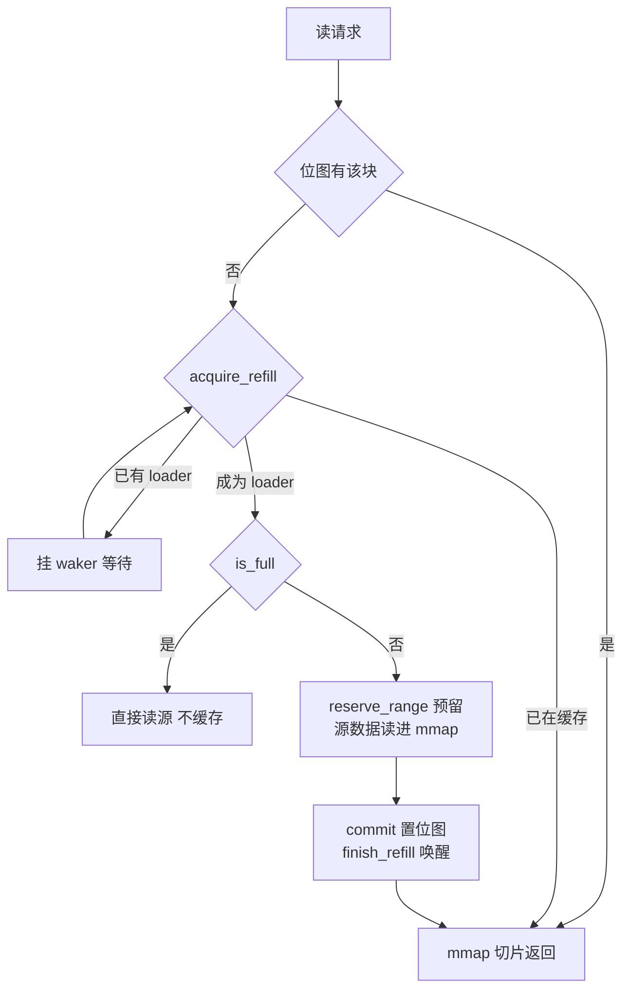
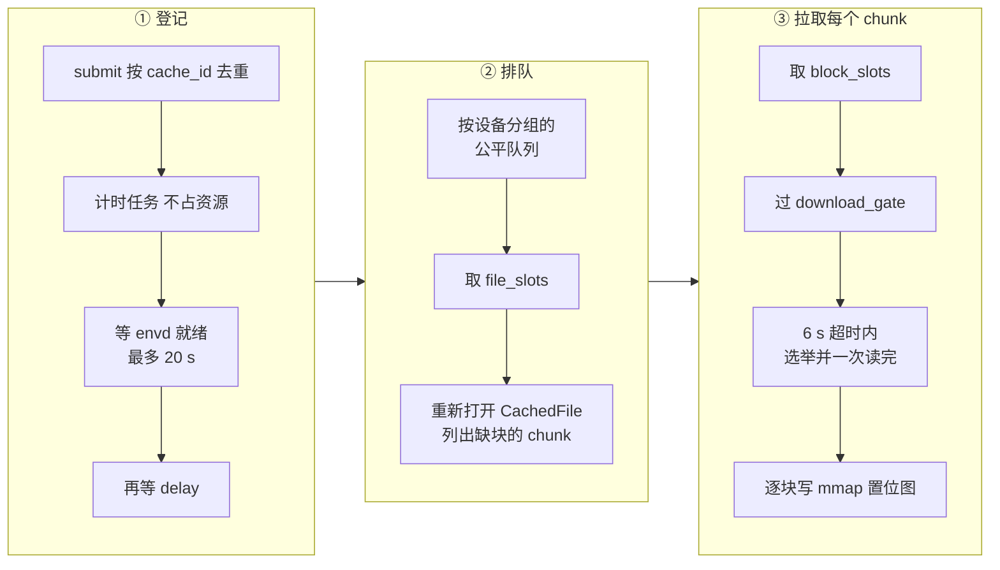
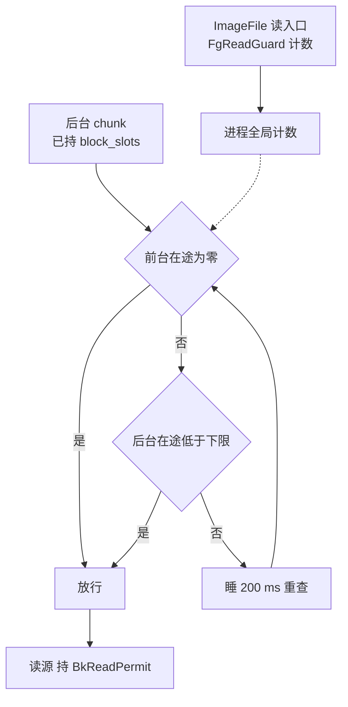

# 39 · 节点块缓存与后台下载

> 远端层按需读解决了「启动前不必下载整层」，却留下两个问题：同一块被不同沙箱、不同时刻反复读时，每次都要走网络；
> 一层迟早要全部用到时，零碎的按需读既慢又贵。Rust 版 overlaybd 在读链上插了一个节点级块缓存，
> 再在它旁边挂一个后台下载调度器，并用一个进程内准入闸门让后台流量给前台缺页让路。
> 本篇讲这三样东西的数据结构、并发协议与它们共同依赖的假设。
>
> **读者**：存储与系统工程师。　**预备**：[第 38 篇 · VirtualFile 装饰器链](38-virtualfile-chain-and-remote-io.md)、[第 05 篇 · overlaybd 与按需加载](05-overlaybd-and-lazy-loading.md)。
> **代码**：`storage/overlaybd/src/backend/cache/{mod,meta,bk_download}.rs`、`storage/overlaybd/src/backend/cache/full_file_cache/{cache_pool,cache_entry,cache_store}.rs`、`storage/overlaybd/src/download_gate.rs`、`storage/overlaybd/src/image/{image_service,image_file}.rs`、`src/setup/deps.rs`、`src/cfg.rs`

---

## 0. 本篇要回答的问题

1. 块缓存放在读链的哪一层？一个缓存条目在磁盘上长什么样，用什么做键？
2. 多个请求同时缺同一块时，怎样保证只回源一次？回源中途被取消会留下什么？
3. 容量怎么记账、什么时候驱逐、驱逐的粒度是什么？为什么正在用的层永远不会被驱逐？
4. 后台下载怎样排队、怎样限流、失败怎样重试？它和前台按需读如何共享同一份缓存？
5. 前台缺页在途时后台下载怎样让路？这个闸门依赖什么假设？
6. `meta.bin` 的格式是什么？进程崩溃后缓存还剩下什么？

---

## 1. 问题：远端层的两种读法

一层 overlaybd 层存在 registry 或对象存储里，guest 的一次缺页最终变成对这个远端对象的一次 Range GET
（[第 38 篇](38-virtualfile-chain-and-remote-io.md)）。如果什么都不缓存，会出现三种浪费：
同一节点上从同一模板起的多台沙箱各自读一遍相同的块；同一台沙箱暂停又恢复后再读一遍；
一层最终几乎全部会被读到，却被拆成成千上万次小请求。

对应的需求也有三条：第一，读过的块要落在本地，供之后的读命中；第二，最终要把整层拉到本地，
而且要用大请求拉；第三，后台的大请求不能和 guest 的缺页抢带宽，因为缺页是阻塞 vCPU 的。
前两条由块缓存和后台下载调度器满足，第三条由 `download_gate` 满足。
三者都运行在 ublk-daemon 进程里：`ImageService` 由 daemon 按全局配置创建（`storage/ublk-daemon/src/main.rs`），
缓存与调度器又挂在 `ImageService` 的远端运行时上。

这个缓存是 AgentENV 自研的，元数据格式与上游 overlaybd 使用的 Photon 文件缓存不兼容（[§4.3](#43-metabin-与崩溃语义)）。

---

## 2. 缓存在读链上的位置与条目组织

### 2.1 位置

`ImageFile::open_ro_remote()`（`storage/overlaybd/src/image/image_file.rs`）为每个远端 lower 拼出
`{repoBlobUrl}/{digest}`，交给 `ImageService::open_remote_blob_with_size()`。后者先建远端源
（registry 或 OSS，外面包着 `RuntimeDispatchFile`），再决定是否套一层 `CachedFile`：

- OSS 对象**总是**经过缓存；
- registry 对象只在 `RemoteOpenMode::Cached` 下经过缓存。`enable_acceleration()` 在 P2P 门面可用时把模式切到 `Direct`，
  此时 P2P 门面自己充当缓存，Rust 侧不再套 `CachedFile`。

本地层根本不进入这条路径。OCI 镜像转换出的层由 `image.json` 的 `dir` 指向 image-cache 的 `commits/<digest>` 目录
（`src/image/cache/service.rs` 里的 `OverlaybdLayerLocation::CacheDir`，目录由 `commit_index.rs` 的 `commit_dir()` 算出），
`open_lower_layer()` 在这个目录里找到 `overlaybd.commit` 就按本地文件打开（[第 38 篇 §3.1](38-virtualfile-chain-and-remote-io.md#31-一次远端读穿过的栈)），不经过块缓存。

`CachedFile` 之上依次是 tar 适配、`SwitchFile`（识别 ZFile）、LSMT。所以缓存里存的是**远端对象的原始字节**：
ZFile 层在缓存里仍是压缩的，每次命中仍要解压。代价是 CPU，收益是缓存体积与远端对象一一对应，
后台下载可以按对象偏移直接填，不必懂层格式。

### 2.2 条目与键

一个远端对象对应一个缓存条目（`CacheEntry`，`full_file_cache/cache_entry.rs`），
目录名是键的 sha256（`backend/cache/mod.rs` 的 `cache_key_digest()`）：

```text
<cacheDir>/                            例：$IMAGE_CACHE_ROOT/remote-blocks
├── premerged-index/                   LSMT 预合并索引缓存，与本缓存共用根目录（第 34 篇 §5），加载时跳过
├── 3f9a…e1/                           sha256(cache_key)
│   ├── data                           稀疏文件，长度 = 源对象长度，整体 mmap
│   └── meta.bin                       OBCH 头 + key + roaring 位图 + CRC32C
└── 7c02…5b/
    ├── data
    └── meta.bin
```

**键是什么，需要说清楚。** `ImageService::build_file_cache()` 照搬了上游的做法，给缓存装了一个
`basename_transform`：把 `https://reg/v2/repo/blobs/sha256:abc` 变成 `/sha256:abc`，
这样同一 digest 从不同 registry 或仓库拉取时会落在同一条目上。上游 `src/image_service.cpp` 的
`cache_fn_trans_sha256()` 是同一个变换。但在 AgentENV v0.2.3 的在线路径上，这个变换并不生效：
`ImageService::open_cached_blob()` 调的是 `FileCacheBackend::open_file_with_source_size(url, …)`，
直接以完整 URL 作键；只有 `open_src_name_with_flags()` 系列会走变换，而它们只被 `CachedFs` 调用，
`CachedFs` 在 crate 外没有调用者。结论是：**缓存条目按完整 URL 区分**，同一 digest 换一个 `repoBlobUrl`
就是另一个条目。键里不含 digest 以外的版本信息也没有问题，因为远端对象按内容寻址、不可变。

### 2.3 数据文件与位图

`CacheEntry::create()` 打开 `data`，`set_len(source_size)` 得到一个稀疏文件，再用 `MMapRegion::from_fd()`
把整个文件映射进进程。块是缓存的管理单位，大小来自 `cacheConfig.refillSize`，
`src/setup/deps.rs` 的 `write_generated_overlaybd_global_config()` 写的是 262144，即 256 KiB；
`FileCacheBackendOptions::normalize()` 要求它是 ≥ 4 KiB 的 2 的幂。同一处还写了 `"blockSize": 65536`，
但 Rust 的 `CacheConfig` 没有这个字段，这个值不被读取（推论：为兼容上游配置格式保留）。

块是否在缓存里，由 `index: RwLock<RoaringBitmap>` 的一位表示，块号以 `u32` 存入位图。
条目还持有：`block_states`（缺块的等待者表，[§3](#3-一次缺块读)）、`open_count`（打开它的 `CachedFile` 数）、
命中 / 未命中 / 回填计数、最近访问时间、`dirty` 标志，以及一把 `refill_eviction_barrier`（tokio `RwLock`）。

用 mmap 而不是 pread / pwrite 的收益是：命中时 `CacheEntry::read_block()` 直接把映射区间包成 `Bytes` 交出去，
不分配缓冲；回填时远端数据可以直接读进映射页。代价是映射页上的缺页会阻塞调用线程，
而调用线程往往就是 ublk queue 线程（[第 40 篇](40-ublk-library.md)）。

### 2.4 一个节点上的四个缓存目录

`write_generated_overlaybd_global_configs()` 为四个消费方各生成一份全局配置，缓存目录互相隔离：
rootfs 用 `remote-blocks`，内存快照用 `memory-blocks`，C++ 的 `overlaybd-apply` 用 `convert-blocks`，
`overlaybd-resize` 用 `resize-blocks`。后两者隔离的理由写在注释里：C++ 文件缓存把 `cacheDir` 下的每个文件
都当作一个扁平缓存项，驱逐时会截断并删除，与 Rust 缓存共用目录就会毁掉后者的按条目目录。
这是两种缓存格式不兼容的直接证据。

rootfs 与内存快照各有一个 `ImageService`，因此各有一个 `FileCacheBackend`、一个下载调度器，
容量都取 `[image.cache.remote_blocks] max_size_gb`（代码缺省 10，`default.toml` 写 100）。
推论：两类缓存的磁盘占用上限是这个值的两倍，配置时要按两份估算。

---

## 3. 一次缺块读

`CachedFile::read_at_with_flags()` 进入 `FileCacheBackend::do_preadv2_generic()`（`cache_store.rs`）。下图是一个块从缺失到命中的路径；整个选举与回填过程都持有条目的 `refill_eviction_barrier` 读锁，图中略去：



### 3.1 先找洞，再逐块回填

读请求先按块对齐；`query_refill_range_for()` 在位图上裁掉请求区间两端已缓存的块，得到一个连续的「洞」。
`refill_exact_range_generic()` 对洞里的每个块依次执行选举与回填，然后组装结果：
单块读直接返回映射切片，跨块读拷进一个新缓冲。

前台回填**逐块**进行：`do_refill_block_generic()` 每次只向源请求一个块（≤ 256 KiB），并且块与块之间串行 await。
ublk 一次请求最大 256 KiB（[第 40 篇 §7.2](40-ublk-library.md#72-设备参数与支持的操作)），通常只跨一两个块，所以这个粒度与前台请求匹配；
大请求留给后台下载（[§5](#5-后台下载调度器)）。

### 3.2 loader 选举

`CacheEntry::acquire_refill()` 返回一个手写的 future `AcquireRefillFut`。它每次被 poll 时：
位图里已有该块，返回 `InCache`；`block_states` 里已有该块的记录，说明别人正在回源，
把自己的 waker 挂上去返回 `Pending`；都没有，插入一条空记录并返回 `ShouldLoad`，调用者成为这一块的 loader。

loader 拿到资格后立刻构造 `RefillGuard`。它的 `Drop` 调 `CacheEntry::finish_refill()`：
删掉 `block_states` 里的记录、唤醒全部等待者。等待者醒来后重新 poll：
回填成功时看到位图已置位，返回 `InCache`；回填失败或 loader 被取消时，记录已删，第一个重新 poll 的人成为新的 loader。
因为释放写在 `Drop` 里，**loader 的 future 在任意 await 点被丢弃都不会让等待者永远挂起**——
这是取消安全的关键，与 ublk queue 上 future 随时可能被丢弃的环境相适配。

### 3.3 预留磁盘：把 SIGBUS 变成 ENOSPC

往共享文件映射里的空洞写入时，内核在缺页那一刻才分配磁盘块；磁盘满了，进程收到的是 SIGBUS 而不是错误返回。
`CacheEntry::reserve_range()` 在写映射之前先用 `sys::reserve_space()` 预分配这段范围，把磁盘耗尽变成一次普通的 ENOSPC。
它返回的 `ReservedRange` 是 RAII 守卫：源读失败、读短或 future 被取消时，`Drop` 用 `release_space_hint()` 打洞还回去，
既不留下记账看不见的已分配块，也不留下写了一半的页；只有 `commit()` 之后才置位图。
注释说明 macOS 不支持区间预留，这层保护在实践中只在 Linux 上有效。

### 3.4 失败时回到源

回填的错误在 `do_preadv2_generic()` 里被丢弃（`let _ = …refill_range_generic(…)`），
随后 `try_preadv2_generic()` 再查一次位图，仍没有就 `pread_from_source_generic()` 直接读源、不写缓存。
所以缓存满、磁盘满、预留失败都只让这次读退化为「不缓存的远端读」，不会让 guest 的 I/O 出错。
设置了 `O_CACHE_ONLY` 的文件例外，缺块直接报错。

远端源外面包着 `RuntimeDispatchFile`，它不能把调用方的 `&mut [u8]` 带到另一个 runtime 上，
因此回填时会退化为「`read_at` 拿到 `Bytes`，再拷一次进映射页」（`do_refill_block_generic()` 的注释）。

代码里有一个名为 `DEFAULT_MAX_REFILLING`（128）的上限：在途回填数达到它时，`do_preadv2_generic()` 跳过整段预填。
但随后的逐块路径以 `enable_refill = !did_prefill` 调用回填，恰好在跳过预填时打开，
所以这个上限并不限制回填并发，只改变回填从「整段」退化为「逐块」的触发条件。

---

## 4. 容量、驱逐与持久化

### 4.1 记账与两条水位

`BackendState.current_bytes` 是全部条目已缓存字节之和，回填成功后由 `add_current_bytes()` 增加。
`cache_pool.rs` 定义了两条线：

| 量 | 计算 | 含义 |
|---|---|---|
| 水位 `water_mark` | max(容量 × 90%，容量 − 50 GiB) | 超过它就驱逐到它以下 |
| 风险线 `risk_mark` | max(容量 − 5 GiB，(水位 + 容量) / 2) | 超过它就拒绝新的回填 |
| 磁盘余量 | 文件系统可用 < 128 MiB | 不论缓存用量，按差额驱逐 |

`publish_pressure_locked()` 把「需要驱逐」或「超过风险线」发布成一个 `is_full` 原子标志。
回填路径只看这个标志：置位时 `do_refill_block_generic()` 返回 ENOSPC，读退化为直接读源（[§3.4](#34-失败时回到源)）。
记账与发布在 `pressure_lock` 下成对进行，避免两个并发回填各自读到旧值。

### 4.2 驱逐：按条目、按 LRU、跳过忙条目

驱逐由两处触发：后台每 1 s 一轮的 `periodic_eviction_loop()`，以及每次前台回填结束时的 `eviction_inner()`。
`evictable_cache_ids_by_lru()` 按最近访问时间从旧到新排出候选，`evict_entry()` 逐个驱逐直到目标量为零。

驱逐的粒度是**整个条目**，不是块。`entry_is_busy()` 把 `open_count > 0` 或有在途回填的条目排除在候选之外，
而一台活着的 ublk 设备的 `ImageFile` 一直持有它每个远端层的 `CachedFile`。所以：
**正在被任何设备使用的层永远不会被驱逐**，容量上限对它们只是软约束。
收益是驱逐永远不会和读并发地抽掉数据，读路径不需要为「映射被回收」加锁；
代价是在一个长时间运行大量不同镜像的节点上，缓存可能长期停在 `is_full`，新层的块全部变成不缓存的远端读。

驱逐一个条目的顺序有讲究（`CacheEntry::evict_all_blocks()`）：先把 `DashMap` 里的槽位换成 `CacheSlot::Evicting(Notify)`，
此时新的打开者会等在这个 `Notify` 上；然后取 `refill_eviction_barrier` 的写锁，等所有在途回填与 checkpoint 放手；
接着清空内存位图——此后所有读都未命中并回到源；再删 `meta.bin`；最后对整个 `data` 打洞，释放磁盘。
先删 `meta.bin` 再打洞，是为了防止崩溃在两步之间时，重启加载出一张声称有数据、而数据已被打洞的位图。

### 4.3 `meta.bin` 与崩溃语义

`meta.bin` 是 AgentENV 扩展的格式，与上游不兼容。布局来自 `backend/cache/meta.rs` 的 `CacheMetaDisk`，全部小端：

```text
偏移   长度      字段
0      4         magic = 0x4F424348（"OBCH"）
4      4         version = 1
8      8         source_size        源对象长度，必须等于 data 文件长度
16     8         block_size         必须等于当前配置，否则整个条目作废
24     8         last_access_unix_nanos
32     8         hits
40     8         misses
48     8         refills
56     4         key_len
60     key_len   key（UTF-8，即完整 URL）
…      变长      RoaringBitmap 序列化
末尾   4         CRC32C（覆盖前面全部字节）
```

`FileCacheBackend::start_checkpoint_worker()` 每 300 s 遍历一次 `dirty` 条目，调 `CacheEntry::checkpoint()`：
持 barrier 读锁拍一份位图快照，先 fsync `data`，再写临时文件、fsync、rename 成 `meta.bin`（`CacheMetaDisk::write_to_path()`）。
先同步数据、后发布元数据，保证磁盘上的位图永远是磁盘上数据的子集。

daemon 重启时 `BackendState::load_from_disk()` 逐个目录加载，任何一项校验失败（`meta.bin` 缺失、魔数或版本不符、CRC 错、
文件长度或块大小不一致）都会**删除整个条目目录**。由此得到三条崩溃语义：
上一次 checkpoint 之后新增的块会被遗忘、需要重新回源，但不会读到错误数据；
从未 checkpoint 过的新条目连同已下载的数据一起被删；改了 `refillSize` 等于清空缓存。

---

## 5. 后台下载调度器

### 5.1 谁会被后台下载

`ImageFile::open()` 读取有效的下载配置（镜像级 `download` 覆盖优先，否则用全局配置），
当 `enable` 为真且这次打开不是在录制 trace 时，`open_ro_remote()` 会为每个远端层多构造一个 `CacheDownloadRequest`，
随后 `ImageService::submit_bk_downloads()` 把它们交给缓存的调度器。三类设备的缺省不同：

| 设备 | 配置来源 | 缺省 |
|---|---|---|
| rootfs | `[ublk.overlaybd] download_enable` | 关 |
| tools 盘 | `install_tools_image()` 写入镜像级覆盖 | 开，无延迟 |
| 内存快照 | `[memory_snapshot.background_download]` | 开，无延迟，不限速 |

内存快照的设置经 `MemorySnapshotBackgroundDownloadConfig::to_overlaybd_download_config()` 转换，`max_mbps` 写死为 0（不限速），
`AppConfig::validate_memory_snapshot_background_download()` 给出上界：块 ≤ 64 MiB、每层并发 ≤ 16、
单层暂存 ≤ 256 MiB、`max_inflight_blocks` ≤ 128 且节点暂存 ≤ 2 GiB。overlaybd crate 自己的 `DownloadConfig::default()`
则是关闭、延迟 300 s、限速 100 MiB/s，这些值只在不经 AgentENV 生成配置时出现。

### 5.2 任务的三段生命

`BkDownloadScheduler`（`backend/cache/bk_download.rs`）每个 `FileCacheBackend` 一个，由 `with_options_and_trans_func()` 创建。
模块注释概括了它的原则：**提交从不因容量失败，只限制执行**。下图是一个任务从提交到完成的路径：



**登记。** `BkDownloadScheduler::submit()` 以 `cache_id` 为键插入 `tasks`，已完成的层（`background_is_complete()`）直接跳过。
登记的任务不持有条目引用，所以排队期间条目仍可驱逐；运行时才在 `run_task()` 里重新打开 `CachedFile`。
`wait_then_mark_ready()` 先等设备所属沙箱的 envd 就绪（[§6.2](#62-envd-就绪信号)），再睡 `delay + rand(delay_extra)` 秒。

**排队。** 就绪的任务进入 `FairReadyQueue`：按设备键分组、组间轮转出队，一个镜像有很多层时不会饿死后来的镜像。
`dispatch_loop()` 每取出一个任务先拿一个 `file_slots` 许可（`max_concurrent_files`，缺省 8），再 spawn `run_task()`。

**拉取。** `actionable_background_chunks()` 把源对象按 chunk 切分，列出至少缺一块的 chunk；
`download_chunks()` 以每层 `concurrency` 路并发拉取。每个 chunk 先拿全局的 `block_slots` 许可（`max_inflight_blocks`，缺省 16），
再过 `download_gate`，最后在超时内调 `CachedFile::background_refill_range()`。

### 5.3 chunk 与块：两种粒度共用一张位图

后台的请求单位是 `download.blockSize`（缺省 16 MiB），对齐到整数个缓存块，即 64 个 256 KiB 块；缓存的管理单位仍是 256 KiB。
`background_refill_range()` 先对 chunk 内每个缺失块做与前台相同的 loader 选举，把拿到资格的连续块攒成若干 run，
`refill_block_run()` 对每个 run 只发**一次**源读，读进任务自己的暂存缓冲，再逐块拷进映射、置位图、释放该块的 `RefillGuard`。
前台此时若缺同一块，会挂在同一个 `block_states` 上等后台读完；后台遇到前台正在回源的块，也只是跳过它。
暂存内存因此有界：全节点不超过 `max_inflight_blocks × blockSize`，这正是 `block_slots` 存在的理由。

### 5.4 超时重发与任务重试

`refill_chunk_with_hedge()` 名为 hedge，实际是**超时后重发**而不是并发发两份：
单次 chunk 读超过 `DEFAULT_HEDGE_TIMEOUT`（6 s）就丢弃这次读（许可随之释放），稍等后重发，最多 3 次。
chunk 失败后，`run_task()` 在 `try_cnt`（缺省 5）次以内用带抖动的指数退避重试整轮，每轮重新列出缺块，已完成的部分保留。
缓存满时 `background_refill_range()` 直接返回 ENOSPC，这条退避路径把它变成一次有界的等待，而不是反复触发驱逐。

startup pack 预取（[第 43 篇](43-startup-pack-and-prefetch.md)）也由这个调度器执行，并优先于普通下载：
`dispatch_loop()` 先看 startup 队列；普通任务在每个 chunk 边界检查 `startup_waiting()`，有排队者就让出 file slot。
startup 任务最多占 file slot 预算的四分之一。

### 5.5 下载完成之后

`run_task()` 发现位图已满即结束，任务从 `tasks` 中移除。此后对这一层的读全部命中缓存，读的仍是 `CachedFile`。
`SwitchFile::set_switch_file()` 提供了「切到本地文件」的能力，但在 v0.2.3 里只有测试调用它，
在线路径上没有「下载完成后切换」这一步。

`run_task()` 与 `RunOutcome::WaitPending` 的注释里还提到「只剩 pending-import 洞的 chunk 交给 startup pack」，
但 `actionable_background_chunks()` 只看位图、不看 pending 状态，于是「位图未满而可做 chunk 为空」不会出现，
`WaitPending` 分支实际不可达。推论：这是 startup pack 早期设计留下的注释与分支。

---

## 6. 前台与后台的准入

### 6.1 `download_gate`

`storage/overlaybd/src/download_gate.rs` 用两个进程全局计数器区分两类流量：
`FgReadGuard` 在 `ImageFile` 的每个读入口（`read_at()` 等）加一，作用域结束减一；
后台 chunk 在 `gate_block_read()` 放行后持有 `BkReadPermit`，读完减一。准入规则只有一条：
前台计数为零时立即放行；不为零时，后台在途数低于下限才放行，否则每 200 ms 重查一次。
普通后台下载的下限是 1，startup 类预取是 8——后者拉的正是 guest 马上要碰的页，性质接近前台。



两点值得注意。其一，`FgReadGuard` 计的是**所有**经过 `ImageFile` 的读，包括命中本地层或缓存的读，
不只是远端读；变量名 `FG_REMOTE_INFLIGHT` 比它的实际含义窄。推论：本地读频繁的设备也会把后台下载压到下限。
其二，模块注释明确写着正确性依赖**单进程假设**：所有块设备与所有后台下载都在同一个 daemon 进程里。
计数器是进程静态变量，设备一旦分散到多个进程，闸门就只能看见本进程的前台流量。
这个假设与 ublk-daemon「单进程集中管理全部设备」的设计互为前提（[第 41 篇](41-ublk-daemon.md)）。

### 6.2 envd 就绪信号

沙箱启动的那几秒里，guest 的缺页最密集，此时开始后台下载最不合适。`wait_then_mark_ready()` 因此先等
`download_gate::wait_sandbox_ready()`：节点侧 `FirecrackerSandbox::wait_for_ready()`（`src/sandbox/firecracker/sandbox.rs`）
在 envd 就绪后，对 tools 盘、内存快照设备与 rootfs 设备的镜像配置路径各调一次 `UblkDeviceManager::notify_sandbox_ready()`，
经 daemon 的 `NotifySandboxReady` RPC 落到 `download_gate::notify_sandbox_ready()`，把设备键加入就绪集合。
信号丢失、沙箱启动失败或设备不属于沙箱时，`SANDBOX_READY_FALLBACK`（20 s）后照常开始。

就绪集合只增不减：代码里没有删除键的入口。推论：同一镜像配置路径被后来的设备复用时，
那台设备的后台下载会跳过等待；集合本身随设备数缓慢增长。

---

## 7. 与 e2b infra 的对照

e2b infra 的 chunker 同样是「稀疏文件 + mmap + 位图」，但以固定 4 MiB 分片按需回源、用 `WaitMap` 去重，
没有独立的后台整层下载（见 e2b 手册第 30 篇）；它的模板缓存用 TTL 加磁盘水位、延迟 60 s 删除，不做引用计数（见 e2b 手册第 34 篇）。
AgentENV 把前台粒度降到 256 KiB、把大请求交给带准入闸门的后台调度器，并用 `open_count` 钉住在用条目；
代价是驱逐只能整条目进行，且闸门把正确性绑在单进程假设上。

---

## 8. 小结

- 块缓存位于远端源之上、tar / ZFile / LSMT 之下，缓存的是远端对象的原始字节；OSS 层总经过它，registry 层只在非 P2P 直连模式下经过它。
- 条目键在线路径上是完整 URL；移植自上游的 basename 变换只在无调用者的 `CachedFs` 中生效，跨仓库共享同 digest 的效果在 v0.2.3 并不存在。
- loader 选举（`AcquireRefillFut` + `RefillGuard`）保证同一块只回源一次，loader 在任意 await 点被丢弃都会唤醒等待者。
- `reserve_range` 把磁盘满从 SIGBUS 变成 ENOSPC；任何回填失败都退化为不缓存的直接读源，guest 不感知。
- 驱逐按 LRU、按整条目，跳过 `open_count > 0` 的条目；在用的层永远不会被驱逐，容量上限对它们是软约束。
- `meta.bin`（`OBCH`）是 AgentENV 扩展格式；300 s checkpoint 保证位图是数据的子集，加载失败的条目整目录删除。
- 后台下载「提交不失败、只限执行」：file slot、block slot、设备间公平队列三层限流；16 MiB chunk 与 256 KiB 块共用一张位图。
- 所谓 hedge 是超时重发；`DEFAULT_MAX_REFILLING` 不限制回填并发；`WaitPending` 不可达；下载完成后不切换到本地文件。
- `download_gate` 让后台在前台读在途时只保留 1（startup 为 8）路，正确性依赖全部设备在同一 daemon 进程。
- 后台下载在 envd 就绪或 20 s 兜底后才开始；就绪集合只增不减。

## 延伸阅读 / 下一篇

- 下一篇：[第 40 篇 · ublk 库](40-ublk-library.md)——缓存命中与回填所在的 queue 线程是怎样组织的。
- [第 38 篇 · VirtualFile 装饰器链与远端 I/O 运行时](38-virtualfile-chain-and-remote-io.md)：`RuntimeDispatchFile` 与 `obd-remote-io` runtime。
- [第 41 篇 · ublk-daemon](41-ublk-daemon.md)：`ImageServiceCache` 与 `NotifySandboxReady` 的 daemon 侧。
- [第 43 篇 · 启动加速](43-startup-pack-and-prefetch.md)：startup pack 如何借用本篇的调度器与 loader 选举。
- [第 11 篇 · 配置](11-configuration.md)：`[memory_snapshot.background_download]` 与 `[image.cache.remote_blocks]` 的代码默认与文件默认。
- [第 73 篇 · 持久化制品与磁盘格式总表](73-artifacts-and-formats-reference.md)：`OBCH` 等扩展格式与上游格式的兼容对照。
- [e2b 手册第 30 篇](../e2b-infra/30-block-layer.md)、[e2b 手册第 34 篇](../e2b-infra/34-template-cache-and-local-storage.md)：e2b infra 的 chunker 与模板缓存。
