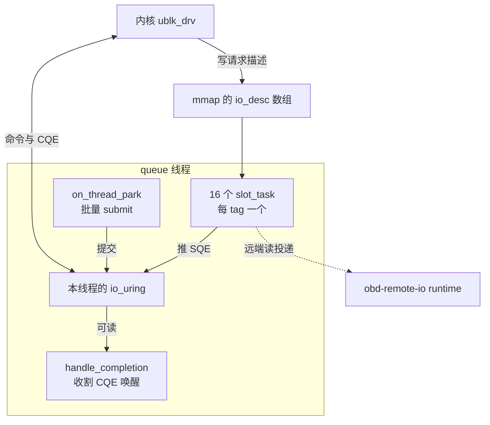
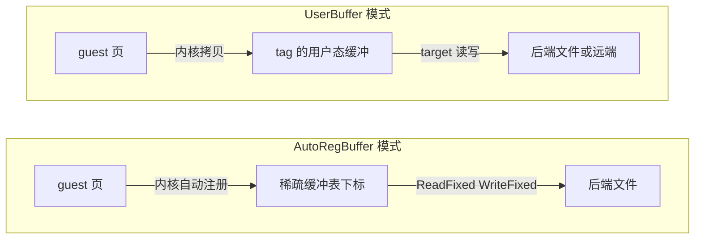

# 40 · ublk 库

> AgentENV 的每一块 overlaybd 盘都是一个 ublk 设备，而服务这些设备的用户态代码不是 libublk，
> 是仓库里的 `uvm-ublk` crate：它只借用 libublk-rs 的 FFI 定义，自己写了控制命令、queue 线程与缓冲管理，
> 好让块请求直接落进 tokio 世界里的 Rust 版 overlaybd。本篇讲这套库的线程模型、一个 tag 的生命循环、
> 让 io_uring future 可以安全丢弃的那个小机制，以及库里有、生产路径却没有用上的零拷贝。
>
> **读者**：存储与系统工程师。　**预备**：[第 04 篇 · io_uring 与 ublk](04-io-uring-and-ublk.md)、[第 07 篇 · Rust 异步](07-rust-async-primer.md)。
> **代码**：`storage/ublk/src/{ctrl,dev,queue,io_buffer,ublk_caps,lib}.rs`、`storage/ublk/src/impls/overlaybd_target.rs`、`storage/util/src/io_ring/{uring,worker,mod}.rs`、`storage/ublk-daemon/src/server.rs`（只看调用处）

---

## 0. 本篇要回答的问题

1. 为什么不用 libublk 的 queue？这个库从 libublk-rs 借了什么？
2. 控制命令怎么提交？一台设备从 ADD_DEV 到 DEL_DEV 经过哪些步骤，顺序为什么不能乱？
3. 一个 queue 线程里有哪些任务？SQE 什么时候真正提交给内核？为什么每个 queue 要有自己的 ring？
4. `RingFuture` 被丢弃时会发生什么？「取消安全」在这里具体保证了什么、没保证什么？
5. `UserBuffer` 与 `AutoRegBuffer` 的数据路径有什么不同？为什么 overlaybd 设备用不上后者？
6. `OverlaybdTarget` 向内核声明了哪些设备参数？它怎样做到在不销毁设备的情况下换镜像？

---

## 1. 问题：块请求要落进 tokio

ublk 把块设备的 I/O 交给一个用户态 server：内核把请求描述写进一块与 server 共享的 `ublksrv_io_desc` 数组，
server 通过 io_uring 的 `URING_CMD` 取请求、交结果（[第 04 篇](04-io-uring-and-ublk.md)）。
AgentENV 的 server 端要做的事，是把每个请求交给 `ImageFile`——一个满是 `async fn`、内部会 await 远端读、
会把任务投递到另一个 tokio runtime 的对象（[第 38 篇](38-virtualfile-chain-and-remote-io.md)）。

libublk-rs 自带 queue 实现与事件循环。`storage/ublk/src/queue.rs` 开头只有一句话交代为什么不用它：
「libublk 原有的 ublkqueue 对我们的用法不够灵活，我们自己写一个。」crate 的依赖印证了这个分工：
`Cargo.toml` 里 libublk 只以 `libublk-rs-sys`（git rev `c6a3e06`）的形式出现，提供 `ublksrv_ctrl_cmd`、`ublksrv_io_desc`、
`UBLK_U_IO_FETCH_REQ` 等常量与结构体；io_uring 用的是 `io-uring` 0.7.9。

推论（依据库的实际结构）：「不够灵活」主要指三点。一是 target 的 I/O 要在 tokio 的 current_thread runtime 上执行，
这样 Rust 版 overlaybd 的 async 代码可以原样运行；二是 target 自己的文件读写要与 ublk 命令共用同一个 ring、同一次提交；
三是缓冲、ring 与 runtime 的生命周期要由 AgentENV 控制，以便设备销毁时干净地拆掉。

`uvm-ublk` 的模块分工如下：

| 文件 | 内容 |
|---|---|
| `ctrl.rs` | `UVMUblkCtrlBuilder` / `UVMUblkCtrl`：打开 `/dev/ublk-control`，提交控制命令 |
| `dev.rs` | `UVMUblkDevBuilder` / `UVMUblkDev`：设备生命周期、queue 线程、`slot_task()`；trait `UVMUblkTarget` |
| `queue.rs` | `UVMUblkQueue`：每 queue 的 ring、描述符映射、FETCH / COMMIT_AND_FETCH 的组装 |
| `io_buffer.rs` | `UserBuffer`、`AutoRegBuffer` 与它们的统一外壳 `IOBuffer` |
| `ublk_caps.rs` | `UBLK_U_CMD_UPDATE_SIZE` 与 `UBLK_F_UPDATE_SIZE` 两个常量 |
| `impls/overlaybd_target.rs` | `OverlaybdTarget`：把 ublk 请求翻译成 `ImageFile` 调用 |
| `impls/startup_pack_recorder.rs` | 首触页录制器，见[第 43 篇](43-startup-pack-and-prefetch.md) |
| `storage/util/src/io_ring/` | `AsyncIoRing`、`IoRingWorker`：两类 ring 的 async 包装 |

---

## 2. 控制面

### 2.1 一条独立的 ctrl ring

控制命令走 `/dev/ublk-control` 上的 `UringCmd80`（128 字节 SQE）。`UVMUblkCtrl` 自己不持有 ring，
它持有一个 `IoRingHandle<Entry128>`，由 `storage/util/src/io_ring/worker.rs` 的 `spawn_io_ring_worker()` 创建：
一个专用 OS 线程，跑 current_thread runtime，经 mpsc 通道接收请求并在自己的 ring 上提交。
`IoRingHandle` 可以跨线程传递，所以 daemon 主 runtime 上任何一个任务都能发控制命令。
ublk-daemon 在 `main.rs` 里只建一条这样的 ring，进程内所有设备共用。

`UVMUblkCtrlBuilder` 的缺省值就是生产值，daemon 的 `create_overlaybd_device()` 只改了名字：

| 参数 | 缺省 | 说明 |
|---|---|---|
| `nr_queues` | 1 | 每设备一个硬件队列，即一个 queue 线程 |
| `depth` | 16 | 每队列 16 个 tag，即 16 个并发请求 |
| `max_io_buf_bytes` | 256 KiB | 单请求上限，也是每个 tag 缓冲的大小 |
| `ctrl_flags` | 0 | 只有 `zero_copy(true)` 会置 `UBLK_F_AUTO_BUF_REG` |
| `dev_id` | `u32::MAX` | 请内核分配设备号，ADD_DEV 时内核把结果写回 `dev_info` |

### 2.2 已实现的命令

`UVMUblkCtrl` 实现了 `GET_FEATURES`、`ADD_DEV`、`SET_PARAMS`、`START_DEV`、`STOP_DEV`、`DEL_DEV`、`GET_DEV_INFO` 七个标准命令，
外加一个 `UPDATE_SIZE`。后者在所用的 libublk-rs-sys 版本里没有定义，`ublk_caps.rs` 按内核 uapi 的写法手工编码：
`_IOWR('u', 0x15, struct ublksrv_ctrl_cmd)`，即 `0xC0207515`，对应的特性位 `UBLK_F_UPDATE_SIZE = 1 << 10`；
注释专门提醒 bit 0 是 `UBLK_F_SUPPORT_ZERO_COPY`，不要写成 `0x0001`。单元测试 `update_size_command_matches_kernel_encoding` 固定了这个编码。

daemon 启动时用 `detect_ublk_features()` 发一次 `GET_FEATURES`：内核不认识这个命令（ENOTTY / EINVAL / EOPNOTSUPP）时按特性为零处理，
预热池随之退化为只复用容量相同的设备（[第 41 篇](41-ublk-daemon.md)）。
推论：`UPDATE_SIZE` 与 `AUTO_BUF_REG` 都比 ublk 的基础命令晚进入内核，各版本的分级表见第 04 篇。

`START_DEV` 与 `DEL_DEV` 在收到 `-EINTR` 时原样重发；其它命令把非零结果直接转成 `std::io::Error`。
`load_ublk_module()` 在建 ctrl 之前检查 `/sys/module/ublk_drv`，缺失时依次尝试 `modprobe ublk_drv` 与 `sudo -n modprobe ublk_drv`。

---

## 3. 设备生命周期

一台设备从无到有、从有到无，按下面的顺序进行（`dev.rs` 与 daemon 的 `create_overlaybd_device()`、`handle_delete()`）：

1. **ADD_DEV**（`UVMUblkDevBuilder::build()`）：内核创建 `/dev/ublkcN`。随后循环打开这个字符设备，每 25 ms 一次、最多 64 次，等 udev 建好节点并改好权限。
2. **校验状态**（`UVMUblkDev::start()`）：`GET_DEV_INFO` 读回设备信息，状态必须是 `UBLK_S_DEV_DEAD`，否则拒绝启动。
3. **起 queue 线程**：每个 queue 一个线程，线程里建 ring、映射描述符数组、为每个 tag 发出第一条 `FETCH_REQ`（[§4](#4-数据面一个-queue-线程)）。
4. **SET_PARAMS**：写入 target 给出的设备参数（[§7.2](#72-设备参数与支持的操作)）。
5. **START_DEV**：内核创建 `/dev/ublkbN`。推论（依据 ublk 驱动语义）：内核要等每个 tag 都已 FETCH 才完成 START_DEV，这就是第 3 步必须在第 5 步之前、且 `START_DEV` 要处理 EINTR 的原因。
6. **等块设备可读**（`wait_for_ublk_dev()`）：按 10 / 100 / 500 / 1000 ms 的间隔分段重试打开 `/dev/ublkbN`，合计约 30 s；区分「节点不存在」与「权限未生效」，后者只警告一次。Firecracker 以非 root 身份打开这个设备，节点存在不等于可读。
7. **服务**：直到被停止。
8. **STOP_DEV**（`quiesce_ublk_device()`）：内核让所有挂着的 FETCH 以错误返回，每个 `slot_task()` 因结果为负而退出，queue 线程随之结束；daemon 用 `wait_for_bg_tasks()` 最多等 5 s。
9. **关闭字符设备**：丢弃 `UVMUblkDev`，从而关闭它持有的 `/dev/ublkcN`。daemon 的注释写得很直白：不先关这个 fd，DEL_DEV 会卡住。
10. **DEL_DEV**（`lib.rs` 的 `delete_dev()`）：内核等字符设备的全部引用释放后才返回，返回时设备号已可复用。`delete_dev()` 先发 STOP_DEV，遇到 ENODEV 视为设备已不存在。

启动失败时 `cleanup_failed_ublk_start()` 走第 8–10 步的同一顺序。

---

## 4. 数据面：一个 queue 线程

### 4.1 线程里有什么

`UVMUblkDev::queue_work()` 在线程 `ublk-q-<dev_id>-<qid>` 里建一个 current_thread runtime 和一个 `LocalSet`，
在其上创建 `UVMUblkQueue`，然后为每个 tag spawn 一个本地任务 `slot_task(tag)`。下图是这个线程的内部结构：



`UVMUblkQueue::new()` 做四件事：建一个 `AsyncIoRing`（SQ / CQ 各 `depth × 2` = 32 项，稀疏缓冲表 `depth × 4` = 64 项，稀疏文件表 16 项）；
spawn 一个本地任务跑 `handle_completion()`；把这个 ring 存进线程局部变量 `UBLK_QUEUE_URING`；
用 `UblkQueueIoDesc::new()` 以 `PROT_READ | MAP_SHARED | MAP_POPULATE` 映射字符设备上属于本 queue 的描述符区间
（偏移 `UBLKSRV_CMD_BUF_OFFSET + qid × 按页对齐的最大描述符区大小`，算法取自 libublk）；
再把 `/dev/ublkcN` 注册进 ring 的稀疏文件表，此后 ublk 命令都以 `Fixed(cdev_idx)` 提交。

### 4.2 一个 tag 的循环

`UVMUblkQueue::slot_task()`（定义在 `dev.rs`）是整个数据面的核心，删去日志后的骨架如下：

```rust
let mut buf = /* AutoRegBuffer 或 512 对齐的 UserBuffer，大小 = max_io_buf_bytes */;
let res = self.prep_slot(tag, &buf)?.await;          // UBLK_U_IO_FETCH_REQ
if res < 0 { bail!(…) }
loop {
    let io_desc = self.io_desc(tag)?;                 // 从 mmap 的数组读本 tag 的请求
    let res = tgt.handle_io_request(self.queue_id, tag, io_desc,
                                    &mut buf, extra.as_mut(), &self.ring).await;
    let res = self.submit_and_fetch_for_slot(tag, &buf, res)?.await; // COMMIT_AND_FETCH_REQ
    if res < 0 { bail!(…) }                           // STOP_DEV 后从这里退出
}
```

一条 `COMMIT_AND_FETCH_REQ` 同时交上一个请求的结果、领下一个请求，所以稳态下每个 tag 在内核里始终挂着一条命令。
`UserBuffer` 模式下命令里的 `addr` 指向该 tag 的缓冲：内核在完成 FETCH 前把写请求的数据拷进来，在收到 COMMIT 后把读请求的数据拷出去。
16 个 tag 是 16 个独立的本地任务，一个 tag 在等远端读时，其余 15 个照常推进。

代码里有两处 `FIXME: should we handle EINTR?`，分别在 FETCH 与 COMMIT_AND_FETCH 的结果检查处；
目前任何负结果都会结束这个 tag 的任务。推论：一个 tag 因偶发错误退出后不会被重建，该设备的有效深度随之减一。

### 4.3 什么时候真正提交

`AsyncIoRing::send()` 只把 SQE 推进 SQ，不调用 `io_uring_enter`。真正的提交在 runtime 的 `on_thread_park` 钩子里：
线程即将因无事可做而休眠时，钩子调用一次 `submit()`。于是一轮调度里所有任务产生的 SQE——
16 个 tag 的 COMMIT_AND_FETCH，加上 target 对本地文件发出的读写——在一次系统调用里交给内核。
SQ 满时 `send_entry_()` 退而调用 `submit_and_wait(0)` 先清空。ring 建立时带 `setup_single_issuer` 与 `setup_coop_taskrun`，
与「只有本线程提交」的用法一致。CQE 的收割由 `handle_completion()` 负责：它把 ring fd `dup` 一份交给 tokio 的 `AsyncFd`，
可读时调用 `reap_cqe()`，按 `user_data` 唤醒对应的 future。ctrl ring 的 `IoRingWorker` 用的是同一套 park 时提交的做法。

target 的本地文件 I/O 之所以能进同一个 ring，是因为 `OverlaybdTarget::handle_io_request()` 用 `IoCtx::new(io_ring)` 把这个 ring 往下传，
`LocalFile` 的 `*_with_ctx` 路径在它上面提交普通的 `Read` / `Write`（以裸 fd 提交，不用 fixed file，也不用 fixed buffer）。
远端读则经 `RuntimeDispatchFile` 投递到 `obd-remote-io` runtime，queue 线程只 await 一个 `JoinHandle`（[第 38 篇](38-virtualfile-chain-and-remote-io.md)）。
LSMT 索引查找与 ZFile 解压在 queue 线程上同步执行（推论：读路径上没有 `spawn_blocking`），
而每设备只有一个 queue，这部分 CPU 时间会推迟同一设备上其它 tag 的推进。

### 4.4 为什么每个 queue 一个 ring

`spawn_queue_workers()` 里有一段注释解释了不跨设备共享 ring 的原因：共享一个 ring 并把多个 ublk 字符设备注册为 fixed file 时，
DEL_DEV 会卡住。注销 fixed file 只减少内核当前资源节点（`rsrc_node`）的引用计数，而其它设备即使用的是稀疏表里的不同槽位，
也可能持有同一个资源节点的引用，字符设备因而迟迟不被释放。每 queue 独立 ring 的代价是线程与 ring 数随设备数线性增长；
收益是设备之间在内核资源上彻底隔离，拆一台设备不受其它设备影响。`UVMUblkQueue` 的 `Drop` 用 `unregister_fd_sync()` 先注销字符设备，再随 ring 一起释放。

---

## 5. `AsyncIoRing` 与取消安全

### 5.1 slab key 作 `user_data`

`storage/util/src/io_ring/uring.rs` 的 `AsyncIoRing` 是 `Rc<RefCell<IoUring>>` 加一个 `Slab<RingFutureData>`，只能在一个线程里用。
`send()` 先在 slab 里插一条 `{waker, result, cancelled}`，以返回的 slab key 作为 SQE 的 `user_data`，返回一个 `RingFuture`。
`reap_cqe()` 用 CQE 的 `user_data` 找回 slab 项，写入结果、唤醒 waker；`RingFuture::poll()` 看到结果就返回。

问题出在 future 被提前丢弃的时候。tokio 里 future 随时可能被丢弃：`select!` 的另一个分支先完成、超时、整个任务被 abort。
如果丢弃时直接删 slab 项，这个 key 会被下一次 `send()` 复用；而内核稍后送来的旧 CQE 带着同一个 `user_data`，
会把旧操作的结果投给新的 future——一次读的返回值被当成另一次写的返回值，这是静默的数据错误。

`RingFuture::drop()` 因此分两种情况：结果已到，直接删除 slab 项；结果未到，只把项标记为 `cancelled` 并清掉 waker。
`reap_cqe()` 遇到 `cancelled` 的项时丢弃结果、此时才删除，key 才重新可用。
这样「一个 key 同时只对应一个在途操作」这条不变式在任何丢弃顺序下都成立。

### 5.2 它没有保证什么

这个机制保证的是**结果投递**不会错位，不保证 SQE 引用的内存在内核完成前仍然有效。
`LocalFile` 的 ctx 读把调用方传入的 `&mut [u8]` 直接交给内核；若 future 在读完成前被丢弃而那块内存随即被释放，内核仍会往里写。
推论：在 ublk 数据面上这一风险被结构性地规避了——读写的目标是每个 tag 的 `UserBuffer`，它与 `slot_task()` 同生共死，
而 slot 任务只在设备停止、内核已中止全部命令后才结束。在其它场景使用 `AsyncIoRing` 时，缓冲的寿命仍要调用方自己保证。

### 5.3 稀疏表的下标分配

稀疏缓冲表与稀疏文件表的下标由 `ReloadableIDAllocator`（`storage/util/src/id_allocator.rs`）分配与回收：
`register_buffer()`、`occupy_sparse_buffer_index()`、`register_fd()` 取下标，对应的注销与释放把下标还回去。
它在 `storage/util` 之外确实没有直接引用，但 `AsyncIoRing` 自身依赖它，并不是死代码。

---

## 6. 两种缓冲

### 6.1 数据路径

每个 tag 在 `slot_task()` 开头分配一块缓冲，类型由设备是否设置了 `UBLK_F_AUTO_BUF_REG` 决定（`UVMUblkQueue::is_zero_copy()`）。



- **`UserBuffer`**：按 512 字节对齐分配 `max_io_buf_bytes`（256 KiB），并用 `register_buffer()` 注册进 ring 的稀疏缓冲表。
  命令里的 `addr` 指向它，数据在 guest 页与这块缓冲之间由内核拷贝一次。
- **`AutoRegBuffer`**：不分配内存，只用 `occupy_sparse_buffer_index()` 占一个下标。请求到达时内核把这个请求的页自动注册到该下标，
  用户态用 `ReadFixed` / `WriteFixed` 指定这个下标，后端文件与请求页之间直接传输，不经过用户态缓冲。
  此时命令里的 `addr` 必须为 0，SQE 的 `addr` 字段改为 `ublk_auto_buf_reg_to_sqe_addr()` 的编码；
  `io-uring` crate 没有暴露这个字段的写法，`queue.rs` 用从 libublk 抄来的 `RawSqe` 布局和 `override_sqe!` 宏 `transmute` 后改写，属于 unsafe 代码。

### 6.2 零拷贝只停留在库层面

`OverlaybdTarget::handle_read()` 与 `handle_write()` 遇到 `IOBuffer::AutoReg` 直接返回错误「overlaybd target does not support zero-copy IO buffer」；
daemon 建设备时从不调用 `zero_copy(true)`；仓库里也没有任何测试打开它。所以 AgentENV v0.2.3 的全部 ublk 设备都走 `UserBuffer`，
每个请求在内核与用户态之间多一次拷贝。

推论（依据 LSMT 与 ZFile 的读写实现）：AutoReg 的前提是「一个块请求对应后端文件上的一段连续 I/O」，像 loop 设备那样直通。
overlaybd 的一次读要按段映射拆到多个层文件、多个偏移，空洞与零段要在内存里填 0，ZFile 层还要先读压缩块再解压到目标；
写在 Hybrid 布局下也会拆成原地写与追加写。这些都要求数据经过一块用户态可寻址的缓冲。

还有一处连带的浪费：`UserBuffer` 注册进稀疏缓冲表，本意是让 target 用 fixed-buffer 读写；
但 `OverlaybdTarget` 把它当普通切片传给 `ImageFile`，`LocalFile` 提交的是不带 fixed buffer 的 `Read` / `Write`，
这次注册在生产路径上没有被利用（推论：其代价是注册时内核要钉住这些页）。
文档 `docs/src/internals/architecture.md` 把 `AutoRegBuffer` 描述为「zero-copy … kernel 6.8+」，容易让人以为生产路径是零拷贝的。

---

## 7. `OverlaybdTarget`

### 7.1 可热切换的状态

`UVMUblkTarget` trait 要求 target 提供四样东西：`init()`、每 tag 额外缓冲的大小、`ublk_dev_params()`、`handle_io_request()`。
trait 用 `#[async_trait(?Send)]`，因为 handler 在 queue 线程的 `LocalSet` 上执行，可以持有 `Rc` 和非 `Send` 的 future。

`OverlaybdTarget` 把镜像与容量放进 `ArcSwap<TargetState>`：`image`、`dev_sectors`、`logical_bs_shift`（取自 `ImageFile.block_size`，512 即 9）、
`physical_bs_shift`（至少 12）、`discard_supported`（镜像可写时为真）。`handle_io_request()` 一开始 `load_full()` 一份快照，整个请求都用它。
`swap_state()` 原子地换上新镜像，并清掉 startup pack 录制器，防止池化设备换了镜像还在为旧镜像录制。
注释写明前提是**设备空闲、没有在途 I/O**；已经拿到旧快照的请求会用旧镜像做完。
daemon 的预热池就靠它在不销毁设备的前提下把一台空闲设备改成另一个镜像（[第 41 篇](41-ublk-daemon.md)）。

### 7.2 设备参数与支持的操作

`build_ublk_params()` 给出的参数：

| 参数 | 值 |
|---|---|
| 参数类型 | `BASIC`；可写镜像另加 `DISCARD` |
| 逻辑块 / 物理块 | 512 B / 4096 B |
| `io_min_shift` / `io_opt_shift` | 逻辑块 / 4096 B |
| `max_sectors` | `max_io_buf_bytes >> 9`，即 512 扇区 = 256 KiB |
| `dev_sectors` | `ImageFile::num_lbas()` |
| discard | 粒度与对齐 512 B，单次最多 256 KiB，`max_discard_segments = 1`，`max_write_zeroes_sectors = 0` |

`request_meta()` 先校验请求不越过设备末尾，越界返回 `-EINVAL`。支持 Read、Write、Flush（`ImageFile::sync()`）与 Discard；
只读镜像上的 Discard 以 `PermissionDenied` 失败；WriteZeroes 与 Zone 系列一律报错。
错误经 `anyhow_to_ublk_errno()` 转成负的 errno：带原始 errno 的 I/O 错误原样返回，`PermissionDenied` 映射为 `EROFS`，
`Unsupported` 为 `EOPNOTSUPP`，`InvalidInput` / `InvalidData` 为 `EINVAL`，其余为 `EIO`。
读请求在进入 `ImageFile` 之前先调用录制器的 `observe_submit()`（若已挂上），这是 startup pack 录制首触页的位置。

---

## 8. 遗留代码与技术债

- **遗留 CLI**：`storage/ublk/src/main.rs` 编出 `uvm-ublk create/delete/recovery`，一个进程服务一台设备，`nr_queues != 1` 时报错，
  `Recovery` 分支是 `unimplemented!()`，注释「NOTE: why we use fork」所说的 fork 在代码里并不存在。生产路径完全由 ublk-daemon 取代。
- **`spawn_data_io_ring_worker()`**（`lib.rs`）：为数据面准备的跨线程 ring worker，没有调用者。
- **日志字段与实际特性位不一致**：`UVMUblkDevBuilder::build()` 的两条日志用 `UBLK_F_SUPPORT_ZERO_COPY` 判断 `zero_copy`，
  而 builder 设置、`is_zero_copy()` 检查的都是 `UBLK_F_AUTO_BUF_REG`，日志里这一字段恒为假。
- **EINTR 与 auto buffer 大小**：`slot_task()` 的两处 `FIXME: should we handle EINTR?` 与 `TODO: update auto buffer's size according to io_desc`。
- **无用户态恢复**：库与 daemon 都不使用 `UBLK_F_USER_RECOVERY`，server 进程退出即意味着设备失效（故障模型见[第 41 篇](41-ublk-daemon.md)）。

---

## 9. 与 e2b infra 的对照

e2b infra 用 NBD 把 rootfs 交给 Firecracker，NBD server 是 orchestrator 进程里的一段 Go 代码，请求与数据都经过 socket 传递（见 e2b 手册第 33 篇）。
AgentENV 选 ublk，请求描述经共享内存数组到达、命令与后端文件 I/O 在同一个 io_uring 里批量提交，server 也独立成 ublk-daemon 进程。
代价是对内核版本的要求更高（`UPDATE_SIZE` 等特性需要较新的内核），以及自己维护一套 queue 实现。

---

## 10. 小结

- `uvm-ublk` 只借用 libublk-rs-sys 的 FFI 定义，控制命令、queue 线程与缓冲管理都是自己写的，目的是让 ublk 请求直接在 tokio 上执行 overlaybd 的 async 代码。
- 控制命令经一条独立 ctrl ring 线程提交，`IoRingHandle` 可跨线程；`UPDATE_SIZE` 按 uapi 手工编码，内核不支持 `GET_FEATURES` 时按特性为零降级。
- 设备生命周期有固定顺序：先起 queue 线程并 FETCH，再 SET_PARAMS、START_DEV；拆除时先 STOP_DEV、等线程退出、关字符设备，最后 DEL_DEV。
- 每个 queue 一个 OS 线程，内含 current_thread runtime + `LocalSet`、每 tag 一个 `slot_task`；SQE 在 `on_thread_park` 时批量提交，ublk 命令与本地文件 I/O 共用一个 ring。
- 每 queue 独立 ring，是为了避开共享 ring 注册多个字符设备时 DEL_DEV 卡住的问题。
- `RingFuture` 丢弃时把 slab 项标为 cancelled、等迟到的 CQE 再回收，保证结果不会投递给复用了同一 key 的新操作；缓冲寿命不在它的保证范围内。
- 生产设备全部使用 `UserBuffer`：`OverlaybdTarget` 拒绝 `AutoRegBuffer`，daemon 不开零拷贝，也没有测试覆盖它。
- `OverlaybdTarget` 的状态放在 `ArcSwap` 里，可在设备空闲时换镜像，这是预热池复用设备的基础；设备参数为 512 / 4096 B 块、单请求 256 KiB。
- 遗留 CLI、`spawn_data_io_ring_worker()`、错误的零拷贝日志字段与两处 EINTR FIXME 是这个 crate 的主要技术债；`ReloadableIDAllocator` 不在其列。

## 延伸阅读 / 下一篇

- 下一篇：[第 41 篇 · ublk-daemon](41-ublk-daemon.md)——谁来创建这些设备、怎样池化与共享它们、daemon 崩溃时会怎样。
- [第 04 篇 · io_uring 与 ublk](04-io-uring-and-ublk.md)：FETCH / COMMIT_AND_FETCH 协议与内核版本分级。
- [第 38 篇 · VirtualFile 装饰器链与远端 I/O 运行时](38-virtualfile-chain-and-remote-io.md)：`IoCtx`、`!Send` future 与 `RuntimeDispatchFile`。
- [第 39 篇 · 节点块缓存与后台下载](39-block-cache-and-background-download.md)：queue 线程上缓存命中与回填的行为。
- [第 43 篇 · 启动加速](43-startup-pack-and-prefetch.md)：挂在 `OverlaybdTarget` 上的首触页录制器。
- [e2b 手册第 33 篇](../e2b-infra/33-nbd-and-rootfs.md)：e2b infra 的 NBD server 与 rootfs。
