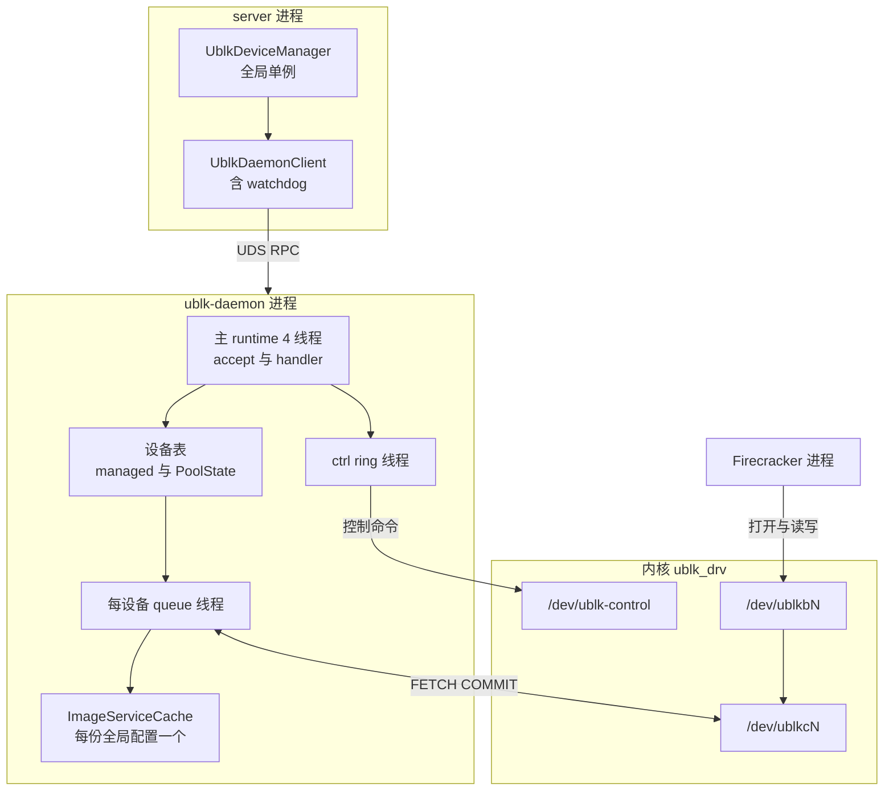
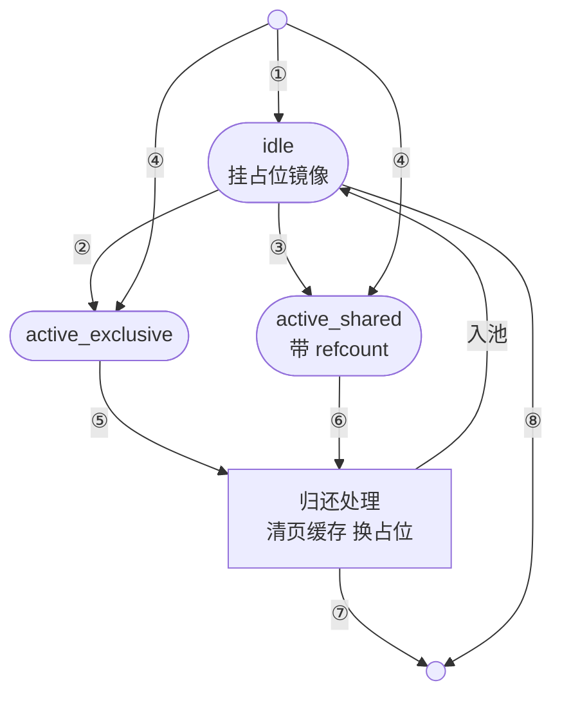

# 41 · ublk-daemon

> 节点上的每一个 ublk 设备都归同一个进程所有：`uvm-ublk-daemon`，下文写作 ublk-daemon 或 daemon。
> 它由 `server` 拉起、只带一项能力、随 `server` 一起结束；`server` 通过一条「一连接一请求」的 UDS RPC 让它建设备、借设备、还设备、封存可写层。
> 本篇讲这个进程的生命周期、RPC 协议、两套设备表与预热池里一台设备的流转、rootfs 的运行时物化，以及它不做崩溃恢复意味着什么。
>
> **读者**：存储与系统工程师、运维。　**预备**：[第 40 篇 · ublk 库](40-ublk-library.md)、[第 26 篇 · 沙箱的块设备](26-sandbox-block-devices.md)。
> **代码**：`storage/ublk-daemon/src/{main,server,protocol,runtime,client}.rs`、`src/sandbox/ublk/device.rs`（只看调用处）、`crates/linux-cap/src/lib.rs`

---

## 0. 本篇要回答的问题

1. 为什么把全部 ublk 设备放进一个独立进程，而不是放在 `server` 里，或者每台设备一个进程？
2. daemon 怎样被拉起、怎样宣告就绪、怎样知道自己该退出？
3. RPC 的帧格式与请求种类是什么？错误分哪三类，各自告诉调用方什么？
4. daemon 里有哪几张设备表？一台设备在预热池里怎样流转，占位镜像解决了什么问题？
5. 运行时物化做了什么？为什么扩容还要调用 C++ 写的 overlaybd 工具？
6. daemon 崩溃或被杀时，正在运行的沙箱会怎样？

---

## 1. 问题：谁来拥有 ublk 设备

ublk 设备的服务端必须一直开着 `/dev/ublkcN`、持续向内核领取请求；服务端一退出，设备就无人服务（[第 04 篇](04-io-uring-and-ublk.md)）。
在 AgentENV 里，这些设备的寿命与任何一台沙箱都不同步：tools 盘与内存设备被多台沙箱共享，预热池里的设备在没有沙箱时也存在。
所以「谁来当服务端」不能按沙箱来分。

可选的归属有三种。放进 `server` 进程最省事，但 `server` 就要长期持有 `CAP_SYS_ADMIN`（创建 ublk 设备需要它），
而且 Rust 版 overlaybd 的 queue 线程、远端 I/O runtime、块缓存都会和 API、orchestrator 挤在同一个地址空间里。
每台设备一个进程是另一个极端，仓库里的遗留 CLI `uvm-ublk` 就是这种形态（[第 40 篇 §8](40-ublk-library.md#8-遗留代码与技术债)）；
它隔离最好，但进程之间无法共享缓存与准入状态。

AgentENV 选了中间的一种：**每节点一个 daemon 进程，集中拥有全部设备**。这个选择有几项具体收益：

- **能力收窄。** 只有 daemon 拿到 `CAP_SYS_ADMIN`，`server` 自己用这项能力只是为了把它委派出去（§2.1）。
- **进程全局状态成立。** 前台读与后台下载之间的 `download_gate`、premerged index 的进程内去重，都假设所有设备在同一个进程里（[第 39 篇 §6.1](39-block-cache-and-background-download.md#61-download_gate)）。
- **共享设备可以引用计数。** 同一快照的内存设备、同一版本的 tools 盘只需一份，计数放在 daemon 里（[第 26 篇 §4](26-sandbox-block-devices.md#4-共享只读设备与两级引用计数)）。
- **池化。** 空闲设备可以跨沙箱复用，不必每次 ADD_DEV。

代价是单点：daemon 出事，节点上所有块设备一起出事（§6）。

图 1 是部署形态。`server` 侧只有设备管理单例与 RPC 客户端；daemon 侧有一个 4 线程的主 runtime 处理 RPC，一条 ctrl ring 线程发控制命令，
每台设备一个 queue 线程（[第 40 篇 §4](40-ublk-library.md#4-数据面一个-queue-线程)），按 overlaybd 全局配置分开的若干 `ImageService`。

---

## 2. 进程生命周期

### 2.1 拉起与就绪

`UblkDeviceManager::init_global()`（`src/sandbox/ublk/device.rs`）在节点启动时调用 `UblkDaemonClient::new()`（`storage/ublk-daemon/src/client.rs`），后者依次做五件事：

1. **处理旧 socket。** `wait_for_socket_available()`：socket 文件不存在就继续；存在但 connect 失败，说明是上一次留下的，删掉；
   能 connect 上，说明另一个 daemon 还活着，每 100 ms 重试，30 s 后报错（推论：覆盖 `server` 快速重启时旧 daemon 仍在拆设备的窗口）。
2. **委派能力。** `configure_daemon_capabilities()` 先确认 `server` 自己的有效集里有 `CAP_SYS_ADMIN`，否则拒绝 spawn；
   随后在 `pre_exec` 里调用 `linux_cap::configure_current_process_capabilities()`：清空 ambient 集，把 permitted、effective、inheritable 都设成只有 `CAP_SYS_ADMIN`，再把它升进 ambient 集，
   使这一项能力跨过 exec 留下来。推论（与[第 25 篇](25-backend-and-firecracker-process.md)对 Firecracker 的讨论相同）：「只有一项能力」只在 `server` 以非 root 身份运行时成立，root 身份 exec 时内核会重新授予 bounding 集里的能力。
3. **独立进程组。** `process_group(0)` 让 daemon 不在 `server` 的前台进程组里。注释给出的理由是：终端里按 Ctrl+C 时 SIGINT 会同时打到两个进程，
   打断 `server` 优雅关闭时正在进行的 restack RPC。
4. **传参。** 命令行带上 socket 路径、rootfs 用的 overlaybd 全局配置、扩容专用的全局配置、metrics 地址、日志文件，以及配置文件路径 `--config`。
   有配置文件时池参数由 daemon 自己从文件读，没有时才用 `--enable-pool` 等参数传；daemon 读同一份 TOML 的规则与 `server` 不同，见[第 11 篇 §5](11-configuration.md#5-同一个文件的第二个读者)。
5. **等 `ready`。** stdout 是管道，客户端逐行读，读到 `ready` 即认为就绪；30 s 内没有就 kill 子进程并报错。
   daemon 在 `run_with_ready_signal()` 里**绑定好 socket 之后**才打印 `ready`，所以客户端收到它时，第一条 RPC 一定连得上。

daemon 的 `main()` 在打印 `ready` 之前完成自己的初始化：把 `RLIMIT_NOFILE` 提到 1,048,576（失败只告警）；建 4 个 worker 的 multi-thread runtime；
起 metrics HTTP 服务（缺省 `0.0.0.0:9103`，与 `default.toml` 的 `daemon_metrics_listen_addr` 一致）；用 `--global-config` 建默认 `ImageService`；
建 ctrl ring 线程；读扩容工具配置；若开启块设备池，发一次 `GET_FEATURES` 并据此决定 `startup_prewarm` 的缺省值（[第 32 篇 §4](32-warm-pools.md#4-块设备池)）。

### 2.2 何时退出

daemon 有三个退出触发：SIGTERM、SIGINT，以及父进程退出。最后一个用 pidfd 实现：`main()` 在进入 runtime 之前取 `getppid()`，
再 `pidfd_open()` 得到一个文件描述符，交给 tokio 的 `AsyncFd` 等可读。注释解释了为什么不用 `prctl(PR_SET_PDEATHSIG)`：
后者在**调用 fork 的那个线程**退出时就会触发，而 `server` 是多线程的 tokio 程序，spawn daemon 的线程随时可能结束；pidfd 跟踪的是整个进程的寿命。
如果 `pidfd_open()` 返回 `ESRCH`（父进程在这之前就已经退出），daemon 直接以 0 退出。

三个触发都只是调用 `request_shutdown()`。accept 循环看到通知后退出，`stop_all_devices()` 按固定顺序收尾：
先中止所有 startup pack 录制（防止录制任务把结果落到正在拆的设备上），再拆 managed 表里的设备，最后依次拆池里的 exclusive、shared 与 idle 设备。
每台设备都走[第 40 篇 §3](40-ublk-library.md#3-设备生命周期)的拆除顺序：STOP_DEV、最多等 5 s 让 queue 线程退出、丢弃持有字符设备的对象、DEL_DEV。最后删掉 socket 文件。

正常关闭时，`server` 在暂停完全部沙箱之后调用 `UblkDeviceManager::shutdown_daemon()`（`src/bin/server.rs`）：先释放常驻的 tools 设备，
再发 `Shutdown` RPC，并等 watchdog 确认子进程已经退出。客户端事先把 `shutting_down` 置位，watchdog 因而把这次退出记为预期内。

---

## 3. RPC 协议

### 3.1 帧与连接

协议在 `storage/ublk-daemon/src/protocol.rs`：每条消息是 4 字节大端长度加一段 JSON，长度上限 16 MiB（`MAX_MESSAGE_SIZE`），超限直接报错。
请求是 serde 的内部标签枚举 `DaemonRequest`（`kind` 字段，snake_case），响应是 `DaemonResponse`（`status` 字段）。

**一个连接只处理一个请求**：`handle_connection()` 调一次 `recv_message()`，处理，回一条响应，连接结束。
客户端的 `call_inner()` 因此每次都新建一个 `UnixStream`。没有长连接、没有多路复用、没有请求号，换来的是实现上不需要处理乱序响应与连接级状态。
accept 循环为每个连接 `tokio::spawn` 一个 handler，daemon 侧没有并发上限。

### 3.2 请求一览

`DaemonRequest` 有 14 种：

| 类 | 请求 `kind` | 作用 | 节点侧调用者 |
|---|---|---|---|
| 原始设备 | `create_overlaybd` | 按给定 image.json 原样建设备，进 managed 表 | 录制用专用内存设备；池关闭时的共享设备 |
| | `delete` | 先中止录制，再拆 managed 表里的设备 | `delete_device()` |
| 运行时设备 | `create_overlaybd_runtime_device` | 物化运行时目录后建独占设备（§5） | rootfs、附加盘 |
| 池 | `acquire_overlaybd` | 按 `exclusive` / `shared` 取设备 | 共享只读设备 |
| | `release_overlaybd` | 归还；shared 计数归零才回池 | `release_device()` |
| | `update_size` | 在线改设备容量 | 无 |
| | `get_features` | 返回启动时探测到的特性位 | 无 |
| 快照 | `restack_snapshot` | 封存 upper 并换新 upper | `restack_snapshot_device()` |
| 启动包 | `start_pack_recording` / `pack_recording_status` / `abort_pack_recording` | 首触页录制 | [第 43 篇](43-startup-pack-and-prefetch.md) |
| | `prefetch_startup_pack` | 按 startup manifest 预取，恒回 `ok` | 第 43 篇 |
| 其它 | `notify_sandbox_ready` | 放开被 envd 就绪门挡住的后台下载 | envd 就绪后 |
| | `shutdown` | 请求关闭 | `shutdown_daemon()` |

`update_size` 与 `get_features` 在 `src/` 里没有调用者，只被 daemon 的集成测试使用；池复用设备时的改容量是 daemon 内部直接发控制命令完成的（§4.3）。
另外，`get_features` 在块设备池关闭时恒返回 0，因为特性位只存在 `PoolState` 里。

### 3.3 三类错误与超时

handler 的错误在 `handle_connection()` 末尾按类型映射成三种响应：

- **`terminal_error`**：错误链里有 `RestackSnapshotTerminalFailure`。含义是「失败发生在已经改动了 live 状态之后」，调用方不能把设备当作可安全继续使用（[第 37 篇 §3.3](37-seal-restack-compact.md#33-terminal-分界与不回滚的理由)）。
- **`invalid_request`**：错误链里有 `runtime::InvalidRequest`，例如请求的大小不是 GiB 对齐、要求缩小而未允许。改参数可以重试。客户端把它还原成 `InvalidRequestError`。
- **`error`**：其它一切。未改动状态，可以原样重试。

录制相关的参数校验不走这条映射，而是 handler 直接返回 `InvalidRequest` 响应。

超时只在客户端：`call()` 用 `tokio::time::timeout` 包住整个连接-发送-接收，普通请求 30 s，`restack_snapshot` 360 s，
`create_overlaybd_runtime_device` 取 360 s 与「扩容超时 + 120 s」中的较大者（[第 26 篇 §3](26-sandbox-block-devices.md#3-ublkdevicemanager节点侧的设备客户端)）。
对 restack，客户端把超时与「连接在回复前关闭」都当作 Terminal：seal 可能已经成功，只是回复丢了。

客户端超时并不取消 daemon 里的处理。handler 是独立 spawn 的任务，客户端断开只会让最后那次 `send_message()` 失败。
推论：一次在 30 s 内没有完成的 `acquire_overlaybd` 仍会在 daemon 里把设备登记为 active，而节点不知道它的 `dev_id`，也就不会归还；
对 shared 设备，这份计数永远不会归零，设备一直留在 active 表里。

---

## 4. 设备表与预热池

### 4.1 两套表

daemon 里并存两套互不相交的设备表（`storage/ublk-daemon/src/server.rs`）：

- **managed 表** `devices: DashMap<u32, ManagedDevice>`：`create_overlaybd` 建的设备，以及池关闭时的运行时设备。只有 `delete` 能拆它们。
- **`PoolState`**（池开启时才存在）：`idle`（一个 `WarmPool<PooledDevice>`）、`active_exclusive`（按 `dev_id`）、`active_shared`（按 `(image_config, global_config)`，带 `refcount`），
  以及反向索引 `shared_by_dev_id`。注释说明加这个索引的原因：release、update、restack 若用 `iter_mut` 扫 `active_shared` 找 `dev_id`，并发 release 时可能死锁。

请求按各自的规则查表：`delete` 只查 managed；`release_overlaybd` 与 `update_size` 只查池；`restack_snapshot` 先查 managed、再查 exclusive、最后经反向索引查 shared；
录制只接受 managed 表里的设备，所以录制用的内存设备由节点的 `create_dedicated_mem_device()` 经 `create_overlaybd` 创建、不走池；它不能共享的理由是共享页缓存会掩盖首触（第 43 篇）。

### 4.2 `ImageServiceCache`

每个请求都带一份 overlaybd 全局配置路径。`ImageServiceCache::get_or_create()` 以规范化后的路径为 key 懒建 `ImageService`，
创建期间一直持有异步锁，防止并发请求为同一份配置建出两个带后台任务的实例。默认的那一份（`--global-config`，即 rootfs 用的配置）在构造时预先放进去。

节点生成四份全局配置（`src/setup/deps.rs` 的 `write_generated_overlaybd_global_configs()`）：rootfs、内存、离线转换、扩容，`cacheDir` 两两不同。
daemon 用到三份：rootfs 与内存各对应一个 `ImageService`，各有远端 I/O runtime 与块缓存（[第 38 篇 §4](38-virtualfile-chain-and-remote-io.md#4-多-runtime-陷阱)、[第 39 篇](39-block-cache-and-background-download.md)）；扩容配置只交给 `overlaybd-resize` 子进程（§5）。

### 4.3 一台池化设备的流转

图 2 是池化设备在各表之间的流转，编号见下表。

| 编号 | 触发 | 动作 |
|---|---|---|
| ① | 取用或归还之后，`startup_prewarm` 为真且空闲数低于水位 | `schedule_idle_pool_refill()` 按本次请求的大小建占位设备补进 idle |
| ② | `acquire` exclusive，池中有可用设备 | `swap_state()` 换上业务镜像；大小不同且内核支持 `UPDATE_SIZE` 时再改容量 |
| ③ | `acquire` shared，表中没有该 key，池中有可用设备 | 同 ②，计数置 1 |
| ④ | 池中没有可用设备 | `create_new_device()`：ADD_DEV、START_DEV、等块设备可读 |
| ⑤ | `release` exclusive | 进入归还处理 |
| ⑥ | `release` shared 且计数减到 0 | 进入归还处理；计数未到 0 只减一 |
| ⑦ | idle 已满，或建占位、换占位失败 | STOP_DEV 与 DEL_DEV |
| ⑧ | daemon 关闭 | 同 ⑦ |

表里没有画出的一条：`acquire` shared 时表中已有该 key，只把 `refcount` 加一，返回同一个设备。

**「可用」由内核特性决定。** `take_idle_device()` 在内核支持 `UBLK_F_UPDATE_SIZE` 时取任意一台空闲设备，之后在线改容量；
不支持时只能用 `try_acquire_where()` 挑扇区数完全相同的那台。所以老内核上，不同大小的镜像各自需要一批空闲设备，池的命中率依赖镜像尺寸是否集中。

**归还时换到占位镜像。** `idle_released_device()` 先用 `BLKFLSBUF`（ioctl `0x1261`）清掉这台设备的块设备页缓存，
再用 `placeholder_for(virtual_size)` 取一份与原镜像**同样大小**的占位镜像并 `swap_state()` 过去，然后 `try_push_bounded()` 入池。
占位镜像是 daemon 自己生成的、只有一个 Sparse upper、没有 lower 的空镜像，存放在 socket 所在目录的 `overlaybd-pool-placeholders/` 下，按大小缓存，同一大小只建一次。
这样做的理由写在 `PoolState::placeholders` 的注释里：空闲设备不能继续钉住刚释放的业务镜像。业务镜像的 `ImageFile` 持有打开的层文件、远端连接与缓存条目的引用计数，
如果空闲设备一直挂着它，这些资源就要等到设备被下一次取用时才释放（[第 32 篇 §4](32-warm-pools.md#4-块设备池)）；推论：被打开的缓存条目不参与驱逐，业务镜像的缓存也会被拖住。
占位镜像与原镜像同样大小，换过去时内核记录的设备容量不需要改，所以这一步在不支持 `UPDATE_SIZE` 的内核上也成立。

清页缓存保证下一位用户读不到上一位用户留在 `/dev/ublkbN` 页缓存里的数据。不过 `clear_page_cache()` 是尽力而为的：打开设备或 ioctl 失败都只记一条警告，
设备照样入池。推论：此时还有第二道防线——节点在归还之前已经关掉了它对设备的所有打开者（包括 `cache_fd`），而内核在块设备的最后一个打开者关闭时会丢弃页缓存，
所以残留只可能出现在「清缓存失败且仍有别的打开者」的情形。

**Shared 获取的双重检查。** `acquire_shared()` 先查 `active_shared`，命中就加计数返回；未命中才去池里取或新建设备。
取设备要 await，期间别的请求可能已经为同一个 key 插入了设备，所以插入时用 `entry()` 再检查一次：若已被占，就把计数加到对方身上，
并把自己多出来的设备直接 STOP/DEL，而不是放回池里——它此刻还挂着业务镜像。

**镜像锁。** `image_locks` 为每个 image.json（规范化路径）维护一把 `RwLock`：`handle_acquire_overlaybd()` 打开镜像时持读锁，`handle_restack_snapshot()` 对池中设备 restack 时持写锁。
restack 会原地改写镜像的 upper 与 image.json，这把锁保证同一镜像在改写期间不会被别的请求打开，又不会串行化无关镜像的 resume。

**一些代价。** 每次 `acquire_overlaybd` 都先完整打开一次镜像，再判断 shared 表是否命中；命中时这份 `ImageFile` 直接丢弃。
`prepare_overlaybd_device()` 在 `swap_state()` 或改容量失败时以 `?` 返回，那台从池里取出的设备既不回池也不拆除。推论：这会在内核里留下一台无人管理的设备，直到 daemon 退出。

---

## 5. 运行时物化

### 5.1 步骤

rootfs 与附加盘不直接用快照或镜像的 image.json，而是由 daemon 在沙箱的工作目录里物化出一份「运行时镜像」再建设备。
节点侧的请求字段与五步概要见[第 26 篇 §5.1](26-sandbox-block-devices.md#51-运行时物化)，这里补充 daemon 侧 `materialize_runtime_contents()`（`storage/ublk-daemon/src/runtime.rs`）的细节：

1. **认领目录。** `ClaimedRuntimeDir::claim()` 用 `create_dir`（不是 `create_dir_all`）创建运行时目录，目录已存在就失败。之后任何一步出错都 `remove_dir_all` 整个目录。
2. **基础大小。** 调用方给了 `known_source_virtual_size` 就用它；否则从最上面一个本地 lower 的层头读，读不到再完整打开镜像。
3. **目标大小。** `validate_requested_virtual_size()`：不给或等于基础大小就沿用；否则必须非零、**GiB 对齐**、不小于基础大小（除非 `allow_shrink`）。不满足返回 `InvalidRequest`。
4. **可写层。** 只读请求不建 upper；源 image.json 已有有效 upper 就沿用；否则按请求的模式在运行时目录新建 `upper.data`（LogStructured 与 Hybrid 另有 `upper.index`）。
   要改大小却没有新建 upper，返回 `InvalidRequest`「resizing requires a fresh writable OverlayBD upper」。
5. **改写配置。** `rewrite_overlaybd_lower_paths()` 把每个 lower 里的本地路径改写成相对运行时目录的路径（远端 URL 不动），写入新的 upper 段与 `resultFile`，输出 `<runtime_dir>/image.json`。
6. **扩容。** 目标大小与基础大小不同时运行 `overlaybd-resize`，再复验（§5.2）。

成功后，池开启时以 `exclusive` 模式走 `handle_acquire_overlaybd()`，关闭时走 `create_overlaybd_device()` 进 managed 表；建设备失败则 `rollback()` 删掉运行时目录。

### 5.2 为什么扩容要调 C++ 工具

扩大一块 rootfs 盘不只是改 LSMT 头里的虚拟大小，还要让盘上的 ext4 文件系统长大，否则 guest 看到的仍是原来大小的文件系统。
Rust 版 overlaybd 没有实现 ext4 扩容（仓库里没有相关代码），于是 daemon 调用 overlaybd 工具 `overlaybd-resize`：
命令行是 `--config <runtime image.json> --size <目标 GiB 数> --service_config_path <扩容全局配置>`，工作目录是运行时目录。
上游 overlaybd 有同名工具（`src/tools/overlaybd-resize.cpp`），它打开镜像后调用 `ImageFile::resize(target, true)`，在用户态改写 ext4 元数据。

围绕这个子进程有四道约束：

- **全局串行。** 所有扩容共用扩容配置里那一个隔离的缓存目录，所以 `resize_permit` 这把 daemon 全局锁让同一时刻只有一个 `overlaybd-resize` 在跑。
- **超时。** `[ublk.overlaybd] resize_timeout_secs`（缺省 120 s）到期就 kill 子进程；子进程还设了 `kill_on_drop`。客户端的运行时设备超时为此留出 120 s 余量。
- **输出有界。** stdout 与 stderr 各最多保留 64 KiB，超出部分丢弃并加截断标记，失败时把它们放进错误信息。
- **用 Rust 复验。** `verify_resized_runtime()` 先用 `validate_rw_header_pair_paths()` 检查被外部工具原地改过的 upper 头与 index 头是否一致，
  再用请求的正常全局配置重新打开镜像，确认大小等于目标。C++ 工具写、Rust 读，这一步是双向格式兼容在运行时的检查点（[第 34 篇](34-lsmt-format-and-index.md)）。

GiB 粒度来自工具的命令行（`--size` 只接受整数 GiB），daemon 因此在第 3 步就拒绝非 GiB 对齐的目标大小，而不是悄悄截断。
扩容只发生在冷启动：恢复时请求大小等于快照记录的大小，第 6 步不会执行（[第 26 篇 §5.3](26-sandbox-block-devices.md#53-大小只在冷启动时改变)）。
本书不读 overlaybd 工具的源码，无法确认扩容是否会在 upper 里写下 discard 记录；推论：即便写了，也只落在本次新建的空 upper 上。
另外，daemon 查找 `overlaybd-resize` 的路径规则与 `server` 安装工具的位置可能不一致，见[第 11 篇 §5](11-configuration.md#5-同一个文件的第二个读者)。

---

## 6. 故障模型

### 6.1 daemon 先死

客户端的 watchdog（`spawn_watchdog()`）一直 `wait` 着子进程；子进程退出时，它记下退出状态，把 `daemon_dead` 置位。
此后每次 `call()` 一开始就检查这个标志，直接以「ublk daemon is not running」失败，不再尝试连接。这就是全部的故障处理：**没有重启，没有重连，没有用户态恢复**。

内核侧，AgentENV 不设置 `UBLK_F_USER_RECOVERY`（[第 40 篇 §8](40-ublk-library.md#8-遗留代码与技术债)），所以 daemon 退出、字符设备随之关闭后，设备不会进入「等待新服务端接管」的状态。
推论（依据 ublk 驱动语义）：在途与后续的块请求以错误结束，设备随后被停止。对正在运行的沙箱，rootfs 与附加盘的 I/O 出错；
内存设备上尚未进入页缓存的页一旦被访问，Firecracker 的缺页无法完成。

节点侧还有一个盲点：`UblkDeviceManager::is_available()` 只看客户端是否存在，而客户端在 daemon 死后仍然存在，单例又是 `OnceCell` 一次初始化。
所以 daemon 死后，`start_resume()` 开头的快速失败检查照样通过，失败推迟到第一个设备 RPC；要恢复服务只能重启整个 `server`。

### 6.2 `server` 先死

pidfd 让 daemon 不会比 `server` 活得更久：`server` 无论怎样退出，daemon 都会看到 pidfd 可读，走一遍 `stop_all_devices()`。
这避免了「没有 `server` 管理的孤儿设备」，但也意味着 `server` 被 SIGKILL 时，仍在运行的 Firecracker 进程会失去全部块设备（[第 22 篇 §7](22-persistence-across-restarts.md#7-崩溃一致性边界)）。
跨重启保留下来的只有已经暂停落盘的沙箱，这也是 `server` 优雅关闭时要先暂停全部沙箱、最后才关 daemon 的原因。

### 6.3 这个取舍

| 维度 | 一个集中的 daemon（AgentENV 的做法） | 每设备一个服务进程 |
|---|---|---|
| 能力 | 只有 daemon 持有 `CAP_SYS_ADMIN` | 每个服务进程都要 |
| 共享 | 共享设备、引用计数、预热池、`download_gate` 都在一个进程里 | 无法跨设备共享 |
| 资源 | 一个主 runtime、一条 ctrl ring；queue 线程按设备增长 | 每设备一整套进程开销 |
| 故障面 | 一次崩溃波及节点上全部设备 | 只影响一台设备 |
| 恢复 | 无；需重启 `server` | 视实现而定 |

推论：要缩小故障面而不放弃集中管理，可以走 ublk 的 `USER_RECOVERY`，但前提是 daemon 能从持久状态重建设备表与镜像栈，而这些状态现在只在内存里。

---

## 7. 技术债与文档漂移

- **阻塞调用在主 runtime 上。** `wait_for_ublk_dev()`（`storage/ublk/src/lib.rs`）用 `std::thread::sleep` 轮询，最长约 30 s，却在 async handler 里同步调用。
  推论：udev 迟迟不生效时，几个并发的建设备请求就能占满 4 个 worker，连 accept 循环都会被拖住。
- **泄漏路径。** 客户端超时不取消 daemon 里的处理（§3.3）；从池中取出后换镜像失败的设备无人回收（§4.3）。
- **无调用者的 RPC。** `update_size` 与 `get_features` 只有测试使用；`get_features` 在池关闭时恒为 0。
- **metrics 监听 `0.0.0.0`。** daemon 的 Prometheus 端点缺省监听所有地址、无鉴权，需要部署侧用防火墙约束。
- **文档。** `docs/src/internals/architecture.md` 说设备号「allocated in the daemon」，实际由内核分配（daemon 传 `dev_id = u32::MAX`）；
  同一处把 `/dev/ublkcN` 称为 control 设备，而控制命令走的是 `/dev/ublk-control`，`/dev/ublkcN` 是每台设备的 I/O 命令通道。

---

## 8. 与 e2b infra 的对照

e2b infra 的 NBD server 是 orchestrator 进程里的 Go 代码，块设备与 orchestrator 同生共死，NBD 设备池也在同一个进程里（见 e2b 手册第 33 篇）。
AgentENV 把块设备服务拆成独立进程，换来能力收窄与跨设备共享的集中状态；代价是多一层 RPC 与一个需要监视的进程。推论：两种做法在服务进程崩溃时都没有让设备继续工作的路径。

---

## 9. 小结

- 节点上全部 ublk 设备集中归 ublk-daemon 所有：只有它持有 `CAP_SYS_ADMIN`，共享设备的计数、预热池与 `download_gate` 等进程全局状态都依赖这一点；代价是单点。
- daemon 由 `server` spawn，独立进程组，绑定 socket 之后才打印 `ready`；pidfd 监视父进程，`server` 退出它就拆掉全部设备退出。
- RPC 是一连接一请求、4 字节大端长度加 JSON、上限 16 MiB，共 14 种请求；超时只在客户端，且不会取消 daemon 里的处理。
- 错误分三类：`terminal_error` 表示已改动 live 状态，`invalid_request` 表示改参数可重试，`error` 表示可原样重试；restack 的超时与丢回复也按 Terminal 处理。
- daemon 有 managed 表与 `PoolState` 两套设备表，不同请求查不同的表；录制设备只能是 managed 设备。
- 池化设备归还时先清块设备页缓存，再换到同尺寸的 Sparse 占位镜像，使空闲设备不钉住业务镜像；没有 `UPDATE_SIZE` 的内核上只能复用同尺寸设备。
- Shared 获取在插入时二次检查，输掉竞争的那台设备直接销毁；`image_locks` 让 restack 与同镜像的打开互斥。
- 运行时物化在独占认领的目录里改写 lower 路径、建 upper；扩容只在冷启动发生，要求 GiB 对齐，经全局串行、带超时的 `overlaybd-resize` 完成，并用 Rust 版 overlaybd 复验。
- 没有 `UBLK_F_USER_RECOVERY`，也没有重启逻辑：daemon 死后客户端只做快速失败，且 `is_available()` 仍为真。

## 延伸阅读 / 下一篇

- 下一篇：[第 42 篇 · 内存快照](42-memory-snapshot-over-ublk.md)——共享只读内存设备上的数据从哪里来、怎样变回 guest 内存。
- [第 40 篇 · ublk 库](40-ublk-library.md)：设备的创建与拆除顺序、queue 线程、`swap_state()`。
- [第 26 篇 · 沙箱的块设备](26-sandbox-block-devices.md)：节点侧的 `UblkDeviceManager`、两级引用计数与 `cache_fd`。
- [第 32 篇 · 预热池](32-warm-pools.md)：块设备池作为一个池的水位与补充行为。
- [第 37 篇 · 封存、restack 与 compact](37-seal-restack-compact.md)：`restack_snapshot` 在镜像层面做了什么。
- [第 43 篇 · 启动加速](43-startup-pack-and-prefetch.md)：录制与预取 RPC 的语义。
- [e2b 手册第 33 篇 · NBD 与 rootfs](../e2b-infra/33-nbd-and-rootfs.md)：进程内 NBD server 的做法。
