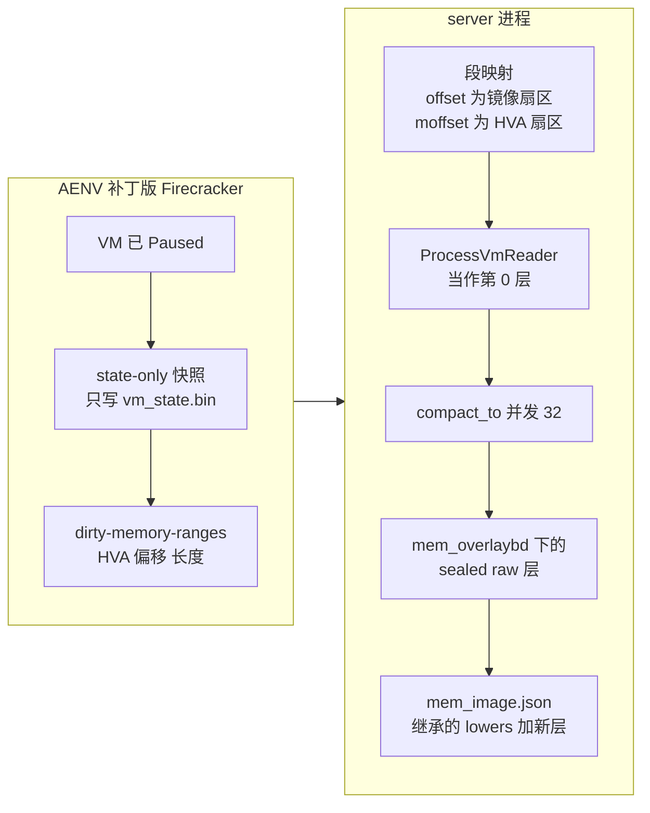
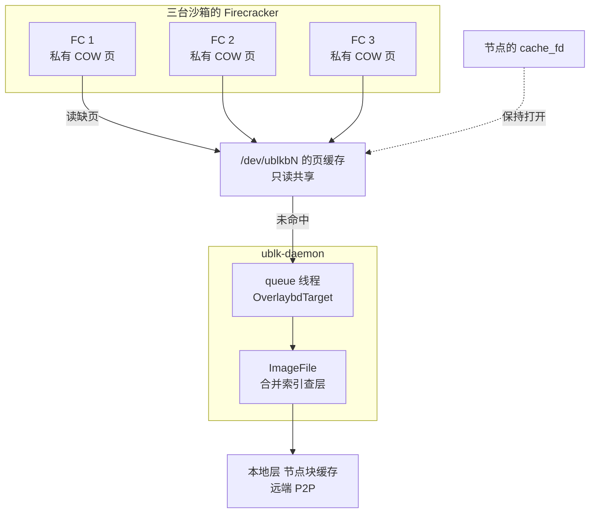

# 42 · 内存快照：脏页成层与共享只读设备

> 暂停一台沙箱时，AgentENV 不让 Firecracker 写内存文件，而是问它「哪些页脏了、它们在你的地址空间里的哪里」，
> 再把这些页直接从 Firecracker 进程里读出来，写成一个标准的 overlaybd 层；恢复时，同一份内存层栈变成一个只读 ublk 设备，
> 被 Firecracker 当作内存文件 mmap，同一快照的所有沙箱共享这一个设备与它的页缓存。
> 本篇讲数据怎样变成层、层怎样变回内存，以及这条路径的边界。Firecracker 一侧的调用顺序在[第 27 篇](27-start-pause-resume-sequences.md)，这里不重复。
>
> **读者**：存储与虚拟化工程师。　**预备**：[第 34 篇 · LSMT 格式](34-lsmt-format-and-index.md)、[第 37 篇 · compact](37-seal-restack-compact.md)、[第 26 篇 · 沙箱的块设备](26-sandbox-block-devices.md)、[第 41 篇 · ublk-daemon](41-ublk-daemon.md)。
> **代码**：`src/sandbox/firecracker/{sandbox,overlaybd_snapshot,process_vm_reader,instance}.rs`、`src/sandbox/ublk/device.rs`、`thirdparty/firecracker-client/src/models/dirty_memory_ranges.rs`、`src/cfg.rs`；
> AENV 补丁版 Firecracker 的 `src/vmm/src/vstate/{vm,memory}.rs`、`src/vmm/src/rpc_interface.rs`

---

## 0. 本篇要回答的问题

1. 为什么不让 Firecracker 自己写内存快照文件？
2. `GET /vm/dirty-memory-ranges` 返回什么？「脏页」在冷启动的 VM 与从快照恢复的 VM 上分别指什么？
3. 一段脏区间怎样变成 LSMT 的段映射？为什么映射里的物理偏移字段可以放 Firecracker 进程的宿主虚拟地址？
4. 内存层栈怎样随一次次暂停与恢复演进？
5. 恢复时多台沙箱怎样共享一个只读设备？一次缺页经过哪些部件？
6. 关闭脏页跟踪（PVM 模式）时会发生什么？

---

## 1. 问题：内存快照的写入量与形状

上游 Firecracker v1.15.1 的快照有两种内存写法。Full 快照把整个 guest 内存写进一个文件，写入量等于内存大小；
Diff 快照只写脏页，但写进的是一个与内存等大的稀疏文件，还要和上一份文件合并才是完整内存（见 Firecracker 手册第 37 篇）。
不论哪种，产物都是「一个与 guest 内存布局一一对应的扁平文件」。

AgentENV 的其余存储都是 overlaybd 层：rootfs、卷、模板都以层栈表示，可以上传到快照仓库、经 P2P 分发、按需远端读取、在节点块缓存里共享。
如果内存快照先落成 Firecracker 的扁平文件，再转换成层，就要多写一个与内存等大（或至少与脏页等量）的中间文件，多一次全量读写，
而且这一步发生在暂停的关键路径上。

想要的是三件事同时成立：

- 写入量正比于自上次恢复以来的脏页数，与 guest 内存大小无关；
- 产物直接是 sealed LSMT 层，可以压在上一份内存层栈之上；
- 不经过任何中间内存文件。

AgentENV 的做法是把 Firecracker 降级为「状态文件的生产者」与「脏页位置的报告者」，数据搬运由 AgentENV 自己完成。

---

## 2. 暂停：从脏页到层

### 2.1 管线

`FirecrackerSandbox::snapshot_memory_to_overlaybd()`（`src/sandbox/firecracker/sandbox.rs`）在 VM 已经 `Paused` 之后执行三步：

1. `create_state_only_snapshot()`：`PUT /snapshot/create`，`snapshot_type = Diff`，不带 `mem_file_path`，Firecracker 只写 `vm_state.bin`。
   缺省内存路径是 AENV 补丁版 Firecracker 的改动，上游这个字段必填（[第 27 篇 §5.2](27-start-pause-resume-sequences.md#52-每一步为什么在那个位置)、[第 67 篇](67-firecracker-patch-layer.md)）。
2. `get_dirty_memory_ranges()`：AENV 补丁版 Firecracker 新增的 `GET /vm/dirty-memory-ranges`（§2.2）。
3. `convert_dirty_memory_to_overlaybd()`（`src/sandbox/firecracker/overlaybd_snapshot.rs`）：把区间换成段映射（§2.4），用 `ProcessVmReader` 作源、调 `compact_to()` 写出层（§2.5）。

之后 `snapshot_to_dir()` 调 `build_mem_snapshot_image_config()` 把新层压到层栈上，写出 `mem_image.json`（§2.6）。整条管线如图 1。



### 2.2 `DirtyMemoryRanges` 的语义

返回体是 `DirtyMemoryRanges{page_size, memory_size, ranges}`，每个区间是 `{base_host_virt_addr, image_offset, length}`
（AgentENV 侧的生成模型在 `thirdparty/firecracker-client/src/models/dirty_memory_ranges.rs`，数值字段是有符号整数，所以转换时先用 `checked_i64_to_u64()` 拒绝负值）。
它在 AENV 补丁版 Firecracker 里由三处代码给出：

- **布局。** `GuestMemoryMmap::dirty_memory_ranges()`（`src/vmm/src/vstate/memory.rs`）按顺序遍历每个内存槽，`image_offset` 是之前所有槽长度的累加。
  这正是 Firecracker 内存快照文件的连续布局：guest 物理地址里的 MMIO 空洞（例如 4 GiB 以下那段）不占位置。未插入的热插槽跳过，但偏移照样前进。`memory_size` 是累加的总长。
- **「脏」的判据。** `GuestMemorySlot::append_dirty_ranges()` 对每一页取「KVM 脏页位图中置位」**或**「Firecracker 自己的位图中置位」，相邻的脏页在同一槽内合并成一个区间。
  KVM 位图记录 guest 的写；Firecracker 位图记录 VMM 自己经 `vm-memory` 写进 guest 内存的数据，例如 virtio 设备把读到的块数据写进 guest 缓冲（`devices/virtio/iovec.rs`、`block/virtio/io/async_io.rs` 里的 `mark_dirty`）。
- **逻辑上不清除。** `Vm::get_dirty_memory_ranges_preserve()`（`src/vmm/src/vstate/vm.rs`）读 KVM 脏页日志时会清掉 KVM 的位，所以它先把读到的位 `store_dirty_bitmap()` 存回 Firecracker 位图，再计算区间。
  注释给出的理由是外部消费者失败时，下一次快照仍能看到这些页。

「不清除」在 AgentENV 里还有第二层意义。`snapshot()` 与 `fork()` 在写完快照后原地恢复源 VM（[第 27 篇 §6](27-start-pause-resume-sequences.md#6-capture-与-pause同一段代码四种收尾)），
同一台 VM 可能被捕获多次。每次捕获的新层都压在**这台 VM 启动时**的内存层栈上（§2.6），所以它必须包含自启动以来的全部脏页，而不只是自上次捕获以来的。
脏位只增不减，恰好给出这个集合。代价是：对同一台运行中的 VM 反复捕获，每一份新层都比上一份大或相等。

还有一类页不经过上述两个位图写入：virtio 队列结构（描述符表、avail / used ring）由 Firecracker 通过裸指针更新。
上游的处理是在 `Queue::initialize()` 里把这几块内存标脏（设备激活与从快照恢复时都会调用），并在每次把内存写进文件之后重新标脏。
AgentENV 的路径从不写内存文件、也从不重置 Firecracker 位图，因此队列内存在每次查询里都是脏的，不会漏。

### 2.3 两种 VM 上的「脏页」

**冷启动的 VM。** guest 内存是匿名映射（`memory::anonymous()`），从未写过的页读出来是 0。脏页 = 自启动以来被 guest 或 Firecracker 写过的页，
包括 Firecracker 装入的内核与 initrd。新层只覆盖这些页，其余位置是没有映射的空洞，读出 0，与匿名内存的初值一致。

**从快照恢复的 VM。** `PUT /snapshot/load` 的 File 后端走 `guest_memory_from_file()`（`src/vmm/src/persist.rs`）：`File::open()` 只读打开 `/dev/ublkbN`，
`memory::snapshot_file()` 以 `MAP_PRIVATE` 映射它。这两处是上游代码，AENV 补丁版只把其中的取文件大小从 `fstat` 改成了 seek 到末尾——块设备的 `st_size` 是 0（[第 67 篇](67-firecracker-patch-layer.md)）。
私有映射意味着：读缺页把块设备页缓存里的页映射进来；第一次写触发写时复制，该页变成 Firecracker 进程私有的匿名页，块设备本身永不被写。
脏页跟踪在 load 时随 `track_dirty_pages` 重新开启，所以恢复后的脏页 = 自 load 以来被写过的页 = 发生过写时复制的页，再加上始终脏的队列内存。
推论（依据上述 Firecracker 代码与 KVM 脏页日志的语义）：两者等价的前提是 guest 的每一次写都经过 KVM 的写保护跟踪、Firecracker 的每一次写都经过位图，本书没有找到反例。

没被写过的页，内容就是 lower 层栈里的内容。新层压在 lower 之上，读一页时先看新层、再看下面的层（[第 34 篇](34-lsmt-format-and-index.md)），所以只写脏页就足以表达新的完整内存。

### 2.4 区间到段映射：`moffset` 存 HVA

`dirty_ranges_to_segment_mappings()` 先做校验：`page_size` 必须是 4096，`memory_size` 与每个区间的地址、偏移、长度都必须 4 KiB 对齐，区间不能越过 `memory_size`。
然后把每个区间按 `Segment::MAX_LENGTH`（16383 个 512 B 扇区）切段，生成：

```text
SegmentMapping {
    offset  = image_offset / 512           // 目标：内存镜像里的扇区号
    length  = 本段扇区数（≤ 16383）
    moffset = base_host_virt_addr / 512    // 源：Firecracker 进程里的 HVA，按扇区计
    zeroed  = false
    tag     = 0                            // 源数组的第 0 个
}
```

`SegmentMapping` 原本的含义是「逻辑扇区 `offset` 的数据在第 `tag` 层文件的物理扇区 `moffset` 处」（[第 34 篇](34-lsmt-format-and-index.md)）。
这里把「层文件」换成了 Firecracker 的地址空间，「物理扇区」换成了 HVA 除以 512。
推论：这个复用成立的数值条件是 HVA 按扇区计能放进 `moffset` 的 55 位；x86-64 用户态地址在 4 级页表下小于 2^47、5 级下小于 2^56，除以 512 后分别小于 2^38 与 2^47，都放得下。
最后映射按目标排序，相邻两段的目标区间若重叠就报错。注释特意说明：检查的是目标区间，不是源地址——两段不同的镜像区域理论上可以来自重叠的 HVA，那不是错误。

### 2.5 `ProcessVmReader` 与 `compact_to()`

`compact_to(src_layers, mappings, virtual_size, commit_args)` 只要求源实现 `VirtualFile`，按映射的 `tag` 与 `moffset` 读源、按 `offset` 写目标（[第 37 篇 §4](37-seal-restack-compact.md#4-compact按映射重写成单层)）。
`ProcessVmReader`（`src/sandbox/firecracker/process_vm_reader.rs`）就是这样一个源：它的 `read_at_into(offset, dst)` 把 `offset` 当作 Firecracker 进程（`fc_instance.pid()`）的 HVA，
调用 `process_vm_readv` 读满 `dst`；遇到 `EINTR` 重试，短读则推进地址继续，读到 0 字节报错。它不支持写，`size()` 也没有意义。

于是「把脏页写成层」不需要任何专门的写层代码。`publish_memory_overlaybd_layer()` 以 `DIRECT_MEMORY_SNAPSHOT_COMPACTION_CONCURRENCY = 32` 的并发调用 `compact_to()`，
先写 `mem_overlaybd/overlaybd.commit.tmp`，成功后 rename 为 `overlaybd.commit`，失败删除临时文件。输出一律 raw，压缩留到发布时（[第 35 篇](35-zfile-compression.md)）。
数据只走一趟：Firecracker 地址空间 → `compact_to` 的块缓冲 → 层文件。

两点需要注意。第一，`process_vm_readv` 是同步系统调用，直接跑在 poll 这个 future 的 tokio worker 上；代码里的 TODO 说明，要卸到阻塞线程上又不多拷一次，需要一个拥有缓冲的接口。
32 路并发因而最多同时占住 32 次 poll 的 worker 时间。第二，读别的进程的内存需要 ptrace 访问权限。推论：这里成立是因为 Firecracker 与 `server` 同一 uid、且是 `server` 的子进程（Yama `ptrace_scope = 1` 时也允许读后代进程），
这也是这一步在 `server` 里执行、而不交给 ublk-daemon 的原因之一。

### 2.6 压到层栈上

`build_mem_snapshot_image_config()` 读本次启动所用的内存 image.json（冷启动时没有，用空配置），取其 lowers，在末尾追加新层，
交给与 rootfs 共用的 `rewrite_lowers_with_owned_runtime_suffix()` 做层数预算（[第 37 篇 §5](37-seal-restack-compact.md#5-运行时层数预算)）：
稳定前缀（模板、已发布或缓存所有的层，可能是远端层）原样保留；运行时拥有的后缀若未超预算，逐个硬链接进快照目录的 `inherited-layers/`，超预算就整体压成 `mem_compacted.commit`。
结果写成 `<snapshot_dir>/mem_image.json`，只有 lowers、没有 upper，节点侧的 `OverlaybdConfig` 标为 `read_only: true`。
内存层栈因此和 rootfs 一样是增量分层的：每次暂停只新增一层。

---

## 3. 层栈的演进

下面以一台从模板创建的沙箱为例，模板的内存层栈是 `T`（可能有多层、可能在远端）：

```text
从模板 resume       mem lowers = [T]                       guest 内存 = T 的私有映射
  └ pause #1        写 L1 = 自 load 以来的脏页              mem_image.json = [T, L1]
resume #1           设备 = [T, L1]                          只读，与其它同快照沙箱共享
  └ pause #2        写 L2 = 自 resume #1 以来的脏页          [T, inherited/L1, L2]
...
  └ pause #k        运行时后缀 L1..Lk 超过预算               [T, mem_compacted]
                    compact_layers 把 L1..Lk 合成一层
```

冷启动的沙箱没有 `T`，第一次暂停写出的 L1 就是自启动以来写过的全部页。
`T` 属于稳定前缀，从不参与压缩；运行时后缀里若出现远端层，压缩会报错，因为 `compact_layers()` 只读本地文件——测试 `build_mem_snapshot_image_config_skips_compaction_for_remote_lowers` 覆盖了远端层留在前缀里的情形。

每次暂停的写入量 = 本次运行期间的脏页数，与 guest 内存大小无关；超预算的那一次暂停额外读写整个运行时后缀。
一台频繁「暂停、恢复」的沙箱，内存层数在预算内增长，到达预算时被压回一层。

---

## 4. 恢复：一个只读设备，N 台 VM

### 4.1 取设备

`start_resume()`（`sandbox.rs`）在 load 之前准备内存设备：

- 普通恢复调用 `UblkDeviceManager::get_or_create_shared_mem()`（`src/sandbox/ublk/device.rs`），以内存 image.json 的规范化路径为 key 去重。
  块设备池开启时向 daemon 发 `acquire_overlaybd`（`shared`），关闭时发 `create_overlaybd`；daemon 用内存专用的全局配置 `mem-overlaybd-global.json` 打开镜像，它有独立的块缓存目录（[第 41 篇 §4.2](41-ublk-daemon.md#42-imageservicecache)）。
  daemon 还校验请求带来的 `mem_virtual_size` 与镜像大小一致。
- 若快照带有 OSS 来源的 startup pack，取设备之前先发 `prefetch_startup_pack`；本地来源则在取到设备之后由节点直接预取（[第 43 篇](43-startup-pack-and-prefetch.md)）。
- 录制 startup pack 的一次性 VM 改用 `create_dedicated_mem_device()` 得到一个专用、不共享的设备，并在 load 之前挂上录制器：共享设备的页缓存会掩盖首次触达。

然后 `load_snapshot_file()` 发 `PUT /snapshot/load`，`mem_backend = {backend_type: File, backend_path: /dev/ublkbN}`，`resume_vm = false`，`track_dirty_pages` 取配置。

节点一级 `Arc`、daemon 一级 `ActiveShared.refcount` 的两级计数，以及让页缓存跨越「上一台已退出、下一台未打开」窗口的 `cache_fd`，详见[第 26 篇 §4](26-sandbox-block-devices.md#4-共享只读设备与两级引用计数)。
这里只回顾与内存有关的一点：内存设备没有 tools 盘那样的常驻引用，同一快照的最后一台沙箱 `stop()` 时显式 `release()`，daemon 把设备的页缓存清掉、换到占位镜像回池（[第 41 篇 §4.3](41-ublk-daemon.md#43-一台池化设备的流转)）。

### 4.2 一次缺页

图 2 是同一快照的三台沙箱共享一个设备时的拓扑。



guest 第一次读某页时，KVM 因 EPT 缺项退出给 Firecracker 进程的这段映射，内核按 `MAP_PRIVATE` 文件映射的规则去页缓存找 `/dev/ublkbN` 对应偏移的页：
命中就直接映射，未命中则向块设备发读请求。请求经 ublk 到达 daemon 的 queue 线程，`OverlaybdTarget` 交给 `ImageFile`，按合并索引找到最上面覆盖这一页的层，
从本地 commit 文件、节点块缓存或远端（经 P2P 门面）读出（[第 38 篇 §3](38-virtualfile-chain-and-remote-io.md#3-装饰器链)、[第 39 篇](39-block-cache-and-background-download.md)）。
同一页对第二台沙箱就是一次页缓存命中，不再经过 ublk。

envd 就绪后，节点对内存 image.json 调 `notify_sandbox_ready()`，放开被就绪门挡住的该镜像的后台下载（[第 39 篇 §6.2](39-block-cache-and-background-download.md#62-envd-就绪信号)）。

### 4.3 页缓存即去重

推论（依据 Linux 对私有文件映射的处理）：只读缺页映射进来的是页缓存里的那一页本身，不是副本，所以 N 台沙箱读同一页时，宿主上只有一份物理页。
每台沙箱额外占用的内存只是它自己写过的页（私有匿名页）。这是一种不需要任何扫描或合并的内存去重，效果取决于同一快照的沙箱读集合有多大重叠。

这份共享有三条边界。第一，页缓存可被回收：内存压力下干净的页被丢掉，再次访问时重新经 ublk 读回，不影响正确性。
第二，它只在同一份内存 image.json 之间成立：从同一模板恢复、但各自暂停过一次的两台沙箱，层栈不同、设备不同，页缓存不共享。
第三，共享设备是只读的：`OverlaybdTarget` 对只读镜像不声明 discard，Firecracker 以只读方式打开设备，写只发生在各进程的私有页上。

---

## 5. 关闭脏页跟踪时

`[memory_snapshot] track_dirty_pages`（`src/cfg.rs` 的 `MemorySnapshotConfig`，缺省 true，可由 `AGENTENV_MEMORY_SNAPSHOT_TRACK_DIRTY_PAGES` 覆盖）决定冷启动的 machine-config 与 load 时是否开启 KVM 脏页跟踪。
PVM 模式下，配置归一化会把它强制设为 false，校验也拒绝在 PVM 下设为 true（「has not been tested」）。

此时 AgentENV 的流程不变，仍然调用 `GET /vm/dirty-memory-ranges`。差别在 Firecracker 内部：内存槽没有位图，`Vm::get_dirty_bitmap()` 改用上游的 `mincore_bitmap()`，
上游注释把它描述为「对脏页位图的过近似」——它报告的是**驻留**的页，而不是写过的页。配置项的注释「set … false to use mincore」说的就是这条路径。

推论（依据 `mincore(2)` 的语义）：对冷启动 VM 的匿名内存，驻留页大致是被触碰过的页，新层会多出一些只读未写的页；
对从快照恢复的 VM，文件映射部分的驻留判据是「该页在块设备页缓存里」，而共享设备的页缓存里还有其它沙箱读过的页，于是新层可能包含大量本沙箱从未写过的页。
内容仍然正确（读出来的就是 lower 里的内容），只是层更大。另一个方向的风险来自上游的 TODO：被换出到 swap 的页 `mincore` 不报告为驻留，开启 swap 的宿主上这些页若是写过的私有页，就会被漏掉。

---

## 6. 代价、边界与技术债

| 方面 | 收益 | 代价 |
|---|---|---|
| 写入量 | 正比于脏页数，无中间内存文件 | 冷启动后第一次暂停正比于启动以来写过的全部页 |
| 产物 | 标准 sealed LSMT 层，可上传、可 P2P、可远端读 | 层数要靠预算与压缩控制 |
| 恢复 | 同快照沙箱共享设备与页缓存 | 依赖 ublk-daemon 存活；缺页要经过用户态 |
| 对 Firecracker 的要求 | 只需报告位置与写状态文件 | 依赖 AENV 补丁版的两个接口与 seek 取大小 |

- **同步读进程内存。** `ProcessVmReader` 的 TODO：`process_vm_readv` 跑在 tokio worker 上。
- **反复捕获的层越来越大。** 脏位不清除，同一台运行中的 VM 每次 `snapshot()` 都重写自启动以来的全部脏页（§2.2）。
- **页缓存随最后一台沙箱消失。** 内存设备没有常驻引用；同一快照间隔一段时间再次恢复，要重新从层文件读。
- **文档漂移。** `docs/src/internals/architecture.md` 写 AgentENV 查询「dirty/present memory ranges」，「present」只在关闭脏页跟踪、Firecracker 退回 `mincore` 时成立，缺省路径报告的是写过的页。

---

## 7. 与 e2b infra 的对照

e2b infra 也不让 Firecracker 写内存文件、也用 `process_vm_readv` 读脏页，但判据来自分叉 Firecracker 的 `GET /memory/dirty`（`mincore` 加 pagemap），产物是与上一代合并的扁平 memfile diff（见 e2b 手册第 37 篇）；
恢复时每台沙箱由自己的 uffd 处理器逐页供给内存（见 e2b 手册第 31 篇）。
AgentENV 用 KVM 脏页日志确定写过的页、把结果写成 LSMT 层，并把恢复交给块设备页缓存，换来跨沙箱共享与免去每 VM 一个缺页处理器；代价是依赖 ublk 与 daemon、以及层栈预算。
两种方案的系统比较在[第 44 篇](44-uffd-alternative.md)与[第 66 篇](66-design-tradeoffs-vs-e2b.md)。

---

## 8. 小结

- 暂停时 Firecracker 只写 `vm_state.bin` 并报告脏区间；数据由 AgentENV 用 `process_vm_readv` 直接读出写成层，没有中间内存文件，写入量正比于脏页数。
- `DirtyMemoryRanges` 用 Firecracker 快照的连续镜像布局（去掉 MMIO 空洞），脏 = KVM 位图或 Firecracker 位图置位；查询把 KVM 的位存回，逻辑上不清除。
- 不清除使原地捕获的每一层都包含自启动以来的全部脏页，与「新层压在启动时的层栈上」的做法一致；virtio 队列内存因从不重置而始终在内。
- 冷启动 VM 的脏页是启动以来写过的页，其余为空洞读 0；恢复的 VM 以 `MAP_PRIVATE` 映射只读块设备，脏页即写时复制过的页（已在 Firecracker 代码中核实映射方式）。
- 段映射的 `offset` 是镜像扇区，`moffset` 是 Firecracker 进程 HVA 的扇区数，`tag` 0 指向 `ProcessVmReader`；通用的 `compact_to()` 以并发 32 写出 sealed raw 层。
- 新层压在启动所用的内存层栈之上，运行时后缀按与 rootfs 相同的预算硬链接继承或压成 `mem_compacted.commit`。
- 恢复时同一内存 image.json 的沙箱共享一个只读 `/dev/ublkbN`，缺页先查页缓存、未命中经 ublk 到 daemon 的 LSMT 栈；页缓存共享即内存去重，每台沙箱只为自己写过的页付内存。
- PVM 模式强制关闭脏页跟踪，Firecracker 退回 `mincore` 的驻留判据：层更大但内容正确，开启 swap 时有漏页风险（推论）。

## 延伸阅读 / 下一篇

- 下一篇：[第 43 篇 · 启动加速](43-startup-pack-and-prefetch.md)——从远端恢复时，怎样避免首批缺页逐个回源。
- [第 27 篇 · 启动、暂停与恢复的 Firecracker 调用序列](27-start-pause-resume-sequences.md)：这些步骤在完整序列中的位置。
- [第 37 篇 · 封存、restack 与 compact](37-seal-restack-compact.md)：`compact_to()` 与层数预算。
- [第 44 篇 · uffd 方案与对比](44-uffd-alternative.md)：同样用 `ProcessVmReader` 加 `compact_to` 的备选方案。
- [第 67 篇 · Firecracker 补丁层](67-firecracker-patch-layer.md)：可选 `mem_file_path`、`dirty-memory-ranges` 与 seek 取大小。
- [Firecracker 手册第 37 篇](../firecracker/37-snapshot-create.md)、[Firecracker 手册第 38 篇 · 快照加载](../firecracker/38-snapshot-load.md)：上游的快照写出与 File 后端。
- [e2b 手册第 31 篇 · uffd 内存后端](../e2b-infra/31-uffd-memory-backend.md)、[e2b 手册第 37 篇 · 暂停与快照](../e2b-infra/37-pause-and-snapshot.md)。
