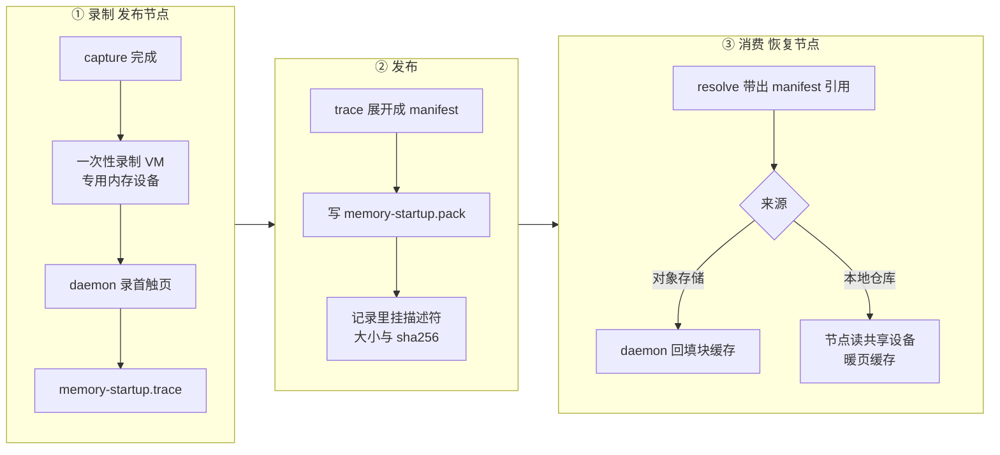
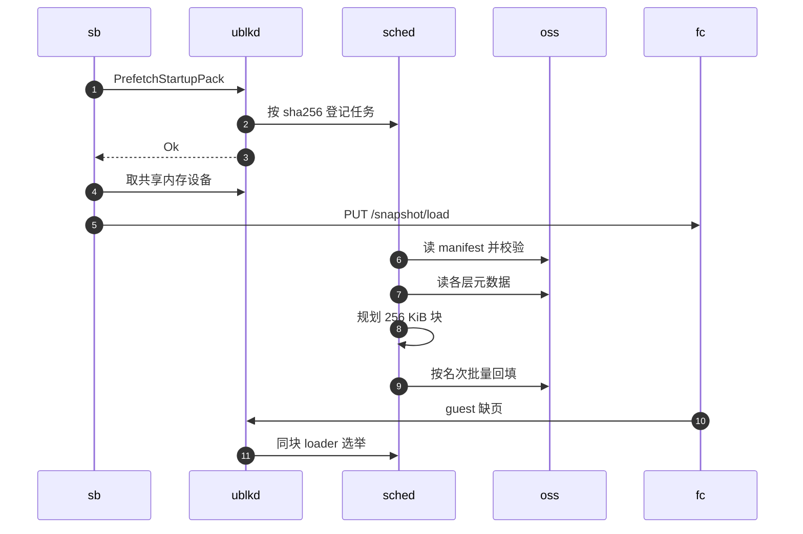

# 43 · 启动加速：trace prefetch 与 startup pack

> 内存快照按需加载，省掉了恢复前搬运整个内存镜像的成本，却把恢复后最初几秒的缺页变成了一串串行的远端读。
> startup pack 的做法是：发布快照时在本节点重放一次恢复，录下 guest 最先碰到哪些页；别的节点恢复同一快照时，
> 照这份清单按首次需要的顺序并发预取。本篇讲录制、清单格式与两条消费路径，并顺带讲与上游兼容的 trace prefetch。
>
> **读者**：存储与系统工程师。　**预备**：[第 39 篇 · 节点块缓存与后台下载](39-block-cache-and-background-download.md)、[第 42 篇 · 内存快照](42-memory-snapshot-over-ublk.md)。
> **代码**：`src/sandbox/firecracker/startup_pack.rs`、`src/snapshot/startup_pack.rs`、`storage/ublk/src/impls/startup_pack_recorder.rs`、`storage/ublk-daemon/src/server.rs`、`storage/overlaybd/src/{startup_pack,startup_manifest,pack_planner,prefetch}.rs`、`storage/overlaybd/src/backend/cache/startup_pack_task.rs`

---

## 0. 本篇要回答的问题

1. 从远端恢复一台沙箱时，最初的缺页为什么慢？后台下载为什么解决不了这一段？
2. 首触页在哪里录、怎么录？为什么要起一台一次性 VM，而且内存设备不能共享？
3. 录下来的 trace 与上传的 manifest 各长什么样？为什么只记页的位置、不打包页的内容？
4. 恢复时 manifest 怎样变成预取？对象存储来源与本地来源为什么走两条不同的路？
5. 录制或预取失败、超时、多台沙箱并发恢复同一快照时会怎样？
6. 上游兼容的 acceleration layer trace 是什么，它和 startup pack 是什么关系？

---

## 1. 问题：恢复后的最初几秒

回顾第 42 篇：恢复时 Firecracker 把一个只读的 `/dev/ublkbN` 当作内存文件映射进来，guest 的每次缺页都沿
「Firecracker 映射 → 块设备页缓存 → ublk → ublk-daemon → LSMT 合并索引 → 本地层 / 节点块缓存 / 远端对象」这条链往下走。
内存层在对象存储上时，一次页缓存未命中最终变成节点块缓存的一次 256 KiB 回填，也就是一次远端 Range GET
（[第 39 篇 §3](39-block-cache-and-background-download.md#3-一次缺块读)）。

问题在时间分布上。guest 恢复后的头一两秒，内核、envd 与用户进程会集中碰一批页；每个 vCPU 的缺页是阻塞的，
一页没回来，这个 vCPU 就停着。这些缺页彼此独立地按需回源，延迟按次叠加。
后台下载帮不上这一段：它要等 envd 就绪或 20 s 兜底之后才开始（[第 39 篇 §6.2](39-block-cache-and-background-download.md#62-envd-就绪信号)），
而且按层、按 chunk 顺序整层拉取，不知道哪些页先被需要。

要缩短这一段，需要三样东西：一份「guest 恢复后先碰哪些页、按什么顺序」的清单；一个在恢复开始时就照单并发拉取的执行者；
以及让预取与真正的缺页互不重复、互不饿死的协调。startup pack 就是这三样的合称。
下图是它的三个阶段：录制发生在发布快照的节点上，发布把清单与快照放在一起，消费发生在任何恢复该快照的节点上。



---

## 2. 录制：一台一次性的 VM

### 2.1 何时录、谁来等

录制挂在发布路径上。`SnapshotManager::publish_captured()`（`src/snapshot/manager.rs`）在把 capture 交给仓库后端之前，
先用 `StartupRecording::spawn_with_capture_lease()` 起一个任务运行 `record_startup_pack()`，
并把 capture 根目录的租约一起交给它；模板构建的发布路径（`src/template/builder.rs`）做同样的事。
注释说明了意图：录制 VM 与后端的层上传并行，发布本身从不等它。
暂停不发布快照，因此暂停不会触发录制。

开关是 `[snapshot.memory_startup_pack] enabled`，代码缺省为关（`src/cfg.rs` 的 `SnapshotStartupPackConfig`），
`config/default.toml` 里整节被注释掉。关闭时 `record_startup_pack()` 直接返回 `None`。
两个后端（`posixfs/backend.rs`、`oss/repository.rs`）在提交记录之后，各自 spawn 一个后续任务：
等录制结束、把 trace 展开成 manifest、写入仓库、再把描述符挂到已提交的记录上；挂接的细节在[第 49 篇](49-resolve-and-artifact-cache.md)。
后续任务由 `StartupManifestTaskGuard` 计数。进程正常关闭时，`src/bin/server.rs` 调 `drain_startup_manifest_tasks()` 最多等 15 s，
超时后发出 abort 通知，仍在进行的任务尽快收尾。

### 2.2 录制 VM 的配置

`record_startup_pack()` 先用 `derive_recording_mem_config()` 从 capture 的内存 `image.json` 派生一份 `mem_image.pack-rec.json`：
lowers 不变，只把镜像级下载覆盖设成 `enable: false`。录制时允许前台按需读（链式快照的父层可能还在远端），
但不允许任何东西触发后台整层下载，否则后台流量会和首触读混在一起。

随后它把 `pack_recording` 置真，用 `FirecrackerSandbox::from_snapshot_config()` 构造一台 VM，走普通的 `start_resume()` 路径，
但用的是 `start_nowait()`：只等 API socket，不等 envd 就绪。`pack_recording` 在恢复路径上改变三处行为：

- 不触发 custom extension 的 start-resume hook，扩展不会看到一台不存在的沙箱（[第 27 篇 §4.1](27-start-pause-resume-sequences.md#41-load-之前设备必须先就位)）。
- 内存设备改用 `UblkDeviceManager::create_dedicated_mem_device()`：直接经 daemon 创建、**不登记**进共享内存设备表。
  `src/sandbox/firecracker/sandbox.rs` 的注释给出理由：与别的沙箱共享设备（或共享它背后的块设备页缓存），首次触达就会被页缓存吃掉，录制器看不见。
- 在 `PUT /snapshot/load` **之前**调 `start_pack_recording()` 布防，使 load 期间与 guest 最初的缺页全部被记录。

注意录制发生在发布节点上，且时机在 capture 之后、层上传期间。此时内存层大多还在本地，录制 VM 跑得快，十秒预算足够。

### 2.3 `StartupPackRecorder`

布防请求到达 daemon 的 `handle_start_pack_recording()`（`storage/ublk-daemon/src/server.rs`）：它按设备上镜像的大小建一个
`StartupPackRecorder`，用 `OverlaybdTarget::set_recorder()` 挂到设备上，并 spawn 窗口任务。
`OverlaybdTarget` 的读路径在进入 `ImageFile` 之前先调 `observe_submit()`（[第 40 篇 §7.2](40-ublk-library.md#72-设备参数与支持的操作)），
所以录到的顺序是 daemon **看到请求的顺序**，近似于 guest 的缺页顺序。

录制器（`storage/ublk/src/impls/startup_pack_recorder.rs`）的数据结构只有两样：一张 `AtomicU64` 位图，一个有序的页号日志。
`observe_submit()` 对请求覆盖的每个 4 KiB 页做 `fetch_or`，只有把某一位从 0 翻成 1 的线程才把该页追加进日志。
于是每页恰好记一次，读路径上唯一的锁是有新页时那一下短暂的日志追加。几个边界：

- 位图最多覆盖 16 GiB 设备空间（`BITMAP_MAX_PAGES`），更高的页只计入 `skipped_high_pages`，不记录。
- 日志长度上限 `max_pages` 取 `max_pack_bytes / 4 KiB` 与 `MAX_PACK_PAGES`（262,144 页，即 1 GiB）中的较小者；缺省 `max_pack_bytes` 正好是 1 GiB。
- `read_guard()` 在读完成时结算：触到新页且耗时不少于 10 ms 的读，其字节数计入 `remote_bytes`，作为「这次录制有多少是远端读」的估计。
  这个数只出现在 daemon 日志与状态里，不参与任何决策。

### 2.4 录制窗口

窗口何时结束由 `StartupPackRecorder::verdict()` 决定，daemon 的 `pack_recording_window()` 每 100 ms 问一次：

| 条件 | 判定 | 缺省参数 |
|---|---|---|
| 还没有任何读，且布防已超过 max_window | 结束 | `record_max_window_ms = 2000` |
| 第一次读之后不足 min_window | 继续 | `record_min_window_ms = 200` |
| 第一次读之后已达 max_window | 结束 | 同上 |
| 无在途读，且静默已达 quiet | 结束 | `record_quiet_ms = 300` |

「静默」的时钟在每次出现新页或读完成时刷新，在途读不算静默。判定结束后，窗口任务先摘下录制器，
再在 `spawn_blocking` 里调 `finalize()`：把日志编码成 trace，写到 `memory-startup.trace.tmp`，检查取消标志后 rename 到位。
取消标志与一把 `finalize_gate` 锁配合，保证 abort 删除文件时不会撞上正在进行的 rename：取消之后的 trace 永远不会落地，取消之前已完成的保留。

`RecordingVerdict` 定义了第三种结果 `Fail`，录制器的注释也提到「不让重复读触发 abort guard」，
但 v0.2.3 的 `verdict()` 只返回 `Continue` 或 `Finish`，没有任何地方构造 `Fail`。`remote_bytes` 因此只是观测量，
「远端读太多就放弃这次录制」的质量守卫并不存在。

### 2.5 节点侧的等待与收尾

节点侧的 `boot_and_wait()`（`src/sandbox/firecracker/startup_pack.rs`）每 200 ms 用 `pack_recording_status()` 轮询，
只有这段等待受 `record_budget_secs`（缺省 10 s）约束。收尾不受预算约束：失败或超时时发 `abort_pack_recording()`（限时 3 s，
因为停 VM 删除设备时 daemon 也会放弃录制），然后总是 `stop()` 录制 VM；只有关闭 abort 时停 VM 才限时 5 s。
任何一步失败，函数都返回 `None`，删掉 trace 与派生配置，发布照常完成，只是这个快照没有 startup pack。

---

## 3. 两种格式：trace 与 manifest

### 3.1 字节布局

录制器产出的 trace 只在节点本地存在；发布时由 `build_startup_manifest()`（`src/snapshot/startup_pack.rs`）在 `spawn_blocking` 里展开成 manifest，
写进仓库的是后者。两者都是 AgentENV 扩展格式，上游 overlaybd 没有对应物。布局（小端）：

```text
memory-startup.trace   (storage/overlaybd/src/startup_pack.rs，只留在节点本地)
  0   magic "AENVTRC1"          8 B
  8   version = 1               u32
  12  header_bytes = 32         u32
  16  mem_virtual_size          u64
  24  page_count                u32     ≤ 1 << 20
  28  reserved = 0              u32
  32  page_offset[page_count]   u64 ×N  首触顺序，去重，4 KiB 对齐

memory-startup.pack    (storage/overlaybd/src/startup_manifest.rs，写进仓库)
  0   magic "AENVMF01"          8 B
  8   version = 4               u32
  12  header_bytes = 32         u32
  16  mem_virtual_size          u64
  24  prefix_page_count         u32     当前生产者恒为 0
  28  range_count               u32     ≤ 1 << 20
  32  prefix_page[...]          u64 ×P
  ..  (start, len)[range_count] u64+u64 ×R  按最早首触名次排序
```

### 3.2 从 trace 到 manifest

`build_manifest()` 的算法很短：给每页一个名次（它在首触日志里的位置），按地址排序，把地址连续的页合并成区间，
区间的名次取其中各页名次的最小值，最后按名次排序区间表。于是**表中位置就是首次需要的顺序**，而区间合并让清单比逐页列出小得多。
格式里预留了「精确顺序前缀」（prefix pages）：一段在区间表之前逐页交付的页号；注释写明当前生产者不使用它，`build_manifest()` 总是留空。

清单只记位置，不带页内容。这样做有两个理由，都能从代码里看到：
其一，发布时内存层可能被重封装成 ZFile（`[snapshot.publish_compression]`），最终对象的字节与本地 capture 的层不同；
只记逻辑页号，消费端就能对着「实际上传的那份对象」重新翻译，不必关心发布时做了什么变换（§4.2）。
其二，页内容本来就在层里，再打包一份等于把热页上传两遍、存两遍。代价是消费端必须先读层的元数据才能知道要拉哪些块。

### 3.3 名字的混用

这组制品的称呼在代码里并不统一，阅读时需要对照：

| 出现位置 | 写法 |
|---|---|
| 仓库里的文件名 | `memory-startup.pack`（`MEMORY_STARTUP_PACK_ARTIFACT`），内容是 manifest，不是「pack」 |
| 记录里的描述符 | `MemoryStartupPackInfo { pack_size, mem_virtual_size, index_sha256 }`；`index_sha256` 实为整个 manifest 的 sha256，注释称为兼容旧记录而保留字段名 |
| 魔数与版本 | 魔数 `AENVMF01`，版本字段为 4 |
| 注释 | `default.toml` 与 `src/sandbox/firecracker/startup_pack.rs` 称 v4；`src/cfg.rs`、`src/sandbox/ublk/device.rs`、`startup_pack_task.rs` 称 v3；`oss/resolver.rs` 称 v2 |

本书统一称它为 **startup manifest**（魔数 `AENVMF01`，格式版本 4），仓库里的文件称 `memory-startup.pack`。
`startup_pack_task.rs` 先读 64 字节探测魔数，旧格式（v1 / v2 的打包数据）一律拒绝，恢复退回按需加载。
`pack_planner.rs` 里还留着按「v2 文件大小」计算预算的模型（头、对象表、块表、校验帧），消费端调用时传 `u64::MAX`，这套预算实际不生效。

---

## 4. 消费：两条路径

### 4.1 开关与解析

消费由另一个开关 `consume_enabled` 控制，缺省同样为关；注释说这是为了能在同一个快照上做有无预取的对照。
解析阶段决定来源：OSS 解析器（`src/snapshot/repository/backends/oss/resolver.rs`）用 `resolve_startup_pack_ref()` 产出 `OssUrl`；
POSIX 运行时解析（`posixfs/runtime.rs`）在 manifest 文件确实存在时用 `resolve_local_startup_pack_ref()` 产出 `LocalPath`。
引用经 `FirecrackerSnapshotConfig::from_runnable_snapshot()` 带进恢复配置；暂停后恢复本节点沙箱的配置里这一项恒为 `None`。

两条路都不信任引用本身：执行前都校验大小、sha256 与 `mem_virtual_size`，任何一项不符就放弃预取，恢复照常进行。
`start_resume()` 里内存设备那一段按来源分流（`src/sandbox/firecracker/sandbox.rs`）。

### 4.2 对象存储来源：交给 daemon 回填块缓存

OSS 来源时，节点在**取共享内存设备之前**调 `UblkDeviceManager::prefetch_startup_pack()`，发 `PrefetchStartupPack` RPC。
daemon 的 `handle_prefetch_startup_pack()` 无论成败都回 `Ok`：恢复从不依赖预取。下图中 `sb` 是节点上的 `FirecrackerSandbox`，`ublkd` 是 ublk-daemon，`sched` 是 daemon 里该全局配置对应的后台下载调度器，
`oss` 是对象存储，`fc` 是 Firecracker 进程（它的缺页经内核块层到达 daemon，图中简化为一条消息）：



登记阶段（`ImageService::prefetch_startup_pack()`）有三个前提：节点开了块缓存；内存镜像的**每一层**都是 OSS 远端对象
（`collect_startup_pack_layers()`：有 `file=` 的本地层直接放弃，因为预取一个设备根本不读的对象只会暖错缓存）；
每层的 URL 与缺页路径的拼法一致，保证命中同一个缓存条目。manifest 对象本身绕过块缓存读取，它只用一次。

`BkDownloadScheduler::submit_startup_pack()` 以 `startup-pack:<sha256>` 为键去重，并发恢复同一快照的多台沙箱共享一个任务。
startup 任务有自己的队列，调度循环先看它；它最多占 file slot 预算的四分之一，正在运行的普通后台任务在 chunk 边界让出名额
（[第 39 篇 §5.4](39-block-cache-and-background-download.md#54-超时重发与任务重试)）。

执行阶段（`startup_pack_task.rs` 的 `execute()`）先读 64 字节探测魔数，再读余下部分，校验 sha256 与内存大小，然后调
`pack_planner::plan_ranges()`。规划器只读元数据：剥 tar 包裹得到 base offset，ZFile 层用 jump table 把逻辑块换成压缩后的物理区间，
LSMT 合并索引把每个区间翻译成「哪一层、层内哪段」；首次碰到一层时，把该层头部与索引所在的块也排进计划。
注意这些元数据本身是经块缓存从远端读来的，规划这一步就会产生若干次远端读。

计划是按首次需要排序、去重的 256 KiB 块列表。`merge_runs_by_first_need()` 把同层相邻块合并成最长 64 块（16 MiB）的 run，
再按 run 的最早名次排序：请求次数与按物理顺序合并相同，但启动最先要的块最先到。
8 个 worker 依次取 run，每个 run 先拿全局 `block_slots`，再过 `download_gate::gate_startup_block_read()`（前台在途时仍保留 8 路，
[第 39 篇 §6.1](39-block-cache-and-background-download.md#61-download_gate)），最后调 `CachedFile::background_refill_range()`。
这个函数对每个缺失块做与缺页相同的 loader 选举（[第 39 篇 §3.2](39-block-cache-and-background-download.md#32-loader-选举)）：
guest 先缺到某块时预取跳过它，预取先拿到某块时 guest 挂在同一块上等待，同一块只回源一次。
整个任务受 `consume_timeout_secs`（缺省 30 s）约束，含排队时间；超时即 `Failed`，已经回填的块留在缓存里照样有用。

任务结束后，块在节点块缓存里，块设备页缓存仍是冷的：guest 的缺页仍要经过 ublk 往返，但不再等远端。
daemon 把登记得到的句柄放进一个列表，下次登记时才清掉已终止的；沙箱停止不会取消它。推论：一台沙箱很快被删除时，它触发的预取仍会跑完或超时。

### 4.3 本地来源：读共享设备，暖页缓存

POSIX 仓库在本地或共享文件系统上，没有远端读可省；这时缺页的成本是每页一次 ublk 往返。
于是本地来源换了目标：**直接读共享的 `/dev/ublkbN`**，把页放进 Firecracker 映射所依赖的那份块设备页缓存。
`execute_device_prefetch()` 的注释点明了为什么不读层文件：层文件的读暖的是另一份页缓存，满足不了 Firecracker 的缺页。

`submit_local_startup_prefetch()` 在拿到共享设备之后 spawn，恢复不等它。`prepare_local_prefetch()` 先限长读入 manifest
（文件在检查之后变大也不会导致无界分配），校验大小与 sha256；lower 配置为 O_DIRECT（`io_engine == 2`）时跳过，注释说这一组合尚未验证。
`device_prefetch_spans()` 先放 prefix 页，再按表序放区间并去掉与 prefix 重复的页，总量截断到 `max_pack_bytes`。
读取在 `spawn_blocking` 里用 1 MiB 缓冲做普通的 `pread`，每个 1 MiB 之前检查取消与截止时间。

本地预取有三层共享与限流：

- **去重**：以（设备代次，manifest sha256）为键。设备代次是 `SharedReadOnlyDevice` 内部 `Arc` 的地址，不是可回收的内核设备号；
  worker 持有一份设备租约直到读返回，所以这个地址在登记期间不会被复用。
- **订阅**：每台恢复的沙箱是一个订阅者。一个订阅者退出只撤销自己的兴趣，最后一个订阅者离开才真正取消读；
  最后一次释放会先把这次运行从表里摘掉，新到的恢复因此另起一轮，而不是加入一个正在排空的已取消运行。
- **全局并发**：节点上同时进行的本地预取读最多 4 个（`LOCAL_PREFETCH_MAX_READS`）。

`FirecrackerSandbox::stop()` 一开始就取消订阅；内核里正在进行的 `pread` 不能打断，句柄只会脱离，worker 带着设备租约等读返回后自己清理。

### 4.4 两条路对照

| 维度 | 对象存储来源 | 本地来源 |
|---|---|---|
| 执行位置 | ublk-daemon 的后台下载调度器 | 节点进程的 blocking 线程 |
| 暖的是什么 | 节点块缓存（256 KiB 块，压缩后字节） | 共享设备的块设备页缓存 |
| 何时开始 | 取设备之前登记，任务异步执行 | 取到共享设备之后 spawn |
| 去重键 | manifest sha256 | 设备代次 + sha256 |
| 与缺页的协调 | loader 选举 + `download_gate` | 同一份页缓存，内核合并 |
| 放弃条件 | 无块缓存、有本地层、校验失败、30 s 超时 | O_DIRECT lower、校验失败、30 s 超时 |

---

## 5. 上游兼容的 trace prefetch

`storage/overlaybd/src/prefetch.rs` 是另一套机制：上游 overlaybd 的 trace 录制与回放，Rust 版按上游格式移植。
它由镜像配置里的两个字段驱动（`ImageConfig` 的 `accelerationLayer` 与 `recordTracePath`，二者互斥），
`ImageFile::init_image_file()` 的判断顺序与上游 `image_file.cpp` 一致：

- **回放**：`accelerationLayer` 为真时，最上面那个 lower 被当作加速层弹出，不参与层栈；若其目录下的 `trace` 文件非空，进入回放模式。
  `replay()` 起一个线程，以 `prefetch_config.concurrency` 个 worker 按记录逐条对对应层 `read_at`，把数据读进下层缓存。
- **录制**：`recordTracePath` 指向一个存在的空文件时进入录制模式，并关闭这次打开的后台下载。每个 lower 被包一层 `PrefetchFile`，
  读请求记成一条记录；同时建 `<trace>.lock`，后台线程每秒检查一次，外部删除 lock 文件即停止录制、写出 trace 并建 `<trace>.ok`。

格式与上游一致：24 字节头（魔数 3270449184，上游注释说是「Container Image Trace Format」的 CRC32；数据长度；CRC32C 校验），
随后是 24 字节的记录（操作 `R` / `W`、层号、长度、层内偏移）。上游还支持动态预取清单，Rust 版遇到时报错「not migrated in Rust yet」。

这套机制与 startup pack 的差别在坐标与控制方式上：trace 记的是**每一层内的偏移**，绑定具体的层文件；
startup manifest 记的是**内存镜像的逻辑页**，与层结构无关，消费时才对着最终对象翻译。
trace 的录制靠外部删 lock 文件结束，startup pack 靠录制窗口自动结束。
在 v0.2.3 里，AgentENV 自己的代码从不设置 `accelerationLayer` 或 `recordTracePath`：它只在外部提供的镜像配置带有这些字段时生效，
是格式兼容的一部分，不在 AgentENV 的启动路径上。

---

## 6. 代价与边界

- **录制占发布节点的资源。** 录制 VM 是一台完整的恢复（网络槽位、Firecracker 进程、tools 盘与 rootfs 设备、专用内存设备），
  与层上传同时发生，最长占用约一个录制预算加收尾时间。
- **清单只代表一种启动。** 录制 VM 用 `start_nowait()` 启动，不等 envd，也不发用户请求。推论：清单反映的是「恢复后无负载」的首触页，
  真实沙箱在 `/init` 与第一个用户请求上碰到的页可能不在其中；而且只录一次，没有多轮取交集去掉随机成分。
- **最多 1 GiB。** 超过 `max_pages` 的新页不进日志，16 GiB 以上的设备空间完全不录。
- **预取与缺页并行。** 恢复不等预取；预取与缺页靠 loader 选举去重，靠 `download_gate` 给前台让路但保底 8 路。
  推论：预取的带宽仍可能与 guest 的随机缺页竞争，名次靠后的块拉得越早，竞争越明显。
- **静默降级。** 录制、构建、上传、挂接、登记、规划、执行任何一步失败都只记日志，快照退回按需加载；没有指标区分「没有 pack」与「pack 失败」。
- **技术债。** `RecordingVerdict::Fail` 从未构造，注释描述的质量守卫不存在；`src/cfg.rs` 的注释写「OSS backend only」与「v3」，
  而 `recording_enabled_for()` 对所有后端生效、manifest 版本是 4；`pack_planner.rs` 的预算模型描述的是已不再生产的 v2 打包格式；版本称呼混用见 §3.3。

---

## 7. 与 e2b infra 的对照

e2b infra 在 uffd 填页路径上记录去重的块索引与首次访问序号，构建时跑两轮取交集，存进模板元数据，恢复时由 fetch 与 copy 两组 worker 预取并直接填进 guest 内存（见 e2b 手册第 32 篇）。
AgentENV 没有用户态缺页处理器可挂，于是把录制放在 ublk 设备的读入口、把清单做成与层结构无关的逻辑页区间表，预取的终点是节点块缓存或块设备页缓存而不是 guest 内存。
代价是预取完成后 guest 的缺页仍要走一次 ublk 往返（OSS 来源），而好处是同一份预取结果可以被同节点上恢复同一快照的所有沙箱共享。

---

## 8. 小结

- startup pack 解决的是恢复后最初几秒的串行远端缺页；后台下载要等 envd 就绪且不知道顺序，覆盖不了这一段。
- 录制在发布节点上进行：capture 后起一台一次性 VM，用专用、不共享的内存设备，在 load 之前布防；全程 best-effort，发布从不等它。
- `StartupPackRecorder` 用原子位图保证每页只记一次，日志顺序是 daemon 看到请求的顺序；窗口由 200 / 300 / 2000 ms 三个参数自动结束。
- trace（`AENVTRC1`）只留在本地；仓库里的 `memory-startup.pack` 是 startup manifest（`AENVMF01`，版本 4）：按名次排序的合并区间表，只记位置不带内容。
- 只记逻辑页使清单与发布时的重封装无关；代价是消费端要读层元数据才能规划块。
- OSS 来源由 daemon 执行：按 sha256 去重，规划成 256 KiB 块、合并成 16 MiB run、按名次交付，与缺页共用 loader 选举，30 s 内含排队。
- 本地来源由节点读共享 `/dev/ublkbN` 暖块设备页缓存；读层文件暖的是另一份页缓存，没有用。
- 录制与消费各有开关，缺省都关；任何失败都退回按需加载，且无从区分。
- `prefetch.rs` 是与上游格式一致的 acceleration layer trace，坐标是层内偏移；AgentENV 自己的流程不使用它。

## 延伸阅读 / 下一篇

- 下一篇：[第 44 篇 · uffd 方案与对比](44-uffd-alternative.md)——没有共享页缓存时，内存恢复要怎样做。
- [第 42 篇 · 内存快照](42-memory-snapshot-over-ublk.md)：共享只读设备与缺页链路。
- [第 39 篇 · 节点块缓存与后台下载](39-block-cache-and-background-download.md)：调度器、loader 选举与 `download_gate`。
- [第 41 篇 · ublk-daemon](41-ublk-daemon.md)：`StartPackRecording`、`PackRecordingStatus`、`PrefetchStartupPack` 等 RPC。
- [第 49 篇 · resolve 与本地制品缓存](49-resolve-and-artifact-cache.md)：manifest 制品的写入、描述符挂接与解析。
- [第 68 篇 · 已知问题与技术债](68-known-issues-and-debt.md)：版本称呼与注释漂移的汇总。
- [e2b 手册第 32 篇](../e2b-infra/32-memory-prefetch-and-hugepages.md)：e2b infra 的预取映射与两组 worker。
