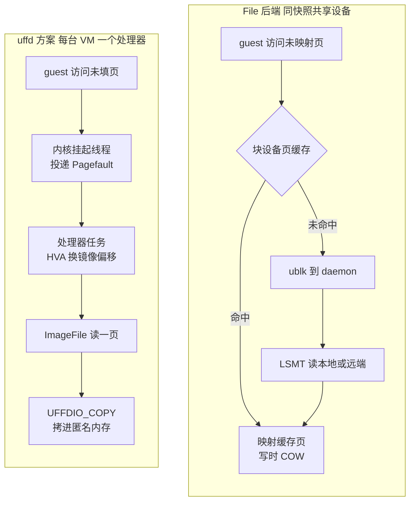

# 44 · uffd 方案与对比

> 让一台 microVM 从内存快照按需恢复，有两种基本做法：在用户态接管缺页（userfaultfd），或者把内存镜像做成一个块设备、让内核按文件映射去读。
> AgentENV 仓库里两种都有：现行路径是 ublk 块设备加 Firecracker 的 File 后端，`storage/uffd-core` 则保留了一套完整的 uffd 实现，已不参与构建。
> 本篇读这套保留实现，并把两种方案放在同一组维度上比较。
>
> **读者**：存储、虚拟化与系统工程师。　**预备**：[第 42 篇 · 内存快照](42-memory-snapshot-over-ublk.md)、[第 43 篇 · 启动加速](43-startup-pack-and-prefetch.md)。
> **代码**：`storage/uffd-core/src/{lib,backend,handler,scm,overlaybd,process_vm_reader}.rs`、`src/sandbox/firecracker/instance.rs`、`src/sandbox/firecracker/{overlaybd_snapshot,process_vm_reader}.rs`

---

## 0. 本篇要回答的问题

1. 内存快照恢复要解决哪两件事？uffd 与 File 后端各自把这两件事交给了谁？
2. `uffd-core` 怎样和 Firecracker 握手、怎样处理缺页与 Remove 事件？哪些约束来自内核？
3. 它的快照路径为什么和现行方案几乎一样？差别在哪里？
4. 在页缓存共享、脏页判据、故障面、对 Firecracker 的要求上，两种方案各付出什么、换来什么？
5. 这套代码在 v0.2.3 里处于什么状态，留下了哪些需要注意的遗留物？

---

## 1. 问题：恢复内存的两件事

把一份内存快照变回一台运行中的 VM，要回答两个问题。**读**：guest 第一次碰到某一页时，这页的内容从哪里来、由谁放进 guest 内存。
**写回**：下一次暂停时，哪些页变过、需要写进新的内存层。按需加载的前提是第一个问题能在缺页时现场回答；
增量分层的前提是第二个问题能回答得足够准，否则每次暂停都要把整个内存写一遍。

两种方案的分工不同：

- **userfaultfd**：Firecracker 用匿名内存承载 guest，把这片内存注册到一个 uffd 上，并把 uffd 交给外部进程。
  缺页时内核挂起访问线程、把事件交给外部进程，由它读出页内容、用 `UFFDIO_COPY` 填进去。读与写回都由这个用户态处理器负责。
- **File 后端 + 块设备**：Firecracker 用 `MAP_PRIVATE` 映射一个文件。在 AgentENV 里这个「文件」是只读的 `/dev/ublkbN`，
  缺页由内核的文件映射路径处理，未命中页缓存时才经 ublk 到达 ublk-daemon。写回则依赖 KVM 的脏页日志。

AgentENV v0.2.3 用后者（[第 42 篇](42-memory-snapshot-over-ublk.md)）。前者的实现留在 `storage/uffd-core`：
根 `Cargo.toml` 的 `members` 不含它，`docs/src/internals/architecture.md` 称它「retained for reference but excluded from the workspace build」；
节点侧唯一与之对应的 `FirecrackerInstance::load_snapshot_uffd()`（`src/sandbox/firecracker/instance.rs`）标着 `#[allow(dead_code)]`，没有调用者。

---

## 2. `uffd-core` 的结构

### 2.1 模块与接口

crate 名 `uvm-uffd-core`，约 780 行，分五个模块：`handler.rs`（`UffdHandle`，握手与缺页循环）、`scm.rs`（经 Unix socket 收 fd）、
`backend.rs`（`MemoryImageBackend` trait）、`overlaybd.rs`（基于 Rust 版 overlaybd 的实现）、`process_vm_reader.rs`。
后两个在缺省开启的 `overlaybd` feature 之下。

`MemoryImageBackend` 把「页从哪来」抽象成三个方法：`pagesize()`；`read_page_at_offset()`，按内存镜像内的偏移读一页，返回 `None` 表示空洞、由处理器填零页；
`snapshot()`，用处理器跟踪的页状态生成增量层，缺省实现直接报错。注释写着不同格式（overlaybd、「uvm-diff」等）都可以实现它，
一个处理器集合经 trait 对象同时管理多种格式。v0.2.3 里只有 `OverlaybdMemoryImage` 一个实现。

### 2.2 握手

`UffdHandle::new()` 绑定一个 Unix socket，spawn 后台任务后立即返回。后台任务 `sync_with_fc()` 做四件事：

1. `accept()` 等 Firecracker 连接，用 `peer_cred()` 取对端 pid，留给快照时的 `process_vm_readv` 使用。
2. `get_mappings_and_uffd()` 用 `recv_with_fd()`（`scm.rs`）收一条带 `SCM_RIGHTS` 的消息：缓冲 1 KiB，收到空消息最多重试 5 次，
   一条消息里带两个以上 fd 时全部关闭并报错。
3. 把消息体按 JSON 解析成 `Vec<GuestRegionUffdMapping>`：每个区域的宿主虚拟地址（HVA）、大小、在内存镜像中的偏移、页大小。
   注释强调偏移不是 guest 物理地址：区域之间的 MMIO 空洞已经去掉，偏移是连续的。
4. 校验每个区域的页大小等于后端的 `pagesize()`，然后启动缺页循环。

另一端的行为在上游 Firecracker v1.15.1 里：`src/vmm/src/persist.rs` 的 `guest_memory_from_uffd()` 以匿名内存建 guest 内存，
创建非阻塞、要求 `EVENT_REMOVE` 特性的 uffd，逐区域注册，再把区域映射与 uffd 发过 socket。
节点侧的 `load_snapshot_uffd()` 只是发 `PUT /snapshot/load`，`mem_backend` 为 `Uffd`、路径为这个 socket，且 `resume_vm = true`。

### 2.3 缺页循环

`serve_pf()` 等 uffd 可读，每次读出一个事件。`userfaultfd` crate 的 `Event` 含裸指针、不是 `Send`，
代码先取出地址等数据并 drop 事件，再进入任何 await。事件分三类：

- **Pagefault**：spawn 一个任务执行 `handle_page_fault()`。它把地址按页对齐，在页状态表里把这页记为 `Accessed`；
  若这页先前被记为 `Removed`，直接填零页；否则用 `hva_to_image_offset()` 找到所在区域、换算成镜像偏移，调 `read_page_at_offset()`，
  返回空洞则填零页，否则 `UFFDIO_COPY`。两个 ioctl 遇到 `EAGAIN` 让出后重试，遇到 `EEXIST` 视为成功（并发缺页已经填过这一页）。
- **Remove**：guest 的 virtio-balloon 归还内存时，Firecracker 对相应区间做 `MADV_DONTNEED`，内核发出 Remove 事件。
  `record_remove_range()` 在事件循环里**同步**把区间内各页记为 `Removed`。
- 其他事件：报错，循环结束。

Remove 的处理有两条来自内核的约束，注释写得很清楚。其一，**不能在这里等在途的缺页任务**：每个未读的 Remove 事件都让内核的
`mmap_changing` 计数加一，只有读走事件才减一；计数不为零时 `UFFDIO_COPY` 一律返回 `EAGAIN`。
如果处理 Remove 时阻塞等缺页任务，而后面还有 Remove 未读，缺页任务就永远重试下去，形成死锁。
其二，**必须同步记录**：事件流是有序的，同一页先 Remove 后 Pagefault 意味着 guest 释放后又访问了它；
若 Remove 异步处理，缺页任务可能先写入 `Accessed`，迟到的 Remove 再把它覆盖成 `Removed`，快照就会漏掉这一页。

### 2.4 页状态即脏页估计

页状态表是一个以「HVA 页号」为键的 `DashMap<u64, PageState>`。`PageState` 只有两个值：
`Accessed`（被 Firecracker 访问过，假定为脏）与 `Removed`（被 balloon 归还，下次缺页给零页，快照时不导出内容）。
注释给出原因：Firecracker 的 uffd 没有用 `UFFDIO_REGISTER_MODE_WP` 注册，处理器无从区分读缺页与写缺页，只能把**访问过**一律当作**写过**。
`load_snapshot_uffd()` 也不打开 `track_dirty_pages`，KVM 的脏页日志在这条路径上没有被利用。

### 2.5 快照：与现行方案同一个技巧

`OverlaybdMemoryImage::snapshot()` 把页状态表直接翻译成一组 LSMT 段映射：对每一页，
`Accessed` 生成 `offset = 镜像偏移 / 512`、`moffset = HVA / 512` 的映射，`Removed` 生成一个 `zeroed` 映射；排序后交给 `compact_to()`，
源层只有一个 `ProcessVmReader`——它实现 `VirtualFile`，`read_at_into()` 的「偏移」就是 HVA，内部调 `process_vm_readv` 从 Firecracker 进程读内存。
新层的 uuid 新生成，parent uuid 取当前镜像最上层的 uuid，`compact_to()` 并发度 64。

这正是第 42 篇讲的「把 moffset 字段借来存 HVA、把对方进程的地址空间当作第 0 层」。现行的 `src/sandbox/firecracker/overlaybd_snapshot.rs`
与 `process_vm_reader.rs` 沿用了同一结构。推论：现行方案的快照路径就是从这里演化来的，换掉的只是「哪些页要写」的来源。两份代码的差别：

| 维度 | `uffd-core` | 现行路径 |
|---|---|---|
| 页集合来源 | 处理器自己记录的 `Accessed` 页 | AENV 补丁版 Firecracker 的 `GET /vm/dirty-memory-ranges` |
| 映射粒度 | 每页一条 4 KiB 映射 | 连续区间合并，按 `Segment::MAX_LENGTH` 切段 |
| 归还页 | 写 `zeroed` 映射 | 区间里没有这一类 |
| 并发度 | 64 | 32（`DIRECT_MEMORY_SNAPSHOT_COMPACTION_CONCURRENCY`） |
| 短读与 EINTR | `read_at_into()` 只调一次 `process_vm_readv` | 循环直到读满，遇 EINTR 重试 |

---

## 3. 两条缺页路径

下图把两种方案的缺页路径放在一起。左边每一次缺页都要经过用户态处理器；右边命中页缓存的缺页在内核里就结束了，未命中才进入 ublk-daemon。

右边的「映射缓存页、写时 COW」依据 AENV 补丁版 Firecracker 的 `src/vmm/src/vstate/memory.rs`：`snapshot_file()` 用 `MAP_PRIVATE` 映射内存文件，
并把上游的 `fstat` 改成 `lseek(SEEK_END)` 取大小，块设备才能当内存文件用（[第 67 篇](67-firecracker-patch-layer.md)）。
私有文件映射的读缺页映射的是页缓存里的页，写入时内核为本进程复制一份匿名页，块设备本身从不被写。

---

## 4. 逐项比较

| 维度 | uffd + `uffd-core` | ublk + File 后端（现行） |
|---|---|---|
| 缺页由谁处理 | 节点进程里的用户态处理器，每台 VM 一个 | 内核文件映射路径；未命中时 ublk-daemon |
| 命中时的开销 | 没有「命中」：每个首次访问的页都要一次用户态往返和一次拷贝 | 页缓存命中不出内核 |
| 跨 VM 共享 | 每台 VM 各持一份拷贝，节点块缓存可共享 | 同一快照共用一个设备与一份页缓存，只读页天然去重 |
| 脏页判据 | 访问过即脏（无写保护） | KVM 脏页日志：写过的页 |
| 暂停时写入量 | 正比于访问过的页 | 正比于写过的页 |
| balloon 归还 | 记 `Removed`，快照写零映射 | 不单独区分 |
| 大页 | 上游 uffd 路径支持 hugetlbfs | 上游 File 后端拒绝 hugetlbfs 快照 |
| 对 Firecracker 的要求 | 上游 v1.15.1 即可 | 需要补丁：块设备取大小、`dirty-memory-ranges` |
| 每 VM 的额外部件 | 一个 Unix socket、一个事件循环、每缺页一个任务 | 无；设备按快照共享 |
| 故障面 | 处理器出错只影响一台 VM | daemon 是全节点单点 |

几项需要展开。

**页缓存共享。** uffd 把页拷进各 VM 的匿名内存，N 台从同一模板恢复的 VM 各持一份热页；
File 后端下，只要 guest 不写，N 台 VM 映射的是同一批页缓存页（[第 26 篇 §4.1](26-sandbox-block-devices.md#41-为什么要共享)）。
对一个以高密度运行同一模板为目标的平台，这是两种方案之间最大的结构差异。第 43 篇的本地预取之所以能做「读一次设备、暖所有沙箱」，也建立在这上面。

**每次缺页的路径长度。** uffd 方案里，每个首次访问的页都要唤醒用户态处理器、过一遍 `ImageFile`、再做一次 4 KiB 拷贝，没有任何「已经在内存里」的捷径。
File 后端把已在页缓存中的页留在内核里解决。推论：内核对文件映射缺页还会做预读，一次未命中可能顺带带回相邻页，这在 uffd 路径上需要处理器自己实现。

**脏页判据。** 在 `uffd-core` 里，只读访问过的页也会进入下一次快照；对一台恢复后主要在读的 VM，增量层会远大于实际写入。
现行路径用 `dirty_memory_ranges()`（AENV 补丁版 Firecracker 的 `src/vmm/src/vstate/memory.rs`）按 KVM 脏页位图生成区间，只包含写过的页。
uffd 本身并非做不到更准：带写保护的注册可以区分读写，e2b infra 走的正是这条路；只是 `uffd-core` 依赖的 Firecracker 没有提供它。

**对 Firecracker 的要求与大页。** 这是 uffd 方案保有的优势：它只用上游 Firecracker v1.15.1 已有的接口，不需要任何补丁；
而且上游的 File 后端在 `src/vmm/src/persist.rs` 里明确拒绝 hugetlbfs 快照（错误信息建议改用 uffd）。
现行方案因此同时放弃了「零补丁」与「大页内存」两样东西。AgentENV 的 Firecracker 配置里没有大页选项。

**故障面。** uffd 处理器跑在节点进程里，每台 VM 一个，坏一个只影响一台；
现行方案把全部内存设备集中在一个 ublk-daemon 进程里，daemon 不支持 `UBLK_F_USER_RECOVERY`，它一旦退出，所有依赖它的设备都失效（[第 41 篇](41-ublk-daemon.md)）。
推论：此时 guest 对未命中页缓存的页的访问会在 Firecracker 进程里表现为映射读错误，沙箱无法继续运行；已在页缓存里的页不受影响。

---

## 5. 为什么被取代

代码与文档都没有写明取代的理由。依据上面的比较，推论如下：

1. **共享**：平台的目标场景是同一模板的大量沙箱，File 后端让只读页在节点上只存一份，这是 uffd 拷贝模型给不了的。
2. **缺页成本**：热页命中页缓存时不必进入用户态；未命中的路径与 rootfs 共用同一套 ublk + Rust 版 overlaybd 数据面，不必为内存单独维护一套读路径。
3. **增量写入**：KVM 脏页日志只报告写过的页，暂停的写入量随写集而不是访问集增长。
4. **部件数**：每台 VM 少一个 socket、一个事件循环和一串缺页任务，内存设备的生命周期并入已有的设备管理（共享表与两级引用计数）。

代价也成对：现行方案依赖 AENV 补丁版 Firecracker 的两处改动，失去了大页，并把故障面集中到 daemon 这个单点上。

---

## 6. 遗留状态

- **不参与构建。** `uffd-core` 不在 workspace 里，`cargo build` 与 `cargo test` 在根目录都不会编译它。推论：它与 overlaybd crate 的接口一旦漂移，不会有任何检查发现；
  v0.2.3 里它引用的 `index_file::compact_to`、`CommitArgs::from_writer`、`ImageFile::get_uuid` 仍存在，但本书没有实际编译验证。
- **节点侧的死代码。** `load_snapshot_uffd()` 设 `resume_vm = true`，load 即恢复运行；而现行恢复路径刻意用 `resume_vm = false`，
  在 load 与恢复之间补发新卷、MMDS 与限流（[第 27 篇 §4.2](27-start-pause-resume-sequences.md#42-load-与-load-之后)）。
  这个函数若被重新启用，会跳过这些步骤。
- **两份 `ProcessVmReader`。** `storage/uffd-core/src/process_vm_reader.rs` 与 `src/sandbox/firecracker/process_vm_reader.rs` 各一份，
  前者有 scatter 读但不处理短读与 EINTR，后者相反；现行那份带着「同步系统调用跑在 tokio worker 上」的 TODO。
- **没有调用者的入口。** `UffdHandle::snapshot()`、`dirty_pages()` 在 AgentENV 主代码里没有任何引用，整个 crate 只能当作参考实现阅读。

---

## 7. 与 e2b infra 的对照

e2b infra 的恢复路径就是 uffd：每台沙箱一个 Go 处理器，缺页时从模板缓存取块并 `UFFDIO_COPY`，脏页位图由其分叉 Firecracker 的 `GET /memory/dirty` 提供，预取页靠写保护位避免被算成脏页（见 e2b 手册第 31、32 篇）。
`uffd-core` 与它结构相近，但没有写保护，于是只能把访问过的页都当作脏页。
AgentENV 最终换到块设备 File 后端，换来跨沙箱共享页缓存，代价是依赖 Firecracker 补丁并放弃大页。

---

## 8. 小结

- 内存恢复要回答「缺页时页从哪来」与「暂停时写哪些页」两件事；uffd 把两件事都交给用户态处理器，File 后端交给内核页缓存与 KVM 脏页日志。
- `uffd-core` 不在 workspace 中，节点侧 `load_snapshot_uffd()` 是死代码；它是一套完整但不运行的参考实现。
- 握手经 Unix socket 收 uffd 与区域映射；区域偏移已去掉 MMIO 空洞，与 `dirty-memory-ranges` 的镜像偏移同一坐标。
- Remove 事件必须在事件循环里同步记录，且不能等在途缺页，否则 `mmap_changing` 使 `UFFDIO_COPY` 永远 `EAGAIN`。
- 没有写保护注册，`uffd-core` 把访问过的页一律当作脏页；现行方案只写 KVM 报告写过的页。
- 两套方案的快照路径相同：moffset 存 HVA、`ProcessVmReader` 作第 0 层、`compact_to()` 写出新层；现行路径由此演化而来（推论）。
- File 后端让同一快照的只读页在节点上只存一份，页缓存命中的缺页不进入用户态。
- 代价：依赖 AENV 补丁版 Firecracker（块设备取大小、脏页区间）、失去 hugetlbfs、daemon 成为全节点单点；uffd 方案三者都没有。

## 延伸阅读 / 下一篇

- 下一篇：[第 45 篇 · 从 OCI 镜像到 overlaybd 层栈](45-oci-to-overlaybd.md)——第七部分从镜像转换开始。
- [第 42 篇 · 内存快照](42-memory-snapshot-over-ublk.md)：现行方案的暂停管线与共享设备。
- [第 67 篇 · AENV 补丁版 Firecracker](67-firecracker-patch-layer.md)：现行方案依赖的两处补丁。
- [第 66 篇 · 与 e2b infra 的对照（二）](66-vs-e2b-infra-storage-and-memory.md)：存储与内存恢复的整体对照。
- [Firecracker 手册第 39 篇](../firecracker/39-uffd-backend.md)、[Firecracker 手册第 53 篇](../firecracker/53-uffd-write-protection.md)：uffd 后端与写保护。
- [e2b 手册第 31 篇](../e2b-infra/31-uffd-memory-backend.md)、[e2b 手册第 05 篇](../e2b-infra/05-userfaultfd.md)：e2b infra 的 uffd 服务与 userfaultfd 预备知识。
