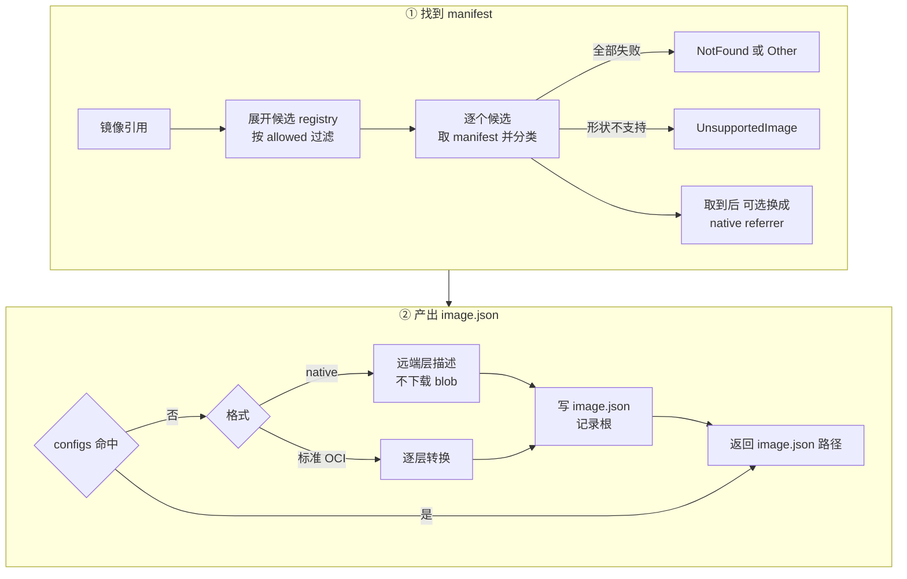
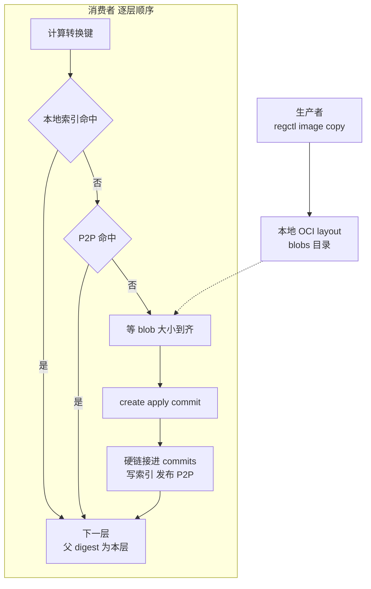
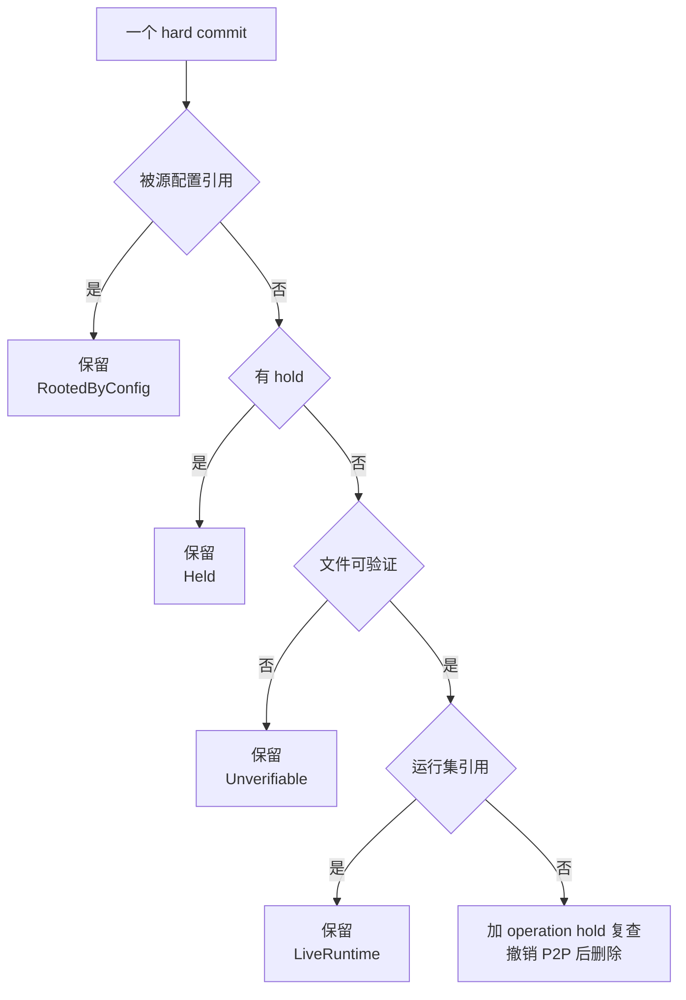

# 45 · 从 OCI 镜像到 overlaybd 层栈

> 用户给出的是一个 OCI 镜像引用，沙箱要的是一个能挂成 `/dev/ublkbN` 的 overlaybd 层栈。
> 本篇讲 AgentENV 怎样把前者变成后者：`ImageResolver::resolve()` 的决策树、overlaybd-native 镜像为什么一个 blob 都不下载、
> 标准 OCI 镜像怎样逐层转换并复用转换结果，以及承载这些结果的节点本地 image-cache 怎样做「宁可不删」的垃圾回收。
>
> **读者**：工程师。　**预备**：[第 05 篇 · overlaybd 与按需加载](05-overlaybd-and-lazy-loading.md)、[第 36 篇 · 读写路径与三种可写布局](36-read-write-paths-and-rw-layouts.md)。
> **代码**：`src/image/{resolver,oci_image,reference,commit_index,local_layer}.rs`、`src/image/cache/{service,graph,store,source_config}.rs`、`src/cfg/image.rs`、`storage/overlaybd/src/tools/oci.rs`

---

## 0. 本篇要回答的问题

1. 一个短名镜像引用会被展开成哪些候选？哪个阶段失败可以换下一个 registry，哪个阶段失败就整体放弃？
2. AgentENV 认得哪几种镜像形状？哪些形状被拒绝，为什么？
3. overlaybd-native 镜像在解析时做了什么、没做什么？
4. 标准 OCI 镜像的一层为什么不能独立转换？转换结果用什么做键、在哪里被复用？
5. image-cache 的元数据记了什么？GC 在什么条件下保留一个已转换的层？
6. 已提交的快照为什么不钉住 image-cache？

---

## 1. 问题：镜像是 tar 层，沙箱要的是块设备

OCI 镜像的层是一串 tar 包，每层记录相对下层的文件增删，删除用 whiteout 文件表示。它是给容器运行时在宿主上解包、再用 overlayfs 叠起来的。
microVM 的 guest 只认块设备，所以中间必须有一步把「文件层」变成「块层」。

最直接的做法是构建时把全部层解包进一个 ext4 文件。它的代价有三：每个镜像都要整份下载、整份解包；
两个共享基础层的镜像在节点上存两份；镜像越大，第一台沙箱等得越久。

AgentENV 的做法是让每个 OCI 层对应一个 overlaybd 层（[第 05 篇](05-overlaybd-and-lazy-loading.md)），层栈由 `image.json` 描述，
在 ublk-daemon 里叠成一个块设备（[第 26 篇 §5](26-sandbox-block-devices.md#5-用户-rootfs每台沙箱独占的可写设备)）。
镜像本身已经是 overlaybd 格式时，层留在 registry，按需读取；是标准 OCI 时，在节点上逐层转换，转换结果以层为单位缓存与共享。
这一入口的调用者很多：创建沙箱（`src/api/impls/sandbox.rs`）、模板构建（`src/api/impls/template.rs`）、
从镜像建卷与附加盘、BuildKit 的 builder 镜像，以及 tools 盘（`ImageResolver::resolve_tools()`，[第 26 篇 §7](26-sandbox-block-devices.md#7-tools-盘的来源与版本)）。

---

## 2. 解析一个镜像引用

### 2.1 候选 registry

`src/image/reference.rs` 的 `image_ref_candidates()` 先把引用拆成名字与后缀：只有 tag 时保留 tag，没有 tag 补 `:latest`，
同时带 tag 与 digest 时丢掉 tag，以 digest 为准。第一段含 `.`、`:` 或等于 `localhost` 才算 registry 主机。

带主机的引用只有一个候选。短名按 `[image.resolver] search_registries`（缺省 `docker.io`、`ghcr.io`）依次展开，
`docker.io` 下的单段名字补 `library/`。随后 `enforce_allowed_registries()` 按 `allowed_registries` 过滤：
键缺省表示不限，显式空列表表示全拒；过滤后为空就返回 `ImageError::InvalidReference`。

### 2.2 取 manifest：唯一可以换 registry 的阶段

`ImageResolver::resolve()`（`src/image/resolver.rs`）对每个候选调用 `fetch_oci_manifest()`。
代码注释写明，这是唯一允许「这个 registry 不对，换下一个」的阶段；一旦拿到 manifest，之后任何失败都直接终止整次解析。
全部候选都因 HTTP 404 失败时返回 `ImageError::NotFound`，否则返回 `ImageError::Other`。
`ImageError`（`src/image/mod.rs`）只为调用者要区分的 HTTP 状态设变体：`InvalidReference`、`NotFound`、`UnsupportedImage` 映射为 4xx，其余一律 5xx。

`fetch_manifest()`（`src/image/oci_image.rs`）用 `regctl manifest get` 取原始 body，自己对它做 sha256 得到 manifest digest。
遇到 index 时由 `select_manifest_for_platform()` 按 `linux/<宿主架构>` 选子 manifest，再取一次；嵌套最多 4 层（`MAX_INDEX_RESOLUTION_DEPTH`）。
index 只有一项时不看平台直接用它。返回的 `selected_image_ref` 已换成 `repo@digest` 形式，之后的读取都钉在这个 digest 上。

### 2.3 分类

取到 manifest 后 `classify_manifest()` 立即分类，逐层先由 `classify_layer()` 判定：

| 层的特征 | 分类 | 结果 |
|---|---|---|
| 带 `turbo-oci/` 前缀注解，或 version 注解含 `turbo` | OverlaybdTurbo | 拒绝 |
| mediaType 含 `.overlaybd`、`/zfile` 等记号 | OverlaybdNative | 接受 |
| 标准 tar mediaType 且 `blob-digest` 注解等于层 digest | OverlaybdNative | 接受 |
| 标准 tar mediaType 且 `blob-digest` 指向别的 blob | OverlaybdTarWrapped | 拒绝 |
| 标准 tar mediaType、无注解 | StandardTar | 接受 |
| 其它 mediaType | Unknown | 拒绝 |

manifest 的 `artifactType` 是 turbo 类型时不看层直接拒绝；各层分类不一致（标准层与 native 层混用）也拒绝。
被拒绝的形状都返回 `UnsupportedImage`，`resolve()` 收到它不再尝试其它候选，因为镜像确实存在，换 registry 没有意义。
turbo-OCI 的层只含文件系统与解压索引，数据仍在原始 OCI 层里，Rust 版 overlaybd 没有实现这条读路径；
注释特意让 turbo 判定优先于其它判定，因为 turbo 层也带「`blob-digest` 等于自身 digest」的注解，否则会被误认成 native，到运行时才以短读报错。

### 2.4 referrers：给标准镜像找加速层

一些 registry 会把转换好的 overlaybd 版本作为 OCI referrer 挂在原镜像上。
引用以 `try_referrers_overlaybd_prefixes` 中某个前缀开头（`starts_with` 匹配，缺省为空）且源镜像不是 native 时，
`try_resolve_overlaybd_referrer()` 用 `regctl artifact list` 取不加过滤的 referrers 列表，在本地按 artifactType 匹配：
先找 containerd 的 `application/vnd.containerd.overlaybd.native.v1+json`，再找 Azure 的 `application/vnd.azure.artifact.streaming.v1`。
命中后取它的 manifest，必须重新分类为 native 才采用；查找失败只记 warn，回到源镜像。
采用 referrer 时层来自 referrer，镜像配置（ENTRYPOINT、ENV 等）仍取自源镜像的 config blob。

下图是整个决策过程：



图中省略了一个检查：`convert_standard_oci`（缺省 true）为 false 时，标准镜像在查缓存之前就以 `InvalidReference` 被拒绝，提示改用 native 镜像或打开转换。
缓存命中时只做一次「触碰」，更新这个配置的最近使用时间（[§5.4](#54-容量驱逐按源配置的-lru)）；
若旁边的元数据文件缺失，再取一次 config blob 补上。

---

## 3. overlaybd-native：不下载任何 blob

native 镜像的每个层 blob 本身就是封存好的 overlaybd 层。`convert_fetched_oci_image_to_overlaybd()` 对它只做两件事：
由引用拼出 `repo_blob_url = https://<host>/v2/<repository>/blobs`（`docker.io` 换成 `registry-1.docker.io`），
再为每层生成 `RemoteLayer { digest, size, dir }`，`dir` 指向 image-cache 中以该 digest 命名的 commit 目录。
`overlaybd_image_config_json()` 把它们写成 `image.json` 的 `repoBlobUrl` 与 `lowers[{digest, size, dir}]`。

解析阶段到此结束，没有 blob 下载。沙箱启动后，Rust 版 overlaybd 按 `repoBlobUrl/<digest>` 用 Range GET 按需读层，
本地 `dir` 下若已有该层的 `overlaybd.commit` 就改读本地文件（[第 38 篇 §3.1](38-virtualfile-chain-and-remote-io.md#31-一次远端读穿过的栈)）。

native 镜像的缓存键多一维：`fetch_manifest()` 为 native 镜像设置 `repository_scope = host/repository`，配置文件名带上这个范围。
推论：`repoBlobUrl` 绑死了仓库地址，同一 manifest digest 在两个仓库里必须生成两份配置；标准镜像的转换产物只在本地，按 manifest digest 共享即可。

---

## 4. 标准 OCI：逐层转换

### 4.1 为什么一层不能独立转换

把一个 tar 层变成 overlaybd 层，等于在已有 lower 栈之上开一个空的可写层，把 tar 解进去，再封存。
whiteout 要删除的文件在下层，ext4 的目录与分配位图也只存在于下层之上，所以第 N 层的转换必须看得见第 0 到 N−1 层的完整结果。
第 0 层还要先 `mkfs` 出 ext4。这决定了两件事：层与层之间必须串行；同一个 tar 层叠在不同的下层上，产出的是不同的 overlaybd 层。

于是转换结果的键 `LayerConversionKey`（`src/image/oci_image.rs`）包含：源层 digest、转换器 ID、虚拟大小（固定 64 GiB，`LAYER_VIRTUAL_SIZE_GIB`）、
是否 mkfs（只有第 0 层为真）、**父层转换产物的 digest**、预期的层 UUID。
父 commit digest 把整条下层链折进了键里，作用类似 Merkle 链：任何一层变化，它之上所有层的键都随之变化。
转换器 ID 形如 `overlaybd-oci:<版本>:agentenv-cache-v1`（`AppConfig::resolved_overlaybd_oci_converter_id()`），升级 overlaybd 工具会使全部旧结果失效。

层 UUID 由 `uuid_from_layer_digest()` 取源层 digest 的 sha256 前 16 字节生成，父 UUID 取下一层的 UUID，
二者经 `overlaybd-commit --uuid / --parent-uuid` 写进层头（[第 34 篇](34-lsmt-format-and-index.md)）。
UUID 只依赖源层 digest，任何节点都能预先算出，用来核验从别处拿到的层是不是期望的那一层。

### 4.2 三级查找

`convert_standard_oci_layers_pipeline_inner()` 从第 0 层起逐层处理。每层先按键查找，查不到才转换：

1. **本地索引。** `lookup_converted_layer()` 读 `indexes/<源 digest>/sha256-<上下文哈希>.json`，核对索引里的全部上下文字段；
   **先**为它指向的 commit 加 operation hold，**再**检查文件存在、大小一致、层头 UUID 等于预期值。先加保护后检查是为了与并发的 GC 竞争：
   GC 赢了，检查发现文件没了，就落到下一级；保护先到，GC 在删除前复查时会看到它。
2. **P2P。** `lookup_remote_converted_layer()` 以 `oci-layer/v1/<键的 sha256>` 查集群里的其他节点。
   取回的文件要通过三项核验：元数据协议名、sha256 与大小、层头 UUID。每个键在一次转换中只查一次。
3. **现场转换。** 前两级都失败才调用 overlaybd 工具。

转换或取回的文件由 `store_converted_layer()` 计算 sha256，硬链接进 `commits/<digest>/overlaybd.commit`（跨文件系统时退为拷贝），
记录元数据、写索引，再 best-effort 发布到 P2P。staging 目录建在 image-cache 之下，就是为了让硬链接不跨文件系统。
全部层都能命中时，`cached_standard_oci_lowers()` 直接返回，连镜像都不下载。

推论：P2P 键含父 commit digest，若 `overlaybd-apply` 的输出不是逐字节确定的，两个节点独立转换的同一底层会有不同 digest，
它们之上的层在 P2P 上互相找不到；只有沿同一条链从对方取得下层时，上层才能复用。

### 4.3 生产者与消费者

只要有一层未命中，就要下载镜像。`RegctlImageCopyProducer` 在后台启动 `regctl image copy --platform local <ref@digest> ocidir://…`，
把镜像写成本地 OCI layout；消费者按层顺序等待自己要的 blob。下图上方是生产者，方框内是消费者对每一层的处理：



`wait_layer_blob()` 每 50 ms 检查一次 `blobs/<algo>/<hex>`，大小等于 manifest 声明值就认为到齐；
复制进程失败退出时，HTTP 404 立即报 `NotFound`，其它错误按 500 ms 起的指数退避重启复制，最多 5 次。
这样下载与转换重叠：第 0 层在转换时，后面的层还在下载。代价有两处。一是就绪判据只有大小，
推论：blob 内容的校验依赖 regctl 自身；二是 regctl 复制的是整个镜像，推论：已命中的层也会被下载一遍。
转换成功或失败后，`convert_standard_oci_layers_pipeline()` 都会终止复制进程。

### 4.4 一层的转换

`OverlaybdTools::convert_local_oci_layer_to_overlaybd()`（`storage/overlaybd/src/tools/oci.rs`）按顺序调用三个 overlaybd 工具：

1. `overlaybd-create`：在干净的工作目录里建可写层 `upper.data` 与 `upper.index`，虚拟大小 64 GiB；
2. 写一份临时 `image.json`，`lowers` 是此前各层的 commit 文件，`upper` 是刚建的可写层；
3. `overlaybd-apply`：把 tar 解进这个层栈，第 0 层带 `--mkfs`；
4. `overlaybd-commit`：带 `--uuid` 与 `--parent-uuid` 把可写层封存成 `layer.commit`。

成功后只留下 `layer.commit`；失败时保留中间文件便于排查。有一处临时绕行：注释说明当前版本的 `overlaybd-apply` 不能解 zstd 压缩的 tar，
所以按文件魔数（而不是 mediaType，有的镜像把 zstd 层标成 gzip）识别 zstd，先经 `zstd -dc` 管道解压再交给工具。

`overlaybd-apply` 使用专用的全局配置 `convert-overlaybd-global.json`，缓存目录是独立的 `convert-blocks`（`src/setup/deps.rs`），
原因见[第 39 篇 §2.4](39-block-cache-and-background-download.md#24-一个节点上的四个缓存目录)。

---

## 5. 节点本地的 image-cache

### 5.1 目录

`ImageCacheService`（`src/image/cache/service.rs`）管理 `[image.cache] root_dir`（缺省 `$AENV_HOME/image-cache`），同一根目录在进程里只有一个实例：

```text
image-cache/
├── configs/
│   ├── <manifest digest>[-<repository 范围>]-image.json      解析结果：运行时 image.json
│   └── <manifest digest>[-<repository 范围>]-image.metadata.json  镜像配置元数据
├── indexes/<源层 digest>/sha256-<上下文哈希>.json               转换索引：键 → commit digest
├── commits/<algo>-<hex>/overlaybd.commit                        已转换的层，内容寻址
├── metadata/                                                     RocksDB：元数据图
├── staging/                                                      转换与 P2P 取回的临时目录
├── remote-blocks/  convert-blocks/  resize-blocks/               块缓存目录（第 39 篇）
```

`configs/` 下的每个 `-image.json` 是一个**根**：它引用的 commit 被认为在用。
同一镜像的解析与转换由进程内的按配置路径互斥锁串行化（`SourceImageCache::acquire_lock()`）。

### 5.2 元数据图

`ImageCacheMetadataStore`（`src/image/cache/graph.rs`）在 RocksDB 里存四类记录，写入走同步模式：

| 记录 | 键前缀 | 内容 |
|---|---|---|
| hard commit 对象 | `object/hard-commit/` | digest、文件路径、大小、发布过的 P2P 键 |
| config 引用 | `ref/config-to-hard/` | 哪个源配置引用哪个 commit |
| hold | `hold/`、`ref/hold-to-hard/`、`ref/hard-to-hold/` | 哪个持有者钉住哪些 commit，正反两向 |
| 最近使用 | `config-last-used/` | 源配置的最后使用时间 |

config 引用可以从 `configs/` 目录完整重建（`rebuild_from_configs()`），GC 每轮先重建一次，所以 RocksDB 里的根只是缓存，真相在配置文件。
hold 不能重建，它记录的是进程内正在发生的事。schema 版本不符时整库清空重写，hold 随之丢失。

### 5.3 三类持有者

hold 的持有者分三个命名空间：

- **operation**：一次转换或一次 GC 删除期间的临时保护。转换时它是惰性的，第一次保护 commit 时才写入 RocksDB。
  `publish_image_config()` 先写配置文件并记录根，**之后**才放掉转换会话，于是 commit 从「被 operation 保护」无缝转到「被根引用」。
- **runtime**：启动中的沙箱（`RuntimeImageOwner::StartingSandbox`）。
- **paused**：暂停的沙箱，跨重启保留。

启动时 `cleanup_stale_runtime_holds()` 清掉 runtime 与 operation 两类，paused 由 `reconcile_namespace()` 对照暂停记录清理孤儿。
这几类保护怎样在沙箱的启动、运行、暂停之间交接，见[第 20 篇 §5](20-launch-plan-and-rollback.md#5-镜像引用保护的交接)；
运行中的沙箱不靠 hold，而是由维护任务每轮从句柄表收集运行集（`collect_running_artifacts()`）。
只有 commit 目录里、以 `file=` 引用的层会被钉住；以 `dir=` 引用、可以回退到 registry 的层不需要保护（`acquire_hold_for_config_paths()` 的注释）。

### 5.4 容量驱逐：按源配置的 LRU

维护任务由 `Orchestrator::start_local_image_maintenance_task()` 启动，间隔 `[image.cache.gc] interval_secs`（缺省 1800 s），
`gc.enabled = false` 时不启动。设了 `capacity_gb` 时，每轮先做容量驱逐：
`plan_capacity_eviction()` 统计全部 hard commit 的字节数，超过 `capacity_gb × high_watermark_ratio`（缺省 0.95）就按最近使用时间从旧到新挑源配置，
只挑闲置超过 `min_age_secs`（缺省 600 s）的，直到估计值降到 `low_watermark_ratio`（缺省 0.70）以下。
估计时一个 commit 只有在它的全部引用者都被选中时才计入可释放字节。

驱逐的对象是**配置文件**而不是层：删掉配置等于拆掉一个根，层本身留给随后的 GC 判定。删除前在该配置的锁下复查最近使用时间，期间被用过就放弃。
`capacity_gb` 的代码缺省是不设（不做容量驱逐），`default.toml` 写的是 100。

### 5.5 宁可不删的 GC

`run_gc()` 遍历每个 hard commit 对象，逐项判定。保留的理由有四种，任何一种成立都不删：



「无法验证」也算保留理由：记录里没有文件路径、文件在 commit 目录之外、文件不见了或大小不符，GC 都不动它。
第二次判定在 operation hold 下进行，因为源配置的发布不受这把 hold 串行化，第一次判定之后可能刚有新配置引用了它。
删除时先撤销该 commit 发布过的 P2P 键再删文件；`publish_converted_layer()` 则是先记 P2P 键再发布，
注释说明这样崩溃时不会留下元数据里查不到、因而永远无法撤销的 catalog 条目。一轮结束后 `reclaim_stale_indexes()` 删除指向已不存在 commit 的索引。

这套规则的代价是会漏删。推论：commit 文件已硬链接进目录、元数据还没写入时进程崩溃，或 schema 重置清空了对象记录，
这样的文件不在 GC 的遍历范围内，要等某个配置重新引用它才会被重新记账。

### 5.6 已提交快照不钉住 image-cache

`SnapshotManager` 的文档注释写明：已提交快照的持久可达性完全由快照仓库负责，节点本地的 `image-cache/commits/` 可以回收，快照不在这里登记任何 hold。
原因是快照发布时，它引用的本地层要么被导入仓库的 `managed-layers/`，要么本来就在 registry 里（[第 46 篇](46-snapshot-object-model.md)）。
image-cache 因此只对节点上**此刻**运行或暂停的沙箱负责。

---

## 6. 调用 regctl 的两条约束

所有 registry 访问都经 `regctl`：注释给的理由是它逐字节保留 manifest，并接受带 OCI mediaType 的 Docker schema2 manifest。
`regctl_command()` 给每个子进程设 `GOMAXPROCS=4`：Go 运行时缺省按宿主 CPU 数起线程，AgentENV 高并发地为每次镜像操作 fork 一个 regctl，
在多核宿主上会耗尽进程数上限，而 regctl 的工作受网络限制，少几个线程不影响吞吐。
`run_regctl()` 对失败做 5 次、500 ms 起的指数退避重试，但 stderr 里带 `[http 404]` 时立即返回 `NotFound`，不消耗重试预算。

---

## 7. 与 e2b infra 的对照

e2b infra 在构建模板时把全部 OCI 层解包、经 overlayfs 叠合后 rsync 进一个 ext4 文件，构建进程需要 loop 设备与 overlay 挂载的特权（见 e2b 手册第 43 篇）。
AgentENV 保留 OCI 的层结构，每层一个 overlaybd 层，native 镜像连下载都推迟到运行时，转换结果按层跨镜像、跨节点复用。
代价是转换依赖一组外部 C++ 工具，层与层必须串行，image-cache 需要一套自己的根、保护与 GC。

---

## 8. 小结

- 候选 registry 只在取 manifest 阶段可以切换；拿到 manifest 后任何失败都终止解析，镜像形状不支持时也不再尝试其它 registry。
- 支持两种形状：全部层为 overlaybd-native，或全部层为标准 tar；turbo-OCI、tar 包裹的 overlaybd、混合层与未知 mediaType 一律以 4xx 拒绝。
- 标准镜像可以通过 OCI referrers 换成 native 加速层，层取自 referrer，镜像配置仍取自源镜像。
- native 镜像在解析时不下载任何 blob，只生成带 `repoBlobUrl` 的 `image.json`，层在运行时按需读取。
- 标准镜像逐层串行转换；转换键包含父层产物的 digest，同一 tar 层叠在不同下层上是不同的键。
- 每层按本地索引、P2P、现场转换三级查找；全部命中时不下载镜像，否则下载与转换以生产者与消费者的方式重叠。
- image-cache 以 `configs/` 下的解析结果为根，以 operation、runtime、paused 三类 hold 与运行集为保护；容量驱逐拆根，GC 删层。
- GC 在无法验证时选择保留，删除前在 hold 下复查，并先撤销 P2P 发布再删文件。
- 已提交快照不钉住 image-cache，它的层已在快照仓库或 registry 里有持久副本。

## 延伸阅读 / 下一篇

- 下一篇：[第 46 篇 · 快照对象模型与 SnapshotManager](46-snapshot-object-model.md)——层栈加上内存与 VM 状态，怎样成为一条可提交的快照记录。
- [第 26 篇 · 沙箱的块设备](26-sandbox-block-devices.md)：解析得到的 `image.json` 怎样在 daemon 里物化成 rootfs 设备。
- [第 38 篇 · VirtualFile 装饰器链与远端 I/O 运行时](38-virtualfile-chain-and-remote-io.md)：native 层在运行时怎样被按需读取。
- [第 58 篇 · P2P 制品传输](58-p2p-artifact-transport.md)：`oci-layer/v1` 键所在的传输层与发现机制。
- [第 53 篇 · BuildKit](53-buildkit-in-microvm.md)：`resolve_buildkit()` 用同一条转换流水线处理 BuildKit 产出的镜像。
- [e2b 手册第 43 篇 · rootfs 制作](../e2b-infra/43-rootfs-construction.md)：另一种把 OCI 镜像变成磁盘的做法。
