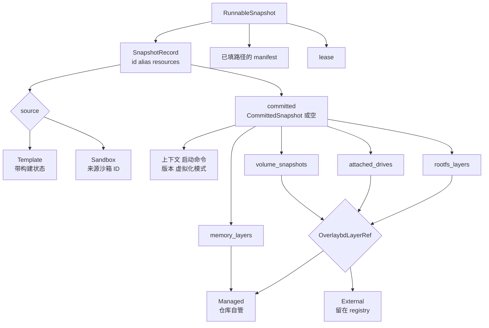
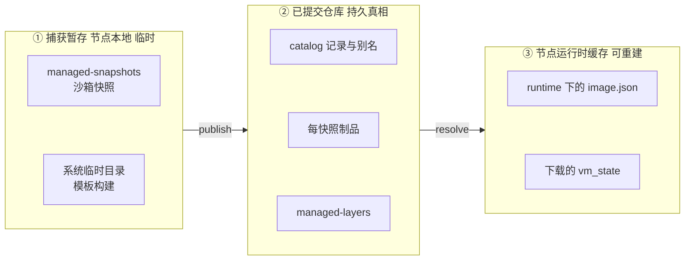

# 46 · 快照对象模型与 SnapshotManager

> 一个快照是 VM 状态、内存层、rootfs 层栈、附加盘与卷的组合，再加上恢复它所需的运行上下文。
> 这些东西在三个地方以三种形态出现：捕获时是节点本地的一个目录，提交后是快照仓库里的记录与制品，运行时又被物化成节点本地的路径。
> 本篇讲 AgentENV 用哪些类型描述它们、为什么持久记录里不允许出现任何节点本地路径，以及 `SnapshotManager` 这层门面在提交前后各做了什么。
>
> **读者**：工程师。　**预备**：[第 45 篇 · 从 OCI 镜像到 overlaybd 层栈](45-oci-to-overlaybd.md)、[第 16 篇 · 快照与卷 API](16-snapshot-and-volume-api.md)。
> **代码**：`src/snapshot/types/{snapshot,value,drive,artifacts,version}.rs`、`src/snapshot/manager.rs`、`src/snapshot/repository/interfaces.rs`、`src/sandbox/manifest.rs`、`src/snapshot/repository/backends/posixfs/artifacts.rs`

---

## 0. 本篇要回答的问题

1. `SnapshotRecord`、`CommittedSnapshot`、`RunnableSnapshot` 各代表什么？一条记录什么时候没有 `committed`？
2. 层引用为什么分 `Managed` 与 `External` 两种？捕获目录里的一个层怎样被归入其中一种？
3. 持久化的 Firecracker manifest 里为什么没有路径？路径在什么时候、由谁填回去？
4. 一个快照由哪些制品组成？它们在捕获目录、POSIX 仓库、对象存储与节点运行时各叫什么？
5. 捕获暂存、已提交仓库、节点运行时缓存这三层各由谁拥有、活多久？
6. `SnapshotManager` 除了转发调用之外做了哪两件事？P2P 发布为什么不能影响提交结果？

---

## 1. 问题：一个可恢复的检查点由什么组成

恢复一台暂停过的 microVM 需要四类东西：Firecracker 的 VM 状态文件、guest 内存、guest 看到的每一块盘，
以及 VM 之外的上下文（环境变量、工作目录、用户、启动命令、CPU 与内存规格）。AgentENV 把内存与每块盘都存成 overlaybd 层栈
（[第 42 篇](42-memory-snapshot-over-ublk.md)、[第 37 篇](37-seal-restack-compact.md)），所以快照的绝大部分体积是层。

层有两个特点：大，而且在快照之间大量共享。从同一模板派生的一百个快照共享同一组 rootfs 底层，只在栈顶各有一层增量。
记录则相反：小，要能按 ID 或别名查到，要能列出，还要在多个节点之间可读。
模板构建还要求记录能在制品存在之前就出现，承载「正在构建」这种中间状态。

这三点决定了对象模型的形状：记录与制品分开；层用内容寻址的逻辑引用表示，不在记录里存文件；记录允许没有已提交载荷。
还有一条约束来自多节点：同一条记录会被不同节点解析，节点本地的绝对路径一旦写进记录，换一个节点就失效。

---

## 2. 记录、已提交载荷与可运行快照

### 2.1 类型一览

下图是 `src/snapshot/types/` 里的主要类型及其包含关系：

`SnapshotRecord`（`src/snapshot/types/snapshot.rs`）是目录项：`id`、可选的 `alias`、`source`、`resources`（vCPU、内存、磁盘大小）、
创建与更新时间、可选的 `committed`。`committed` 为空只有一种情况：模板记录已经建立、构建还没完成。

`SnapshotId`（`src/snapshot/types/value.rs`）包着一个 `Uuid::now_v7()`，按时间单调，列表与分页可以直接按 ID 排序。
注释提醒它总以小写带连字符的形式输出，POSIX 仓库的目录名必须与之一致，外部工具写入的大写 ID 会查不到。
`SnapshotAlias` 只允许 ASCII 字母、数字、`-` 与 `_`；模板名就是快照别名。

### 2.2 来源与模板状态

`SnapshotSource` 有两种：`Template { build }` 与 `Sandbox { source_sandbox_id }`。模板记录的 `TemplateBuildInfo` 带状态、起止时间与失败原因，
状态只有四个，转换各由一个仓库方法完成：

| 转换 | 方法 | 说明 |
|---|---|---|
| 无 → Waiting | `SnapshotRepository::create()` | 只接受模板来源、不带 `committed` 的记录 |
| Waiting → Building | `try_start_build()` | 非 Waiting 一律拒绝 |
| Building → Ready | `publish()` 内的 `SnapshotRecord::mark_committed()` | 同时写入 `committed`、清空失败原因 |
| 任意 → Error | `mark_build_error()` | 写入结束时间与原因 |

`mark_committed()` 本身不检查原状态：已有记录无论处于什么状态都会被置为 Ready；记录不存在而来源是模板时，POSIX 仓库直接造一条 Ready 记录
（`posixfs/catalog.rs` 的 `committed_record_unlocked()`）。来源是沙箱时，`mark_committed()` 把 `source` 改写成 `Sandbox`。
模板与构建 ID 合一、别名在 Waiting 时就被占住等 API 层面的后果，见[第 15 篇 §2](15-template-build-api.md#2-模板即快照记录)。

失败原因 `TemplateBuildErrorReason` 有 `message` 与 `step` 两个字段。`step` 必须是从 1 开始的十进制步骤号，
`src/template/step_executor.rs` 的注释说明了原因：E2B 官方 SDK 把这个字段当作下标去索引本地记录的调用栈，
非数字会让 Python SDK 在抛出真正的构建错误之前先在错误处理路径里崩溃；指令文本因此只能放进 `message`。
反序列化做了兼容：旧记录里的失败原因是一个纯字符串，自定义的 `Deserialize` 把它读成只有 `message` 的结构。

### 2.3 `CommittedSnapshot`：恢复需要的全部逻辑信息

已提交载荷分两组字段。第一组是运行上下文：

- `context`（`CommandContext`）：环境变量、工作目录、用户、暴露端口、ENTRYPOINT、CMD、VOLUME、LABEL，来自镜像配置与构建步骤；
- `startup`：模板的启动命令与就绪检查命令；
- `runtime_versions`（`src/snapshot/types/version.rs`）：内核、Firecracker、envd 与 tools 盘的版本，构建时在 VM 里探测；
- `virtualization_mode`：捕获时节点的虚拟化模式（KVM 或 PVM）；
- `image_configs`：源镜像的 OCI config 原文，启动时经 MMDS 交给 guest；
- `custom_extension_params`：透传给扩展 hook 的不透明 JSON（[第 33 篇](33-custom-extension-hooks.md)）。

这些字段在恢复时不只是被读出来，而是被校验。`launch_sandbox()`（`src/orchestrator/service.rs`）在虚拟化模式不符时返回 `VirtualizationModeMismatch`；
`src/sandbox/firecracker/config.rs` 在构造恢复配置时再查一次虚拟化模式与 manifest 的 `backend`，
并把 tools 盘版本钉成记录里的值，记录没有这个版本就拒绝启动（[第 26 篇 §7.3](26-sandbox-block-devices.md#73-版本钉在快照上)）。

第二组是制品引用：`rootfs_layers`、`attached_drives`（每块盘的 drive ID、层、只读、虚拟大小、挂载路径）、
`volume_snapshots`（随快照捕获的卷：挂载路径、模式、大小、层）、`memory_layers`，
以及可选的 `disk_publications`（rootfs 被推回源 registry 时的镜像引用与 manifest digest，[第 50 篇](50-rootfs-as-oci-image.md)）
和 `memory_startup`（startup manifest 的大小与 sha256，[第 43 篇](43-startup-pack-and-prefetch.md)）。
`memory_startup` 的 sha256 字段仍叫 `index_sha256`，注释说明这是为已提交记录的兼容而保留的名字。

### 2.4 两种层引用

`OverlaybdLayerRef` 是全书反复出现的类型，只有两个变体：

| 变体 | 字段 | 字节在哪里 | 谁负责它活着 |
|---|---|---|---|
| `Managed(ManagedLayer)` | digest、size、可选 uuid | 仓库的 `managed-layers/`，按 digest 寻址 | 快照仓库 |
| `External(ExternalLayer)` | digest、`repo_blob_url`、size | 源 OCI registry | registry 的所有者 |

捕获目录里的一个层归入哪一种，由它在 `image.json` 里的写法决定。POSIX 仓库的 `derive_rootfs_layers()`（`posixfs/artifacts.rs`）的规则是：
有 `file` 且带 digest 与 size 的层，信任这个描述符导入为 Managed；有 `file` 但没有描述符、文件名表明它是运行时生成的增量
（`snapshot.commit` 等，`src/image/local_layer.rs` 的 `rootfs_layer_is_runtime_generated_delta()`），现场计算 hash 后导入为 Managed；
没有 `file` 但有 `repoBlobUrl` 的层记为 External；其它情况拒绝发布。
运行时增量没有现成的描述符，是因为封存不产出整层 digest（[第 37 篇 §2.3](37-seal-restack-compact.md#23-增量-digest-与它的适用范围)），发布时只能另算。

由此可以读出两件事。第一，image-cache 里转换出的层（[第 45 篇](45-oci-to-overlaybd.md)）带描述符，发布时被复制或硬链接进 `managed-layers/`，
从此与 image-cache 无关；overlaybd-native 镜像的层没有本地文件，以 External 进入记录，快照的可读性就依赖 registry 一直保留这些 blob。
第二，`memory_layers` 的类型是 `Vec<ManagedLayer>`，内存层永远由仓库自管，没有「留在别处」的选项。

### 2.5 `RunnableSnapshot`

`RunnableSnapshot` 是 `SnapshotRuntimeResolver::resolve()` 的产物，三个字段：记录本身、已填入本节点路径的 manifest、一个 `Arc<dyn RuntimeArtifactLease>`。
lease 没有任何方法，它的作用全在析构：只要 `RunnableSnapshot` 还活着，它引用的本地缓存文件就不会被驱逐（`src/snapshot/artifact_cache.rs` 的 `CacheArtifactLease`）。
`committed()` 访问器对空载荷直接 `expect`，因为解析器只接受已提交的记录。

---

## 3. manifest：形状进仓库，路径留在节点

`SandboxSnapshotManifest`（`src/sandbox/manifest.rs`）描述一次捕获在磁盘上的布局：VM 状态文件、内存镜像、rootfs 镜像、每块附加盘，
外加 `backend`（拍快照的 VMM，目前只有 `firecracker`）、为启动时挂卷预留的 virtio-blk 槽位数（`volume_drive_slots`）、
快照里实际存在的附加盘数（`physical_extra_drive_count`）。

关键在于序列化规则：`vm_state.path`、`memory.image_config_path`、`rootfs.image_config_path`、每块盘的 `image_config_path` 全部标了 `#[serde(skip)]`。
持久化的 `firecracker-manifest.json` 只剩虚拟大小、drive ID、只读与挂载路径这些「形状」信息。
发布时，仓库从内存中的 manifest 读出这些路径去导入制品；解析时，解析器重新物化本节点的 `image.json` 并把路径填回（hydrate），
这一步在[第 49 篇](49-resolve-and-artifact-cache.md)。`SnapshotRepository` 的文档注释把这条边界写成契约：
返回的记录描述持久仓库状态，节点本地的缓存目录不得漏回记录。

两处细节。manifest 不含卷：卷的逻辑层在 `CommittedSnapshot.volume_snapshots` 里，manifest 只记预留了几个槽位（[第 31 篇](31-extra-drives-and-volumes.md)）。
`memory_startup_pack` 字段是运行时才填的解析结果，注释说明它不来自持久文件；推论：它在为空时不序列化，捕获出的 manifest 里总为空，所以不会被写进仓库。

`SandboxSnapshotManifest::new()` 还会拒绝不认识的 `backend`，让一个无法恢复的捕获在进入仓库之前就失败，而不是在别的节点恢复时才失败。

---

## 4. 一个快照的制品

固定的文件名集中在 `src/snapshot/types/artifacts.rs` 的 `SNAPSHOT_ARTIFACT_LAYOUT`。下表把每个制品在四个位置的名字对齐；
POSIX 与对象存储两列的细节分别在[第 47 篇](47-posix-repository.md)与[第 48 篇](48-object-storage-repository.md)：

| 制品 | 捕获目录 | POSIX 仓库 | 对象存储 key | 节点运行时 |
|---|---|---|---|---|
| 记录 | 无 | `catalog/records/{id}.json` | `catalog/records/{id}.json` | 不落盘 |
| 别名 | 无 | `catalog/aliases/{alias}` | `catalog/aliases/{alias}.json` | 不落盘 |
| 提交标记 | 无 | `snapshots/{id}/commit` | 无，记录即提交点 | 无 |
| VM 状态 | `vm_state.bin` | `snapshots/{id}/vm_state.bin` | `artifacts/{id}/vm_state.bin` | POSIX 直接用仓库文件；对象存储下载到 `artifacts/{id}/` |
| Firecracker manifest | 内存对象 | `snapshots/{id}/firecracker-manifest.json` | `artifacts/{id}/firecracker-manifest.json` | 填好路径的内存对象 |
| 内存层 | `mem_overlaybd/overlaybd.commit`、`mem_image.json` | `managed-layers/` | `managed-layers/{digest}` | `runtime/{id}/memory/image.json` |
| rootfs 层 | `rootfs/snapshot.commit`、`rootfs/inherited-layers/`、`rootfs/image.json` | `managed-layers/` 或 External | `managed-layers/{digest}` 或 External | `runtime/{id}/rootfs/image.json` |
| 附加盘 | `drives/{drive_id}/` | `managed-layers/` | `managed-layers/{digest}` | `runtime/{id}/drives/{drive_id}/image.json` |
| startup manifest | 录制产物 | `snapshots/{id}/memory-startup.pack` | `artifacts/{id}/memory-startup.pack` | 按需读取 |
| 构建日志 | 无 | `snapshots/build-logs/{id}.json` | `snapshots/build-logs/{id}.json` | 无 |

`managed-layers/` 下的文件名在 POSIX 仓库里是把 digest 中的 `:` 与 `/` 换成 `_` 再加 `.overlaybd.commit`（`posixfs/layout.rs` 的 `managed_layer_file_name()`）；
节点运行时一列的路径都在 `[snapshot] local_cache_path`（缺省 `$AENV_HOME/snapshot-local-cache`）之下。
表里的规律是：每个快照独有的制品（VM 状态、manifest、startup manifest）放在按快照 ID 命名的目录或前缀下，删除快照时随之删除；
层放在按 digest 命名的共享位置，删除快照时不动。v0.2.3 两种仓库都没有回收 `managed-layers/` 的机制，这也是删除源卷之后克隆卷仍然可用的前提（[第 47 篇](47-posix-repository.md)）。

---

## 5. 三层存储

下图从左到右是一个快照的数据所经过的三层：

**① 捕获暂存。** 沙箱快照由 `FirecrackerSandbox::snapshot()` 捕获到 `<managed-snapshot-base>/<沙箱 ID>/<UUIDv7>`，
基目录是 `[firecracker] work_dir` 下的 `managed-snapshots`，未设 `work_dir` 时在系统临时目录的 `aenv/` 下（`managed_snapshot_base()`）。
目录的寿命由 `PersistentSnapshotRootGuard` 的引用计数决定，`CapturedSandboxSnapshot` 持有这个守卫直到发布结束。
模板构建的捕获由 `TemplateBuildRunner` 调 `capture_to_dir()` 写进 `TemplateBuilder::create_local_dir()` 建的临时目录，名字是 `snapshot-{id}-` 前缀，
位于系统临时目录。两种暂存都只活到发布完成；startup 录制任务另持一份守卫，可以活得更久（§6）。

**② 已提交仓库。** 记录、别名、每快照制品与共享层，是模板 API 与快照 API 暴露的唯一真相。
`SnapshotRepository` 的文档注释列出了对后端的要求：别名的认领与释放要并发安全；别名只能在记录与载荷持久到足以被后续读者解析之后才可见；
删除不能暴露半删的记录；共享层的导入要用原子协议，避免并发写者暴露写了一半的层。两种后端怎样满足（或部分满足）这些要求是第 47、48 篇的主题。
「持久」不等于「共享」：`posix_fs` 后端的缺省 `snapshot_store` 是节点本地的 `$AENV_HOME/snapshot-store`，多节点部署必须把它放到共享文件系统上或改用对象存储，否则一个节点提交的快照在另一个节点上不存在。

**③ 节点运行时缓存。** 解析器在 `local_cache_path` 下为每个快照物化 rootfs、内存与附加盘的 `image.json`；对象存储后端还把 VM 状态与 manifest 下载到本地。
这些文件可以从已提交状态重建，由 `LocalArtifactCache` 按引用计数钉住、按 LRU 回收（[第 49 篇](49-resolve-and-artifact-cache.md)）。

这三层之外还有一个容易混淆的位置：暂停的沙箱。pause 的产物写在 `$AENV_HOME/persisted-sandboxes/`，记录在节点本地，不进快照仓库，
只能在原节点恢复（[第 08 篇 §5](08-system-architecture.md#5-存储拓扑什么是真相)、[第 22 篇](22-persistence-across-restarts.md)）。
要让沙箱的状态跨节点可用，只能走本篇的路径：捕获、发布成快照，再从快照创建新沙箱。

`docs/src/internals/persistence-artifact-inventory.md` 有同样的三层划分，但有几处与代码不符：它把模板构建的暂存写成 `<local_cache_path>/snapshots/<id>/`，
把仓库里的记录写成 `snapshot.json`，并称 image-cache 「没有统一 GC」；代码里暂存在系统临时目录，记录在 `catalog/records/{id}.json`，image-cache 有一套 fail-closed GC。

---

## 6. `SnapshotManager`：一层薄门面

`SnapshotManager`（`src/snapshot/manager.rs`）持有仓库、运行时解析器与可选的 P2P 传输。它的大多数方法只是转发：
`create`、`get`、`list`、`delete`、`resolve_committed_alias`、`try_start_build`、`mark_build_error` 直通仓库，`resolve_runnable` 与 `load_runnable` 直通解析器。
`repository()` 把同一个仓库对象交给卷目录使用，卷与快照共享一份持久真相。类型的文档注释写明了它**不做**的事：
已提交快照的可达性完全由仓库负责，节点本地的 `image-cache/commits/` 可以回收，manager 不记录任何本地镜像引用。

它自己的逻辑只有两段。

**发布之后才做 P2P。** `publish()` 与 `publish_captured()` 都先调用 `SnapshotRepository::publish_with_local_layers()`，成功后才调用 `publish_p2p_artifacts()`。
后者把 VM 状态、manifest 字节、仓库上传时准备的本地层文件（可能是压缩或稠密导出后的副本）、以及 rootfs、内存、附加盘 `image.json` 里引用的本地层，
去重后以并发 8（`SNAPSHOT_P2P_PUBLISH_CONCURRENCY`）发布，单项失败只记 warn。`SnapshotPublication.local_layers` 的存在就是为了让这些临时文件活到 P2P 拷完。
两个测试锁定了这一顺序的不变量：`failed_repository_commit_does_not_publish_to_p2p` 与 `failed_p2p_publication_does_not_undo_repository_commit`。
P2P 只是加速路径，从不承载已提交的真相（[第 58 篇](58-p2p-artifact-transport.md)）。

**录制与上传并行。** `publish_captured()` 在调用仓库之前，先用 `StartupRecording::spawn_with_capture_lease()` 启动 startup 录制：
在快照上起一个一次性 VM，记录首批触达的内存页（[第 43 篇](43-startup-pack-and-prefetch.md)）。录制任务与它的后续上传各持一份捕获目录的守卫，
仓库在上传完层之后才等待录制结果，于是录制 VM 与层上传重叠，而不是排在上传之前。功能关闭时这是一个空任务。

沙箱快照的完整调用链是：API 的 `sandboxes_sandbox_id_snapshots_post()` → `Orchestrator::capture_snapshot()`（捕获后立即恢复源 VM）
→ 卷快照 → `SnapshotManager::publish_captured()`。发布发生在源沙箱已回到 Running 之后，这期间它可以被暂停或删除
（[第 20 篇 §6](20-launch-plan-and-rollback.md#6-借出-running快照卷快照与-fork)）。
`SnapshotPublishMetadata` 的上下文、启动命令、版本与扩展参数都取自沙箱元数据，也就是沙箱创建时从模板继承下来的那份；ID 由 `SnapshotId::generate()` 新生成。

---

## 7. 与 e2b infra 的对照

e2b infra 把模板与快照的元数据放在 Postgres（`envs`、`env_builds`、`snapshots` 等表），制品按构建 ID 存在对象存储里（见 e2b 手册第 11、29 篇）。
AgentENV 没有数据库，记录与制品在同一个仓库里，按快照 ID 与层 digest 两种键组织，模板就是一条带构建状态的快照记录。
代价是目录查询、别名唯一性与状态转换都要由文件系统或对象存储自己提供原子性，这正是第 47、48 篇要处理的问题。

---

## 8. 小结

- `SnapshotRecord` 是目录项；`committed` 为空只表示模板构建尚未完成。
- 模板状态 Waiting → Building → Ready | Error 各由一个仓库方法推进；`mark_committed()` 不检查原状态。
- 构建失败的 `step` 必须是 1 起的数字字符串，否则 E2B 的 Python SDK 在错误路径上崩溃。
- `CommittedSnapshot` 携带恢复所需的全部逻辑信息；虚拟化模式、backend 与 tools 盘版本在恢复时被校验或钉住。
- 层引用只有 Managed（仓库按 digest 自管）与 External（留在源 registry）两种；内存层总是 Managed。
- 带描述符的本地层按描述符导入，运行时增量现场计算 hash，只有 `repoBlobUrl` 的层记为 External。
- 持久化的 manifest 只有形状，所有路径 `#[serde(skip)]`，解析时由本节点填回。
- 每快照制品随快照删除，共享层不删；`managed-layers/` 在两种仓库里都没有回收机制。
- 捕获暂存、已提交仓库、节点运行时缓存三层各有所有者；暂停沙箱的产物不属于其中任何一层，只在原节点可用。
- `SnapshotManager` 只做两件事：提交成功后 best-effort 发布 P2P，以及让 startup 录制与层上传并行。

## 延伸阅读 / 下一篇

- 下一篇：[第 47 篇 · POSIX 仓库与提交协议](47-posix-repository.md)——记录、别名与共享层怎样在文件系统上原子地提交。
- [第 48 篇 · 对象存储仓库](48-object-storage-repository.md)：同一个 trait 在没有 CAS 的存储上的实现。
- [第 49 篇 · 从记录到可运行](49-resolve-and-artifact-cache.md)：`RunnableSnapshot` 的路径与 lease 从哪里来。
- [第 16 篇 · 快照与卷 API](16-snapshot-and-volume-api.md)：创建快照与卷快照在 API 层的三个阶段。
- [第 15 篇 · 模板构建 API](15-template-build-api.md)：模板即快照记录在 E2B 接口上的后果。
- [e2b 手册第 11 篇 · 对象模型](../e2b-infra/11-object-model.md)、[e2b 手册第 29 篇 · 模板产物格式](../e2b-infra/29-template-artifact-format.md)：另一套用数据库加对象存储组织模板的做法。
