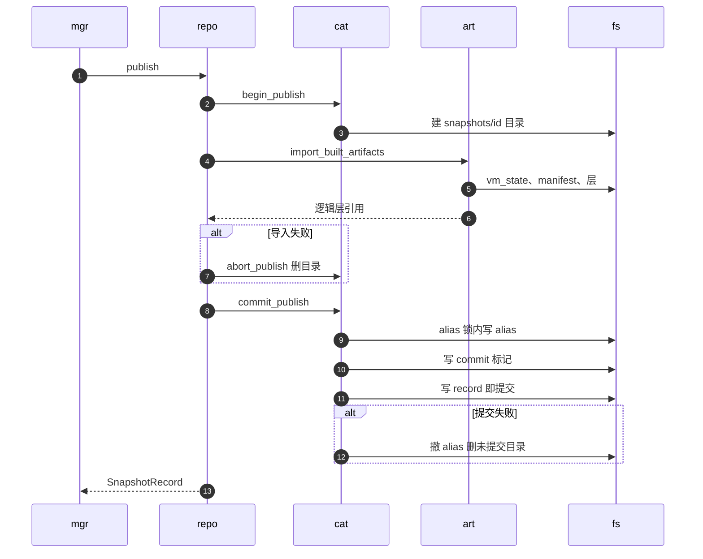

# 47 · POSIX 仓库与提交协议

> 文件系统没有多文件事务，却要承载「一个快照要么完整可见、要么不存在」的语义。
> 本篇讲 POSIX 快照仓库怎样用一个提交点文件、内容寻址的层目录与按名字加的 `flock` 拼出这条语义，
> 以及这套协议在并发、崩溃与删除时的边界：哪些中间状态会被读者看到，哪些会成为无人回收的孤儿。
>
> **读者**：工程师、运维。　**预备**：[第 46 篇 · 快照对象模型](46-snapshot-object-model.md)、[第 37 篇 · 封存、restack 与 compact](37-seal-restack-compact.md)。
> **代码**：`src/snapshot/repository/backends/posixfs/{backend,catalog,artifacts,layout,runtime}.rs`、`src/snapshot/repository/interfaces.rs`、`src/snapshot/repository/backends/mod.rs`

---

## 0. 本篇要回答的问题

1. 一个已提交快照在 POSIX 仓库里由哪些文件组成？哪一个文件的出现才算「已提交」？
2. 发布时制品怎样进入仓库：什么时候硬链接，什么时候拷贝并回读校验，什么时候只记一个远端引用？
3. alias 为什么先于 record 写入？读者能看到这个中间状态吗？
4. 没有全局锁时，并发的发布、删除与模板状态转换怎样互斥？`flock` 保护了什么，没有保护什么？
5. 进程崩溃或掉电会留下哪些中间状态，谁来清理？
6. 为什么 `managed-layers/` 从不删除？代价是什么？

---

## 1. 问题：在文件系统上做一次提交

快照仓库（snapshot repository）是已提交快照与模板的持久真相（[第 46 篇](46-snapshot-object-model.md)）。它要同时满足四个要求：

- **原子可见**：读者要么看不到一个快照，要么看到一个所有制品都已就位的快照；
- **可共享**：多个节点挂同一个目录，任一节点发布的快照别的节点都能解析；
- **层去重**：rootfs 与内存层可能有几十 GiB，被许多快照共享，不能每个快照存一份；
- **名字唯一**：一个 alias（模板名或快照名）同一时刻只指向一个快照。

POSIX 文件系统给的原语很少：`rename()` 原子地替换一个路径；`link()` 原子地「若不存在则创建」；`flock()` 在一个文件上加劝告锁。
没有跨多个文件的事务。所以协议只能这样设计：选一个文件作为**提交点**，其它制品都在它之前写好；读者只相信提交点。
本篇其余部分都是这条原则的展开，以及它在哪些地方没有被严格遵守。

后端由 `[snapshot] repository_backend = "posix_fs"` 选择（缺省就是它），根目录是 `<snapshot_store>/repository`
（`src/snapshot/repository/backends/mod.rs` 的 `build_snapshot_backend_from_config()`）。
`[backend.posix_fs] snapshot_store` 的代码缺省值是 `$AENV_HOME/snapshot-store`，也可以用环境变量 `AENV_SNAPSHOT_STORE` 覆盖（`src/cfg.rs` 的 `PosixFsBackendConfig`）。
这个缺省目录在节点本地，所以缺省配置只适合单节点；多节点部署必须把它指到所有节点共享的文件系统，或者改用对象存储后端（[第 48 篇](48-object-storage-repository.md)）。

模板构建器自己的快照（BuildKit builder，[第 53 篇](53-buildkit-in-microvm.md)）用同一个后端的私有命名空间：
`builder_snapshot_config()` 把 `snapshot_store` 改成 `<snapshot_store>/template-build/builder`，仓库根随之变成它下面的 `repository`。
公共模板 API 看不到也删不掉其中的记录，测试 `builders_share_a_private_catalog_across_node_local_caches()` 锁定了这一点。
推论：私有命名空间有自己的 `managed-layers/`，与公共仓库之间不去重。

---

## 2. 目录布局

`posixfs/layout.rs` 的 `PosixFsSnapshotArtifactLayout` 定义了全部路径：

```text
<snapshot_store>/repository/
├── catalog/
│   ├── records/{id}.json            SnapshotRecord，提交点
│   ├── records/{id}.lock            per-record 锁文件
│   ├── aliases/{alias}              内容是 id 的 JSON 字符串
│   └── aliases/{alias}.lock         per-alias 锁文件
├── snapshots/
│   ├── {id}/commit                  提交标记，内容为 "committed"
│   ├── {id}/vm_state.bin            Firecracker 设备与 vCPU 状态
│   ├── {id}/firecracker-manifest.json   形状信息，不含节点本地路径
│   ├── {id}/memory-startup.pack     可选，发布后由后台任务补写
│   └── build-logs/{id}.json         模板构建日志
├── managed-layers/
│   └── sha256_<hex>.overlaybd.commit    内容寻址的 overlaybd 层
├── volumes/
│   ├── records/{volume_id}.json(.lock)
│   └── aliases/{name}(.lock)
└── template-build/cache-head.json   BuildKit 缓存种子 head
```

几个要点：

- **record 里不存路径。** committed 记录只保存逻辑层引用（digest、size、可选 uuid），层文件的位置由命名约定推出：
  `managed_layer_file_name()` 把 digest 里的 `:` 与 `/` 换成 `_`，再加 `.overlaybd.commit` 后缀。仓库目录整体搬家后记录仍然有效。
- **每个快照一个目录，层不在其中。** `snapshots/{id}/` 只放这个快照独有的固定制品；层放在所有快照共享的 `managed-layers/`。
- **卷目录与构建缓存 head 也在这里。** 卷记录的协议见[第 16 篇](16-snapshot-and-volume-api.md)与[第 21 篇 §4.5](21-deletion-and-volume-capture.md#45-发布-backing)；
  卷 backing 的层同样导入 `managed-layers/`（`PosixFsArtifactStore::publish_volume_backing()`）。

---

## 3. publish：导入，然后提交

入口是 `PosixFsSnapshotRepository::publish()`。它把整个同步过程 `publish_sync()` 放进 `spawn_blocking`（`run_repository_blocking()`），
因为其中有大量阻塞的文件 I/O 与哈希计算，不能占住 tokio 的工作线程。
下图中 `mgr` 是 `SnapshotManager`，`repo` 是 `PosixFsSnapshotRepository`，`cat` 与 `art` 是它持有的 catalog 与制品两个子对象，`fs` 是仓库所在的文件系统。



在 `begin_publish()` 之前，`publish_sync()` 先校验附加盘：drive id 不得重复，`virtual_size` 不得为零。这一步不碰任何文件，
测试 `publish_rejects_duplicate_attached_drive_ids_before_touching_catalog()` 确认了这一点。
`begin_publish()` 只做两件事：`ensure_layout()` 建好 catalog 的几个目录，再 `mkdir -p snapshots/{id}/`。

### 3.1 导入固定制品

`PosixFsArtifactStore::import_built_artifacts()` 依次处理 `vm_state.bin`、`firecracker-manifest.json`、内存层、各附加盘的层、rootfs 的层。

`vm_state.bin` 走 `copy_local_artifact()`。若目标已经是同一个 inode（`same_file()` 比较 dev 与 ino），什么也不做。
否则先试 `hard_link()`：成功后 `finalize_hard_linked_file()` 去掉写权限并 `fsync`。
硬链接失败（最常见的原因是 capture 目录与仓库不在同一个文件系统上）时改走 `copy_file_with_sha256()`：
边拷边算 sha256，写完 `sync_all()`，然后**把目标文件重新读一遍**再算一次 sha256，两者不等就报错。
注释说明第二遍是有意的：它校验的是落盘后的字节，而不只是写循环在内存里的字节流。拷贝完成后 `sync_dir()` 父目录，最后再比一次大小。

`firecracker-manifest.json` 走 `persist_firecracker_manifest()`，是一次普通的 `fs::write()`：不经临时文件，也不 `fsync`。
它与同一目录里其它制品的写法不一致，后果在 §7 讨论。

### 3.2 导入层：按 lower 的形态分流

层的来源是捕获时生成的本地 `image.json`（overlaybd 的层栈配置，[第 36 篇 §2.1](36-read-write-paths-and-rw-layouts.md#21-从-imagejson-到-imagefile)）。
`derive_rootfs_layers()` 逐个检查它的 `lowers`：

| lower 的形态 | 处理 | 校验 |
|---|---|---|
| 有 `file`，且有 `digest` 与 `size` | `import_managed_layer_with_descriptor()` | 只比文件大小，信任 digest |
| 有 `file` 无描述符，文件名是运行时增量层 | `import_descriptorless_rootfs_layer()` | 现场计算 sha256 |
| 有 `file` 无描述符，其它文件名 | 返回 `Unsupported`；卷 backing 例外 | — |
| 无 `file`，有 `repoBlobUrl` | 记为 `OverlaybdLayerRef::External`，不复制 | 无 |
| 两者都没有 | 返回 `Unsupported` | — |

「运行时增量层」由 `src/image/local_layer.rs` 的 `rootfs_layer_is_runtime_generated_delta()` 按文件名判断：
`snapshot.commit`、`managed-base.commit`，以及已不再产生、只为旧仓库保留的 `snapshot.zfile.commit`。
卷 backing 调用时传 `allow_descriptorless = true`，任何无描述符的本地层都现场哈希。
内存层（`derive_memory_layers()`）没有 External 一说：每个 lower 都必须有本地文件，有描述符就信任，没有就现场哈希。

第一行的「信任 digest」是一处明确的取舍。注释写着：描述符来自 AgentENV 内部生成的内容，有意只校验廉价的大小不变量。
层可能很大，重新哈希一遍的代价与拷贝同量级；`vm_state.bin` 则相反，它不大，所以做了双遍校验。
第二行在缺省配置下很常见：缺省的 Hybrid 可写布局不做增量 digest，restack 写进 `image.json` 的 `digest` 为空（[第 37 篇 §2.3](37-seal-restack-compact.md#23-增量-digest-与它的适用范围)），
于是每个新增量层都在发布时被完整读一遍来算摘要。

无描述符的层若是稀疏布局的 RW 层（`overlaybd::dense_export::should_dense_export_layer()` 读层头判断），
不能原样入库：它的数据按逻辑偏移散在一个带空洞的文件里（[第 36 篇 §4.2](36-read-write-paths-and-rw-layouts.md#42-sparse写到逻辑偏移)），
拷到不保留空洞的介质上会膨胀到虚拟盘大小。`store_sparse_overlaybd_layer_dense()` 先在 `managed-layers/` 里建临时文件，
把它导出成紧凑格式，按**导出后**的 digest 命名入库。

### 3.3 内容寻址的写入

所有 managed 层最终都经过 `store_managed_layer()`（稀疏导出走一条结构相同的平行路径）：

1. 目标 `managed-layers/{digest}.overlaybd.commit` 已存在：只比较大小，相同就直接返回引用，不同就报错；
2. 不存在：先试 `hard_link()`。若返回 `AlreadyExists`，说明另一个发布者刚刚写入了同一 digest，视为成功；
3. 硬链接不可用：拷到同目录的临时文件，`sync_all()`，再 `persist_noclobber()`（不覆盖已有文件的改名），`AlreadyExists` 同样视为成功；
4. `sync_dir()` 父目录。

内容寻址让并发写同一个层成为无害的：两个发布者写的是相同的字节，谁先落地都一样，后到者被 `link` 或 `persist_noclobber` 的原子性挡住。
「已存在就只比大小」的代价是：若仓库里某个层文件已经损坏，后续发布不会发现，会继续引用它。
拷贝路径（第 3 步）只做 `fs::copy`，不像 `vm_state.bin` 那样回读校验。

硬链接快速路径还有一个副作用。`finalize_hard_linked_file()` 去掉写权限，改的是**共享 inode** 的权限位，所以节点本地那份文件也随之变成只读。
注释给出的安全前提是：这些层在发布前已经封存或内容寻址，之后不会再被原地改写。
硬链接只在仓库与本地文件同一个文件系统时成立，典型情形是单节点、仓库在本地盘；仓库在 NFS 上时每个新层都要完整拷贝一次（推论：`link()` 跨文件系统返回 `EXDEV`）。

从一个 POSIX 快照恢复出的沙箱再次发布时，继承来的 lower 直接指向仓库里的 managed 层并带着 digest 与 size（§8），
第 1 步命中，不产生任何拷贝。只有新产生的增量层需要真正写入。

### 3.4 提交

`PosixFsCatalogStore::commit_publish()` 的注释列出了顺序，代码（删去错误包装）如下：

```rust
self.with_alias_lock(alias, |store| {
    let record = store.committed_record_unlocked(&metadata, committed.clone(), now)?;
    if let Some(existing) = store.load_alias_target(alias)? {
        if existing != snapshot_id {
            if store.load_record_by_id_unlocked(&existing)?.is_some() {
                return Err(RepositoryError::AliasConflict { … });
            }
            store.remove_file_if_exists(&alias_path)?;   // 陈旧 alias
        }
    }
    store.write_json(&alias_path, &snapshot_id)?;
    store.write_commit_marker(&session.snapshot_id)?;
    store.write_committed_record_unlocked(&record)?;
    Ok(record)
})
```

没有 alias 时跳过锁与前三步，直接写标记与 record。

`committed_record_unlocked()` 区分两种情况。模板构建在开始时已经 `create()` 了一条 Waiting 记录，这里读出它，
调用 `SnapshotRecord::mark_committed()` 把状态改成 Ready、填入 committed 负载；沙箱快照没有预先存在的记录，这里新建一条。
record 与 alias 都用 `write_json()` 写：同目录临时文件、`sync_all()`、`persist()`（即 `rename`）。commit 标记用同样的临时文件加改名，但不 `fsync`。

任一步失败，`commit_publish()` 重新取 alias 锁，**仅当** alias 仍指向自己时删掉它，然后 `cleanup_uncommitted_snapshot_dir()`。
`publish_sync()` 在提交失败后还会再调一次 `abort_publish()`，它是同一个清理函数，重复调用无害。
清理函数自带一道保护：`is_committed()` 为真（标记存在且 record 带 committed 负载）时不删目录。
这道检查防止的是「提交其实已经成功、却在返回路径上报错」时把一个已提交快照的目录删掉。

---

## 4. 可见性：只看 record

读路径 `PosixFsCatalogStore::get()` 先把参数当 id 解析，直接读 `catalog/records/{id}.json`；不是 id 再当 alias，在 alias 锁下读出 id 再读 record。
它**不检查 commit 标记**。标记只在清理与 `is_committed()` 里被读，作用是给清理函数一个「不要删」的信号。
真正的提交点是 record 文件的那次 `rename`：它要么让新内容整体出现，要么什么也没发生；按 id 读的读者不加任何锁，读到的总是某个完整版本。

**alias 先于 record 写入**，看上去违反了 `SnapshotRepository` trait 文档里的要求（「只在 record 持久之后绑定 alias」）。
但在 POSIX 实现里这个窗口对正常运行的读者不可见：通过 alias 查找的 `get()` 与 `resolve_alias()` 都要先取同一把 alias 锁，
而 `commit_publish()` 在整个「写 alias → 写标记 → 写 record」期间都持有它。
先写 alias 的理由在于冲突检测：AliasConflict 必须在提交点之前判定，否则会出现一条已经可见、alias 却绑定失败的记录。

窗口只在进程崩溃时暴露：崩在写 alias 之后、写 record 之前，留下一个指向不存在记录的 alias。
`get()` 与 `resolve_alias()` 在 alias 锁下发现它指向的记录不存在，就**惰性**删除它并返回「不存在」；
下一次以同名发布时，`commit_publish()` 的冲突检查也把它当陈旧 alias 清掉。这种 alias 无害，只是要等到有人访问时才被清理。

模板记录的创建 `create()` 顺序相反：在 alias 锁下先写 record（Waiting、无 committed 负载）再写 alias。此时 record 本身就是一个合法的「尚未构建」状态，没有理由让它晚于 alias。

`list()` 遍历 `records/` 下所有 `.json` 文件，不加锁，按创建时间倒序。临时文件与 `.lock` 文件因扩展名不符被跳过。
任何一个 record 解析失败都会让整个 `list()` 返回错误，一个损坏的文件会让所有列表请求失败。

---

## 5. 锁：按名字加，不设全局锁

所有锁都由 `acquire_file_lock()` 实现：打开（必要时创建）锁文件，`flock(LOCK_EX | LOCK_NB)`；被占用时每 25 ms 重试，
总等待超过 `FILE_LOCK_TIMEOUT`（10 s）返回 Backend 错误。拿到锁后把本进程 pid 写进锁文件，只供排查用。锁文件从不删除，随记录与 alias 的数量累积。

| 操作 | alias 锁 | record 锁 |
|---|---|---|
| `commit_publish()` | 有 alias 时持有 | 不取 |
| `create()` | 有 alias 时持有 | 不取 |
| 按 alias 的 `get()`、`resolve_alias()` | 持有 | 不取 |
| `try_start()`、`mark_error()` | 不取 | 持有 |
| `attach_memory_startup()` | 不取 | 持有 |
| `delete_record()` | 在 record 锁内再取 | 先取 |

只有 `delete_record()` 同时持有两把锁，顺序固定为 record → alias；没有任何路径反向取锁，所以不会死锁。
没有全局锁，意味着不同 alias、不同 record 上的操作完全并行，代价是凡是跨两个对象的不变量都只能靠这张表里的组合来保证。

**模板状态转换是真 CAS。** `try_start()` 在 record 锁下读出记录、确认状态是 Waiting、改成 Building 再写回。
两个节点同时尝试开始同一个构建，只有一个能看到 Waiting。API 层依赖这一点：`src/api/impls/image_build.rs` 调用 `try_start_build()` 前的注释写着「仓库的 CAS 也排除了其它节点或旧 API 的启动」。

**提交不取 record 锁。** 这留下两个缝隙，都只在并发时出现，标为推论：

- `mark_error()` 与 `commit_publish()` 在同一条模板记录上并发时没有互斥。两者都是「读、改、写」整条记录，后写者覆盖前者；
  `mark_committed()` 也不检查当前状态，一条已标 Error 的记录可能被改回 Ready，反过来，一次已提交的构建也可能被标成 Error 并丢掉 committed 负载。
- 删除一条模板记录与发布它并发：带 alias 时两者经 alias 锁串行，但若删除先完成，`committed_record_unlocked()` 找不到旧记录，会**新建**一条 Ready 记录，被删的模板随之复活。

**`flock` 的跨节点语义取决于共享文件系统。** 推论：Linux NFS 客户端把 `flock()` 映射为服务器端的字节范围锁，跨客户端互斥依赖锁协议正常工作；
若以 `local_lock=flock` 或 `local_lock=all` 挂载，锁只在本机有效，多节点之间的互斥就静默地消失了。
代码没有检测这种情况；POSIX 后端在多节点下的正确性取决于部署者对共享文件系统的选择。另外，即使是按 id 的只读访问也会在锁目录里创建文件，仓库不能以只读方式挂载。

---

## 6. 删除

`delete_sync()` 先 `get()` 解析出记录，再调 `delete_record()`：取 record 锁 → 删构建日志 →（有 alias 时取 alias 锁）
→ 删 commit 标记 → 若 alias 仍指向自己就删 alias → 若记录已提交就 `remove_dir_all(snapshots/{id})` → 最后删 record。
参数是一个 id 而记录已不存在时，仍会调一次 `delete_record()` 来清掉残留的构建日志；操作整体幂等。

record 最后删，所以删除期间按 id 不加锁读取的读者可能读到一条 committed 记录，而它的目录已经没了。
这样的记录在解析时失败：`PosixFsRuntimeResolver::snapshot_vm_state_path()` 找不到 `vm_state.bin`，返回 `ArtifactNotFound`。
删除中途崩溃会让这种「可见但不可运行」的记录留下来，直到有人重试删除。trait 文档要求「删除时避免暴露部分删除的记录」，
POSIX 的顺序选择了另一种保证：只要 record 还在，删除就一定能被重试完成。对象存储后端的顺序相反，见[第 48 篇](48-object-storage-repository.md)。

**`managed-layers/` 从不删除。** 删除只移除快照自己的目录，层文件留在原处，全仓库也没有任何回收这些层的代码。这有三个原因，也有一个代价。

- 层被许多快照、卷与模板共享，记录里只有 digest，没有反向引用计数。要安全回收，必须扫描所有记录与卷记录，算出可达集合。
- 发布路径「目标已存在就直接引用」（§3.3 第 1 步）本身就是一次不加锁的引用获取。一个并发运行的回收器可能在发布者确认层存在之后、写入 record 之前删掉它，
  得到一条引用了不存在层的已提交记录。推论：任何回收器都需要与发布协调，例如引入宽限期或全局锁，这正是当前协议刻意避免的东西。
- 正在运行的沙箱直接读仓库里的层文件（§8）；源卷删除后，从它克隆出的卷仍然引用相同的层（[第 16 篇](16-snapshot-and-volume-api.md)）。不回收保证了这些读者永远不会失去底层数据。

代价是仓库单调增长：删除快照、模板与卷都不释放层占用的空间。运维只能自行扫描记录后手工清理，代码没有提供工具。这一点记入[第 68 篇](68-known-issues-and-debt.md)。

`vm_state.bin` 在快照目录里，会随删除消失。推论：一台正在从该快照恢复的沙箱，若 Firecracker 已经打开了这个文件，
本地文件系统上已打开的 inode 会保留到关闭；NFS 客户端对已打开文件的删除做「改名而非删除」处理。所以删除快照不会打断已经开始加载的沙箱，但会让尚未开始解析的启动失败。

---

## 7. 崩溃一致性的边界

把 §3 与 §6 的每一步按「崩在这一步之后」排开：

| 崩溃位置 | 留下什么 | 读者看到什么 | 谁清理 |
|---|---|---|---|
| `begin_publish()` 之后、导入中 | `snapshots/{id}/` 半成品 | 不可见 | 无人 |
| 新 managed 层写入之后 | 无记录引用的层文件 | 不可见，占空间 | 无人 |
| 写 alias 之后、写 record 之前 | 陈旧 alias，加上带或不带标记的目录 | 不可见 | alias 被惰性清理；目录无人清理 |
| 删除时删目录之后、删 record 之前 | 无制品的 committed 记录 | 可见但解析失败 | 重试删除 |

代码里没有启动期扫描，也没有后台任务处理第一、二、三行留下的目录与层。推论：这些孤儿只占空间、不影响正确性，因为没有任何记录引用它们。

**掉电**是另一回事。`write_json()` 对临时文件 `fsync` 后改名，但不 `fsync` 父目录；commit 标记连文件本身都不 `fsync`；
`firecracker-manifest.json` 是直接 `fs::write()`；层与 `vm_state.bin` 则 `fsync` 了文件也 `fsync` 了目录。
推论：掉电后改名本身可能没有落盘，最坏情况是 record 已经持久而同目录的 manifest 内容尚未落盘，得到一条 manifest 为空或残缺的已提交记录；
协议的提交顺序依赖文件系统按顺序持久化元数据，而这一点代码没有用 `fsync` 强制。

startup manifest 的补写（`attach_memory_startup()`，发布返回后由后台任务调用，录制与消费见[第 43 篇](43-startup-pack-and-prefetch.md)）是一个小的两文件提交：
在 record 锁下先校验字节与描述符一致，以临时文件加 `fsync` 加改名写入 `memory-startup.pack`，再把描述符写进 record。
注释承认这不是多文件事务：崩在两次改名之间会留下孤儿制品，或描述符指向缺失的制品；用同一个描述符重试可以修复任一种状态。
因为它持 record 锁并在记录不存在时直接返回，所以不会复活一条已被删除的记录，测试 `startup_manifest_attach_is_idempotent_and_cannot_revive_a_delete()` 覆盖了这一点。

---

## 8. 运行时直接读仓库

POSIX 后端的解析器不复制任何东西（细节见[第 49 篇](49-resolve-and-artifact-cache.md)）。`PosixFsRuntimeResolver::resolve()` 把 `vm_state.bin` 的仓库路径直接交给 Firecracker；
`resolve_local_managed_layer()` 为每个 managed 层生成 `file=` 指向 `managed-layers/` 下仓库文件的 lower，带上 digest、size 与 uuid；External 层保留 `repoBlobUrl`。
物化出来的 `image.json` 放在节点本地的运行时缓存目录里，层数据本身留在仓库。

这让 POSIX 后端没有下载步骤，也没有节点本地的层副本需要管理。代价是共享文件系统成了运行时的数据路径：
冷启动读 rootfs、恢复时按需读内存层，读的都是仓库文件。推论：共享文件系统的随机读延迟与吞吐，直接决定从快照启动的沙箱的首次访问性能，
而且同一个热门模板的所有沙箱在所有节点上都读同一组文件。对象存储后端走的是另一条路：层以 `s3://` 地址按需读取，经节点块缓存（[第 39 篇](39-block-cache-and-background-download.md)）。

---

## 9. 小结

- 提交点是 `catalog/records/{id}.json` 的那次 `rename`；读者只看 record，不看 commit 标记。标记只用来防止清理函数删掉已提交的目录。
- 固定制品在快照自己的目录里，层在共享的 `managed-layers/`，记录里只有 digest，路径由命名约定推出。
- `vm_state.bin` 硬链接或边拷边哈希再回读校验；带描述符的层只比大小、信任 digest；缺省 Hybrid 布局下的新增量层在发布时现场哈希；稀疏层先紧凑导出。
- 层写入靠内容寻址加 `link` / `persist_noclobber` 的原子性做到并发无害；已存在的层不再校验内容。
- alias 先于 record 写入，但整个窗口在 alias 锁内，正常运行时读者看不到；崩溃留下的陈旧 alias 被惰性清理。
- 锁按 alias 与 record 分别加，无全局锁；模板 Waiting → Building 在 record 锁下是真 CAS；提交不取 record 锁，与 `mark_error()`、删除并发时可能互相覆盖（推论）。
- 多节点下的互斥依赖共享文件系统的 `flock` 语义，代码不检测本地锁挂载。
- 删除最后删 record，可能短暂暴露不可运行的记录，换来「记录在就能重试」；`managed-layers/` 从不删除，仓库单调增长。
- 崩溃留下的半成品目录与孤儿层无人清理；record、标记与 manifest 的 `fsync` 不一致，掉电语义依赖文件系统的元数据顺序。
- 运行时直接读仓库里的层，共享文件系统是冷启动与恢复的数据路径。

## 延伸阅读 / 下一篇

- 下一篇：[第 48 篇 · 对象存储仓库](48-object-storage-repository.md)——没有 `rename` 与 `flock` 时，同一套语义怎样实现、哪些地方变弱；两种后端的一致性对比表在该篇末尾。
- 对象模型与三层存储：[第 46 篇](46-snapshot-object-model.md)；解析与本地缓存：[第 49 篇](49-resolve-and-artifact-cache.md)；startup manifest：[第 43 篇](43-startup-pack-and-prefetch.md)。
- 层的来源：[第 37 篇 · 封存、restack 与 compact](37-seal-restack-compact.md)、[第 36 篇 · 读写路径与三种可写布局](36-read-write-paths-and-rw-layouts.md)；卷记录：[第 16 篇](16-snapshot-and-volume-api.md)、[第 21 篇](21-deletion-and-volume-capture.md)。
- 技术债汇总：[第 68 篇](68-known-issues-and-debt.md)。
- 对照：[e2b 手册第 13 篇 · 存储全景](../e2b-infra/13-storage-landscape.md)——e2b infra 把模板与别名的账目放在 PostgreSQL，对象存储里只放按 build ID 寻址的不可变产物。
