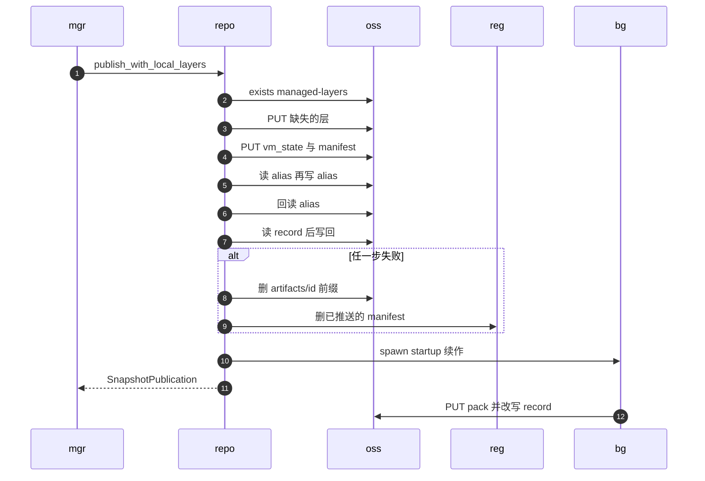

# 48 · 对象存储仓库：上传、回滚与弱一致

> 对象存储没有 `rename`，没有 `flock`，单个对象的 PUT 是原子的，多个对象之间什么也不保证。
> 本篇讲 AgentENV 的对象存储后端怎样在这种条件下发布一个快照：层怎样去重上传，提交点落在哪个对象上，失败时回滚什么、留下什么；
> 以及在没有条件写的地方，alias 绑定与模板状态转换的并发语义比 POSIX 后端弱多少。本篇末尾给出两种后端的一致性对比表。
>
> **读者**：工程师、运维。　**预备**：[第 47 篇 · POSIX 仓库与提交协议](47-posix-repository.md)、[第 46 篇 · 快照对象模型](46-snapshot-object-model.md)。
> **代码**：`src/snapshot/repository/backends/oss/{repository,client,config,layout,mod}.rs`、`src/snapshot/repository/backends/common/recontainerize.rs`、`crates/object-store-operator/src/{operator,auth}.rs`、`storage/overlaybd/src/backend/oss.rs`

---

## 0. 本篇要回答的问题

1. 「OSS 后端」实际依赖的是什么协议？层在对象存储里怎样命名，运行时怎样找到它们？
2. 一次发布按什么顺序写哪些对象？哪一次写入是提交点？失败时回滚到什么程度？
3. 为什么层上传可以先 `exists()` 再无条件 PUT 而不出错？发布压缩为什么让 digest 描述压缩后的字节？
4. 凭证怎样获取与刷新？大文件的分片上传有哪些上限与代价？
5. alias 绑定的「读-写-回读」与模板的 Waiting → Building 在并发下分别能保证什么、不能保证什么？卷记录为什么能做到真 CAS？
6. POSIX 与对象存储两种后端在一致性上逐项有哪些差别？

---

## 1. 问题：没有改名与锁的仓库

POSIX 仓库的协议建立在两个原语上：`rename()` 让 record 原子地出现，`flock()` 让同一 alias 上的读改写互斥（[第 47 篇](47-posix-repository.md)）。
对象存储只保留了第一个原语的一半：**单个对象**的 PUT 原子替换，读者要么读到旧对象，要么读到新对象。
跨对象没有事务；没有锁；能否做「若匹配才写」的条件写，取决于具体服务与写入路径。

所以对象存储后端仍然沿用「一个对象作提交点、其余先写」的结构，但每一处原本靠锁保证的不变量，都要重新回答一次：没有锁时怎么办。
AgentENV 的回答分成三类：内容寻址的数据靠**幂等**；catalog（records 与 aliases）靠**读-写-回读**，接受较弱的保证；
卷记录与 BuildKit 缓存 head 靠 **ETag 条件写**，得到真正的 CAS。本篇的「弱一致」指的是这里的并发控制，
不是对象存储的读写可见性；推论：代码隐含地假定后端对单个对象提供写后读一致。

后端由 `[snapshot] repository_backend = "oss"` 选择。名字叫 OSS，实现却是 OpenDAL 的 S3 服务：
`crates/object-store-operator/src/operator.rs` 的 `build_object_store_operator()` 用 `opendal::services::S3` 构造 operator，
叠加 `TimeoutLayer`（缺省 `DEFAULT_TIMEOUT` = 30 s，同时作为 I/O 超时）与 `RetryLayer`（缺省 `DEFAULT_MAX_RETRIES` = 3 次）。
任何 S3 兼容的对象存储都可以用，注释中反复出现的目标是阿里云 OSS。
`[backend.oss]` 需要 `endpoint`、`bucket`、`region` 与凭证，`prefix` 可选；`NormalizedOssConfig::new()` 去掉 `prefix` 两端的 `/`，所有键都加在它下面。

---

## 2. 对象布局

`oss/layout.rs` 的 `OssSnapshotArtifactLayout` 给出键名，全部相对于 `prefix`：

```text
<prefix>/
├── catalog/records/{id}.json          SnapshotRecord，提交点
├── catalog/aliases/{alias}.json       内容是 id 的 JSON 字符串
├── artifacts/{id}/vm_state.bin
├── artifacts/{id}/firecracker-manifest.json
├── artifacts/{id}/memory-startup.pack     可选，提交后由后台任务上传
├── snapshots/build-logs/{id}.json
├── managed-layers/sha256:<hex>        内容寻址的 overlaybd 层
├── volumes/records/{volume_id}.json
├── volumes/aliases/{name}.json
└── template-build/cache-head.json
```

与 POSIX 布局相比，少了 commit 标记与所有 `.lock` 文件；快照目录换成了 `artifacts/{id}/` 前缀；managed 层的键直接用 digest，不做字符替换。

运行时并不经过这个后端读层。`OssClient::managed_layers_repo_blob_url()` 产出 `s3://<bucket>/<prefix>/managed-layers` 形式的地址，
即使目标是阿里云 OSS，scheme 也保持 `s3://`，因为 Rust 版 overlaybd 只认 S3 兼容的 repo blob URL。
物化出来的 `image.json` 里，managed 层的 lower 就是这个地址加 digest，由 overlaybd 的 OSS 后端按需读取并经节点块缓存
（[第 38 篇 §3.5](38-virtualfile-chain-and-remote-io.md#35-oss)、[第 39 篇](39-block-cache-and-background-download.md)）；解析时层不下载，只校验存在（[第 49 篇](49-resolve-and-artifact-cache.md)）。

---

## 3. publish：编号的七步

入口是 `OssSnapshotRepository::publish_with_local_layers()`，代码注释从 0 编号到 5，加上最后的写 record，一共七步。
下图中 `mgr` 是 `SnapshotManager`，`repo` 是 `OssSnapshotRepository`，`oss` 是对象存储，`reg` 是源镜像仓库（只在启用镜像回推时出现），`bg` 是提交后派生的后台任务。



**第 0 步：校验。** 与 POSIX 相同地检查 drive id 不重复、`virtual_size` 非零；再用 `validate_publish_manifest_image_configs()` 把 rootfs、内存与每个附加盘的 `image.json` 都解析一遍。
这样格式错误在上传任何字节之前就暴露。

**第 1 步：rootfs。** `export_disk_image(DiskImageSubject::Rootfs)` 按策略分两路。
缺省策略 `ObjectStorage` 调用 `derive_and_upload_disk_image_layers_mode()`，分流规则与 POSIX 的 `derive_rootfs_layers()` 逐行相同（[第 47 篇 §3.2](47-posix-repository.md#32-导入层按-lower-的形态分流)），
区别只在「导入」变成了「上传到 `managed-layers/{digest}`」，见 §4。
启用 `[snapshot] image_publish` 时策略是 `SourceRegistry`：把 rootfs 增量层推回源镜像仓库并打 tag（[第 50 篇](50-rootfs-as-oci-image.md)）。
它返回 `Unsupported` 时回退到对象存储，但先用 `fallback_to_object_storage_would_mix_sources()` 检查：
若层栈里有不在本仓库 `managed-layers` 下的远端层，回退就会让一个快照的层分散在两个来源，这时直接报错而不回退。

**内存层**紧接着由 `derive_and_upload_memory_layers()` 上传。它比磁盘层多一条分支：没有本地文件、但 `repoBlobUrl` 恰好是本仓库 managed-layers 地址的 lower，
被 `managed_memory_layer_from_remote_lower()` 直接记为 Managed 引用而不重新上传；指向别处的远端内存层被拒绝。

**第 2 步：固定制品。** `vm_state.bin` 经 `put_file()` 分片上传到 `artifacts/{id}/vm_state.bin`；
manifest 序列化后经 `put_bytes()` 写入。第 2 步注释特意说明 startup manifest 不在这里：`memory_startup` 先置为 `None`。

**第 3 步：附加盘。** `export_attached_drives()` 对每个盘重复第 1 步的逻辑。

**第 4 步：组装** `CommittedSnapshot`，包括第 1、3 步得到的 `disk_publications`（推回源仓库的 manifest 记录）。

**第 5 步：绑定 alias。** `bind_alias()`，失败时删掉 `artifacts/{id}/` 前缀后返回；其语义见 §6。

**第 6 步：写 record。** `write_committed_record()` 先读已有 record（模板构建的 Waiting / Building 记录），`mark_committed()` 后整体写回；没有就新建。
**这次 PUT 就是提交点**：在它之前，`get()` 按 id 读不到记录，按 alias 读到的也是一个指向不存在记录的 alias。

成功之后，若 `[snapshot.memory_startup_pack] enabled`，`tokio::spawn(finish_startup_manifest())` 在后台等录制结束、上传 manifest、把描述符补进 record（§6.3）。
函数返回的 `SnapshotPublication` 带着 `local_layers`：压缩时产生的临时文件要活到 `SnapshotManager` 做完提交后的 P2P 发布，之后随值析构删除。

### 3.1 回滚

第 1 到 6 步包在一个 `async` 块里，任何错误都进入同一个回滚分支：

1. `delete_prefix("artifacts/{id}/")`：列出前缀下的键，以 16 路并发逐个删除；失败只记 warn；
2. 对 `disk_publications` **逆序**调用 `AcrDiskImageExporter::rollback_publication()`，按 digest 删除已推送的 manifest；失败只记 warn，blob 留给镜像仓库自己的 GC。

**managed 层不回滚。** 两处注释都写着：内容寻址的层被多个快照共享，需要单独的 GC。这个 GC 并不存在（§7）。
推论：一次在第 3 步失败的发布，已上传的新层会作为无人引用的对象永久留在桶里。

回滚还有一个 POSIX 后端没有的风险。POSIX 的清理函数先检查 `is_committed()`，提交已经成功就不删目录。这里没有这道检查：
若第 6 步的 PUT 实际成功、却因超时或连接中断报告失败，回滚会删掉 `artifacts/{id}/`，留下一条可见的、引用了已删除 `vm_state.bin` 的已提交记录。
推论：对象存储的请求结果可能不确定，这种情况在 POSIX 的本地改名上几乎不会发生。

第 5 步失败只删前缀，不撤销 alias——失败的就是 alias 本身。第 6 步失败时 alias 已经绑定，回滚也不撤销它；
它指向一个不存在的记录，之后由 `resolve_alias()` 的陈旧 alias 清理处理。

---

## 4. 层上传

### 4.1 先查后写，内容寻址使竞态无害

每个层最后经 `upload_prepared_layer()` → `upload_managed_layer_if_missing()`：先 `exists(key)`，不存在才 `put_file()`。
检查与写入之间显然有竞态：两个节点可能都看到不存在，都上传一遍。函数注释给出它无害的理由：键就是内容的 sha256，
并发写同一个键的一定是相同的字节，最坏情况是多传一次，不会写坏数据。

为什么不用「若不存在才写」的条件 PUT？注释解释：阿里云 OSS 只在单次 PUT 上支持禁止覆盖的条件头，
OpenDAL 的 `if_not_exists` 对大文件会走分片上传路径，在 OSS 上返回 `NotImplemented`。

`exists()` 只看键在不在，不比大小，也不校验内容；已经存在的层被直接引用，与 POSIX 的「只比大小」相比还少一项检查。
磁盘层与内存层都在一个 `for` 循环里逐个 `await`，层与层之间串行；并发只发生在单个文件的分片之间。

### 4.2 发布压缩：digest 描述上传的字节

`[snapshot.publish_compression]` 的代码缺省是开启、LZ4。开启时 `recontainerize::prepare_layer_upload()` 把 raw 本地层重写成 ZFile 临时文件再上传，
**digest、size 与对象键都按压缩后的字节计算**；调用方传入的本地描述符只在原样上传时才被采用（细节见[第 35 篇 §7.1](35-zfile-compression.md#71-本地-raw发布时压缩)）。
这样做的理由是自洽：对象存储里的每一个对象都能用它自己的 digest 校验，overlaybd 读取时也无需知道它曾经是另一个字节序列。
代价有三：同一个层在本地与远端有两个 digest；压缩后的临时文件写在进程临时目录，占用与层同量级的本地盘空间直到发布结束；
推论：去重依赖压缩输出是确定的，同一个 raw 层在两次发布中压出不同字节，就会在桶里存两份。
POSIX 后端不压缩。

### 4.3 继承层的两种记法

从一个对象存储快照恢复的沙箱，其 rootfs 继承层在运行时 `image.json` 里没有本地文件，只有 `repoBlobUrl` 与 digest。
再次发布时，磁盘层的分流规则把它记为 **External** 引用，`repo_blob_url` 就是本仓库的 `s3://…/managed-layers`；
测试 `derives_external_layers_from_layer_repo_blob_urls()` 断言了这一点。内存层则相反，同样的情形被记为 Managed。
推论：这类 External 引用把桶名与 `prefix` 写进了记录，仓库迁移到别的桶或改了前缀后，这些记录的 rootfs 不能再被解析；Managed 引用没有这个问题，因为它的地址由当前配置推出。

### 4.4 分片上传与凭证

`OssClient::put_file()` 调用 `storage/overlaybd/src/backend/oss.rs` 的 `upload_file_streaming()`：OpenDAL writer 设分片大小 `CHUNK_SIZE` = 64 MiB、并发 `UPLOAD_CONCURRENCY` = 8。
只有 `close()` 完成分片上传，中途放弃的 writer 不会产生对象，所以对象要么整体出现，要么不出现。
`client.rs` 的注释记下了两条约束。第一，S3 与 OSS 一次分片上传最多 10,000 片，64 MiB 的分片把单个对象上限定在约 625 GiB；
不显式设置分片大小时 OpenDAL 会退回服务的最小分片 5 MiB，上限只有约 50 GiB。第二，内存峰值是 `(2 × 并发 + 2) × 分片大小` 量级的缓冲，
注释说明有意不缩小分片，因为那会同时缩小可上传的最大对象。代码不在上传前检查文件是否超过上限，超限只会在上传途中失败。
推论：中途失败的分片上传是否被显式中止，取决于 OpenDAL 的 writer 析构行为，未完成的分片可能需要桶的生命周期规则来清理。

凭证由 `crates/object-store-operator/src/auth.rs` 管理，两种来源互斥：

- **静态**：`access_key_id`、`access_key_secret`，可选 `security_token`；
- **`credential_process`**：外部命令，输出 JSON（AccessKeyId、AccessKeySecret、SecurityToken、Expiration），执行超时 `CREDENTIAL_PROCESS_TIMEOUT` = 30 s。

两者同时配置时 `credential_source_from_fields()` 直接报错。`default.toml` 的注释写的是「`credential_process` 优先于静态值」，与代码不符。

刷新分两层。`CachedCredentialSource::current()` 在距 Expiration 不足 `CREDENTIAL_REFRESH_BUFFER`（120 s）时重新执行命令，刷新过程持一把互斥锁，避免多个请求同时拉起子进程；
没有 Expiration 的凭证永不主动刷新。`run_with_refresh()` 在一次操作返回 `PermissionDenied` 时调用 `force_refresh()`，用新凭证重建 operator **重试一次**。
注释说明只认 403：阿里云 OSS 的过期凭证表现为 403，其它认证错误暂时当作终止。
这次重试重跑的是整个操作闭包，对 `put_file()` 来说就是从头再传一遍整个文件。

---

## 5. 读与删除

`get()` 先按 id 读 `catalog/records/{id}.json`，不存在再走 `resolve_alias()`。`resolve_alias()` 读出 alias 指向的 id，
用 `exists()` 检查 record 是否存在；不存在就删除这个 alias 并返回 `None`。这是 POSIX 惰性清理的翻版，但它不在任何锁内，后果见 §6.1。

`list()` 列出 `catalog/records/` 下的所有键，以 16 路并发逐个读取。读取失败一律当作错误，包括 `NotFound`。
推论：列表期间有记录被删除，整个 `list()` 就返回错误，而不是少列一条。

`delete()` 的顺序与 POSIX 相反：先删 alias（仅当它仍指向自己，失败只 warn）→ 删构建日志 → **删 record** → best-effort 删已推送到源仓库的 manifest → 删 `artifacts/{id}/` 前缀（失败只 warn）。
record 一旦删除，读者就看不到这个快照，所以不会出现「可见但制品已删」的记录；代价是中途失败留下的是没有记录引用的制品对象，不会再有人来删它们。
两种顺序各保证一件事：POSIX 保证「记录在就能重试删除」，对象存储保证「看得见的记录都是完整的」。

---

## 6. 没有 CAS 时的 catalog

### 6.1 alias：读-写-回读

`bind_alias()` 的注释写明了算法，并说它「弱于真 CAS，但在同一 alias 的并发发布罕见的部署模型下足够」：

1. 读 alias 当前指向；已经指向自己则成功；
2. 指向的记录仍存在（`snapshot_exists()`），返回 `AliasConflict`；
3. 指向的记录已不存在，删掉这个陈旧 alias；
4. 无条件写入自己的绑定；
5. 回读：仍是自己则成功；被别人覆盖且对方记录存在则 `AliasConflict`；对方记录不存在就删掉重来；alias 消失则重试。最多 `MAX_ALIAS_BIND_ATTEMPTS` = 5 次。

回读把竞态窗口缩小到「写入」与「回读」之间，但这个算法有一个更根本的缺口：它用「记录是否存在」判断一个 alias 是否陈旧，
而 alias 在第 5 步绑定、record 在第 6 步才写入。推论，以下两种交错都会发生：

- **两个发布者都成功。** A 绑定并回读成功，正在写 record；B 此时读到 alias 指向 A，`snapshot_exists(A)` 为假，于是把它当陈旧 alias 删掉、写入自己并回读成功。
  结果两条记录都声明这个 alias，alias 对象只指向 B。
- **读者删掉正在提交的 alias。** 在 A 绑定之后、写 record 之前，任何一次按这个 alias 的 `get()` 都会让 `resolve_alias()` 判定它陈旧并删除。A 随后提交成功，但 alias 已经没了。

模板记录不受这两种交错影响：模板的 Waiting 记录在 `create()` 里**先于** alias 写入，`snapshot_exists()` 恒为真，陈旧判断不会误伤。
受影响的是带名字的沙箱快照，它们没有预先存在的记录。POSIX 后端用 alias 锁把「写 alias」到「写 record」整段包起来，读者与其它发布者都看不到这个窗口；这里没有对应的手段。

### 6.2 模板状态：普通的读改写

`SnapshotRepository::try_start_build()` 的 trait 文档写的是「原子地把一个模板构建从 waiting 转到 building」，
`src/api/impls/image_build.rs` 的调用点注释也依赖它「排除其它节点上的启动」。对象存储实现是读 record、检查 Waiting、改成 Building、无条件写回。
两个节点同时开始同一个构建，都能读到 Waiting，都能写成 Building，都会继续构建。`mark_build_error()` 同样是无条件的读改写。
推论：结果是重复的构建，最终两次发布对同一条记录各写一次，后写者覆盖前者。

### 6.3 startup 描述符

`attach_memory_startup_descriptor()` 的注释坦白了它的边界：读 record、填入 `memory_startup`、写回；
若删除恰好发生在读与写之间，写回会让已删除的记录**复活**——而它的 `artifacts/{id}/` 可能已被删掉。
读取时发现记录已不存在，它会放弃并删掉刚上传的 manifest，所以只有并发交错才会复活。POSIX 版本在 record 锁下做同样的事，不会复活（[第 47 篇 §7](47-posix-repository.md#7-崩溃一致性的边界)）。

### 6.4 同一个文件里的真 CAS

卷记录与 BuildKit 缓存 head 用的是另一套写法。`OssClient::put_bytes_conditionally()` 在有 ETag 时用 `if_match`，没有时用 `if_none_match("*")`，
条件不满足返回 `Ok(false)`；`put_volume()`、`replace_volume_record_owner()`、`claim_volume_alias()` 与 `update_build_cache()` 都以「带 ETag 读 → 修改 → 条件写，失败重读」的循环实现，最多 `MAX_VOLUME_CAS_ATTEMPTS` = 5 次。
`read_volume_record_versioned()` 在服务不返回 ETag 时直接报 `Unsupported`，拒绝退化成无条件写。

这与 `bind_alias()` 注释里「阿里云 OSS 在任何 S3 兼容写路径上都不支持条件写头」的说法矛盾，也与 §4.1 注释「只在单次 PUT 上支持」的说法不一致。
catalog 里的 record 与 alias 都是小 JSON，走的正是单次 PUT。推论：record 与 alias 可以迁移到同样的条件写——
`create()` 时 alias 用 `if_none_match`，`try_start_build()` 与描述符补写用 `if_match`——从而补上 §6.1 到 §6.3 的三个缺口。这一点记入[第 68 篇](68-known-issues-and-debt.md)。

---

## 7. 不回收的层

对象存储后端与 POSIX 后端一样，**从不删除 `managed-layers/` 下的对象**：删除快照只删 record、alias、构建日志与 `artifacts/{id}/` 前缀，
发布失败的回滚也明确跳过它们。全仓库没有任何仓库级的层回收代码，两处「需要单独 GC」的注释没有对应实现。
不回收的理由与 POSIX 相同：层没有引用计数，「先 `exists()` 后直接引用」是一次不加锁的引用获取，回收器无法与它安全并存（[第 47 篇 §6](47-posix-repository.md#6-删除)）。
代价是桶单调增长，并且对象存储按容量计费，这个增长直接是成本；发布失败与删除中途失败留下的对象也加入其中。

---

## 8. 与 e2b infra 的对照

e2b infra 把模板、build 与别名的账目放在 PostgreSQL 里，对象存储只放按 build ID 寻址的不可变产物，别名的唯一性与状态转换由数据库事务保证。
AgentENV 把 catalog 本身放进对象存储，换来的是仓库自包含、不依赖外部数据库；代价就是本篇 §6 的几处并发缺口，以及 catalog 列表需要逐个读对象。

---

## 9. 两种后端的一致性对比

| 维度 | POSIX 后端 | 对象存储后端 |
|---|---|---|
| 提交点 | record 的 `rename`；commit 标记只保护清理 | record 对象的 PUT；无标记 |
| alias 绑定 | alias 锁内检查、写 alias、写 record，读者同锁 | 读-写-回读，无锁；陈旧判断可误伤未提交的发布 |
| 模板 Waiting → Building | record 锁下读改写，真 CAS | 无条件读改写，trait 文档声称原子 |
| 提交与模板状态的互斥 | 提交不取 record 锁，与 `mark_error()` 可互相覆盖 | 全部无条件写 |
| startup 描述符补写 | record 锁下，不会复活已删记录 | 读改写，与删除并发时可能复活 |
| 卷与构建缓存 head | 文件锁 | ETag 条件写，真 CAS |
| 层去重 | 文件存在即引用，只比大小 | `exists()` 即引用，不比大小；否则无条件 PUT |
| 层写入 | 硬链接，或临时文件加 `persist_noclobber` | 分片上传，`close()` 时整体出现 |
| 发布压缩 | 不压缩 | 缺省 LZ4 ZFile，digest 按压缩字节 |
| 失败回滚 | 删未提交目录，先确认未提交 | 删 `artifacts/{id}/` 前缀与已推 manifest，不确认提交是否成功 |
| 删除顺序 | 标记、alias、目录，最后 record | alias、record，最后制品 |
| 删除中途失败 | 留下可见但不可运行的记录 | 留下无人引用的制品 |
| managed 层回收 | 无 | 无 |
| 列表 | 遍历目录，坏记录使列表失败 | 列键后逐个读，并发删除使列表失败 |
| 运行时读层 | `file=` 直接读仓库文件 | `s3://` 按需读，经节点块缓存 |
| P2P 读路径 | 不消费 | vm_state 与 manifest 先试 P2P |

---

## 10. 小结

- 「OSS 后端」是 OpenDAL 的 S3 服务，带 30 s 超时与 3 次重试；层地址统一写成 `s3://`。
- 提交点是 record 对象的那次 PUT；之前依次上传层、vm_state、manifest、附加盘的层，再绑定 alias。
- 失败回滚删除 `artifacts/{id}/` 前缀并逆序撤销推回源仓库的 manifest；managed 层不回滚，回滚也不确认提交是否其实已成功。
- 层上传先 `exists()` 再无条件 PUT，内容寻址使竞态只浪费带宽；层之间串行、分片之间并发。
- 发布压缩让 digest、size 与对象键描述压缩后的字节；从对象存储快照继承的 rootfs 层再发布时记为带桶地址的 External 引用。
- 分片 64 MiB × 10,000 片限定单对象约 625 GiB，缓冲内存随并发增长；凭证静态或 `credential_process` 二选一，提前 120 s 刷新，仅在 403 时强制刷新并重试一次。
- alias 的读-写-回读以「记录是否存在」判断陈旧，而记录晚于 alias 写入：并发发布可能都成功，并发读者可能删掉正在提交的 alias（推论）。
- `try_start_build()` 与描述符补写是无条件读改写；卷与缓存 head 已用 ETag 条件写实现真 CAS，catalog 可以照此迁移。
- 删除先删 record 后删制品，看得见的记录都完整，代价是孤儿对象；`managed-layers/` 与 POSIX 一样从不回收。

## 延伸阅读 / 下一篇

- 下一篇：[第 49 篇 · 从记录到可运行](49-resolve-and-artifact-cache.md)——两种后端怎样把一条已提交记录解析成本地可启动的制品，vm_state 的下载与本地缓存。
- POSIX 协议：[第 47 篇](47-posix-repository.md)；对象模型：[第 46 篇](46-snapshot-object-model.md)；推回源镜像仓库：[第 50 篇](50-rootfs-as-oci-image.md)。
- 发布压缩与 ZFile：[第 35 篇](35-zfile-compression.md)；运行时按需读：[第 38 篇](38-virtualfile-chain-and-remote-io.md)、[第 39 篇](39-block-cache-and-background-download.md)；P2P：[第 58 篇](58-p2p-artifact-transport.md)。
- 技术债汇总：[第 68 篇](68-known-issues-and-debt.md)。
- 对照：[e2b 手册第 13 篇 · 存储全景](../e2b-infra/13-storage-landscape.md)、[e2b 手册第 75 篇 · MinIO 存储 provider](../e2b-infra/75-minio-storage.md)。
